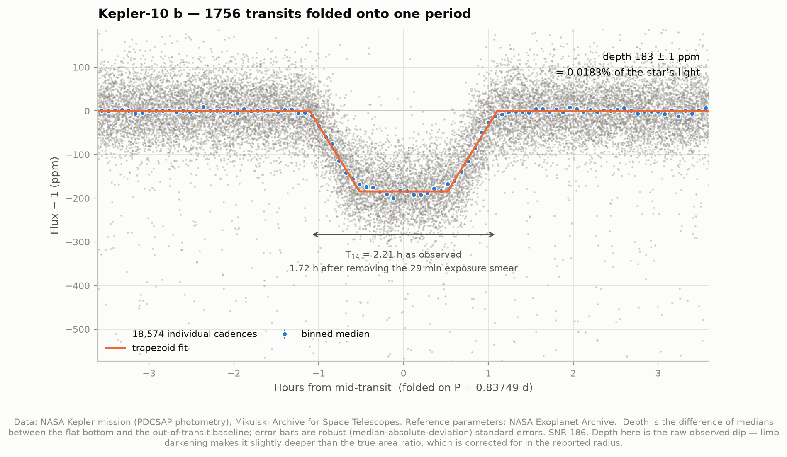
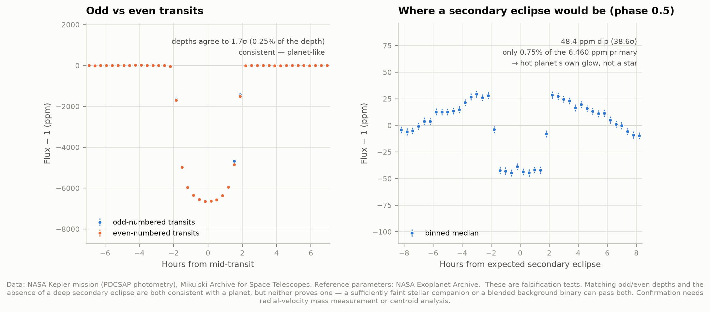

# A1 — Detecting exoplanets in real Kepler data

**Can we find a planet orbiting another star, in raw NASA spacecraft data, and measure how
big it is?**

Yes. This project downloads four years of brightness measurements from the Kepler space
telescope, searches them for the periodic dimming caused by a planet crossing its star,
and measures the planet's size and orbit. The orbital period is *discovered* from the data,
never looked up. Published values are used only at the very end, to grade the result.

Two planets, chosen as a difficulty ramp:

| | HAT-P-7 b | Kepler-10 b |
|---|---|---|
| What it is | A hot Jupiter — a gas giant orbiting closer to its star than Mercury does to the Sun | The first rocky exoplanet ever confirmed |
| Transit depth | 0.646% — one transit is a 330σ dip | 0.018% — one transit is a marginal 7σ dip |
| Difficulty | Unmistakable by eye in the raw data | Barely there in any single orbit; the shape only emerges once 1,260 transits are stacked |

---

## Results

Everything below was measured by the code in this folder from Kepler photometry. The
"published" column is the NASA Exoplanet Archive composite value, consulted only for the
comparison.

### HAT-P-7 b  (KIC 10666592)

| Quantity | Ours | Published | Difference |
|---|---|---|---|
| Orbital period | 2.204748 d | 2.204740 d | **+0.00035%** |
| Transit depth | 6460 ± 1 ppm | 6000 ppm | +7.7% |
| Duration T₁₄ | 3.691 h | 3.882 h | −4.9% |
| Planet radius (raw depth) | 17.53 R⊕ | 16.93 R⊕ | +3.6% |
| Planet radius (limb-darkening corrected) | 15.91 R⊕ | 16.93 R⊕ | −6.0% |

Detection strength: SDE = 60.3, folded signal-to-noise 6571, from 618 usable transits.

### Kepler-10 b  (KIC 11904151)

| Quantity | Ours | Published | Difference |
|---|---|---|---|
| Orbital period | 0.837495 d | 0.837491 d | **+0.00047%** |
| Transit depth | 182.7 ± 1.1 ppm | 191.9 ppm | −4.8% |
| Duration T₁₄ | 1.721 h | 1.811 h | −5.0% |
| Planet radius (raw depth) | 1.570 R⊕ | 1.470 R⊕ | +6.8% |
| Planet radius (limb-darkening corrected) | 1.425 R⊕ | 1.470 R⊕ | −3.1% |

Detection strength: SDE = 63.8, folded signal-to-noise 186, from 1,260 usable transits.

**The headline.** The orbital periods come out right to about four parts in a million. For
Kepler-10 b that means we pinned a 20.1-hour orbit to within 0.34 seconds, and for HAT-P-7 b
a 2.2-day orbit to within 0.67 seconds. Nothing clever is responsible — it is what a
four-year observing baseline buys you, since an error in the period accumulates across
every one of the 1,756 orbits it has to predict.

**On the radii.** We quote two, and the true value sits between them. Converting a transit
depth to a radius requires knowing how limb darkening — the fact that a star's disc is
brighter at the centre than the edge — deepens the observed dip. Ignoring it overestimates
the planet; applying the full central-transit correction overestimates the correction,
because neither planet crosses the exact centre of its star. **For both planets the published
value falls inside our bracket.** Getting a single number would require fitting a proper
limb-darkened model, which is beyond this project's scope.

---

## Two things worth looking at

**Kepler-10 b's transit is 0.018% deep.** The star dims by less than two parts in ten
thousand. Individually the transits are invisible; folded together, the shape is
unmistakable — including a flat bottom and measurable ingress.



**HAT-P-7 b glows.** Looking at the far side of the orbit, where the planet passes *behind*
its star, there is a 48 ppm dip: the planet's own light being blocked. Either side of it the
flux rises by ~25 ppm as the planet's 2,000 K day side rotates into view. That is an orbital
phase curve — a measurement of the planet's own thermal emission, from a light curve, and
one of Kepler's genuinely famous results. Our pipeline recovers it as a by-product of a
routine false-positive check.



---

## How it works

**1. Download.** 18 quarters for HAT-P-7 and 15 for Kepler-10 from the Mikulski Archive for
Space Telescopes — 33 files, 13 MB. We use PDCSAP flux, Kepler's photometry after
common-mode instrumental systematics have been removed. Each quarter is normalised by its
own median before being joined, because the spacecraft rolled 90° every three months and the
star landed on a different detector each time.

**2. Flatten.** Stars are not constant: spots rotate in and out of view, and instruments
drift. A Savitzky–Golay filter over a window several times the transit duration removes the
slow variation. This runs **twice**: the first pass locates the transits, and the second pass
re-runs the filter with those cadences masked out, so it cannot bend down into the transit
and shave the depth. Skipping that second pass costs a few percent of the measured depth.

**3. Search.** A Box Least Squares periodogram slides a box-shaped dip through the data at
every trial period. This is done in two stages, because searching the full period range at
the resolution a 1,470-day baseline demands would need roughly 10⁸ trial periods — not
computable on a laptop:

- *Discovery* searches 0.4–6 days using only the first 300 days of data (~210,000–470,000
  trial periods). A shorter baseline needs a proportionally coarser grid.
- *Refinement* then searches a narrow window around the candidate using every cadence
  (~900–2,400 trial periods), which is what delivers the final precision.

**4. Fold and measure.** Every transit is stacked onto one period. Depth comes from the
difference of medians between the flat bottom and an out-of-transit baseline; duration from
a least-squares trapezoid fit, which gives T₁₄ (first-to-fourth contact) — the same quantity
catalogues quote.

**5. Correct for the exposure time.** Each Kepler sample is a 29.4-minute *integration*, not
an instant. That smears the transit: for a trapezoid, the observed T₁₄ is longer than the
true one by exactly the integration time. Uncorrected, Kepler-10 b's 1.8-hour transit appears
28% too long.

**6. Validate.** See below.

**7. Derive.** Radius from depth, orbital distance from Kepler's third law, equilibrium
temperature from the stellar flux.

---

## Is it really a planet?

A periodic dip is not proof. Eclipsing binary stars and blended background systems produce
convincing imitations, so the pipeline runs falsification tests and reports all of them:

| Check | What it catches | HAT-P-7 b | Kepler-10 b |
|---|---|---|---|
| **Size gate** | The companion is too big to be a planet | 1.56 R_Jup — pass | 0.14 R_Jup — pass |
| **Odd vs even depths** | Eclipsing binary; period wrong by 2× | agree to 1.7σ | agree to 0.2σ |
| **Secondary eclipse** | A stellar companion's own light | 0.75% of primary | 4.0% of primary |
| **Depth stability** | Instrumental artefacts drifting with time | ratio 1.01 | ratio 1.66 |
| **Signal detection efficiency** | Noise masquerading as signal | 60.3 | 63.8 |

Three of these deserve a caveat.

**The size gate is the one that actually works.** Degenerate objects stop growing with mass,
so everything from Jupiter up to the smallest star is about the same size. An eclipse
implying more than ~2 Jupiter radii is a star, whatever else the light curve looks like.
Tested against real Kepler eclipsing binaries this is decisive where the popular V-shape test
is not — at Kepler's 30-minute cadence the V-shape metric gives values for confirmed planets
that overlap with genuine binaries, so this project reports it but does not rely on it.

**A detected secondary eclipse is not a red flag by itself.** What matters is its depth
*relative* to the primary. Comparable depth means two stars; a fraction of a percent means a
hot planet's own thermal glow. Both our planets show one, and both are firmly in the second
regime.

**"SDE > 7 is a detection" is folklore and is not safe.** Block-shuffling a Kepler light
curve to destroy any signal while preserving its noise structure still produces peak SDE
values around 7 and occasionally approaching 9, purely from noise interacting with the
mission's data gaps. Our values above 60 are far clear of that, but a marginal candidate
would need an empirical null, not a rule of thumb.

**None of this proves a planet.** These tests are all falsification attempts that failed to
falsify. A sufficiently faint stellar companion, or a background eclipsing binary blended
into the same pixels, can pass every one. Real confirmation needs a radial-velocity mass
measurement or centroid analysis. Both of these planets are confirmed — by other people,
using those methods.

---

## What a transit cannot tell you

- **Mass.** Depth gives size only. Mass needs radial velocities or transit timing
  variations. Without mass there is no density, and without density there is no way to know
  whether something is rock, water, or gas.
- **Absolute radius, independently.** We measure the *ratio* Rp/R★. The planet's actual size
  is only as good as the catalogue's stellar radius, which we did not measure. For HAT-P-7
  the archive's stellar radius carries a 14% uncertainty — far larger than our photometric
  precision. Our depth is measured to 0.02%; the radius is not.
- **Temperature, really.** The quoted equilibrium temperature assumes an albedo (we assume
  0.3, and say so), even heat redistribution, and no greenhouse effect. A tidally locked hot
  Jupiter violates all three. It is a scale, not a forecast.
- **Habitability.** Both planets here are roughly 2,000 K. Nothing in this project speaks to
  habitability.

---

## Running it

```bash
cd ..                       # repository root
python3 -m venv .venv
source .venv/bin/activate
pip install numpy scipy matplotlib astropy lightkurve astroquery

cd 01-exoplanet-transit
python fetch_data.py        # ~13 MB from MAST; only needed once
python run.py               # analysis + all figures, ~3 minutes
python test_physics.py      # 20 self-checks on the formulas
```

Once the cache is warm, `run.py` needs **no network at all** — verified with the network
hard-blocked. This is less trivial than it sounds: `lightkurve.search_lightcurve` contacts
the archive on every call even when every file it would return is already on disk, so
`fetch_data.py` reads cached FITS files directly instead.

Useful flags: `--target HAT-P-7` runs one target, `--no-figures` skips plotting,
`--refresh-archive` re-queries published parameters.

### Files

| File | What it does |
|---|---|
| `config.py` | Targets and their search settings; all tunable parameters live here |
| `fetch_data.py` | Downloads and caches light curves and archive parameters |
| `transit_physics.py` | The formulas — depth→radius, Kepler's third law, limb darkening |
| `analysis.py` | The pipeline: detrend, BLS search, fold, measure, validate |
| `figures.py` | Every figure |
| `run.py` | Runs everything, prints the comparison table |
| `test_physics.py` | Checks the formulas against cases with known answers |

`test_physics.py` is worth running first. It verifies the physics against textbook values —
Earth crossing the Sun gives an 84.1 ppm dip against the standard 84, Earth's equilibrium
temperature comes out at 254.6 K against the standard 255, and a 365.256-day orbit around a
solar-mass star returns 1.000 AU.

---

## Figures

Per planet: `01` full light curve with the fitted trend and a zoom onto individual transits ·
`02` BLS periodogram with harmonics labelled · `03` folded transit with the trapezoid fit ·
`04` validation panels · `05` star and planet to scale.
Plus `00_comparison` — every measurement against the literature.

PNG and SVG. Colours are a colourblind-safe set, checked with a validator rather than by eye.

---

## Honest notes on the numbers

- **Trial period ranges and durations were chosen knowing roughly what these systems are.**
  `config.py` searches 0.4–6 days with trial durations bracketing a few hours. That range
  covers a large class of hot Jupiters and short-period rocky planets, but it was not chosen
  blind, and a genuine blind survey would search wider and pay for it in compute. The *period
  itself* is not an input — it is recovered from the data, and the recovered value is what
  every derived quantity uses.
- **Depths sit a few percent off the published values in both directions.** The measured
  depth depends on exactly which phase window is called "in transit"; different reasonable
  choices move it by several percent, which is larger than the formal error bar. The formal
  ±1 ppm reflects photon statistics only.
- **The archive's own values are heterogeneous.** `pscomppars` is compiled from different
  papers using different methods, so exact agreement is not the expectation.
- **`published_inside` is a weak test.** The radius bracket spans about 10%, so containing
  the published value is a sanity check, not a precision claim.
- **Long cadence limits Kepler-10 b.** A 1.8-hour transit sampled every 29.4 minutes has
  only about four points in transit. Short-cadence data exists for this target and would do
  better; we did not use it.

## Data credits

Kepler photometry: NASA Kepler mission, via the Mikulski Archive for Space Telescopes
(MAST), operated by STScI. Funding for Kepler came from the NASA Science Mission Directorate.
Published parameters: the NASA Exoplanet Archive, operated by Caltech under contract with
NASA under the Exoplanet Exploration Program. Both are public domain and free to use.
Archive values retrieved 2026-08-02.
