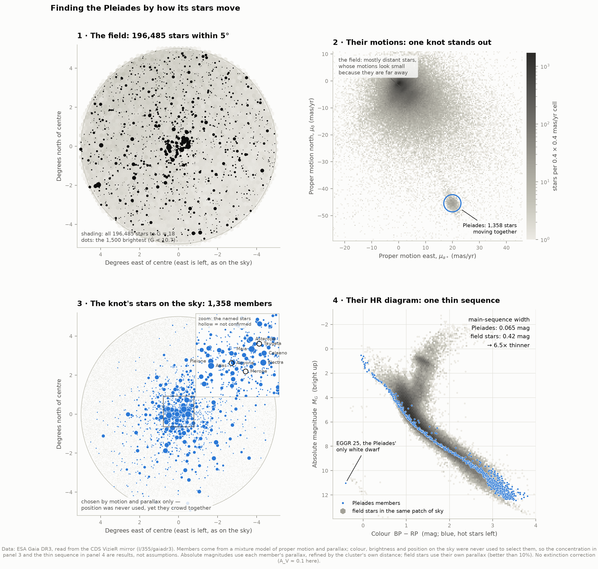
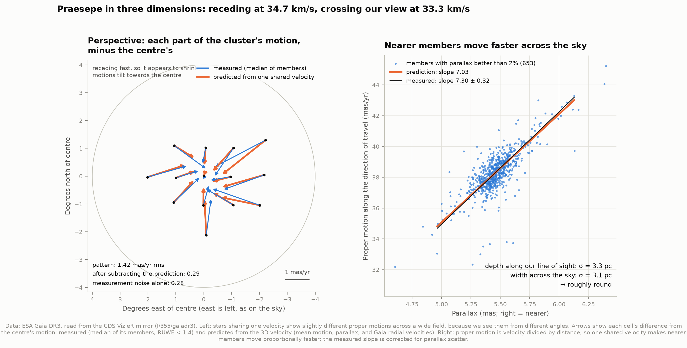
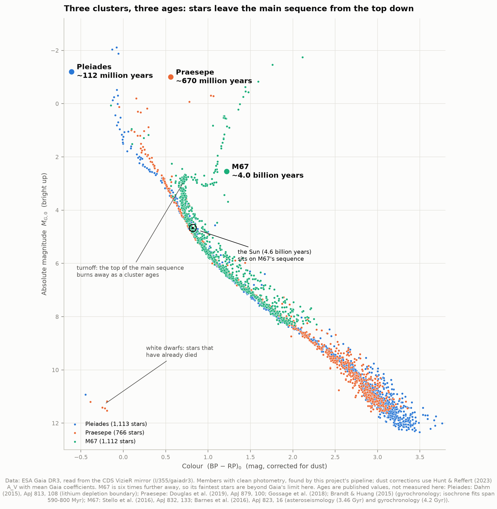

# B3 — Hunting star clusters by their motion

**Stars born together move together. Can we find a star cluster in Gaia's catalogue by the
motion of its stars alone, and then prove it is real?**

Yes, and for three clusters. Around each one we downloaded every star Gaia measured,
between 6,000 and 196,000 of them. In the resulting cloud of motions we looked for a clump
of stars moving as one. The cluster's motion and distance are *found* in the data, never
typed in. Published catalogues are consulted only at the very end, to grade the result.

The clusters make a difficulty ramp, and they also span a factor of 35 in age:

| | Pleiades (M45) | Praesepe (M44) | M67 |
|---|---|---|---|
| What it is | The Seven Sisters | The Beehive | One of the oldest open clusters known |
| Distance | 135 pc | 184 pc | 839 pc |
| Age (published) | ~112 million years | ~670 million years | ~4 billion years |
| Why it is in the ramp | Moves at ~50 mas/yr, where the field stars move at ~5: the easy case | Receding at 35 km/s, so perspective visibly distorts its motions | Six times further away: small motions, a parallax where field stars are densest |

(1 pc = 3.26 light years. A proper motion of 1 mas/yr, a milliarcsecond per year, means a
star drifts across the sky by the width of a human hair seen from 10 km, every year.)

---

## Results



| | Pleiades | Praesepe | M67 |
|---|---|---|---|
| Stars in the field | 196,485 | 79,973 | 6,213 |
| Knot contrast (denser than its surroundings) | 23× | 27× | 30× |
| **Members** (core + halo) | **1,358** (928 + 395) | **953** (692 + 252) | **1,208** (1,042 + 157) |
| Expected field stars among them | 44 (3.2%) | 17 (1.8%) | 16 (1.3%) |
| **Distance** | **135.0 ± 0.2 pc** | **183.5 ± 0.4 pc** | **838.6 ± 7.1 pc** |
| Published distance (Hunt & Reffert 2023) | 134.8 pc | 183.5 pc | 837.3 pc |
| Radial velocity (Gaia) | 5.63 ± 0.12 km/s | 34.72 ± 0.11 km/s | 33.83 ± 0.13 km/s |
| Speed relative to the Sun | 32.2 km/s | 48.1 km/s | 56.4 km/s |
| Main-sequence width, cluster vs field | 0.065 vs 0.425 mag | 0.050 vs 0.263 mag | 0.120 vs 0.276 mag |
| → **thinner than the field by** | **6.5×** | **5.3×** | **2.3×** |
| Hunt & Reffert members we recover | 96% | 100% | 97% |
| Our members they also list | 96% | 94% | 98% |

Graded against the literature, the mean motions, parallaxes, distances and radial
velocities all agree with Hunt & Reffert (2023), the most complete Gaia DR3 cluster census,
to within 1.7 combined standard errors, and most to within 1. Praesepe's distance agrees to the parsec (183.5 vs 183.5)
and M67's mean catalogue parallax to 0.0003 mas. The Pleiades' 3D velocity points within
**0.01°** of the direction the Gaia Collaboration (2018) derived.
[`00_comparison`](figures/00_comparison.png) shows every comparison, including the one that
does not agree (Praesepe's radial velocity; see the honest notes).

---

## Five things worth looking at

**1. The cluster really does pop out of the noise.** In proper-motion space the Pleiades
is a knot 23 times denser than its surroundings. It is not the only clump, though. The
field has its own pile-up, made of distant stars whose motions look small simply because
they are far away, and in the Pleiades field that pile-up reaches 9× contrast. What tells
the two apart is *distance*. The knot's stars share a parallax to within 2%; the
pile-up's spread over 64%. Motion proposes, distance confirms.

**2. One thin line.** A cluster's stars share an age, a composition and a distance, so in
the HR diagram they trace a single line, while field stars of every age and composition
smear into a broad band. Around the Pleiades' main sequence the scatter is 0.065 mag; the
field's in the same colour range is 0.425 mag. This is a genuine result rather than a
consequence of the method, because **colour and brightness were never used to choose the
members**. Nor was position on the sky, which is why the members crowding together on the
sky (panel 3 above) also counts as evidence.

**3. The cluster in three dimensions.** Gaia measures position, parallax and proper
motion, and for the brighter stars radial velocity too. Together these give each
cluster's full 3D velocity, and that makes two sharp predictions:

- *Nearer members must move faster across the sky.* Proper motion is velocity divided by
  distance, so a member 3% nearer shows 3% more proper motion. The predicted slope for the
  Pleiades is 6.69 mas/yr per mas of parallax; we measure **6.59 ± 0.12**. For Praesepe it
  is 7.03 predicted and **7.30 ± 0.32** measured.
- *Perspective distorts the motions across the field.* Stars moving in parallel appear,
  like railway tracks, to converge on one point of the sky, and a receding cluster appears
  to shrink. Across Praesepe this makes members' motions differ from the centre's by up to
  3.3 mas/yr. Subtracting the prediction leaves 0.29 mas/yr of residual pattern, against 0.28
  mas/yr of pure measurement noise. The geometry is right to the limit of the data, and it
  holds for the Pleiades too (1.01 → 0.57 mas/yr, noise 0.59).



The same data show both nearby clusters to be **round**. The Pleiades core is 3.2 pc deep
along our line of sight and 2.9 pc wide across the sky; for Praesepe the figures are 3.3
and 3.1 pc. Each also has a loose **halo** sharing its motion that extends ~10 pc in depth.
Such halos are the inner parts of the vast "coronae" discovered around nearby clusters by
Meingast et al. (2021).

**4. Three ages on one diagram.** Massive stars burn out first, so a cluster's main
sequence erodes from the top down as it ages. The Pleiades still has blue stars as bright
as M_G ≈ −2. Praesepe's main sequence stops near M_G ≈ 0 and has sprouted four red giants.
M67 turns off at M_G ≈ 3, with a full giant branch above it. **The Sun falls right on M67's
main sequence**, as it should, since M67 has about the Sun's age and composition. Two
clusters also show the end of the story. The Pleiades contains exactly one white dwarf,
EGGR 25, the core of a star that must have been born more massive than any star the
cluster still has. Praesepe has five.



**5. The Pleiades distance controversy, settled.** The Hipparcos satellite (1989–93) put
the Pleiades at 120.2 ± 1.5 pc, while other techniques averaged 133.5 ± 1.2 pc, and radio
interferometry in 2014 gave 136.2 ± 1.2 pc (figures as summarised by Melis et al. 2014). A
10% error in the distance to the most-studied cluster in the sky was a real problem for
stellar physics. Gaia measures parallaxes for 1,300 members at once, and our value is
**135.0 ± 0.2 pc**, consistent with the radio result and far from Hipparcos.

---

## How it works

**1. Download.** For each cluster we take every Gaia DR3 star brighter than G = 18 within a
cone enclosing the cluster's tidal radius (5°, 4° and 1°), 46 MB in all. The data come from
the CDS VizieR mirror of the official Gaia catalogue. The values are identical to ESA's
archive, which was timing out while being rebuilt for DR4. Only two cuts are made at the
archive: the magnitude limit, and requiring a measured parallax.

**2. Prepare.** Gaia DR3 parallaxes carry a small offset that depends on each star's
brightness, colour and position (Lindegren et al. 2021). Correcting it with the official
code changes the Pleiades' distance by 0.9 pc and M67's by 27 pc. Photometry contaminated
by neighbours or by the Pleiades' reflection nebula is flagged with the corrected BP/RP
flux excess (Riello et al. 2021).

**3. Discover.** The knot is found the way a star is found in an image. At every point of
proper-motion space we count the stars inside a 1.5 mas/yr circle, compare with a ring
around it, and rank the places by contrast. The top candidates are then checked for shared
parallax, which rejects the field's own pile-up (see point 1 above).

**4. Correct for perspective.** From the knot's motion, its parallax and the Gaia radial
velocities of its stars we build the cluster's 3D velocity. We then predict how that one
velocity looks from every position in the field, and move each star's proper motion into
the cluster's own frame. Two rounds are enough to converge. The radial velocities receive
the Katz et al. (2023) correction for fainter stars, and hot stars are left out.

**5. Model membership.** This is a Gaussian mixture, the modern form of the classical
method (Vasilevskis et al. 1958; Sanders 1971). One population, the cluster, is compact in
motion and parallax; several others describe the lumpy field; each star receives a
probability of belonging to the cluster. Two refinements matter here.

- **Extreme deconvolution** (Bovy, Hogg & Roweis 2011). Every star enters with its *own*
  error ellipse, so faint stars with large errors are judged fairly. The fitted spreads are
  intrinsic, with measurement blur removed. On simulated stars, the test suite checks that
  this recovers a known width of 0.50 (as 0.49) where a plain fit sees 1.03.
- **A core and a halo.** Given a single cluster Gaussian, the fit invented a "field"
  component sitting exactly at the cluster's motion and distance, and each member's
  probability was split between the two. The cluster is therefore allowed two parts. After
  fitting, any Gaussian that is centred on the core and compact in depth counts as cluster.

The model is fitted to stars within 15 mas/yr of the knot, because membership is a local
question. That keeps a full run at about one minute.

**6. Confirm.** Position on the sky and photometry, neither of which the model ever saw,
must show a concentrated cluster and a thin sequence.

**7. Measure and grade.** We derive distance, 3D velocity, convergent point, size, depth,
internal velocity spread and main-sequence width, then compare them with Hunt & Reffert
(2023) and the Gaia Collaboration (2018).

---

## Is it really a cluster?

As with A1's planets, each claim gets a test that could have failed:

| Check | What it would catch | Pleiades | Praesepe | M67 |
|---|---|---|---|---|
| Knot contrast vs the next-best clump | A chance fluctuation | 23× vs 9× | 27× vs 3× | 30× vs 3× |
| Knot stars share a parallax | A pile-up of unrelated stars | 2% spread | 2% | 4% |
| Motion-only candidates confirmed by parallax | Chance motion matches | 1,262 of 1,308 | 853 of 874 | 1,138 of 1,148 |
| Members concentrate on the sky (centre density vs contamination floor) | A selection artefact | 400× | 790× | 1,900× |
| One thin HR-diagram sequence | A mix of populations | 6.5× thinner than field | 5.3× | 2.3× |
| Nearer members move faster | Stars not sharing one velocity | slope 6.59 ± 0.12 vs 6.69 | 7.30 ± 0.32 vs 7.03 | depth too small to see |
| Perspective explains the motion pattern | Wrong 3D velocity | to the noise (χ²/dof 1.2) | to the noise (1.7) | to the noise (1.0) |

**Why M67 cannot do the depth test.** At 839 pc a cluster 3 pc deep spreads parallaxes by
0.003 mas, while Gaia's noise for these stars (errors plus ~0.01 mas of small-scale
systematics) is 0.021 mas. The pipeline computes this comparison and declines to report a
depth. An earlier version reported a 21 pc "depth", which was really noise.

## The Seven Sisters are too bright for Gaia

Six of the nine named Pleiades are recovered as members. The other three cannot be, and
the figures show them hollow rather than hide them:

- **Alcyone**, the brightest (G = 2.9), is in Gaia DR3 with a position but no parallax or
  proper motion. It saturates the detectors too badly to be measured.
- **Merope** (G = 4.2) has a Gaia proper motion 7 mas/yr away from the cluster's.
- **Taygeta** (G = 4.3) has a parallax of 9.5 mas against the cluster's 7.4.

All three are genuine members by every older measurement. Gaia's astrometry degrades for
stars brighter than G ≈ 6, which also inflates RUWE, the quality flag. Errors are therefore
scaled up by RUWE rather than bright stars being discarded. That is how Atlas, Electra and
Maia (RUWE 2.8–4.1) are still recovered, at p ≈ 0.97–0.99.

## What this cannot tell you

- **Ages.** The ages on the ladder figure are published values, not measured here. Measuring
  them means fitting theoretical isochrones, which is the natural next step (see below).
- **Which individual stars are members, with certainty.** Membership is a probability. The
  model expects about 44 field stars among the Pleiades' 1,358 members, and a few "members"
  sit far from the cluster in parallax. They are accepted because the field is even rarer
  at those parallaxes, not because they obviously belong.
- **The internal velocity spread, exactly.** The measured 0.54 km/s (Pleiades), 0.47
  (Praesepe) and 0.65 (M67) are upper limits. Unresolved binaries add their orbital motion,
  and for M67 the Gaia errors may be underestimated.
- **Distances better than ~0.01 mas in parallax.** Gaia's parallaxes share systematic
  errors of about that size across patches of sky, and averaging more stars does not remove
  them. That floor dominates M67's ±7 pc.

---

## Running it

```bash
cd ..                       # repository root
source .venv/bin/activate
pip install numpy scipy pandas matplotlib astropy astroquery pyvo scikit-learn gaiadr3-zeropoint

cd 02-cluster-hunting
python fetch_data.py        # ~46 MB from CDS VizieR, 2-3 minutes; only needed once
python run.py               # analysis + all figures, ~1 minute
python test_physics.py      # 37 self-checks on the formulas and the membership model
```

Once the cache is warm, `run.py` needs no network. This was verified with all web traffic
forced to fail. If ESA's own Gaia archive is healthy, `python fetch_data.py --refresh
--service esa` downloads the same data from there instead.

### Files

| File | What it does |
|---|---|
| `config.py` | The three clusters and every tunable number, each with its reason |
| `fetch_data.py` | Downloads and caches Gaia DR3 cones, published catalogues and star names |
| `gaia_physics.py` | The formulas: distances, 3D motion and perspective, photometric and parallax corrections |
| `membership.py` | The extreme-deconvolution mixture model |
| `analysis.py` | The pipeline: discover, correct, model, confirm, measure, grade |
| `figures.py` | Every figure |
| `run.py` | Runs everything and prints the comparison with the literature |
| `test_physics.py` | Checks against cases with known answers |

`test_physics.py` is worth running first. Some of its checks: Barnard's Star comes out at
90.07 km/s across the sky; the Gaia Collaboration's published Pleiades velocity is
reproduced from their own mean motion to within 0.1 km/s; and the photometric-excess
polynomials join up at their colour boundaries, which catches a mistyped coefficient. It
also runs the membership model on simulated stars with a known answer. That is the only
use of synthetic data in this project, and no figure uses it.

## Figures

Per cluster: `01_story` (field → motions → members on the sky → HR diagram) ·
`02_membership` (the model, the parallax check, probabilities, concentration) ·
`03_hr_diagram` (members vs field, and the width of each) · `04_three_d` (perspective and
depth; Pleiades and Praesepe only). Plus `00_age_ladder` and `00_comparison`.

PNG and SVG. The colours are the colourblind-safe palette from A1. The three-cluster
figures use its first three slots, checked with a colour-vision validator for plots in which
every pair of colours sits side by side.

---

## Honest notes on the numbers

- **Where to look was not blind.** The cone centres and radii come from knowing where these
  famous clusters are. All three are visible to the naked eye or in binoculars. Their
  motions and distances were not inputs.
- **Model settings were tuned on these fields.** The 15 mas/yr fitting region, six field
  Gaussians, the 15% depth limit for halo components and the 25% parallax-spread limit for
  a knot were chosen while looking at these three clusters. They are physically motivated,
  but they were not fixed in advance.
- **Praesepe's radial velocity disagrees with the Gaia Collaboration (2018).** We measure
  34.72 ± 0.11 km/s against their 35.64 ± 0.10, a 6σ difference. Hunt & Reffert (2023)
  give 33.94 ± 0.60. Theirs came from Gaia DR2, whose velocity calibration differs from
  DR3's, and from a different member list. We have not established which is right; the
  0.9 km/s changes Praesepe's speed by 2%.
- **One published number shapes one comparison.** Hunt & Reffert's catalogue half-member
  radius counts only stars inside the tidal radius *in 3D*, which is a different quantity
  from ours. We therefore re-measure r50 on *their* member list, using our method and their
  tidal radius. It agrees with ours to 0.4% for the Pleiades and 0.7% for Praesepe.
- **Hunt & Reffert's ages were not used.** Their neural-network ages put Praesepe at 350
  Myr and M67 at 1.7 Gyr, far from the dedicated studies (~670 Myr and ~4 Gyr). Ages for
  individual famous clusters are better taken from those studies, cited below.
- **No extinction correction in the per-cluster HR diagrams.** All three clusters have
  A_V ≈ 0.1, a 0.05 mag colour shift. The age ladder does correct for it, using Hunt &
  Reffert's A_V and mean Gaia coefficients (Casagrande & VandenBerg 2018).
- **The field sequence is broader for several reasons at once.** It mixes ages,
  compositions, unresolved binaries and some dust. Its stars' own parallax noise contributes
  only ~0.06 mag, and the width counts only field stars with parallaxes better than 5%. The
  contrast is fair, but it is a contrast between populations, not a measurement of any one
  effect.

## Next steps

**Measure the ages.** Overlay theoretical isochrones (PARSEC or MIST) on each member
diagram and fit age, distance and reddening together. M67's turnoff should give a sharp
age. The Pleiades' will be looser, since only a handful of stars sit near its turnoff.
Other extensions: the Hyades, which spans 20° and needs the convergent-point method
properly; a search for the Pleiades' corona beyond our 5° cone; and M67's binary sequence,
visible here as a second bump 0.75 mag above the main sequence in `m67_03_hr_diagram`.

## Data credits

This work has made use of data from the European Space Agency (ESA) mission Gaia
(https://www.cosmos.esa.int/gaia), processed by the Gaia Data Processing and Analysis
Consortium (DPAC, https://www.cosmos.esa.int/web/gaia/dpac/consortium). Funding for the DPAC
has been provided by national institutions, in particular the institutions participating
in the Gaia Multilateral Agreement. Gaia DR3: Gaia Collaboration, Vallenari et al. (2023).
Data were read through the VizieR catalogue access tool (CDS, Strasbourg), and star names
resolved with SIMBAD (CDS, Strasbourg). Retrieved 2026-09-29.

**Methods and comparison data:** Bovy, Hogg & Roweis (2011, Ann. Appl. Stat. 5, 1657) —
extreme deconvolution · Lindegren et al. (2021, A&A 649, A4) — parallax zero point ·
Riello et al. (2021, A&A 649, A3) — photometric excess · Katz et al. (2023, A&A 674, A5) —
radial-velocity correction · Casagrande & VandenBerg (2018, MNRAS 479, L102) — extinction
coefficients and solar colours · Hunt & Reffert (2023, A&A 673, A114) — cluster catalogue ·
Gaia Collaboration, Babusiaux et al. (2018, A&A 616, A10) — cluster velocities ·
Meingast, Alves & Rottensteiner (2021, A&A 645, A84) — cluster coronae · Melis et al.
(2014, Science 345, 1029) — Pleiades VLBI distance.

**Reference ages:** Dahm (2015, ApJ 813, 108) — Pleiades · Douglas et al. (2019, ApJ 879,
100), Gossage et al. (2018), Brandt & Huang (2015) — Praesepe · Stello et al. (2016, ApJ
832, 133), Barnes et al. (2016, ApJ 823, 16) — M67.
