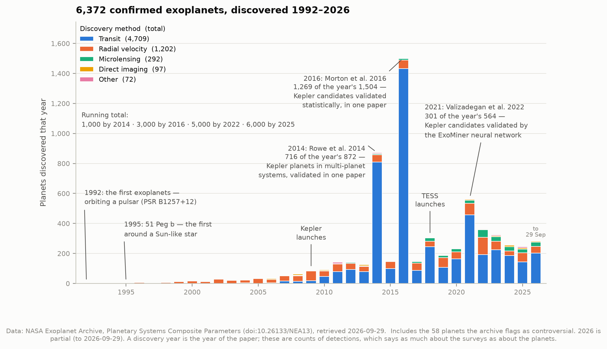
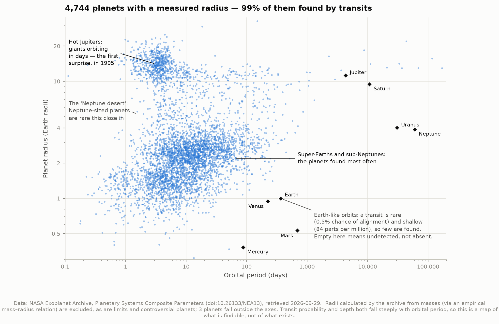
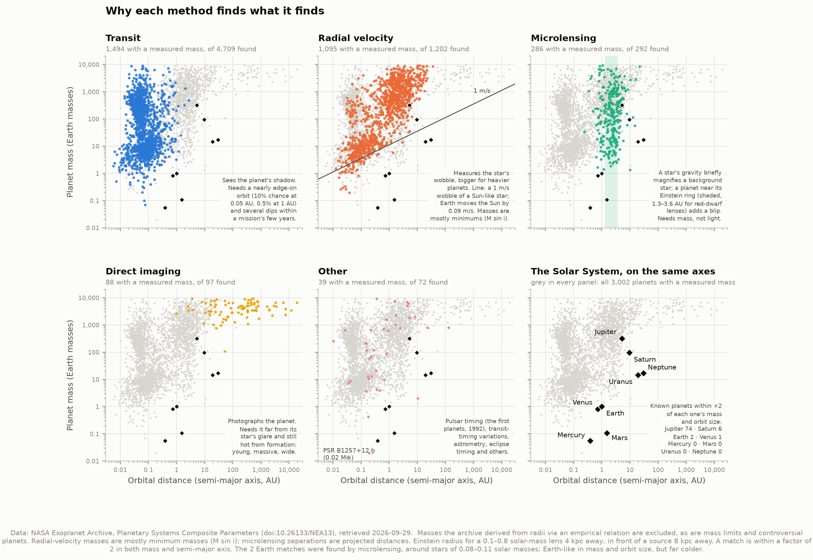
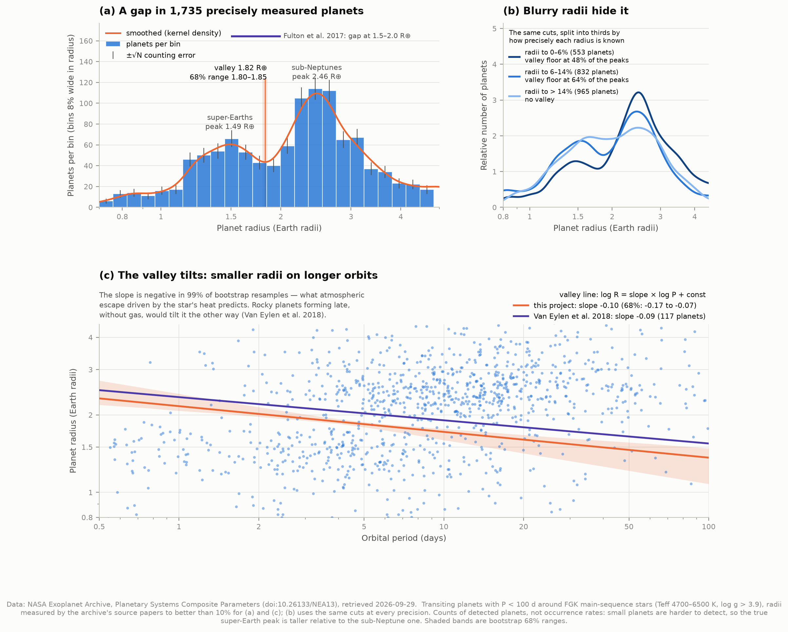
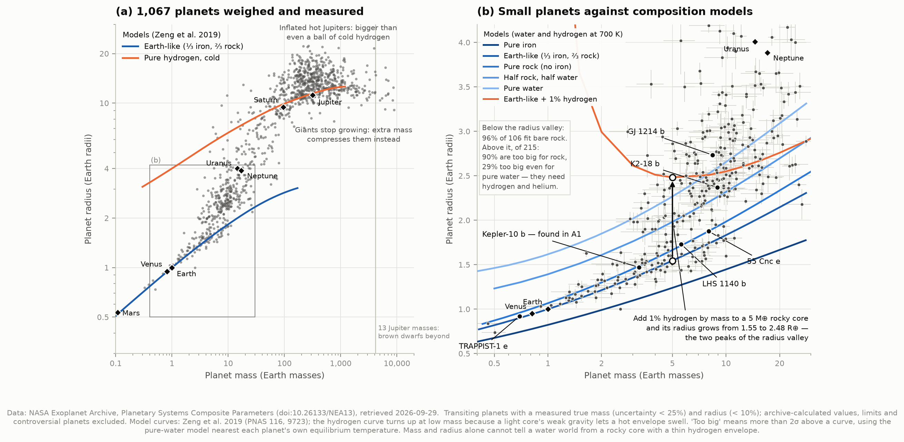
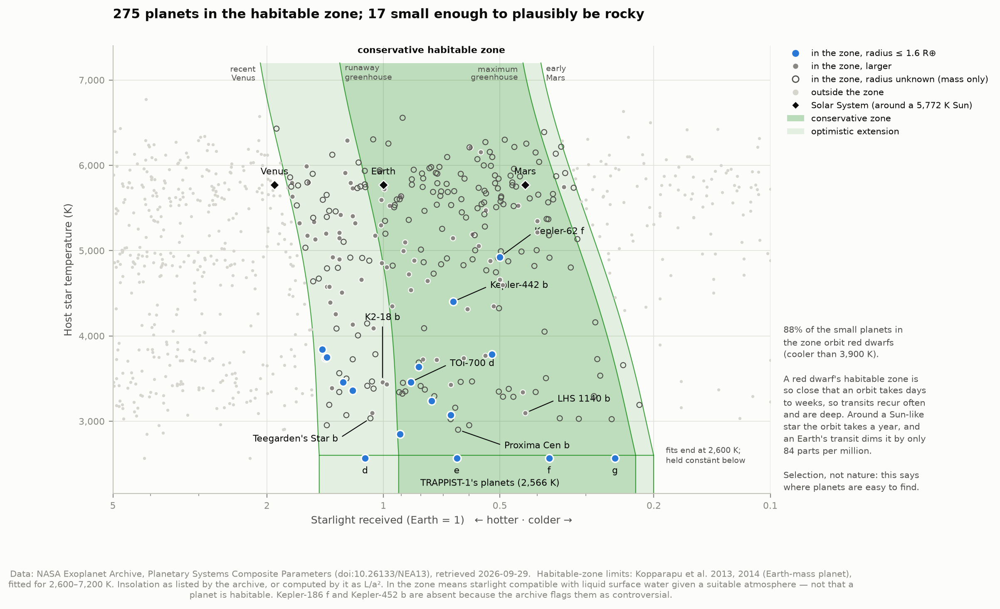

# A2 — The exoplanet population atlas

**What kinds of planets exist, around what kinds of stars — and how much of what we "know"
is really about how we look?**

This project takes NASA's list of every confirmed exoplanet — 6,372 of them on 29 September
2026 — and turns it into six figures. Two of them are genuine measurements: the location
and tilt of the **radius valley**, a gap in the sizes of small planets, and a test of which
small planets are **too big to be made of rock**. The other four are maps of the known
population, and the recurring lesson of all six is the same. A catalogue of discoveries is a
portrait of our telescopes as much as of the galaxy.

---

## First, a trap in the data

The archive's composite table (`pscomppars`) gives every planet one row and fills in the
gaps. For a planet that has a radius but was never weighed, the archive supplies a mass from
an empirical mass–radius formula (Chen & Kipping 2017). For a planet with a mass but no
radius, it runs the same formula backwards.

| In the table on 2026-09-29 | Planets |
|---|---|
| Masses filled in from the formula | **2,970 (47% of all planets)** |
| Radii filled in from the formula | 1,536 |
| Masses that are only upper or lower limits | 235 |
| Planets the archive flags as controversial | 58 |
| Planets with a genuinely measured mass *and* radius | 1,581 |

Plot all of those on a mass–radius diagram and nearly half the points would lie exactly on
one curve. It would look like a spectacular confirmation of a physical law, when it is really
the formula plotted against itself. `catalog.py` recognises filled-in values by their
reference column ("Calculated Value") and excludes them, along with limits and controversial
planets, from every measurement. Only the discovery census keeps everything the archive
counts.

---

## Results

### 1. The census



| Method | Planets | |
|---|---|---|
| Transit | 4,709 | a planet's shadow as it crosses its star |
| Radial velocity | 1,202 | the star's wobble, measured in its spectrum |
| Microlensing | 292 | a brief brightening as the planet's gravity bends background starlight |
| Direct imaging | 97 | a photograph of the planet itself |
| Other | 72 | transit timing (29), eclipse timing (17), brightness modulation (9), pulsar timing (8), astrometry (6), pulsation timing (2), disk kinematics (1) |

The first exoplanets (1992) orbit a pulsar, PSR B1257+12. The first around a Sun-like star,
51 Peg b, followed in 1995. The running total passed 1,000 in 2014, 5,000 in 2022 and
6,000 in 2025.

**The three tallest bars are each mostly one paper.** In 2014, 716 of the year's 872 planets
come from Rowe et al., who validated Kepler planets in multi-planet systems all at once. In
2016, 1,269 of 1,504 come from Morton et al.'s statistical validation. In 2021, 301 of 564
come from Valizadegan et al., using a neural network. None of these planets was confirmed
individually. They were shown to be statistically unlikely to be anything else. This is the
same kind of argument as project A1's validation checks, applied at industrial scale.

### 2. The shape of the known population



Of the 4,744 planets with a measured radius, 99% were found by transits. Three features
stand out:

- **Hot Jupiters**: giant planets orbiting in a few days, closer than Mercury is to the Sun.
  Planet-formation theory had not predicted them; 51 Peg b, in 1995, was one.
- **The Neptune desert**: Neptune-sized planets are rare on the shortest orbits.
- **Super-Earths and sub-Neptunes**: planets between Earth and Neptune in size, which the
  Solar System does not have at all, are the most common kind found.

The Solar System's planets sit almost entirely where the catalogue is empty. An Earth twin
transits for only 0.5% of observers and dims its star by 84 parts per million, so empty space
on this plot means *not yet detectable*, not *absent*.

### 3. Why each method finds what it finds



The same 3,002 planets with a measured mass (or minimum mass), shown once per method:

- **Transits** favour close orbits. The chance of seeing an orbit edge-on falls with
  distance: 10% at 0.05 AU, 0.5% at 1 AU.
- **Radial velocity** favours heavy planets. The line shows a 1 m/s wobble of a Sun-like
  star. Jupiter moves the Sun at 12.5 m/s; Earth moves it at 0.09 m/s.
- **Microlensing** finds planets near a lens star's Einstein ring, roughly 1–4 AU. It needs
  no light from the planet, so it reaches cold, low-mass worlds that no other method can.
- **Direct imaging** finds young, hot, massive planets far from their stars' glare.

Known planets within a factor of two of a Solar System planet's mass and orbit size:
**Jupiter 74, Saturn 6, Earth 2, Venus 1; Mercury, Mars, Uranus and Neptune 0.** Both
"Earth matches" were found by microlensing around stars a tenth of the Sun's mass, so they
are far colder than Earth. By this measure we have found plenty of Jupiters, and no true
Earths.

### 4. The radius valley — our main measurement



Among close-in planets (orbits under 100 days) around Sun-like stars, there is a shortage of
planets about 1.8 times Earth's size. This separates two populations: **super-Earths**,
likely bare rock, and **sub-Neptunes**, likely rocky cores wrapped in a hydrogen–helium
envelope. The leading explanation is atmospheric escape: energy from the star, and from the
young planet's own hot interior, drives the envelope off smaller or more strongly heated
planets, leaving the bare core behind. Fulton et al. (2017) discovered the
gap once better stellar radii made planet radii sharp enough to see it.

Using 1,735 transiting planets whose radii are known to better than 10%:

| Quantity | This project | Published |
|---|---|---|
| Valley location | **1.82 R⊕** (68% range 1.80–1.85) | 1.5–2.0 R⊕ (Fulton et al. 2017) |
| Super-Earth peak | 1.49 R⊕ | ≈ 1.5 R⊕ (Van Eylen et al. 2018) |
| Sub-Neptune peak | 2.46 R⊕ | ≈ 2.5 R⊕ (Van Eylen et al. 2018) |
| Valley depth | floor at 51% of the peaks | — |
| Tilt with period, R ∝ P^slope | **−0.10** (68%: −0.17 to −0.07) | −0.09 (+0.02/−0.04) |
| Valley radius at a 10-day orbit | 1.72 R⊕ | 1.91 R⊕ |

**The tilt is the most interesting number here.** The valley sits at smaller radii on
longer orbits. Our slope is negative in 99.3% of 1,000 bootstrap resamples, and it matches
Van Eylen et al.'s value, which they measured from 117 planets with exceptionally precise
host stars. The sign matters physically. Atmospheric escape driven by the star predicts a
negative slope: cooler, more distant planets can keep an envelope on a smaller core. Rocky
planets forming late, after the gas had gone, would predict a positive slope. Correcting
for the tilt also deepens the valley, from 51% to 41% of the peak height.

**Blurry radii hide the valley** (panel b). Split the same sample into thirds by radius
precision:

| Radius known to | Planets | Valley? | Kepler planets | Radii mostly from |
|---|---|---|---|---|
| 0–6% | 553 | yes, floor at 48% of the peaks | 45% | a mix of recent papers |
| 6–14% | 832 | yes, floor at 64% | 69% | Morton et al. 2016 (53%) |
| > 14% | 965 | **no valley** | 95% | Rowe et al. 2014 (48%), Morton et al. 2016 (43%) |

This matches the history: the valley stayed invisible until stellar radii improved. A
check that is a **simulation, labelled as such**, adds nuance. Blurring the precise radii
by the imprecise third's *quoted* uncertainties only weakens the valley (floor 48% → 65% ±
5%); it does not erase it. So the imprecise radii are blurrier than their error bars say,
or the groups differ in other ways, or both. Those radii come overwhelmingly from two
large 2014–2016 validation papers whose stellar radii predate Gaia's distance measurements.
Systematic errors in those older stellar radii are the likely culprit, but this table alone
cannot prove it.

### 5. What small planets are made of



For 1,067 planets with both a mass (to 25%) and a radius (to 10%), we compare each planet
with published interior models (Zeng et al. 2019). A planet that is **bigger than a ball of
pure rock of the same mass** must contain something lighter than rock, water or gas. One
that is **bigger even than a ball of pure water** must contain hydrogen and helium.

| Small planets (< 4 R⊕) | Planets | Result |
|---|---|---|
| Below the radius valley | 106 | 96% are consistent with bare rock |
| Above the radius valley | 215 | 90% are too big for rock; 29% are too big even for pure water |

"Too big" means more than 2σ above the model curve, allowing for both the mass and radius
uncertainties. So the two sides of the valley really are different kinds of planet, and this
test uses the planets' masses, not just their sizes. The models also give a neat
illustration: **adding just 1% hydrogen by mass to a 5 M⊕ rocky core swells it from 1.55 to
2.48 R⊕.** Those are almost exactly the two peaks measured in section 4. Losing that 1% is
all it takes to move a planet across the valley.

Kepler-10 b, the planet this repository detected for itself in project A1, sits firmly on the
rocky side: 3.24 M⊕ and 1.47 R⊕ (5.6 g/cm³), right on the pure-rock curve (1.48 R⊕ at its
mass). That is slightly larger than an Earth-like mix of rock and iron would be (1.38 R⊕), which
hints at less iron than Earth, at about the 2σ level.

### 6. The habitable zone



The habitable zone is the range of starlight in which a planet with a suitable atmosphere
could keep liquid water on its surface. The limits come from climate models (Kopparapu et
al. 2013, 2014). For the Sun, the conservative zone is 0.95–1.67 AU and the optimistic zone
0.75–1.77 AU. Around cooler stars the zone sits at *lower* starlight, because red light is
absorbed more readily by water and CO₂ and reflected less by the atmosphere.

- **275 planets** receive habitable-zone starlight (optimistic limits); 182 of them are within
  the conservative limits.
- **189 of the 275 have no measured radius** — only a minimum mass — so nothing is known about
  what they are made of.
- **17 are small enough (≤ 1.6 R⊕) to plausibly be rocky**, 11 of them in the conservative zone:
  the TRAPPIST-1 d–g planets, TOI-700 d and e, LP 890-9 c, TOI-715 b, Kepler-442 b,
  Kepler-62 f, and others.
- **15 of those 17 (88%) orbit red dwarfs**, though red dwarfs host only 9% of all planets
  with a known insolation. **None orbits a Sun-like star**: the warmest host is Kepler-62, a
  K dwarf at 4,925 K.

That last point is selection, not nature. A red dwarf's habitable zone is so close that a
planet there orbits in days to weeks, so its transits recur often and are deep. Around a
Sun-like star the same planet orbits once a year and dims its star by 84 parts per million.

Two planets that made headlines as Earth's cousins, Kepler-186 f and Kepler-452 b, are
absent: the archive now flags both as controversial. For Kepler-452 b, Mullally et al. (2018)
showed that its signal cannot be statistically distinguished from an instrumental artefact —
the same false-alarm problem project A1 ran into with Kepler's noise.

"In the habitable zone" describes starlight, not habitability. Proxima Centauri b, for
example, sits in its star's habitable zone, but Proxima is a flare star that bathes it in
X-rays and ultraviolet. Whether planets like these keep an atmosphere at all is one of the
questions JWST is now trying to answer.

---

## How it works

**1. Fetch.** One query to the NASA Exoplanet Archive's TAP service downloads 50 columns
for every planet (5.3 MB), including the reference column for each radius, mass and
insolation. The raw response is cached with a record of the exact query and retrieval time,
because the archive changes weekly. Ten mass–radius model tables come from Li Zeng's website.

**2. Clean** (`catalog.py`). The script flags formula-filled values, limits and
controversial planets, then builds each figure's sample with every cut logged. The cut lists
are saved in `data/results.json`; the radius-valley sample goes 6,372 → 6,314 → 4,732 →
4,728 → 4,356 → 4,180 → 3,256 → 3,196 → 1,735.

**3. Locate the valley.** A smoothed histogram (a Gaussian kernel density estimate, 0.03 dex
≈ 7% wide) of log radius; the valley is its lowest point between 1.4 and 2.4 R⊕. That search
window is an input, stated like A1's period range; the answer is stable to ±0.02 R⊕ for
kernel widths of 0.02–0.04 dex. Uncertainties come from 1,000 bootstrap resamples: the
sample is redrawn with replacement and everything is measured again.

**4. Measure the tilt.** If the valley's radius changes with period as P^slope, then sliding
each planet along that slope lines the valley up across all periods, and the combined
histogram shows the deepest gap. The code tries slopes from −0.30 to +0.20 in steps of 0.01
and keeps the one giving the deepest valley, then bootstraps the whole procedure.

**5. Compare with models.** Each planet's radius is compared with the pure-rock and
pure-water model radius at its mass, in units of its combined uncertainty. The water model
used is the one at the tabulated temperature (300, 500, 700 or 1000 K) nearest the planet's
own, because a hot steam atmosphere swells a water world considerably.

**6. Classify starlight.** The Kopparapu et al. habitable-zone limits are evaluated at each
host star's temperature and compared with the planet's insolation.

---

## Honest notes

- **Counts are not occurrence rates.** Every number here counts *discovered* planets.
  Small planets are harder to find than large ones, so the true super-Earth peak is taller
  than it looks here. Correcting for detection efficiency, as Fulton et al. did, is a
  different and much harder project.
- **The table is heterogeneous.** Each planet's radius inherits its star's radius from
  whichever paper the archive chose, and papers use different methods. That is exactly what
  panel (b) of the valley figure shows.
- **Our valley sits about 10% lower than Van Eylen et al.'s** at a 10-day orbit (1.72 vs
  1.91 R⊕), although the slopes agree. The samples differ (asteroseismic hosts vs a
  heterogeneous archive), and so do the definitions (the lowest point of a density curve vs
  a support-vector boundary between two populations). We do not resolve the offset.
- **Model-dependence.** The composition test is only as good as the Zeng et al. models.
  The water and hydrogen curves drawn are for 700 K, near the small planets' median
  equilibrium temperature of 794 K. Mass and radius alone cannot distinguish a water world
  from a rocky core with a thin hydrogen envelope; those curves overlap.
- **Microlensing numbers are indirect.** Masses usually come from a statistical model of
  the Galaxy, and separations are distances projected on the sky. **Radial-velocity masses**
  are mostly minimum masses (M sin i), because the orbit's tilt is unknown.
- **Habitable-zone limits** assume an Earth-mass planet with an Earth-like atmosphere. The
  fits cover host temperatures of 2,600–7,200 K. TRAPPIST-1, at 2,566 K, is evaluated at the
  2,600 K limits, and the figure marks where that extension begins. Insolations ignore orbital
  eccentricity, which raises the orbit-averaged flux by a few percent for most planets.
- **"Rocky-sized" means ≤ 1.6 R⊕** (Rogers 2015). It is a size, not a measured composition.
- **Reproducible, but a snapshot.** Every run from the cache gives identical numbers,
  bit for bit. Re-fetching (`--refresh`) will change them as the archive grows.

---

## Running it

```bash
cd ..                       # repository root
source .venv/bin/activate   # the shared venv; needs numpy scipy pandas matplotlib astropy requests

cd 02-exoplanet-population
python fetch_data.py        # ~5 MB from the NASA Exoplanet Archive + model tables, once
python run.py               # all analyses and figures, ~15 seconds
python test_physics.py      # 48 self-checks
```

Once the cache is warm, `run.py` needs **no network** (verified with the network hard-blocked).
`python run.py --refresh` re-downloads the archive table; `--no-figures` skips plotting.

### Files

| File | What it does |
|---|---|
| `config.py` | Paths, the archive query, and every sample cut — change a cut here and everything follows |
| `fetch_data.py` | Downloads and caches the archive table and the Zeng et al. model curves |
| `catalog.py` | Flags formula-filled values, limits and controversial planets; builds the samples |
| `planet_physics.py` | The formulas: Kepler's law, insolation, habitable-zone limits, wobble, transit odds |
| `analysis.py` | The measurements: census, radius valley and tilt, composition, habitable zone |
| `figures.py` | The six figures |
| `run.py` | Runs everything and prints the summary |
| `test_physics.py` | Checks formulas and algorithms against known answers |

`test_physics.py` checks the physics against textbook values: Earth's year returns 1.000 AU,
Jupiter moves the Sun at 12.47 m/s against the standard 12.5, and the Sun's conservative
habitable zone comes out at 0.951–1.677 AU against the usually quoted 0.95–1.67. It checks the
algorithms on inputs built so the answer is known in
advance: the tilt fit recovers a planted slope of −0.12 exactly. It also checks that the
catalogue's cleaning catches formula-filled values on a hand-made table.

Figures are PNG and SVG. The colours are a colourblind-safe set checked with a validator.
Because five discovery methods are too many colours for one safe scatter plot, figure 3 uses
one panel per method instead.

---

## Data credits and references

This research has made use of the NASA Exoplanet Archive, which is operated by the California
Institute of Technology, under contract with the National Aeronautics and Space Administration
under the Exoplanet Exploration Program. Planetary Systems Composite Parameters table,
doi:[10.26133/NEA13](https://doi.org/10.26133/NEA13), retrieved 2026-09-29. Archive
reference paper: Christiansen et al. (2025, Planetary Science Journal).

Models and published results used:

- Zeng, L. et al. 2019, PNAS 116, 9723 — planet interior mass–radius models (tables from
  [Li Zeng's website](https://lweb.cfa.harvard.edu/~lzeng/planetmodels.html))
- Kopparapu, R. K. et al. 2013, ApJ 765, 131; 2014, ApJL 787, L29 — habitable-zone limits
  (coefficients from the authors' published calculator)
- Fulton, B. J. et al. 2017, AJ 154, 109 — discovery of the radius valley
- Van Eylen, V. et al. 2018, MNRAS 479, 4786 — the valley's slope with period
- Chen, J. & Kipping, D. 2017, ApJ 834, 17 — the mass–radius relation the archive uses to fill gaps
- Rogers, L. A. 2015, ApJ 801, 41 — most planets larger than ~1.6 R⊕ are not rocky
- Rowe, J. F. et al. 2014, ApJ 784, 45; Morton, T. D. et al. 2016, ApJ 822, 86;
  Valizadegan, H. et al. 2022, ApJ 926, 120 — the three bulk validations behind the census spikes
- Mullally, F. et al. 2018, AJ 155, 210 — the case against confirming Kepler-452 b
- Agol, E. et al. 2021, PSJ 2, 1 — TRAPPIST-1 parameters (used as a data check)
- Wolszczan, A. & Frail, D. A. 1992, Nature 355, 145; Mayor, M. & Queloz, D. 1995,
  Nature 378, 355 — the first exoplanets
