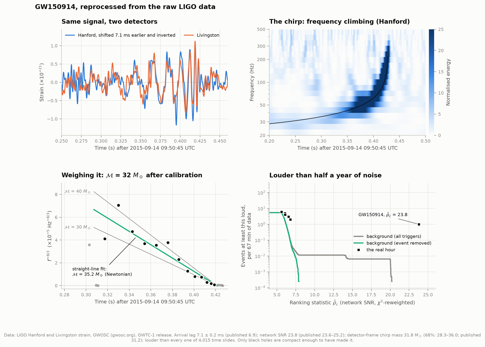
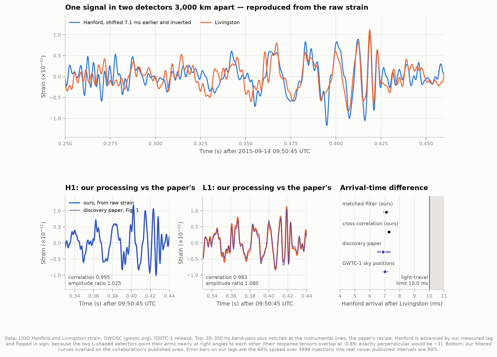
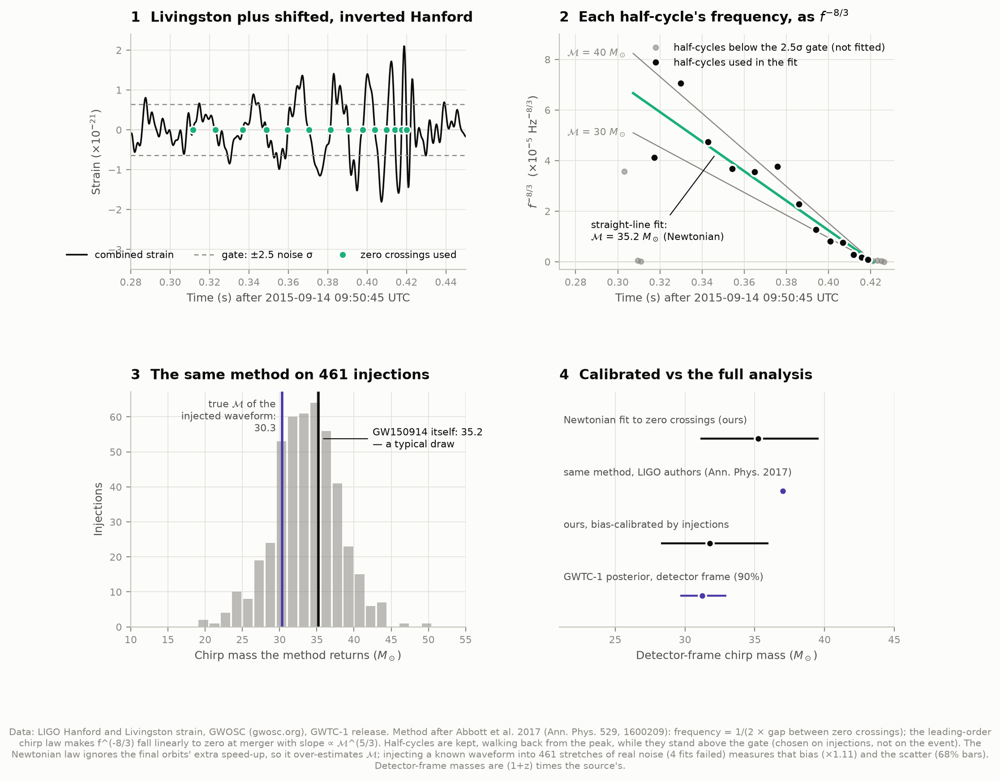
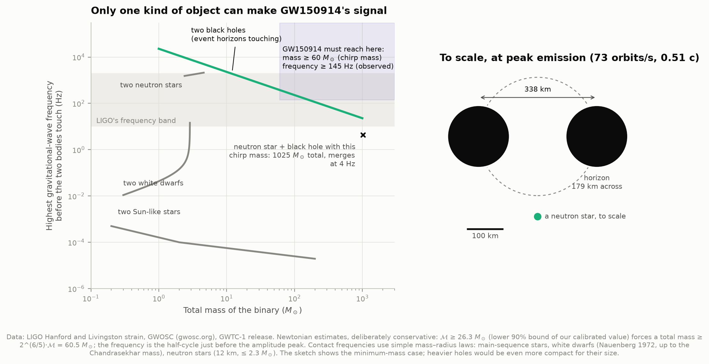
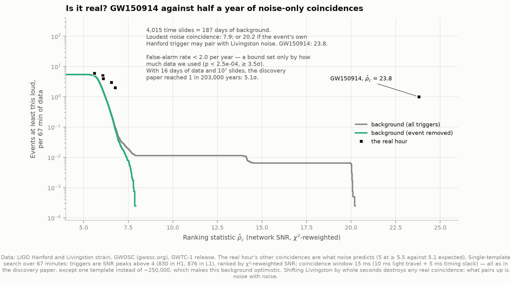

# C1 — The first gravitational wave, from the raw data

**Can we pull GW150914 — the first gravitational wave ever detected — out of the raw LIGO
data ourselves, see the chirp, hear it, weigh the binary that made it, and show it is not
noise?**

Yes. This project downloads an hour of calibrated strain from both LIGO detectors, finds
the signal, reproduces the discovery paper's famous Figure 1 from scratch, measures the
arrival-time difference between the two sites, estimates the binary's chirp mass from the
frequency sweep alone, argues from that number that only black holes fit, turns the chirp
into sound, and runs a small version of the actual detection search to show that an hour
of noise never produces anything close.

**What happened.** On 14 September 2015 at 09:50:45 UTC both LIGO detectors — Hanford,
Washington (H1) and Livingston, Louisiana (L1), 3,000 km apart — recorded a signal that
swept from 35 Hz to about 250 Hz in 0.2 seconds. Two black holes, each around 30 times the
Sun's mass, had spiralled together and merged about 1.3 billion years ago. The wave
changed the length of LIGO's 4 km arms by at most 4 × 10⁻¹⁸ m — roughly 1/400 of the width
of a proton.



---

## Results

Everything below was measured by the code in this folder from the strain data. The
"published" column is used only for comparison, after the fact.

| Quantity | Ours | Published |
|---|---|---|
| Matched-filter SNR, Hanford / Livingston | 19.6 / 13.5 | — |
| Network SNR | **23.8** | 23.6–25.2 (GWTC-1's three searches); 24 (discovery paper) |
| Hanford arrival after Livingston (matched filter) | **7.10 ± 0.19 ms** | 6.9 +0.5/−0.4 ms (discovery paper) |
| Same, by direct cross-correlation (no waveform model) | 7.28 ± 0.12 ms | 7.02 ms, 90% 6.84–7.22 (predicted from GWTC-1 sky positions) |
| Relative sign of the two detectors' signals | inverted | inverted |
| Peak strain, 35–350 Hz filtered (Hanford) | 1.18 × 10⁻²¹ | 1.0 × 10⁻²¹ |
| Chirp mass, Newtonian zero-crossing fit | 35.2 M☉ | ~37 M☉ (same method, by LIGO authors) |
| **Chirp mass, calibrated by injections** (detector frame) | **31.8 M☉** (68%: 28.3–36.0) | 31.2 M☉ (90%: 29.7–33.0), GWTC-1 |
| Ranking statistic ρ̂c | 23.8 | 23.6 |
| Louder than every time-slid background event? | yes — 4,015 slides, 187 days | yes — ~10⁷ slides, 608,000 years |
| False-alarm rate | < 2.0 per year (≥ 3.5σ) | < 1 per 203,000 years (> 5.1σ) |

And the discovery paper's Figure 1 reproduced from raw strain: correlation **0.995** with
the published curve for Hanford and **0.983** for Livingston.

**The headline.** Starting from nothing but the detectors' output, every quantity lands on
the published value within its uncertainty: the ~7 ms delay between the sites, the SNR of
~24, and — after the method is calibrated — a chirp mass of 32 ± 4 M☉ against the full
analysis's 31.2. The significance falls short of the paper's 5.1σ for one reason only: we
analysed one hour of data, not sixteen days. GW150914 is louder than anything the noise
produced in half a year of simulated background; with an hour, "less than once in half a
year" is the strongest statement the data can make.

---

## Things worth looking at

**Two detectors, one signal.** The top panel is the discovery paper's Figure 1,
reproduced: Livingston's strain, and Hanford's shifted 7.1 ms earlier and flipped upside
down. They trace the same wave. The flip is not a fudge — the two detectors' arms point in
nearly perpendicular directions, so the same stretching of space registers with opposite
sign (their response tensors, computed from the arm directions, overlap at −0.89; exactly
perpendicular would be −1). The lower panels lay our processing over the paper's
published curves.



**Weighing a black-hole binary with a stopwatch.** Two orbiting masses radiate at twice
their orbital frequency, and the rate at which that frequency climbs depends on the masses
through a single combination, the *chirp mass*. The consequence is that f^(−8/3) — the
frequency raised to the power −8/3 — falls in a *straight line* to zero at the moment of
merger, with a slope set by the chirp mass alone. Measure the time between successive zero
crossings of the wave, convert to frequency, plot, fit a line: that is panel 2.

The Newtonian formula behind it ignores the extra speed-up of the last orbits, so it
over-estimates. Panel 3 measures by how much: the same fit, run on 461 copies of a
general-relativity waveform with a known chirp mass of 30.3 M☉ hidden in real detector
noise, returns 33.6 M☉ on average. Our 35.2 is a typical draw from that distribution.
Correcting for the bias gives 31.8 M☉.



**Only black holes.** The chirp mass sets a minimum total mass of 60 M☉, and the frequency
just before the peak says the pair was orbiting 73 times a second. Kepler's law then puts
them 338 km apart, moving at half the speed of light — less than twice the 179 km sum of
their Schwarzschild radii (a heavier pair would be even more compact for its size). Stars would have touched long before; white dwarfs and neutron stars cannot weigh
60 solar masses; a neutron star paired with a black hole heavy enough to give this chirp
mass would merge at 4 Hz. Only black holes — each horizon here about 180 km across — are
compact enough.



**Is it real?** Shift Livingston's list of candidate "triggers" by one second relative to
Hanford's and any real coincidence is destroyed; whatever still pairs up is noise with
noise. Doing that 4,015 times turns one hour of data into 187 days of background. The
loudest background event reaches 7.9 — or 20.2 when GW150914's own Hanford trigger is
allowed to pair with Livingston noise, the conservative way the discovery paper did it.
GW150914 sits at 23.8. The five weak coincidences also found in the real hour are exactly as
many as the background predicts (5 against 5.1 expected).



**Listen.** [`audio/`](audio/) has the chirp as sound: Hanford and Livingston in real time
(listen for a short upward *whoomp* two seconds in, under the hiss), Hanford shifted up by
400 Hz so laptop speakers can reproduce it, and the noise-free general-relativity waveform
shifted the same way for comparison. The frequencies are the real ones — GW150914 happened
to fall in the range of human hearing.

---

## How it works

**1. Data.** An hour (4096 s) of strain from each detector, 4096 samples per second,
centred on the event, from the Gravitational Wave Open Science Center (GWOSC). Every second
passes every data-quality check; no simulated signal was being injected into either
detector at the time, apart from a continuous faint sinusoid in Livingston (a simulated
pulsar, irrelevant to a 0.2-second chirp).

**2. Noise model.** Each detector's noise spectrum is estimated by Welch's method over the
hour (median of ~2000 overlapping 4-second segments). The noise is remarkably steady: the
spectra of the hour's two halves agree to within 1% (median ratio 1.006 in Hanford, 1.009 in
Livingston), which is what justifies a single noise model for the whole stretch.

**3. Whitening.** Each frequency is divided by its own noise level, so every frequency
contributes noise equally. Band-passed to 35–350 Hz and expressed in units of the noise's
standard deviation, GW150914 peaks at 8.1σ in Hanford — only one other moment in the whole
hour is louder — and 6.8σ in Livingston. In the raw strain it is invisible: the raw data's
scatter, dominated by seismic noise below 20 Hz, is about 190 times the signal's peak.

**4. The paper's view.** A 35–350 Hz band-pass plus notch filters at the detectors'
instrumental lines — the power mains at 60 Hz and harmonics, calibration signals injected on
purpose at ~35 and ~331 Hz, and the "violin" resonances of the fibres the mirrors hang from
near 500 Hz, which in Livingston stand 1,700 times above the noise floor. Lines are found
automatically as narrow peaks standing 10 times above the local noise. The result matches
the published Figure 1 curves (correlation 0.995 / 0.983).

**5. Matched filter.** The data are correlated against a general-relativity waveform
(GWOSC's SEOBNRv2 template for GW150914), weighted by the inverse noise spectrum — the
optimal detector for a known signal in noise, and how GW150914 was found. Only the
template's amplitude, phase and arrival time are fitted to each detector. A chi-squared test
checks the SNR is spread across frequency the way a real chirp's would be. What remains after
subtracting the fitted waveform is noise-like (scatter 0.89σ and 0.96σ; pure noise gives 1).

**6. Arrival times.** From the matched-filter peaks, and independently by cross-correlating
the two whitened data streams with no waveform at all. Uncertainties come from injecting the
fitted signals into 3,998 other stretches of the hour and repeating the measurement.

**7. Time-frequency.** A Q-transform — a spectrogram whose tiles hold a fixed number of wave
cycles, so they narrow in time as frequency rises — shows the chirp climbing from 35 Hz to
~250 Hz. The best quality factor is Q ≈ 5.7 in both detectors.

**8. Chirp mass.** Livingston plus the shifted, inverted Hanford (the signal adds, the
independent noise does not), zero crossings, f^(−8/3) against time, straight-line fit,
calibration by injection. See "the chirp mass, honestly" below.

**9. Significance.** A single-template version of the discovery search: SNR peaks above 4
in each detector (830 in Hanford, 876 in Livingston over the hour), each re-weighted by its
chi-squared exactly as in the paper, paired within the paper's 15 ms coincidence window
(10 ms light travel plus 5 ms slack), ranked by the combined statistic ρ̂c — then time slides.

---

## Is it really a gravitational wave?

| Check | What it rules out | Result |
|---|---|---|
| **Seen at both sites** | A local disturbance: a truck, an earthquake, a power glitch | Same waveform 3,000 km apart |
| **Delay within the light-travel limit** | Anything travelling slower than light; unrelated noise | 7.1 ms, under the 10.0 ms limit |
| **Sign matches the detectors' orientation** | Coincident but unrelated disturbances | Inverted, as the arm geometry predicts |
| **Chi-squared** | Instrumental glitches that happen to ring the template | χ²/dof 0.89 and 0.56 (≈1 for a real chirp); the hour's loudest glitch, SNR 16 in Livingston, scores 16 and drops to ρ̂ = 4.5 |
| **Residual is noise** | A signal only partly like a black-hole merger | 0.89σ / 0.96σ after subtracting the waveform |
| **Time slides** | A chance coincidence of two noise events | Louder than all 4,015 slides |

**On the sign test.** The flip is a prediction, not an adjustment made to get agreement:
LIGO's arm directions are published constants, and from them the two detectors' response
tensors overlap at −0.89. Our matched filter independently finds the two detectors' signals
168° out of phase.

**On the significance.** Our false-alarm bound (< 2 per year) is weaker than the paper's
(< 1 per 203,000 years) purely because we used 1/350 as much data. The ranking statistic is
the paper's own (23.8 here against their 23.6), and GW150914 beats our loudest background
event comfortably. But a one-template search is a gentler test than the real one: the
discovery search compared the data against ~250,000 templates, and every extra template is
another chance for noise to look like a signal. Our background is therefore optimistic, and
we checked GW150914 against the waveform we already knew it matched.

---

## The chirp mass, honestly

This measurement is where the project learned the most, so here is what actually happened.

**First attempt.** Zero crossings of the combined data, fitted over a time window chosen by
looking at the data, gave 37.5 M☉ — agreeably close to the LIGO authors' own "~37 M☉" from the
same method. Then the identical procedure was run on the fitted signal injected into 467
*other* stretches of noise. The median answer was 18 M☉, the middle two-thirds spread from
9 to 34, and 29% of the fits failed outright. The first attempt's precision had been an illusion: the
window had been drawn around a stretch where the data happened to behave.

**Why.** Early in the chirp the wave is weaker than the noise, and noise adds spurious zero
crossings — each one a wildly wrong frequency that wrecks a straight-line fit.

**The fix.** Let the data decide where the chirp is visible: walk back from the amplitude
peak, keeping each half-cycle only while it stands more than 2.5 noise-σ tall. The threshold
was chosen by injection — the value that recovered the known chirp mass most precisely —
without looking at the event. With it, 457 of 461 injections give a clean fit, the scatter is
±12%, and GW150914's own fit uses 13 half-cycles from 36 Hz up to the peak.

**The bias.** Even with no noise at all, the method returns 36.4 M☉ for a waveform whose
true chirp mass is 30.3 M☉. This is physics, not a bug: near merger the orbit shrinks faster
than the leading-order formula assumes. With noise the typical answer is 33.6, a factor of
1.11 high. Dividing our 35.2 by that factor gives **31.8 M☉**, against 31.2 from the full
Bayesian analysis. The discovery paper met the same bias, which is why its authors quoted
"~30 M☉" as a deliberately conservative figure.

**Detector frame.** The expansion of the universe stretches every period of the wave by a
factor of 1 + z on its way to Earth, so a sweep timed on Earth weighs the chirp mass times
(1 + z). At GW150914's redshift of 0.09, the source-frame chirp mass is 28.6 M☉. Our numbers
are compared with the detector-frame value, computed from GWTC-1's posterior samples.

---

## What this analysis cannot tell you

- **The individual masses, spins, distance or sky position.** Those come from Bayesian
  parameter estimation with full waveform models, run over millions of candidate waveforms.
  We compare against its results; we do not reproduce them.
- **An independent discovery.** The matched filter uses a template GWOSC supplies, with
  parameters close to the published ones. It demonstrates *how* the signal was found and
  how strongly it stands out; it is not a blind search.
- **An independent chirp mass.** The bias calibration uses a waveform with near-published
  parameters, so the calibrated value is a consistency check — "our measurement is what GR
  predicts for a binary like the published one" — more than a fresh measurement. The raw
  35.2 M☉ is fully independent; it just carries the method's known ~11% bias.
- **5σ.** One hour of data cannot bound a false-alarm rate below about once in half a year.
- **Precise compactness.** The black-hole argument is Newtonian and order-of-magnitude. It
  is deliberately conservative (the lowest plausible chirp mass, the lower frequency at the
  peak), and it works because the alternatives miss by factors of ten to a million, not
  because any number here is exact.

---

## Running it

```bash
cd ..                        # repository root
python3 -m venv .venv
source .venv/bin/activate
pip install numpy scipy matplotlib astropy h5py

cd 02-gravitational-waves
python fetch_data.py         # ~265 MB from GWOSC and the LIGO DCC; only needed once
python run.py                # analysis + figures + audio, a few minutes
python test_physics.py       # 43 checks on the formulas
python test_signal.py        # 25 checks on the signal processing
```

Once the cache is warm, `run.py` needs no network — verified by running it inside an
isolated network namespace (`unshare -rn`), where every connection attempt fails.

### Files

| File | What it does |
|---|---|
| `config.py` | The event, every analysis setting, and the published numbers (each quoted from the paper) |
| `fetch_data.py` | Downloads and caches the data; `data/manifest.json` records URL, size, SHA-256 and date for every file |
| `gw_physics.py` | The formulas: chirp mass, the Newtonian chirp, Kepler, compactness, detector geometry |
| `signal_processing.py` | Noise spectra, whitening, filters, matched filter, chi-squared, Q-transform |
| `analysis.py` | The pipeline, including the injection tests and time slides |
| `figures.py`, `plotstyle.py` | Every figure |
| `sonify.py` | The WAV files |
| `run.py` | Runs everything, prints the comparison table |
| `test_physics.py`, `test_signal.py` | Checks against cases with known answers |

`test_physics.py` is worth a look: it reproduces the discovery paper's own back-of-envelope
chain (chirp mass 30 → total mass ≥ 69 → Schwarzschild radii 207 km → 347 km apart) and
places LIGO's corner stations within a millimetre of LALSuite's published coordinates.
`test_signal.py` hides waveforms of known strength in synthetic noise and checks they come
back out at the right strength, time and phase — synthetic data is used there and only there.

### Figures and audio

`00_summary` · `01_noise_spectrum` — what each detector hears, with the signal's spectrum
on top · `02_raw_to_chirp` — raw strain, whitened, zoomed · `03_two_detectors` — Figure 1
reproduced and checked · `04_spectrogram` — Q-transforms · `05_matched_filter` — an hour of
SNR, then data against the waveform · `06_chirp_mass` · `07_only_black_holes` ·
`08_significance`. PNG and SVG; colours are a colourblind-safe set, checked with a validator.

`audio/`: `gw150914_H1.wav`, `gw150914_L1.wav` (real time), `gw150914_H1_shifted.wav`
(+400 Hz), `gw150914_template_shifted.wav` (the model, not data). Three seconds each; the
merger is two seconds in.

---

## Honest notes on the numbers

- **The Figure 1 filter was tuned against the paper.** The band-pass order and the
  line-finding threshold were settled by trying a few settings against the published curves,
  so the 0.995 / 0.983 correlations show the paper's processing can be reproduced, not that
  a blind choice happened to match. The remaining difference — Livingston's amplitude comes
  out 8% higher than the paper's — is unexplained; the paper's exact filter design and
  differences between the 2016 data release and GWOSC's current release are candidates.
- **Our arrival-time error bars are smaller than the paper's** (±0.19 ms against
  +0.5/−0.4). Ours include detector noise only; the published interval also covers
  calibration uncertainty and waveform-model differences.
- **The two arrival-time methods differ by 0.18 ms,** about one error bar. Cross-correlation
  compares the raw shapes, including noise; the matched filter compares each detector against
  the same model.
- **The trigger threshold is SNR 4, not the paper's 5.5.** With one template and an hour of
  clean data there are only about five triggers per detector above 5.5 — too few to see the
  background's shape. Lowering the threshold adds weak triggers and leaves the loud end,
  where GW150914 sits, untouched.
- **The compactness argument uses the chirp mass's lower 90% bound (26.3 M☉) and the
  half-cycle just before the peak (145 Hz),** the choices that make black holes hardest to
  prove. That is why our "total mass ≥ 60 M☉" is below the paper's "≳ 70": the paper used 30.

## Data credits

This research has made use of data or software obtained from the Gravitational Wave Open
Science Center (gwosc.org), a service of the LIGO Scientific Collaboration, the Virgo
Collaboration, and KAGRA. This material is based upon work supported by NSF's LIGO
Laboratory which is a major facility fully funded by the National Science Foundation, as well
as the Science and Technology Facilities Council (STFC) of the United Kingdom, the
Max-Planck-Society (MPS), and the State of Niedersachsen/Germany for support of the
construction of Advanced LIGO and construction and operation of the GEO600 detector.
Additional support for Advanced LIGO was provided by the Australian Research Council. Virgo is
funded, through the European Gravitational Observatory (EGO), by the French Centre National de
Recherche Scientifique (CNRS), the Italian Istituto Nazionale di Fisica Nucleare (INFN) and the
Dutch Nikhef, with contributions by institutions from Belgium, Germany, Greece, Hungary,
Ireland, Japan, Monaco, Poland, Portugal, Spain. KAGRA is supported by Ministry of Education,
Culture, Sports, Science and Technology (MEXT), Japan Society for the Promotion of Science
(JSPS) in Japan; National Research Foundation (NRF) and Ministry of Science and ICT (MSIT) in
Korea; Academia Sinica (AS) and National Science and Technology Council (NSTC) in Taiwan.

Data are released under CC BY 4.0 and were retrieved 2026-09-29: strain data from the
GWTC-1 release of GW150914 (doi:10.7935/82H3-HH23); the data behind Figure 1 of the
discovery paper and the GW150914 template, from GWOSC; GWTC-1 posterior samples from the
LIGO Document Control Center (LIGO-P1800370).

**References.** Abbott et al. 2016, *Observation of Gravitational Waves from a Binary Black
Hole Merger*, PRL 116, 061102 · Abbott et al. 2017, *The basic physics of the binary black hole
merger GW150914*, Ann. Phys. 529, 1600209 · Abbott et al. 2019, *GWTC-1*, PRX 9, 031040 ·
Abbott et al. 2021, *Open data from the first and second observing runs of Advanced LIGO and
Advanced Virgo*, SoftwareX 13, 100658 · Allen 2005, chi-squared test, PRD 71, 062001 ·
Chatterji et al. 2004, Q-transform, CQG 21, S1809 · Taracchini et al. 2014, SEOBNRv2, PRD 89,
061502 · Nauenberg 1972, white-dwarf radii, ApJ 175, 417. Detector geometry from LALSuite's
`LALDetectors.h`.
