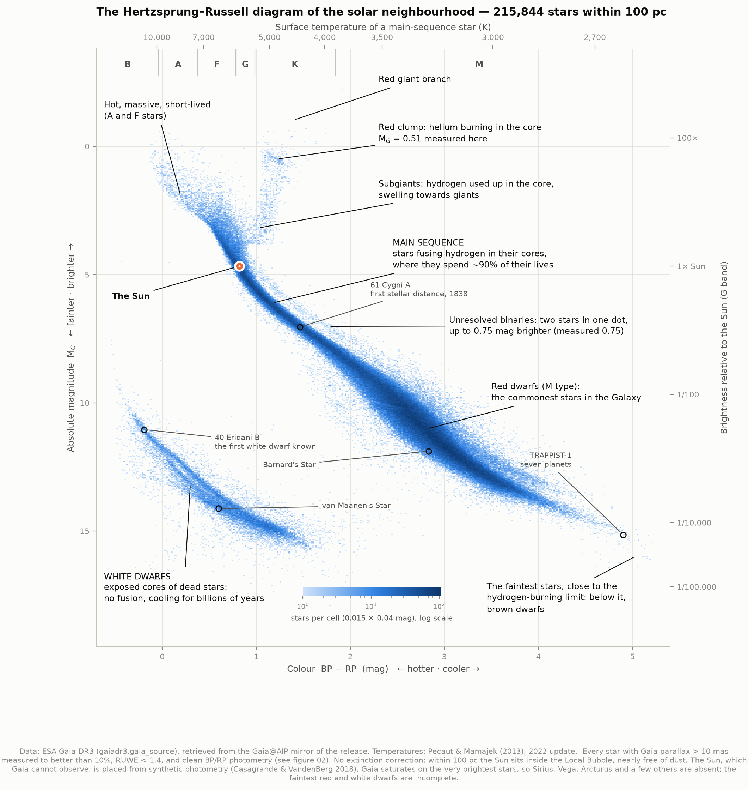
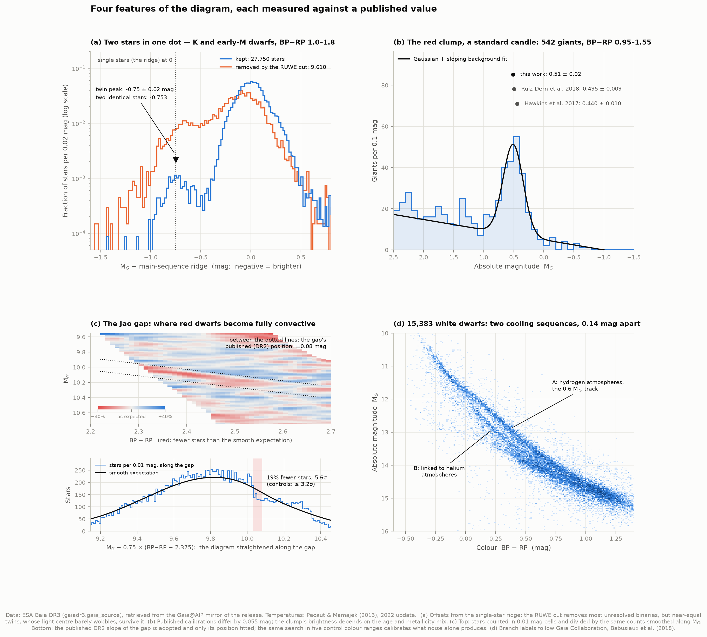
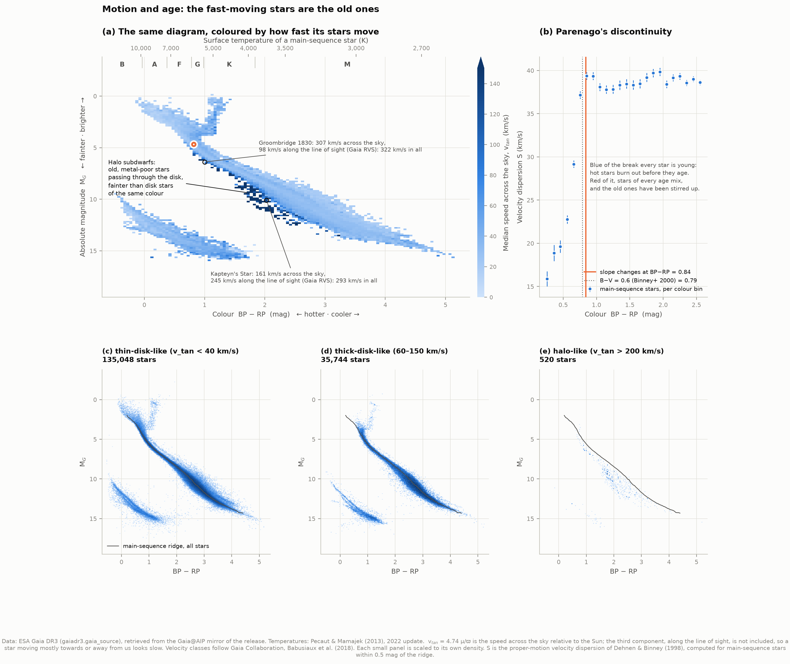
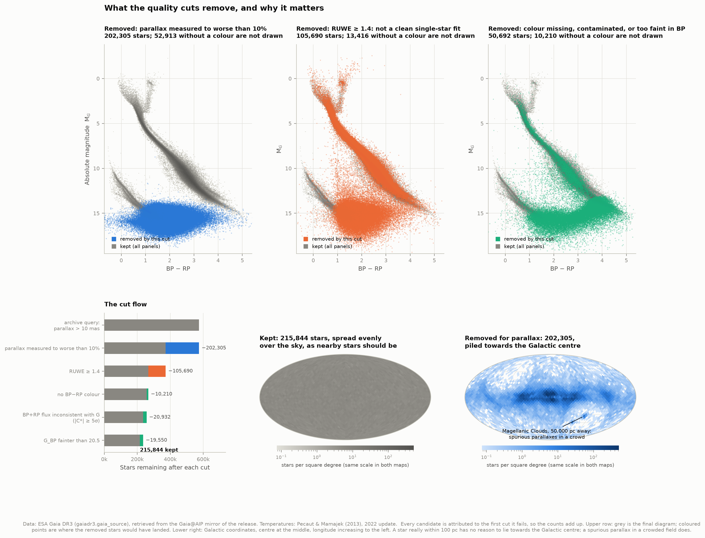
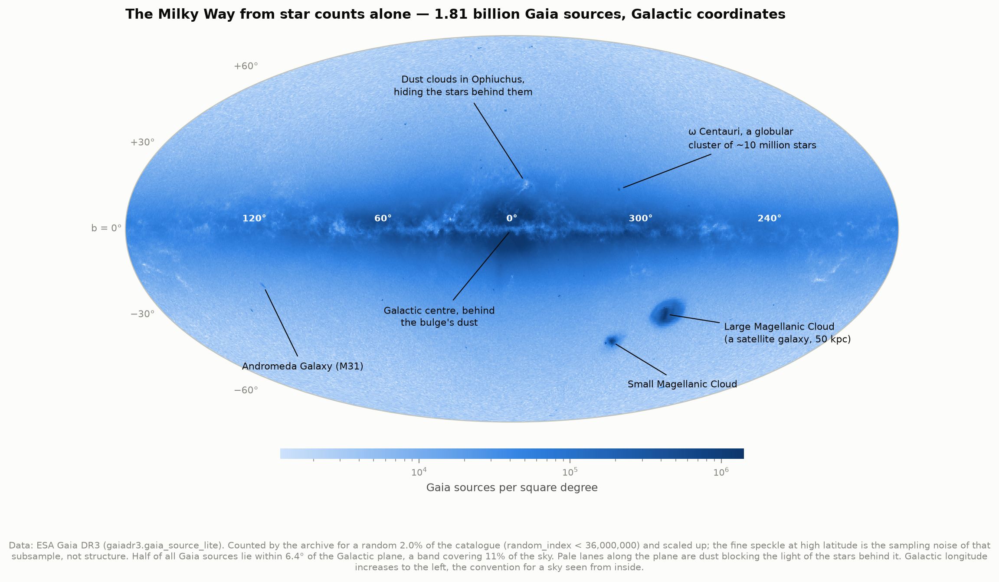

# B1 — The Hertzsprung–Russell diagram, from Gaia

**If you plot how bright every nearby star really is against its colour, does the life
story of stars appear?**

Yes. This project takes every star within 100 parsecs (326 light-years) that ESA's Gaia
spacecraft measured well — **215,844 stars** — and plots each one's true brightness
against its colour. No model, no fitting: just two measured numbers per star. Out of that
scatter come the main sequence, the giants, the dead white dwarfs, and features subtle
enough to have been discovered only in the last decade. The project then tests the diagram
against physics, measuring five of those features and comparing each with the published
value.



---

## How to read an HR diagram

Two numbers per star, one dot per star.

**Across: colour, which is temperature.** Gaia measures each star's brightness through a
blue filter (BP) and a red one (RP). BP − RP is the difference in magnitudes: small or
negative for a star bright in blue light, large for one bright in red. Colour is set by
surface temperature, just as a heated poker goes from dull red to yellow-white: hot stars
(10,000 K) sit on the left, cool red dwarfs (3,000 K) on the right. The top axis converts
colour to temperature using Mamajek's calibration for main-sequence stars, and the letters
B A F G K M are the spectral classes.

**Up: how much light the star really emits.** How bright a star *looks* depends on how far
away it is. Gaia measures the distance directly, by parallax: as the Earth orbits the Sun,
a nearby star appears to shift back and forth against distant ones. A star at 10 parsecs
shifts by 0.1 arcseconds (100 milliarcseconds, mas); at 100 pc, by 10 mas. From the
distance comes the **absolute magnitude** M_G, the brightness every star would have at the
same standard distance of 10 pc:

    M_G = G + 5 log10(parallax in mas) − 10

Magnitudes run backwards, a legacy of the ancient Greeks: *smaller is brighter*, and every
5 magnitudes is a factor of 100. So the vertical axis runs bright at the top to faint at
the bottom, and the right-hand axis translates it into "times as bright as the Sun".

With distance removed, where a star sits depends only on the star itself — its mass, age
and composition. That is why the diagram shows structure at all.

---

## Results

Every number below was measured by the code in this folder from Gaia DR3 data.

| Feature | Measured here | Published or predicted |
|---|---|---|
| Unresolved twin binaries sit above the single stars by | **0.75 ± 0.02 mag** | 0.753 mag — two identical stars give twice the light |
| Red clump absolute magnitude M_G | **0.51 ± 0.02** | 0.495 ± 0.009 (Ruiz-Dern et al. 2018); 0.440 ± 0.010 (Hawkins et al. 2017) |
| Jao gap in the red dwarfs, M_G at BP−RP 2.375 | **10.06 ± 0.01**, 19% fewer stars, 5.6σ | 10.09 in Gaia DR2 (Jao et al. 2018) |
| White dwarf sequence splits into two branches | **in 10 of 10 slices**, 0.14 mag apart | first seen in an HR diagram in Gaia DR2 (Gaia Collaboration, Babusiaux et al. 2018) |
| Parenago's discontinuity (velocity dispersion stops rising) | **BP−RP 0.84** (0.82–0.86) | B−V ≈ 0.6 ≈ BP−RP 0.79 (Binney, Dehnen & Bertelli 2000) |

**What the solar neighbourhood is made of.** Of the 215,844 stars, 90.7% are on the main
sequence, 7.1% are white dwarfs, and fewer than 1% (2,104) are giants or subgiants.
**Red dwarfs are 78% of the main sequence**; stars like the Sun (class G) are 4.8%. **The
Sun is brighter than 94% of its neighbours** — and that is a lower limit, because the
faintest red dwarfs and white dwarfs are the ones Gaia misses.

**How complete is the sample?** Geometry gives a free test: doubling the distance
multiplies the volume by 8, so a complete sample should grow eightfold. It grows ×7.9
from 12.5 to 25 pc (431 → 3,396 stars), ×8.3 to 50 pc (28,042) and ×7.7 to 100 pc
(215,844) — nearly complete, with faint stars starting to drop out beyond 50 pc. For
comparison, the Gaia team's own diagram from the previous data release (DR2) held 3,724
stars within 25 pc, 29,683 within 50 pc, and 212,728 within 100 pc.

---

## Five features, measured



**Two stars in one dot (a).** Many "stars" are really two, too close together for Gaia to
separate. Two identical stars side by side give twice the light of one at the same colour:
2.5 log₁₀(2) = 0.753 mag brighter. Measuring every K and early-M dwarf's offset from the
main-sequence ridge (the most common M_G at each colour), a distinct second peak appears at
**−0.75 ± 0.02 mag** — exactly where the twins should be. The orange curve shows the stars
the RUWE quality cut removed (below): 15.9% of them sit on the binary side of the ridge,
against 1.4% of the kept stars. That cut is doing what it should — RUWE flags stars whose
position wobbles as an unseen companion tugs them around an orbit. Near-equal twins partly
survive it because their light centre and mass centre almost coincide, so there is little
wobble to see.

**The red clump (b).** Once a Sun-like star has exhausted the hydrogen in its core and
climbed the giant branch, it ignites helium in its core. Because that ignition happens at
almost the same core mass for every low-mass star, these stars all burn at roughly the same
luminosity and pile up in a compact clump — a *standard candle* used to measure distances
across the Galaxy. A Gaussian-plus-background fit to 542 local giants puts the clump at
**M_G = 0.51 ± 0.02**. The two published calibrations differ from each other by 0.055 mag,
because the clump's brightness depends on the age and metallicity of the stars and on how
dust was corrected; ours agrees with Ruiz-Dern et al. (0.495 ± 0.009), whose low-extinction
selection is closest to our dust-free sample, and sits 3σ above Hawkins et al.

**The Jao gap (c).** In 2018, Wei-Chun Jao and colleagues found a thin line of *missing*
stars crossing the red dwarfs in Gaia's diagram — about 0.05 mag wide. It marks the mass,
about 0.35 times the Sun's, at which a red dwarf becomes fully convective. Stars just at
that boundary suffer an instability: helium-3 builds up in the core, the core's convection
repeatedly merges with and separates from the envelope's, and the star's brightness
wobbles, thinning the diagram there (van Saders & Pinsonneault 2012; Baraffe & Chabrier
2018). We adopted the gap's published *slope* and measured its *position*: **M_G = 10.06 ±
0.01** at BP−RP 2.375, with **19% fewer stars than expected, at 5.6σ**. That is 0.03 mag
brighter than in DR2. To check the method wasn't just finding noise, the identical search
was run on five colour ranges with no known gap: the deepest dips there reach only 2.2–3.2σ.
The upper panel shows the gap directly, as a red streak of missing stars.

**Two kinds of white dwarf (d).** White dwarfs are the exposed cores of dead stars, no
longer fusing anything, cooling for billions of years. Their sequence splits into two
parallel tracks, first seen in an HR diagram in Gaia's previous data release. In every one of ten slices
of M_G between 12 and 14 the colours are clearly bimodal, the two branches
**0.14 mag apart**. The more populous branch, **A**, lies on the cooling track of a
hydrogen-atmosphere white dwarf of 0.6 solar masses; the second, **B**, has been linked to
helium-rich atmospheres (Gaia Collaboration, Babusiaux et al. 2018). The DR2 paper also
describes a weaker third concentration, "Q"; it is at most faintly visible here, and we
do not claim it.

---

## Motion and age



Gaia also measures how fast each star crosses the sky. Converted to a speed with the
distance, this is the *tangential velocity*, v_tan = 4.74 × (proper motion) / (parallax)
km/s.

**The fast stars are the old ones (a).** Colour the diagram by speed and a dark band
appears *below* the main sequence: **halo subdwarfs**, ancient stars from the Galaxy's
halo, poor in heavy elements (which makes them bluer and fainter than disk stars of the
same colour), passing through our neighbourhood on orbits that don't share the disk's
rotation. Following the Gaia team's velocity classes, 62.6% of the stars move like the
young thin disk (v_tan < 40 km/s), 16.6% like the older thick disk (60–150 km/s), and just
520 stars (0.24%) like the halo (> 200 km/s). The halo panel (e) shows their main sequence
sitting visibly below everyone else's.

Tangential velocity sees only two of a star's three velocity components. **Kapteyn's
Star**, a famous halo star just 3.9 pc away, crosses the sky at only 161 km/s — which
lands it in the thick-disk class — but Gaia's spectrometer measures a further 245 km/s
along our line of sight: **293 km/s in all**. Groombridge 1830 moves at 322 km/s in total;
Barnard's Star at 143 km/s.

**Parenago's discontinuity (b).** Why should old stars move faster? The Galaxy's disk
stirs its stars — spiral arms and giant gas clouds give them random kicks — so the longer a
star has been around, the faster its random motion. Now, hot massive stars burn out
quickly: every main-sequence star bluer than a certain colour is young, because the old
ones of that colour have already died. Redward of that colour, stars of every age mix.
So the spread of velocities (measured here with the method of Dehnen & Binney 1998, which
works with sky motions alone) should rise steeply for blue stars and then level off. It
does: from **16 km/s** for the bluest main-sequence stars to **39 km/s**, flattening at
**BP−RP = 0.84 (0.82–0.86)**. Binney, Dehnen & Bertelli (2000) placed this break near
B−V = 0.6, which is BP−RP 0.79 on Mamajek's scale, and used it to estimate the age of the
solar neighbourhood (11.2 ± 0.75 billion years).

---

## What the quality cuts do — and why they matter



The archive query asks for every source with parallax above 10 mas — 574,531 of them. Most
are not trustworthy, and **it is the cuts, not the query, that make the diagram**. Each
star is charged to the first cut it fails, so the counts add up:

| Step | Removed | Remaining | Why |
|---|---:|---:|---|
| Archive query: parallax > 10 mas | | 574,531 | naive distance under 100 pc |
| Parallax measured to worse than 10% | 202,305 | 372,226 | the distance, and so the absolute magnitude, is too uncertain |
| RUWE ≥ 1.4 | 105,690 | 266,536 | the motion on the sky does not fit a single star: usually an unresolved binary, sometimes a spurious solution |
| No BP−RP colour | 10,210 | 256,326 | without a colour a star cannot be placed on the diagram |
| BP+RP flux inconsistent with G (\|C*\| ≥ 5σ) | 20,932 | 235,394 | a neighbour's light has leaked into the BP/RP measurement, corrupting the colour |
| BP fainter than 20.5 mag | 19,550 | 215,844 | BP fluxes this faint are biased bright, making colours too blue |

**A third of the "nearby" stars are not nearby.** The 202,305 sources removed for poor
parallaxes would all land in an impossible smear at M_G ≈ 15–17, and on the sky (lower
right) they crowd towards the Galactic centre and plane — and even the Magellanic Clouds,
50,000 parsecs away. A star genuinely within 100 pc has no reason to lie in any particular
direction; the kept stars are spread evenly over the sky, as they should be. The rejects
are faint stars in crowded fields whose measured parallaxes are spurious.

**The photometric cuts clean the space between the sequences.** The region between the
white dwarfs and the main sequence is where contaminated colours land. The corrected flux
excess C* (Riello et al. 2021) catches them: without it, 2,212 stars sit in that region;
with it, 450.

**One threshold was chosen from the data, and here is how.** Riello et al. offer a 3σ or
5σ C* cut. At 3σ, the cut also removed 39 of the 170 red dwarfs brighter than G = 10 —
Proxima Centauri and Barnard's Star among them. Such bright stars cannot be contaminated by
a faint neighbour; their C* is offset by a calibration effect (median +3.6σ for bright red
dwarfs, against +0.9σ for fainter ones). The 5σ cut removes almost as much junk (80% of the
contaminated region, against 83%) and loses 6 of those 170 stars instead of 39, so it is the
one used. Proxima Centauri still fails at 6σ; it is also a notorious flare star, and the cut
cannot tell a flare from contamination.

---

## The Milky Way from star counts



Count Gaia's 1.81 billion sources on a grid over the whole sky and the Galaxy draws itself:
the disk, the bulge around the Galactic centre, dark lanes where dust hides the stars
behind it, the Large and Small Magellanic Clouds, globular clusters, even the Andromeda
Galaxy. **Half of all Gaia sources lie within 6.4° of the Galactic plane**, a band
covering 11% of the sky. Density ranges from about 1,700 stars per square degree at high
latitudes to 1.4 million in the densest fields.

Counting all 1.8 billion rows on the archive would take hours of server time, so the map
uses Gaia's `random_index` column — a random shuffle of the whole catalogue — to count a
random 2% (36 million sources) and scale up. The fine speckle at high latitudes is the
sampling noise of that subsample (about ±38% per pixel in the sparsest 1% of the sky), not
structure.

---

## Famous stars

| Star | Distance (pc) | BP−RP | M_G | v_tan (km/s) | On the diagram? |
|---|---:|---:|---:|---:|---|
| Proxima Centauri | 1.30 | 3.80 | 13.41 | 24 | no — fails the C* colour check |
| Barnard's Star | 1.83 | 2.83 | 11.88 | 90 | yes |
| Wolf 359 | 2.41 | 4.18 | 14.13 | 54 | yes |
| ε Eridani | 3.22 | 1.14 | 5.93 | 15 | no — RUWE 2.72 |
| 61 Cygni A — first stellar distance ever measured (Bessel, 1838) | 3.50 | 1.46 | 7.05 | 88 | yes |
| τ Ceti | 3.65 | 1.05 | 5.49 | 33 | no — RUWE 2.63 |
| Kapteyn's Star — halo star | 3.93 | 2.03 | 10.09 | 161 | yes |
| van Maanen's Star — white dwarf | 4.31 | 0.60 | 14.12 | 61 | yes |
| 40 Eridani B — the first white dwarf recognised | 5.01 | −0.19 | 11.04 | 95 | yes |
| δ Pavonis — subgiant | 6.10 | 1.02 | 4.44 | 48 | no — RUWE 2.86 |
| Groombridge 1830 — halo star | 9.17 | 1.00 | 6.39 | 307 | yes |
| TRAPPIST-1 — seven planets | 12.47 | 4.90 | 15.14 | 62 | yes |
| 51 Pegasi — first planet around a Sun-like star | 15.53 | 0.83 | 4.33 | 16 | yes |
| β Pictoris | 19.63 | 0.26 | 2.36 | 8 | no — RUWE 3.07 |
| HR 8799 — four imaged planets | 40.88 | 0.39 | 2.85 | 23 | no — RUWE 1.47 |
| ε Tauri — Hyades red-clump giant | 44.71 | 1.24 | 0.03 | 24 | no — RUWE 2.45 |
| γ Tauri — Hyades red-clump giant | 46.16 | 1.20 | 0.08 | 26 | no — RUWE 6.96 |
| Sirius B — white dwarf | 2.67 | −0.28 | 11.39 | 13 | no — RUWE 2.42, in Sirius A's glare |

**Some of the brightest stars in the sky are not in Gaia DR3 at all**: Sirius, Vega,
Arcturus, Procyon, Altair, Aldebaran and Pollux. Gaia's detectors saturate on them. This
was checked, not assumed: a cone search around each finds nothing brighter than G = 8.5
within an arcminute. (Near Sirius, that G = 8.5 source 17″ away is Sirius B.)

---

## Honest notes

- **The RUWE cut removes the brightest stars.** It rejects 98.7% of the 308 stars brighter
  than G = 4 and 39% of the stars in the giant region, whose astrometry is harder for
  Gaia. The upper part of the diagram is therefore under-populated: the giants shown are
  the fainter ones that survived. None of the counts above are corrected for this.
- **1/parallax as distance** is safe only for precise parallaxes. Our 10% cut bounds the
  resulting error in M_G at 0.22 mag; the median is 0.005 mag. Selecting on the
  *measured* parallax also makes the 100 pc edge slightly fuzzy.
- **No extinction correction.** The Sun sits inside the Local Bubble, a cavity in the
  interstellar medium largely swept clear of gas and dust; reddening within 100 pc is a few
  hundredths of a magnitude at most. Further out this would not be acceptable.
- **The parallax zero-point** (Gaia DR3 parallaxes are on average 0.017 mas too small;
  Lindegren et al. 2021) is not applied: it would shift M_G by at most 0.004 mag here.
- **Region boundaries are drawn by eye**, through the empty gaps between sequences, and are
  used only for counting. The main-sequence and giant counts would shift a little with
  different boundaries.
- **The Jao-gap test uses the published slope.** Only the position was fitted, making it a
  confirmation of a known feature rather than a blind discovery; the slope itself is only
  loosely constrained by our data (anything from 0.25 to 1.25 gives ≥ 5σ).
- **Tangential velocities are relative to the Sun and miss the line-of-sight motion**, so
  the velocity classes are rough: Kapteyn's Star is a halo star classed as thick disk.
- **The Parenago break is from a two-line fit** that describes the curve only
  approximately (χ²/dof = 6.8); its uncertainty is inflated accordingly.
- **The sky map is a 2% random subsample**, scaled up, and uses a different table
  (`gaia_source_lite`, counts computed by the ESA archive) from the 100 pc sample.

---

## Running it

```bash
cd ..                       # repository root
python3 -m venv .venv
source .venv/bin/activate
pip install numpy scipy matplotlib astropy astroquery pyvo astropy-healpix

cd 02-hr-diagram
python fetch_data.py        # ~70 MB of Gaia data + small reference files; only once
python run.py               # analysis + all figures, about 40 seconds, offline
python test_physics.py      # 27 self-checks of the formulas
```

A note on archives: when this was built, ESA's Gaia archive took over an hour on the main
query without finishing (it was busy), while the Gaia@AIP mirror in Potsdam — an official
partner data centre serving the same Gaia DR3 release — returned all 574,531 rows in 72
seconds. `fetch_data.py` therefore uses the mirror by default; `--mirror esa` uses ESA's
archive. Either way, the download is checked against the server's own row count, so a
truncated result is an error rather than a silently smaller sample. The all-sky counts
come from ESA's archive and take several minutes.

### Files

| File | What it does |
|---|---|
| `config.py` | The queries, every quality threshold with its source, reference values |
| `fetch_data.py` | Downloads and caches the Gaia sample, sky counts, Mamajek's table, famous-star IDs |
| `hr_physics.py` | The formulas: distance modulus, tangential velocity, flux-excess correction |
| `analysis.py` | Cuts, ridge line, feature measurements, kinematics, sky map |
| `figures.py` | Every figure |
| `plotstyle.py` | Shared colours and styling (colourblind-safe, validated) |
| `run.py` | Runs everything, prints the summary |
| `test_physics.py` | Checks the formulas against cases with known answers |

`test_physics.py` checks, among others: the Sun's M_G of 4.67 placed at 1 au reproduces its
apparent magnitude of −26.9; Barnard's Star's proper motion gives its textbook 90 km/s; two
identical stars are 0.753 mag brighter than one; and the velocity-dispersion method recovers
a known answer from simulated proper motions.

### Figures

`01` the annotated HR diagram · `02` what the quality cuts remove · `03` motion and age ·
`04` five features measured · `05` the Milky Way from star counts. PNG and SVG; dense
point clouds are rasterised inside the SVGs to keep them small.

---

## Data credits

This work has made use of data from the European Space Agency (ESA) mission Gaia
(https://www.cosmos.esa.int/gaia), processed by the Gaia Data Processing and Analysis
Consortium (DPAC, https://www.cosmos.esa.int/web/gaia/dpac/consortium). Funding for the
DPAC has been provided by national institutions, in particular the institutions
participating in the Gaia Multilateral Agreement. Gaia DR3: Gaia Collaboration, Vallenari
et al. (2023, A&A 674, A1). The 100 pc sample was retrieved on 2026-09-29 from the Gaia@AIP
mirror (Leibniz-Institut für Astrophysik Potsdam); the sky counts on the same day from the
ESA Gaia archive.

Temperatures and spectral types: E. Mamajek, "A Modern Mean Dwarf Stellar Color and
Effective Temperature Sequence", version 2022.04.16, based on Pecaut & Mamajek (2013, ApJS
208, 9). Star identifications: the SIMBAD database, operated at CDS, Strasbourg, France.
Sky pixelisation: HEALPix (Górski et al. 2005), via astropy-healpix. The Sun's Gaia colour
and magnitude: Casagrande & VandenBerg (2018, MNRAS 479, L102).
