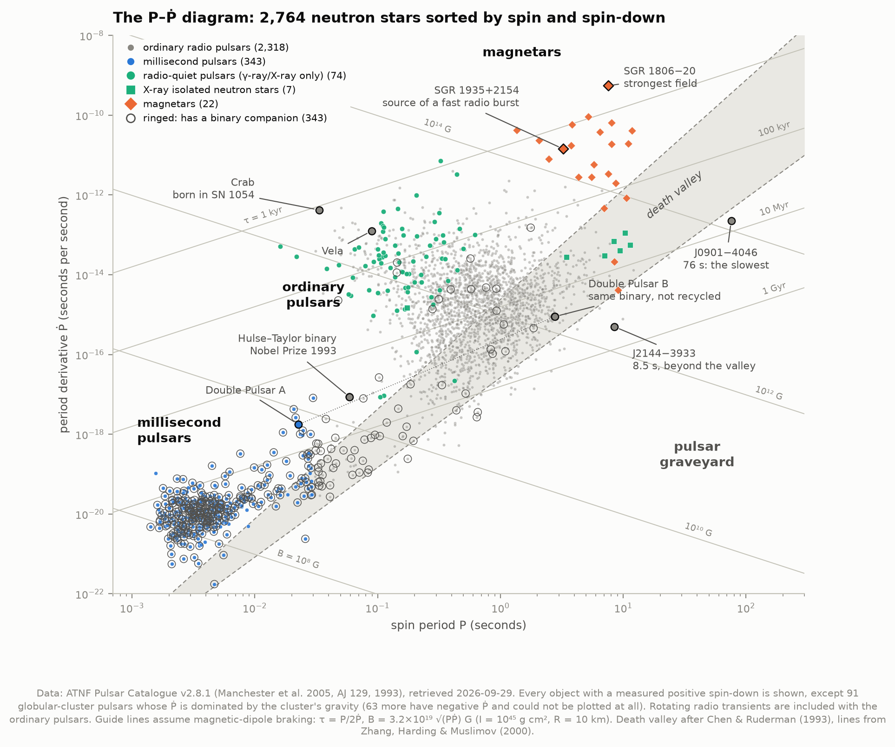
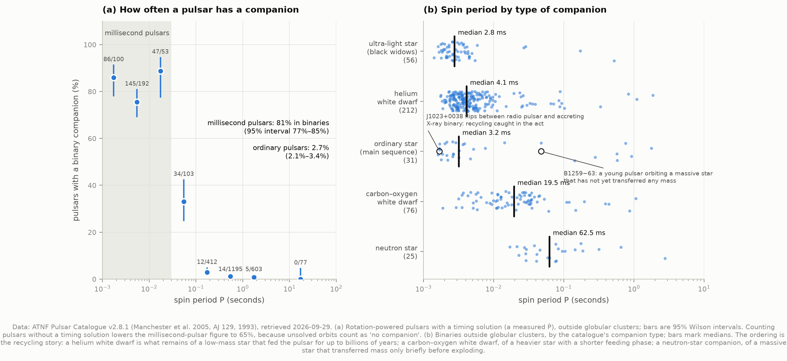
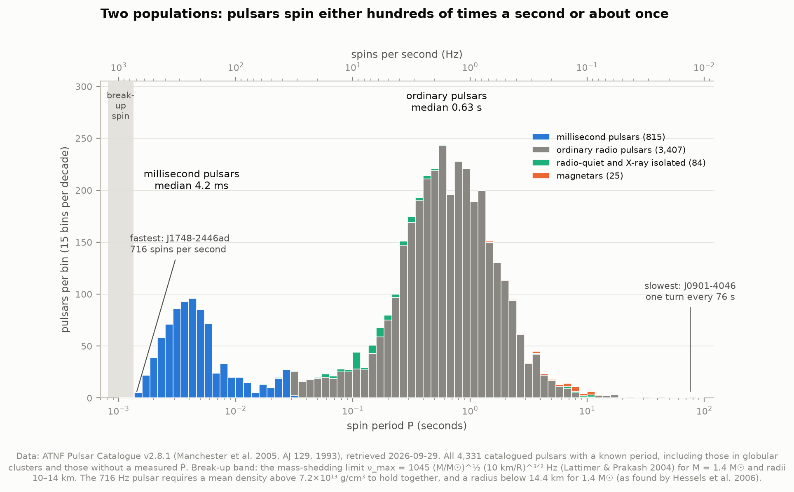
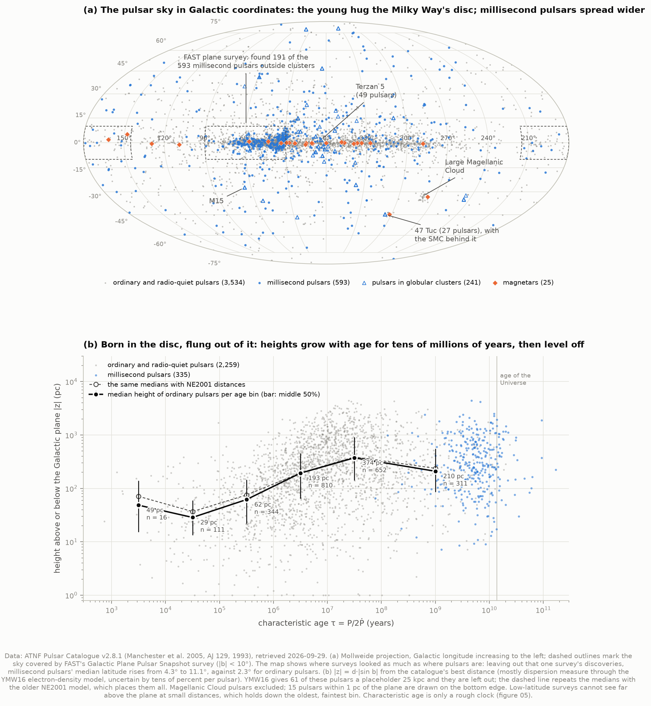
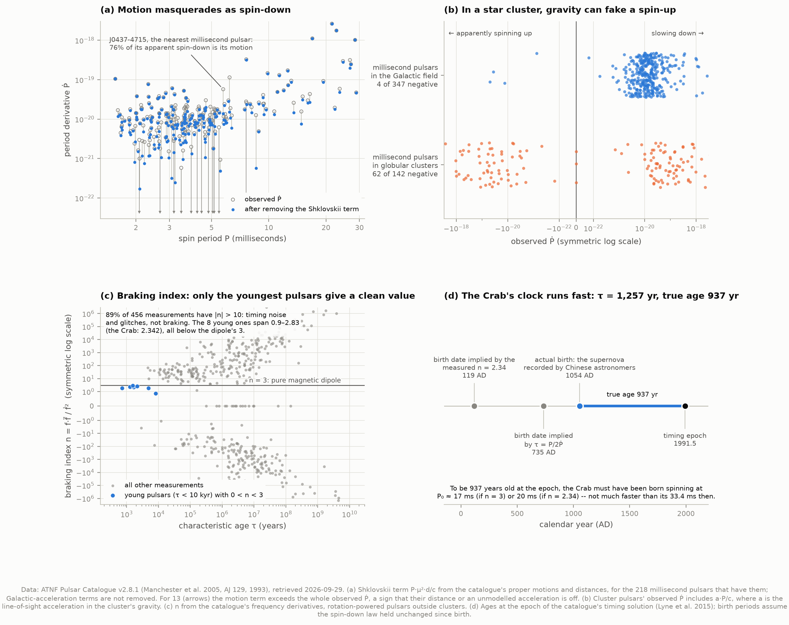

# C2 — The pulsar P–Ṗ diagram

**Plot every known pulsar's spin period against its slow-down rate. Does the population sort
itself into physically distinct families?**

Yes, and cleanly. This project takes the ATNF Pulsar Catalogue, the standard compilation of
all 4,393 published pulsars, and places every neutron star with a measured spin-down on the
P–Ṗ diagram. It then checks each claim the diagram is famous for against the numbers:
- that millisecond pulsars were "recycled" by a companion star
- that pulsars "die" below a line
- that characteristic ages are ages
- that pulsars are born in the Galactic disc

Most of the claims survive. Some survive only with an asterisk, and those asterisks are
documented here.



---

## What a pulsar is, and what the two numbers mean

A pulsar is a **neutron star**: the collapsed core left by a supernova. It packs about 1.4 Suns
into a sphere ~20 km across, spins, and has a magnetic field a trillion times Earth's. Beams of
radio waves from its magnetic poles sweep past us once per rotation, like a lighthouse. Timing
those pulses gives two numbers with extraordinary precision:

- **P**, the spin period: how long one rotation takes, from 1.4 milliseconds to 76 seconds.
- **Ṗ** ("P-dot"), how fast P is growing, in seconds per second. It is always tiny (from about
  10⁻²² to 10⁻⁹), because the star is losing rotational energy very slowly.

Assume the star is a spinning bar magnet losing energy to magnetic-dipole radiation, and three
physical quantities follow from P and Ṗ alone:

| Quantity | Formula | What it means |
|---|---|---|
| Characteristic age | τ = P / 2Ṗ | How long the pulsar has been spinning down, *if* it was born spinning much faster than now |
| Surface magnetic field | B = 3.2×10¹⁹ √(PṖ) gauss | The dipole field needed to produce that braking |
| Spin-down power | Ė = 4π² I Ṗ / P³ | The rate the rotation loses energy: the pulsar's entire power budget |

Every derivation assumes a neutron star of radius 10 km and moment of inertia 10⁴⁵ g cm². These
are the catalogue's conventions, and each is uncertain by tens of percent. `test_physics.py`
derives the 3.2×10¹⁹ from first principles (it comes out 3.1996×10¹⁹), then checks the formulas
against textbook cases.

On the diagram, those formulas become grid lines. Constant age runs up to the right. Constant
field runs down to the right. A pulsar is born near the top left and ages down and to the right,
until it crosses the **death valley**: the region where its spin can no longer power the
electron–positron cascade that makes radio emission. Below the valley lies the **graveyard**.

---

## Results

Everything below was measured by the code in this folder from ATNF catalogue v2.8.1 (released
2026-06-18, retrieved 2026-09-29). All numbers are in `data/results.json` after a run.

### The population sorts itself

Of 4,393 catalogued pulsars, 4,331 have a period and 2,855 have a positive Ṗ. Another 1,401
have no Ṗ yet, mostly recent discoveries without enough timing history. The diagram shows the **2,764** outside globular clusters
(why clusters are excluded is covered under "Where the numbers stop meaning what they say"):

| Family | On the diagram | Where it sits |
|---|---|---|
| Ordinary radio pulsars (incl. 48 rotating radio transients) | 2,318 | The central cloud: P ≈ 0.1–5 s, B ≈ 10¹¹–10¹³ G |
| Millisecond pulsars | 343 | Bottom left: P of a few ms, B ≈ 10⁸–10⁹ G, τ of billions of years |
| Radio-quiet pulsars (seen in γ-rays or X-rays only) | 74 | Among the young ordinary pulsars |
| X-ray isolated neutron stars | 7 | Right of the cloud: slow, strongly magnetised, cooling |
| Magnetars | 22 | Top right: B mostly 10¹⁴–10¹⁵ G |

The strongest field belongs to the magnetar **SGR 1806−20**: 2.1×10¹⁵ G. Magnetars' X-ray
outbursts are thought to be powered by their fields decaying, not by their rotation.

### Recycling: the evidence that millisecond pulsars were spun up

The standard story, proposed in 1982 (Alpar et al.; Radhakrishnan & Srinivasan), runs like this:
1. An old, slow neutron star in a binary system sits dead in the graveyard.
2. When its companion star swells, matter spills onto the neutron star and spins it up to
   hundreds of rotations per second.
3. The process also buries or weakens its magnetic field.

If that is right, millisecond pulsars should still have companions. They do:

| | In a binary | 95% interval |
|---|---|---|
| Millisecond pulsars | **81%** (278 of 343) | 77–85% |
| Ordinary pulsars | **2.7%** (65 of 2,392) | 2.1–3.4% |

The switch is abrupt, right at the millisecond-pulsar boundary:

| Spin period bin | 1–3 ms | 3–10 ms | 10–30 ms | 30–100 ms | 0.1–0.3 s | 0.3–1 s | 1–3 s | >3 s |
|---|---|---|---|---|---|---|---|---|
| In a binary | 86% | 76% | 89% | 33% | 2.9% | 1.2% | 0.8% | 0 of 77 |

**The companion type orders the spin periods**, just as the recycling story predicts:

| Companion | Median spin period | What it implies |
|---|---|---|
| Helium white dwarf (212) | **4.1 ms** | A low-mass star that fed the pulsar for up to billions of years |
| Carbon–oxygen white dwarf (76) | **19.5 ms** | A heavier star with a shorter feeding phase |
| Neutron star (25) | **62.5 ms** | A massive star that fed it only briefly before exploding |
| Ultra-light star, "black widows" (56) | **2.8 ms** | Fully recycled; the pulsar's wind is now evaporating the companion |

Two single systems show the story's two ends:
- **J1023+0038** switches between being a radio pulsar and an accreting X-ray binary: recycling
  caught in the act.
- **The Double Pulsar**, J0737−3039, holds both outcomes in one binary. Pulsar A (22.7 ms) was
  recycled by the star that later exploded to become pulsar B (2.8 s), which was not.



### The fastest spin proves what a pulsar is

The fastest known pulsar, **PSR J1748−2446ad** in the globular cluster Terzan 5, turns **716
times per second**. That one number rules out anything except a neutron star:

- **Density.** A spinning ball holds together only if gravity at its equator beats the
  centripetal pull, which requires a mean density above 3π/(GP²). For 716 Hz that is **7.2×10¹³
  g/cm³**, about a quarter of the density of an atomic nucleus. No white dwarf comes close. The
  same argument, applied to the 89 ms Vela and 33 ms Crab pulsars discovered in 1968, ruled
  out white dwarfs and pointed to neutron stars. (`test_physics.py` checks the formula by recovering Earth's density, 5.51
  g/cm³, from the 84-minute period of an orbit skimming its surface.)
- **Size.** For a 1.4 M☉ star, spinning this fast without shedding its equator needs a radius
  below **14.4 km**, reproducing Hessels et al. (2006).
- **Speed.** The equator of a 10 km star at 716 Hz moves at **15% of the speed of light**.

The fastest outside a cluster is J0952−0607 at 707 Hz. The slowest pulsar is **J0901−4046**:
one turn every **76 seconds**.



### The death valley is a band, not a line

Where radio emission switches off depends on the unknown shape of the magnetic field near the
surface, so there is no single "death line". We draw the band Chen & Ruderman (1993) called the
death valley. Its edges are the dipole-field and curved-field versions of the vacuum-gap model,
using the equations of Zhang, Harding & Muslimov (2000). Among the 2,318 radio pulsars:

- **55%** lie above the valley, alive in every version of the model;
- **43%** lie inside it, alive only if their surface fields are curved;
- **2.0%** (47) lie **beyond** it, shining when no version of the model says they should. The
  slowest of these are J0901−4046 (76 s), J0250+5854 (23.5 s), J1856+0211 (9.9 s) and
  J2144−3933 (8.5 s). Zhang et al. wrote their 2000 paper specifically because J2144−3933 did
  not fit.

### Born in the disc, flung out of it

Neutron stars are born where massive stars live, within ~50 pc of the Galactic plane, and the
supernova kicks them at hundreds of km/s. Sorting ordinary pulsars by characteristic age shows
them leaving the disc:

| Characteristic age | 10–100 kyr | 0.1–1 Myr | 1–10 Myr | 10–100 Myr | 0.1–10 Gyr |
|---|---|---|---|---|---|
| Median height above the plane | **29 pc** | 62 pc | 193 pc | **374 pc** | 210 pc |
| Pulsars | 111 | 344 | 810 | 652 | 311 |
| Same, with NE2001 distances | 37 pc | 75 pc | 195 pc | 389 pc | 238 pc |

Distances come from a model of the Galaxy's free electrons (next section), so the last row
repeats the analysis with a different, older model. The trend is the same.

Heights grow for tens of millions of years, then level off. That is expected once pulsars on
bound orbits start falling back through the disc. The drop in the oldest bin is at least partly
a selection effect: the oldest pulsars are faint, so they are found nearby, and surveys that
search only low Galactic latitudes cannot see far above the plane at short distances.



**The sky map is partly a map of where surveys looked.** One survey dominates the recent
millisecond-pulsar haul. FAST's Galactic Plane Pulsar Snapshot survey searches only within 10°
of the plane, and it discovered **191 of the 593** millisecond pulsars outside clusters (32%).
With them, millisecond pulsars' median Galactic latitude is 4.3°. Without them, it is **11.1°**.
Either way it is well above ordinary pulsars' 2.3°, consistent with millisecond pulsars being
old enough to have spread out. How much above depends on which telescopes looked where.

---

## Where the numbers stop meaning what they say



**(a) Motion masquerades as spin-down.** A pulsar moving across the sky is receding at an
ever-increasing rate, so each pulse travels slightly farther than the last. That mimics
spin-down with Ṗ = P·μ²·d/c (Shklovskii 1970). For ordinary pulsars it is negligible. For
millisecond pulsars, whose true Ṗ is ~10⁵ times smaller, it is a median **14%** of what is
observed. For the nearest one, **J0437−4715**, it is **76%**: most of its apparent slow-down is
its motion, and its corrected characteristic age rises from 1.6 to 6.6 Gyr. For 13 millisecond
pulsars the motion term exceeds the entire observed Ṗ, which means their catalogued distance or
an unmodelled acceleration is wrong.

**(b) In a star cluster, gravity can fake a spin-up.** A pulsar falling through a globular
cluster's gravity toward us has its pulses compressed, adding a·P/c to Ṗ. For millisecond
pulsars in clusters this outweighs the true spin-down. **62 of 142** cluster millisecond
pulsars appear to be spinning *up*, against **4 of 347** in the Galactic field, and those 4 all
lie within 4° of the Galactic centre, where the bulge's gravity does the same thing on a
smaller scale. This is why the diagram leaves out the 91 cluster pulsars with positive Ṗ: their
values do not mean what everyone else's mean. (241 pulsars in 37 clusters; Terzan 5 alone has
49.)

**(c) The braking law is an approximation.** A pure magnetic dipole spins down with braking
index n = f·f̈/ḟ² = 3, where f is spin frequency. Measuring f̈ is hard, and for **89%** of the
456 rotation-powered pulsars with a catalogued value, |n| > 10. Those values record timing noise
and glitches (sudden spin-ups), not braking. Among the 14 youngest (τ < 10 kyr), eight give
clean values, and **all eight fall below 3** (0.9 to 2.83). Real pulsars brake more gently than
a vacuum dipole. The Crab's catalogue values give n = **2.342**. That matches the 45-year value
of Lyne et al. (2015) exactly, but the catalogue's timing solution comes from that paper, so it
checks our formula rather than giving an independent measurement.

**(d) The Crab's clock runs fast.** The Crab pulsar was born in the supernova Chinese
astronomers recorded on 1054 July 4, so its true age is written in the historical record. At the
timing solution's 1991.5 epoch it was **937 years old**, but its characteristic age is **1,257
years**, 34% too old. Characteristic age assumes the pulsar was born spinning infinitely fast.
Turned around, the true age measures the Crab's birth spin: **17 ms** assuming n = 3, or **20
ms** using the measured n. So it was born only about twice as fast as it spins now.

**Characteristic ages of millisecond pulsars are not ages.** Their spin was reset by accretion,
so "time since birth" was never what τ measured. 13% of them have τ longer than the age of the
Universe (21% after the Shklovskii correction).

---

## How it works

**1. Download.** `fetch_data.py` fetches catalogue release v2.8.1 (a 1.4 MB tarball) from the
ATNF, extracts its plain-text database, and records the URL, retrieval time and SHA-256 in
`data/manifest.json`. The release is pinned in `config.py`, so the numbers here are
reproducible. Bump `CATALOGUE_VERSION` to move on.

**2. Parse.** [psrqpy](https://github.com/mattpitkin/psrqpy) reads the database file and
derives distances, Galactic coordinates and Shklovskii-corrected Ṗ the same way the catalogue's
own software does. psrqpy keeps only the *first* type and association tag of each pulsar. We
parse the full original strings instead, since a γ-ray pulsar inside a supernova remnant would
otherwise lose its remnant.

**3. Classify.** The catalogue flags magnetars, X-ray isolated neutron stars, radio-quiet pulsars
and rotating radio transients. It does not flag millisecond pulsars, so we define them: P < 30
ms and (where measured) Ṗ < 10⁻¹⁷. The second condition keeps out two young pulsars that also
spin faster than 30 ms, both in the Magellanic Clouds: J0058−7218, and J0537−6910, the most
powerful pulsar in the catalogue (Ė = 4.9×10³⁸ erg/s). It is not applied inside globular
clusters, where Ṗ measures the cluster rather than the pulsar.

**4. Derive and cross-check.** Ages, fields and powers are computed by our own `pulsar_physics.py`
and compared with psrqpy's independent implementation. They agree for all 2,855 pulsars. The
Shklovskii terms agree to 1×10⁻⁴, the difference coming from psrqpy's rounded constants.

**5. Measure.** Binary fractions, companion statistics, death-valley counts, heights, braking
indices and the Crab check, with 95% Wilson intervals on every proportion.

---

## Running it

```bash
cd ..                       # repository root
python3 -m venv .venv
source .venv/bin/activate
pip install numpy scipy pandas matplotlib plotly astropy psrqpy

cd 03-pulsar-ppdot
python fetch_data.py        # 1.4 MB from the ATNF; only needed once
python run.py               # analysis + every figure, about a minute
python test_physics.py      # 31 self-checks on the formulas
```

Once the catalogue is cached, `run.py` needs **no network at all**. This was verified by running
it inside a network namespace where every connection fails. `--no-figures` skips plotting.

### Files

| File | What it does |
|---|---|
| `config.py` | Catalogue version, classification thresholds, the pulsars labelled on the diagram |
| `fetch_data.py` | Downloads the catalogue once and records its provenance |
| `pulsar_physics.py` | The formulas: ages, fields, spin-down power, death lines, Shklovskii, break-up |
| `analysis.py` | Classification and every measurement quoted above |
| `figures.py` | Every figure, plus the interactive page |
| `plotstyle.py` | Shared styling (colour-blind-safe palette, checked with a validator) |
| `run.py` | Runs everything, prints the summary |
| `test_physics.py` | Checks the formulas against cases with known answers |

`test_physics.py` checks the formulas against:
- the catalogue's own derived values for the Crab and Vela pulsars;
- the Crab's published braking index;
- Hessels et al.'s 14.4 km radius limit;
- the standard Shklovskii coefficient (2.43×10⁻²¹ s⁻¹);
- Earth's density.

It also checks that a negative Ṗ, which the catalogue does contain, is refused rather than
turned into a plausible-looking number.

### Figures

`01_ppdot` the diagram · `02_spin_periods` the spin-period distribution and the break-up limit ·
`03_galaxy` the pulsar sky and height against age · `04_recycling` binary fractions and
companions · `05_caveats` Shklovskii, cluster accelerations, braking indices, the Crab's age.
PNG and SVG.

**`ppdot_interactive.html`** is the diagram with every pulsar hoverable: name, P, Ṗ, age, field,
power, companion and distance. It is self-contained (5.9 MB, mostly the bundled plotting
library), works offline in any browser, and follows the system's light or dark mode.

---

## Honest notes on the numbers

- **The classification thresholds are ours.** 30 ms is a convention, and "partially recycled"
  pulsars in double-neutron-star systems (the Hulse–Taylor pulsar spins at 59 ms) sit across
  it. Changing the cut moves individual pulsars but not the conclusions.
- **Binary fractions depend on timing.** Among millisecond pulsars with a timing solution, 81%
  have companions. Including the recently discovered ones without a solution gives 65%, because
  an unsolved orbit counts as "no companion". 81% is the better estimate; neither is corrected
  for the ways surveys favour or miss binaries.
- **B and Ė inherit the fiducial star.** R = 10 km and I = 10⁴⁵ g cm² are conventions, uncertain
  by tens of percent. The field is the one at the magnetic equator, and some papers quote the
  pole's, which is twice as large. On a plot spanning eight decades of field none of this is
  visible, but no individual B here is better than a factor of ~2.
- **Distances are mostly inferred from dispersion.** A pulsar's signal is delayed by free
  electrons along the way, and the YMW16 model of the Galaxy's electrons turns that delay into a
  distance, typically good to tens of percent and occasionally badly wrong. For 124 pulsars,
  mostly at high Galactic latitude, the delay exceeds everything YMW16 puts along that line of
  sight, and it returns a placeholder 25 kpc. These are excluded from heights. That biases the
  medians low, because they sit far from the plane, but the older NE2001 model (which places
  them all) gives nearly the same medians. Medians over hundreds of pulsars are robust;
  individual heights are not.
- **Selection effects shape every figure.** Radio surveys miss faint, distant and heavily
  scattered pulsars, and millisecond pulsars in tight orbits whose Doppler shifts smear the
  pulses. Magnetars and X-ray isolated neutron stars were found by X-ray telescopes, not radio
  surveys. The diagram is a census of what has been found, not of what exists.
- **One pulsar's motion is missed.** J1836−0436 has its proper motion catalogued only in ecliptic
  coordinates, which psrqpy reads as zero. For a 354 ms pulsar the missing Shklovskii term is
  negligible.

## Data credits

Pulsar data: the ATNF Pulsar Catalogue, R. N. Manchester, G. B. Hobbs, A. Teoh & M. Hobbs,
*Astronomical Journal* 129, 1993–2006 (2005), https://www.atnf.csiro.au/research/pulsar/psrcat
(v2.8.1, retrieved 2026-09-29). Catalogue parsing: psrqpy, M. Pitkin, *Journal of Open Source
Software* 3, 538 (2018).

Results from the literature used as checks or guide lines:
- Chen & Ruderman 1993, ApJ 402, 264 (the death valley);
- Zhang, Harding & Muslimov 2000, ApJ 531, L135 (death-line equations);
- Lattimer & Prakash 2004, Science 304, 536 (the break-up formula);
- Hessels et al. 2006, Science 311, 1901 (the 716 Hz pulsar);
- Lyne et al. 2015, MNRAS 446, 857 (45 years of the Crab);
- Han et al. 2021, RAA 21, 107 (the FAST Galactic Plane Pulsar Snapshot survey);
- Yao, Manchester & Wang 2017, ApJ 835, 29 (the YMW16 electron-density model).
