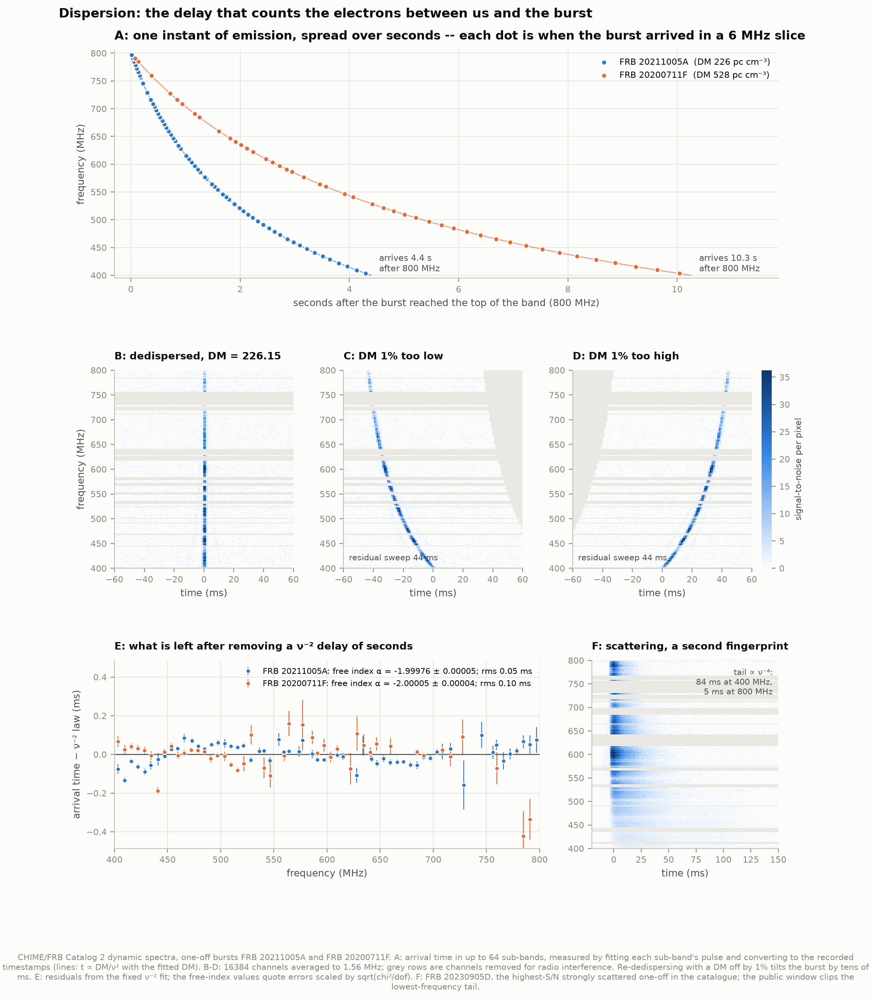
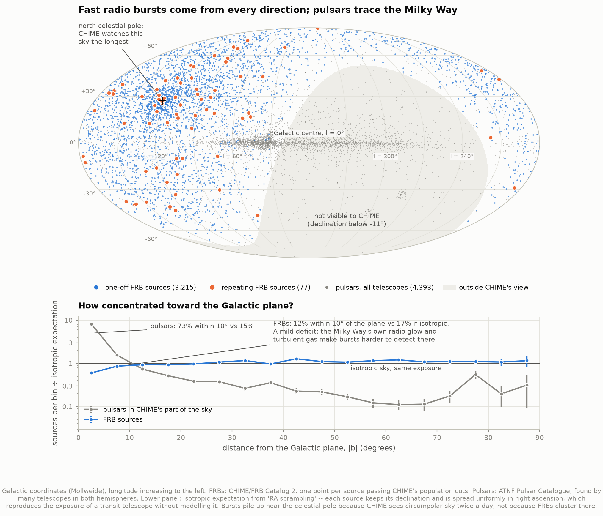
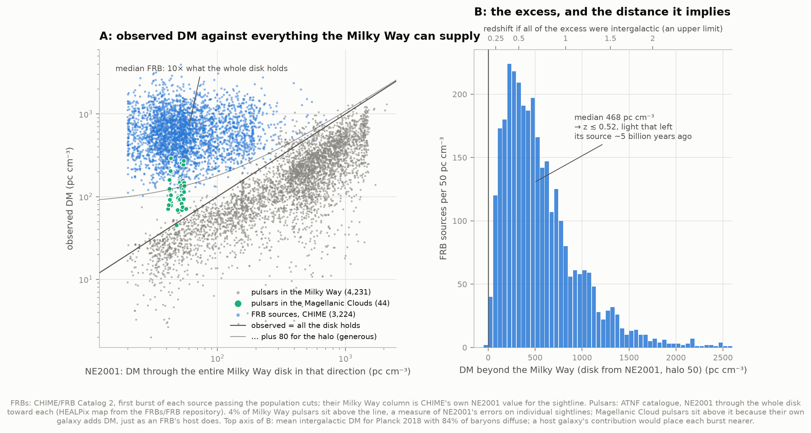
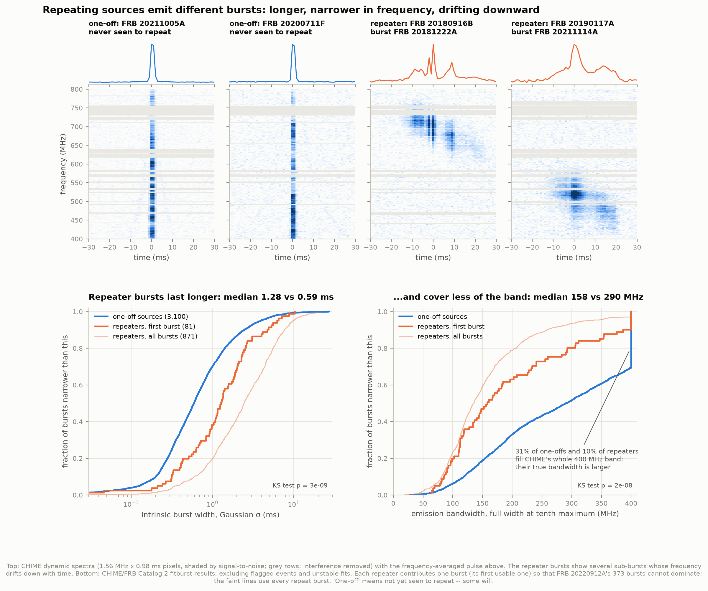
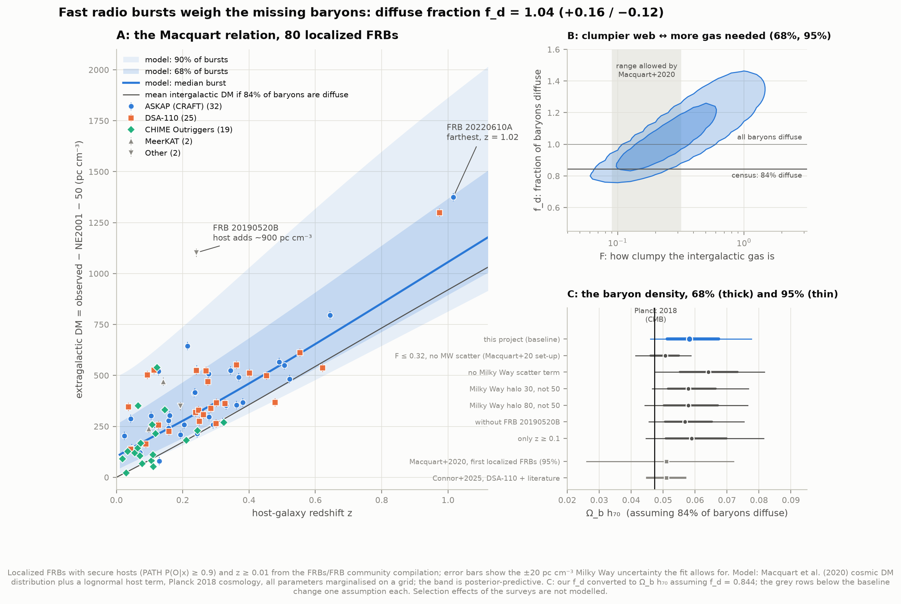

# C3 — Fast radio bursts

**Where do millisecond radio flashes come from, and what can they tell us about the gas
between the galaxies?**

A fast radio burst (FRB) is a flash of radio waves lasting about a thousandth of a second. For
that instant a single burst can outshine its entire host galaxy at radio wavelengths. The first
one turned up in 2007, buried in archival data from the Parkes telescope. Today the
Canadian CHIME telescope catches several a day. What makes them is still debated. At least
some come from magnetars, neutron stars with extreme magnetic fields: in 2020 a magnetar in
our own Galaxy produced a burst of the same kind.

This project works from the **Second CHIME/FRB Catalog** (released January 2026): 4,539 bursts
from 3,641 sources. Two other datasets serve as controls:

- **80 FRBs whose host galaxies have measured redshifts**, compiled by the FRB community.
- **4,393 pulsars from the ATNF catalogue.** Pulsars are radio sources we know lie inside our
  own Galaxy.

| Question | What the data say |
|---|---|
| Is the arrival delay really ∝ 1/frequency², as plasma physics predicts? | Yes. Two bursts give power-law indices of **−1.99976 ± 0.00005** and **−2.00005 ± 0.00004**, measured over sweeps of 4.4 and 10.3 seconds. |
| Do FRBs come from inside the Milky Way? | No. The median burst has **10× more dispersion** than the Milky Way's entire disk could supply in its direction. 99.4% exceed even a generous total for the whole Galaxy. |
| Do they cluster on the sky? | No. They show a slight *deficit* near the Galactic plane (12% within 10° vs 17% expected). This is the opposite of pulsars, which pile up there (73% vs 15%). |
| Are repeating sources different? | Yes. Their bursts last **2.2× longer**, cover **half the bandwidth**, and are **5× as often** made of several sub-bursts (p ~ 10⁻⁸). |
| How much of the universe's ordinary matter is diffuse ionized gas? | Essentially all of it that is not in stars or cold gas: diffuse fraction **f_d = 1.04 (+0.16 / −0.12)** from 80 host-localized FRBs (95% interval 0.82–1.38). The "missing" baryons are there. |

---

## 1. Dispersion: counting electrons with a stopwatch

Radio waves travel through ionized gas slightly slower than light, and the lower the frequency,
the slower they go. A burst that leaves its source in one instant therefore arrives spread
out, high frequencies first. The delay is

  *t* = 4.149 ms × DM / (*ν* / 1 GHz)²

where the **dispersion measure (DM)** is the total number of free electrons along the path, in
a column one centimetre square. Its unit, pc cm⁻³, means "one electron per cubic centimetre
for one parsec". A typical FRB, DM ≈ 500, has crossed about 1.5 × 10²¹ electrons per cm². DM is
the single most useful number in the field, because it measures how much matter the signal
passed through, and that depends on how far it has travelled.



- **Panel A.** The raw effect. Two of the brightest clean one-off bursts in the catalogue both
  reach CHIME's 800 MHz channel first. They arrive at 400 MHz **4.4 s** (DM 226) and
  **10.3 s** (DM 528) later. Each dot is a measured arrival time: we fitted the pulse in each
  6 MHz slice of the band, then converted it back to the telescope's own timestamps.
- **Panels B–D.** Shifting every channel back by the 1/ν² delay for the right DM lines the
  burst up into one vertical stripe. With a DM just 1% off, it tilts by 44 ms.
- **Panel E. The test.** Fitting the arrival times with a power law of *free* index gives
  **−1.99976 ± 0.00005** and **−2.00005 ± 0.00004**, against the −2 that cold-plasma dispersion
  predicts. With the index fixed at −2, the fitted DMs (226.150 and 527.647) match CHIME's own
  to 0.002%. The residuals are 0.05–0.10 ms rms: sub-millisecond timing over a sweep of seconds.
  Strictly, FRB 20211005A's index sits 0.00024 from −2, several times its error bar. At a
  couple of parts in 10⁴, the bursts' own structure changing with frequency is enough to do
  that, so we read both results as "−2 to within ~0.0003", not as new physics.
- **Panel F.** A second fingerprint of the same plasma. Turbulent gas scatters the waves onto
  slightly different paths, smearing the pulse into a tail that grows as ν⁻⁴. For FRB 20230905D
  the tail is 84 ms at 400 MHz and 5 ms at 800 MHz.

## 2. Where on the sky?



Pulsars (grey) trace a thin line: the disk of the Milky Way. FRBs (blue, repeaters orange) do
not. Two effects shape the FRB map, and neither is astrophysical:

- **The empty south.** CHIME is a fixed telescope in British Columbia. It sees the sky north of
  declination −11° as the Earth turns, and nothing south of that (shaded).
- **The pile-up near the celestial pole.** Sky that never sets passes through CHIME's view
  twice a day. Sources above declination +70° got a median of 848 hours of exposure against
  100 hours elsewhere. They hold 23% of the sources in 5% of the visible sky.

To compare FRBs with an isotropic sky seen through that same uneven exposure, we use **"RA
scrambling"**, a trick from cosmic-ray astronomy. A transit telescope sweeps every right
ascension equally, so its exposure depends on declination only. Keeping each source's
declination and spreading it evenly in right ascension therefore gives the exact isotropic
expectation, with no exposure model needed.

**Result (lower panel).**
- **Pulsars:** 73% sit within 10° of the Galactic plane, against 15% expected.
- **FRBs:** only 12% do, against 17% expected. That is a mild *deficit* (KS test
  p = 3 × 10⁻¹¹; with Catalog 1's 536 bursts, Josephy et al. 2021 found no significant latitude
  dependence).

A Galactic population would do the opposite. The deficit is what a selection effect predicts:
the Milky Way's own synchrotron glow raises the telescope noise near the plane, and its
turbulent gas scatters bursts. Both make detection harder there. We did not model the
telescope's sensitivity, so this is an interpretation, not a measurement of the cause. The
same effect shows up as a weak dipole in right ascension pointing at 11.8 h, near the north
Galactic pole at 12.9 h (Rayleigh test p = 4 × 10⁻⁵).

## 3. More dispersion than the whole Milky Way can supply



The Milky Way's free electrons are mapped by models such as **NE2001**, which are calibrated
on pulsars with independently known distances. For any direction, NE2001 gives the DM of a
path through the *entire* Galactic disk. In the left panel:

- **Pulsars** sit on or below the line, as they must: they are inside the disk and see only
  part of it. The 4.5% of Milky Way pulsars above the line measure NE2001's errors on
  individual sightlines.
- **Pulsars in the Magellanic Clouds** sit above it. They are in other galaxies, and their
  own galaxy's gas adds DM.
- **FRBs** sit in a cloud far above the line. The median burst has **10.4×** the DM of the
  whole disk in its direction. 97.8% have more than twice it.

Adding a generous 80 pc cm⁻³ for the Galaxy's hot halo, 99.4% of the 3,224 FRB sources still
exceed everything the Milky Way can supply. The 19 that don't are of two kinds:

- **5 lie within 10° of the Galactic plane**, where NE2001 predicts a lot and is least certain.
- **14 are at high latitude with low DMs of 103–174.** These are nearby bursts, not Galactic
  ones. One of them, the repeater FRB 20181030A, has been localized to a galaxy about 20 Mpc
  away.

A low DM doesn't make a burst Galactic. It just means this particular test can't prove that
it isn't.

The right panel shows the extragalactic part of the DM. Its median, **468 pc cm⁻³**, would
correspond to **redshift 0.52** if all of it were intergalactic gas: light that left its
source about **5 billion years ago**. That is an upper limit, since the host galaxy
contributes too. The highest DM in the catalogue, 3,967 pc cm⁻³ (FRB 20200607C), would imply
z ≈ 5 on the same assumption. A large host contribution is at least as likely.

## 4. Repeaters are different



83 of the 3,641 sources (2.3%) have repeated. Between them they produced 981 of the 4,539
bursts; one of them, FRB 20220912A, produced 373. Comparing one burst per source (each
repeater's first usable burst, against 3,100 one-offs):

| | Repeaters | One-offs | KS test p |
|---|---|---|---|
| Intrinsic width (Gaussian σ) | 1.28 ms | 0.59 ms | 3 × 10⁻⁹ |
| Emission bandwidth (full width at tenth maximum) | 158 MHz | 290 MHz | 2 × 10⁻⁸ |
| Fill CHIME's entire 400 MHz band | 10% | 31% | |
| Made of several sub-bursts | 21% | 4.5% | |
| Extragalactic DM (beyond NE2001) | 330 pc cm⁻³ | 524 pc cm⁻³ | 6 × 10⁻⁸ |

The example dynamic spectra show why. One-off bursts are sharp vertical lines covering the
band. Repeater bursts are narrowband clumps whose sub-bursts drift *down* in frequency over
time, the pattern astronomers call the "sad trombone". This reproduces Pleunis et al. (2021)'s
result from Catalog 1, with six times the sample.

Two cautions:

- **"One-off" only means "not yet seen to repeat".** Some are repeaters that were caught once.
- **The lower DMs of repeaters are probably a selection effect.** Nearer sources are easier to
  catch repeating, because more of their fainter repeat bursts clear the detection threshold.
  It does not have to mean they are intrinsically different.

## 5. The Macquart relation: weighing the missing baryons



Here is the payoff of DM.

- **The census problem.** Planck's measurements of the cosmic microwave background fix how
  much ordinary matter (baryons) the universe contains. At the present day, stars, galaxies
  and cold gas account for only a small fraction of it. The rest was long called "missing":
  thin, hot, ionized gas between the galaxies, almost impossible to see.
- **What FRBs add.** Every one of those electrons disperses a passing FRB. So DM should grow
  with distance at a rate set by how much diffuse gas there is. Macquart et al. (2020)
  measured this with the first handful of localized FRBs.
- **Our sample.** It has **80 FRBs** whose host galaxies are securely
  identified (PATH association probability ≥ 0.9) and have measured redshifts. They come from
  ASKAP/CRAFT (32), DSA-110 (25), CHIME Outriggers (19), MeerKAT (2) and other telescopes (2).

**The model.** We subtract the Milky Way (NE2001 plus 50 pc cm⁻³ for its halo). What remains is
the sum of two parts:

- **The intergalactic part.** Its mean follows ⟨DM⟩(z) ∝ f_d·Ω_b·H₀, where f_d is the fraction
  of all baryons that are in diffuse ionized gas. Around that mean it scatters according to
  the Macquart et al. (2020) distribution. The width of the scatter is set by F, how clumpy
  the gas is.
- **The host galaxy's contribution**, diluted by 1+z.

Cosmology is fixed at Planck 2018. f_d, F and the host distribution are all fitted together
on a grid, and we allow ±20 pc cm⁻³ of uncertainty in the Milky Way term we subtracted.

**Result.** The diffuse fraction comes out at **f_d = 1.04 (+0.16 / −0.12)** (68%), with 95% of
the probability between 0.82 and 1.38. Values above 1 would mean more electrons than the
universe has baryons, so read this as: *the diffuse gas holds essentially every baryon that is
not in stars or cold gas*, and very probably more than 80% of all baryons. That is the
"missing" matter, found by counting its electrons. The census of stars and cold gas implies f_d
≈ 0.84. That sits inside our 95% range, about 1.6σ below our median. The fit also constrains
the host galaxies. Their DM contribution has a median of 100 (77–125) pc cm⁻³ and a wide spread
(lognormal σ = 0.94). The intergalactic scatter parameter is F = 0.27 (0.15–0.53). Turned
around, assuming f_d = 0.844, the same data give a cosmic baryon density **Ω_b h₇₀ = 0.058
(+0.009 / −0.007)**.

The robustness checks each change one assumption:

| Variant | f_d | Ω_b h₇₀ if f_d = 0.844 |
|---|---|---|
| **Baseline**: Milky Way scatter ±20 pc cm⁻³, F from 0.04 to 3.2, halo 50 | **1.04 (+0.16 / −0.12)** | **0.058 (+0.009 / −0.007)** |
| Macquart et al. (2020) set-up: F ≤ 0.32, no Milky Way scatter | 0.90 (+0.08 / −0.08) | 0.051 (+0.004 / −0.005) |
| No Milky Way scatter term (F free) | 1.14 (+0.16 / −0.16) | 0.064 (+0.009 / −0.009) |
| Milky Way halo 30 pc cm⁻³ instead of 50 | 1.03 (+0.15 / −0.11) | 0.058 (+0.009 / −0.006) |
| Milky Way halo 80 pc cm⁻³ instead of 50 | 1.03 (+0.17 / −0.14) | 0.058 (+0.009 / −0.008) |
| Without FRB 20190520B (host DM ~900) | 1.01 (+0.15 / −0.11) | 0.057 (+0.008 / −0.006) |
| Only z ≥ 0.1 (62 FRBs) | 1.05 (+0.20 / −0.14) | 0.059 (+0.011 / −0.008) |

**Where our number sits against the published ones.** Planck gives Ω_b h₇₀ = 0.0473. Macquart
et al. (2020) found 0.051 (+0.021/−0.025, 95%) and Connor et al. (2025) 0.051 ± 0.006. Run with
Macquart et al.'s own set-up, our data give Ω_b h₇₀ = 0.051 (+0.004 / −0.005), in line with
both. Our baseline, which lets the scatter parameter F be larger, lands at 0.058 (+0.009 /
−0.007), about 1.6σ above Planck: consistent, but on the high side. The effects a simple fit
like ours leaves out push in both directions. Surveys miss some high-DM bursts, because heavy
dispersion smears them below threshold, and that biases f_d *low*. Hosts are harder to identify
when they are farther away, so a sample of *localized* bursts may lean toward bursts whose DM
is high for their redshift, and that biases f_d *high*.

**Why the answer depends on F.** Panel B shows the one assumption that matters.

- The data scatter more around the relation than the semi-analytic models behind Macquart et
  al.'s range 0.09 ≤ F ≤ 0.32 allow. Baptista et al. (2024) found the same for nearby FRBs.
- Clumpier gas makes the typical sightline fall *below* the mean. Matching the same data then
  requires more gas in total, so f_d rises with F.
- Without the Milky Way scatter term, the fit has no other way to explain a nearby burst that
  is off by a few tens of pc cm⁻³. It inflates F further, and f_d reaches 1.14.

This degeneracy is real, not a flaw in the code, and it is why modern analyses model the
intergalactic scatter and the survey selection together.

---

## How it works

**Data.**

| Source | What | Size |
|---|---|---|
| CHIME/FRB Catalog 2 (CANFAR, DOI 10.11570/25.0066) | one row per sub-burst: position, DM, width, scattering, spectrum, fluence, exposure | 4 MB |
| CHIME dynamic spectra, same DOI | 16384 channels × 0.98 ms around five example bursts | 68 MB |
| [FRBs/FRB](https://github.com/FRBs/FRB) repository, commit `996fcda` | localized FRBs, host associations and redshifts; an NE2001 all-sky DM map | 1.6 MB |
| ATNF Pulsar Catalogue v2.8.1 | 4,393 pulsars: position, DM, associations | 0.3 MB |

**Counting the right thing.** The catalogue has one row per *sub-burst*, bursts belong to
*sources*, and some sources repeat hundreds of times. We keep the three levels apart:

| Stage | Count |
|---|---|
| catalogue rows (one per sub-burst) | 5,045 |
| bursts | 4,539 (981 from repeaters) |
| sources | 3,641 (83 repeaters) |
| sources passing CHIME's population flags | 3,292 |
| … with a fitted DM | 3,224 |

Population statistics use each source's first burst. We drop events CHIME flags for exclusion:
commissioning or low-sensitivity days, far-sidelobe detections, and citizen-science events.
This follows the catalogue paper's convention.

**Two checks on the inputs, both done in code.**

- **The catalogue's `dm_exc_ne2001` column subtracts the Galactic disk only, with no halo
  term.** At |b| > 60° the implied NE2001 DM has median 25 pc cm⁻³, exactly the model's polar
  column.
- **The NE2001 map has no coordinate frame in its header.** Looked up in Galactic coordinates
  it reproduces CHIME's per-burst NE2001 values (median ratio 1.020, 68% within 1.004–1.063).
  Looked up in equatorial coordinates the ratio scatters from 0.55 to 3.9. So we read it as
  Galactic.

**Localized sample cuts.**

| Stage | Count |
|---|---|
| localized FRBs in the compilation | 179 |
| with a host redshift | 107 |
| secure host (P(O\|x) ≥ 0.9) | 82 |
| z ≥ 0.01 | 81 |
| positive extragalactic DM | 80 |

- **Why z ≥ 0.01.** Below that, a galaxy's redshift is dominated by its own motion rather than
  cosmic expansion, and the intergalactic DM (<10 pc cm⁻³) is smaller than the uncertainty on
  the Milky Way's halo. This drops FRB 20200120E, which sits in a globular cluster in M81, 3.6
  Mpc away.
- **Redshift disagreements.** The compilation's burst and host tables disagree for two bursts.
  For FRB 20231201A they give 0.119 vs 0.1119, for FRB 20220610A 1.015 vs 1.016. We use the
  host table's value.

**The fit.**

- **Grid and priors.** The posterior is evaluated exhaustively on a 4-D grid with flat priors:
  0.2 ≤ f_d ≤ 1.6, 0.04 ≤ F ≤ 3.2, host median 20–800 pc cm⁻³, host log-width 0.2–2.0. There
  is no sampler and no randomness.
- **Handling extreme scatter.** At large F the Macquart distribution needs a constant C₀ so
  negative that the textbook formula underflows. We carry that factor analytically, and the
  test suite checks the distribution against its exact large-scatter limit.

**The dispersion test.** In each 6.25 MHz slice we fit a Gaussian to the dedispersed pulse. We
convert its centre to the telescope's recorded timestamp for that sample, and assign it the
slice's effective frequency ⟨f⁻²⟩^(−1/2): at 400 MHz, using the mean frequency instead would
bias the time by 0.7 ms. Slices fainter than 6σ, or timed worse than 0.25 ms, are skipped. The
public data only cover ±77 ms around the catalogue's own DM track. A burst following a law
different enough to leave that window would be invisible, so the test is only sensitive to
departures from −2 smaller than about 0.02. That is ample for a result good to 0.0003.

---

## What this cannot tell you

- **What FRBs are.** DM measures the path, not the source. Nothing here identifies the engine.
- **Distances of individual CHIME bursts.** DM gives an upper limit on redshift. A burst's
  host contribution is unknown until the host is found.
- **Rates or luminosities.** Those need CHIME's injection-calibrated selection function, which
  we did not use. Every sky and population statement here is about *detected* bursts.
- **A measurement of the cosmic baryon density free of astrophysics.** The Macquart fit
  assumes a shape for the intergalactic scatter and a lognormal host term, holds cosmology at
  Planck, treats NE2001 as unbiased, and ignores the surveys' selection effects. Recent
  analyses (Baptista et al. 2024; Connor et al. 2025) model those. Ours reproduces the
  published numbers when set up like Macquart et al. (2020), and panel B shows how far the
  answer moves when F is freed.
- **Whether all FRBs repeat.** A one-off here is a source seen once in five years of CHIME.

---

## Running it

```bash
cd ..                            # repository root
python3 -m venv .venv
source .venv/bin/activate
pip install numpy scipy pandas matplotlib astropy astropy-healpix h5py requests

cd 04-fast-radio-bursts
python fetch_data.py             # ~75 MB; --no-dynamic-spectra skips the 68 MB of examples
python run.py                    # all analyses + figures, a few minutes (mostly the Macquart fits)
python run.py --quick            # baseline Macquart fit only, under a minute
python run.py --figures-only     # redraw figures from the last run, seconds
python test_physics.py           # self-checks on the formulas and the fitting code
```

Once `data/` is populated, everything runs offline. `data/manifest.json` records the source
URL, retrieval time, size and SHA-256 of every downloaded file, and `data/results.json` every
number quoted here.

### Files

| File | What it does |
|---|---|
| `config.py` | Data sources (pinned), example bursts, every cut and fit setting, each with its reason |
| `fetch_data.py` | Downloads and caches the four datasets, writes the manifest |
| `catalogs.py` | Loads them into tidy tables: sub-bursts → bursts → sources; pulsars; localized FRBs |
| `frb_physics.py` | Dispersion, the mean cosmic DM, the Macquart et al. (2020) distribution |
| `waterfalls.py` | Reads dynamic spectra; re-dedispersion; sub-band arrival times and the index fit |
| `macquart_fit.py` | The grid likelihood for the Macquart relation, and its predictive band |
| `analysis.py` | Sky, DM, repeater and Macquart analyses; writes `results.json` |
| `figures.py` | Every figure |
| `run.py` | Runs everything and prints the headline numbers |
| `test_physics.py` | Checks the formulas against known answers and the fits against simulated inputs |

---

## Data credits

- **CHIME/FRB Catalog 2.** CHIME/FRB Collaboration (2026), *The Second CHIME/FRB Catalog of
  Fast Radio Bursts*, arXiv:2601.09399; data DOI 10.11570/25.0066, hosted by CANFAR. CHIME is
  located at the Dominion Radio Astrophysical Observatory, operated by the National Research
  Council of Canada.
- **Localized FRBs and host galaxies.** The FRBs/FRB open repository (Prochaska et al. and
  contributors), commit `996fcda9`. The compilation draws on many papers, cited per burst in
  its `refs` column, among them Macquart et al. 2020, Gordon et al. 2023, Shannon et al. 2024,
  Sharma et al. 2024 and Leung et al. 2025.
- **NE2001 Galactic electron model.** Cordes & Lazio (2002). We use the all-sky map from the
  FRBs/FRB repository.
- **ATNF Pulsar Catalogue v2.8.1.** Manchester, Hobbs, Teoh & Hobbs (2005), AJ 129, 1993.
- **Comparison values.** Macquart et al. 2020 (Nature 581, 391); Connor et al. 2025 (Nature
  Astronomy); Baptista et al. 2024 (ApJ); Pleunis et al. 2021 (ApJ 923, 1); Josephy et al.
  2021 (ApJ 923, 2); Planck Collaboration 2020 (A&A 641, A6).

Retrieved 2026-09-29.
