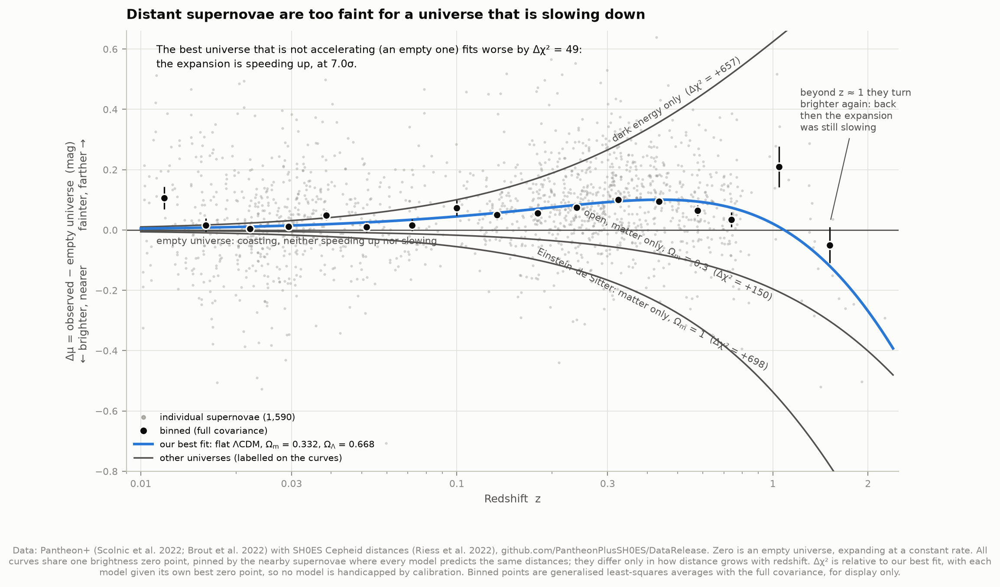
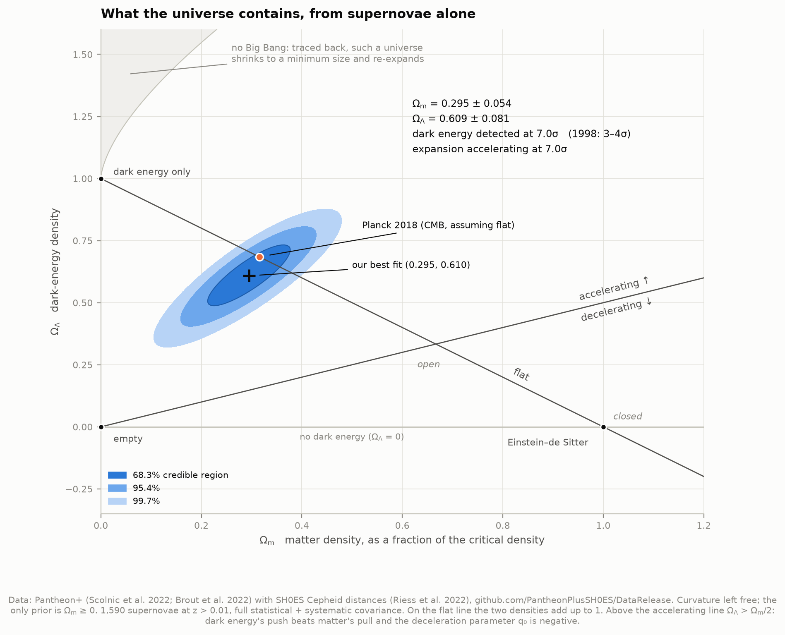
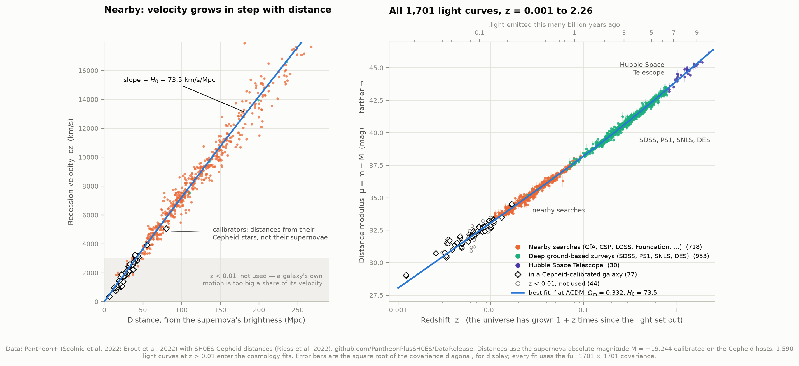
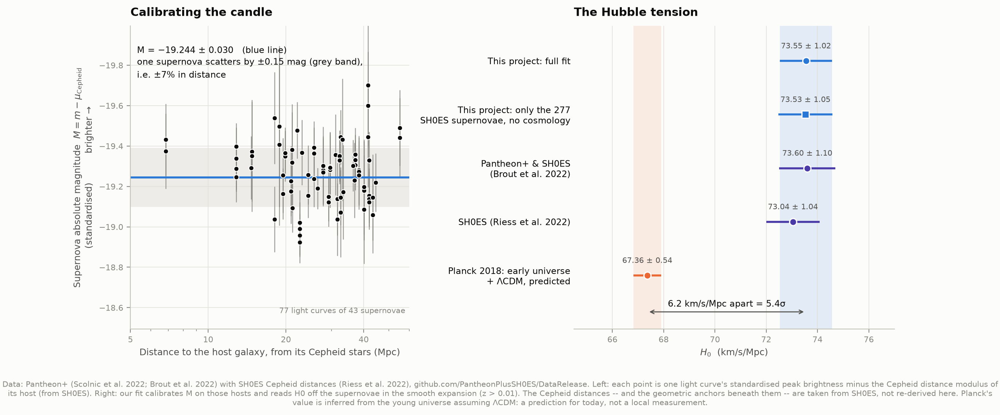

# D1 — The accelerating universe, from 1,701 supernova light curves

**Is the expansion of the universe slowing down, as gravity alone would make it — or speeding up?**

Speeding up. This project takes the Pantheon+ compilation of Type Ia supernovae — 1,701 light
curves of about 1,550 exploding stars, observed by some twenty surveys between redshift 0.001
and 2.26 — and fits the expansion history of the universe to them. It reproduces the result
that won the 2011 Nobel Prize in Physics, now at **7σ** where the 1998 discovery papers had
3–4σ. It also measures the Hubble constant from the last rung of the cosmic distance ladder
and finds it **5.4σ** away from the value the early universe predicts: the Hubble tension.

The likelihood is written from scratch here, and then checked against the Pantheon+ team's own
published MCMC chains. Every parameter agrees to within 0.05σ.

---

## Results

### The discovery: supernovae alone

| Quantity | Ours | Pantheon+ (Brout et al. 2022) |
|---|---|---|
| Matter density Ωm, flat universe | 0.332 ± 0.018 | 0.334 ± 0.018 |
| Matter density Ωm, curvature free | 0.295 ± 0.054 | 0.306 ± 0.057 |
| Dark-energy density ΩΛ, curvature free | 0.609 ± 0.081 | 0.625 ± 0.084 |
| Curvature Ωk = 1 − Ωm − ΩΛ | 0.10 ± 0.13 | — |
| Deceleration parameter today, q₀ (curvature free) | −0.46 ± 0.06 | — |
| Dark energy's equation of state w (flat) | −0.91 ± 0.15 | −0.90 ± 0.14 |
| **Dark energy exists (ΩΛ > 0)** | **7.0σ** (Δχ² = 49) | 1998: 3.0–4.0σ (Riess et al.), 99% (Perlmutter et al.) |
| **The expansion is accelerating (q₀ < 0)** | **7.0σ** | 1998: 2.8–3.9σ (Riess et al.) |

With curvature left completely free, the best universe that is *not* accelerating is an
empty one, and even that fits worse by Δχ² = 49. Any matter at all makes it worse. A flat
universe containing only matter (Einstein–de Sitter, the favourite before 1998) is
rejected by Δχ² = 698.

### The Hubble constant: with the Cepheid calibrators

| Quantity | Ours | Published |
|---|---|---|
| H₀ (km/s/Mpc) | **73.55 ± 1.02** | 73.6 ± 1.1 (Brout et al. 2022); 73.04 ± 1.04 (SH0ES, Riess et al. 2022) |
| H₀ from only SH0ES's 277 supernovae, no cosmological model | 73.53 ± 1.05 | — |
| Supernova absolute magnitude M | −19.244 ± 0.030 | chain: −19.244 ± 0.030 |
| Planck 2018, from the cosmic microwave background | — | 67.36 ± 0.54 |
| **Tension with Planck** | **5.4σ** (6.2 km/s/Mpc apart) | |

### What the fit implies

- **The acceleration began at z = 0.59 ± 0.04, about 5.3 billion years ago.** Before that,
  matter's gravity was winning and the expansion was slowing. The switch happened before the
  Sun and Earth formed, 4.6 billion years ago.
- **The universe is 12.46 ± 0.24 billion years old**, from our H₀ and Ωm. A matter-only
  universe expanding at the same rate today would be only 8.9 billion years old, younger
  than the oldest stars in our own galaxy (well over 12 billion years). That mismatch was a
  known problem before 1998, and dark energy removes it.
- Our age is younger than Planck's 13.8 billion years. That is the Hubble tension again: a
  faster expansion today means less time since the Big Bang.
- At z = 0.5 our best fit puts supernovae about **9% farther** away than an Ωm = 0.3
  universe without dark energy would. That difference is what the 1998 teams saw.

---

## The four figures worth looking at

**The discovery.** Every supernova's brightness is compared with an empty universe that
coasts at a constant rate. Anything above zero is fainter, and so farther away, than
coasting allows: the expansion has sped up. Out to z ≈ 0.5 the supernovae rise above that
line. Every universe made only of matter bends the other way. Beyond z ≈ 1 the supernovae
turn brighter again, because back then the expansion was still slowing down. Only a
universe with both matter and dark energy draws that shape.



**The 1998 figure, redone.** This is the plane in which the discovery was first reported:
how much matter, how much dark energy. The blue regions are where our 1,590 supernovae put
the answer. They sit far from "no dark energy" (the horizontal line) and well above the line
separating acceleration from deceleration. The cosmic microwave background, measured by
Planck from the universe at 380,000 years old, lands inside our 68% region. Two completely
independent methods agree.



**The Hubble diagram itself.** On the left, the nearby galaxies: recession velocity rises
in step with distance, Hubble's law, with slope H₀. On the right, the whole sample, from the
Cepheid-calibrated galaxies at 22 million light-years out to a supernova whose light set off
9.9 billion years ago.



**The distance ladder and the tension.** On the left, the standard candle made visible:
every supernova in a galaxy with a Cepheid distance, converted to absolute brightness. They
agree to ±0.15 mag, which is ±7% in distance, with no trend with distance. On the right, the
local measurements of H₀ cluster at 73–74 while the early-universe prediction sits at 67.4.



Also: `05_dark_energy_w` (is dark energy a cosmological constant? yes, within the errors),
`06_expansion_history` (the size of the universe over time, for our best fit and two
textbook universes), `07_validation` (our likelihood against the Pantheon+ chains).

---

## Background, in brief

**Standard candles.** A Type Ia supernova is a white dwarf star exploding. The explosions
are similar enough that, after two corrections, their peak brightness is nearly the same
everywhere. The corrections: slower-fading ones are intrinsically brighter, and redder ones
are dimmed by dust. Knowing how bright something really is (absolute magnitude *M*) and
measuring how bright it looks (*m*) gives its distance, through the distance modulus
μ = m − M = 5 log₁₀(d / 10 pc). Five magnitudes is a factor of 100 in brightness, and a
factor of 10 in distance.

**Redshift.** Light from a distant galaxy arrives stretched: 1 + z is the factor by which
the universe has grown since the light set out. Plotting distance against redshift (a Hubble
diagram) traces how the expansion rate has changed over time.

**Why "fainter" means "accelerating".** For a given redshift, a universe whose expansion
sped up took longer to grow by that factor. The light therefore travelled farther, and the
supernova looks fainter. A decelerating universe does the opposite. An empty universe, with
nothing to speed it up or slow it down, is the dividing line, which is why figure 02 measures
everything from it.

**The Ω's.** Cosmologists measure densities as fractions of the *critical density*, the
density that makes space exactly flat. For our H₀ it is about six hydrogen atoms per cubic
metre. Ωm is matter (ordinary plus dark), ΩΛ is dark energy. If they add up to 1, space is
flat. More than 1 means closed (like a sphere); less means open (like a saddle). Matter pulls,
and dark energy (w < −1/3) pushes. The expansion accelerates today when ΩΛ > Ωm/2, which is
q₀ < 0.

**The distance ladder.** Supernovae alone measure the *shape* of the Hubble diagram, but not
its scale. Their true brightness M and the Hubble constant enter only in combination (see
below). The scale comes from a ladder:

1. Geometry (parallaxes, a water maser disc in NGC 4258, eclipsing binaries in the Large
   Magellanic Cloud) calibrates Cepheid variable stars.
2. Cepheids give distances to 37 nearby galaxies that also hosted a supernova. That
   fixes M.
3. Supernovae far enough away to ride the smooth cosmic expansion then give H₀.

This project does step 3 and inherits steps 1–2 from SH0ES.

---

## How it works

**1. Data.** From the public Pantheon+/SH0ES release on GitHub (80 MB, retrieved
2026-09-29):
- the distance table: redshifts and standardised peak magnitudes `m_b_corr` for 1,701 light
  curves, plus Cepheid distances for the 77 light curves in calibrator galaxies;
- the 1701 × 1701 covariance matrix of those magnitudes, statistical plus systematic;
- the statistical-only covariance, to see what systematics do;
- the team's own MCMC chains, as an answer key.

Every file's URL, size, SHA-256 and retrieval time are recorded in `data/manifest.json`.

**2. The model.** A universe is defined by H₀, Ωm, ΩΛ (and w). Its luminosity distance comes
from integrating the expansion rate,
`E(z)² = Ωm(1+z)³ + Ωk(1+z)² + ΩΛ(1+z)^{3(1+w)}`,
with curvature bending light rays (sinh for open space, sin for closed).
`cosmology.py` does this for 150,000 universes at once, and is checked in `test_physics.py`
against textbook closed forms, astropy, and adaptive quadrature: agreement to ~10⁻⁶.
Radiation is left out; `test_physics.py` checks against astropy with radiation included and
shows it changes distances by at most 0.0004 mag here.

**3. The likelihood**, matching the published one line by line:
- supernovae at z > 0.01 only. Below that, a galaxy's own motion of a few hundred km/s is
  too large a share of its recession velocity;
- distances integrated to the peculiar-velocity-corrected redshift `zHD`, with one factor
  of (1 + z) from the heliocentric redshift `zHEL`;
- χ² = rᵀ C⁻¹ r with the **full covariance**. Supernovae share calibration, dust and
  selection systematics, so their errors are correlated, and the data release insists on
  this.

**4. The degeneracy.** The predicted magnitude is `m = M + 5 log₁₀(d_L) + 25`, and
`d_L ∝ c/H₀`, so M and H₀ appear only as the combination `M − 5 log₁₀ H₀`. Supernovae alone
cannot separate them. Both enter linearly, so for each universe on the grid they are solved
exactly by generalised least squares instead of being sampled. With flat priors this gives
the same answer as integrating over them.

**5. Grids, not chains.** The (Ωm, ΩΛ) plane is evaluated at 96,641 points, and (Ωm, w) at
31,161. Credible regions are highest-density regions of the normalised grid posterior. The
significance of dark energy comes from profiling the likelihood along ΩΛ = 0 and along
q₀ = 0 (ΩΛ = Ωm/2), with Ωm ≥ 0 as the only prior.

**6. H₀.** Adding the calibrators (rows whose model distance is the Cepheid one) pins M. The
fit then solves for (M, 5 log₁₀ H₀) exactly at each Ωm and averages over Ωm. As a
cross-check, H₀ is refitted from only the 277 supernovae SH0ES used (0.023 < z < 0.15),
with a model-free Taylor expansion of the distance. It gives the same number.

**7. Validation.** Our posteriors against the Pantheon+ chains, with the same priors
(figure 07):

| Parameter | Ours | Pantheon+ chain | Shift | Width ratio |
|---|---|---|---|---|
| Ωm, flat | 0.3323 ± 0.0182 | 0.3314 ± 0.0179 | +0.05σ | 1.02 |
| Ωm, curvature free | 0.295 ± 0.054 | 0.296 ± 0.055 | −0.02σ | 0.99 |
| ΩΛ, curvature free | 0.609 ± 0.081 | 0.611 ± 0.080 | −0.02σ | 1.01 |
| w, flat | −0.914 ± 0.149 | −0.916 ± 0.147 | +0.01σ | 1.01 |
| H₀ | 73.55 ± 1.02 | 73.54 ± 1.02 | +0.01σ | 1.00 |
| M | −19.244 ± 0.030 | −19.244 ± 0.030 | −0.01σ | 0.99 |

The remaining differences are the size of the chains' own Monte Carlo noise. The paper's
quoted values differ slightly from its released chains; we match the chains.

---

## Honest notes

**What is ours and what is inherited.** The hardest parts of supernova cosmology are done
by the Pantheon+ team, not here. That means cross-calibrating twenty photometric systems,
fitting light curves, standardising them (stretch, colour, host-galaxy mass), and correcting
for selection biases with simulations. `m_b_corr` is their output, and the systematic
covariance is their error budget. Likewise, the Cepheid distances, and the geometric anchors
beneath them, come from SH0ES. What this project does independently is the cosmology: the
distance model, the likelihood, the fits, and every derived number.

**Systematics matter, and so do correlations.** The same flat-universe fit three ways:

| Covariance used | Ωm |
|---|---|
| statistical + systematic (correct) | 0.332 ± 0.018 |
| statistical only | 0.348 ± 0.013 |
| diagonal only (correlations ignored) | 0.351 ± 0.014 |

Leaving systematics out shrinks the error bar by 30% and moves the answer by one of its own
error bars. Ignoring correlations, the mistake the data release warns against, does much the
same. For H₀, systematics matter far less (73.24 ± 1.00 statistical only). Its error is
dominated by the 37 calibrator galaxies.

**The table's error column does not match the covariance.** `m_b_corr_err_DIAG` is
documented as the diagonal of the covariance, but it is about 1.4× larger for almost every
row. This is an open question on the data release (issues
[#6](https://github.com/PantheonPlusSH0ES/DataRelease/issues/6) and
[#13](https://github.com/PantheonPlusSH0ES/DataRelease/issues/13)); the authors' only answer
is that the column is "for plotting". The column is not the one that describes the data.
Our best fit has χ² = 1403 for 1588 degrees of freedom with the covariance, but χ² = 698
with the column, meaning the supernovae scatter far less than the column claims. The figures
therefore show the covariance diagonal, and no fit uses either.

**"7σ" is a translation, not a measurement.** It is √Δχ² for a one-parameter comparison
whose constrained best fit (an empty universe) sits at the edge Ωm = 0. That conversion is
approximate at such a boundary. The honest statement is Δχ² = 49 against the best universe
without acceleration, under the Pantheon+ systematic budget. Effects outside that budget,
such as supernovae evolving with cosmic time, are not covered by any number here.

**Two binned points sit high.** In figure 02, the nearest bin (0.010 < z < 0.0135, 41
supernovae) and the z ≈ 1 bin (10 supernovae) sit 2.7σ and 2.9σ above the best fit. Both are
in the data, not artefacts: simple weighted means and medians agree. Neither drives the
result:

| Data used | n | Ωm (flat) | H₀ |
|---|---|---|---|
| all (baseline) | 1590 | 0.332 ± 0.018 | 73.55 ± 1.02 |
| without the nearest bin | 1549 | 0.334 ± 0.018 | 73.66 ± 1.02 |
| without the z ≈ 1 bin | 1580 | 0.343 ± 0.019 | 73.53 ± 1.02 |
| nothing beyond z = 1 | 1565 | 0.349 ± 0.020 | 73.51 ± 1.02 |
| only z > 0.023 | 1371 | 0.329 ± 0.019 | 73.71 ± 1.03 |

Even without a single supernova beyond z = 1, the universe is accelerating (Ωm < 2/3 in a
flat universe means q₀ < 0) by a wide margin.

**w is quoted with its prior.** Supernovae alone cannot separate Ωm from w well: the
contours in figure 05 form a long banana. The marginal w therefore depends on where the
prior cuts that banana. We use the published analysis's prior (0.1 < Ωm < 0.9,
−2 < w < 0.5) so the comparison is fair. Pinning w down properly needs the CMB and baryon
acoustic oscillations as well.

**The live questions, as of 2026.**
- *Is dark energy constant?* Our w = −0.91 ± 0.15 is consistent with a cosmological
  constant. But in 2025 DESI's second release of baryon acoustic oscillation measurements,
  combined with the CMB and supernovae, preferred a dark energy that weakens over time. The
  preference was 2.8σ with Pantheon+, 3.8σ with Union3, and 4.2σ with DES-SN5YR
  ([DESI 2025](https://arxiv.org/abs/2503.14738)). A constant-w fit to supernovae alone
  cannot test that.
- *Is the Hubble tension real?* Planck's value is inferred from the young universe assuming
  standard ΛCDM, so it is a prediction for today, not a measurement of it. SH0ES has
  re-observed its Cepheids with JWST and found the same distances. An independent team (the
  Chicago–Carnegie Hubble Program) using other kinds of stars finds values nearer 70 and
  argues the tension is smaller. Our 5.4σ uses the SH0ES calibration; published analyses
  quote about 5σ depending on which numbers are compared.

**Smaller points.** 1,701 light curves are not 1,701 supernovae: ~150 were observed by more
than one survey, and the covariance correlates the duplicates. Survey code 101, labelled
"SNAP" (a satellite that never flew), is six z = 1.0–1.4 supernovae observed with Hubble.
Binned points in the figures are display only; every fit uses individual supernovae. The
curves in figure 06 are models evaluated at our fitted parameters, not data. The future half
is a projection.

---

## Running it

```bash
cd ..                       # repository root
python3 -m venv .venv
source .venv/bin/activate
pip install numpy scipy pandas matplotlib astropy

cd 05-supernova-cosmology
python fetch_data.py        # 80 MB from GitHub; only needed once
python run.py               # every fit + all figures, ~2 minutes
python test_physics.py      # 31 checks on the cosmology formulas
python test_likelihood.py   # 15 checks on the statistics
```

Once the cache is warm, `run.py` needs no network. `python run.py --figures-only` redraws the
figures from the last analysis in ~20 seconds.

### Files

| File | What it does |
|---|---|
| `config.py` | Data sources, sample cuts, grids, and the published values we compare against |
| `fetch_data.py` | Downloads and caches the data release; loaders for the table, covariances and chains |
| `cosmology.py` | The physics: distances in curved and flat universes, deceleration, ages, the no-Big-Bang boundary |
| `likelihood.py` | χ² with the full covariance, the exact M/H₀ solutions, credible regions, binning |
| `analysis.py` | Every fit and derived number, robustness cuts, validation against the chains |
| `figures.py` | Every figure |
| `plotstyle.py` | Shared colours and styling (same palette as 01-exoplanet-transit) |
| `run.py` | Runs everything and prints the summary |
| `test_physics.py`, `test_likelihood.py` | Self-checks against textbook values and brute-force calculations |

## Figures

`01_hubble_diagram` · `02_acceleration` · `03_omega_plane` · `04_hubble_constant` ·
`05_dark_energy_w` · `06_expansion_history` · `07_validation`. PNG and SVG. Colours are
a colourblind-safe set, checked with a validator rather than by eye. The three survey colours
in the Hubble diagram pass the check for every pair, as scatter plots require.

## Data credits

- **Pantheon+**: Scolnic et al. 2022, ApJ 938, 113 (the data set); Brout et al. 2022, ApJ
  938, 110 (the cosmology). Data release: https://github.com/PantheonPlusSH0ES/DataRelease
- **SH0ES** Cepheid distances: Riess et al. 2022, ApJL 934, L7.
- **Planck 2018** cosmological parameters: Planck Collaboration 2020, A&A 641, A6.
- The discovery: Riess et al. 1998, AJ 116, 1009; Perlmutter et al. 1999, ApJ 517, 565.
- No-Big-Bang boundary: Carroll, Press & Turner 1992, ARA&A 30, 499.

All data retrieved 2026-09-29.
