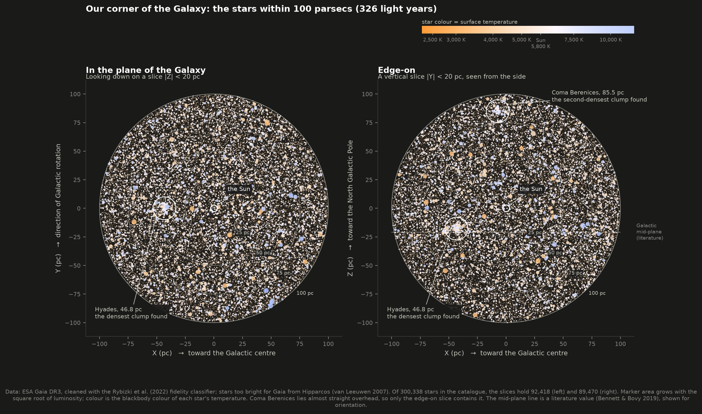
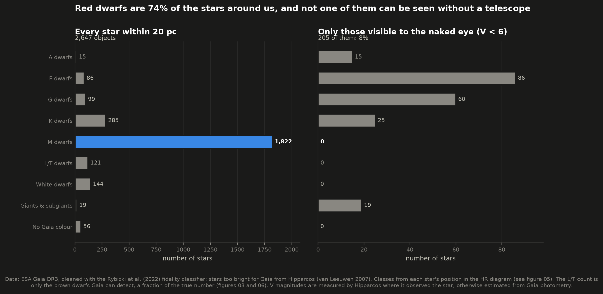
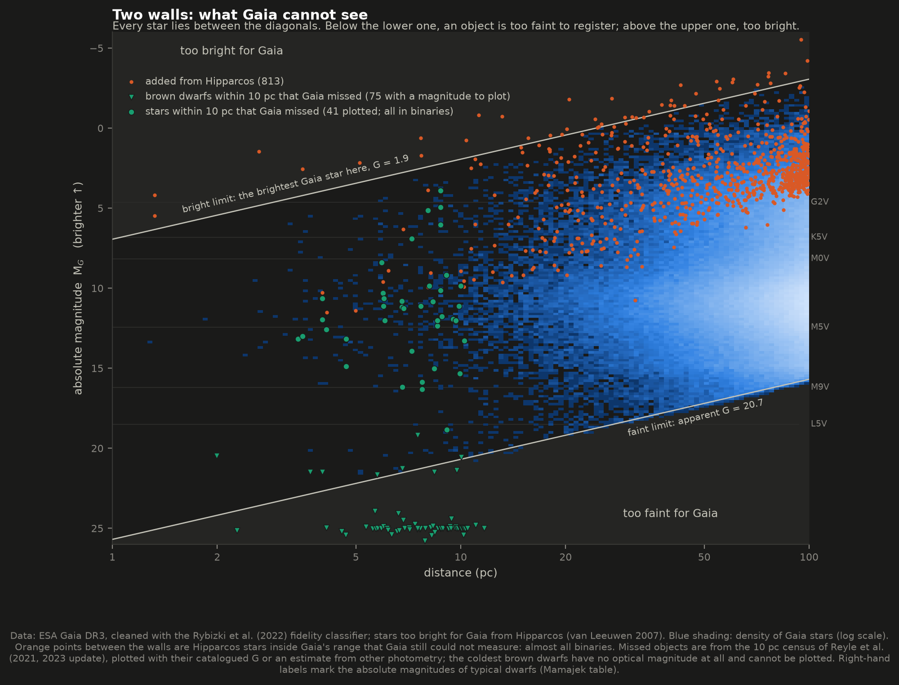
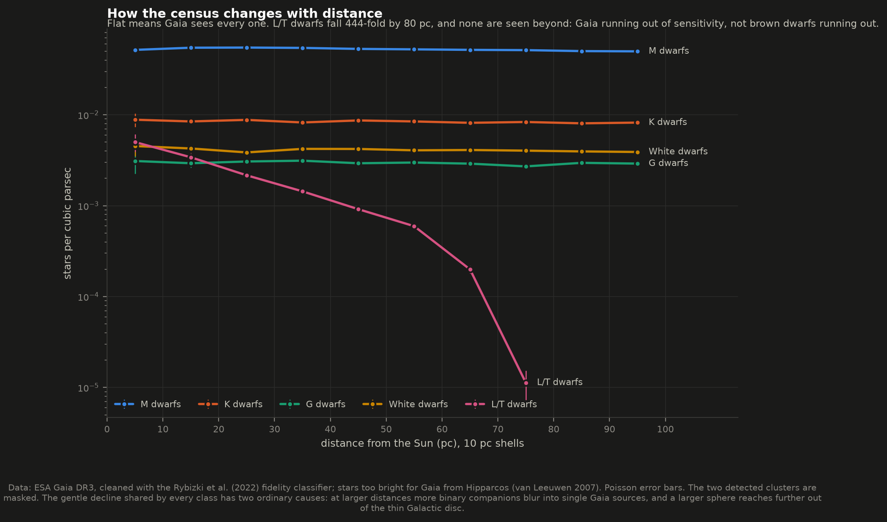
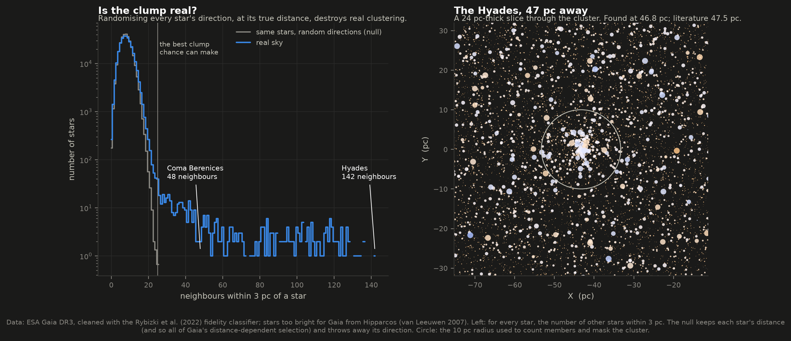
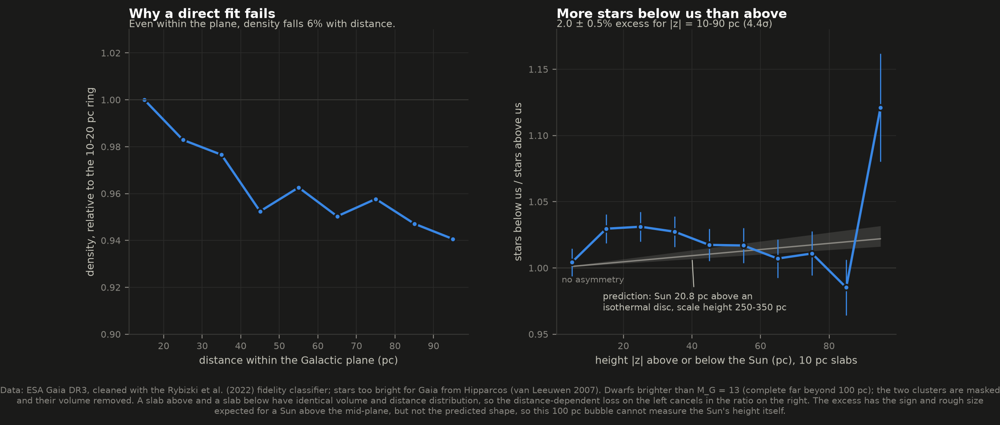
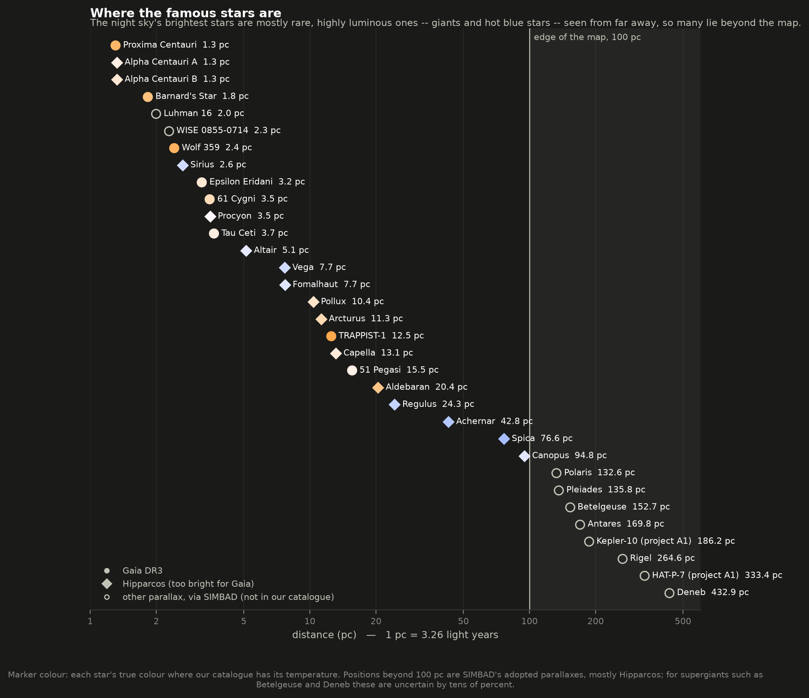
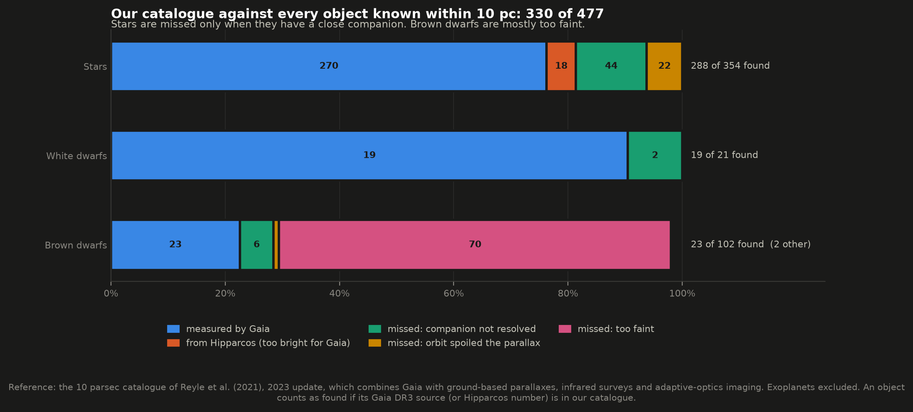
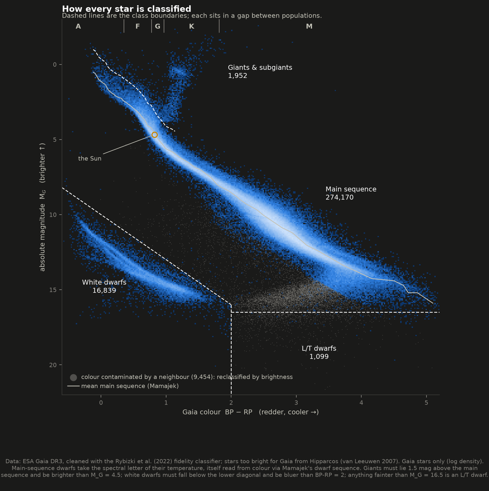

# B2 — A 3D map of the solar neighbourhood

**What does our corner of the Galaxy actually look like in three dimensions?**

This project maps every star within 100 parsecs of the Sun (326 light years), using ESA's
Gaia space telescope, which measured the distance to each one by parallax. Stars too bright
for Gaia come from its predecessor, Hipparcos. The result is a catalogue of **300,338 stars**,
an interactive 3D map, and nine figures. Here is what the map shows:

- **Seen from inside, our neighbourhood is a nearly featureless ball of stars.** The Milky
  Way's disc is ~600 pc thick, so a 100 pc bubble sits well inside it and cannot show its shape.
- **Almost all of those stars are red dwarfs, and you cannot see a single one of them.** They
  are 74% of the stars within 20 pc, and not one is visible to the naked eye. The sky you see is
  a biased sample of rare, luminous stars, over half of them from beyond this map.
- **The one obvious structure is the Hyades,** the nearest star cluster. The pipeline found it
  blind, as the densest clump in 3D, at 46.8 pc; the literature value is 47.5 pc. A second,
  fainter clump is the Coma Berenices cluster, found at 85.5 pc (literature: 85.9 pc).
- **Even Gaia misses things, and the gaps can be measured.** It is blind to the very brightest
  stars (its detectors saturate), to most brown dwarfs (too faint), and to stars in close
  binaries (their orbits spoil the measurement).

**The interactive map is [`figures/solar_neighborhood_3d.html`](figures/solar_neighborhood_3d.html).**
It is one self-contained file: open it in any browser, offline. You can rotate it, zoom to
the nearest 5 or 20 pc, hover over any star within 20 pc to see its name, and toggle each type
of star, the two clusters, and the 1,055 stars with known planets.



---

## Results

### Who lives here

Within 20 pc (65 light years), Gaia and Hipparcos together count 2,647 objects:

| Class | All | Visible to the naked eye (V < 6) |
|---|---:|---:|
| A dwarfs | 15 | 15 |
| F dwarfs | 86 | 86 |
| G dwarfs (the Sun's type) | 99 | 60 |
| K dwarfs | 285 | 25 |
| **M dwarfs (red dwarfs)** | **1,822** | **0** |
| L/T dwarfs (mostly brown dwarfs) | 121 | 0 |
| White dwarfs | 144 | 0 |
| Giants & subgiants | 19 | 19 |
| Unclassified (no usable Gaia colour) | 56 | 0 |

**Red dwarfs are 73.8% of the stars.** (Brown dwarfs are excluded from that count, because they
are not stars: they never become hot enough to fuse hydrogen.) Yet only 205 of the 2,647 objects
are visible to the naked eye, and none of those is a red dwarf. The brightest red dwarf in the
whole sky, Lacaille 8760, is at V = 6.7, just too faint. Proxima Centauri, the nearest star of
all, is at V = 11, a hundred times too faint.

The bias runs the other way too. Of the 4,995 stars in the whole sky brighter than V = 6, only
**46% lie within this map**, and their median distance is 109 pc. Most of the stars you can see
are there because they are luminous enough to be visible from far away, not because they are
near.



### What Gaia cannot see

This figure puts every star at its distance and its true luminosity (absolute magnitude, which
is how bright a star would look from a standard 10 pc away). Gaia can only record stars with
apparent magnitudes between about G = 2 and G = 20.7. At each distance that maps onto a range of
true luminosities, so the two limits become the two diagonal walls in the figure. Nothing can
appear outside them.



- **Too bright.** 813 stars came from Hipparcos instead. 99 of them, such as Sirius, Vega and
  Arcturus, are brighter than V = 4 and simply saturate Gaia's detectors. Most of the rest are
  binaries that Gaia DR3 could not solve.
- **Too faint.** Gaia's faint limit reaches a late M dwarf (M8V) out to 125 pc, but an L5 brown
  dwarf only to 27 pc, and T dwarfs only within about 10 pc. The coldest brown dwarf known, WISE 0855−0714,
  is just 2.3 pc away and is invisible to Gaia altogether.
- **Hidden companions.** Tested against the independent 10 pc census (below), every ordinary
  star Gaia misses within 10 pc belongs to a binary or multiple system.

The same limits show up as distance-dependent completeness. For M, K and G dwarfs and white
dwarfs, the detected density stays within about 15% of flat out to 100 pc. For L/T dwarfs it falls
440-fold by 80 pc, and none are detected beyond. That is Gaia running out of sensitivity, not brown
dwarfs running out.



### Structure, found blind: the Hyades and Coma Berenices

For every star, the pipeline counts how many other stars lie within 3 pc of it. The star with
the most neighbours marks the densest spot, and a mean-shift walk then settles on the clump's
centre. Nothing about any cluster is given to it.

To decide whether a clump is real, the pipeline runs a null test. It keeps every star at its
true distance but points it in a random direction, which destroys real clustering while keeping
all of Gaia's distance-dependent selection. The best clump that chance produced this way has
**25** neighbours.

| | Found here | Literature (Gaia Collaboration 2018) | Neighbours (null: 25) | Stars above the field, within 10 pc |
|---|---|---|---:|---:|
| **Hyades** | 46.8 pc, toward Taurus (l = 180.0°, b = −22.3°) | 47.5 pc | 142 | ~500 |
| **Coma Berenices** | 85.5 pc, near the North Galactic Pole (b = +83.6°) | 85.9 pc | 48 | ~120 |

Both clusters are real by a wide margin, and both centres land within 1.3 pc of the catalogued
ones. Aldebaran, the red eye of Taurus, looks like part of the Hyades but is at 20 pc, less than
half the cluster's distance.



### Are we above or below the Galactic disc?

The Sun is thought to sit about 20 pc above the mid-plane of the Milky Way's disc, which would
put slightly more stars below us than above. The data show exactly that: **2.0 ± 0.5% more stars
below the Sun than above, at heights of 10–90 pc (4.4σ)**. The sign matches what a Sun about
20 pc above an isothermal disc predicts, and so does the rough size.

What this 100 pc bubble *cannot* do is measure the Sun's height. The excess is already ~3% at
15–35 pc, where a smooth disc predicts about 1% at most, so something local (unmasked Hyades stars, or
the known vertical ripples in the solar-neighbourhood disc) also contributes. And the obvious
method, fitting a density profile to star counts against height, fails outright. Stellar density
falls by about 6% with distance *even within the Galactic plane*, because more binary companions
blur into single Gaia sources further away. The ratio used here cancels that effect exactly; a
profile fit does not. A first attempt at the fit, before this was understood, put the mid-plane
2.6 ± 1.8 pc below us, a false precision that the ratio method replaced.



### Where the famous stars are



Betelgeuse (153 pc), Rigel (265 pc), Deneb (433 pc), Polaris (133 pc) and Antares (170 pc) are
all beyond the map; the 3D map shows them as signposts on its edge. So are the Pleiades
(136 pc), and project A1's two planet hosts, Kepler-10 (186 pc) and HAT-P-7 (333 pc). Kepler
stared at a patch of sky hundreds of parsecs deep, while most planets around *nearby* stars come
from radial-velocity surveys: 959 of the 1,569 planets known within 100 pc (61%) were found by
their star's wobble, and 550 by transits. Canopus, the second-brightest star in the sky, is only just inside,
at 94.8 pc.

---

## How it works

1. **Download.** All of this is cached in `data/`:
   - 372,226 Gaia DR3 sources with parallax > 10 mas measured to better than 10%, in 48 sky
     chunks, with the total checked against the archive's own count;
   - Hipparcos (23,010 stars with parallax > 10 mas), with the official Gaia cross-match;
   - the Gaia Catalogue of Nearby Stars, the 10 pc census, Mamajek's dwarf table, and SIMBAD
     names.
2. **Clean.** Faint sources in crowded fields can have their Gaia transits mismatched, which
   produces fake large parallaxes. The Rybizki et al. (2022) classifier flags these, and the
   pipeline drops the 72,701 sources with fidelity < 0.5. The evidence that this works is
   direction. A real 100 pc sample must look the same in every direction, yet 71% of the rejected
   sources lie toward the crowded inner Galaxy, a patch holding 2.9% of the sky. The kept sample
   has 3.1% there.
3. **Fill the bright end.** A Hipparcos star is added only if Gaia has no usable measurement of
   it, checked three ways: the official cross-match, Gaia placing the star beyond 100 pc, and a
   positional match after moving the Hipparcos position forward 24.75 years along its proper
   motion. Hipparcos V and B−V are converted to Gaia G and BP−RP through Mamajek's table. The
   conversion reproduces Gaia's own G to 0.017 mag across 12,384 stars both missions measured.
4. **Place.** Distance is 1/parallax, which the 10% precision cut makes safe (bias < 1%).
   Positions are converted to Galactic X, Y, Z with astropy, and the result agrees with Gaia's
   catalogued Galactic coordinates to within 0.025″ for every star.
5. **Classify.** Each star is classed by its place in the HR diagram of colour against absolute
   magnitude. Main-sequence dwarfs get the spectral letter of their temperature, read from colour
   through Mamajek's dwarf sequence. Every boundary sits in an empty gap between populations.
   Three refinements, each measured on this sample:
   - **Colour ceiling for white dwarfs.** Brown dwarfs, whose faint BP flux makes them look
     falsely blue, would otherwise land among the white dwarfs.
   - **Contaminated colours.** 9,454 faint stars whose BP/RP colour is contaminated by a
     neighbour (Riello et al. 2021 excess factor) sit in an impossible place below the main
     sequence. They are classified by brightness instead.
   - **The brightest stars.** For the 296 brightest Gaia stars (G < 4), where Gaia colours scatter
     from saturation, colour comes from Hipparcos B−V.
6. **Colour.** Each star is drawn in the colour a human eye would see: a blackbody at the star's
   temperature, integrated against the CIE colour-matching functions and converted to screen
   RGB. `test_physics.py` checks the result: the Sun comes out warm white, and a 10,000 K star
   blue-white.
7. **Measure.** The census, completeness, the cluster search, and the north–south asymmetry, as
   described above.

---

## Is the catalogue right?

Three independent checks:

| Check | Result |
|---|---|
| **Gaia Catalogue of Nearby Stars.** The Gaia team's own curated 100 pc catalogue, built with a machine-learning selection. | 99.98% of our Gaia stars are in it. We recover 99.3% of its 300,526 objects; the 2,159 we miss are faint (median G = 19.6) and fail our parallax-precision or fidelity cuts. |
| **Our white dwarfs against GCNS's white-dwarf probabilities** | 16,497 agree; 340 are ours only and 75 theirs only (97.5% agreement). |
| **SIMBAD spectral types, within 20 pc** | Our colour-based letter matches the published one for 96.4% of 2,060 dwarfs, and 99.7% are within one class. 143 of 144 SIMBAD white dwarfs are white dwarfs here. |
| **The 10 pc census** (Reylé et al. 2021, 2023 update). Every known object within 10 pc, from all sources. | We find 330 of 477: 288 of 354 stars, 19 of 21 white dwarfs, and 23 of 102 brown dwarfs. Every missed star and white dwarf is in a binary: 46 companions Gaia did not resolve, and 22 components whose orbital motion spoiled the parallax. Of the missed brown dwarfs, 70 are simply too faint. |





---

## Honest notes

- **Counts are counts of Gaia sources, not of stars.** A binary too close for Gaia to split
  counts once. That is why density slowly falls with distance, and why this is a census of
  what can be *resolved* from here.
- **Classes are photometric.** They are assigned from colour and brightness, not from spectra.
  The 96% agreement with SIMBAD is the measure of how well that works. Temperatures use a
  main-sequence (dwarf) relation for every star, which is right for 91% of them. For giants and
  white dwarfs it is an approximation, used only to colour the map.
- **Alpha Centauri's distance is slightly off.** The 2007 Hipparcos reduction gives A and B
  separate, inconsistent parallaxes (754.8 and 796.9 mas), which would put B nearer than Proxima.
  Because the two orbit each other, the pipeline gives both the weighted mean: 755.9 mas, or
  1.323 pc. The best modern value (Kervella et al. 2016) is 1.338 pc, so the map is 1% off here.
- **Distances beyond 100 pc** (the signposts) are SIMBAD's adopted values, mostly Hipparcos. For
  supergiants they are uncertain by tens of percent: Betelgeuse's distance estimates range from
  ~150 to ~220 pc.
- **No extinction correction.** Within 100 pc we are inside the Local Bubble, a region nearly
  empty of dust, where reddening is typically below 0.02 mag.
- **Stars near the 100 pc boundary scatter across it,** because each parallax carries up to 10%
  uncertainty. This matters for counts near the edge, not for anything quoted here.
- **The 3D map shows a random 1 in 6 of the stars beyond 20 pc.** The same fraction is used for
  every class, so the proportions of each type are true. Every star within 20 pc is shown.
- **The Gaia archive was unstable** while this was built (it is being reworked for DR4).
  Asynchronous jobs failed, so the download uses small synchronous queries, rejects any result
  the archive flags as truncated, and checks totals against a server-side count. The archive
  also named one column `SOURCE_ID` in some responses and `source_id` in others; `fetch_data.py`
  normalises this. It is a quiet trap that splits one column into two half-empty ones.

---

## Running it

```bash
cd ..                       # repository root
python3 -m venv .venv && source .venv/bin/activate
pip install numpy scipy matplotlib astropy astroquery pyvo plotly

cd 06-solar-neighborhood
python fetch_data.py        # ~70 MB from ESA, CDS and NASA; only needed once (5-10 minutes)
python run.py               # catalogue, measurements, 9 figures and the 3D map (~45 s)
python test_physics.py      # 44 self-checks on the formulas
```

Once `data/` is populated, `run.py` makes no network requests. This was verified by running the
whole pipeline inside a network namespace with no connectivity (`unshare -rn`), where it rebuilt
every figure and the map. Flags: `--no-figures`,
`--no-map`, `--refresh` (re-download everything). `python map3d.py` rebuilds only the
interactive map from the saved catalogue.

### Files

| File | What it does |
|---|---|
| `config.py` | Paths, sample cuts, classification thresholds, and the list of famous stars, each with the reason for its value |
| `fetch_data.py` | Downloads and caches the seven datasets, with provenance in `data/provenance.json` |
| `stellar_physics.py` | The formulas: parallax, magnitudes, Galactic coordinates, the dwarf sequence, blackbody colours |
| `analysis.py` | The pipeline: clean, merge, classify, measure, validate |
| `figures.py` | The nine static figures |
| `map3d.py` | The interactive 3D map |
| `plotstyle.py` | The dark figure theme and its palette |
| `run.py` | Runs everything and prints the summary |
| `test_physics.py` | Checks the formulas against known answers |

`test_physics.py` includes, for example: Proxima's parallax gives 4.2465 light years;
Sgr A\* lands on the +X axis and the North Galactic Pole on +Z; a 5772 K blackbody peaks at
502 nm (Wien's law); and the Riello et al. polynomial is continuous at its joins, which is how a
mistyped coefficient would show itself.

### Figures

`01` the neighbourhood in two slices · `02` census against the naked-eye sky · `03` selection
effects · `04` density with distance · `05` how stars are classified · `06` against the
10 pc census · `07` north versus south · `08` the famous stars · `09` finding the clusters · and
`solar_neighborhood_3d.html`.

All are PNG and SVG. They use a dark theme because hot stars' true colours are pale blue-white
and would vanish on white paper. Every non-star colour is from the documented palette, checked
with a colourblind-safety validator.

---

## Data credits

- **Gaia**: this work uses data from the European Space Agency (ESA) mission Gaia
  (https://www.cosmos.esa.int/gaia), processed by the Gaia Data Processing and Analysis
  Consortium (DPAC). Gaia DR3: Gaia Collaboration, Vallenari et al. (2023).
- **GCNS**: Gaia Collaboration, Smart et al. 2021, A&A 649, A6.
- **Astrometric fidelity**: Rybizki et al. 2022, PASP 134, 044501.
- **BP/RP excess factor**: Riello et al. 2021, A&A 649, A3.
- **Hipparcos**: ESA 1997; new reduction by van Leeuwen 2007, A&A 474, 653.
- **10 pc census**: Reylé et al. 2021, A&A 650, A201 (2023 update, via VizieR).
- **Dwarf sequence**: E. Mamajek, "A Modern Mean Dwarf Stellar Color and Effective Temperature
  Sequence", v2022.04.16 (Pecaut & Mamajek 2013, ApJS 208, 9).
- **SIMBAD**: Wenger et al. 2000, CDS, Strasbourg.
- **NASA Exoplanet Archive**: operated by Caltech under contract with NASA.
- **Colour-matching functions**: Wyman, Sloan & Shirley 2013, JCGT 2(2).
- **Cluster distances**: Gaia Collaboration, Babusiaux et al. 2018, A&A 616, A10.
- **Sun's height reference**: Bennett & Bovy 2019, MNRAS 482, 1417.

All data were retrieved on 2026-09-29.
