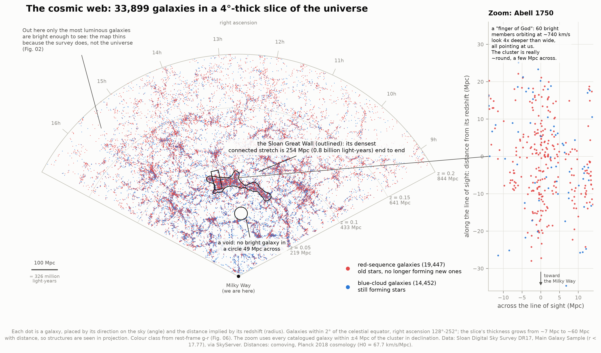
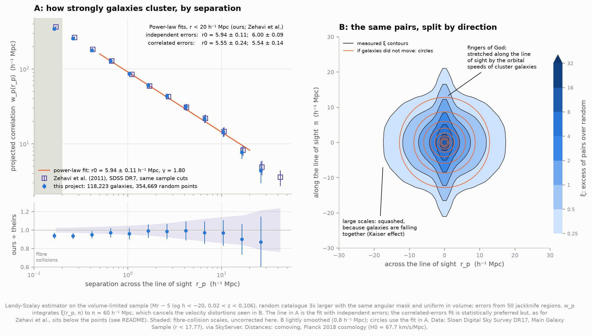
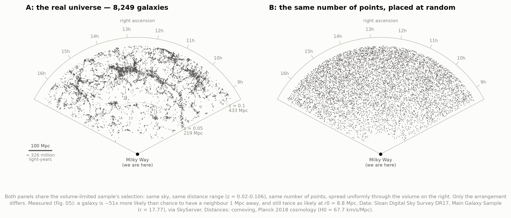
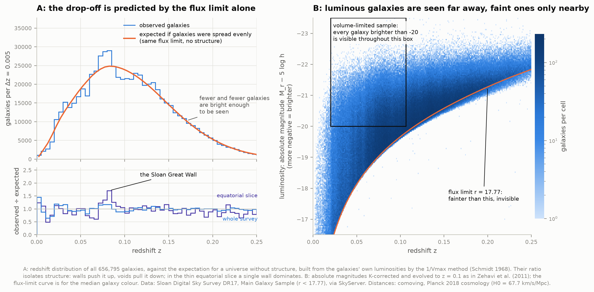

# D2 — The cosmic web from SDSS

**Is matter scattered randomly through the universe, or organised into filaments, walls and
voids? And can we measure the difference rather than just see it?**

It is organised, and yes. This project takes the 656,795 galaxies in the Sloan Digital Sky
Survey's Main Galaxy Sample, places each at the distance its redshift implies, and draws a
4°-thick slice of them as the classic wedge map of the cosmic web. Then it tests what the eye
sees. It compares the map with the same number of randomly placed points under exactly the
same survey selection, measures the galaxies' two-point correlation function, and grades that
measurement against the published SDSS result. The two agree to within a few percent.



Each dot is a galaxy: the angle is its direction on the sky, the radius the distance implied
by its redshift, and the Milky Way sits at the bottom. The map shows walls and filaments, with
voids between them tens of megaparsecs across. The **Sloan Great Wall**, one of the largest
known structures, crosses the middle. The zoom on the right shows a **finger of God**: a
cluster that looks five times deeper than it is wide, pointing straight at us. And the dots
thin out towards the edge, which is a property of the survey, not of the universe.

---

## Results

Everything here was measured by the code in this folder from the SDSS catalogue. Published
values, collected in [`literature.py`](literature.py), were consulted only afterwards, for
grading.

### Is it random? No, by a factor of about fifty

The standard test is the **two-point correlation function** ξ(r): how much more likely than
random it is to find two galaxies a distance r apart. For randomly scattered points ξ = 0.
We measure its projected form w_p(r_p) on the fairest sample the survey allows (see *How it
works*). The same sample definition was used by Zehavi et al. (2011) on SDSS Data Release 7,
so the comparison is like for like.

| Quantity | This project | Zehavi et al. 2011 |
|---|---|---|
| Correlation length r₀ (fit with correlated errors) | **5.55 ± 0.24** h⁻¹ Mpc | 5.54 ± 0.14 |
| Slope γ (same fit) | **1.85 ± 0.03** | 1.83 ± 0.01 |
| Correlation length r₀ (fit with independent errors) | **5.94 ± 0.11** h⁻¹ Mpc | 6.00 ± 0.09 |
| Slope γ (same fit) | **1.80 ± 0.03** | 1.79 ± 0.01 |
| w_p point by point, r_p = 0.4–10 h⁻¹ Mpc | 96–100% of theirs | — |
| Galaxies in the sample | 134,975 | 141,733 |

**In words:** a galaxy is about **50 times** more likely than chance to have a neighbour 1 Mpc
away, and still twice as likely at the correlation length r₀ ≈ 8–9 Mpc. A null test, running
the same machinery on random points treated as galaxies, returns zero, as it must.

*h⁻¹ Mpc?* Clustering results are quoted in units scaled by the Hubble constant,
h = H₀ / (100 km/s/Mpc). That keeps them independent of H₀, whose exact value is itself
disputed: the *Hubble tension* of project D1. With Planck's h = 0.677, 5.55 h⁻¹ Mpc is 8.2 Mpc,
or 27 million light-years.



### The structures

| | This project | Published |
|---|---|---|
| Sloan Great Wall: densest connected stretch | **254 Mpc** end to end (0.8 billion light-years), RA 168°–208°, z = 0.081 | Gott et al. 2005: RA 130°–206°, z = 0.073, 450 Mpc along its curve (for H₀ = 71) |
| Coma cluster velocity dispersion | **963 ± 28 km/s** (613 galaxies) | Colless & Dunn 1996: 1015 ± 59 |
| Largest empty circle in the slice | **49 Mpc** across, at z ≈ 0.054 | — |
| Clusters and groups found | 711 with ≥ 10 bright members | — |

The wall lengths answer different questions. Ours is the longest stretch that stays above
twice the average density. Gott et al. traced the wall by eye, including thinner stretches
that our threshold breaks apart. Both agree it is a single structure hundreds of megaparsecs
long, at z ≈ 0.07–0.08.

### Galaxies and their neighbourhoods

- **Colours are bimodal.** A tight *red sequence* of galaxies whose stars are old and which have
  stopped forming new ones, and a broad *blue cloud* still forming stars. The dividing line,
  found from the data, is g − r = −0.050 M_r − 0.39 in rest-frame colour.
- **Environment matters.** The fraction of red galaxies rises from **51%** in the sparsest
  eighth of environments to **81%** in the densest. It rises at fixed luminosity too
  (57 → 86% for luminous galaxies, 50 → 79% for fainter ones), so crowded places are not red
  merely because they host brighter galaxies. This is the *colour–density relation*, the modern
  form of Dressler's 1980 morphology–density relation.

---

## Three things worth looking at

**The web is not in your imagination.** Here are the same number of points, over the same sky
and volume, placed at random:



**Why the map thins out.** SDSS measured a redshift only for galaxies brighter than apparent
magnitude r = 17.77. Far away, only intrinsically luminous galaxies are that bright, so the
survey's census gets sparser with distance. Panel A predicts the drop-off for a universe
*without* structure, using nothing but the galaxies' own luminosities. It matches, and what is
left over is structure. In the equatorial slice, the Sloan Great Wall alone is a 70% excess:



**Fingers of God and the Kaiser effect.** Panel B of the clustering figure splits galaxy pairs
by direction. A redshift measures velocity, not distance, so every galaxy's own motion shifts
its apparent distance along our line of sight, and only along it. Inside clusters, galaxies
orbit at hundreds of km/s, which stretches each cluster into a spike pointing at us. On large
scales, galaxies falling coherently towards overdense regions squash structures instead. The
same thing seen in one cluster is the zoom in Fig. 01: Abell 1750's galaxies orbit at
~740 km/s, which stretches a cluster whose members lie within ~2 Mpc of its centre on the sky
into a spike some 20 Mpc long.

---

## How it works

**1. Download.** 24 SQL queries to SkyServer (SDSS Data Release 17), one per 15° strip of right
ascension: 656,838 rows, 90 MB of CSV, cached as served. The sample is SDSS's **Main Galaxy
Sample** (Strauss et al. 2002). It includes objects *targeted* as main-sample galaxies (target
bits `legacy_target1 & 0x1C0`), spectroscopically classed as galaxies, with a clean redshift
(`zWarning = 0`), the best spectrum of each object (`sciencePrimary = 1`), 0.002 < z < 0.3, and
dust-corrected Petrosian r < 17.77. Selecting on the target bits keeps out SDSS's other
programmes (luminous red galaxies, quasars), whose different selections would imprint
themselves on the map. The Abell cluster catalogue (VizieR VII/110A) is fetched only to put
names on the clusters we find.

**2. Distances.** Redshift → comoving distance with the Planck 2018 cosmology. Comoving
distance is the separation *today*, with the expansion during the light's journey scaled out,
so the map is not distorted by when we happen to see each galaxy. For scale: z = 0.1 is
433 Mpc (1.4 billion light-years), and its light left 1.35 billion years ago.

**3. Luminosities.** Apparent magnitude → absolute magnitude, with **K-corrections**: redshift
slides a galaxy's spectrum through the camera's filters, so a distant galaxy is seen in bluer
rest-frame light than a nearby one. We use the published polynomial fits of Chilingarian et al.
(2010, 2012), checked against the authors' own code. To match the literature we also convert to
Zehavi et al.'s convention: the r band shifted to z = 0.1, a mean offset of 0.182 mag we
compute ourselves; luminosity evolution with Q = 1.62 (Blanton et al. 2003); and magnitudes
quoted for h = 1.

**4. A fair census.** The map uses every galaxy (*flux-limited*), but every measurement uses a
**volume-limited** sample: all galaxies brighter than M_r − 5 log h = −20 between z = 0.02
and 0.106. Inside that volume the census is complete, so density means density (Fig. 03). We
check completeness rather than assume it. A threshold galaxy moved to the far edge would appear
at r = 17.599 even if it is as red as the reddest 0.5% of galaxies there, just inside the
17.6 limit.

**5. Clustering.** The survey's footprint on the sky is mapped on a HEALPix grid
(0.84 deg² pixels), trimmed of its ragged edge, which leaves 6,934 deg². 354,669 random points
are scattered through the same footprint and the same distance range, uniform in volume. Pairs
of galaxy–galaxy, galaxy–random and random–random are counted by separation across (r_p) and
along (π) the line of sight, about 5 billion pairs examined in all. That is the slow step:
about 4 minutes on 8 cores, cached afterwards. The Landy–Szalay estimator turns the counts into
ξ(r_p, π); integrating over π to 60 h⁻¹ Mpc gives w_p(r_p), which galaxy motions cannot
distort. Errors come from **jackknife resampling**: the footprint is cut into 50 patches and
the whole measurement repeated 50 times, leaving one out each time. That captures *cosmic
variance*, the fact that one survey samples one finite piece of the universe.

**6. Clusters.** A friends-of-friends group finder links galaxies closer than 0.14 of the mean
spacing across the line of sight and 0.75 of it along it (Berlind et al. 2006). The line-of-sight
link is longer because fingers of God stretch clusters that way. Groups are named after any
Abell cluster within one Abell radius. The finder's membership trims the fastest-moving
galaxies, so velocity dispersions are measured separately: all galaxies within one Abell radius
and ±3000 km/s, iteratively clipped at 3σ, as Colless & Dunn did for Coma.

**7. Colours and environment.** In each 0.5-magnitude bin, two Gaussians are fitted to the
colour distribution. The divider is the colour where a galaxy is equally likely to belong to
either. Local density is Σ₅, the projected distance to the fifth-nearest neighbour within
±1000 km/s. A cylinder rather than a sphere keeps cluster members that fingers of God have
smeared along the line of sight.

**8. The wall and the void.** The volume-limited slice is smoothed into a density map, divided
by the same map made from random points, and cells above twice the mean density are joined
into connected structures. The largest is the Sloan Great Wall. The void is the largest circle
in the slice, wholly inside surveyed space, containing no volume-limited galaxy.

---

## Is it real? The checks

| Check | What it guards against | Result |
|---|---|---|
| **Null test**: random points measured as if they were galaxies | The machinery inventing clustering | w_p consistent with zero, χ²/bin = 1.06 |
| **Pair counter vs brute force** | A counting or binning bug | Identical counts, every bin, serial and parallel |
| **Completeness at the far edge** | A volume-limited sample that isn't | Reddest threshold galaxy at r = 17.599 < 17.6 |
| **Number density vs Zehavi et al.** | Wrong magnitude conventions | 86% of theirs (fibre collisions account for ~7%, see below) |
| **w_p point by point vs Zehavi et al.** | Anything at all | 96–100% at 0.4–10 h⁻¹ Mpc; 92% at 0.17, as expected |
| **Coma's velocity dispersion** | A biased cluster-dynamics estimate | 963 ± 28 vs 1015 ± 59 km/s |
| **K-corrections vs the authors' own code** | Transcription errors in 60 coefficients | Agreement to 10⁻¹⁵ |

`test_physics.py` runs the first two and the last, among about 40 checks in all: distances
against astropy and Hubble's law, the power-law projection against numerical integration,
uniform sampling on the sphere, and clipped dispersions against known inputs.

---

## Honest notes

- **Fibre collisions are not corrected.** Two SDSS fibres could not be placed closer than
  55″ on one plate, so ~7% of targeted galaxies, preferentially in crowded regions, have no
  redshift. Zehavi et al. gave each one its nearest neighbour's redshift; we do not. That is
  most of the 14% number-density gap and why our w_p is 6–8% low below r_p ≈ 0.3 h⁻¹ Mpc. The
  power-law fits therefore start at 0.5 h⁻¹ Mpc. Refitting over their range (0.13–20) gives
  r₀ = 5.95 ± 0.10, still in agreement.
- **Our survey mask is simpler.** It is derived from where the galaxies are, and treats every
  surveyed pixel as equally complete. The SDSS team's own masks record completeness sector by
  sector (typically 90–95%). The remaining density gap is this plus photometry and K-correction
  differences between DR7 and DR17.
- **Why two power-law fits, and why the plotted one is not the "better" one.** With the full
  jackknife covariance, neighbouring bins share most of their structures, so the fit may sit
  below all the points at little χ² cost. Ours does, and so does Zehavi et al.'s (5.54 vs 6.00
  with independent errors). The figure draws the independent-errors fit because it describes
  the points; both are quoted, and each matches its published counterpart. A pure power law is
  also only an approximation: χ²/dof = 16/6 with correlated errors, because real w_p has a
  kink near 1–2 h⁻¹ Mpc, where pairs inside a single halo give way to pairs in separate ones.
- **The map is in redshift space.** Every distance here is inferred from a redshift, which
  includes the galaxy's own motion. Fingers of God are the visible symptom; the Kaiser
  squashing of large structures is subtler. Neither is corrected in the maps. w_p is immune by
  construction.
- **Distances scale with 1/H₀.** With SH0ES's H₀ = 73 instead of Planck's 67.7, every distance in
  Mpc would be 7% smaller. Results in h⁻¹ Mpc are unaffected.
- **The Great Wall's length depends on its definition.** At 1.5× the mean density the connected
  structure is ~260–300 Mpc; at 3× it is ~120 Mpc. With more smoothing, less of it connects. The
  number is a measurement *given* a definition, not a property carved in stone.
- **The void is two-dimensional.** It has to be empty through the slice's full thickness, and
  only of galaxies brighter than the volume-limited threshold. True 3D voids are larger.
- **Cluster dispersions are indicative.** 3σ clipping sheds interlopers far from the cluster in
  velocity but not those inside the window. With 10% interlopers it overestimates σ by ~12%,
  which `test_physics.py` demonstrates. Hercules (Abell 2151) comes out at 1282 km/s because
  its aperture spans several merging subclusters. Our Coma value is 5% below Colless & Dunn's,
  plausibly because a bright, flux-limited sample is mostly early-type galaxies, which they
  show have lower dispersions than late types.
- **The colour divider is extrapolated at the bright end.** Brighter than M_r ≈ −21 the blue
  population is only a shoulder on the red one, with no dip to measure, so the line is carried
  over from fainter bins (Fig. 06). Our red fraction (63%) is higher than Zehavi et al.'s
  (56%) because the two dividers differ; the environment trend does not depend on the exact line.
- **Correlation is not causation.** Red galaxies prefer dense regions, but this project does not
  show *why*. Candidates in the literature include gas stripping in clusters, halted gas
  inflow, and galaxy mergers.

---

## Running it

```bash
cd ..                       # repository root
python3 -m venv .venv
source .venv/bin/activate
pip install numpy scipy pandas matplotlib astropy astroquery astropy-healpix scikit-learn plotly requests

cd 07-cosmic-web
python fetch_data.py        # ~90 MB from SkyServer, about a minute; only needed once
python run.py               # analysis + all figures; ~5 min the first time, ~1 min after
python test_physics.py      # about 40 self-checks, ~10 s
```

Once the cache is warm, `run.py` needs **no network**, verified by running it with networking
disabled. `run.py --no-figures` skips plotting; `--workers N` sets the number of processes
for pair counting (default: half the cores, up to 8).

### Files

| File | What it does |
|---|---|
| `config.py` | Every sample cut and setting, each with its reason |
| `fetch_data.py` | SkyServer queries in right-ascension strips; the Abell catalogue |
| `cosmo_physics.py` | Distances, K-corrections, magnitudes, line-of-sight geometry |
| `clustering.py` | Survey mask, random catalogues, jackknife regions, pair counting, estimators, fits |
| `analysis.py` | The samples, colours, environment, clusters, selection, clustering, wall and void |
| `literature.py` | Published numbers, used only for grading |
| `figures.py` | Every static figure |
| `interactive.py` | The 3D map |
| `plotstyle.py` | Colours and style, shared with the other projects |
| `run.py` | Runs everything and prints the comparison table |
| `test_physics.py` | Checks formulas and estimators against known answers |

## Figures

`00_footprint`: where SDSS looked · `01_cosmic_web`: the slice, with a finger-of-God zoom ·
`02_selection`: why the map thins out · `03_flux_vs_volume_limited`: the fair census ·
`04_real_vs_random`: the web against randomness · `05_clustering`: w_p against Zehavi et al.,
and the 2D correlation map · `06_colors`: red sequence and blue cloud ·
`07_environment`: red fraction against density.

PNG and SVG; in the SVGs the point clouds are embedded as images and everything else stays
vector. Galaxy colours are drawn in the colour they are named for, a red/blue pair checked
with a colour-vision-deficiency validator.

**[`cosmic_web_3d.html`](figures/cosmic_web_3d.html)**: an interactive 3D map of the 134,975
galaxies of the volume-limited sample, with the richest clusters labelled. A menu shows one
declination slab at a time, which is where the walls and voids stand out. The page is
self-contained (7 MB, works offline) and follows the viewer's light/dark setting.

## Data credits

Galaxy data: the Sloan Digital Sky Survey, Data Release 17 (Abdurro'uf et al. 2022, ApJS 259,
35), retrieved from SkyServer on 2026-09-29. The Main Galaxy Sample was observed by SDSS-I/II:
*Funding for the SDSS and SDSS-II has been provided by the Alfred P. Sloan Foundation, the
Participating Institutions, the National Science Foundation, the U.S. Department of Energy, the
National Aeronautics and Space Administration, the Japanese Monbukagakusho, the Max Planck
Society, and the Higher Education Funding Council for England.* Data Release 17 is an SDSS-IV
release: *Funding for the Sloan Digital Sky Survey IV has been provided by the Alfred P. Sloan
Foundation, the U.S. Department of Energy Office of Science, and the Participating
Institutions.*

Cluster names: Abell, Corwin & Olowin (1989, ApJS 70, 1), via VizieR (CDS, Strasbourg).
K-corrections: coefficients from Chilingarian, Melchior & Zolotukhin (2010, MNRAS 405, 1409)
and Chilingarian & Zolotukhin (2012, MNRAS 419, 1727), from `calc_kcor.py`
(kcor.sai.msu.ru, simplified BSD licence). Comparison values: Zehavi et al. (2011, ApJ 736,
59), Gott et al. (2005, ApJ 624, 463), Strauss et al. (2002, AJ 124, 1810), Colless & Dunn
(1996, ApJ 458, 435), Blanton et al. (2003, ApJ 592, 819).
