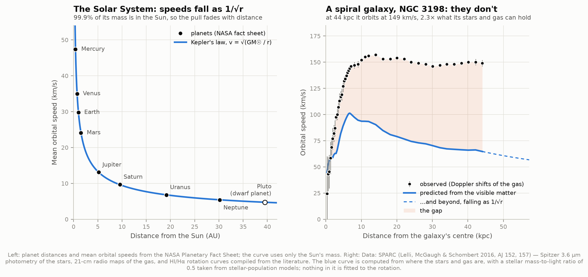
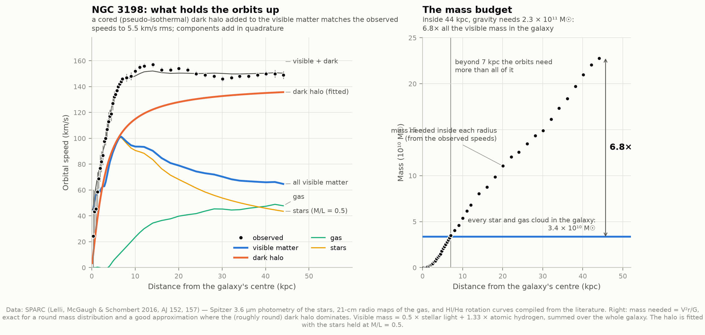
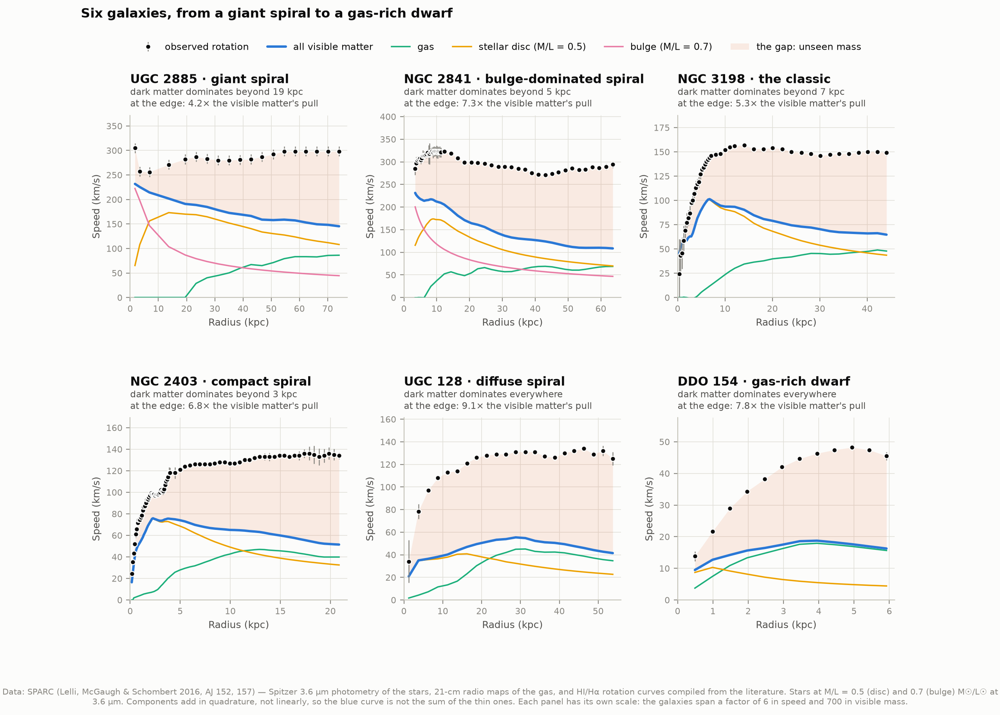
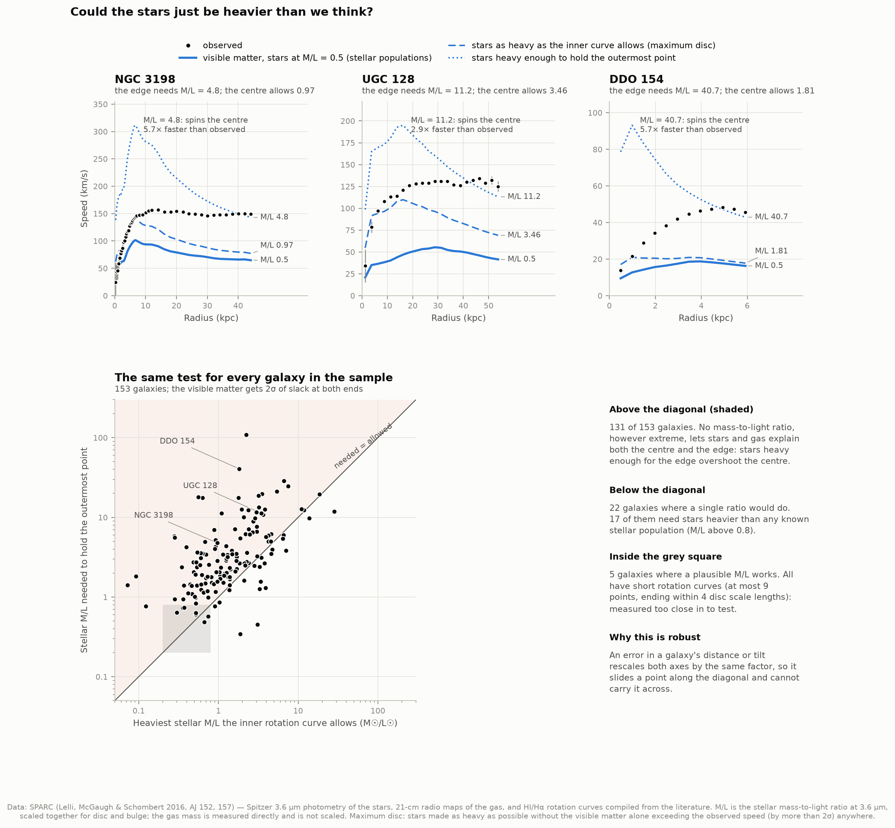
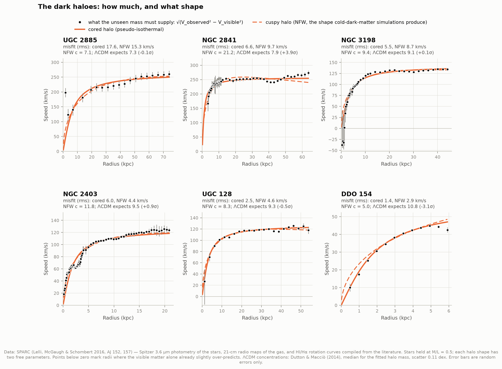
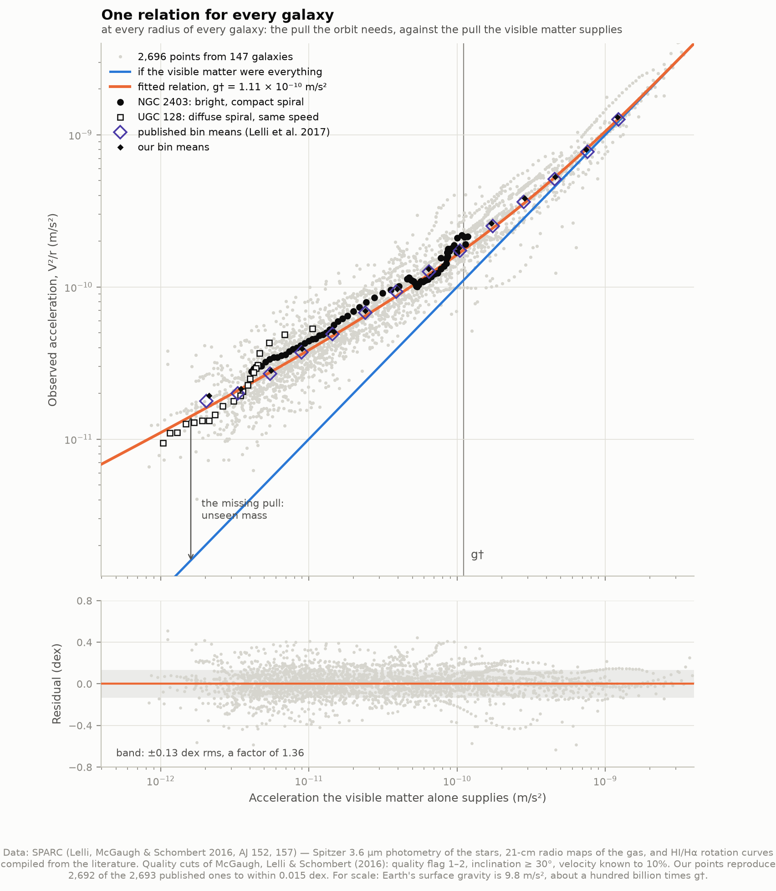
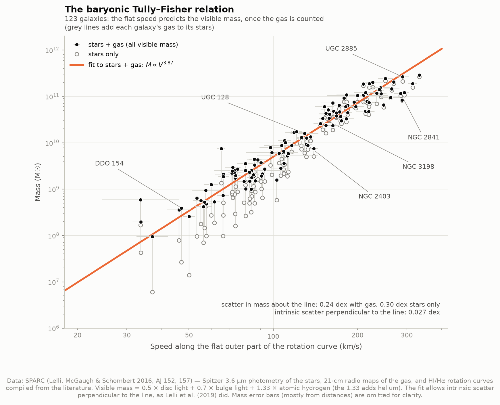
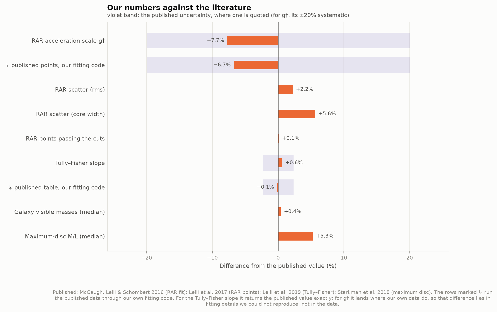

# D4 — Dark matter from galaxy rotation curves

**Far from a galaxy's centre, stars and gas should orbit more slowly, the way the outer
planets do, if the visible matter is all there is. Do they?**

No. This project takes the rotation curves of 175 real galaxies from the SPARC database.
Each is a measurement of how fast gas orbits at each distance from the centre. For each
galaxy it computes the speeds the visible stars and gas could hold, and compares the two.
In every galaxy the observed speeds stay high long after the visible matter's prediction
has fallen away. The rest of the project asks what closes the gap. Could the stars simply
be heavier than we think? What would the missing mass look like? And what regularity ties
the missing mass to the visible matter across all 153 well-measured galaxies?

Nothing here is fitted to produce the headline result. The visible-matter prediction has
one free number, how much mass the stars carry per unit of light (the *mass-to-light
ratio*, M/L), and that number is fixed from stellar physics, not tuned to the rotation.
Published results are consulted only at the end, to grade ours.

The six galaxies featured individually span what SPARC spans:

| Galaxy | What it is | Why it is here |
|---|---|---|
| UGC 2885 | Giant spiral | One of the largest spirals known. Vera Rubin measured its rotation in 1980; the astronomer who imaged it with Hubble in 2020 nicknamed it "Rubin's Galaxy". |
| NGC 2841 | Bulge-dominated spiral | Its big central bulge, not its disc, dominates the inner rotation. |
| NGC 3198 | The classic | The textbook disc-plus-dark-halo decomposition (van Albada et al. 1985). |
| NGC 2403 | Compact spiral | Same rotation speed as UGC 128, but its stars are packed 16× more densely. |
| UGC 128 | Diffuse spiral | A *low-surface-brightness* galaxy: NGC 2403's twin in speed, 16× more thinly spread. |
| DDO 154 | Gas-rich dwarf | More than ten times more mass in gas than in stars. |

---

## Results

### The expectation, and what happens



In the Solar System nearly all the mass sits in the Sun, so the pull it exerts fades with
distance and orbital speeds fall as 1/√r. The planets sit on that curve to within 1%. That
is Kepler's third law, and our test file checks it against NASA's published speeds.

In NGC 3198 the visible matter predicts the same kind of decline once you are outside most
of the stars. The observed gas instead keeps orbiting at about 150 km/s all the way out to
44 kpc (roughly 140,000 light-years), 2.3× faster than the stars and gas can hold.

### One galaxy taken apart: NGC 3198



Left: the pull of the gas and the stars, combined, is the blue curve. Adding a dark halo
(orange, fitted) brings the total onto the measurements to 5.5 km/s rms. Right: the mass
needed to hold each orbit (from V²r/G) against all the visible mass the galaxy has,
3.4 × 10¹⁰ solar masses. **Beyond 7 kpc the orbits need more mass than every star and gas
cloud in the galaxy put together, and inside 44 kpc they need 6.8× as much.**

### It is every galaxy, not one



| Galaxy | Outermost point | Observed | Visible matter predicts | Pull there vs visible pull | Mass needed vs all visible mass | Dark matter dominates |
|---|---|---|---|---|---|---|
| UGC 2885 | 74 kpc | 298 km/s | 145 km/s | 4.2× | 5.8× | beyond 19 kpc |
| NGC 2841 | 64 kpc | 294 km/s | 109 km/s | 7.3× | 11.0× | beyond 5.5 kpc |
| NGC 3198 | 44 kpc | 149 km/s | 65 km/s | 5.3× | 6.8× | beyond 6.7 kpc |
| NGC 2403 | 21 kpc | 134 km/s | 51 km/s | 6.8× | 9.4× | beyond 3.5 kpc |
| UGC 128 | 54 kpc | 125 km/s | 41 km/s | 9.1× | 12.3× | at every radius |
| DDO 154 | 5.9 kpc | 46 km/s | 16 km/s | 7.8× | 7.3× | at every radius |

"Pull" is V²/r, the acceleration an orbit needs; the ratio of pulls is the ratio of the
squared speeds. "Dark matter dominates" means it supplies more than half the pull.

**The pair NGC 2403 and UGC 128 is the telling one.** They rotate at the same speed, but in
the compact spiral the stars hold the inner orbits and the unseen mass takes over only
beyond 3.5 kpc, while in the diffuse one the unseen mass dominates everywhere. How much
dark matter a galaxy seems to have depends on how densely its visible matter is packed.
That is the first hint of the relation further down.

### Could the stars just be heavier than we think?



The obvious objection: nobody weighs stars directly, so perhaps M/L is bigger than 0.5. The
test gives that idea every chance. Make the stars as heavy as the *inner* rotation curve
allows (the "maximum disc"), then ask how heavy they would need to be to hold the *outer*
curve:

| Galaxy | M/L the centre allows | M/L the edge needs | With that M/L, the centre would spin |
|---|---|---|---|
| UGC 2885 | 0.76 | 2.55 | 2.0× faster than observed |
| NGC 2841 | 0.92 | 5.21 | 2.6× faster |
| NGC 3198 | 0.97 | 4.78 | 5.7× faster |
| NGC 2403 | 0.88 | 6.97 | 2.9× faster |
| UGC 128 | 3.46 | 11.2 | 2.9× faster |
| DDO 154 | 1.81 | 40.7 | 5.7× faster |

Stellar-population models allow roughly 0.2–0.8 at this wavelength. Across the whole
sample, in **131 of 153 galaxies no mass-to-light ratio at all, however extreme, lets
stars and gas explain both the centre and the edge**. Of the other 22, 17 would need stars
heavier than any known stellar population. The remaining 5 all have short rotation curves
(at most 9 points, ending within 4 disc scale lengths), measured too close in to test.

Two things make this robust. The visible matter gets 2σ of slack at both ends; with 1σ the
count rises to 146 of 153. And an error in a galaxy's distance or tilt rescales both sides of
the comparison by the same factor, so it cannot flip the verdict.

### The dark haloes: how much, and what shape



The points are what the unseen mass must supply at each radius, straight from the data:
√(V_observed² − V_visible²). Two halo shapes are fitted to fill the gap, with the stars held
at M/L = 0.5:

- a **cored** halo (pseudo-isothermal), with a constant-density centre, the classic
  empirical choice;
- a **cuspy** NFW halo, whose density keeps climbing towards the centre. This is the shape
  cold-dark-matter simulations of the universe produce.

| Galaxy | Cored misfit | NFW misfit | NFW concentration | Simulations predict |
|---|---|---|---|---|
| UGC 2885 | 17.6 km/s | 15.3 km/s | 7.1 | 7.3 (−0.1σ) |
| NGC 2841 | 6.6 km/s | 9.7 km/s | 21.2 | 7.9 (+3.9σ) |
| NGC 3198 | 5.5 km/s | 8.7 km/s | 9.4 | 9.1 (+0.1σ) |
| NGC 2403 | 6.0 km/s | 4.4 km/s | 11.8 | 9.5 (+0.9σ) |
| UGC 128 | 2.5 km/s | 4.6 km/s | 8.3 | 9.3 (−0.5σ) |
| DDO 154 | 1.4 km/s | 2.9 km/s | 5.0 | 10.8 (−3.1σ) |

Both shapes fill the gap in every galaxy, to within a few percent of the observed speeds.
For the large spirals the NFW haloes come out with just the concentration the simulations
predict for their mass (Dutton & Macciò 2014). For NGC 3198 the agreement is 9.4 against 9.1.

**The dwarf is where it breaks.** In DDO 154 the cuspy NFW shape overshoots the innermost
points, and fits at all only with a concentration 3σ below the prediction. The cored halo
fits twice as well. This is the long-standing *cusp–core problem*: small galaxies' dark
matter looks cored where simulations make it cuspy. Whether the fix is gas blown out by
supernovae reshaping the inner halo, or something about dark matter itself, is still argued
over.

### One relation for every galaxy



At every radius of every well-measured galaxy (2,696 points from 147 galaxies), plot the
pull the orbit needs, V²/r, against the pull the visible matter supplies. They fall on a
single curve:

- **At high accelerations the visible matter explains everything.** The data sit on the
  1:1 line.
- **Below about 10⁻¹⁰ m/s² they peel away**, and the discrepancy grows the weaker the pull
  gets. The observed pull is 10% above the visible matter's at 6.4 × 10⁻¹⁰ m/s² and double it
  at 5.3 × 10⁻¹¹ m/s². For scale, Earth's surface gravity is about a hundred billion times
  larger.

The fitted acceleration scale is **g† = 1.11 × 10⁻¹⁰ m/s²**. Its uncertainty is ±0.02
formally, ±0.08 when whole galaxies are resampled, and 0.91–1.39 if the stars are 20%
lighter or heavier. McGaugh, Lelli & Schombert (2016) published 1.20 ± 0.02 (random)
± 0.24 (systematic). The scatter about the relation is 0.133 dex, against their published
0.13 dex.

This is the same fact as the NGC 2403/UGC 128 pair, seen for all galaxies at once. The
compact spiral lives at high accelerations, the diffuse one at low, and both follow the one
curve. The outer parts of dense galaxies behave exactly like the inner parts of diffuse ones.

### The baryonic Tully–Fisher relation



A galaxy's flat outer rotation speed predicts its total visible mass as M ∝ V^3.87 ± 0.09
(123 galaxies; Lelli et al. 2019 found 3.85 ± 0.09). The intrinsic scatter perpendicular to
the line is only 0.027 dex, about 6%. The relation is tight only once the gas is counted.
With stars alone (open circles), the gas-rich dwarfs fall far below the line, and each thin
grey line shows how adding a galaxy's gas lifts it back on. In the dark-matter picture the
flat speed is set by the halo, so a relation this tight between the halo's speed and the
visible mass is one of the most demanding things a theory of galaxy formation has to
reproduce.

### Graded against the literature



| Quantity | Ours | Published | |
|---|---|---|---|
| Galaxies passing the quality cuts | 153 | 153 | McGaugh et al. 2016 |
| RAR points | 2,696 | 2,693 | 2,692 of theirs matched one-to-one within 0.015 dex |
| RAR acceleration scale g† | 1.11 × 10⁻¹⁰ m/s² | 1.20 ± 0.02 ± 0.24 | their points through our fit: 1.12 |
| RAR scatter | 0.133 dex rms | 0.13 dex | |
| Tully–Fisher slope | 3.87 ± 0.09 | 3.85 ± 0.09 | their table through our fit: 3.85 |
| Galaxy visible masses | — | Lelli et al. 2019 | median difference 0.002 dex |
| Maximum-disc M/L | — | Starkman et al. 2018 | rank correlation 0.94, median ratio 1.05 |

The g† gap (−7.7%) is not in our reproduction of the data: we reproduce their 2,693 points
one by one. Their own published points, run through our fitting code, give 1.12 as well. It
lies in a detail of their fit that the public files do not let us reproduce, and it is a
third of their quoted systematic uncertainty. For the Tully–Fisher relation, where the same
check returns their slope exactly, our slope agrees to 0.6%.

### A hands-on version

`figures/rotation_curve_explorer.html` is a single self-contained page (works offline,
light or dark) with every one of the 175 galaxies and the stars' M/L on a slider. Slide the
M/L up until the visible matter holds the outer orbits, and watch it spin the centre far
faster than anything observed. Buttons jump to the stellar-population value, the maximum
disc, and "enough for the edge". Open it with `…/rotation_curve_explorer.html#DDO154` to
start on a particular galaxy.

---

## How it works

**1. Download.** `fetch_data.py` fetches eight small files (456 kB) and records each file's
URL, retrieval time and SHA-256 in `data/manifest.json`. Three SPARC tables feed the
analysis: galaxy properties, the rotation curves with their mass models, and bulge
luminosities. Four files hold published results, used only for grading. The eighth is
NASA's Planetary Fact Sheet.

**2. Read.** SPARC's machine-readable tables declare column positions in their headers, but
in the galaxy table the data sit one character to the right of where the header says.
astropy's reader therefore fails. `sparc.py` splits on whitespace instead and checks the
field count of every row, and it cross-checks that every galaxy's two tables agree on its
distance.

**3. The visible matter's prediction.** For every radius SPARC gives the rotation speed that
the gas alone, the stellar disc alone and the bulge alone would produce. The SPARC team
computed these by solving Newton's equations for the actual observed distributions of
light (Spitzer 3.6 µm images) and gas (21-cm radio maps). Speeds combine as
V² = V_gas² + M/L × V_disc² + M/L_bulge × V_bulge², using signed squares: a gas disc with a
central hole pulls *outward* at small radii, and that has to subtract.

**4. Fix M/L from stellar physics.** We use M/L = 0.5 for discs and 0.7 for bulges, in
solar units at 3.6 µm, the values stellar-population models give (McGaugh & Schombert
2014). The near-infrared is used because M/L barely varies there; in visible light it can
change several-fold with a galaxy's age and dust. Gas masses include a factor 1.33 for
helium, since 21-cm radio only sees hydrogen.

**5. Check the units.** SPARC says its stellar curves are for M/L = 1. If so, the peak of
each bulgeless galaxy's disc curve should match an ideal exponential disc (Freeman 1970)
with the catalogued luminosity and size. It does: median ratio 0.989 over 108 galaxies. A
factor √2 off would have meant the column was really for M/L = 0.5, and every conclusion
here would be wrong by a factor of two.

**6. Quality cuts** (as in McGaugh et al. 2016): drop the 12 galaxies whose rotation is too
disturbed to trace a steady orbit, the 10 too close to face-on (the correction from
line-of-sight speed to rotation, dividing by sin *i*, blows up there), and any point whose
speed is uncertain by more than 10%.

**7. Fits.** The halo fits use weighted least squares with several starting points. The RAR
is fitted with errors on both axes (the *effective-variance* method, a standard first-order
equivalent of the orthogonal regression the published fit used; SciPy's ODR module is
deprecated). The Tully–Fisher fit is a maximum-likelihood line with intrinsic scatter
perpendicular to it, the convention of the published fit. Galaxies are resampled 1,000 times
for honest error bars: the points within one galaxy share its distance and tilt, so they
are not independent.

---

## What rotation curves cannot tell you

- **What the missing mass is.** A rotation curve measures a *mass discrepancy*: more pull
  than the visible matter provides. Rotation curves alone cannot distinguish unseen matter
  from a change to the law of gravity at low accelerations. The radial acceleration
  relation has the form Milgrom's modified Newtonian dynamics (MOND) anticipated in 1983,
  as the published paper itself notes. The case that the missing mass is real, non-luminous
  *matter* rests on other evidence. The cosmic microwave background's acoustic peaks need
  about five times more non-baryonic matter than ordinary matter (project D3). In the Bullet
  Cluster, gravitational lensing shows mass sitting apart from the hot gas that holds most
  of the ordinary matter. And the growth of cosmic structure needs it too.
- **The halo beyond the last point.** Every halo mass, radius and concentration here
  extrapolates a fitted formula far beyond where any gas is seen to orbit.
- **The halo's shape, independently of M/L.** Heavier stars mean a lighter inner halo, so
  halo shapes and M/L trade off (the disc–halo degeneracy). We fix M/L rather than fit it,
  and say so.
- **Molecular and hot gas.** Only atomic hydrogen (plus helium) is counted. Molecular gas is
  usually a modest fraction of the atomic gas in these galaxies, and it would add to the
  visible mass, but nowhere near enough to close gaps of 4–12×.
- **All galaxies.** SPARC is a collection of galaxies with the best rotation curves, not a
  census. It favours gas-rich discs with extended hydrogen, so counts like "131 of 153" say
  what these galaxies do, not what every galaxy does.

---

## Running it

```bash
cd ..                       # repository root
python3 -m venv .venv
source .venv/bin/activate
pip install numpy scipy matplotlib astropy plotly

cd 08-rotation-curves
python fetch_data.py        # 456 kB from SPARC and NASA; only needed once
python run.py               # analysis, all figures and the explorer, ~45 seconds
python test_physics.py      # 44 self-checks on the formulas
```

Once the cache is warm, `run.py` needs no network at all. This was verified by running it
inside a network namespace with no connectivity.

`python run.py --galaxy NGC6503 --galaxy F568-3` also analyses any other SPARC galaxy by
name and draws it to `figures/galaxy_<name>.png`. `--no-figures` skips plotting.

### Files

| File | What it does |
|---|---|
| `config.py` | Paths, data sources, every assumed number, the showcase galaxies |
| `fetch_data.py` | Downloads and caches the data, with a provenance manifest |
| `sparc.py` | Reads the SPARC tables and the NASA fact sheet, with row checks |
| `rotation_physics.py` | The formulas: combining components, masses, accelerations, halo profiles, the RAR, error propagation |
| `analysis.py` | Per-galaxy decomposition, maximum disc, halo fits; the whole-sample RAR and Tully–Fisher fits; the literature comparison |
| `figures.py` | Every static figure |
| `interactive.py` | The rotation-curve explorer page |
| `run.py` | Runs everything and prints the graded summary |
| `test_physics.py` | Checks the formulas against known answers |

`test_physics.py` is worth running first. It pins every conversion to something known
independently. Earth's circular speed from G and the Sun's mass comes out at 29.785 km/s.
NASA's published mean speeds for five bodies from Mercury to Pluto agree to within 1% once
orbital eccentricity is included. An exponential disc peaks at 2.15 scale lengths, an NFW
halo at 2.163 scale radii, and a flat rotation curve falls out of the RAR's deep limit as
V⁴ = G·M·g†.

## Figures

`00_comparison` our numbers against the literature · `01_kepler_vs_galaxy` the Solar System
against a spiral galaxy · `02_ngc3198_anatomy` components, halo and mass budget ·
`03_gallery` six rotation curves · `04_heavier_stars` the maximum-disc test, for three
galaxies and for all · `05_dark_halos` cored and cuspy haloes · `06_radial_acceleration`
the relation for 2,696 points · `07_tully_fisher` mass against flat speed ·
`rotation_curve_explorer.html` interactive.

PNG and SVG. One colour rule runs through every figure: ink is observed, blue is what the
visible matter predicts, orange is the unseen mass and our fits to it, violet is published.
The palette is colourblind-safe, checked with a validator rather than by eye, in both light
and dark versions. Figure text writes the mass-to-light ratio as "M/L" because the usual
symbol, Υ, is indistinguishable from a Y in the figure font.

---

## Honest notes on the numbers

- **The 2σ slack in the maximum-disc test is a choice.** It is deliberately generous to the
  no-dark-matter case: the innermost points of radio rotation curves carry the largest
  systematic errors. With it our maximum-disc ratios sit 5% *above* the published ones
  (Starkman et al. 2018), with 1σ about 6% below. The verdict barely moves: 131 of 153
  galaxies with 2σ, 146 with 1σ, and 139 using the published maximum-disc values instead of
  ours.
- **χ² is a poor guide to the halo fits.** SPARC's error bars include random errors only,
  some as small as 0.2 km/s, and not the few-km/s wiggles that gas streaming along spiral
  arms adds. NGC 2403 has χ²/dof of 10–14 while missing by only 4–6 km/s rms. Fitting its
  M/L as well barely helps (χ²/dof 9–11). We quote misfits in km/s for that reason.
- **Halo parameters are soft.** Concentration and halo mass trade off against each other and
  against M/L. NGC 2841's high NFW concentration (+3.9σ) may say more about its bulge's M/L
  than about its halo. The simulated concentrations are for dark-matter-only universes, and
  real haloes are reshaped by the baryons inside them.
- **Points and galaxies.** 2,696 of our points pass the cuts against the published 2,693,
  and they come from 147 galaxies. The other 6 of the 153 have no point measured to 10%. The
  published count of 153 is of galaxies passing the galaxy-level cuts.
- **The Tully–Fisher slope depends on convention.** With intrinsic scatter allowed only in
  mass instead of perpendicular to the line, the same data give 3.67. We use the published
  convention, under which their own table through our code returns their slope exactly.
- **Distances matter for masses, not for the verdict.** 97 of the 175 SPARC distances come
  from the Hubble flow and are uncertain by 10–30%. That moves each galaxy's masses and radii, but it
  moves the visible and required masses together.

## A little history

Fritz Zwicky inferred "dunkle Materie" in the Coma galaxy cluster in 1933, from galaxies
moving too fast for the cluster's visible mass to hold. For spiral galaxies the case built
up through the 1970s. Kenneth Freeman noted in 1970 that some rotation curves did not turn
over where their light suggested. Vera Rubin and Kent Ford measured optical rotation curves
from emission nebulae, M31 in 1970 and then 21 spirals out to their visible edges by 1980,
UGC 2885 among them. All were flat. Radio astronomers following the 21-cm hydrogen line far
beyond the optical disc found the same: Roberts & Whitehurst for M31 in 1975, and Albert
Bosma's hydrogen survey of some twenty spirals (1978–81). In 1985 van Albada, Bahcall, Begeman & Sancisi used NGC
3198's hydrogen rotation curve to show that no maximal disc could do without a massive dark
halo. That picture is the one reproduced in figure 2.

## Data credits

SPARC: Lelli, McGaugh & Schombert 2016, AJ 152, 157, from
[astroweb.cwru.edu/SPARC](https://astroweb.cwru.edu/SPARC/). The rotation curves were
compiled from many original HI and Hα studies, cited galaxy by galaxy in the SPARC galaxy
table. For the showcase galaxies they include Roelfsema & Allen 1985 and Sanders 1996
(UGC 2885); Begeman 1987 and Begeman et al. 1991 (NGC 3198, NGC 2841, DDO 154); Dicaire et
al. 2008 (NGC 2841); Daigle et al. 2006 (NGC 3198, NGC 2403); van der Hulst et al. 1993
(UGC 128); and Carignan & Beaulieu 1989 (DDO 154).

Published results compared against: McGaugh, Lelli & Schombert 2016, PRL 117, 201101; Lelli
et al. 2017, ApJ 836, 152; Lelli et al. 2019, MNRAS 484, 3267; Starkman et al. 2018, MNRAS
480, 2292; Dutton & Macciò 2014, MNRAS 441, 3359. Planet data: NASA Planetary Fact Sheet
(D. R. Williams, NASA Space Science Data Coordinated Archive). SPARC files and the fact sheet
were retrieved 2026-09-29.
