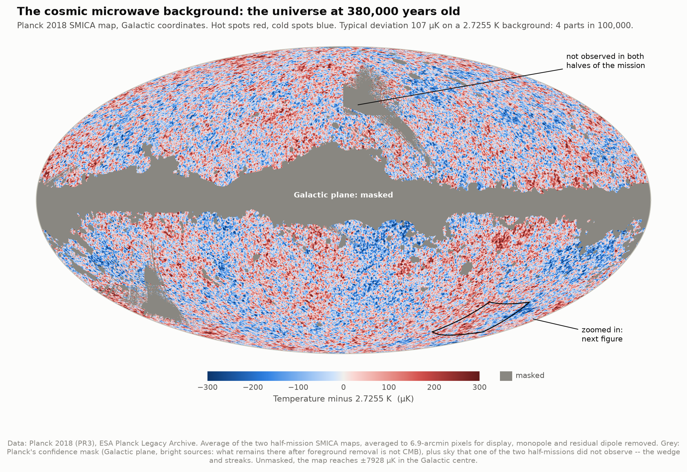
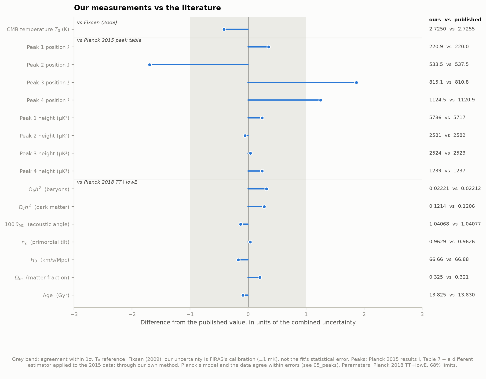
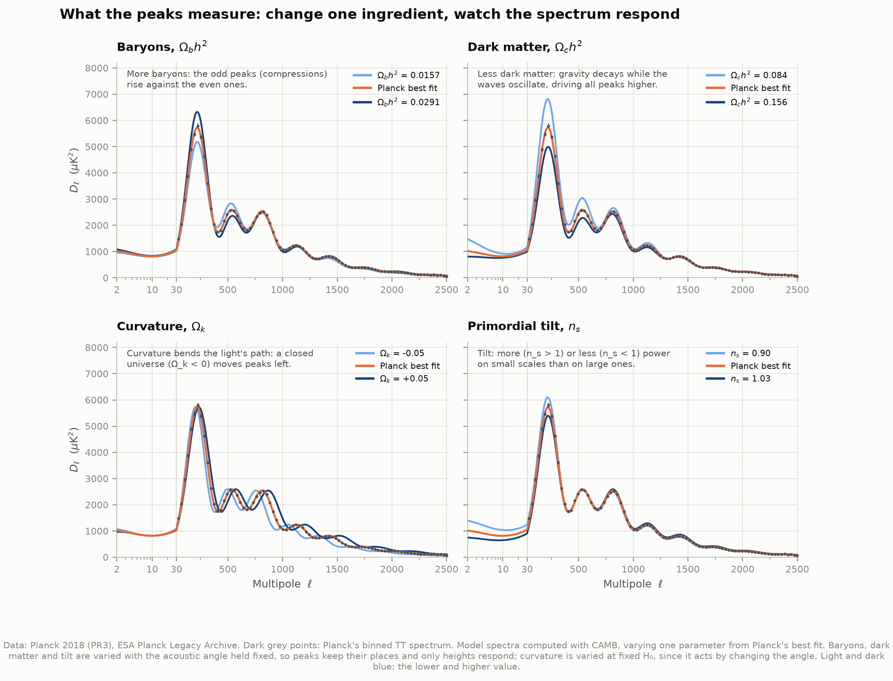
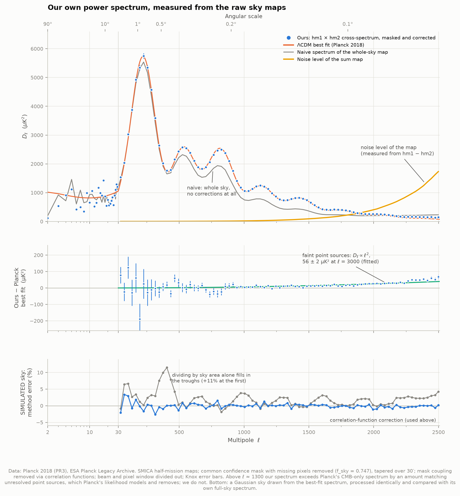

# D3 — The cosmic microwave background, from Planck's raw maps

**Can we see the universe as it was 380,000 years after the Big Bang, measure the ripples in
it, and read off what the universe is made of?**

Yes. This project takes the oldest light there is — the cosmic microwave background (CMB),
released when the universe first became transparent — and works through it in four steps:

1. **The glow itself.** Using NASA's COBE/FIRAS data, we check that the CMB is a blackbody,
   at 2.725 K, and set a limit on how far its spectrum could depart from one.
2. **The map.** Using ESA's Planck satellite, we render the sky's temperature fluctuations:
   ±300 µK on that 2.725 K, a few parts in 100,000.
3. **The power spectrum.** We measure how strong those fluctuations are on each angular scale:
   first from Planck's published spectrum, then **ourselves, from the raw sky maps**. The
   result is the famous series of "acoustic peaks": sound waves frozen into the early universe.
4. **The ingredients.** We fit the standard cosmological model to the peaks with CAMB, the code
   the Planck team itself uses. That gives the amounts of ordinary matter, dark matter and dark
   energy, the age of the universe, and the Hubble constant.



---

## Results

Everything below was measured by the code in this folder. Published values were used only
for grading.

### The glow: a 2.725 K blackbody (COBE/FIRAS)

| | Ours | Published |
|---|---|---|
| Temperature | 2.7250 K (FIRAS calibration: ±1 mK) | 2.72548 ± 0.00057 K (Fixsen 2009) |
| Fit quality | χ² = 45 for 42 degrees of freedom | — |
| Peak of the spectrum | 160.2 GHz (1.87 mm) | — |
| Distortion from a blackbody, y | (−0.1 ± 2.8) × 10⁻⁶ (statistical only) | \|y\| < 1.5 × 10⁻⁵ (95%, Fixsen et al. 1996) |

Across the 43 frequencies, the sky matches a perfect blackbody to within the measurement
errors. Near the peak, the differences are below one part in ten thousand.

### The map

| | |
|---|---|
| Typical temperature deviation | **107 µK**, i.e. ΔT/T = 3.9 × 10⁻⁵ |
| Same, predicted from Planck's best-fit power spectrum | 109 µK (the map and the spectrum agree) |
| Instrument noise per 1.7′ pixel (from the half-difference map) | 12.8 µK |
| Sky used | 74.7% |

### The acoustic peaks (Planck 2018 temperature spectrum)

| Peak | Ours: position ℓ | Ours: height (µK²) | Model through the same method | Planck 2015 table |
|---|---|---|---|---|
| 1 | 220.9 ± 2.3 | 5736 ± 69 | 220.3 · 5731 | 220.0 ± 0.5 · 5717 ± 35 |
| 2 | 533.5 ± 2.3 | 2581 ± 19 | 536.6 · 2596 | 537.5 ± 0.7 · 2582 ± 11 |
| 3 | 815.1 ± 2.2 | 2524 ± 16 | 813.5 · 2543 | 810.8 ± 0.7 · 2523 ± 10 |
| 4 | 1124.5 ± 2.7 | 1239 ± 8 | 1127.8 · 1242 | 1120.9 ± 1.0 · 1237 ± 4 |
| 5 | 1457 ± 5 | 783 ± 8 | 1455.7 · 793 | 1444.2 ± 1.1 · 797 ± 3 |
| 6 | 1771 ± 9 | 380 ± 7 | 1774.7 · 380 | 1776 ± 5 · 377 ± 3 |
| 7 | 2074 ± 25 | 218 ± 9 | 2077.0 · 219 | 2081 ± 25 · 214 ± 4 |

**The peaks are evenly spaced.** They fall on ℓₙ = ℓ_A (n − φ) with ℓ_A = 303.9 ± 0.9 and
φ = 0.277 ± 0.008: overtones of a single sound wave. The offset φ ≈ ¼ says the oscillations
started at maximum compression ("adiabatic" initial conditions, as inflation predicts). The
alternative, starting from zero ("isocurvature"), would put the peaks at ratios 1 : 3 : 5 : 7.
The measured ratios are 1 : 2.42 : 3.69 : 5.09.

### Our own power spectrum, from the sky maps

Built from Planck's two half-mission sky maps (see "How it works"), compared with Planck's
published spectrum:

| Multipoles | Ours ÷ Planck | χ² vs Planck's model |
|---|---|---|
| 30–500 | 1.002 | 23 for 16 bins |
| 500–1000 | **1.0005** | 16 for 16 bins |
| 1000–1500 | 1.010 | 43 for 17 bins |
| 1500–2000 | 1.050 | (excess, see below) |
| 2000–2508 | 1.40 | (excess, see below) |

Up to ℓ ≈ 1300 (angular scales down to about 8 arcminutes) our spectrum reproduces Planck's.
Beyond that we see more power than Planck does. The excess follows the shape of faint,
unresolved radio and infrared galaxies (power rising as ℓ²), with an amplitude of 56 ± 2 µK² at
ℓ = 3000, close to the point-source level Planck's own likelihood fits at 143 GHz (51 µK²).
Planck's published spectrum has these sources modelled and subtracted. Ours does not.

### The ingredients of the universe (CAMB fit to the temperature spectrum)

A five-parameter ΛCDM fit to Planck's 83 binned band powers: χ² = 64.3 for 78 degrees of
freedom. It is graded against Planck's own fit to the same kind of data (TT+lowE).

| Parameter | Ours | Planck 2018 TT+lowE | Shift |
|---|---|---|---|
| Ω_b h² (ordinary matter) | 0.02221 ± 0.00019 | 0.02212 ± 0.00022 | +0.4σ |
| Ω_c h² (dark matter) | 0.1214 ± 0.0021 | 0.1206 ± 0.0021 | +0.4σ |
| 100 θ_MC (acoustic angle) | 1.04068 ± 0.00047 | 1.04077 ± 0.00047 | −0.2σ |
| n_s (primordial tilt) | 0.9629 ± 0.0051 | 0.9626 ± 0.0057 | +0.05σ |
| 10⁹ A_s e^(−2τ) (amplitude) | 1.891 ± 0.010 | 1.884 ± 0.014 | +0.5σ |
| **H₀** (km/s/Mpc) | **66.66 ± 0.90** | 66.88 ± 0.92 | −0.2σ |
| Ω_m (matter fraction) | 0.325 ± 0.013 | 0.321 ± 0.013 | +0.3σ |
| **Age of the universe** | **13.825 ± 0.033 Gyr** | 13.830 ± 0.037 Gyr | −0.1σ |
| Sound horizon r_* | 144.19 ± 0.49 Mpc | 144.46 ± 0.48 Mpc | −0.6σ |

**In words:** the universe is 5.0% ordinary matter, 27% dark matter and 68% dark energy. It
holds about 5.5 times as much dark matter as ordinary matter. It is 13.8 billion years old.
Every parameter lands within 0.7σ of Planck's own analysis of the same kind of data, with
error bars within ~15% of theirs. The exception is the amplitude, whose error is smaller
than Planck's only because we hold τ fixed (see "What the CMB alone cannot tell you").

**The Hubble tension, measured twice in this repository.** Our H₀ = 66.7 ± 0.9 km/s/Mpc comes
from the young universe: the sound horizon, calibrated by physics, seen at a known angle.
Project D1 ([05-supernova-cosmology/](../05-supernova-cosmology/)) measured the expansion rate
today from Cepheid-calibrated supernovae and got 73.55 ± 1.02. The two disagree by **5.1σ**.
(Against the SH0ES team's own 73.04 ± 1.04 the gap is 4.6σ.) This is one of the biggest open
problems in cosmology: either one side has an undiscovered systematic error, or the standard
model is missing something between recombination and today.



---

## What the peaks mean

Before recombination the universe was a hot plasma. Photons and electrons were tightly
coupled, so light could not travel freely, and the photon–baryon fluid carried sound waves.
Gravity from dark-matter clumps pulled the fluid in and photon pressure pushed it back out.
When the universe cooled below ~3000 K at redshift z ≈ 1090, electrons joined nuclei to make
neutral atoms, the photons streamed free, and the pattern of the sound waves was frozen into
the light we see today.

**The first peak** is the wave that had just reached maximum compression at that moment. Its
wavelength is set by how far sound could travel by then: the *sound horizon*, 144 Mpc today.
Its position on the sky, ℓ ≈ 220 (about a degree), measures the angle that ruler subtends
across the universe. That angle depends on the geometry of space: in a closed universe light
rays converge and the ruler looks bigger, in an open one smaller.

**The later peaks** are overtones. Ordinary matter (baryons) adds weight but no pressure to the
fluid, deepening the compressions (odd peaks) relative to the rarefactions (even peaks). That
is why the 2nd peak sits below the 1st and 3rd. Dark matter sets how much gravity drove the
oscillations.

**The damping tail.** Photons random-walk a finite distance, smoothing out the smallest
waves ("Silk damping"). That makes the spectrum fall steeply beyond ℓ ≈ 1000.

**The plateau** at the largest scales (ℓ < 30) shows fluctuations too big for sound to have
crossed. They are the primordial seeds, seen through the gravitational redshift of climbing
out of potential wells (the Sachs–Wolfe effect).



---

## How it works

**1. The blackbody.** Fit a Planck curve to FIRAS's 43-frequency measurement of the sky's
brightness, then fit again with a Compton-y distortion added. That distortion is the
signature energy injection into the early universe would leave.

**2. The published spectrum.** Planck's TT spectrum at every multipole from 2 to 2508, its
binned version, and its best-fit model. Planck averages C_ℓ with ℓ(ℓ+1) weights inside each
bin, a recipe that is not documented alongside the file. We reverse-engineered it, and it
reproduces Planck's binned best-fit column to 4 parts in 10⁹, so every model we bin later is
binned exactly as Planck's data were.

**3. The peaks.** Each peak is located by fitting a Gaussian on a sloping line to the
every-multipole data within ±100 of it, and taking the maximum of the fitted curve. For
peaks 5–7 the damping tail is steep enough that the oscillation maxima stop being maxima of
the spectrum. The 7th is not a local maximum at all, just a shoulder. So we first divide by
a smooth fit to the tail, as the Planck team did. Error bars come from re-running the
whole measurement 300 times on noisy copies of the spectrum. The same method applied to
Planck's noise-free model is the control.

**4. The sky maps.** Planck's SMICA map is the microwave sky with the Galaxy and other
foregrounds removed by combining all nine frequency channels. We use its two half-mission
versions, made from the first and second halves of the observations. Same sky, independent
noise:

- **(hm1 + hm2)/2** is the sky map.
- **(hm1 − hm2)/2** cancels the sky exactly, leaving a map of pure instrument noise.
- **Correlating hm1 with hm2** measures the sky's power with no noise bias at all, because
  the two noises do not correlate.

The analysis mask removes the Galactic plane and bright sources (Planck's confidence mask)
plus sky that one half-mission never observed. It is tapered smoothly over 30′. We remove
the leftover monopole and dipole, transform to spherical harmonics, and form the spectra.

**5. Correcting for the cut sky.** Masking a quarter of the sky does more than remove area:
it mixes neighbouring multipoles. The usual shortcut, dividing by the sky fraction, fails at
the 11% level at the first trough (proved on a simulated sky, below). We instead correct
exactly in angle space. The masked map's correlation function is the sky's correlation
function times the mask's, so we divide one by the other and transform back. This is the
idea behind the SpICE estimator (Szapudi et al. 2001), and here it takes ~40 lines of
Legendre polynomials. Then the beam and pixel smoothing are divided out.

**6. Checking the method on a simulated sky.** A random Gaussian sky is drawn from Planck's
best-fit spectrum and pushed through the identical mask, taper and corrections. Comparing
with the same simulated sky's full-sky spectrum isolates the method's own error: −0.05% on
average, 0.8% rms per bin. With the shortcut it is +4.4% (ℓ < 500) and +11.5% at the worst
bin. *This is the only simulation in the project. It tests the method and is never used as
data.*

**7. The fit.** CAMB computes model spectra. Before fitting anything, we check that CAMB fed
Planck's best-fit parameters reproduces Planck's best-fit curve: it does, to 0.06% rms. A
Gauss–Newton least-squares fit then adjusts five parameters to Planck's binned spectrum and
converges in two iterations. The covariance of the fit gives the error bars.

---

## Two traps worth knowing about

**The pixel window.** A HEALPix map pixel reports the average over its 1.7′ area, which
smooths the map slightly: the "pixel window". Planck's documentation for the SMICA beam says
both that the beam "includes the pixel window function" and that
C_ℓ(map) = C_ℓ(sky) B_ℓ² p_ℓ², which only makes sense if it does not. The numbers in the
beam file are a bare 5′ Gaussian. We first trusted the first sentence. The data then showed
a deficit growing with ℓ: −2.2% at ℓ = 1000, which is *exactly* the pixel window's size
there. The product description settles it: the 2018 SMICA map "is not deconvolved from the
pixel window function". With both divided out, the spectrum agrees with Planck's to 0.05%
over ℓ = 500–1000. A comparison with a published result exists to catch exactly this.

**Mode coupling.** See step 5. The shortcut error is invisible unless you look for it,
because it only fills in the troughs and shaves the peaks by a few percent. On the real data
it made the first trough 11% too high, and the simulated sky showed the identical 11%, which
identified the cause.



---

## What the CMB alone cannot tell you

- **Curvature, without H₀.** The peak angle fixes one combination of spatial curvature and
  expansion rate (the "geometric degeneracy"). With our measured angle, any H₀ between 60
  and 80 km/s/Mpc implies curvature Ω_k between −0.017 and +0.021, so the universe is flat
  to within about 2% for any plausible H₀. It still takes an H₀ from somewhere to say "flat".
- **The reionization optical depth τ.** Temperature data above ℓ = 30 measure only
  A_s e^(−2τ). τ itself needs large-scale polarization, which we do not use, so τ is fixed at
  Planck's value (0.0522). That is why our A_s error bar is a third of Planck's, and why we
  quote A_s e^(−2τ) instead.
- **Why the Hubble tension exists.** Our number reproduces the tension. It does not explain
  it.

---

## Running it

```bash
cd ..                            # repository root
python3 -m venv .venv
source .venv/bin/activate
pip install numpy scipy matplotlib astropy healpy camb requests

cd 09-planck-cmb
python fetch_data.py             # ~1.6 GB (about 5 minutes from ESA)
python run.py                    # first run ~6 minutes; afterwards ~40 seconds
python test_physics.py           # 31 self-checks on the formulas
```

`python fetch_data.py --spectra-only` fetches just 0.4 MB. `run.py` then skips the map
figures and the map power spectrum, and runs everything else.

Once the cache is warm, `run.py` needs **no network at all**. This was verified by running it
inside an empty network namespace (`unshare -rn`), where even DNS fails. The expensive steps
(map spectra, simulated-sky check, parameter fit, peak error bars) are cached in
`data/derived/`. `--recompute` redoes them, `--no-maps` and `--no-fit` skip parts, and
`--no-figures` skips plotting.

Python 3.14 worked without trouble: healpy 1.20 and CAMB 2.0 both ship compatible wheels.

### Files

| File | What it does |
|---|---|
| `config.py` | Data products, analysis settings, and every published value we compare against, with its source |
| `fetch_data.py` | Downloads and size-checks everything; fetches the beam as a 58 KB slice of a 2 GB file |
| `cmb_physics.py` | The formulas: blackbody, power-spectrum conventions, beams and masks, the mask correction, the sound horizon |
| `spectra.py` | FIRAS fit, peak measurement, harmonic series |
| `sky.py` | Maps → masks → spectra, the simulated-sky check, the comparison with Planck |
| `cosmology_fit.py` | CAMB models and the parameter fit |
| `figures.py`, `plotstyle.py` | Every figure; colours checked with a colour-blindness validator |
| `run.py` | Runs everything, prints the scorecard, writes `data/results.json` |
| `test_physics.py` | Checks the formulas against known answers |

`test_physics.py` is worth a look. Among other things it checks that the blackbody
integrates to the Stefan–Boltzmann law and that the universe holds 411 photons per cubic
centimetre. It also checks that our few-line sound-horizon integral, fed Planck's best-fit
densities, gives the same answers as Planck's own Boltzmann code: r_* = 144.391 Mpc against
144.394, and the distance to last scattering 13,869.5 Mpc against 13,869.5.

---

## Figures

`01_blackbody` the FIRAS spectrum and its residuals · `02_sky` the CMB map ·
`03_zoom_and_noise` a 20° patch at full resolution next to its noise map, and the whole-sky
noise · `04_power_spectrum` Planck's spectrum, annotated · `05_peaks` our peak measurements and
the harmonic series · `06_map_spectrum` our spectrum from the maps, and the simulated-sky check
· `07_what_the_peaks_measure` how each ingredient changes the spectrum · `08_fit` the parameter
fit and the Hubble tension · `00_summary` every measurement against the literature.

The spectrum figures are PNG and SVG. The sky maps are PNG only: an SVG of a raster image is the
same picture in a larger file.

---

## Honest notes on the numbers

- **The FIRAS temperature is FIRAS's, not ours.** The archived spectrum is stored as a
  2.725 K blackbody plus measured residuals, so a fit returns 2.725 K by construction. Its
  ±8 µK statistical error is real for the *shape* and meaningless for the absolute scale,
  which rests on FIRAS's thermometry (±1 mK). What our fit genuinely tests is that no
  non-blackbody shape is needed.
- **Peak positions depend on the estimator at the few-multipole level.** Planck's own 2015
  table disagrees with the exact maxima of Planck's 2018 model by similar amounts. The fair
  test is our data against the model *through the same method*, and those agree within
  errors for every peak. Our peak errors treat neighbouring multipoles as independent, which
  they are not quite, so they are somewhat optimistic.
- **The harmonic series is approximate.** The phase φ drifts slightly from peak to peak
  (χ² = 92 for 5 degrees of freedom), and the spacing overestimates the true acoustic
  multipole by 0.8% (shown by running the same fit on the model). The CAMB fit has no such
  approximation: 100θ_* = 1.04091 ± 0.00047.
- **The fit is simplified.** It uses Planck's foreground-subtracted spectrum with
  independent errors per bin, fixes τ, and ignores ℓ < 30. χ² = 64 for 78 degrees of freedom
  (Planck's own best fit gives 65 for these 83 bins) suggests the published per-bin errors
  are slightly conservative or correlated. The parameter errors should be read as good to
  ~20%, not to the last digit.
- **Our map spectrum carries foregrounds above ℓ ≈ 1300** (see Results). The noise also
  overtakes the signal in the sum map at ℓ ≈ 1875, but the cross-spectrum is immune to that.
- **Degeneracies.** In temperature data alone, the dark-matter density, the amplitude and the
  tilt are strongly correlated (correlation coefficients 0.86–0.94). That is why the errors
  on each are larger than the data's precision might suggest.
- **The map shown is the average of the half-missions**, not Planck's full-mission release
  map (which also comes in an "inpainted" version with the Galaxy filled in by a statistical
  guess, the version usually shown in press images). The half-mission maps make the noise map
  and the noise-free spectrum possible. The price is 3% more masked sky where one half is
  missing.
- **"380,000 years"** is the standard round figure for the time of last scattering,
  z_* ≈ 1090.

## Data credits

Based on observations obtained with Planck (http://www.esa.int/Planck), an ESA science mission
with instruments and contributions directly funded by ESA Member States, NASA, and Canada. Data
from the Planck Legacy Archive (ESA), with the NASA/IPAC Infrared Science Archive as mirror.
COBE/FIRAS data from NASA's Legacy Archive for Microwave Background Data Analysis (LAMBDA).
Published parameter values: Planck 2018 cosmological parameter tables (PLA); peak table: Planck
Collaboration I (2016, A&A 594, A1), Table 7. Software: CAMB (Lewis, Challinor & Lasenby 2000),
HEALPix (Górski et al. 2005) via healpy (Zonca et al. 2019), astropy. All data retrieved
2026-09-29.
