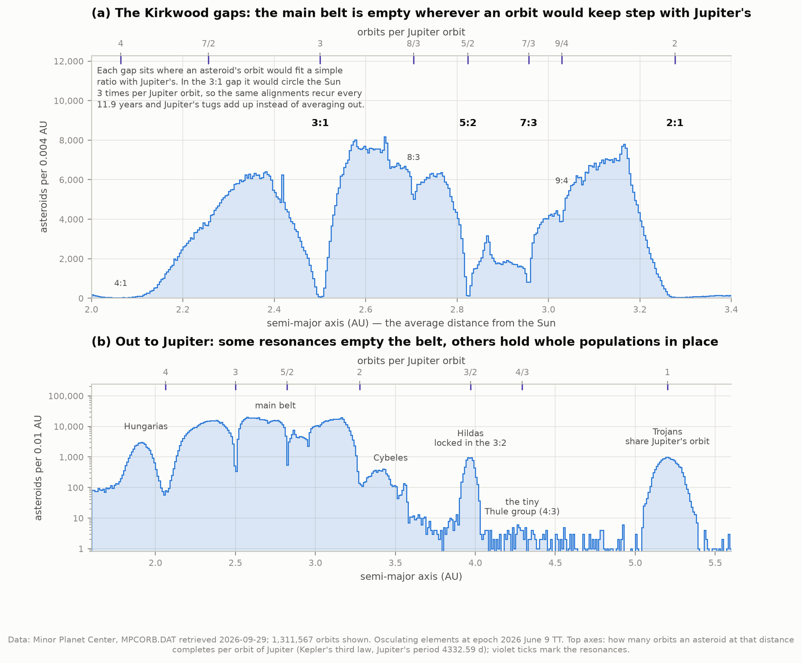
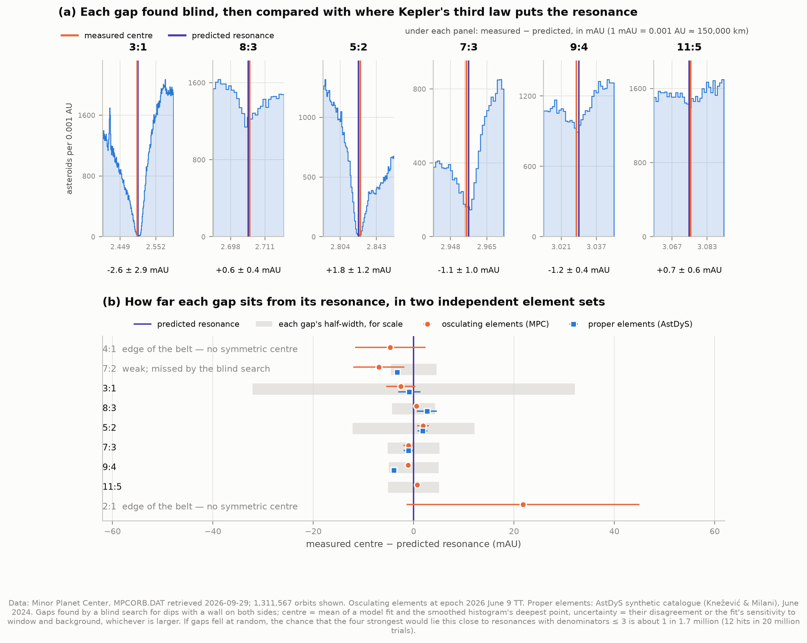
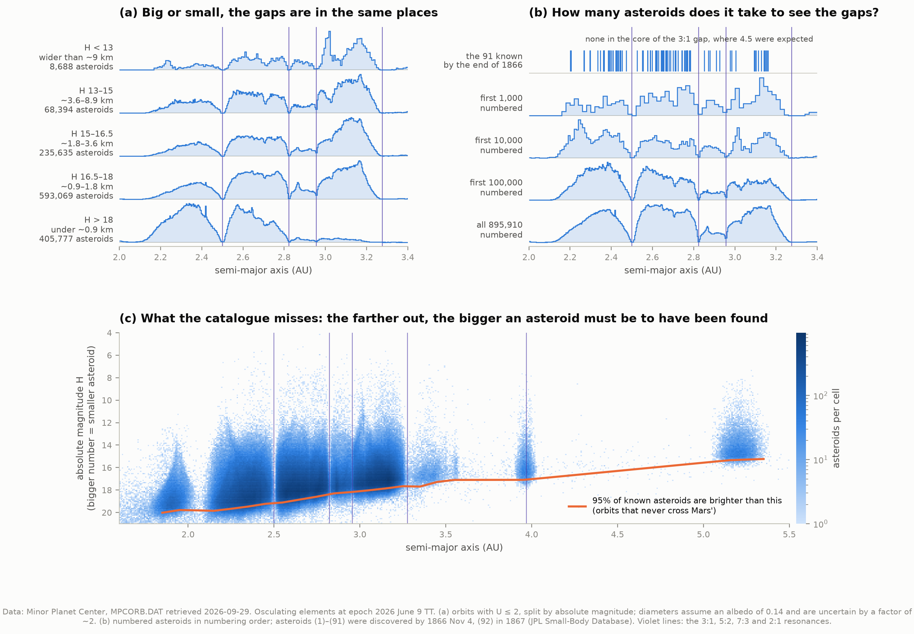
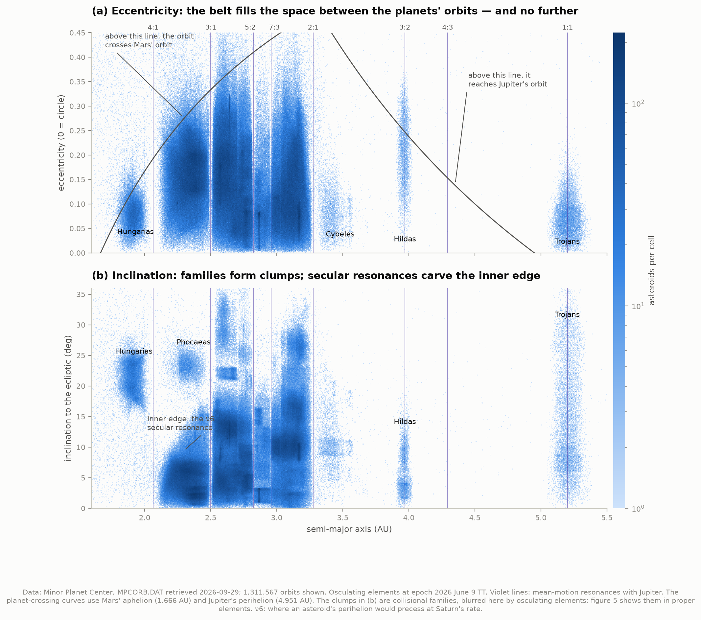
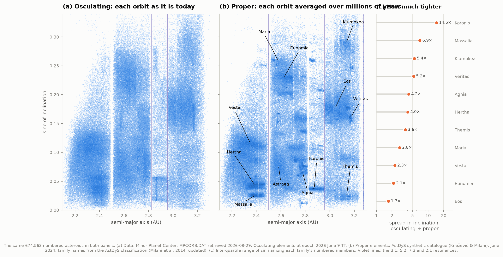
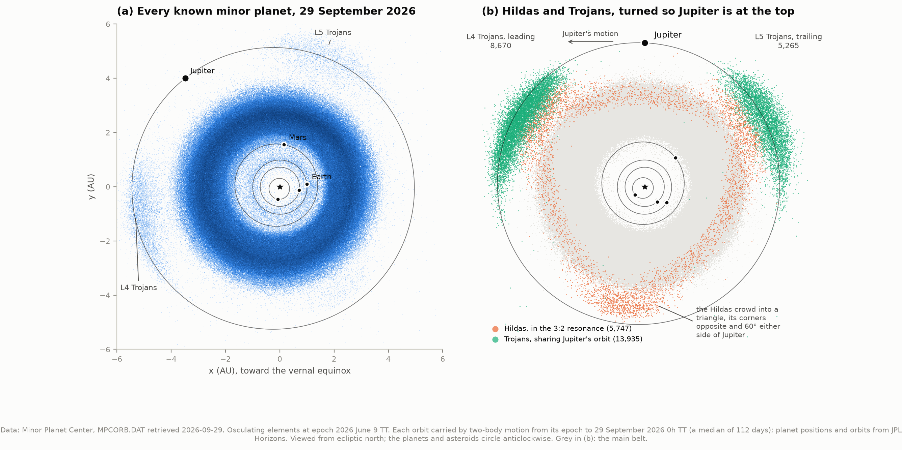
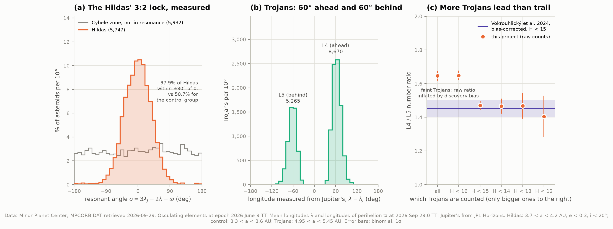
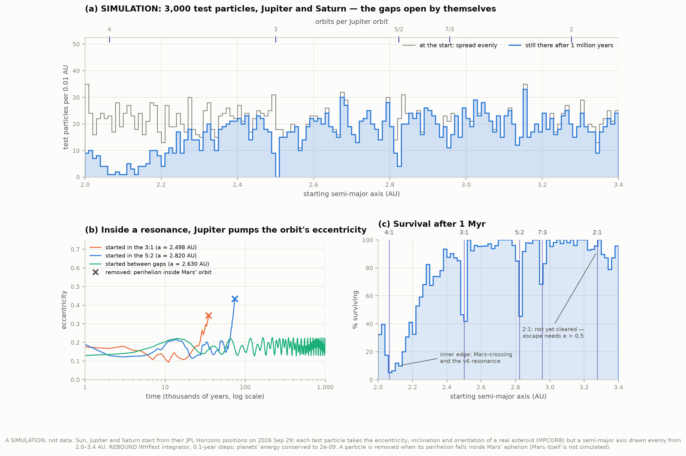

# E1 — The Kirkwood gaps: Jupiter's fingerprints on the asteroid belt

**Do Jupiter's orbital resonances really carve gaps in the asteroid belt — visible in a plain
histogram of real orbits?**

Yes, and sharply. This project takes the Minor Planet Center's orbit file — **1,568,901 minor
planets** on 29 September 2026 — and histograms their distances from the Sun. The gaps are
found by a search that knows nothing about Jupiter. Only afterwards are they compared with
where Kepler's third law says an asteroid would orbit in a simple ratio with Jupiter. The
six clearest gaps all land within 0.0026 AU of that prediction, about 0.1% of the distance.

Along the way the same data show the other half of the story: two populations that live
*inside* resonances rather than being cleared out of them, the families of collision
fragments hidden in the belt, and where all of it is today. The mechanism itself, how a
resonance empties its gap, gets its own figure. That one is a **simulation**, labelled as
such, and it is the only thing here that isn't measured data.

---

## First, what a resonance is

An asteroid's orbital period is set by its average distance from the Sun (Kepler's third
law). At 2.50 AU the period is 3.95 years: exactly a third of Jupiter's 11.86. An asteroid
there laps the Sun three times for each lap of Jupiter's. It meets Jupiter at the same few
points of its orbit over and over, and every 11.9 years the whole pattern of alignments
repeats. Elsewhere Jupiter's pulls arrive from ever-changing directions and average out. At
the resonance they add up, like pushing a swing in time with its motion.

The resonances are named by the ratio: the **3:1** (3 asteroid orbits per Jupiter orbit),
the **5:2**, the **7:3**, the **2:1**. Daniel Kirkwood pointed out gaps at these distances in
1866, when fewer than a hundred asteroids were known, and correctly blamed Jupiter. Why a
steady push in step empties a gap, rather than just making the orbits wobble, took another
116 years to settle. It is explained below.

---

## Results

### 1. The gaps



Panel (a) is the whole finding. The belt is not a smooth band: it has near-empty valleys, and
each one sits under a simple fraction on the top axis. Panel (b) shows the other kind of
resonance. The **Hildas** (3:2) and the **Trojans** (1:1, sharing Jupiter's orbit) are
populations that exist *because* of a resonance, and they are almost the only asteroids
beyond the belt.

| Region (semi-major axis) | Asteroids |
|---|---|
| Hungaria zone (1.78–2.0 AU) | 40,322 |
| Inner belt (4:1 to 3:1, 2.0–2.5 AU) | 409,501 |
| Middle belt (3:1 to 5:2, 2.5–2.82 AU) | 543,786 |
| Outer belt (5:2 to 2:1, 2.82–3.28 AU) | 498,774 |
| Cybele zone (3.28–3.7 AU) | 8,160 |
| Hilda zone (3.7–4.2 AU) | 8,286 |
| Jupiter Trojans (4.95–5.45 AU) | 16,406 |

Plus 42,550 near-Earth objects, 30,616 other Mars-crossers and 8,309 objects beyond Jupiter.
The region counts exclude orbits that reach inside Earth's.

### 2. Found blind, then named — the main measurement



The search slides windows of 9 widths along the semi-major axis. It looks for places holding
fewer asteroids than *both* neighbouring windows predict: a dip with a wall on each side. It
uses the 1,311,567 orbits the MPC rates as well determined (uncertainty parameter U ≤ 2). Each
dip it finds is then fitted for its centre, width and depth. Only after that is the period
ratio at the centre worked out and matched to the nearest simple fraction.

| Gap | Found at (AU) | Kepler's law predicts | Offset | Width | Depth | Significance |
|---|---|---|---|---|---|---|
| **3:1** | 2.4979 ± 0.0029 | 2.5005 | −2.6 ± 2.9 mAU | 0.064 AU | 94% | 197σ |
| **8:3** | 2.7053 ± 0.0004 | 2.7047 | +0.6 ± 0.4 mAU | 0.008 AU | 20% | 21σ |
| **5:2** | 2.8255 ± 0.0012 | 2.8236 | +1.8 ± 1.2 mAU | 0.024 AU | 93% | 82σ |
| **7:3** | 2.9555 ± 0.0010 | 2.9565 | −1.1 ± 1.0 mAU | 0.010 AU | 71% | 44σ |
| **9:4** | 3.0279 ± 0.0004 | 3.0291 | −1.2 ± 0.4 mAU | 0.010 AU | 21% | 11σ |
| **11:5** | 3.0755 ± 0.0006 | 3.0748 | +0.7 ± 0.6 mAU | 0.010 AU | 10% | 5σ |

1 mAU = 0.001 AU ≈ 150,000 km. "Depth" is the fitted fraction of asteroids missing at the
centre. The predictions use Jupiter's mean period, 4332.589 days, and nothing else.

**The headline.** Every interior gap the blind search found sits where an asteroid would
complete a simple fraction of Jupiter's orbit. The offsets are 0.6–2.6 mAU, a thousandth of
the distance, and mostly within their error bars. If the four strongest gaps were scattered
at random between 2.0 and 3.5 AU, the chance that all four would sit this close to
resonances with denominators of 3 or less is **about 6 × 10⁻⁷**: 12 hits in 20 million
simulated trials.

The search found four more features that are not clean gaps:

- **The 4:1 (2.06 AU) and 2:1 (3.28 AU)** are the belt's inner and outer *edges*. The
  population on the far side never recovers, so there is no symmetric centre to measure.
  (Wall ratios are 0.03 and 0.005; below 0.25 the code calls a dip an edge.) The 4:1 also
  blends with the ν6 secular resonance, section 4.
- **The 9:5 (3.51 AU)** is an edge within the sparse Cybele zone.
- **A weak dip at 2.415 ± 0.009 AU** (9% deep, 6.6σ) matches no low-order Jupiter
  resonance. It does match the **1:2 resonance with Mars** (2.419 AU), and the proper
  elements back that up. Asteroids *captured* in a resonance all share its averaged
  semi-major axis, so they pile up there, and 5,180 asteroids crowd into one 0.0005 AU bin at
  2.4185 AU, 9.6 times the neighbourhood level. That is probable but not proven. A
  three-body resonance with Jupiter and Saturn (4J−2S−1, 2.3978 AU) produces a similar
  pile-up nearby.

**Two element sets agree.** The same measurement on AstDyS's *proper* semi-major axes gives
3:1 −0.9 ± 2.2, 5:2 +1.8 ± 1.0 and 7:3 −1.0 ± 1.0 mAU. That is the same answer from a
catalogue computed completely differently (proper elements are explained in section 4). For
the weak 8:3 and 9:4 the proper values drift (+2.7 ± 2.0 and −3.9 ± 0.5 mAU), because
asteroids trapped in those resonances pile up at the exact resonance in proper elements and
distort the dip beside them.

### 3. Are the gaps real?



A skeptic could ask whether the gaps are artefacts of how asteroids get discovered. Three
tests say no.

**Same gaps at every size (panel a).** Discovery depends strongly on size: the smaller the
asteroid, the closer it must pass to be found. So a discovery artefact would change with
size. The gaps don't:

| Absolute magnitude H (diameter*) | Asteroids | 3:1 core empty | 5:2 core empty |
|---|---|---|---|
| H < 13 (> 9 km) | 8,688 | 94% | 97% |
| 13–15 (3.6–9 km) | 68,394 | 93% | 93% |
| 15–16.5 (1.8–3.6 km) | 235,635 | 92% | 94% |
| 16.5–18 (0.9–1.8 km) | 593,069 | 92% | 90% |
| H > 18 (< 0.9 km) | 405,777 | 93% | 90% |

\*Diameters assume an albedo of 0.14 and are uncertain by a factor of ~2. "Core" means the
central half of the gap, compared with the density just outside it.

**Kirkwood's 91 asteroids (panel b).** Of the 91 asteroids discovered by the end of 1866,
none lies in the core of the 3:1 gap, where a gap-free belt would have put 4.5. By chance
alone that happens about 1% of the time: suggestive, not conclusive, and a bold call from 91
points. In the 5:2 core he had 0 where 1.2 were expected, which proves nothing. By the first
1,000 numbered asteroids the case is overwhelming: 2 in the 3:1 core against 31 expected, 0
in the 5:2 against 13.

**What the catalogue misses (panel c).** The faintest asteroids found, taken as the 95th
percentile of H among orbits that never cross Mars', fall from **H ≈ 20.0 at 1.85 AU** to
**18.0 at 3.05 AU** and **15.3 among the Trojans at 5.2 AU**. The farther out, the bigger an
asteroid must be to have been seen, so most small outer-belt asteroids are still unknown.
This is a smooth trend over whole AU, with nothing in it that could open a sharp gap 0.01 AU
wide.

**One size trend is real, and not settled here.** The narrow 9:4 gap is shallower among small
asteroids: 36% deep for H < 13, 18–19% for H > 16.5. The 7:3 shows a milder version. Two
explanations are possible, and this data can't separate them. Small asteroids' orbits carry
larger uncertainties, which blurs a narrow gap. And small asteroids drift: sunlight absorbed
and re-emitted as heat gives a spinning km-sized body a tiny thrust (the Yarkovsky effect),
walking its orbit into resonances faster than they empty.

### 4. The architecture of the belt



**Eccentricity (panel a).** The belt fills exactly the space between two curves. Above the
left curve, an orbit's perihelion reaches inside Mars' orbit. Above the right one, its
aphelion reaches Jupiter's. Orbits in either region get disturbed by close encounters and
don't last, so the belt's outer shape is set by the neighbouring planets as much as the gaps
are. The gaps show as vertical white bars.

**Inclination (panel b).** Two things carve this panel. The clumps are **collisional
families**, section 5. The belt's slanted inner edge, running from 2.1 AU at low inclination
to 2.45 AU at 16°, is the **ν6 secular resonance**. A mean-motion resonance matches orbital
*periods*; a secular resonance matches the far slower turning of the orbit itself. Here an
asteroid's perihelion would precess at the same rate as Saturn's dominant mode, g6 = 28.2″
per year, one turn in 46,000 years. Orbits there get their eccentricity pumped up until they
cross Mars' orbit. The resonance's position depends on inclination, which is why the edge
slants. The high-inclination **Hungarias** (1.9 AU, ~22°) and **Phocaeas** (2.3 AU, ~23°)
are separate islands, walled off from the main belt by the ν6 and by Mars-crossing orbits.

### 5. Collisional families — and why they need proper elements



When asteroids collide, the fragments leave on nearly identical orbits. Over time these
**families** should stand out as clumps in orbital-element space. In the MPC's elements
(panel a) they are smudges. That is not a data problem. The MPC's elements are *osculating*:
each is the ellipse the asteroid would follow if the planets vanished at this instant.
Jupiter and Saturn make every orbit's eccentricity and inclination oscillate over tens of
thousands of years, so fragments launched together look scattered at any given moment.

**Proper elements** (panel b) are those oscillations averaged away by integrating each orbit
for millions of years (Knežević & Milani 2000). They stay nearly constant for hundreds of
millions of years, and the families snap into focus. Kiyotsugu Hirayama discovered the first
families this way in 1918 (Koronis, Eos and Themis), by removing Jupiter's perturbations with
pencil-and-paper theory.

For the same 674,563 numbered asteroids in both panels, the spread in inclination of each
family's members (interquartile range of sin i) shrinks by:

| Family | Members | Tighter in proper elements by |
|---|---|---|
| Koronis | 13,539 | **14.5×** |
| Massalia | 14,457 | 6.9× |
| Klumpkea | 5,607 | 5.4× |
| Veritas | 6,380 | 5.2× |
| Agnia | 7,273 | 4.2× |
| Hertha (the Nysa–Polana complex) | 24,922 | 4.0× |
| Themis | 10,001 | 3.6× |
| Maria | 6,673 | 2.8× |
| Vesta | 16,581 | 2.3× |
| Eunomia | 20,381 | 2.1× |
| Eos | 35,542 | 1.7× |

The oscillations add about the same scatter to every family, roughly 0.02 in sin i. So the
ratio mostly measures how *intrinsically* tight a family is. Eos, the largest, sharpens
least because its members really are spread out: their proper inclinations span 9 times
Koronis's (interquartile range 0.016 against 0.0018 in sin i).

**22.7% of main-belt asteroids belong to a family** in the AstDyS classification. The Vesta
family is debris from the two giant craters on Vesta's south pole, and some of its members
fall to Earth as the HED meteorites.
Astraea's family (12,147 members) is omitted from the table because it is locked in a
secular resonance, where proper eccentricity isn't defined.

### 6. Where everything is today



Every orbit carried to 29 September 2026 and viewed from above the Solar System. Panel (a)
is all 1,568,901 objects. Panel (b) rotates the view so Jupiter is at the top and shows only
its companions:

- **Trojans** crowd around the two Lagrange points, 60° ahead of Jupiter (L4) and 60° behind
  (L5), where the pulls of the Sun and Jupiter balance in the rotating frame. With orbit
  quality U ≤ 2: **8,670 lead and 5,265 trail**.
- **Hildas** form a **triangle** with corners opposite Jupiter and 60° either side of it.
  Measured from the positions: corners at **−58°, +58° and +172°** from Jupiter, against the
  predicted −60°, +60° and 180°. No Hilda holds still. Each one moves along the triangle,
  lingering near a corner at the slow, far end of its orbit, and the corners are where those
  far ends fall. Why they fall there is in the next section.

### 7. How a resonance protects instead of clearing



**Hildas (panel a).** For the 3:2 resonance, the angle σ = 3λ_J − 2λ − ϖ measures where
conjunctions with Jupiter happen along the asteroid's orbit. At σ = 0 they happen at
perihelion, the asteroid's closest point to the Sun and so its farthest from Jupiter's
orbit. Computed for every Hilda, **97.9% have σ within ±90° of 0** (median |σ| = 26°). A
control group just inside, in the Cybele zone and not in resonance, gives 50.7%, the 50%
that random angles would. Jupiter's repeated tugs keep steering each Hilda back so that it
never meets Jupiter anywhere dangerous. The same resonance that would destabilise an orbit
at one phase protects it at this one.

**Trojans (panel b).** The longitude measured from Jupiter's shows two tight clumps at +60°
and −60° and essentially nothing in between.

**More Trojans lead than trail (panel c).** In raw counts L4/L5 = **1.65 ± 0.03**. That
mixes in faint Trojans, whose discovery depends on where each cloud happened to sit in the
sky during the big surveys. Counting only the brighter, essentially complete Trojans gives
**1.470 ± 0.028 for H < 15**, and 1.47 ± 0.04 and 1.47 ± 0.08 for H < 14 and H < 13. The
bias-corrected value from a decade of Catalina Sky Survey data is **1.45 ± 0.05 for H < 15**
(Vokrouhlický et al. 2024). The asymmetry is real, and its cause is still debated; the
leading ideas involve Jupiter's migration early in the Solar System's history.

### 8. Watching a gap open — a labelled simulation



The data show *that* resonant orbits are missing. To show *how*, 3,000 massless test
particles were integrated for 1 million years with the REBOUND N-body code, under the
gravity of the Sun, Jupiter and Saturn.

- **Real planets.** They start from their actual JPL Horizons positions and velocities on 29
  September 2026. Saturn matters: its pull makes Jupiter's orbit precess, and that is part of
  what turns the resonances chaotic.
- **Real asteroids, moved.** Each particle copies the eccentricity, inclination and
  orientation of a randomly chosen real asteroid, but gets a semi-major axis drawn evenly
  from 2.0–3.4 AU. The starting belt therefore has no gaps. That uniform start is the one
  invented ingredient; it is the null hypothesis being tested.
- **Removal.** A particle is removed when its perihelion reaches inside Mars' orbit.

| Starting zone (±0.015 AU) | Removed within 1 Myr | Median time to removal |
|---|---|---|
| 4:1 | 91% | 81,000 years |
| **3:1** | **72%** | **24,000 years** |
| 5:2 | 49% | 74,000 years |
| 7:3 | 30% | 182,000 years |
| 2:1 | 2% | — |
| elsewhere beyond 2.3 AU, away from resonances | 7% | — |

Panel (b) shows how it happens. A particle between the gaps keeps its eccentricity rocking
steadily between 0.13 and 0.22 for the whole million years. Particles inside the 3:1 and 5:2
have theirs pumped until the orbit crosses Mars'. This is the mechanism Jack Wisdom
identified in 1982–83 for the 3:1: resonant orbits are **chaotic**, and their eccentricity
makes sudden large excursions. The planets' energy was conserved to 2 parts in 10⁹, so the
integration is trustworthy at the level that matters here.

**What the simulation doesn't do.** The 2:1 does not clear in 1 Myr. Escaping from 3.28 AU
needs an eccentricity above 0.5, the 2:1's chaos works far more slowly, and parts of it are
stable: a small population, the Zhongguos, lives inside it. The inner edge (a < 2.3 AU, 67%
removed) empties for a different reason: particles there start close to crossing Mars' orbit
anyway, and the ν6 resonance is nearby. Mars itself is not simulated, and neither are
asteroid collisions or the Yarkovsky drift.

---

## How it works

**1. Fetch** (`fetch_data.py`). The MPC's `MPCORB.DAT.gz` (94 MB, regenerated daily). AstDyS's
synthetic proper elements, their secular-resonance supplement and the family classification
(142 MB). JPL Horizons states for the planets at the snapshot instant, 0h TT on the
retrieval date. Each file is recorded with its URL, retrieval time, size, SHA-256 and the
server's Last-Modified date in `data/provenance.json`.

**2. Parse** (`mpcorb.py`, `astdys.py`). MPCORB is fixed-width text with two *packed*
encodings, the rite of passage the project plan warned about:

- Epochs are 5 characters: `K2669` = 2026 June 9 (K = 20th century, 26, month 6, day 9;
  months and days above 9 use letters).
- Asteroid numbers above 99,999 turn their first digit into a letter (`A0000` = 100,000).
  Numbers above 619,999 use a tilde and base-62 (`~0000` = 620,000; the file reaches 895,910).

The parser is checked against every example on the MPC's own format pages, and against the
file itself: all 895,910 numbers decode to exactly 1…895,910. For every one of the 1,543,857
orbits between 1.5 and 6 AU, the printed mean motion matches the semi-major axis to within
the printed rounding.

**3. Cut.** One cut for the measurements: U ≤ 2 keeps 1,311,567 orbits (84%). U is the MPC's
estimate of how far an orbit's prediction could drift in a decade, from 0 (under a second of
arc) to 9 (barely constrained). One-opposition orbits whose eccentricity was *assumed*
rather than fitted are dropped.

**4. Search blind** (`analysis.detect_gaps`). Windows 0.004–0.064 AU wide, every 0.0005 AU,
each tested against the lower of its two neighbours. A window that merely overlaps an
already-found gap is an echo and is discarded. On pure random numbers the search finds
nothing, and on planted gaps it finds exactly those (`test_algorithms.py`).

**5. Measure each gap.** Two independent estimators of the centre:

- a Poisson maximum-likelihood fit of a smoothed box on a quadratic background;
- the smoothed histogram's deepest point.

The quoted centre is their mean. The uncertainty is the larger of their disagreement and the
fit's sensitivity to its window and background shape. The formal statistical error, often
0.0001 AU, is not quoted because it would overstate the precision.

**6. Name it.** The period ratio P_Jupiter/P_asteroid at the centre is approximated by the
nearest fraction with denominator ≤ 7. The name counts only if the resonance is of modest
order and lies inside the gap. Otherwise the feature stays unidentified, and Mars and
three-body resonances nearby are listed as candidates.

**7. The rest.** Positions come from two-body propagation to the snapshot date (the median
orbit moves 112 days). The resonant angles use Jupiter's elements from Horizons at the same
instant. The families are the AstDyS memberships, matched to MPC orbits by number.

---

## Honest notes

- **"Where a gap is" has a definition problem at the 0.001 AU level.** Gaps are not
  symmetric. The 3:1 has a long, gradual inner shoulder and a steep outer wall, and the fit
  and the deepest point differ by 5 mAU there. That is why both are quoted and their
  disagreement enters the error bar. Resonances are not infinitely thin either: a
  resonance's exact centre shifts by fractions of a mAU with eccentricity and with how fast
  the orbit precesses. The one offset that is formally significant (9:4, −1.2 ± 0.4 mAU) is
  still eight times smaller than the gap is wide.
- **Osculating semi-major axes blur the gaps slightly.** Short-period tugs from Jupiter make
  each asteroid's osculating *a* oscillate by up to ~0.01 AU. Proper elements remove that,
  but introduce their own artefact for resonant asteroids, the pile-ups of section 2.
- **These are discovered asteroids, not all asteroids.** The census and the Trojan ratio
  count what has been found, and the faint limit falls from H ≈ 20 in the inner belt to 15
  among the Trojans.
  The gap measurements survive this: they are the same at every size. The raw census does
  not.
- **The chance-alignment test is only as good as its question.** It asks about the four
  strongest interior gaps and resonances with denominators up to 3, placing random gaps
  uniformly in 2.0–3.5 AU. A different reasonable question would give a different number,
  but no reasonable version comes near "chance".
- **Kirkwood's sample** is taken as asteroids (1)–(91), all discovered by 4 November 1866.
  (92) Undina followed in July 1867 (discovery dates from JPL's Small-Body Database). Their
  orbits are today's, and "expected in the gap" uses today's gap positions, so this is an
  illustration of what the data could show, not a reconstruction of Kirkwood's reasoning.
- **Family membership is AstDyS's classification**, not ours, and family catalogues disagree
  in detail. Nesvorný et al.'s, for example, splits and names some families differently;
  AstDyS's "Hertha" is the whole Nysa–Polana complex.
- **Hilda and Trojan boxes are simple cuts in osculating elements.** Hildas are 3.7–4.2 AU,
  e < 0.3, i < 20°; Trojans 4.95–5.45 AU. A few interlopers and missed members don't change
  the percentages quoted.
- **The simulation is a simulation.** It uses massless particles and no Mars (removal at
  Mars-crossing stands in for it), no collisions, no Yarkovsky drift, and only 1 Myr of the
  belt's 4.5 billion years. Its uniform starting belt is invented. Everything else about it
  comes from real data.
- **Reproducible, but a snapshot.** From the cache every run gives identical numbers. The
  MPC file changes daily, so re-fetching (`python fetch_data.py --refresh`) will move the
  counts slightly.

---

## Running it

```bash
cd ..                       # repository root
source .venv/bin/activate   # shared venv: numpy scipy pandas matplotlib astropy astroquery requests
pip install rebound         # only for the simulation (a Python 3.14 wheel exists)

cd 10-kirkwood-gaps
python fetch_data.py        # ~240 MB from the MPC, AstDyS and JPL Horizons; only once
python simulation.py        # optional N-body run: ~15 minutes on 6 cores
python run.py               # every measurement and figure: about a minute
python test_physics.py      # 68 self-checks on the formulas, the parser and the algorithms
```

Once the cache is warm, `run.py` needs **no network**. This was verified by running it in a
network namespace with no connection at all. The first run parses the catalogues (~20 s) and
caches them as `.npz`.

### Files

| File | What it does |
|---|---|
| `config.py` | Paths, data sources, physical constants (each with its source), every cut |
| `fetch_data.py` | Downloads and caches the three data sources, with provenance |
| `mpcorb.py` | Parses MPCORB.DAT: fixed-width fields, packed dates and packed numbers |
| `astdys.py` | Parses the proper elements and the family classification |
| `orbit_physics.py` | Kepler's law, resonance locations, Kepler's equation, orbit → position |
| `analysis.py` | Census, blind gap search and measurement, size/era tests, resonance lock, families |
| `simulation.py` | The labelled N-body experiment (REBOUND) |
| `figures.py` | The eight figures |
| `plotstyle.py` | Shared styling, identical to A1 and A2 |
| `run.py` | Runs everything and prints the summary |
| `test_physics.py` | Checks formulas, parser and file against known answers |
| `test_algorithms.py` | Checks the gap search on planted gaps and on pure noise |

`test_physics.py` checks the physics against known answers:

- Earth's year returns 1.000 AU, and Jupiter's mean period its mean distance of 5.2028 AU.
- Every resonance location matches its tabulated value to 0.1%.
- Our elements → position code reproduces JPL Horizons' own position vectors for Mars,
  Jupiter and Saturn to 10⁻¹⁴ AU.

`test_algorithms.py` plants two gaps in random numbers, one empty and 0.03 AU wide, one 40%
deep and 0.008 AU wide. The blind search finds exactly those two and recovers their centres
to 0.0001 AU.

Figures are PNG and SVG. Colours are a colourblind-safe set checked with a validator. No
scatter plot uses more than four hues together, and those four pass the all-pairs check.

---

## Data credits and references

This research has made use of data and services provided by the **International
Astronomical Union's Minor Planet Center** (MPCORB.DAT, retrieved 2026-09-29; file
Last-Modified 2026-09-29 12:52 GMT). Proper elements and asteroid families are from
**AstDyS-2** (University of Pisa / SpaceDyS; synthetic proper elements computed by
Z. Knežević, June 2024 release; retrieved 2026-09-29). Planet positions are from **JPL
Horizons** (Giorgini et al. 1996), and discovery dates from the **JPL Small-Body Database**.

- Kirkwood, D. 1866, *Proceedings of the American Association for the Advancement of
  Science* — the gaps and their cause
- Hirayama, K. 1918, AJ 31, 185 — the first asteroid families
- Wisdom, J. 1982, AJ 87, 577; 1983, Icarus 56, 51 — chaos and the 3:1 gap
- Moons, M. & Morbidelli, A. 1995, Icarus 114, 33 — secular resonances inside the
  mean-motion resonances
- Gladman, B. et al. 1997, Science 277, 197 — how quickly resonances empty
- Nesvorný, D. & Morbidelli, A. 1998, AJ 116, 3029 — three-body resonances
- Knežević, Z. & Milani, A. 2000, CMDA 78, 17; 2003, A&A 403, 1165 — synthetic proper
  elements
- Milani, A. et al. 2014, Icarus 239, 46 — the family classification used here
- Laskar, J. et al. 2004, A&A 428, 261 — Saturn's secular frequency g6
- Park, R. S. et al. 2021, AJ 161, 105 — planetary masses (DE440)
- Vokrouhlický, D. et al. 2024, AJ 167, 138 — the bias-corrected Trojan L4/L5 ratio
- Pravec, P. & Harris, A. W. 2007, Icarus 190, 250 — diameter from absolute magnitude
- Rein, H. & Liu, S.-F. 2012, A&A 537, A128 (REBOUND); Rein, H. & Tamayo, D. 2015, MNRAS 452,
  376 (WHFast)
- Giorgini, J. D. et al. 1996, BAAS 28, 1158 — JPL Horizons
