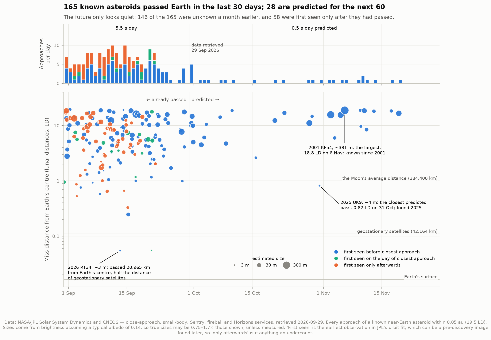
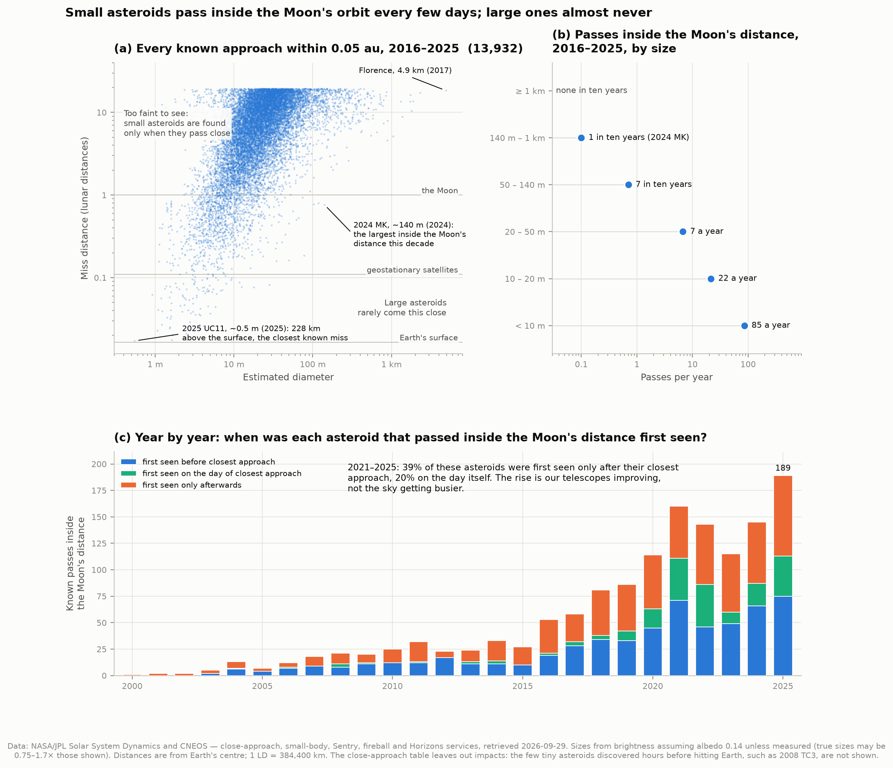
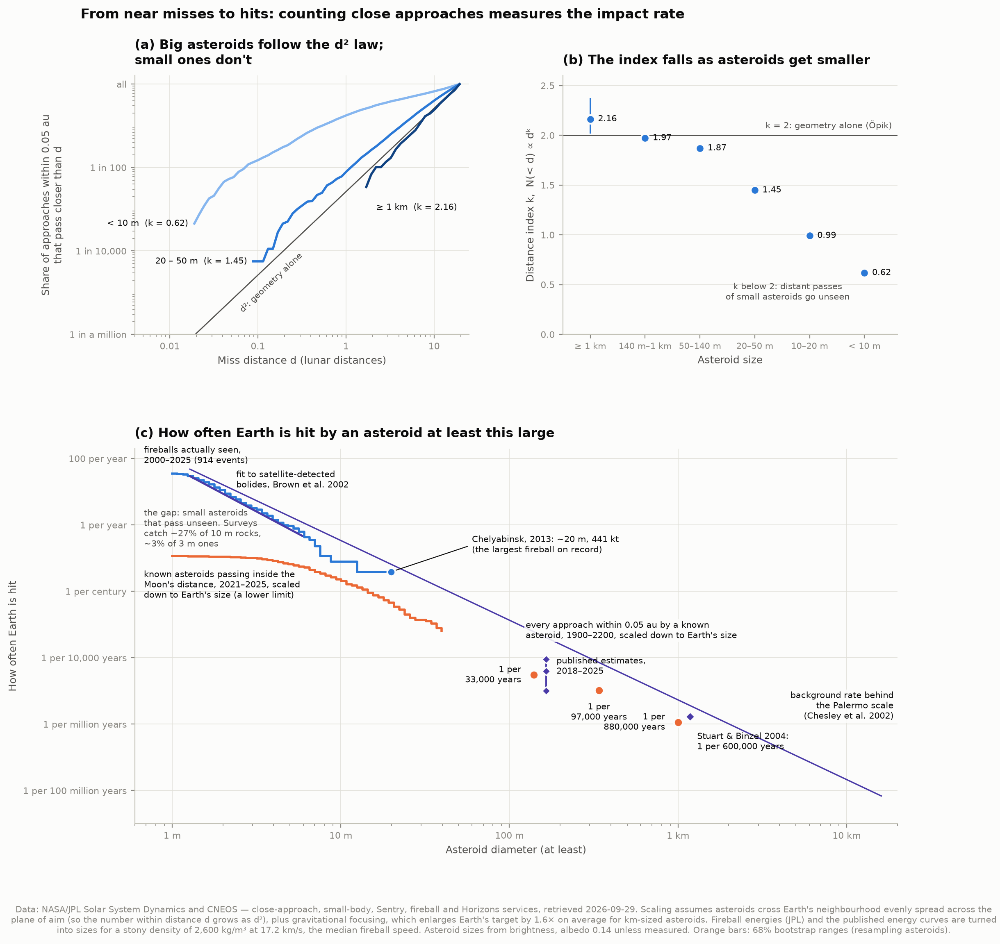
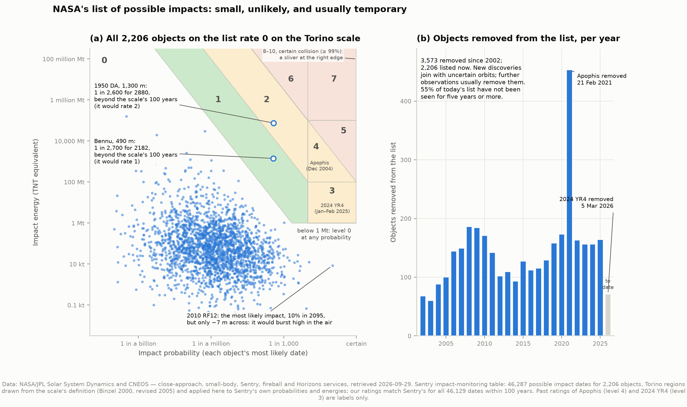
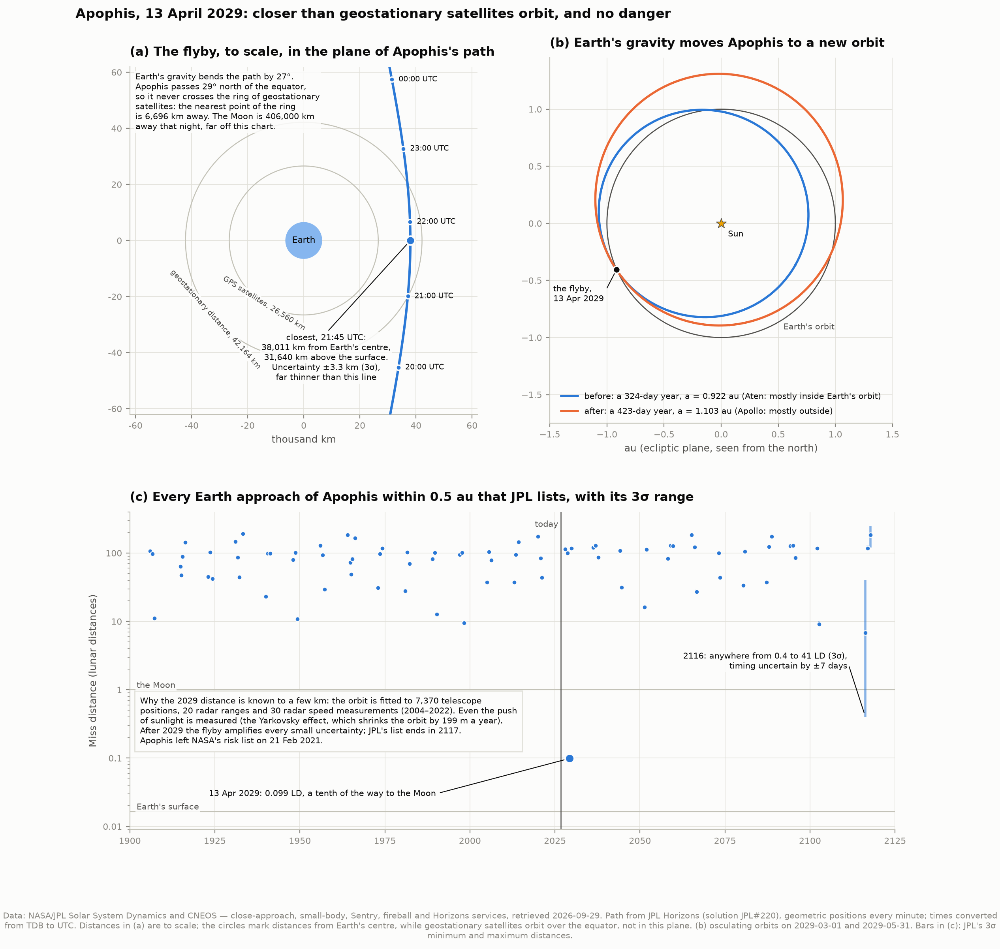

# E3 — Near-Earth asteroid close approaches

**What is passing Earth right now? How close do asteroids come, how often do they hit, and how
can we be sure Apophis will miss in 2029?**

This project takes NASA/JPL's free data services and looks at near-Earth asteroids four ways.
It starts with a snapshot of the month around 29 September 2026, when the data were retrieved,
then ten years of close approaches. Next comes a measurement of how often Earth is hit, built
from near misses alone, and then NASA's list of possible future impacts. It ends with the most
famous close approach still to come, Apophis on 13 April 2029.

The recurring lesson is the one from project A2: a list of discoveries is a portrait of our
telescopes as much as of the sky. Most small asteroids are found only as they pass, or after.

---

## Three things to know first

- **Distances** are measured from Earth's centre, in lunar distances (LD). 1 LD = 384,400 km,
  the Moon's average distance. Earth's surface is at 0.017 LD; geostationary satellites orbit
  at 0.11 LD.
- **Sizes mostly come from brightness.** Astronomers measure how bright an asteroid would look
  under standard conditions (its *absolute magnitude*, H). Brightness depends on size *and*
  reflectivity, so a size needs an assumed reflectivity (albedo). Here that is 0.14, the
  measured average for near-Earth asteroids (0.14 ± 0.02, Stuart & Binzel 2004), which makes
  H = 22 a 141 m asteroid. A dark one (albedo 0.05) would be 1.7× bigger, a bright one (0.25)
  0.75×. So sizes here are good to within a factor of about two, unless they were measured
  by radar or infrared, which is true for 3% of the approaches.
- **0.05 au** (7.5 million km, 19.5 LD) is the distance NASA uses to define "potentially
  hazardous". JPL's close-approach table lists every approach of a known asteroid inside it,
  computed from each orbit for 1900–2200, whether or not anyone was watching at the time.
  Impacts are not in the table.

---

## Results

### 1. What is passing this month



In the 30 days before 29 September 2026, **165** known asteroids passed within 0.05 au: 5.5 a
day, 14 of them inside the Moon's distance. For the next 60 days JPL predicts **28**, or 0.47
a day. Only one of those comes inside the Moon's distance: 2025 UK9, a ~4 m rock, at 0.82 LD
on 31 October.

That twelvefold drop is not a quiet patch of sky. **146 of the 165 had not been seen at all a
month earlier.** Of the 165, 58 were first seen only after they had passed, and 14 on the day
itself. The predicted approaches are the asteroids we already know: 22 of the 28 were found
more than a year ago, on earlier passes. The small asteroids that will pass in October and
November are mostly still undiscovered, and will join the list as they arrive.

The closest pass of the month was **2026 RT34**, a ~3 m rock, 20,965 km from Earth's centre on
13 September. That is half the distance of geostationary satellites. The largest asteroid is
**2001 KF54**, about 390 m across, which passes at 18.8 LD on 6 November.

### 2. Who comes close, and when we notice



For the ten years 2016–2025, JPL lists 13,932 approaches within 0.05 au. **1,144 came inside
the Moon's distance, 114 a year**, and 92 came closer than geostationary satellites.

| Size | Passes inside the Moon's distance, 2016–2025 |
|---|---|
| under 10 m | 85 a year |
| 10–20 m | 22 a year |
| 20–50 m | 7 a year |
| 50–140 m | 7 in ten years |
| 140 m – 1 km | 1 in ten years: 2024 MK, ~140 m, at 0.77 LD on 29 June 2024 |
| 1 km and larger | none |

The scatter plot in (a) has two empty corners, and they are empty for different reasons. The
lower right is empty because large asteroids really are rare. The upper left is empty
because small asteroids far away are too faint to see. A survey telescope finds a 5 m rock
only when it comes within a few lunar distances.

The closest known misses are all tiny, and all recent:

| Asteroid | Date | Height above the surface | Size |
|---|---|---|---|
| 2025 UC11 | 30 Oct 2025 | ~230 km | ~0.5 m |
| 2020 VT4 | 13 Nov 2020 | ~380 km | ~7 m, first seen the next day |
| 2025 TF | 1 Oct 2025 | ~410 km | ~1.6 m |

For comparison, the International Space Station orbits at roughly 400 km.

Panel (c) is the history of the surveys. In 2000 a single pass inside the Moon's distance was
known; in 2025 there were 189. Of the 752 such passes in 2021–2025, **39% were first seen
only after closest approach and 20% on the day itself**. 88% were first seen within three
days either side of it, and their median size was 6 m.

"First seen" needs care. It is the earliest observation JPL's orbit uses, and that can be an
old image found after the discovery. 2024 MK is an example. Its designation says it was
discovered in the second half of June 2024 (the letter M stands for 16–30 June), yet its orbit
uses images from 2014. So "first seen only afterwards" is, if anything, an undercount.

### 3. From near misses to hits: the measurement



Imagine every asteroid heading past Earth as a dart thrown at a board centred on Earth, set
square to its path. If the darts land evenly, the number landing within a distance d of the
centre grows with the area, d²: ten times closer means a hundred times fewer. Earth's own disc
is a small bullseye in the middle. Gravity enlarges it a little, because it pulls slow
asteroids in (*gravitational focusing*); for km-sized asteroids that enlarges the target
1.6× on average. This is Öpik's classic argument (1951), and it means **counting near misses
measures the impact rate**. Count the approaches within 0.05 au, then multiply by the ratio of
Earth's (enlarged) target to the 0.05 au disc.

**First, test the d² law.** If the number of approaches closer than d grows as dᵏ, the
exponent k should be 2. Here it is fitted to every approach within 0.05 au, 1900–2200:

| Size | k (68% range) | Approaches / asteroids |
|---|---|---|
| 1 km and larger | 2.16 (2.02–2.37) | 293 / 109 |
| 140 m – 1 km | 1.97 (1.94–2.01) | 6,055 / 1,714 |
| 50–140 m | 1.87 (1.84–1.90) | 8,256 / 2,695 |
| 20–50 m | 1.45 (1.44–1.46) | 17,757 / 7,490 |
| 10–20 m | 0.99 (0.98–1.00) | 12,693 / 5,346 |
| under 10 m | 0.62 (0.61–0.63) | 6,618 / 2,645 |

For large asteroids, whose catalogue is nearly complete, the law holds: k = 2 lies inside
both 95% ranges. For small ones it fails, and the size of the failure measures what we miss.
A small asteroid is found only if it passes close, so its distant passes are missing from the
table. The same number that tests the physics also measures the discovery bias.

**Then extrapolate, for large asteroids.** JPL computes their approaches for three centuries,
so every one within 0.05 au is scaled down to Earth's size:

| At least | One impact every | 68% range | Published |
|---|---|---|---|
| 1 km | **880,000 years** | 800,000–980,000 | 600,000 ± 100,000 (Stuart & Binzel 2004) |
| 340 m (Apophis's size) | 97,000 years | 93,000–102,000 | — |
| 140 m | **33,000 years** | 32,000–34,000 | 11,000–100,000 (four estimates, 2018–2025) |

The 1 km result is 1.5 times longer than Stuart & Binzel's, and most of the difference is the
population they assumed. Their rate came from an estimated 1,090 ± 180 asteroids larger than
1 km. Today 935 are known, and NASA's Planetary Defense Coordination Office puts that at about
95% of the total, roughly 975. Rescaled to that count, their interval becomes about 670,000
years. Ours becomes about 840,000 once the missing 5% are added in. The remaining 25% is within
the two estimates' combined uncertainties. This is a completely different method: nothing but
the geometry of near misses.

The 140 m result counts only known asteroids, which are about 45% of the estimated
population. Even so, it lands inside the published range, at 3.0 × 10⁻⁵ per year against
estimates of 1–9 × 10⁻⁵. That suggests the known ones are the frequent visitors: an asteroid
that often passes close is also more often bright enough to be discovered. This is the same
bias again, working in the other direction.

The same calculation answers a different question. **An asteroid at least as large as Apophis
passes as close as Apophis will (38,011 km) about once every 4,400 years** (68%: 4,300–4,600),
counting known asteroids only. NASA's Apophis page says "only every few thousand years on
average".

**For small asteroids the calculation runs the other way.** Scaling down the passes *seen*
inside the Moon's distance in 2021–2025 gives only a lower limit, because most small passers
are never seen. But there is an independent check: the **fireball record**. These are small
asteroids actually hitting the atmosphere, detected by US government sensors, 914 of them in
2000–2025. The record starts in 1988, but reporting was incomplete before 2000: events above
1 kiloton were logged 1.2 times a year in 1995–1999, against 3.4–4.8 in every five-year block
since. Brown et al. (2002) fitted a power law to these sensors' early years, and the record
since agrees with it:

| Impacts per year, at least | 0.1 kt | 1 kt | 10 kt |
|---|---|---|---|
| Fireballs, 2000–2025 | 28.9 | 4.0 | 0.38 |
| Brown et al. 2002 fit | 29.4 | 3.7 | 0.47 |

Setting the two side by side shows **how many small passers the surveys catch**:

| At least | Impact rate from fireballs | Implied by the passes seen | Surveys catch |
|---|---|---|---|
| 3 m | 3.1 a year | 0.10 a year | ~3% |
| 5 m | 0.88 a year | 0.063 a year | ~7% |
| 10 m | once in 13 years | once in 49 years | ~27% |

A 10 m rock passing inside the Moon's distance is spotted about a quarter of the time; a 3 m
rock, about one time in thirty. That is the "gap" in panel (c). The largest fireball on
record, Chelyabinsk (15 February 2013, 441 kilotons), comes out as a ~20 m asteroid at its
measured speed, consistent with published estimates of roughly 20 m.

### 4. NASA's list of possible impacts



JPL's **Sentry** system keeps scanning every asteroid orbit for possible impacts over the next
century or so. On 29 September 2026 its list held **2,206 objects** with **46,287 possible
impact dates**. Two scales rate them:

- The **Torino scale** (0–10) is for public communication. It combines impact probability and
  impact energy on the chart in panel (a): white (0) means no hazard, green (1) normal, yellow
  "meriting attention", orange "threatening", red a certain collision. Anything below 1
  megaton rates 0 at any probability, because the atmosphere takes most of the blow. The
  scale covers only the next 100 years.
- The **Palermo scale** is for specialists. It compares the risk with the *background*, the
  chance that some other impact at least as energetic happens anyway before the same date. It
  is logarithmic: −2 means 1% of the background, 0 means equal to it.

What the list shows:

- **Every object rates 0 on the Torino scale.** Two are unrated because their possible impacts
  lie beyond the 100-year window: Bennu (490 m, 1 in 2,700 for 2182) and 1950 DA (1.3 km,
  1 in 2,600 for 2880). Recomputed from Sentry's own numbers, they would rate 1 and 2.
- **Only those two rise above −2 on the Palermo scale**: 1950 DA at −0.92, Bennu at −1.40.
- **The most probable impact is harmless.** 2010 RF12 has a 10% chance of hitting in 2095, but
  it is about 7 m across and carries less than 1 megaton. It would burst high in the
  atmosphere, like the fireballs of section 3.
- **The list is mostly small and mostly stale.** The median object is 11 m across; 22 are
  140 m or larger, and 2 are 1 km or larger. 86% would release less than a megaton. 55% have not
  been observed for five years or more: they are too faint to recover until they pass close
  again, so their probabilities cannot be updated.
- **It churns.** 3,573 objects have been removed since 2002, so 5,779 have been listed in all.
  A new discovery joins with an uncertain orbit; more observations usually remove it. Apophis
  left the list on 21 February 2021, and 2024 YR4 on 5 March 2026. 2021 stands out, with 453
  removals, mostly in batches in May and July; the data do not say why.

Historically, only two objects have been rated higher than 2 (as summarised in Wikipedia's
article on the scale, from NASA's records): Apophis, which held level 4 for four days in
December 2004 (a 2.7% chance), and 2024 YR4, at level 3 from 27 January to 20 February 2025.

**Checks.** The Torino regions in panel (a) are computed from the scale's definition. Applied
to Sentry's own probabilities and energies, they reproduce Sentry's rating for all 46,129
dates within 100 years. Our Palermo values match Sentry's to within 0.02 for 99.2% of dates.
One rule had to be inferred from the data: Sentry evidently counts at least one year to impact.
With that rule, even a possible impact two days away reproduces Sentry's value exactly.

### 5. Apophis, 13 April 2029



- **Closest approach: 21:45 UTC on 13 April 2029, 38,011 km from Earth's centre** (31,640 km
  above the surface), known to ±3.3 km (3σ), at 7.42 km/s.
- **Closer than geostationary satellites orbit, but not through their ring.** Apophis passes
  29° north of the equator. It crosses the equatorial plane 53,400 km out, beyond the ring,
  and comes no closer than 6,700 km to any point of it. The Moon is 406,000 km away that night.
- **Earth's gravity bends its path by 27°.** The full ephemeris gives 27.0°, the two-body
  hyperbola formula 27.2°; the Sun's pull accounts for the difference.
- **It leaves on a new orbit.** Its year lengthens from 323.5 to 423.2 days, and its average
  distance from the Sun from 0.922 to 1.103 au. It goes from an *Aten*, mostly inside Earth's
  orbit, to an *Apollo*, mostly outside. The citation that named it predicted this: "As a
  result of its passage within 40 000 km of the earth on 2029 Apr. 13, this minor planet
  will move from the Aten to the Apollo class."
- **Why the distance is known to a few km.** The orbit is fitted to 7,370 telescope positions
  plus 20 radar ranges and 30 radar speed measurements, spanning 2004–2022. It even includes
  the push of sunlight. An asteroid re-radiates absorbed sunlight as heat, slightly unevenly,
  and the recoil acts like a tiny rocket (the *Yarkovsky effect*). JPL measures this push for
  Apophis to 0.6%; averaged over the orbit, it shrinks the orbit by 199 m a year.
- **After 2029 the future is fuzzier.** A close flyby magnifies every small uncertainty in the
  orbit. By the 2116 approach, the 3σ range runs from 0.4 to 41 LD, with the timing uncertain
  by ±7 days. Even so, the closest possible distance is 155,000 km. JPL's list of approaches
  ends in 2117.

---

## How it works

**1. Fetch** (`fetch_data.py`). 21 requests to JPL's free services, 25 MB in total:

- close approaches within 0.05 au for 1900–2200 (51,672, in nine time chunks);
- the near-Earth asteroid catalogue (42,535 asteroids);
- Sentry's list three ways: per object, per possible impact, and removed objects;
- the fireball record (1,073 events);
- Apophis's database record, plus five Horizons ephemeris tables for April 2029.

Each response is checked before it is written, because these services report many errors as
ordinary responses. It is written atomically and logged, with its URL and retrieval time, in
`data/manifest.json`.

**2. Clean** (`catalog.py`). Joins every approach to its asteroid in the catalogue (100%
matched), assigns sizes and size classes, and computes the discovery lag.

**3. Measure** (`analysis.py`).

- *Distance index.* If N(< d) ∝ dᵏ, the maximum-likelihood exponent from all n approaches
  within d_max is k = (n − 1) / Σ ln(d_max/dᵢ). This uses every approach, with no binning.
- *Near misses to impacts.* Far from Earth, an asteroid's path is aimed to miss the centre by
  a distance b (the *impact parameter*). Gravity bends it into a closer approach q:
  b² = q² (1 + 2GM/(q v∞²)). Earth captures everything aimed within
  b⊕ = R⊕ √(1 + v_esc²/v∞²). Each approach within the reference distance counts as
  (b⊕ / b_ref)², and the sum over a time span is a rate. `test_physics.py` checks this
  against a million synthetic asteroids aimed at random, and checks the flyby formulas
  against numerically integrated trajectories.
- *Uncertainties.* 2,000 bootstrap resamples of *asteroids*, not approaches, because one
  asteroid on an Earth-like orbit can pass a dozen times in three centuries.
- *Risk scales.* Torino and Palermo are recomputed from their definitions.
- *Apophis.* The flyby geometry comes from Horizons position vectors, minute by minute; the
  orbit change from Horizons' osculating elements.

**4. Draw** (`figures.py`). Five figures, PNG and SVG.

---

## Honest notes

- **Every count is of *known* asteroids.** Section 3 shows how incomplete that is for small
  ones: surveys catch roughly 3–27% of 3–10 m asteroids passing inside the Moon's distance.
  These fractions inherit the size conversions on both sides (albedo for asteroids; density
  and speed for fireballs), so treat them as good to a factor of two.
- **Sizes and energies are estimates.** Brightness-based sizes can be off by 0.75–1.7×.
  Energies assume a stony density of 2,600 kg/m³ (Sentry's convention), and fireball energies
  are converted to sizes at each event's measured speed, or at the median 17.2 km/s where none
  was recorded (62% of events since 2000).
- **The d² extrapolation reaches a long way.** The law can only be tested where approaches
  are common. For km-sized asteroids, 95% of approaches lie beyond 0.013 au (2 million km).
  Scaling down to Earth's radius then extrapolates over a further factor of about 300 in
  distance. That is standard practice (Öpik's theory), and the large-asteroid results match
  published ones. But it is still an extrapolation.
- **"Once every N years" means an average rate**, not a schedule. Impacts arrive at random.
- **"First seen" includes pre-discovery images** (see 2024 MK above), so "first seen only
  afterwards" undercounts late discoveries.
- **The close-approach table leaves out impacts.** The handful of tiny asteroids found hours
  before hitting Earth are not in figures 1–2. 2008 TC3, over Sudan, was the first; it does
  appear in the fireball record.
- **Two thresholds are ours.** The small-asteroid limit uses a reference distance of 1 LD; at
  0.25–2 LD the 10 m result ranges over 0.014–0.022 impacts a year (`results.json` lists
  them). The orange curve in figure 3 stops where fewer than five passes remain.
- **The Torino boundaries** follow Binzel's chart as tabulated in Wikipedia's article on the
  scale. The CNEOS page describes the levels only in words. The tabulation is confirmed here
  by reproducing all 46,129 of Sentry's current ratings and the historical Apophis and
  2024 YR4 ratings.
- **The Palermo scale's one-year minimum** is inferred from Sentry's numbers, not taken from
  documentation.
- **This is a snapshot.** Section 1 is the month around 29 September 2026, and every table
  changes daily. Every run from the cache gives identical numbers, bit for bit;
  `python run.py --refresh` re-downloads everything and moves the snapshot to the new date.
- **Times.** JPL's close-approach and vector tables use TDB, the timescale of planetary motion,
  which runs 69 seconds ahead of UTC. Apophis's times are converted to UTC; elsewhere the
  difference is far below the plots' resolution.

---

## Running it

```bash
cd ..                       # repository root
source .venv/bin/activate   # the shared venv; needs numpy scipy pandas matplotlib astropy requests

cd 11-neo-close-approaches
python fetch_data.py        # ~25 MB from JPL, once (about a minute)
python run.py               # every analysis and figure, ~20 seconds
python test_physics.py      # 69 self-checks, ~4 seconds
```

Once the cache is warm, `run.py` needs **no network**; this was verified with all traffic
forced through a dead proxy. `--refresh` re-downloads everything; `--no-figures` skips
plotting (5 seconds).

### Files

| File | What it does |
|---|---|
| `config.py` | Paths, API queries, constants, every cut and window, and the published values compared against |
| `fetch_data.py` | Downloads, validates and caches the JPL data, with a provenance manifest |
| `catalog.py` | Turns cached responses into clean tables: distances, sizes, classes, discovery lag |
| `neo_physics.py` | The formulas: size from brightness, flyby dynamics, focusing, Torino, Palermo, fireballs, Yarkovsky |
| `analysis.py` | The five analyses, with bootstrap uncertainties |
| `figures.py` | The five figures |
| `run.py` | Runs everything and prints the summary |
| `test_physics.py` | Checks the formulas, algorithms and cached data against known answers |

`test_physics.py` checks the physics against textbook values: H = 22 is 141 m, escape speed is
11.186 km/s, and Chelyabinsk's light converts to 441 kilotons. The hyperbola formulas agree
with flybys integrated from Newton's law to better than 0.001%. The Torino scale gives every
level on its chart, never decreases with probability or energy, and reproduces the historical
ratings. On synthetic data built to have a known answer, the distance index recovers k = 2
and k = 1, and the near-miss estimator predicts the number of hits in a million-asteroid
stream to within 0.6%. It also checks that JPL's own numbers agree with one another: the
close-approach table, Horizons, Sentry and the fireball record.

Figures use the same colourblind-safe palette as A1 and A2. The three colours that meet in
scatter plots (blue, aqua, orange) were checked on every pair.

---

## Data credits and references

Data from NASA/JPL's Solar System Dynamics group and Center for Near-Earth Object Studies
(CNEOS), retrieved 29 September 2026, through their public APIs: SBDB Close-Approach Data,
SBDB and SBDB Query, Sentry, Fireball, and Horizons (Giorgini, J. D. et al. 1996, BAAS 28,
1158). Fireball data are from US Government sensors, as published by CNEOS.

- Öpik, E. J. 1951, Proc. R. Irish Acad. 54A, 165 — collision probabilities from encounter
  geometry
- Binzel, R. P. 2000, Planet. Space Sci. 48, 297 — the Torino scale
- Chesley, S. R. et al. 2002, Icarus 159, 423 — the Palermo scale and its background rate
- Brown, P. et al. 2002, Nature 420, 294 — the flux of small impactors from satellite
  bolide data, and the light-to-energy conversion JPL applies
- Stuart, J. S. & Binzel, R. P. 2004, Icarus 170, 295 — NEA population, mean albedo 0.14,
  one km-sized impact per 0.60 Myr
- Pravec, P. & Harris, A. W. 2007, Icarus 190, 250 — the size–brightness relation
- Brozovic, M. et al. 2018, Icarus 300, 115 — Apophis's radar shape and 340 m size
- Granvik, M. et al. 2018, Icarus 312, 181; Harris, A. W. & Chodas, P. W. 2021, Icarus 365,
  114452; Nesvorný, D. et al. 2024, Icarus 411, 115922 — impact rates for NEAs ≥ 140 m, as
  compiled by Nugent, C. R. et al. 2025, Planet. Sci. J. (arXiv:2508.02418)
- NASA Planetary Defense Coordination Office, 2023 status update — ~25,000 NEAs ≥ 140 m;
  95% of those ≥ 1 km found
- NASA, "Apophis Facts" (science.nasa.gov, updated 23 September 2026) — "only every few
  thousand years"
