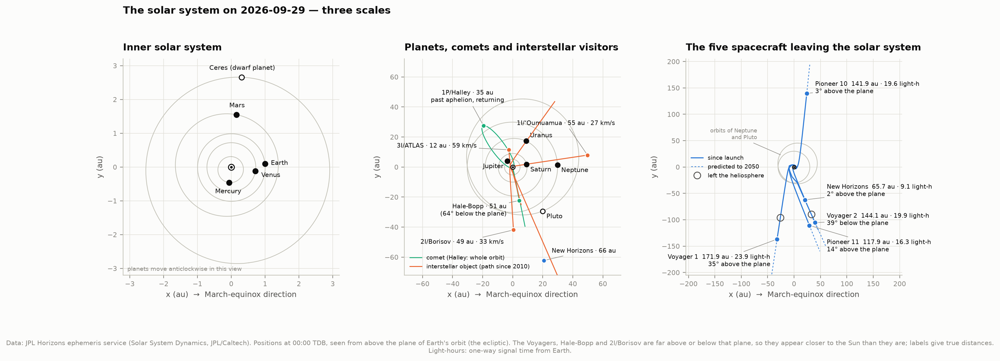
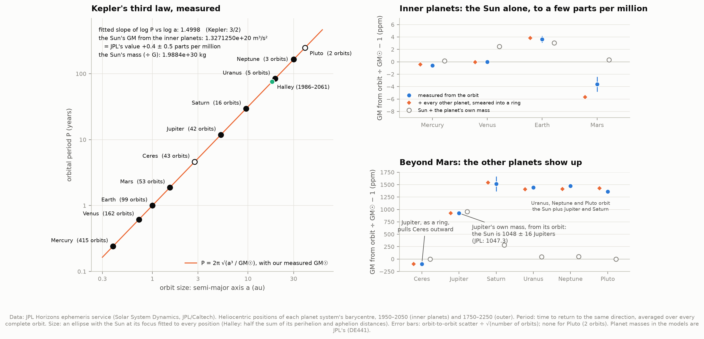
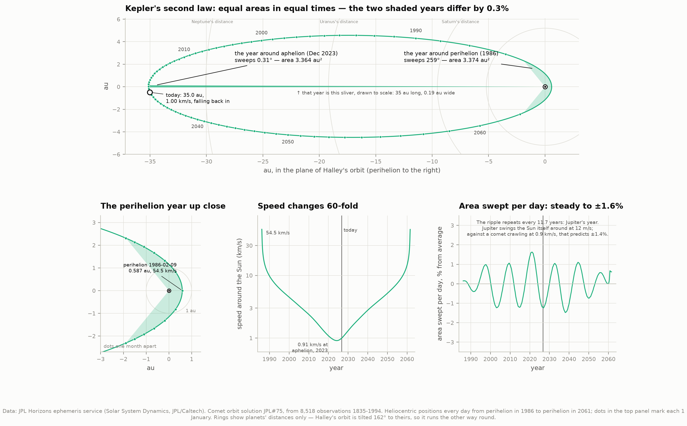
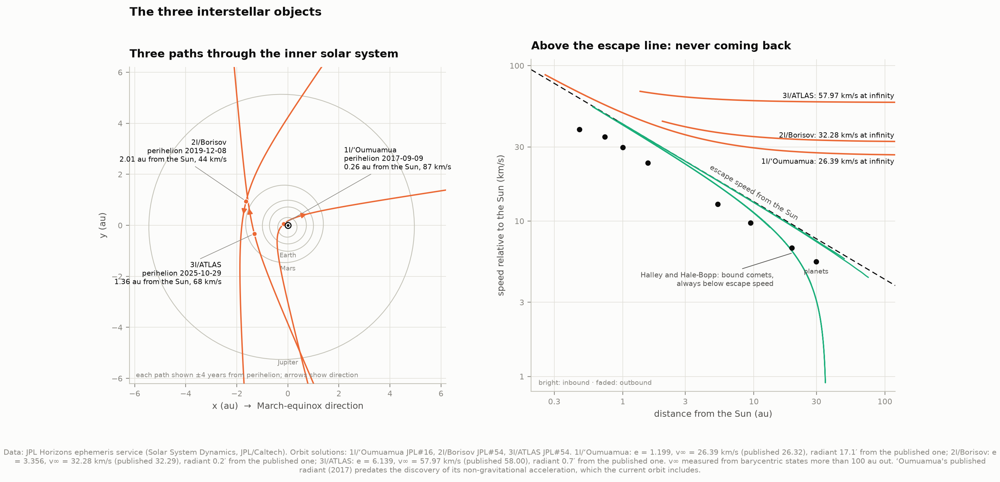
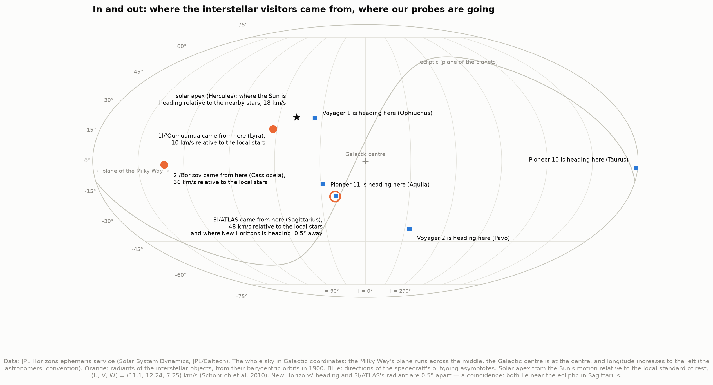
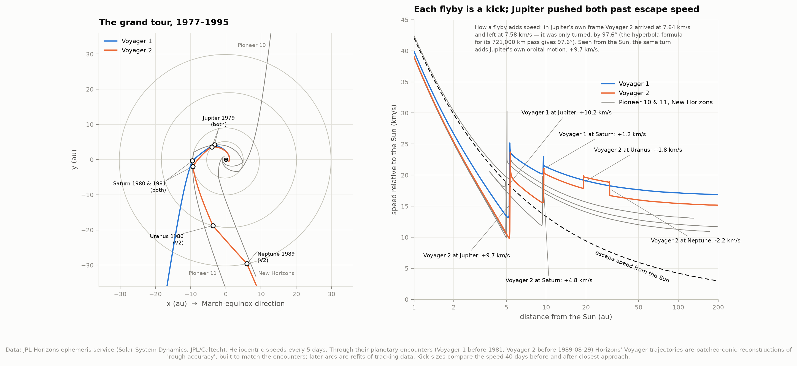
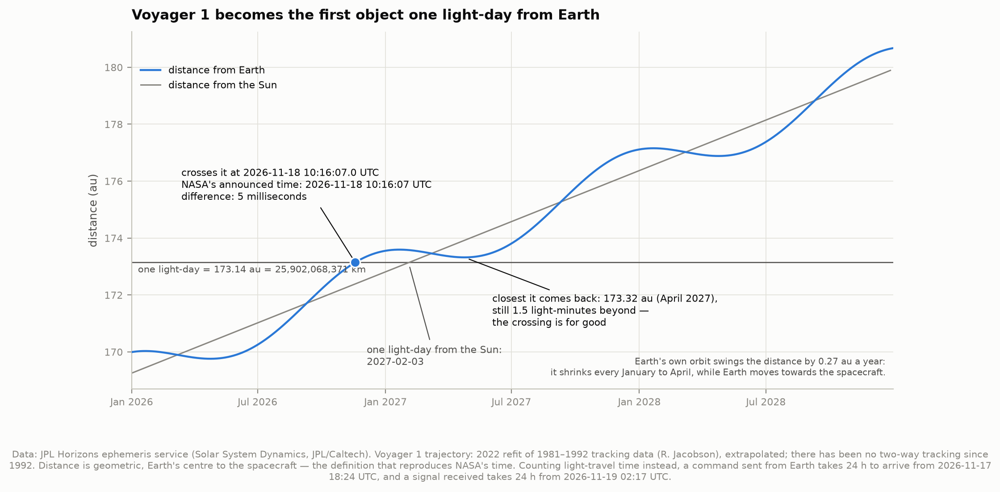
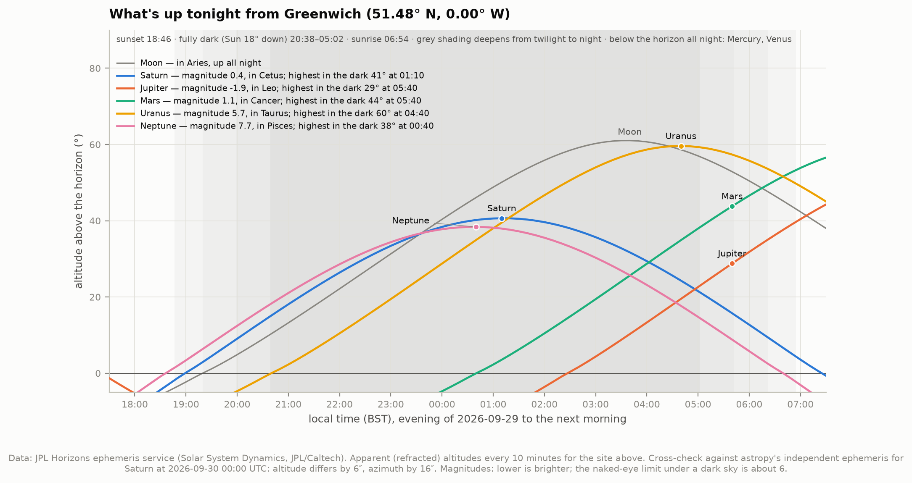

# E2 — Solar system orbit visualizer

**Where is everything right now, and where is it going?**

This project asks JPL Horizons — the ephemeris service JPL's own mission navigators use —
for the positions and velocities of 20 objects covering every kind of orbit the Sun has:

- the eight planets, Pluto and Ceres (bound, nearly circular);
- Halley's comet and Hale-Bopp (bound, extremely stretched);
- the only three objects ever seen arriving from interstellar space;
- the five spacecraft now leaving the solar system for good.

From those positions alone it measures things. It weighs the Sun, and then Jupiter, with
Kepler's third law. It checks Kepler's second law on Halley's comet. It works out how fast
the interstellar visitors were moving before the Sun pulled on them, and which part of the
sky they came from. It takes apart the Voyagers' gravity assists. It predicts the moment
Voyager 1 is one light-day from Earth.

As in the other projects in this atlas, published values are consulted only at the end, to
grade the result. Everything ends in eight figures and an interactive 3D viewer.

"Today" is the snapshot date **2026-09-29**, fixed in `config.py` so the project reproduces
exactly. Change it and re-run to move it.

---

## Results

### Where everything is today



| | Distance from the Sun | Speed | |
|---|---|---|---|
| **Voyager 1** | 171.9 au | 16.9 km/s | 23.9 light-hours from Earth, heading for Ophiuchus |
| **Voyager 2** | 144.1 au | 15.3 km/s | 19.9 light-hours, heading for Pavo |
| **Pioneer 10** | 141.9 au | 11.9 km/s | 19.6 light-hours, heading for Taurus |
| **Pioneer 11** | 117.9 au | 11.1 km/s | 16.3 light-hours, heading for Aquila |
| **New Horizons** | 65.7 au | 13.6 km/s | 9.1 light-hours, heading for Sagittarius |
| 1I/ʻOumuamua | 54.6 au | 27.0 km/s | outbound since 2017 |
| 2I/Borisov | 48.6 au | 32.8 km/s | outbound since 2019 |
| 3I/ATLAS | 11.8 au | 59.3 km/s | outbound since its perihelion in October 2025 |
| Halley's comet | 35.0 au | 1.00 km/s | past aphelion (December 2023) and falling back; perihelion in 2061 |
| Hale-Bopp | 51.2 au | 5.5 km/s | 64° below the planets' plane, outbound since 1997 |

(1 au, the astronomical unit, is the Earth–Sun distance: 149.6 million km.)

---

### 1. Weighing the Sun with Kepler's third law

In 1619 Kepler found that a planet's orbital period P and orbit size a obey P² ∝ a³. Newton
explained why: P² = 4π²a³ / G(M☉ + m). The constant of proportionality *is* the Sun's mass,
so measuring any orbit weighs the Sun.

Every orbit here is measured directly from where the planet was:

- **the period** is the time taken to return to the same direction as seen from the Sun,
  averaged over every complete orbit in the data — 415 of them for Mercury, 2 for Pluto;
- **the size** comes from an ellipse, with the Sun at its focus, fitted to every position.



- **The law holds across a 100-fold range in distance.** The fitted slope of log P against
  log a is 1.49980 ± 0.00003; Kepler's value is 3/2.
- **The Sun's GM is 1.3271250 × 10²⁰ m³/s²**, from the four inner planets. That is JPL's
  value to +0.4 ± 0.5 parts per million. Even before any correction, the four inner planets
  agree with each other to within 7 ppm.
- **The Sun's mass is 1.9884 × 10³⁰ kg.** Dividing by G costs precision: we know G to only
  22 ppm, compared with about ten significant figures for GM.

**Look closer, and the law is not exact — in a way that weighs the planets.** The table
shows, for each orbit, how far its "Sun mass" lands above the Sun's alone:

| | GM from the orbit ÷ GM☉ − 1 | Newtonian model | Difference |
|---|---|---|---|
| Mercury | −0.6 ± 0.1 ppm | −0.4 | −0.2 |
| Venus | −0.0 ± 0.3 ppm | −0.0 | 0.0 |
| Earth | +3.6 ± 0.5 ppm | +3.8 | −0.2 |
| Mars | −3.6 ± 1.2 ppm | −5.7 | +2.1 |
| Ceres | −98 ± 43 ppm | −102 | +3 |
| **Jupiter** | **+925 ± 15 ppm** | **+926** | **−0.6** |
| Saturn | +1514 ± 148 ppm | +1539 | −24 |
| Uranus | +1440 ± 50 ppm | +1404 | +36 |
| Neptune | +1474 ± 34 ppm | +1410 | +64 |
| Pluto | +1361 ppm (2 orbits, no error bar) | +1428 | −67 |

The model has two ingredients. First, the planet's own mass: the Sun and planet orbit each
other, so the relative orbit feels both. That alone explains Jupiter's +955 ppm, and almost
nothing else. Second, every other planet: averaged over its orbit, a planet pulls like a ring
of mass spread along its path — an idea that goes back to Gauss.

- A ring *outside* an orbit pulls outward, weakening the Sun's grip. That is why Mars and
  Ceres come out light: Jupiter's ring pulls Ceres outward by 100 ppm.
- A ring *inside* an orbit adds to the central mass. So everything beyond Saturn orbits the
  Sun *plus* Jupiter and Saturn, and comes out about 0.14% heavy.

With both included, the model matches the inner planets to a couple of parts per million,
and Jupiter to 0.6 ppm.

Turned around, that gives **Jupiter's mass from its own orbit: the Sun is 1048 ± 16 times
heavier (JPL: 1047.35)**.

Halley's comet makes a good stress test: one orbit (1986–2061) with eccentricity 0.97. It
lands on the same line to within 0.15%.

---

### 2. Kepler's second law: Halley's comet

A planet sweeps out equal areas in equal times. Halley's comet is the extreme test: its speed
around the Sun ranges from **54.5 km/s at perihelion to 0.91 km/s at aphelion**, a 60-fold
change.



- **The year around the 1986 perihelion** swings the comet through 259° and sweeps
  **3.374 au²**.
- **The year around the December 2023 aphelion** moves it 0.31° and sweeps **3.364 au²**.

Those are the same area to 0.3%. The area swept per day stays within ±1.6% over the whole
75-year orbit.

The remaining ±1.6% is not noise. It repeats every 11.7 years — Jupiter's year. Jupiter
swings the Sun itself around their common centre of mass at about 12 m/s. To a comet
crawling past aphelion at 0.9 km/s, a 12 m/s wobble in the thing it orbits is a 1.4% effect —
which is what we see.

The orbit: perihelion 1986-02-09 at 0.587 au, aphelion 2023-12-08 at 35.14 au, next perihelion
**2061-07-28**.

---

### 3. Three visitors from other stars

Anything moving faster than the local escape speed, √(2GM☉/r), is not bound to the Sun. For
the three interstellar objects that is true everywhere along their paths. Their
eccentricities are 1.20 (ʻOumuamua), 3.36 (Borisov) and 6.14 (3I/ATLAS); anything above 1 is
a hyperbola, not an ellipse.



The speed each had **before the Sun pulled on it**, v∞, comes from its orbit in 1900, when
all three were hundreds of au out. That far away, the whole solar system pulls like one mass.
The **radiant** is the point on the sky each one came from.

| | v∞ (ours) | v∞ (published) | Radiant: ours vs published | Galactic velocity (U, V, W), ours |
|---|---|---|---|---|
| 1I/ʻOumuamua | 26.39 km/s | 26.32 | 17′ apart | (−11.56, −22.39, −7.85) km/s |
| 2I/Borisov | 32.28 km/s | 32.29 | 0.2′ apart | (+21.97, −23.63, +1.06) km/s |
| 3I/ATLAS | 57.97 km/s | 58.00 | 0.7′ apart | (−51.25, −19.39, +18.92) km/s |

Borisov and 3I/ATLAS agree with the literature to a fraction of an arcminute. ʻOumuamua's
published radiant (Mamajek 2017) came from an orbit that treated it as a coasting rock.
In 2018 it was found to be accelerating slightly, pushed by something other than gravity,
and the current JPL orbit includes that push. The 17′ shift and the 0.07 km/s in v∞ are that
push; the galactic velocity matches Mamajek's to 0.1 km/s.

**Where they came from says something about their age.** The solar apex, in Hercules, is the
direction the Sun is moving relative to the stars around it. A rock at rest among those stars
would appear to come from there.

- **ʻOumuamua** came from 15° away from the apex, moving just 10 km/s relative to the local
  stars — remarkably close to "at rest".
- **Borisov** moves at 36 km/s relative to the local stars.
- **3I/ATLAS** moves at 48 km/s. Stars that old tend to move faster, and Hopkins et al. (2025)
  argue it comes from the Milky Way's old thick disk.



A coincidence worth noting: New Horizons is heading to within **0.5°** of the point 3I/ATLAS
came from. Both directions lie near the ecliptic in Sagittarius.

---

### 4. Five spacecraft leaving: the gravity-assist kicks

A flyby cannot change a spacecraft's speed *relative to the planet*: it leaves as fast as it
arrived, only turned. Relative to the Sun, that turned velocity is added to the planet's own
orbital motion, and the speed can change a lot.



| Flyby | Closest approach (from the planet's centre) | Speed relative to the planet, in → out | Turn: measured (formula) | Speed around the Sun, before → after |
|---|---|---|---|---|
| Pioneer 10 at Jupiter, 1973 | 203,122 km | 8.52 → 8.52 km/s | 127.4° (127.2°) | 10.2 → 22.2 km/s |
| Pioneer 11 at Jupiter, 1974 | 113,514 km | 8.93 → 8.93 | 137.9° (137.9°) | 10.9 → 18.2 |
| Pioneer 11 at Saturn, 1979 | 80,859 km | 8.36 → 8.36 | 121.9° (121.0°) | 11.9 → 17.5 |
| Voyager 1 at Jupiter, 1979 | 348,435 km | 10.76 → 10.77 | 98.7° (98.6°) | 13.3 → 23.5 |
| Voyager 1 at Saturn, 1980 | 184,030 km | 15.17 → 15.11 | 57.0° (56.5°) | 20.2 → 21.5 |
| Voyager 2 at Jupiter, 1979 | 721,375 km | 7.64 → 7.58 | 97.6° (97.6°) | 10.1 → 19.7 |
| Voyager 2 at Saturn, 1981 | 160,691 km | 10.67 → 10.67 | 84.8° (84.8°) | 15.6 → 20.4 |
| Voyager 2 at Uranus, 1986 | 107,154 km | 14.73 → 14.73 | 23.0° (23.0°) | 17.9 → 19.7 |
| Voyager 2 at Neptune, 1989 | 29,245 km | 16.74 → 16.74 | 54.0° (54.1°) | 18.9 → 16.7 |
| New Horizons at Jupiter, 2007 | 2,304,505 km | 18.45 → 18.45 | 16.0° (16.0°) | 19.8 → 21.6 |

The "formula" column is the textbook hyperbola: the turn is 2 arcsin(1/e), with
e = 1 + r v∞² / GM for a pass at distance r.

- **Jupiter added about 10 km/s** to each of Voyager 1, Voyager 2 and Pioneer 10 — close to
  doubling their speed — and each left Jupiter faster than the Sun's escape speed.
- **Pioneer 11 is the exception:** Jupiter sent it back across the solar system to Saturn,
  and Saturn set it free.
- **New Horizons** was launched fast enough to escape without any help.
- **Neptune cost Voyager 2 2.2 km/s.** That pass was aimed at a close look at the moon Triton,
  not at speed, and it bent the spacecraft steeply south of the planets' plane. It is 38°
  below that plane today.

Where the Horizons headers give encounter distances, we match them:

- **Pioneer 11:** 42,022 km above Jupiter's cloud tops (header: 42,000 km) and 20,591 km
  above Saturn's (21,000).
- **Pioneer 10:** 203,122 km from Jupiter's centre (about 200,000).
- **New Horizons:** 2,304,505 km from Jupiter (2.3045 million).

On their published heliopause dates, the tracks put Voyager 1 at 121.60 au and Voyager 2 at
119.02 au. Those are the days their own instruments saw them leave the Sun's bubble of solar
wind; the published distances are 121.6 and 119.0 au.

---

### 5. Voyager 1, one light-day out



A light-day is 25,902,068,371 km, or 173.14 au. **Voyager 1 crosses it on 2026-11-18 at
10:16:07.0 UTC.** NASA's announced time is 2:16:07 a.m. PST, which is 10:16:07 UTC: **the two
agree to 5 milliseconds.** (Some press coverage gives "12:16:07 a.m. CST", which is 4 hours
off.)

Matching NASA to the second also pins down their definition. It is the straight-line distance
from Earth's centre at that instant. Counting light-travel time instead gives different
moments:

- a command sent from Earth takes 24 hours to arrive from 2026-11-17 18:24 UTC;
- a signal received on Earth has been travelling 24 hours from 2026-11-19 02:17 UTC.

The distance does not grow smoothly. Earth's own orbit swings it by 0.27 au a year, and it
*shrinks* every January to April, while Earth moves towards the spacecraft. Could Voyager 1
slip back inside a light-day? No. Its next closest approach, on 2027-04-24, is still 1.5
light-minutes beyond, so the crossing is for good. It reaches one light-day **from the Sun** on
2027-02-03.

---

### 6. What's up tonight



The sky for the night of 29–30 September 2026, from the Royal Observatory Greenwich (times in
BST). The site is set in `config.py`; any latitude and longitude works.

- **Saturn** (magnitude 0.4, in Cetus) rises at 18:58, is highest at 01:10, and is up all
  night: it reaches opposition in early October.
- **Mars** (1.1, in Cancer) rises at 00:40 and **Jupiter** (−1.9, in Leo) at 02:27. Both are
  high in the east by dawn.
- **Uranus** (5.7, in Taurus) is at the naked-eye limit under dark skies. **Neptune** (7.7,
  in Pisces) needs binoculars.
- A bright Moon rises in Aries at 19:19 and stays up the rest of the night.
- **Mercury and Venus** stay below the horizon whenever the sky is dark.

A cross-check against astropy's independent ephemeris puts Saturn in the same spot to 6″ in
altitude and 16″ in azimuth.

---

## The interactive viewer

`figures/orbit_viewer.html` opens in any browser and works offline.

- **Time:** a date slider from 1972 to 2050, with play controls.
- **Views:** inner planets, all planets, the visitors, the spacecraft.
- **Moments:** a "jump to a moment" list — launches, every flyby, perihelia, the heliopause
  crossings, today, the light-day.
- **Readout:** a live table of every object's distance and speed.

A moment can be linked with a URL fragment, e.g. `orbit_viewer.html#date=1979-07-09&view=planets`
for Voyager 2 at Jupiter. The page follows the system light/dark setting.

Every position is a Horizons sample. The browser only interpolates in straight lines between
stored samples, and those were kept dense enough that this never strays more than 0.3% of the
object's distance from the true path. The page is 5.7 MB: the plotting library is inlined,
and the embedded data is 0.9 MB.

---

## How it works

**Data.** The project makes 83 queries through `astroquery.jplhorizons`, 74 MB in all. The
**raw text** of each answer is cached in `data/horizons/`, so every file carries its own
provenance header: which planetary ephemeris (DE441), which spacecraft reconstruction, which
comet orbit solution with how many observations. `data/manifest.json` records every query's
URL and retrieval time.

The states are *geometric* — where each body actually is at that instant, uncorrected for
light-travel time. The frame is Sun-centred, ecliptic and equinox of J2000. Planets are
fetched as system barycentres: Earth's centre loops 4,670 km around the Earth–Moon
barycentre every month, a wobble that is no part of the orbit around the Sun.

**Events are found by interpolation, not by sampling.** Horizons gives velocities alongside
positions. That allows cubic Hermite interpolation between samples, which is fourth-order
accurate (tested: halving the step cuts the error 15.9-fold). Every "moment" is solved for
rather than read off the nearest sample: a perihelion, a closest approach, a return to the
same direction, a light-day crossing.

**Kepler's third law.** The period comes from repeated returns to the same direction; the
size from a least-squares conic, 1/r = A + B cos θ + C sin θ, which is linear in its unknowns.
The Newtonian model smears each other planet into a ring. Its pull comes from the ring
potential's multipole series, checked against a brute-force sum of 20,000 point masses to
machine precision.

**The interstellar objects.** v∞ and the radiant come from barycentric states more than
100 au out, using the total mass of the solar system. The asymptote directions come from the
orbit's eccentricity vector: the true anomaly can never exceed arccos(−1/e). Galactic
velocities use astropy's ICRS→Galactic rotation, and the local standard of rest uses the
Sun's motion from Schönrich et al. (2010).

**Checks against Horizons itself.** Our conversion from state vectors to orbital elements
reproduces Horizons' own osculating elements for all ten planet and dwarf-planet orbits to
about 10⁻¹⁵.
`test_physics.py` runs 49 further checks against cases with known answers: Earth's 29.78 km/s
orbital speed, 42.1 km/s solar escape speed at 1 au, element round-trips for Halley-like and
ʻOumuamua-like orbits, and a perfect synthetic orbit whose period, size and GM come back to
10⁻¹³.

---

## Honest notes on the numbers

- **These are measurements of JPL's ephemerides, not of raw telescope data.** The ephemerides
  are themselves fits of Newtonian and relativistic mechanics to decades of observations. So
  recovering Kepler's laws from them shows what the real orbits look like; it is not an
  independent test of gravity. What *is* tested is that the methods recover the right physics
  — the Sun's GM to 0.4 ppm, Jupiter's mass to 1.5% — and that the numbers quoted about these
  objects follow from their trajectories.
- **Voyager's flybys are patched-conic reconstructions.** Horizons says so itself: through
  their planetary encounters (Voyager 1 before 1981, Voyager 2 before 29 August 1989) the
  trajectories are "patched conic mission-design type" arcs of "rough accuracy", built to
  match the encounters. Inside each planet's sphere of influence a patched conic *is* a
  hyperbola, so the near-perfect turn-angle agreement for the Voyagers is partly by
  construction. The Pioneer trajectories are flagged as "suitable for general historical
  purposes".
- **Spacecraft positions after their last tracking data are predictions.** For the Voyagers
  that means since 1992: Horizons notes no two-way tracking since then, and quotes a formal
  pointing uncertainty of about 2″ (Voyager 1) and 5″ (Voyager 2) in 2030. New Horizons'
  tracking runs to July 2026.
- **The comparison values come from different orbit solutions.** Mamajek (2017) used JPL
  orbit 13 for ʻOumuamua, before its non-gravitational push was known. Hopkins et al. (2025)
  used a very early 3I/ATLAS orbit; ours is JPL solution 54 (February 2026, with outgassing
  modelled). Small differences are expected and are not errors on either side.
- **The outer planets complete only 2–6 orbits in 500 years**, so their per-orbit error bars
  are rough, and Pluto (2 orbits) has none. The ring model assumes circular, coplanar orbits.
  It is at its weakest near resonances: Jupiter–Saturn's near 5:2, Uranus–Neptune's near 2:1,
  and Pluto locked in 3:2 with Neptune — the four outer residuals of 24–67 ppm.
- **The Sun is not a fixed point.** Heliocentric coordinates ride along with its ~12 m/s
  wobble around the solar system's centre of mass. That wobble is Halley's ±1.6% ripple, and
  it adds scatter to the outer planets' orbits.
- **Top-down maps flatten 3D positions onto the ecliptic.** The Voyagers are 35–39° out of
  that plane and Hale-Bopp 64°, so they appear closer to the Sun than they are. Labels carry
  true distances, and the interactive viewer is fully 3D.
- **The sky chart uses a fixed UTC offset** (`utc_offset_hours = 2`, Central European Summer
  Time). Move the snapshot into winter and change it to 1. Altitudes include standard
  atmospheric refraction.

---

## Running it

```bash
cd ..                            # repository root
source .venv/bin/activate        # numpy scipy matplotlib astropy astroquery plotly

cd 12-orbit-visualizer
python test_physics.py           # 49 self-checks on the formulas, no network
python fetch_data.py             # 83 Horizons queries, ~75 MB, about four minutes, once
python run.py                    # every measurement, 8 figures + the viewer, ~30 s
```

Once the cache is warm, `run.py` needs **no network at all** — verified by running it with the
network cut off (`unshare -rn`). Astropy is told not to download fresh Earth-orientation
tables: its bundled predictions cover the snapshot date, and a few months of drift in
predicted Earth rotation is milliseconds, far below anything that shows in a planet's
altitude.

To move "today", change `SNAPSHOT_DATE` in `config.py` and run `python fetch_data.py` then
`python run.py`. The date-dependent queries carry the date in their cache names, so only
those 44 small requests are fetched again.

### Files

| File | What it does |
|---|---|
| `config.py` | Bodies, time spans, the snapshot date, observing site, published comparison values |
| `horizons.py` | The Horizons query plan, the raw-text cache, the parser and header provenance |
| `fetch_data.py` | Downloads whatever is missing, politely and resumably |
| `orbit_physics.py` | The formulas: state → orbit, asymptotes, frames, Hermite events, conic fit, ring model |
| `analysis.py` | Every measurement, each graded against the literature at the end |
| `figures.py` | The eight static figures |
| `viewer.py` | The interactive HTML page |
| `plotstyle.py` | Shared figure style (the same as A1 and A2) |
| `run.py` | Runs everything and prints the summary |
| `test_physics.py` | Checks the formulas against cases with known answers |

### Figures

1. `01_solar_system_today` — the snapshot at three scales.
2. `02_kepler_third_law` — P against a, and the ppm-level residuals.
3. `03_halley_equal_areas` — Kepler's second law.
4. `04_interstellar_visitors` — the three paths, and speed against distance.
5. `05_sky_in_and_out` — radiants and headings on the sky.
6. `06_voyager_gravity_assists` — the grand tour and its kicks.
7. `07_voyager1_light_day` — the light-day crossing.
8. `08_sky_tonight` — tonight's sky from the observing site.

Plus `orbit_viewer.html`. PNG and SVG throughout.

Colours: spacecraft blue, interstellar objects orange, comets aqua, planets neutral. That is
never more than three hues in one figure — the palette's validated limit for maps, where any
two marks can meet. Every object is also labelled directly.

---

## Data credits

- **Ephemerides:** JPL Horizons, Solar System Dynamics group, JPL/Caltech (Giorgini et al.
  1996, BAAS 28, 1158), accessed with astroquery (Ginsburg et al. 2019, AJ 157, 98).
- **Planetary ephemeris:** DE441 (Park et al. 2021, AJ 161, 105).
- **Voyager trajectories:** the 2022 refit by R. Jacobson.
- **New Horizons trajectory:** the mission's navigation team (KinetX).
- **Comet and interstellar orbits:** JPL solutions 16 (ʻOumuamua), 54 (Borisov), 54
  (3I/ATLAS), 75 (Halley) and 226 (Hale-Bopp).
- **Comparison values:**
  - Mamajek (2017), RNAAS 1, 21;
  - Bailer-Jones et al. (2020), A&A 634, A14;
  - Hopkins et al. (2025), ApJL (arXiv:2507.05318);
  - Seligman et al. (2025), ApJL (arXiv:2507.02757);
  - Stone et al. (2013), Science 341, 150, and (2019), Nature Astronomy 3, 1013;
  - NASA Science, "Where are Voyager 1 and Voyager 2 now?";
  - JPL SSD, "Approximate positions of the planets" (Standish);
  - the solar motion from Schönrich, Binney & Dehnen (2010), MNRAS 403, 1829.
- **Software:** astropy (Astropy Collaboration 2022, ApJ 935, 167), numpy, scipy,
  matplotlib, plotly.

Horizons data retrieved 2026-09-29.
