# G1 — Colour composites of real galaxies

**What colour is a galaxy? And how much of a beautiful galaxy picture is the galaxy, and how
much is a choice?**

A telescope camera does not see colour. It records how much light arrives through one filter
at a time, as a greyscale image. Every colour picture of a galaxy is assembled from such
images by a chain of decisions: which filter feeds which colour on the screen, how a
brightness range of a thousand to one or more is squeezed into 256 screen levels, and what
counts as "white". This project builds colour pictures of twelve galaxies from calibrated SDSS
images and makes each of those decisions explicit and physical rather than cosmetic. It checks
the data against independent references before trusting them. Then it asks the two questions
every such picture raises: *what would a human eye actually see?* and *what do the colours
mean?*

The short answers, from the numbers below:

- **Our pictures are the survey's pictures, made openly.** Put through the survey viewer's own
  recipe and the same JPEG compression, our copy of the data reproduces the survey's images:
  99.995% of 7.2 million pixel values agree to within one level in 256. Photometry of 278
  stars agrees with Gaia's independent measurements to within 0.004 mag, and whole-galaxy
  photometry agrees with Brown et al. (2014) to 0.006 mag (median; colours to 0.003).
- **"White" is a decision.** We define it as the colour of sunlight, computed from the Sun's
  measured spectrum. The survey viewer's default makes white a colour no star has; equal
  weights make an F star white. The same galaxy looks convincingly different under each.
- **Galaxies are shades of white.** To a human eye every galaxy's total light would look
  white to cream: the colour of a glowing body at 4,570–6,330 K, from a bluish white (M101) to
  a pale peach (M104, M82). Survey pictures are far more colourful than any eye could see.
- **And no eye can see them in colour anyway.** Even the brightest core in the sample, M104's,
  is 0.08 cd/m², barely inside the range where cones begin to work, and at most 1.5% of any
  galaxy's area gets that bright. Everything else is visible only to the colour-blind rods.
  In eleven of the twelve, most of the catalogued disc is fainter than the night sky's own
  glow. No telescope can change this: it can gather more light but never raise its surface
  brightness.
- **The colours still carry physics.** Centres are as red as K giants (old stars); discs are
  as blue as F stars (young stars mixed in); dust lanes redden what lies behind them. Across
  the spectrum, M51 shows each of these ingredients separately.

---

## The galaxies

The same camera, filters, white point and stretch for all twelve. Pictures open at full
resolution; the swatch is the colour of the galaxy's total light as an eye would see it.

| | Galaxy | What it is | g − r | Eye colour | Brightest core |
|---|---|---|---|---|---|
| [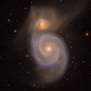](figures/gallery/m51.jpg) | **M51**, Whirlpool | Grand-design spiral caught in an encounter with its companion NGC 5195 | 0.51 |  5,670 K | 0.035 cd/m² |
| [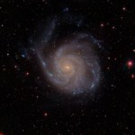](figures/gallery/m101.jpg) | **M101**, Pinwheel | Giant face-on spiral, lopsided, studded with star-forming regions | 0.39 |  6,330 K | 0.006 cd/m² |
| [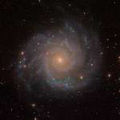](figures/gallery/m74.jpg) | **M74**, Phantom | The textbook face-on spiral | 0.46 |  5,750 K | 0.006 cd/m² |
| [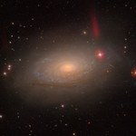](figures/gallery/m63.jpg) | **M63**, Sunflower | Flocculent spiral: short, patchy arms | 0.65 |  5,140 K | 0.004 cd/m² |
| [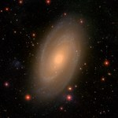](figures/gallery/m81.jpg) | **M81**, Bode's | Big old bulge in thin blue arms | 0.75 |  4,630 K | 0.061 cd/m² |
| [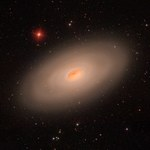](figures/gallery/m64.jpg) | **M64**, Black Eye | A band of dust across the bright inner disc | 0.66 |  5,000 K | 0.078 cd/m² |
| [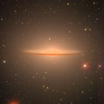](figures/gallery/m104.jpg) | **M104**, Sombrero | Edge-on dust lane against a huge glow of old stars | 0.79 |  4,580 K | 0.080 cd/m² |
| [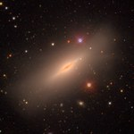](figures/gallery/ngc5866.jpg) | **NGC 5866**, Spindle | Edge-on lenticular: old, no arms, one thin dust lane | 0.72 |  4,900 K | 0.012 cd/m² |
| [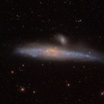](figures/gallery/ngc4631.jpg) | **NGC 4631**, Whale | Edge-on disc forming stars along its whole length | 0.40 |  6,320 K | 0.002 cd/m² |
| [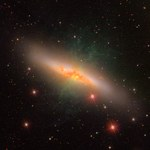](figures/gallery/m82.jpg) | **M82**, Cigar | Starburst choked with dust, blowing out a wind of hydrogen | 0.69 |  4,570 K | 0.024 cd/m² |
| [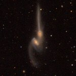](figures/gallery/mice.jpg) | **The Mice**, NGC 4676 | Two spirals merging, trailing tidal tails, 300 million light-years away | 0.57 |  5,470 K | 0.001 cd/m² |
| [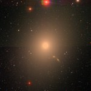](figures/gallery/m87.jpg) | **M87**, Virgo A | Giant elliptical: almost only old stars, ringed by globular clusters | 0.79 |  4,700 K | 0.023 cd/m² |

g − r is the galaxy's colour inside its D25 ellipse (the 25 B-mag/arcsec² isophote), corrected
for Milky Way dust; the Sun's is 0.48. Eye colour: the whole galaxy's light, on a screen where
sunlight is white, with the temperature of the blackbody that looks most alike. Brightest core:
luminance of the brightest 2" patch; a white page under a full Moon is 0.06 cd/m². Every
picture also exists in eye colours (`figures/gallery/<name>_eye.jpg`).

---

## Results

### A telescope sees in greyscale

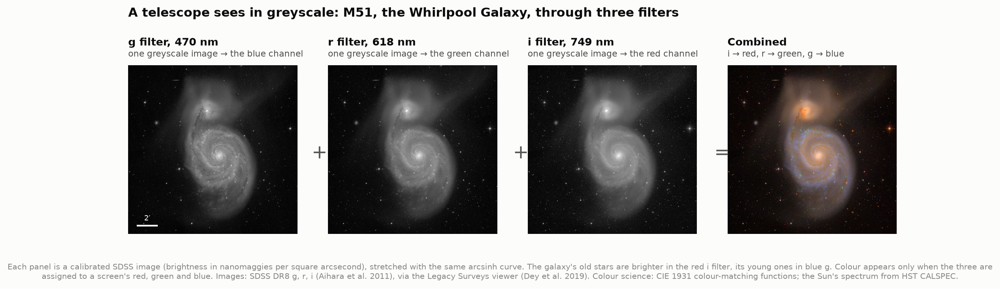

The Sloan Digital Sky Survey photographed a third of the sky through five filters. Its camera
held a row of CCDs for each filter, and as the sky drifted across it every patch was imaged in
all five within about five minutes. Three of the filters cover visible light: g (470 nm), r
(618 nm) and i (749 nm). Each image is a measurement: every pixel holds a surface brightness in
nanomaggies per square arcsecond (22.5 − 2.5 log₁₀ of it is the brightness in AB magnitudes
per square arcsecond). M51's companion NGC 5195 is relatively brighter in i than in g, because
it is made of old red stars; the spiral arms are relatively brighter in g, because young blue
stars light them. Colour appears only when the three images are assigned to a screen's red,
green and blue: i to red, r to green, g to blue, the "chromatic order" every survey uses.

### The stretch problem

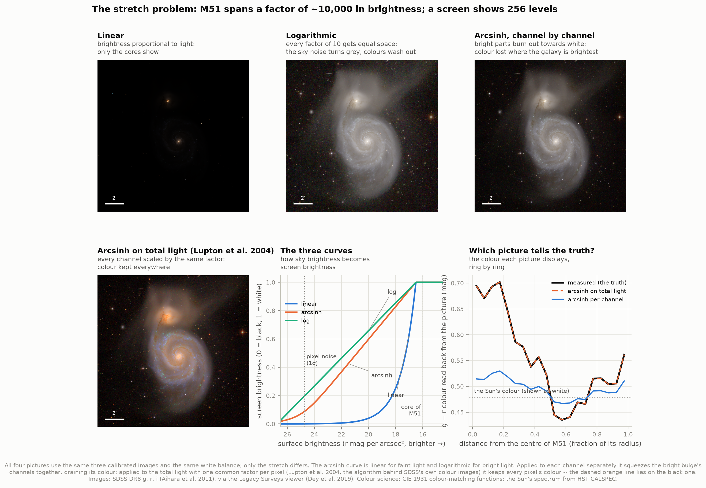

M51's core is about a thousand times brighter than the faintest parts of its disc that rise
above the noise, and a screen has 256 levels. A linear stretch shows only the cores. A
logarithmic one lifts the faint outskirts but turns the sky noise grey. Stretching each channel
separately, the usual approach in photo editors, drains the colour from the bright parts: the
bulge's measured g − r of 0.70 is displayed as 0.51, almost the grey that sunlight maps to.
Lupton et al. (2004) fixed this by stretching the *total* light and multiplying all three
channels of a pixel by the same factor, so every pixel keeps the ratios between its colours
(dashed orange line, right, lying on the black one). That is the stretch used for every
picture here, with the same parameters, in physical units, for every galaxy: equal surface
brightness gives equal screen brightness in all twelve panels.

### Checking the data before trusting the pictures

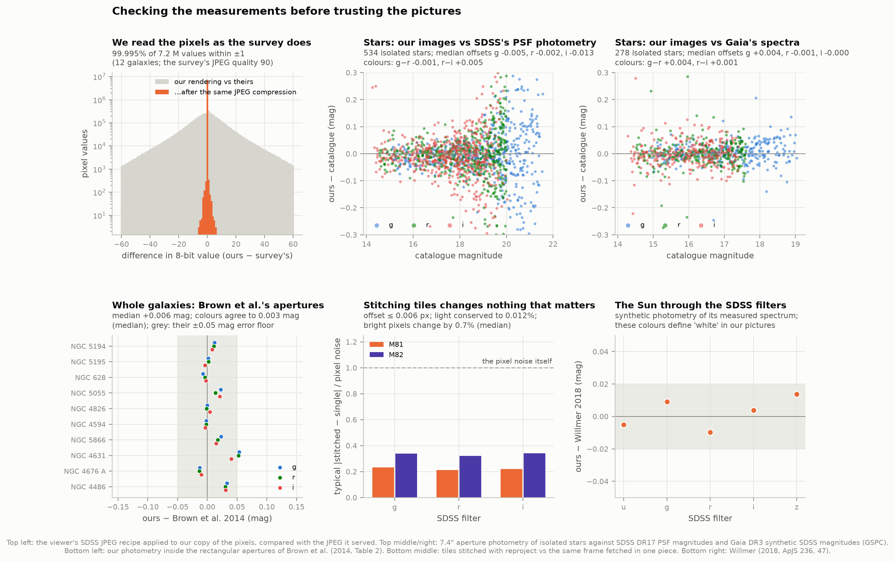

| Check | Result |
|---|---|
| The survey viewer's own JPEGs, one tile per galaxy (12) | our rendering, after the same JPEG compression (quality 90), matches 99.995% of 7.2 million values to within ±1 |
| 278 isolated stars vs Gaia DR3's synthetic SDSS magnitudes | median offsets +0.004, −0.001, −0.000 mag in g, r, i; scatter 0.03–0.04 |
| 534 stars vs SDSS DR17's PSF photometry | −0.005, −0.002, −0.013 mag |
| Whole galaxies in Brown et al.'s 10 apertures | median +0.006 mag, rms 0.021; colours to 0.003 (median) |
| Stitched tiles vs one-piece cutouts (M81, M82) | offset ≤ 0.006 pixel; light conserved to 0.012%; typical pixel change 0.2–0.3 × the noise |
| The Sun's colours vs Willmer 2018 | within 0.014 mag in all five filters |
| Seven M51 maps vs Gaia star positions | ≤ 0.24" (a third of a pixel) |
| Hubble vs SDSS surface brightness | −2%, +9%, +4% of what M51's spectrum predicts for the three filter pairs |

The images are what they say they are. Pixel values are in nanomaggies per *native* 0.396"
SDSS pixel whatever grid the cutout is on; star photometry through that conversion lands on
Gaia's, an entirely separate calibration, within half a percent. Brown et al.'s galaxy
photometry agreed only once foreground stars were *filled in* with the galaxy light around
them rather than dropped: dropping them removed up to 0.14 mag of M74's light along with the
stars.

### The gallery

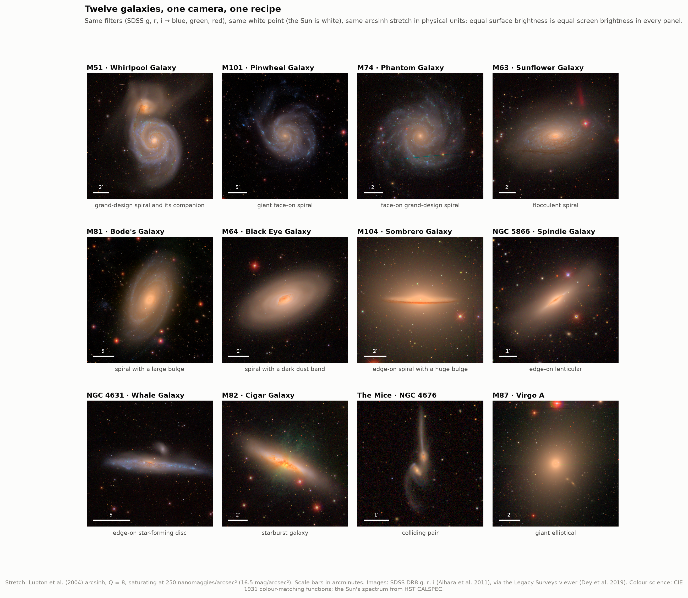

Twelve kinds of galaxy under one recipe. Old stellar populations (M87, M104, NGC 5866, the
bulges of M81 and M64) come out yellow-orange; star-forming discs (M101, M74, NGC 4631) blue;
dust lanes (M104, M64, M82) brown-red. Some colours are artefacts of the method, and worth
knowing: the bright knots along spiral arms, and M82's wind of hydrogen gas, show as *green*,
because hydrogen's red 656 nm glow falls in the r filter, which is displayed as green. The
pictures also keep the survey's flaws: satellite trails across M74 and M63, and a faint step
where two SDSS fields meet behind M87.

### What "white" means

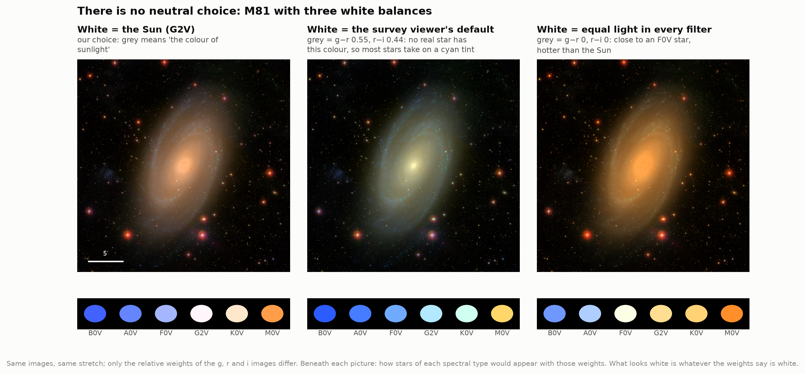

Before the three images become channels, each is multiplied by a weight, and the weights decide
what shows as grey. We choose the colour of sunlight: weights of 1.554, 1, 0.907 for g, r, i
come from the Sun's measured spectrum through the SDSS filter curves (its colours g − r =
0.48, r − i = 0.11 match Willmer 2018's to 0.01–0.02). The survey viewer's default weights
(2.5, 1.5, 1.0) make a source with g − r = 0.55 and r − i = 0.44 grey, a combination no star
has, so almost every star takes on a cyan tint in its pictures. Equal weights make an F0 star
white and turn the galaxy orange. None of these is "the" true colour. Ours at least means
something physical: grey is sunlight.

### Survey filters are not the eye's

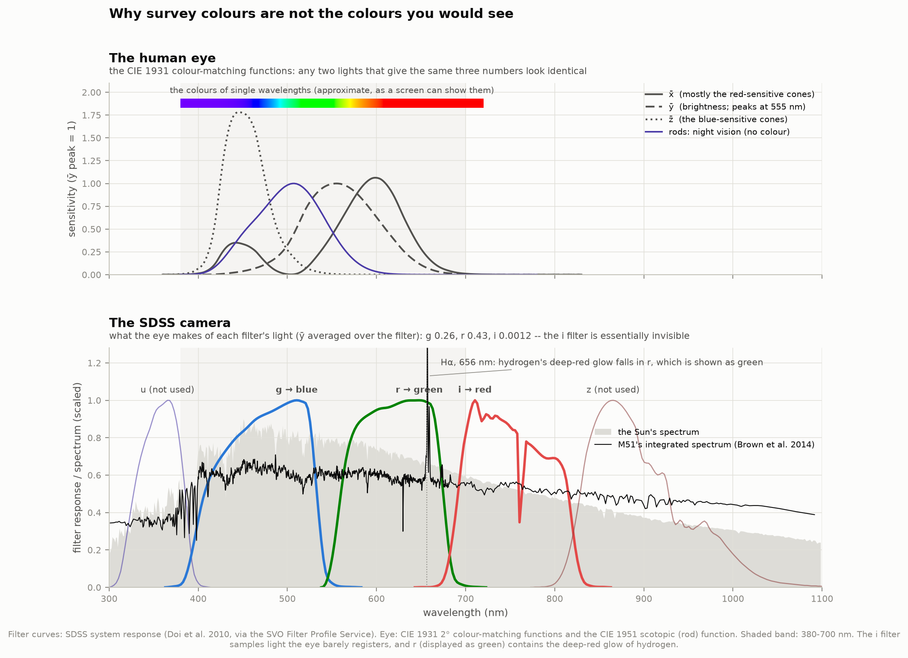

The eye has its own three filters, the cones, whose combined response is standardised by the
CIE. Averaged over each SDSS filter, the eye's brightness sensitivity is 0.26 for g, 0.43 for r
and 0.0012 for i: the i filter, displayed as red, records light the eye can barely see. And
the r filter, displayed as green, contains hydrogen's deep-red glow. Survey colours are a
consistent code, not what an eye would see.

### True colour

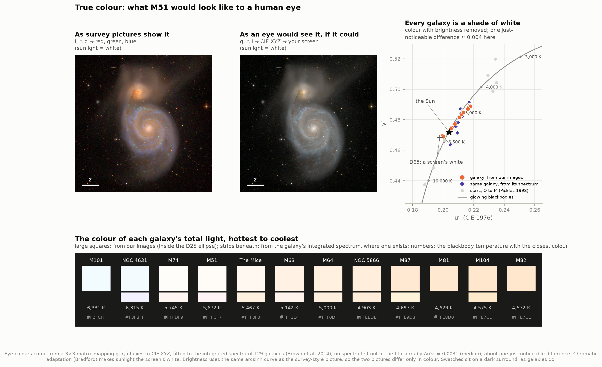

To get what an eye would see, we treat the survey as a camera and characterise it the way
camera makers do: a 3×3 matrix that turns g, r, i fluxes into the eye's XYZ, fitted to the
integrated spectra of 129 galaxies (Brown et al. 2014). On spectra left out of the fit it
errs by Δu′v′ = 0.0031 (median; 90% within 0.0071), about one just-noticeable difference in
colour, and its brightness by 2.6% rms. The worst case is a starburst dominated by emission
lines (0.021). On stars, which it never saw, it does as well for G and K types (0.003–0.005)
and worse for the hottest and coolest (0.02–0.04).

M51 through that matrix, on a screen whose white is sunlight and with exactly the same
brightness mapping as the survey-style picture, is a far quieter object: a cream core, a
greyish-white disc with slightly bluer arms, a pale peach companion. Every galaxy's total light
sits on the curve of glowing blackbodies, between 4,570 K (M82, M104) and 6,330 K (M101), which
is to say: white, tinged cream or faintly blue. Where Brown et al. measured a galaxy's spectrum,
our image-based colour agrees with the spectrum's to Δu′v′ = 0.0005–0.0070, within about one
to two just-noticeable differences, even though their apertures differ from ours.

### Too faint for colour

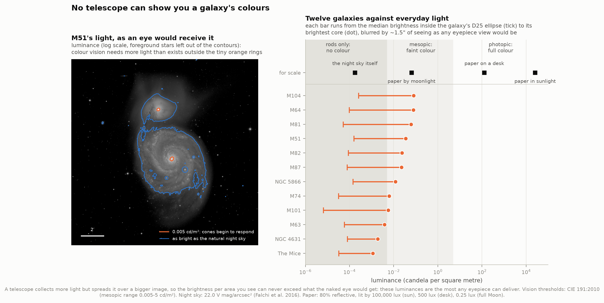

The same matrix gives the luminance an eye would receive, in candela per square metre. Colour
vision needs cones, and cones only begin to respond around 0.005 cd/m² (the lower edge of the
"mesopic" range, CIE 191:2010). The brightest core in the sample, M104's, reaches 0.080 cd/m²
(through ~1.5" of seeing), about the brightness of a white page lit by the full Moon. M64 and
M81 reach 0.06–0.08; the Mice only 0.001. At most 1.5% of any galaxy's area inside its D25
ellipse gets above 0.005 cd/m² (M104; 0.16% for M51, none at all for M101, M74, NGC 4631 or the
Mice). The median point of each disc is at 7 × 10⁻⁶ to 3 × 10⁻⁴ cd/m², and in eleven of the
twelve most of the D25 area is fainter than the natural night sky (1.7 × 10⁻⁴ cd/m², Falchi et
al. 2016).

This cannot be fixed with a bigger telescope. A telescope collects more light but spreads it
over a proportionally larger image, so the brightness per unit area reaching your retina can
never exceed what the naked eye would receive from the same galaxy (it is usually less). Through
an eyepiece, galaxies are grey smudges not because telescopes are too small but because
galaxies are too dim per unit area, and they always will be.

### What the colours mean

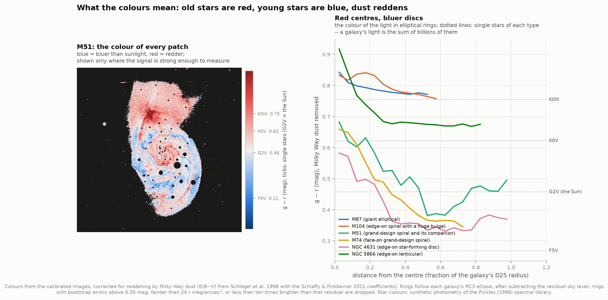

Colour still carries physics, as long as it is read as a code. A galaxy's light is the sum of
billions of stars, so its colour sits among theirs: M87's is that of K giants (g − r 0.84 at
the centre, 0.77 at half its radius: a gentle gradient usually put down to the outer stars being
poorer in heavy elements); NGC 5866's centre is redder still (0.92), where its dust lane reddens
the starlight behind it. In spirals the centre is red and the disc blue: M51 falls from 0.68 at
its centre to 0.38 at half its radius, bluer than the Sun (0.48), because young massive stars
in the arms outshine everything else in blue light. The colour map shows it pixel by pixel: red
bulge and dust lanes, blue arms, red companion. Colour alone cannot separate age from dust from
metallicity (see below); figure 10 does it with more wavelengths.

### M51 across the spectrum

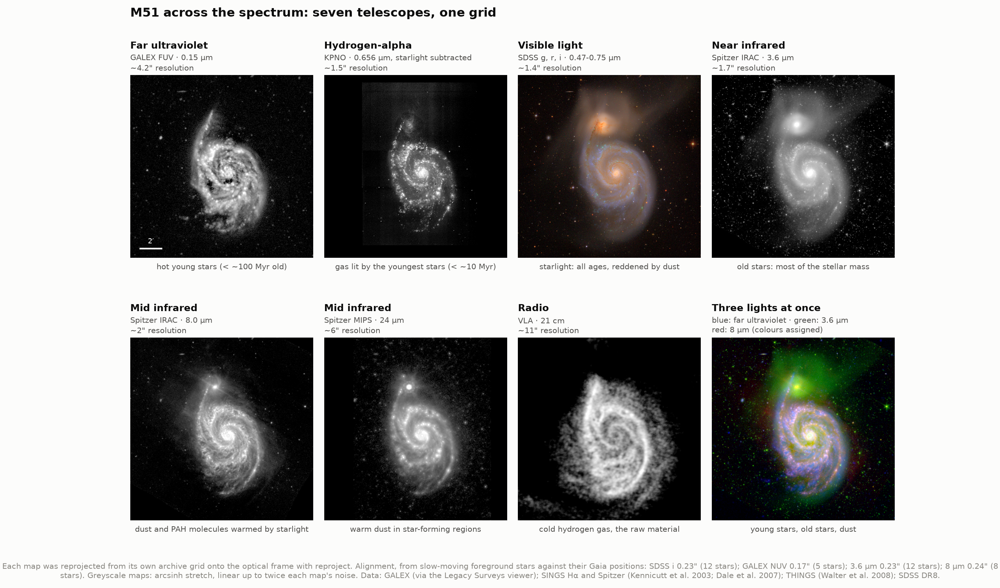

Seven telescopes, each with its own pixel grid, reprojected onto one: GALEX's far ultraviolet
(hot young stars), a KPNO Hα image with the starlight subtracted (gas lit by the youngest
stars), SDSS, Spitzer at 3.6 µm (old stars: most of the stellar mass), 8 µm (dust and PAH
molecules) and 24 µm (warm dust in star-forming regions), and the VLA's 21 cm map of cold
hydrogen. Foreground stars land within 0.24" of their Gaia positions in every map that shows
them. Each layer answers a question the optical picture cannot: the young stars and the warm
dust trace the same arms (dust lanes that look brown in visible light glow at 8 and 24 µm); the
plume around NGC 5195 shows in visible light and at 3.6 µm but not in the ultraviolet or at
8 µm, so it is old stars with neither young stars nor dust; the hydrogen extends into a long
tidal tail at lower left that the SDSS picture does not show at all. In the three-colour combination
(far ultraviolet, 3.6 µm, 8 µm), colours are assigned, not seen.

Getting here needed one correction worth knowing about: the Spitzer and Hubble mosaics carry
leftover SIP distortion keywords without the "-SIP" label that would invoke them. Astropy
applies them anyway, which moved positions by arcseconds across the mosaics; removing them, as
the FITS convention says, brought every map within a quarter of an arcsecond.

### Hubble and the ground

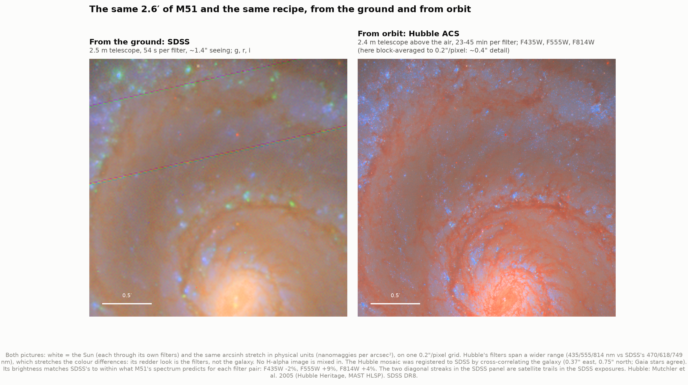

The same 2.6′ of M51 from SDSS and from Hubble's 2005 mosaic, with the same white point (the
Sun through each telescope's filters), the same stretch and the same grid. Hubble resolves star
clusters and fine dust filaments that SDSS's 1.4" seeing blurs together. Two measurements tie
the two together. The Hubble mosaic sits 0.37" east and 0.75" north of SDSS; its own foreground
stars say the same against Gaia; it was shifted onto SDSS before the comparison. And its surface
brightness matches SDSS's to within −2%, +9% and +4% of what M51's own spectrum predicts for
the three filter pairs, which confirms that these block-averaged files are in electrons per
second per original 0.05" pixel (their header says "ELECTRONS"). Hubble's picture looks redder
because its filters span a wider range (435–814 nm against 470–749 nm): the wider the spread,
the stronger any colour difference comes out.

### When a pipeline erases a galaxy

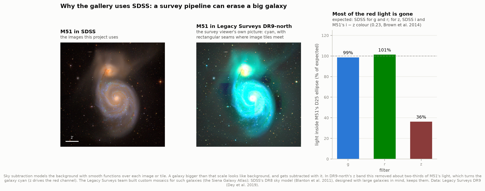

The gallery uses SDSS rather than the deeper, sharper Legacy Surveys because of this. In
Legacy Surveys DR9-north, M51 is cyan with rectangular seams. Measured inside M51's D25
ellipse, DR9-north keeps 99% of its g light and 101% of its r light, but only 36% of the z
light expected from SDSS i and M51's i − z colour. Sky subtraction models the background with
smooth functions over each image or tile, and a galaxy larger than that scale gets subtracted
along with it. It is a well-known hazard for big galaxies, and the reason the Legacy Surveys
team built custom mosaics for them in the Siena Galaxy Atlas.

### A hands-on version

`figures/composite_explorer.html` is a single self-contained page (3.5 MB, works offline,
light or dark) with the calibrated g, r, i images of M51, M81 and M104. Every choice in this
project is a control: the white point (the Sun, the survey viewer's, equal flux, or your own
weights), which filter goes to which channel (swap them and M81's old bulge turns blue), the
stretch (Lupton's, per channel, linear, log; saturation and Q), and a switch to what an eye
would see. Hovering over the picture reads out the pixel's surface brightness, colour,
eye colour and temperature, luminance, and whether a human eye could see its colour at all.

---

## How it works

**1. Fetch.** `fetch_data.py` downloads about 510 MB and records every file's URL, retrieval
time and SHA-256 in `data/manifest.json`. The galaxy images come from the Legacy Surveys sky
viewer's cutout service, which serves SDSS DR8 imaging (coadded onto a common pixel grid by
the Legacy Surveys team) on any grid we ask for. The service cuts off any request that takes
longer than about two minutes, and whole-galaxy cutouts can, so each galaxy is fetched as a
grid of overlapping tiles of at most 460 pixels. Catalogues come from SDSS DR17 (star
photometry), Gaia DR3 (star positions, motions and synthetic SDSS magnitudes), RC3 (galaxy
sizes and orientations) and IRSA (Milky Way dust). The colour science uses the CIE's own
tables, filter curves from the SVO Filter Profile Service, and measured spectra of the Sun,
Vega, 14 kinds of star and 129 galaxies.

**2. Stitch.** `imaging.py` puts every tile onto the galaxy's single target grid (a gnomonic
projection, north up) with `reproject`, which interpolates each tile's surface brightness at
the exact sky position of every output pixel.

**3. Units.** Pixel values are nanomaggies per *native* SDSS pixel (0.396"): the cutout service
preserves surface brightness, not flux. Dividing by 0.396² gives nanomaggies per square
arcsecond, the unit everything else works in; 22.5 − 2.5 log₁₀ of that is the surface
brightness in AB mag/arcsec². The star photometry checks this conversion.

**4. The picture** (`composite.py`). Each filter is multiplied by a weight that makes the
Sun's colour exactly grey (weights from synthetic photometry of the Sun's measured spectrum
through the SDSS filter curves: g × 1.554, r × 1, i × 0.907), then placed in a screen channel
(i red, r green, g blue). The stretch is the arcsinh of Lupton et al. (2004), applied to the
mean of the three channels, with every channel scaled by the same factor, so each pixel keeps
its colour. Its two parameters are fixed in physical units for every galaxy: full brightness at
250 nanomaggies per arcsec² (16.5 mag/arcsec²) and Q = 8, which puts the linear part of the
curve below 0.17 nanomaggies per arcsec² (24.4 mag/arcsec², about 1.3 times the pixel noise).
Our implementation matches `astropy.visualization.make_lupton_rgb` to 2 × 10⁻¹⁶.

**5. The eye** (`color_physics.py`). The CIE 1931 colour-matching functions describe how the
average human eye responds to each wavelength. Integrating a spectrum against them gives
tristimulus values X, Y, Z: two lights with equal XYZ look identical. For each of the 129
galaxy spectra of Brown et al. (2014), we compute both the SDSS g, r, i fluxes and XYZ, and fit
the 3×3 matrix that best turns one into the other: the "colour matrix" of a digital camera,
fitted to galaxies. Chromatic adaptation (the Bradford transform) then maps sunlight onto the
screen's white, and the sRGB standard turns XYZ into screen values. Brightness uses the same
arcsinh curve as the survey-style picture, applied to the eye's luminance, so the two pictures
differ only in colour.

**6. Luminance.** The CIE Y integral of a surface brightness, converted to watts per square
metre per steradian and multiplied by 683 lumens per watt (the definition of the candela), is
the luminance an eye receives, in candela per square metre. The same number, for the rods, uses
the CIE scotopic function and 1700 lm/W.

**7. Galaxy measurements** (`analysis.py`). Foreground stars are identified by Gaia: anything
with a parallax or proper motion measured at more than 5σ is a star in our own Galaxy, not a
knot in the galaxy, and is masked with the Legacy Surveys' radius rule (1630" × 1.396^−G).
For aperture photometry each masked star is then filled with the median of the galaxy light
in a ring around it, so the galaxy's own light under the mask is not lost. Integrated colours
use each galaxy's RC3 D25 ellipse (the 25 B-mag/arcsec² isophote), with companions excluded.
Colours for physical interpretation are corrected for Milky Way dust.

---

## What colour pictures cannot tell you

- **Colour does not uniquely mean age.** Old stars are red, but so is starlight behind dust,
  and so are metal-rich stars. A red patch in g − r can be any mix of the three. Separating them
  needs more bands, from ultraviolet to infrared (figure 10 shows why: dust glows at 8 and
  24 µm exactly where the optical picture shows red-brown lanes).
- **Survey colours depend on the filters.** Another survey's g, r, z (the Legacy Surveys') or
  B, V, R (a typical amateur camera) puts the channel boundaries in different places, and the
  same galaxy comes out a slightly different colour. Colours in these pictures compare only with
  other pictures made through SDSS g, r, i.
- **The eye colours are for an eye that could see colour.** They are what a person with normal
  colour vision, adapted to sunlight, would see if the galaxy were bright enough to switch on
  their cones. It never is (figure 8).
- **Three filters cannot see an emission line.** An HII region's light includes the narrow
  656 nm line of hydrogen. The r filter records it, but cannot tell it from light spread over
  560–700 nm, so the eye-colour estimate is least accurate there: the worst training galaxy is
  a starburst, off by Δu′v′ = 0.02, five times the typical error.
- **Resolution.** SDSS's ~1.4" seeing blurs everything smaller than about 50 parsecs at M51's
  distance. Hubble resolves star clusters that SDSS sees as smudges (figure 11).

---

## Running it

```bash
cd ..                       # repository root
python3 -m venv .venv
source .venv/bin/activate
pip install numpy scipy pandas matplotlib astropy astroquery reproject pillow

cd 13-galaxy-composites
python fetch_data.py        # ~510 MB; only needed once (see below)
python test_physics.py      # self-checks of the colour physics and the compositing
python run.py               # every picture, figure and number; a few minutes
```

Once the cache is warm, `run.py` needs no network at all; this was verified by running it
inside a network namespace with no connectivity.

`fetch_data.py --only gallery` (or `catalogs`, `reference`, `multiwavelength`) fetches one
group. The download is polite (one request at a time, pauses, back-off when a server is busy)
and resumable: rerun it and it fetches only what is missing. Two runs with different `--only`
groups can safely go side by side. `run.py --only m51 --only m104` processes just those
galaxies.

### Files

| File | What it does |
|---|---|
| `config.py` | Paths, data sources, the twelve galaxies, and every chosen number: stretch, white point, filter-to-channel mapping, vision thresholds |
| `fetch_data.py` | Downloads and caches the data in tiles, with a provenance manifest |
| `imaging.py` | Stitches tiles with reproject; reads catalogues; ellipse, rectangle and star masks; aperture and star photometry |
| `color_physics.py` | Synthetic photometry, CIE colorimetry, sRGB, chromatic adaptation, colour temperature, luminance, the colour matrix |
| `composite.py` | The stretches (linear, log, arcsinh per channel, Lupton), white balance, the survey viewer's recipe, the eye-colour rendering |
| `analysis.py` | Reference points, the colour matrix fit, the four validations, per-galaxy measurements |
| `multiwave.py` | M51 from ultraviolet to radio, and Hubble against SDSS |
| `figures.py` | Figures 01–09 and 12 |
| `interactive.py` | The hands-on explorer page |
| `run.py` | Runs everything and prints the graded summary |
| `test_physics.py` | Checks the formulas against known answers |

`test_physics.py` is worth running first: 49 checks pin every conversion to something known
independently. A flat 3631 Jy spectrum is magnitude 0 in every band. The CIE's own D65 table
comes out at the chromaticity the CIE defines for it, (0.31271, 0.32902), and at 6,504 K. Our
sRGB matrix matches the IEC standard's. Blackbodies from 2,856 to 10,000 K come back at their
own temperatures. One watt of 555 nm light is 683 lumens, by the definition of the candela. The
Sun's spectrum integrates to 1360.6 W/m² against the measured 1360.8 (Kopp & Lean 2011). Our
Lupton composite matches `astropy.visualization.make_lupton_rgb` to 2 × 10⁻¹⁶.

## Figures

`01_how_a_picture_is_made` three filters into one picture · `02_the_stretch` four stretches
and which one keeps colours · `03_filters_vs_the_eye` SDSS's filters against the eye's ·
`04_validation` the checks · `05_gallery` twelve galaxies · `06_what_white_means` three
white points · `07_true_color` what an eye would see · `08_too_faint_for_colour` galaxy
luminances against vision thresholds · `09_what_colours_mean` colour maps and profiles ·
`10_m51_across_the_spectrum` seven telescopes · `11_hubble_vs_ground` Hubble against SDSS ·
`12_when_a_pipeline_erases_a_galaxy` the DR9-north caveat · `gallery/` every picture at full
resolution, survey-style and eye-colour (JPEG, north up) · `composite_explorer.html`
interactive.

PNG and SVG for every figure (the SVGs keep text and lines as vectors and embed the pictures at
90 dpi to stay small). In the charts, ink is what was measured, orange our own measurement,
violet a published value, and each SDSS filter is drawn in the screen channel it feeds, always
with a direct label. The colour-index map uses a diverging scale centred on the Sun's colour.

---

## Honest notes on the numbers

- **"True colour" is an estimate for an impossible observer.** It is the colour a person with
  normal colour vision, adapted to sunlight, would see if the galaxy were a thousand times
  brighter per unit area. Adapted to a screen's D65 white instead, every colour here shifts a
  little warmer (the Sun itself becomes #FFF2EE). And the matrix that estimates it was fitted to
  whole galaxies: individual pixels dominated by hydrogen emission are its least accurate case.
- **The sky is not perfectly subtracted.** Away from every galaxy, the images sit at +0.004 to
  +0.06 nanomaggies/arcsec² in r (0.1–0.4 of a pixel's noise, around 26 mag/arcsec²), within
  the accuracy of SDSS's sky model. We leave it in the pictures and the aperture photometry,
  where it could brighten a D25 magnitude by up to about 0.04 mag; the colour profiles subtract
  it and stop wherever the galaxy is less than ten times brighter than it, or fainter than 24
  mag/arcsec². The residual is itself red, and left in it would have reddened the outskirts.
- **Foreground stars are filled, not dropped.** Aperture photometry replaces each masked star
  with the median of the galaxy light in a ring around it. Where a star sits on a steep gradient
  (the dust lane of an edge-on galaxy), the fill is imperfect: NGC 4631 is the one galaxy 0.05
  mag off Brown et al.'s photometry, right at their quoted error floor.
- **Brown et al.'s spectra are not purely measured.** 95% of each spectrum in the visible range
  (median) comes from drift-scan spectrophotometry; the gaps are filled with model fits
  constrained by their photometry. The colours of their spectra differ from their own
  photometry by up to 0.05 mag in g − r (M51: 0.575 vs 0.62), which is part of why our
  image-based eye colours and their spectrum-based ones differ by up to Δu′v′ = 0.007.
- **Peak luminances are seeing-limited.** They are averages over ~2" patches blurred by ~1.4"
  of seeing, like a view through an eyepiece on a typical night. A nucleus seen at Hubble's
  resolution would be brighter, but even ten times the brightest value here (0.8 cd/m²) would
  stay inside the mesopic range. The threshold itself is a convention: CIE 191 puts the
  scotopic–mesopic boundary at 0.005 cd/m², Falchi et al. (2016) at 0.001. The verdict for the
  discs, at 10⁻⁵–10⁻⁴ cd/m², holds either way.
- **The survey's JPEGs match "to within ±1", not exactly.** Our rendering and theirs are
  identical before compression; after it, 0.005% of values differ by more than one level,
  consistent with small differences between JPEG encoders.
- **SDSS magnitudes are treated as AB.** SDSS documents g, r and i as within about 0.01 mag
  of the AB system; u and z (not used) are further off.
- **Milky Way dust** uses the SFD map at each galaxy's centre with the Schlafly & Finkbeiner
  (2011) coefficients: E(B−V) from 0.009 (M101) to 0.16 (M82, which lies behind noticeably more
  of our Galaxy's dust). It is applied only where colours are interpreted physically (profiles,
  maps, the table's g − r), never to the eye colours: we see galaxies through that dust.
- **Registration and units needed care.** The Spitzer and Hubble mosaics carry stray SIP
  keywords (removed, per the FITS convention); the Hubble mosaic is offset by 0.84" from SDSS
  and Gaia (corrected); its low-resolution files are block averages still per original pixel,
  and their header's "ELECTRONS" really means electrons per second (confirmed photometrically).
  Each of these would otherwise have silently distorted a figure.

## A little history

Colour pictures of galaxies have always been made this way: separate black-and-white exposures
through coloured filters, recombined. In the 1970s David Malin at the Anglo-Australian
Observatory made his celebrated colour images by exactly this three-colour process, from
photographic plates exposed through blue, green and red filters. CCDs made the images
quantitative. Robert Lupton and colleagues then asked how to display a calibrated image whose
brightness spans many decades without destroying its colours, and their answer (arcsinh on the
total intensity, one scaling factor for all three channels; Lupton et al. 2004) is the one SDSS
used for its colour images and the one this project uses.

What "true colour" means has tripped up professionals too. In January 2002 Karl Glazebrook and
Ivan Baldry combined the light of more than 200,000 galaxies from the 2dF Galaxy Redshift
Survey and announced that the average colour of the universe was a pale turquoise. In March
they corrected it: the colour-conversion software had used a non-standard white point, and the
universe's colour is in fact a beige white, soon nicknamed "cosmic latte" (#FFF8E7). The
galaxies in figure 7 sit right around it.

## Data credits

**Imaging.** SDSS DR8 (Aihara et al. 2011, ApJS 193, 29), served by the Legacy Surveys sky
viewer (Dey et al. 2019, AJ 157, 168; legacysurvey.org). Legacy Surveys DR9-north for figure
12. GALEX (Martin et al. 2005, ApJ 619, L1), via the same viewer. Spitzer IRAC and MIPS mosaics
and the KPNO Hα image from SINGS (Kennicutt et al. 2003, PASP 115, 928; Dale et al. 2007, ApJ
655, 863), via IRSA. VLA 21-cm map from THINGS (Walter et al. 2008, AJ 136, 2563). Hubble ACS
mosaic of M51 from the Hubble Heritage team (Mutchler et al. 2005), a MAST High Level Science
Product.

**Catalogues.** SDSS DR17 (Abdurro'uf et al. 2022, ApJS 259, 35). Gaia DR3 (Gaia
Collaboration, Vallenari et al. 2023, A&A 674, A1) and its Synthetic Photometry Catalogue (Gaia
Collaboration, Montegriffo et al. 2023, A&A 674, A33). RC3 (de Vaucouleurs et al. 1991), via
VizieR. Milky Way dust: Schlegel, Finkbeiner & Davis 1998 (ApJ 500, 525) through IRSA, with
the extinction coefficients of Schlafly & Finkbeiner 2011 (ApJ 737, 103).

**Colour science.** CIE 1931 colour-matching functions, CIE standard illuminant D65 and CIE
scotopic luminous efficiency (CIE datasets, DOIs 10.25039/CIE.DS.xvudnb9b, .hjfjmt59,
.gr6w4b5g). SDSS filter curves: Doi et al. 2010 (AJ 139, 1628), via the SVO Filter Profile
Service (Rodrigo et al. 2012, 2020). Spectra of the Sun and Vega: HST CALSPEC (Bohlin, Gordon &
Tremblay 2014, PASP 126, 711). Stellar library: Pickles 1998 (PASP 110, 863). Galaxy spectra
and photometry: Brown et al. 2014 (ApJS 212, 18; MAST HLSP GALSEDATLAS). Vision thresholds:
CIE 191:2010. Night-sky brightness: Falchi et al. 2016 (Sci. Adv. 2, e1600377). Solar absolute
magnitudes compared against: Willmer 2018 (ApJS 236, 47). Total solar irradiance: Kopp & Lean
2011 (GRL 38, L01706).

**Algorithms.** Lupton et al. 2004 (PASP 116, 133) for the arcsinh composite; legacypipe's
`sdss_rgb` for the survey viewer's recipe; Bradford chromatic adaptation (Lam 1985); sRGB (IEC
61966-2-1). Software: astropy, reproject, numpy, scipy, matplotlib, pillow.
