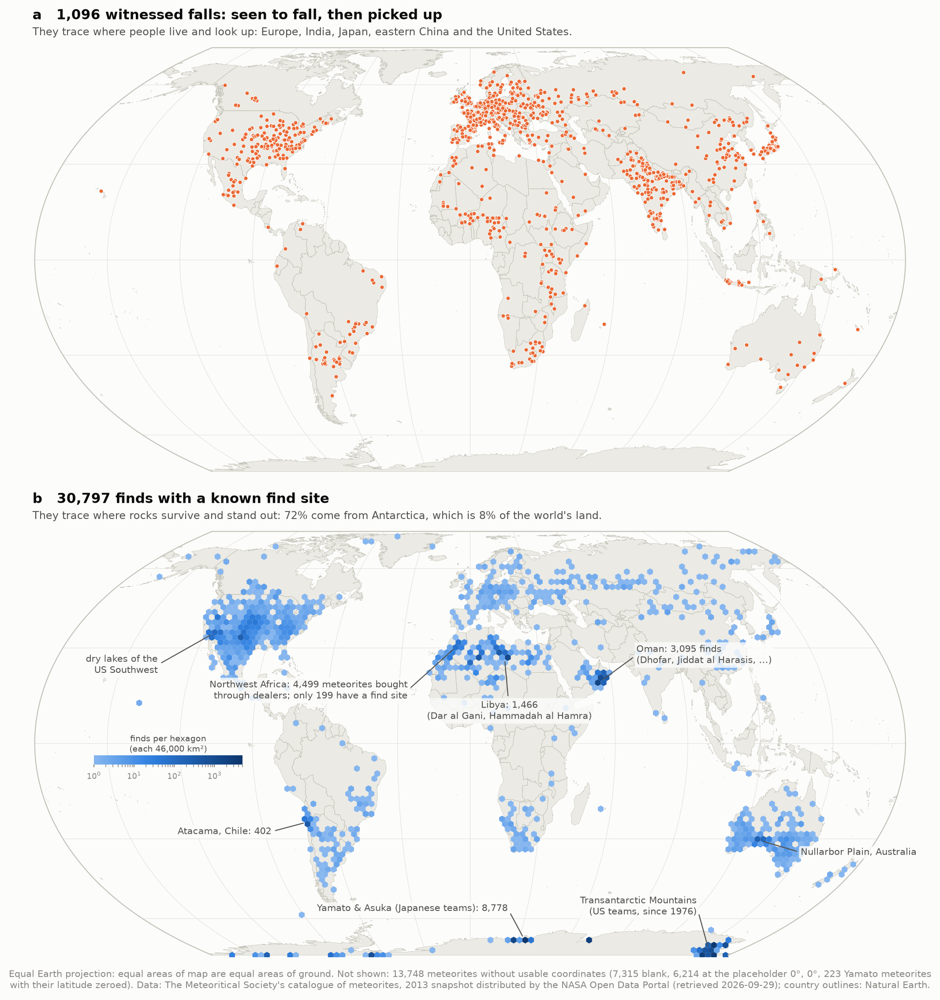
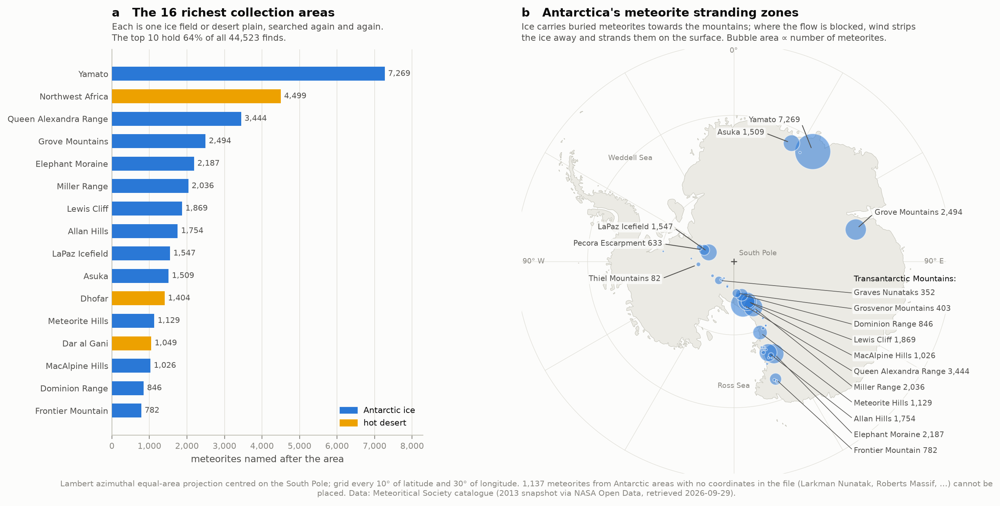
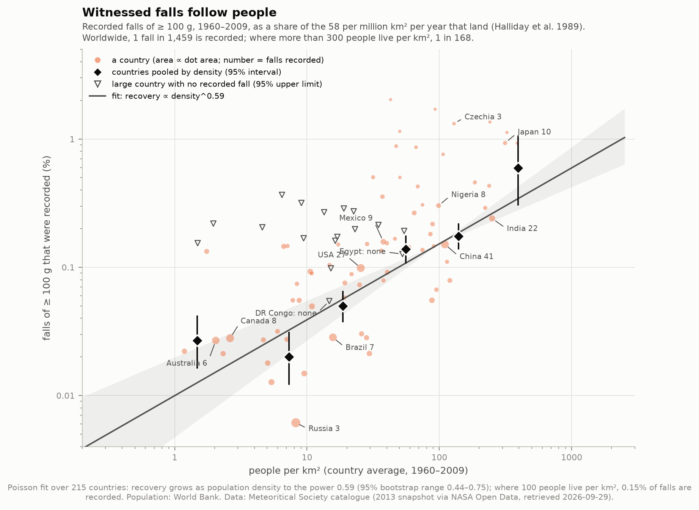
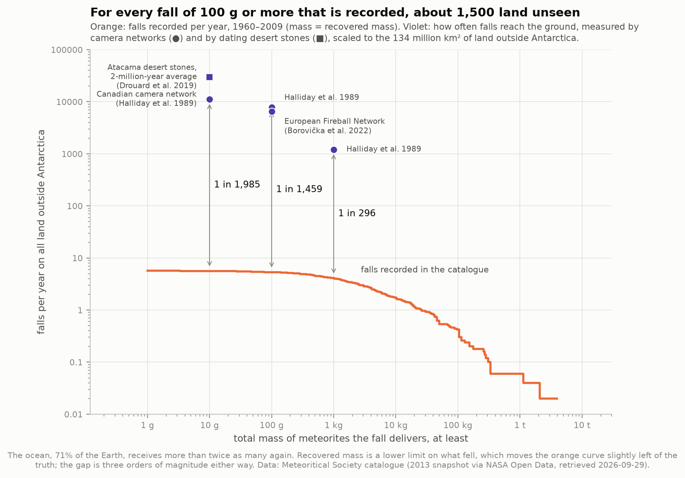
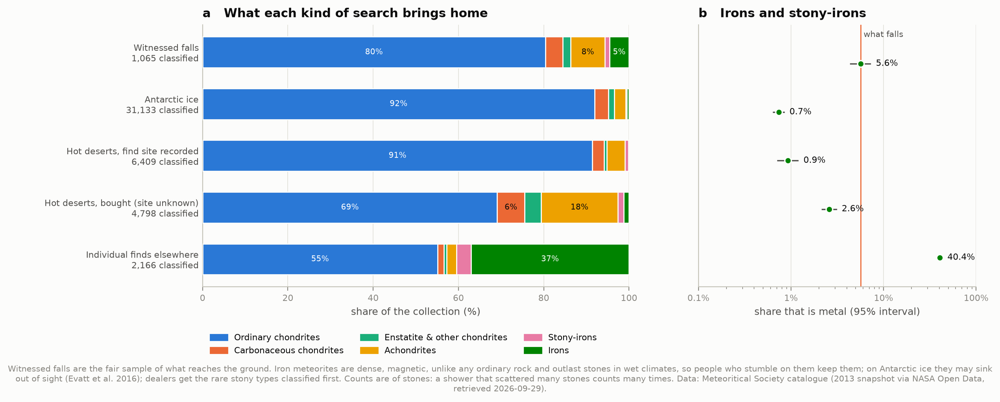
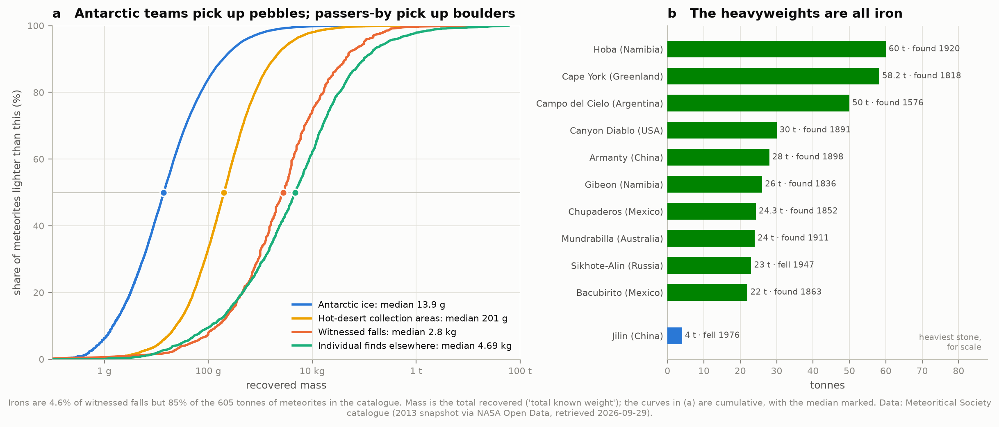
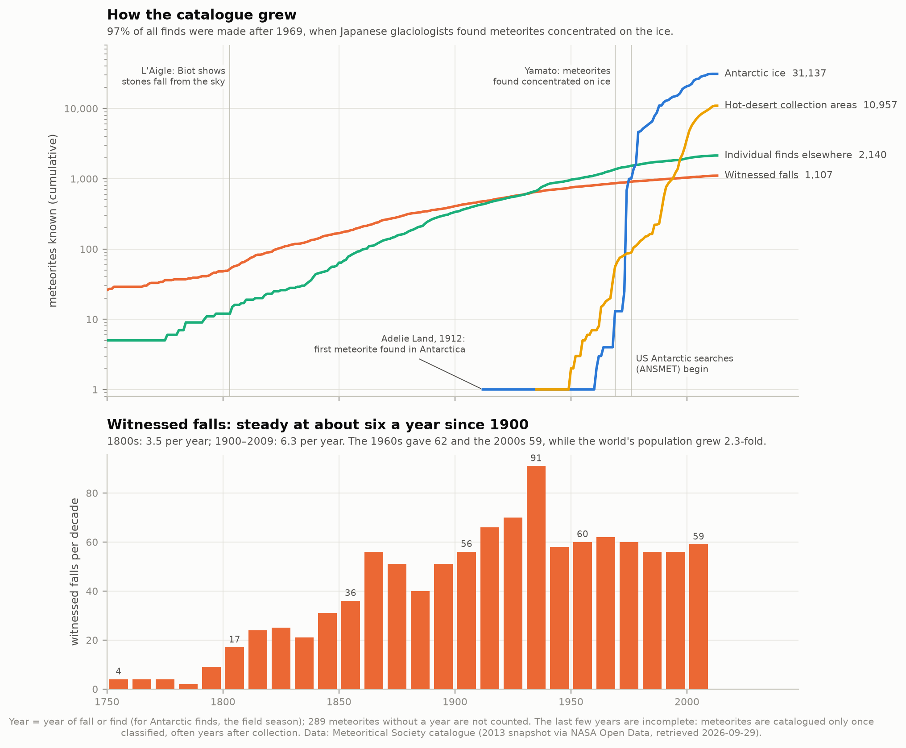

# G2 — Meteorite landings: where they fall, and where we find them

**Meteorites rain down on the whole Earth almost evenly. Why does the map of the 45,716 known
meteorites look nothing like that, and what do the differences tell us?**

Nearly all of the pattern is us. The map of known meteorites is a map of *where people have
looked*. It is not a map of where rocks fall. This project takes the Meteoritical Society's
catalogue and measures each way the looking distorts the sample:
- who was watching when a meteorite fell;
- where rocks survive long enough to be found, and stand out when they have;
- which rocks a passer-by or a dealer thinks are worth keeping;
- how far off the recovery rate is from what actually lands.

- **72% of all meteorites with a known find site come from Antarctica**, which is 8% of the world's
  land. Oman yields 9,900 finds per million km², 150 times the average for land outside Antarctica.
- **Only about 1 fall in 1,500 is ever recorded.** Camera networks show ~58 falls of ≥ 100 g per
  million km² per year. The catalogue records ~5 such falls a year worldwide.
- **Witnessed falls follow people.** Recovery grows as population density to the power
  **0.59** (95% range 0.44–0.75). It is 1 in 170 where more than 300 people live per km², and
  about 1 in 4,000 where fewer than 10 do.
- **Metal meteorites (irons and stony-irons) are 5% of what falls but 40% of what passers-by
  find**, and under 1% of what Antarctic teams find. This reproduces a published table (Evatt et al. 2016) from an
  independent snapshot of the data.
- **Dealers select, too**: 18% of desert meteorites bought through the trade, find site unknown,
  are rare achondrites. Among desert meteorites whose find site was recorded, it is 4%.



---

## What a meteorite is, and what "fell" and "found" mean

A **meteoroid** is a piece of rock or metal in space, almost always a fragment of an asteroid
(a few come from the Moon and Mars). When one hits the atmosphere at 11–70 km/s it heats and
glows as a **meteor**, or a **fireball** if it is bright. Most burn up. A body big and slow enough
loses its cosmic speed at a height of 10–30 km. Its surviving pieces then fall at the speed of a
dropped stone, and those are **meteorites**.

The catalogue labels every meteorite in one of two ways:
- **Fell**: someone saw or heard it come down and the stones were collected soon after.
  There are 1,107 of these.
- **Found**: it was picked up later, sometimes thousands of years after it landed.
  There are 44,534.

The distinction matters because falls are the only fair sample of what reaches the ground. A
find has been through two filters first: surviving on the ground, and being noticed.

**Names tell you how a meteorite was found.** Most meteorites are named after the place they
came down (Willamette, Allende). In a **dense collection area**, a patch of Antarctic ice or
desert that yields meteorites by the hundred, each gets the area's name plus a number instead:
- *Allan Hills 84001* was found in 1984 on the Allan Hills ice field. It is the Martian meteorite
  famous for its disputed microfossils.
- *Dhofar 019* is the 19th meteorite from Dhofar, Oman.

This project uses that convention to sort every find by *how* it was found: Antarctic ice,
hot-desert collection areas, or individual finds elsewhere.

**Families.** Meteorites come from bodies that either never melted or melted and separated:

| Family | What it is | Share of falls |
|---|---|---|
| Ordinary chondrites (H, L, LL) | Unmelted rock from small asteroids, full of millimetre beads (chondrules) | 80% |
| Carbonaceous chondrites | Primitive, carbon- and water-bearing; chemically the closest to the Sun's own composition | 4% |
| Enstatite and other chondrites | Unmelted rarities: enstatite chondrites formed with almost no oxygen, Rumuruti (R) chondrites with plenty | 2% |
| Achondrites | Melted rock, like lava or crust: pieces of Vesta, the Moon, Mars and others | 8% |
| Stony-irons | Metal and rock mixed: pallasites, mesosiderites | 1% |
| Irons | Iron-nickel metal, mostly from the cores of shattered asteroids | 5% |

The data give **466 distinct class labels** ("L6", "Iron, IIIAB", "Lunar (anorth)", ...).
`catalog.py` sorts each into one of these families, and `test_physics.py` checks 30 awkward
cases.

---

## Results

Everything below was measured by the code in this folder. All numbers are in
`data/results.json` after a run, and `python run.py` prints them.

### 1. Finds come from the ice and the deserts

Of the **30,797 finds with a known find site**, **22,096 (71.7%) are from Antarctica**. By this
project's Natural Earth outlines, Antarctica is 12.3 million km² of grounded ice and rock. That
is 8.4% of the world's land and 2.4% of the Earth's surface. Per unit area:

| Where | Finds per million km² |
|---|---|
| Oman | 9,918 |
| Antarctica (whole continent) | 1,803 |
| Libya | 901 |
| Chile (the Atacama) | 545 |
| United States | 160 |
| All land outside Antarctica | 65 |

Nineteen countries larger than 300,000 km² have yielded no find with a known site at all.
They include Kenya, Madagascar, Pakistan, Vietnam and the Democratic Republic of the Congo, and
they get as many meteorites per km² as Oman.

**The 209 dense collection areas** supply 95% of all 44,523 finds, and the ten richest alone
hold 64%. Yamato (7,269) is the biggest by far, then Northwest Africa (4,499), Queen
Alexandra Range (3,444) and Grove Mountains (2,494).



**Why Antarctica.** Meteorites that fall on the ice sheet are buried by snow and carried along
inside the flowing ice, sometimes for hundreds of thousands of years. Where mountains block the
flow, the ice is pushed upward, and dry winds strip it away by sublimation. The meteorites are
left stranded on bare blue ice: dark stones on a surface with no other stones. Japanese
glaciologists found the first such concentration in 1969, near the Yamato Mountains. US
searches (ANSMET) began in 1976, and 97% of all finds in the catalogue were made after 1969.
Antarctic teams collect everything, down to pebbles: their median meteorite weighs **14 g**,
and 43% weigh under 10 g.

**Why hot deserts.** Little rain means slow weathering, so stones survive. Meteorites from hot
deserts have lain on the surface for 12,000 years on average (Antarctic ones for 99,000). In the
hyper-arid Atacama the average is 710,000 years, and two stones are older than 2 million years
(Drouard et al. 2019). With no vegetation, a dark, fusion-crusted stone on pale sand or a
wind-swept gravel plain can be seen from a distance. Oman's collection areas (Dhofar, Jiddat al
Harasis, Sayh al Uhaymir) have yielded 3,000 stones since the late 1990s.

**Why the Sahara looks empty on the map.** The 4,499 "Northwest Africa" meteorites were bought
from dealers, mostly in Morocco, and only **199** come with a find site. The Sahara's true
share is far larger than its dots.

**The ocean**, 71% of the Earth, has given almost nothing. Only three meteorites in the
catalogue have positions far out at sea:
- **Eltanin**, a fragment of the asteroid that struck the Bellingshausen Sea 2.5 million years
  ago, recovered from seabed cores;
- **Clarion** and **Clipperton**, two small chondrites whose recorded positions lie in the open
  Pacific, in the Clarion–Clipperton zone of the deep seafloor.

### 2. Witnessed falls follow people

Camera networks watch the sky over large areas, work out where each bright fireball dropped its
stones, and so count falls regardless of whether anyone saw them. The Canadian network found
that each year, on every million km², about **58 falls** deliver at least 100 g of meteorites and
**9** deliver at least 1 kg (Halliday, Blackwell & Griffin 1989). The European Fireball Network
has since measured 48 (Borovička et al. 2022).

Over the 134 million km² of land outside Antarctica, that is **~7,800 falls of ≥ 100 g a year**.
The catalogue records **5.3 a year** (267 in 1960–2009). **Only 1 in about 1,500 is recorded.**
Counting the ocean, it is about 1 in 5,500: roughly 30,000 such falls land somewhere on Earth
each year. Put another way, any one km² receives a ≥ 100 g meteorite about once every 17,000
years.

The shortfall depends on where people are. Each recorded fall in 1960–2009 was assigned to the
country it landed in. Each country's record was then compared with what 58 per million km² per
year would have delivered to its area. The result was set against its population density
(World Bank, 1960–2009 average):

| People per km² | Countries | Falls recorded | Expected if all found | Recorded |
|---|---|---|---|---|
| < 3 | 10 | 20 | 74,269 | 1 in 3,700 |
| 3–10 | 21 | 20 | 99,770 | 1 in 5,000 |
| 10–30 | 38 | 57 | 114,470 | 1 in 2,000 |
| 30–100 | 75 | 71 | 51,298 | 1 in 720 |
| 100–300 | 42 | 82 | 46,864 | 1 in 570 |
| > 300 | 27 | 12 | 2,018 | 1 in 170 |

A Poisson fit over all 215 countries gives **recovery ∝ density^0.59** (bootstrap 95% range
0.44–0.75). Where 100 people live per km², 0.15% of falls are recorded. Recovery independent of
people is rejected overwhelmingly: the likelihood ratio is 175 for one extra parameter. It is
still 115 after allowing for the extra scatter between countries.



Some individual countries, 1960–2009:

| Country | Falls recorded | Recorded |
|---|---|---|
| Japan | 10 | 1 in 107 |
| India | 22 | 1 in 420 |
| China | 41 | 1 in 660 |
| United States | 27 | 1 in 1,000 |
| Canada, Australia, Brazil | 6–8 each | about 1 in 3,600 |
| Russia | 3 | 1 in 16,000 |
| DR Congo | none | 0 of ~6,700 expected |

**A twist in time.** Witnessed falls have held at about 6 a year since 1900. The 1960s gave 62
and the 2000s 59, while the world's population grew 2.3-fold (World Bank). In Europe, recorded
falls dropped from 18 per decade in 1900–1929 to 7 per decade in 1970–2009, even as its
population grew. So recovery
is not simply proportional to headcount. It depends on who is outdoors, whether they know what
a meteorite is, and whether someone passes the stone to a museum. One plausible reason for
Europe's decline is that far fewer Europeans now work in the fields, but these data cannot test
that.

### 3. What we miss, by size

Bigger falls are more likely to be recorded: brighter fireballs, louder sonic booms, bigger
stones.

| Falls delivering at least | Recorded per year | Landing per year on land | Recorded |
|---|---|---|---|
| 10 g | 5.6 | 11,000 (Halliday) – 30,000 (Drouard) | 1 in 2,000 – 5,300 |
| 100 g | 5.3 | 6,500 (Borovička) – 7,800 (Halliday) | 1 in 1,200 – 1,500 |
| 1 kg | 4.1 | 1,200 (Halliday) | 1 in 300 |

The desert estimate comes from dating the stones that piled up in the Atacama over 2 million
years (Drouard et al. 2019). It is 2.7 times the Canadian camera-network rate at 10 g. Drouard
et al. argue that the 11-year camera sample is the less representative of the two. Either
way, the gap is three orders of magnitude.



### 4. What falls vs. what is found

Witnessed falls show what actually reaches the ground: **80% ordinary chondrites, 8%
achondrites, 4% carbonaceous chondrites, 5% irons**. Every search method bends that mix its own
way:



**Irons.** Evatt et al. (2016) noticed that iron meteorites are rare in Antarctic collections.
They proposed that sunlight warms metal meteorites through the clear ice, so irons melt their
way down and stay hidden. This project rebuilds their table from the 2013 snapshot, 2½ years
older than the database they used:

| Iron + stony-iron share | This project (2013 snapshot) | Evatt et al. 2016 (Dec 2015) |
|---|---|---|
| LaPaz Icefield | 0.32% (5 / 1,547) | 0.30% (5 / 1,670) |
| Frontier Mountain | 0% (0 / 782) | 0% (0 / 798) |
| All Antarctic finds | 0.74% (229 / 31,137) | 0.68% (239 / 34,927) |
| Witnessed falls | 5.42% (60 / 1,107) | 5.47% (60 / 1,097) |
| Finds outside Antarctica | 7.9% (1,060 / 13,396) | 6.9% (1,145 / 16,650) |
| ↳ in hot-desert collection areas | 1.6% (183 / 11,208) | — |
| ↳ individual finds elsewhere | **40.2%** (876 / 2,178) | — |

The last two rows split the "finds outside Antarctica" row in two, a split the published table
doesn't make, and the split is the more striking result. Systematic desert searches are also
iron-poor. **Individual finds are 40% metal**, more than seven times the share among falls. An iron
meteorite is heavy, magnetic and unlike any ordinary rock, and it outlasts stones in wet
climates, so the farmer who turns one up keeps it. Plot only the irons on the interactive map,
and the farm belts of North America light up.

**The market.** Desert meteorites bought through dealers, find site unknown, are 18.1%
achondrites (95% CI 17.0–19.2%). Those from desert collection areas with a recorded find site are
4.3% (3.9–4.8%). A rare stone is worth
the cost of classification, and a common ordinary chondrite often is not. The trade also
supplies most of the exotic rocks:
- 87 of the 119 Martian meteorites and 130 of the 165 lunar meteorites came from hot deserts;
- only 5 Martian meteorites have ever been seen to fall, and no lunar one.

### 5. Masses: pebbles, boulders and iron giants

| Collection | Median mass (95% CI) | Middle half |
|---|---|---|
| Antarctic ice | 13.9 g (13.6–14.3) | 4 g – 50 g |
| Hot-desert collection areas | 201 g (194–210) | 68 g – 590 g |
| Witnessed falls | 2.8 kg (2.3–3.2) | 0.7 kg – 10 kg |
| Individual finds elsewhere | 4.7 kg (4.1–5.4) | 0.8 kg – 22 kg |

A trained search team walking blue ice picks up everything. A passer-by notices a boulder.
The ten heaviest meteorites are all irons, led by Hoba (Namibia, 60 t), Cape York (Greenland,
58 t) and Campo del Cielo (Argentina, 50 t). Irons are 2.3% of all meteorites but **85% of the
605 tonnes** in the catalogue, and the ten heaviest alone are 57%. The heaviest stone is the
H5 chondrite Jilin (China, 4 t), which fell in 1976.



### 6. How the catalogue grew



Falls and individual finds accumulated at a steady pace for two centuries. Then Antarctic
collections took off after 1969, and hot-desert collections in the 1990s. The busiest year was
2003, with 3,311 finds.

The oldest witnessed fall in the catalogue is **Nogata**: 472 g, seen to fall in Japan in 861.
Others among the oldest are the **Elbogen** iron (about 1400) and **Ensisheim**, which fell in
Alsace in November 1492. The first meteorite found in Antarctica was **Adelie Land**, found in 1912 by
Mawson's expedition.

---

## Interactive map

`figures/meteorite_map.html` is a self-contained page: plotly.js and all the data are embedded,
so it works offline and can be shared as a single file. It shows all 31,893 located meteorites
on the same equal-area map as the static figures:
- **hover** for each one's name, class, mass, year and country;
- **filter** by how it was found, by family (down to lunar, Martian and Vesta meteorites), by
  mass and by year;
- **search** for a meteorite by name.

A table below the map counts whatever is currently shown. The page follows the reader's
light/dark setting.

---

## The data, and what was repaired

| Source | What | Retrieved | SHA-256 |
|---|---|---|---|
| NASA Open Data Portal, [Meteorite Landings](https://data.nasa.gov/dataset/meteorite-landings) | The Meteoritical Society's catalogue, 2013 snapshot: 45,716 rows | 2026-09-29 | `5b4c6a35…` |
| [Natural Earth](https://www.naturalearthdata.com/) v5.1.2 admin-0 countries, 1:50m and 1:110m | Country outlines (public domain) | 2026-09-29 | `3e458fc0…`, `6866c877…` |
| World Bank WDI, [SP.POP.TOTL](https://data.worldbank.org/indicator/SP.POP.TOTL) | Population by country, 1960–2009 (CC BY 4.0) | 2026-09-29 | `31e31c29…` |

NASA rebuilt its portal in 2025, so the old links (`data.nasa.gov/resource/gh4g-9sfh`) are
dead. `fetch_data.py` uses the file's new address and warns if its checksum ever changes. The
live [Meteoritical Bulletin Database](https://www.lpi.usra.edu/meteor/) is much larger today:
3,646 meteorites were approved in 2024 and 1,944 in 2025 alone. It sits behind a browser check
that scripts cannot pass, so the NASA snapshot is the freely downloadable version.

The file needed cleaning before any map or statistic meant anything. Every repair is counted in
`data/results.json`:

- **Placeholders for "unknown".** 7,315 rows have no coordinates. 6,214 more sit at exactly
  (0°, 0°), a dummy position rather than meteorites in the Gulf of Guinea. Plotted naively, they
  make a phantom collection area off West Africa.
- **An Antarctic collection area in Kenya.** 223 Yamato meteorites have their latitude zeroed:
  (0°, 35.67° E) instead of (71.5° S, 35.67° E). They would appear on the equator in Kenya.
  They are treated as unlocated.
- **A meteorite found on Mars.** *Meridiani Planum*, an iron found by the Opportunity rover in
  2005, has Martian coordinates. It is kept out of every Earth statistic.
- **Every year before 1583 is one too small.** Ensisheim, which fell in November 1492, is listed
  as 1491; Nogata (861) as 860. This is what happens when 1 January is stored in the modern
  (Gregorian) calendar and read back in the Julian calendar, which applies before the October
  1582 reform, as Java and many databases do. Before the reform the two calendars differ by
  4–10 days, which pushes 1 January back into the previous year. `test_physics.py` does the
  calendar arithmetic and confirms that all 8 affected years match exactly, and that the shift
  stops at the reform. The years are corrected.
- **A typo.** *Northwest Africa 7701* is dated 2101; its year is treated as unknown.
- **Antarctic areas without any coordinates.** Eleven Antarctic search areas (Larkman Nunatak,
  Roberts Massif, ...; 1,137 meteorites) have no position in the file. Antarctic meteorites are
  numbered by field season plus serial (Allan Hills 84001 was collected in 1984), while desert
  areas count 001, 002, .... That pattern identifies these 11 areas as Antarctic. It was tested on the meteorites
  that do have coordinates: all **21,919** that follow it lie in Antarctica, with no exceptions.
- **Coasts.** 44 located meteorites fall just offshore against the 1:50m coastline, so they are
  snapped to the nearest country within 25 km. Six remain at sea: the three genuine seafloor
  finds and three with coarse coordinates.

---

## Caveats

- **The catalogue is a 2013 snapshot.** Tens of thousands of meteorites have been approved
  since, many from the Sahara, Oman, the Atacama and Antarctica. The *patterns* here are
  robust, but the counts are not current.
- **Counts are of stones, not of falls.** One Antarctic or desert shower can scatter hundreds of
  stones, each catalogued separately ("pairing"). Collections of finds are therefore lumpier
  than their counts suggest, and their family shares carry more uncertainty than the binomial
  intervals quoted. Witnessed falls do not have this problem: each fall is one entry.
- **Coordinates vary in quality.** Antarctic meteorites often carry their collection area's
  coordinates, so thousands share a point. Some old falls are placed only roughly.
- **Country assignment** uses 1:50m borders, good to a few km. A meteorite close to a border
  can land in the neighbour, as the Carancas fall of 2007 does: it is placed in Bolivia, a few
  km from where it actually fell in Peru.
- **The witness test is country-level.** An average density hides where people live. Most
  Egyptians live along the Nile, not in the desert that makes up most of the country. The
  population used is the 1960–2009 average; the reference flux is Halliday et al.'s 58 per
  million km² per year. Falls are counted by *recovered* mass. That is a lower limit on what
  fell, so recovery rates are, if anything, slightly underestimated.
- **The flux itself is uncertain** by a factor of 2–3 between methods (§3). All the "1 in N"
  numbers scale with it; the density trend does not.
- **Environment labels come from naming.** "Hot-desert collection areas" are the areas that
  number their meteorites; "individual finds" are everything with a name of its own. A few
  individually named finds are from deserts too, such as the Nullarbor irons.

---

## How to run

```bash
cd astrophysics
source .venv/bin/activate       # numpy, scipy, pandas, matplotlib, plotly, requests
cd 14-meteorite-landings
python run.py                   # fetch (once, ~10 MB) -> analysis -> figures -> summary
python test_physics.py          # 43 self-checks: projections, areas, parsing, calendar, stats
```

The run takes about 25 seconds. Once `data/` is populated everything runs offline. No mapping
library is needed: the equal-area projections are implemented and tested in `geo.py`.

| File | What it does |
|---|---|
| `config.py` | Paths, pinned sources, every tunable choice and every literature value compared against |
| `fetch_data.py` | Downloads and caches the three sources; writes `data/manifest.json` |
| `geo.py` | Equal Earth and polar equal-area projections, areas on the sphere, point-in-country |
| `catalog.py` | Loads the catalogue, repairs and flags it, sorts meteorites into families and environments |
| `analysis.py` | Every measurement; writes `data/results.json` |
| `figures.py` | The seven static figures (PNG + SVG) |
| `interactive.py` | `figures/meteorite_map.html` |
| `plotstyle.py` | Shared colour-blind-safe style |
| `run.py` | Runs everything and prints the summary |
| `test_physics.py` | Self-checks against analytic and published values |

## References

- The Meteoritical Society, *Meteoritical Bulletin Database*, https://www.lpi.usra.edu/meteor/
  (2013 snapshot via the NASA Open Data Portal).
- Halliday, I., Blackwell, A. T. & Griffin, A. A. 1989, *The flux of meteorites on the Earth's
  surface*, Meteoritics 24, 173.
- Borovička, J. et al. 2022, *Data on 824 fireballs observed by the digital cameras of the
  European Fireball Network in 2017–2018. II.*, A&A 667, A158.
- Borovička, J., Spurný, P. & Brown, P. 2015, *Small near-Earth asteroids as a source of
  meteorites*, in Asteroids IV (Univ. of Arizona Press).
- Drouard, A. et al. 2019, *The meteorite flux of the last 2 Myr recorded in the Atacama
  desert*, Geology 47, 673.
- Evatt, G. W. et al. 2016, *A potential hidden layer of meteorites below the ice surface of
  Antarctica*, Nature Communications 7, 10679.
- Šavrič, B., Patterson, T. & Jenny, B. 2019, *The Equal Earth map projection*, Int. J.
  Geographical Information Science 33, 454.
- Natural Earth, https://www.naturalearthdata.com/ (public domain).
- World Bank, World Development Indicators, SP.POP.TOTL (CC BY 4.0).
- The Meteoritical Society news: 3,646 meteorites approved in 2024 and 1,944 in 2025
  (meteoritical.org).
