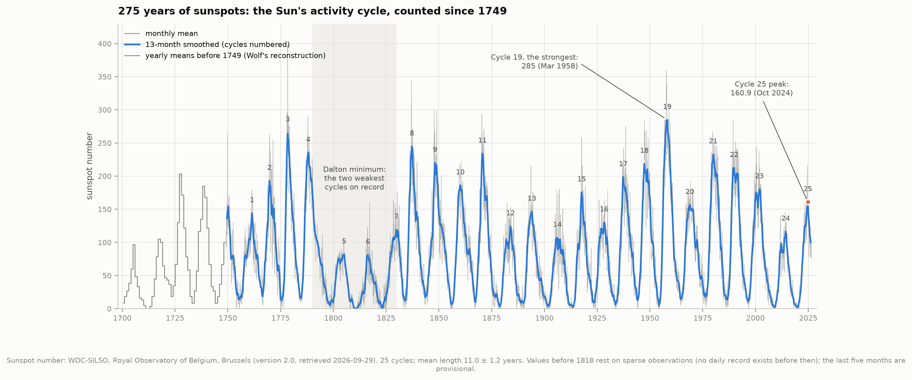
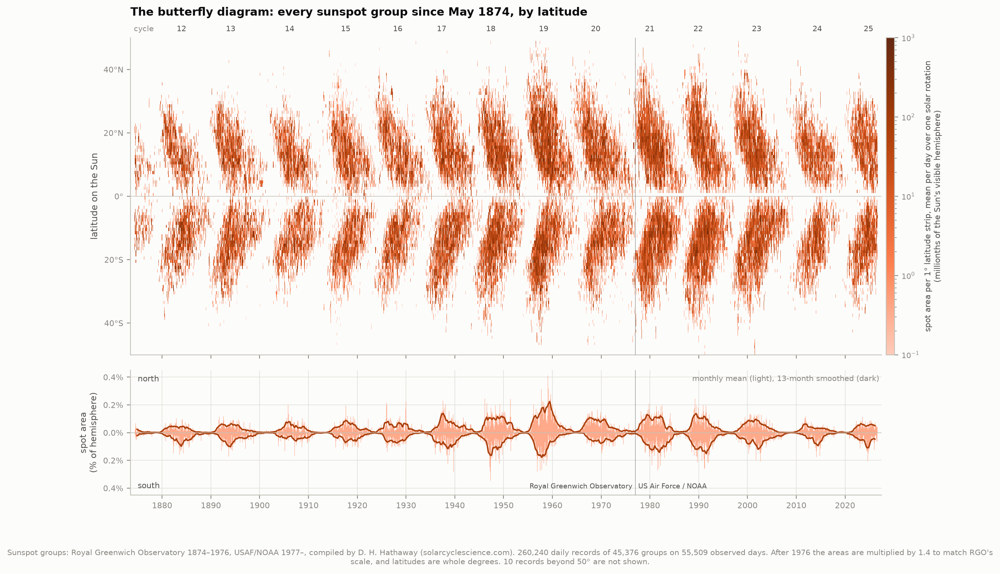
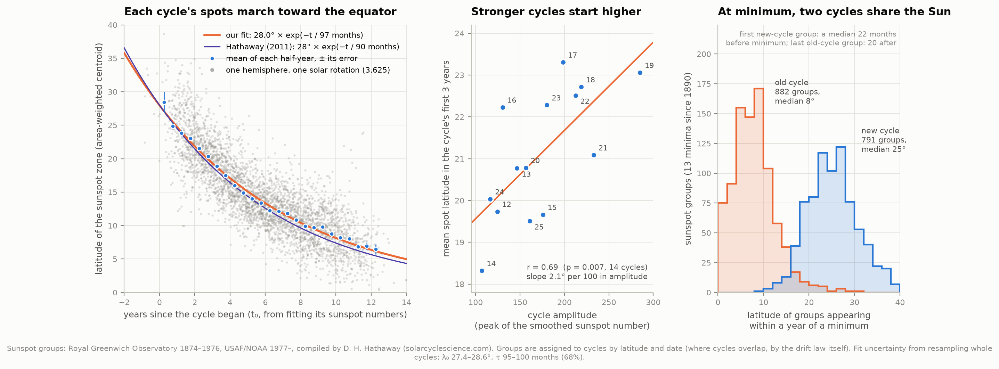
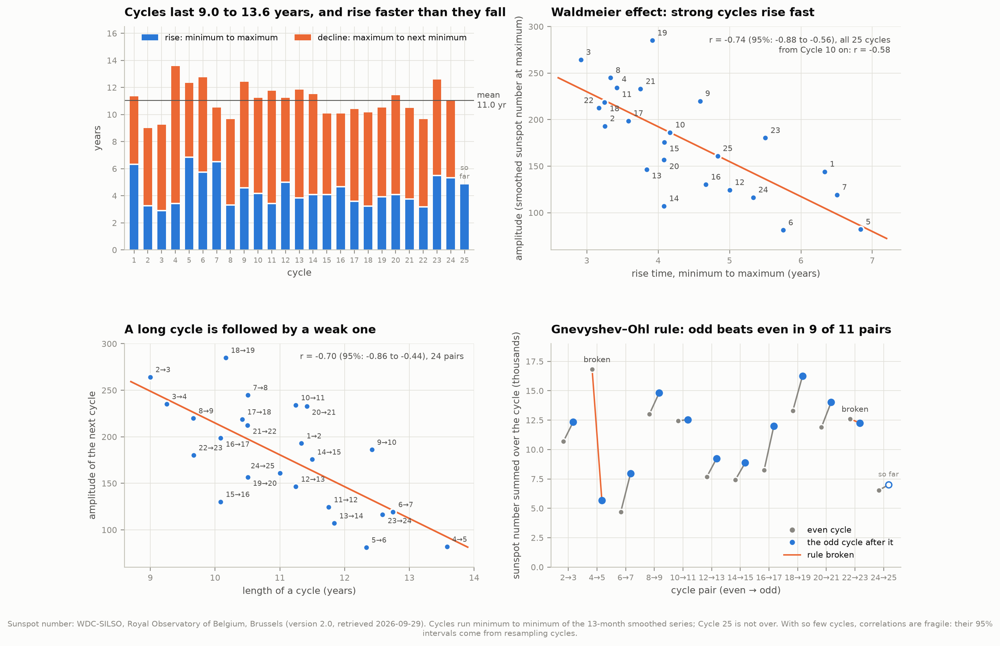
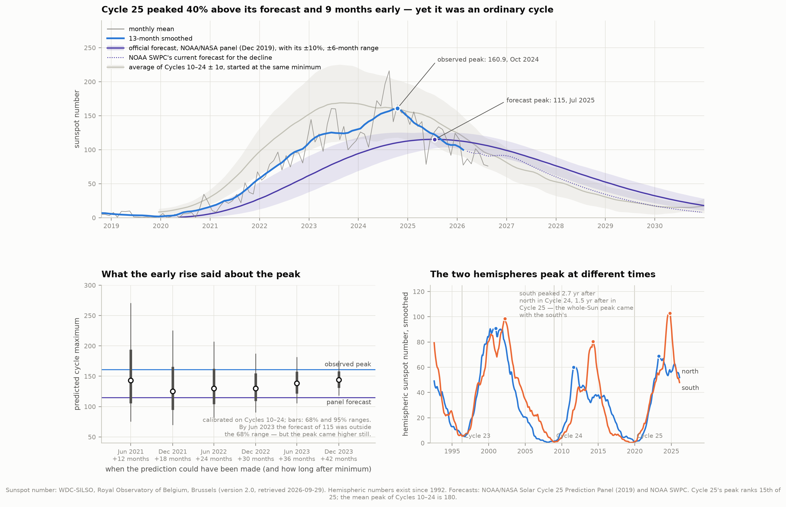
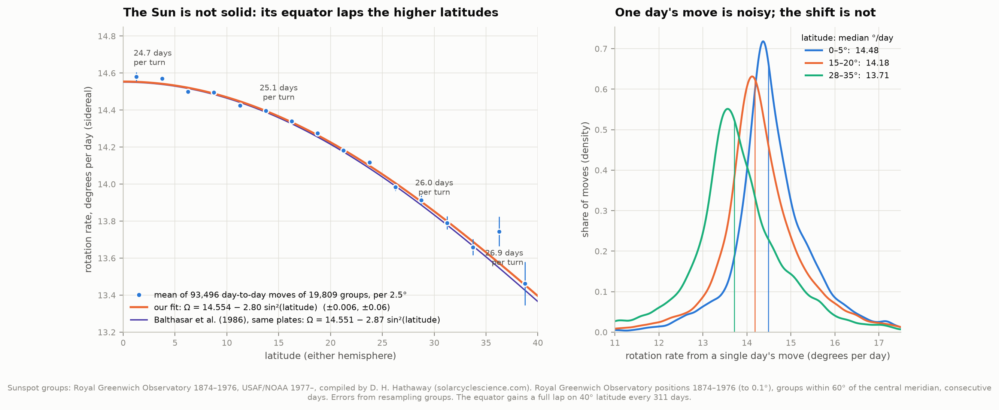
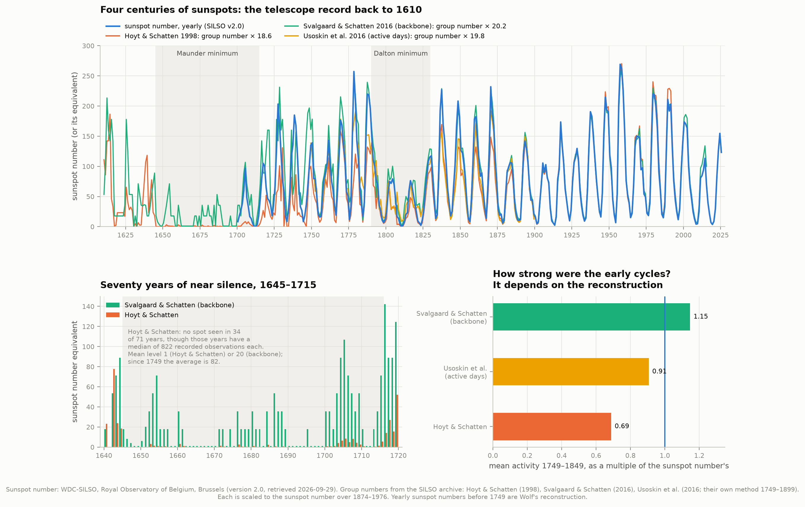

# F1 — 275 years of solar cycles, and the butterfly diagram

**The Sun's activity rises and falls about every 11 years. What does the longest-running
experiment in astrophysics — counting sunspots, every day, since before the French Revolution —
actually show?**

It shows a cycle whose pattern is fixed but whose size is not. This project takes the
international sunspot number from 1749 to August 2026, plus the position and size of every
sunspot group photographed since May 1874: 260,240 daily records of 45,376 groups. It finds the
25 cycles itself and measures what they share.

No two cycles are alike. They last from 9.0 to 13.6 years (11.0 on average) and peak anywhere
from 81 to 285. Yet the *spots* of every cycle take the same path across the Sun. They appear
near 28° latitude and slide toward the equator, slowing as they go (the zone's latitude falls by
a factor of e every 8 years). Meanwhile the next cycle's first spots are already appearing at high
latitude. The same records show the Sun turning faster at its equator than at 30°, by more than a
day per rotation.

The current cycle, 25, peaked at 160.9 in October 2024. That is 40% above the official forecast
and 9 months early. Yet by the standards of the whole record it is an ordinary cycle, 15th of 25.

Wherever a result reproduces a published one, the two are compared at the end, under
[Graded against the literature](#graded-against-the-literature).



---

## What is being counted

A **sunspot** is a patch of the Sun's surface where the magnetic field is thousands of times
stronger than Earth's (about 3,000 gauss). The field chokes off the convection that carries heat
up from below, so the spot is cooler than its surroundings: about 3,800 K against 5,800 K. It
looks dark only by contrast. Spots come in **groups**, usually a pair of opposite magnetic
polarity where a bundle of field lines breaks through the surface.

The **sunspot number** is the index Rudolf Wolf invented in 1848:
`R = k (10 g + s)`, where g counts groups, s counts individual spots, and k scales each observer
to a common standard. The factor 10 makes a new group count as much as ten extra spots within an
existing one. Today about 80 stations send their counts to the World Data Center SILSO at the
Royal Observatory of Belgium, which took the series over from Zürich in 1981. In 2015 the whole
series was recalibrated (version 2.0). The recalibration removed an old scaling factor of 0.6 and
corrected a 1947 jump and a later drift at the pilot station. That is why today's values are
about 1.4 to 1.7 times those in older books.

Monthly means are noisy, so cycles are timed on the **13-month smoothed** series. Each value
averages the 13 months centred on it, with the two end months at half weight. The official
minimum and maximum of every cycle are the lowest and highest points of this curve.

The cycle was discovered by Heinrich Schwabe, an amateur astronomer, in 1843. It is only half the
story. In 1908 George Ellery Hale found that sunspots are magnetic, and by 1919 he had found that
the leading spot of every pair flips polarity from one cycle to the next. The full magnetic cycle
therefore lasts about 22 years. A sunspot count does not record polarity, so it sees only the 11.

From 1874 to 1976 the Royal Greenwich Observatory measured the position and area of every
sunspot group on daily photographs of the Sun. From 1977 the US Air Force's solar observing
network did the same, with the data kept by NOAA. David Hathaway put both into one format, one
file per year. That is the raw material for the **butterfly diagram**, first drawn by Annie and
Walter Maunder in 1904.

---

## Results

Everything below was measured by the code in this folder from data retrieved on 2026-09-29. All
numbers are in `data/results.json` after a run.

### 25 cycles, no two alike

| | |
|---|---|
| Cycles | 25, from the minimum of 1755 (Cycle 1) to that of December 2019 (Cycle 25) |
| Length, minimum to minimum | **11.03 ± 1.18 years**; shortest 9.0 (Cycle 2), longest 13.6 (Cycle 4) |
| Shape | rise **4.4** years on average, decline **6.7**: cycles go up faster than they come down |
| Peak (smoothed) | from **81** (Cycle 6, 1816) to **285** (Cycle 19, March 1958); mean 178 |
| Dalton minimum | Cycles 5–7 (1798–1833) averaged a peak of 94, against 189 for all the others |
| Power spectrum | one peak, at **10.99 years**; half power at 10.65–11.43 years |

The code finds the cycles itself, and its answer matches SILSO's official table:

- Our 13-month smoothing reproduces SILSO's published smoothed series to within **0.05** over
  3,320 months, the size of their rounding to 0.1.
- All **25 maxima** fall in the same month with the same value.
- **23 of 25 minima** match. The other two are ties:
  - In 1810 the smoothed number sits at exactly 0.0 for nine months. We take the middle month
    (August); SILSO lists July.
  - In 1996, May (11.17) and August (11.20) differ by 0.03. We take the lower; SILSO keeps its
    long-standing August date.

**Spotless days.** A day with no spots on the Sun at all is rare at maximum and common at
minimum. Counting the days with a sunspot number of zero between one maximum and the next:

| Minimum | Spotless days | Longest unbroken run |
|---|---|---|
| 1878 | 1,028 | 54 days |
| 1913 | 1,023 | **92 days** |
| 1902 | 934 | 69 days |
| **2019** | **848** | 40 days |
| **2008** | **817** | 32 days |
| 1964–1996 (four minima) | 227 to 309 each | 15 to 42 days |

The two most recent minima were the most spotless since 1913. The table covers the 15 minima
since 1867; the windows around earlier ones reach back before 1849, when too many days went
unobserved (see [Honest notes](#honest-notes-on-the-numbers)).

### The butterfly diagram



Each vertical strip is one solar rotation (27.3 days). Colour shows how much spot area sat at each
latitude. Every cycle draws a pair of wings, one per hemisphere. They begin at mid-latitudes and
close in on the equator, and the next pair is already opening before the last one closes.

Sunspots live in two belts:
- **99%** of all spot area lies within 33° of the equator.
- Only **4%** lies within 5° of it, and only **0.11%** beyond 40°.
- Half the spot area is within 14.5°.
- The highest group on record was a speck of 6 millionths of a hemisphere at **59.7°N**, in
  October 1915.

The parsing was checked against Hathaway's own derived file, which uses his 1.4 factor for the
USAF/NOAA areas. Our daily spot areas are **identical on all 55,509 observed days**. The 123 days
we find missing from the Greenwich record are exactly the 123 he lists.

### The march toward the equator



Every group is assigned to its cycle (see [How it works](#how-it-works)). For each hemisphere and
each rotation we then take the area-weighted mean latitude of that cycle's spots. That gives
3,625 points for Cycles 12–25, each a snapshot of where one wing sits. Against time since the
cycle began, they all fall on one curve:

| | λ₀, latitude at the start | τ, e-folding time |
|---|---|---|
| This project, Cycles 12–25 | **28.0°** (68%: 27.4–28.6) | **97 months** (68%: 95–100) |
| — fitting only each cycle's first 9 years | 28.3° | 94 months |
| — Cycles 12–23 with Hathaway's own start times | 27.0° | 96 months |
| — with the cycle minimum as the clock | 26.1° | 98 months |
| Hathaway (2011), Cycles 12–23 | 28° | 90 months |

The law is λ = λ₀ · exp(−t/τ). A wing starts at 28° and reaches 10° about 8 years later. The
uncertainties come from resampling whole cycles, because cycle-to-cycle differences, not
measurement noise, dominate. The typical scatter of a single rotation's point about the curve is
3.3°.

The start latitude matches Hathaway's. Our e-folding time is 7% longer, mostly because of the
last years of each cycle: late spots sit slightly higher than a pure exponential allows. Leaving
those years out brings τ to 94 months.

**Stronger cycles start higher.** Hathaway (2011) concluded that the path is identical for every
cycle once each is timed from its fitted start. We find the *shape* of the path universal but not
its *height*. In a cycle's first three years, its spots' mean latitude rises with its amplitude,
by 2.1° per 100 in peak sunspot number (**r = 0.69, p = 0.007**, 14 cycles). Weak Cycle 14 (peak
107) started at 18.3°; Cycles 17 and 19 (peaks 199 and 285) started at 23.3° and 23.1°.

The correlation holds whichever clock is used (r = 0.70–0.73). With Hathaway's own start times it
weakens to r = 0.58 (p = 0.05). Solanki, Wenzler & Schmitt (2008) found the same relation, with
p = 0.0054, from Greenwich data extended with other observatories.

**At minimum, two cycles share the Sun.** In the year either side of each of the 13 minima since
1890 there are 790 new-cycle groups at a median latitude of 25°, and 882 old-cycle groups at 8°.
The two populations barely overlap. The first new-cycle group appears a median **22 months before**
the minimum (range 11–39). The last old-cycle group is seen a median **20 months after** it
(range 4–30).

### The rules of the cycle



Solar physicists have long used a handful of statistical rules to guess a cycle's size. Measured
on all 25 cycles (95% intervals from resampling cycles):

| Rule | Measured | Verdict |
|---|---|---|
| **Waldmeier effect**: strong cycles rise fast | r = −0.74 (−0.88 to −0.56), all 25 cycles; −0.58 from Cycle 10 on; only −0.39 (p = 0.05) if rise time runs from 20% to 80% of the peak | real, but sensitive to how "rise" is defined |
| **Early activity foretells the peak** | smoothed number 2 years after minimum against the peak: r = **+0.84** (+0.69 to +0.93) | the robust form of Waldmeier's rule (Cameron & Schüssler 2008) |
| **A long cycle is followed by a weak one** | r = **−0.70** (−0.86 to −0.44), 24 pairs | holds |
| The level at minimum foretells the peak | r = +0.55 (+0.24 to +0.79) | weak |
| **Gnevyshev–Ohl rule**: summed over a whole cycle, each odd cycle beats the even one before it | holds for **9 of 11** complete pairs; broken by 4→5 and 22→23, the two exceptions usually cited. Cycle 25 has already outdone Cycle 24 (7,005 against 6,529). | holds, with two exceptions |

These rules rest on 24 complete cycles, and the first nine come from sparse observations, so any
single correlation is fragile. That is why the intervals are wide.

### Cycle 25 against its forecast



In December 2019 the NOAA/NASA Solar Cycle 25 Prediction Panel forecast the minimum for April
2020 (±6 months). It forecast a peak of **115** (range 105–125) in **July 2025** (±8 months): "a
cycle similar to Cycle 24".

| | Forecast (2019) | Observed | |
|---|---|---|---|
| Minimum | April 2020 ± 6 months | **December 2019** (1.8) | 4 months early, inside the range |
| Peak | 115 (105–125), July 2025 ± 8 months | **160.9, October 2024** | 40% higher, 9 months early: outside both ranges |

SILSO announced the maximum as 160.9 in October 2024, and our smoothing reproduces it exactly.
Since then the smoothed number has fallen 38%, to 99.8 in February 2026, so the maximum is
settled.

Cycle 25 was 1.38 times Cycle 24 and 0.89 times Cycle 23. It only looks strong next to the weak
Cycle 24 and the forecast. Across the whole record it ranks **15th of 25**, and the average peak of
Cycles 10–24 is 180.

**What the early rise said.** The early-activity rule above can be turned into a forecast that
updates as the cycle grows. The peak is predicted from the smoothed number some months after
minimum, calibrated on Cycles 10–24. Each prediction is dated when it could actually have been
made, 6 months after the month it uses, because smoothing needs 6 months of data on either side:

| Data available by | Months after minimum | Predicted peak | 68% range | 95% range |
|---|---|---|---|---|
| Jun 2021 | 12 | 143 | 105–194 | 76–271 |
| Dec 2021 | 18 | 125 | 95–166 | 70–226 |
| Jun 2022 | 24 | 130 | 104–162 | 82–207 |
| Dec 2022 | 30 | 130 | 109–155 | 90–188 |
| Jun 2023 | 36 | 138 | **121–158** | 105–182 |
| Dec 2023 | 42 | 144 | 131–158 | **118–176** |

By mid-2023 the rise had pushed 115 out of the 68% range, and by the end of 2023 out of the 95%
range. But the same method fell short of 160.9: the cycle kept climbing longer than its early
pace implied.

**Why: the two hemispheres.** SILSO also counts each hemisphere separately (since 1992). In Cycle
25 the north peaked in April 2023 (69) and the south in October 2024 (103), 1.5 years later. The
whole-Sun maximum came with the south's. In Cycle 24 the gap was 2.7 years (north August 2011,
south April 2014), which gave it a double peak. The spot areas show this is normal. Since 1874,
the two hemispheres' peaks have been a mean of 1.5 years apart (up to 2.5), with the south peaking
later in 10 of 14 cycles.

### The Sun is not a solid ball



Sunspots are markers carried on a rotating ball of plasma. Following each Greenwich group from one
day to the next gives its rotation rate. This uses 93,496 day-to-day moves of 19,809 groups, all
within 60° of the disc centre, where positions are best:

| | A (equator) | B (latitude term) |
|---|---|---|
| This project: Ω = A + B sin²(latitude), °/day | **14.554 ± 0.006** | **−2.80 ± 0.06** |
| Balthasar, Vázquez & Wöhl (1986), the same Greenwich plates | 14.551 | −2.87 |

The two agree to within the errors, which come from resampling whole groups.

| Latitude | One turn, relative to the stars | One turn, as seen from Earth |
|---|---|---|
| 0° (equator) | **24.7 days** | 26.5 days |
| 15° | 25.1 days | 26.9 days |
| 30° | **26.0 days** | 28.0 days |
| 40° | 26.9 days | 29.0 days |

As seen from the orbiting Earth, a turn takes longer, because the Earth moves around the Sun in
the same direction the Sun spins. The equator gains a full lap on latitude 40° every **311 days**.
This winding up of the magnetic field, year after year, is thought to be one of the engines of the
solar cycle itself.

Choices of method move the answer slightly. Changing the disc-centre limit between 30° and 75°
moves A by up to 0.02 and B by up to 0.06. Fitting the median move instead of the mean lowers A
by 0.08, because single moves have a skewed distribution. Balthasar et al. used means, as we do.

### Before 1749: four centuries and the Maunder minimum



Before 1749 there are no daily spot counts, only records of which days spots were seen and how
many groups. Four published reconstructions of the **group number** reach back to Galileo's era.
Each is scaled here to the sunspot number where they overlap in 1874–1976, by a single factor
between 17.6 and 20.2.

**The Maunder minimum (1645–1715) was real.** Hoyt & Schatten's compilation records no spot at all
in **34 of the 71 years**, although those blank years have a median of **822 recorded
observations** each. The Sun was watched, and it was blank. The reconstructions agree that this
was the quietest stretch in 400 years. They disagree about *how* quiet by a factor of 20. The mean
level is 1 in Hoyt & Schatten's reconstruction and 20 in Svalgaard & Schatten's "backbone" one,
against 82 on average since 1749.

**How big were the early cycles?** Averaged over 1749–1849, the reconstructions put solar activity
at 0.69 (Hoyt & Schatten), 0.91 (Usoskin et al.) and 1.15 (Svalgaard & Schatten) times the
sunspot number's own level. SILSO groups them into two families: series with a rising trend from
the 18th to the 20th century, and series without one. Whether the 20th century was unusually
active ("the Modern Maximum") depends on which family is right. It is still debated.

---

## Graded against the literature

| Quantity | This project | Published | Source |
|---|---|---|---|
| 13-month smoothed sunspot number | within 0.05 over 3,320 months | SILSO's values, rounded to 0.1 | WDC-SILSO |
| Cycle maxima, month and value | 25 of 25 identical | — | SILSO cycle table |
| Cycle minima, month | 23 of 25 identical (two ties) | — | SILSO cycle table |
| Cycle 25 maximum | 160.9, October 2024 | 160.9, October 2024 | SILSO announcement |
| Daily spot area 1874–2026 | identical on 55,509 of 55,509 days | — | Hathaway's derived file |
| Unobserved days in the Greenwich record | 123 | 123 | Hathaway's list |
| Drift law, start latitude λ₀ | 28.0° (27.4–28.6) | 28° | Hathaway 2011 |
| Drift law, e-folding time τ | 97 months (95–100); 94 without the last years | 90 months | Hathaway 2011 |
| Fitted cycle start times | 4.4 ± 1.6 months earlier | Table 1, version-1 sunspot numbers | Hathaway 2011 |
| Stronger cycles, higher spot latitudes | yes: r = 0.69, p = 0.007 | yes, p = 0.0054 / no dependence | Solanki et al. 2008 / Hathaway 2011 |
| Equatorial rotation A | 14.554 ± 0.006 °/day | 14.551 | Balthasar et al. 1986 |
| Latitude term B | −2.80 ± 0.06 °/day | −2.87 | Balthasar et al. 1986 |
| USAF/NOAA area shortfall | 1.33× (1.27–1.38); 1.49× for 1977–81 | 1.4; 1.43–1.49 | Hathaway; Balmaceda et al. 2009 |
| Gnevyshev–Ohl exceptions | pairs 4→5 and 22→23 | pairs 4→5 and 22→23 | standard |
| Hoyt & Schatten scale to sunspot number | 18.6 | 12.08 / 0.6 = 20.1 | Hoyt & Schatten 1998, version 2 conversion |

The Hoyt & Schatten scale lands 8% below the nominal conversion. That is expected: version 2.0 was
not a pure ×1/0.6 rescaling of version 1. It also lowered the values after 1947 relative to earlier
ones (the "Waldmeier jump" correction), and the calibration window spans both.

---

## How it works

1. **`fetch_data.py`** downloads everything once into `data/`:
   - SILSO's six sunspot-number files, checked against the SHA-256 hashes SILSO publishes for them
   - SILSO's cycle table and the four group-number reconstructions
   - the 153 yearly group files 1874–2026, plus Hathaway's documentation and derived files, which
     are used only as an answer key
   - NOAA SWPC's forecast files

   `data/manifest.json` records the URL, size, hash and retrieval time of every file.
2. **Cycles.** The monthly means are smoothed with SILSO's own 13-month filter. Minima are troughs
   at least 7 years apart and 10 units deep (`scipy.signal.find_peaks`). Each maximum is the
   highest point between two minima.
3. **Cycle start times.** Each cycle's monthly numbers are fitted with the cycle shape of Hathaway,
   Wilson & Reichmann (1994), `F(t) = Rmax · 2x³ / (exp(x²) − 0.71)` with `x = (t − t₀)/b` and
   the width b tied to the amplitude. The fitted t₀, usually a few months before the minimum, is
   the clock the zone drift is measured on.
4. **Spot records** (`groups.py`) are parsed from the fixed-width files. Two conventions matter. A
   day with no record was observed and spotless. A day with an all-zero record was not observed.
5. **Assigning groups to cycles.** Near a minimum the old cycle's low-latitude spots and the new
   cycle's high-latitude spots coexist. Each group goes to the cycle under which it is most
   probable. That probability is the cycle's activity at that date (from its fitted shape) times a
   Gaussian in latitude around the cycle's drift-law latitude. The law is then refitted and the
   assignment repeated. It converges in three rounds and does not depend on the starting law.
6. **Drift law.** For each cycle, hemisphere and Carrington rotation, the area-weighted mean
   latitude is computed, keeping rotations with at least 100 millionths of a hemisphere summed over
   their days. λ₀ exp(−t/τ) is fitted to all of them, with errors from resampling whole cycles.
7. **Rotation.** Consecutive-day sightings of the same Greenwich group (0.5–1.5 days apart, within
   60° of the central meridian) give a drift in Carrington longitude. Adding the Carrington frame's
   own rate, 360°/25.38 days = 14.184°/day, gives the true (sidereal) rate. Moves faster than
   5°/day are misidentifications (0.5% of pairs). A + B sin²(latitude) is fitted to all moves,
   with errors from resampling groups.
8. **Hindcast.** For each lead time, log(peak) is fitted against log(smoothed number L months after
   minimum) across Cycles 10–24. Cycle 25 is then predicted with a t-distribution prediction
   interval. `test_physics.py` confirms by simulation that its 68% intervals cover 68% of new
   cycles.
9. **The 1977 seam** is measured in monthly means (months with a sunspot number above 20). The fit
   is log(area) = a + b·log(sunspot number) plus a step after 1976, over 1965–1988, with errors
   from resampling whole years.

---

## Honest notes on the numbers

- **The sunspot number is a construct, and it has been revised.** Version 2.0 (2015) changed the
  values by up to tens of percent in places. Before 1818 there are no daily values at all. From
  1818 to 1848, between 41% and 97% of days were observed each year. SILSO's last five months are
  provisional and may shift slightly as late reports arrive.
- **The 1977 seam.** At equal sunspot number the USAF/NOAA areas are 1.33 times smaller than
  Greenwich's (68%: 1.27–1.38). The shortfall is 1.49× for 1977–81 alone, matching Balmaceda et
  al., and 1.22× after 1982. Neither side of the seam is perfectly flat (figure 08). The figures
  use Hathaway's standard factor of 1.4. Latitudes after 1977 are whole degrees, which makes fine
  horizontal striping in the butterfly but does not affect the centroids.
- **Assigning spots to cycles is a model.** It only matters within a few years of each minimum,
  but it feeds the drift law's late points. τ ranges over 94–98 months depending on which choices
  are made (table above). Our start times also run about 4 months earlier than Hathaway's, which
  moves λ₀ by about 1°.
- **The disagreement with Hathaway (2011)** about cycle strength is a disagreement about a
  correlation measured on 12–14 cycles. It is significant at p = 0.007 with our start times and
  borderline (p = 0.05) with his, and it agrees with Solanki et al. (2008). It is not settled by
  data this sparse.
- **The hindcast is a hindcast.** It uses information that did not exist when the panel made its
  forecast at minimum: the minimum's date itself was only confirmed months later. Its
  calibration rests on 15 cycles. It shows what the rise was saying, not what anyone could have
  forecast in 2019.
- **Before 1749**, reconstructions differ 20-fold on the depth of the Maunder minimum and by ±25%
  on the size of the 18th-century cycles. The figures show three of them rather than choose one.
- **Spots are a proxy.** The sunspot number and spot areas track the Sun's magnetic activity, not
  its total brightness. Over a cycle the Sun's total output changes by only about 0.1%.

---

## Running it

```bash
cd ..                       # repository root
python3 -m venv .venv
source .venv/bin/activate
pip install numpy scipy pandas matplotlib plotly requests

cd 15-solar-cycles
python fetch_data.py        # ~25 MB from SILSO, solarcyclescience.com and NOAA; only needed once
python run.py               # analysis, all figures and the explorer page, ~45 seconds
python test_physics.py      # 44 self-checks on the formulas
```

Once the cache is warm, `run.py` needs no network at all. This was verified by running it inside
a network namespace with no connectivity. `python run.py --no-figures` prints the numbers only.
`python fetch_data.py --refresh` downloads the latest data, which moves the last months of the
record and anything that depends on them.

### Files

| File | What it does |
|---|---|
| `config.py` | Paths, data sources, every analysis choice, and the published values compared against |
| `fetch_data.py` | Downloads and caches the data, checks SILSO's hashes, writes the provenance manifest |
| `silso.py` | Reads the SILSO series, the group-number reconstructions and the SWPC forecasts |
| `groups.py` | Reads the RGO/USAF/NOAA group files: missing vs spotless days, sub-groups, daily areas |
| `solar_physics.py` | The formulas: smoothing, cycle finding, cycle shape, drift law, rotation, fore-shortening, statistics |
| `analysis.py` | Every measurement, in seven parts; writes `data/results.json` |
| `figures.py` | The eight static figures |
| `interactive.py` | The explorer page |
| `run.py` | Runs everything and prints every number quoted here |
| `test_physics.py` | Checks each formula against a known answer |

`test_physics.py` pins every formula to something known independently:
- the smoothing leaves straight lines unchanged, and a single spike spreads with exactly SILSO's
  weights
- Carrington's 25.38-day sidereal period turns into the 27.2753-day synodic rotation
- a real 1976 Greenwich record's corrected area follows from its observed one
- the cycle shape peaks at 1.007 Rmax, 1.09 widths after its start

## Figures

- `01_sunspot_record`: the whole record since 1700
- `02_butterfly`: 152 years of spot latitudes, and the area in each hemisphere
- `03_zone_drift`: the drift law, cycle strength against latitude, and the two cycles at minimum
- `04_cycle_rules`: lengths, the Waldmeier effect, long-then-weak, Gnevyshev–Ohl
- `05_cycle25`: the forecast, what the early rise said, and the two hemispheres
- `06_rotation`: rotation against latitude, and the spread of single moves
- `07_four_centuries`: the group-number reconstructions and the Maunder minimum
- `08_caveats`: the thin early record and the 1977 seam
- `solar_cycle_explorer.html`: interactive, offline. Every daily sunspot number since 1818 and
  every sunspot group since 1874 on one zoomable time axis.

Every figure comes as PNG and SVG. One colour rule runs through them:
- blue is the sunspot number and our measurements
- orange is the focus of each panel: a fitted law, the current cycle, or the Sun's area
- violet is a published value or forecast

The categorical colours are colourblind-safe, checked with a validator rather than by eye. The
butterfly uses a single-hue orange scale with lightness stepping monotonically.

---

## Data credits

- **Sunspot number and cycle table:** WDC-SILSO, Royal Observatory of Belgium, Brussels,
  [doi:10.24414/qnza-ac80](https://doi.org/10.24414/qnza-ac80). Licensed CC BY-NC 4.0. Version
  2.0 is described by Clette, Svalgaard, Vaquero & Cliver 2014, Space Sci. Rev. 186, 35, and
  Clette & Lefèvre 2016, Sol. Phys. 291, 2629.
- **Sunspot groups:** Royal Greenwich Observatory Photoheliographic Results (1874–1976) and US Air
  Force/NOAA Solar Optical Observing Network data (1977–), compiled and maintained by D. H.
  Hathaway at [solarcyclescience.com](http://solarcyclescience.com/activeregions.html).
- **Group numbers** (via SILSO):
  - Hoyt & Schatten 1998, Sol. Phys. 179, 189
  - Svalgaard & Schatten 2016, Sol. Phys. 291, 2653
  - Usoskin et al. 2016, Sol. Phys. 291, 2685
  - Cliver & Ling 2016, Sol. Phys. 291, 2763
- **Forecasts:** NOAA/NASA Solar Cycle 25 Prediction Panel (2019) and NOAA Space Weather
  Prediction Center (services.swpc.noaa.gov).

All retrieved 2026-09-29.

Published results compared against:
- Hathaway 2011, Sol. Phys. 273, 221
- Hathaway, Wilson & Reichmann 1994, Sol. Phys. 151, 177
- Balthasar, Vázquez & Wöhl 1986, A&A 155, 87
- Solanki, Wenzler & Schmitt 2008, A&A 483, 623
- Balmaceda et al. 2009, J. Geophys. Res. 114, A07104
- Cameron & Schüssler 2008, ApJ 685, 1291
- Waldmeier 1935
- Gnevyshev & Ohl 1948
- Eddy 1976, Science 192, 1189 (the Maunder minimum)
