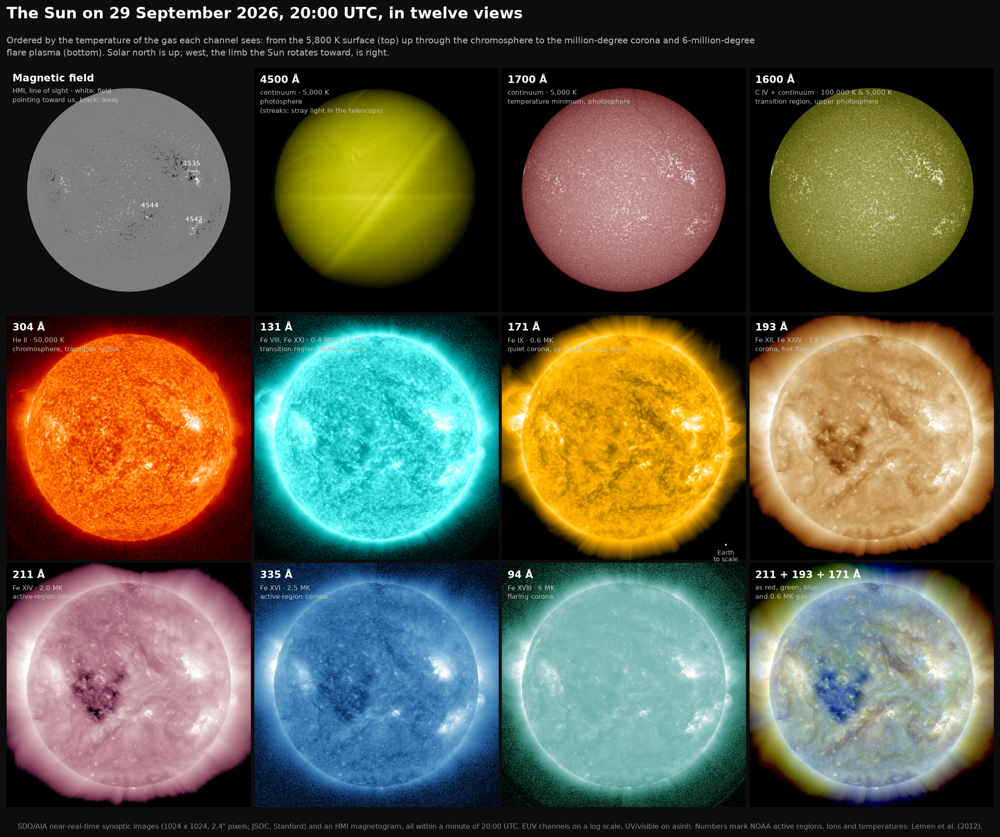
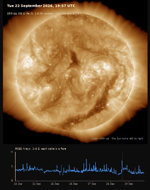
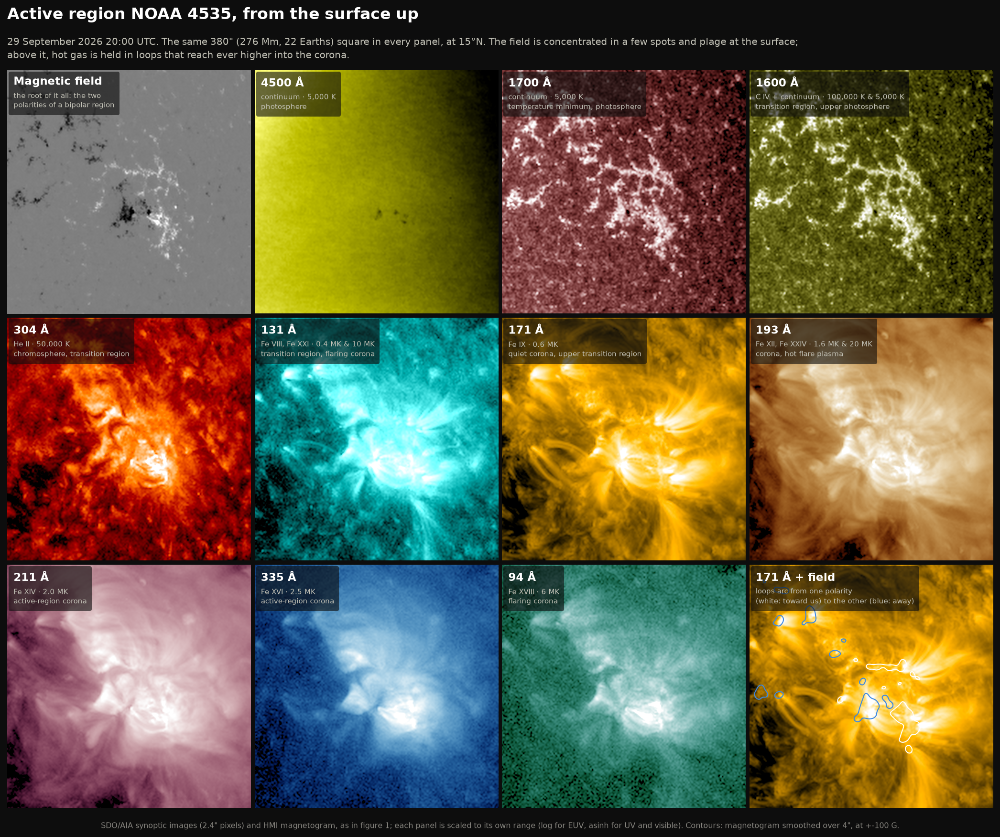
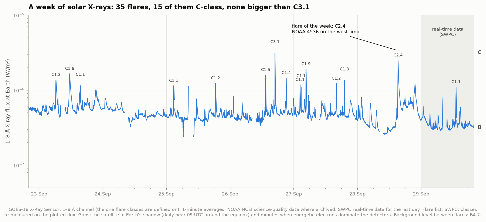
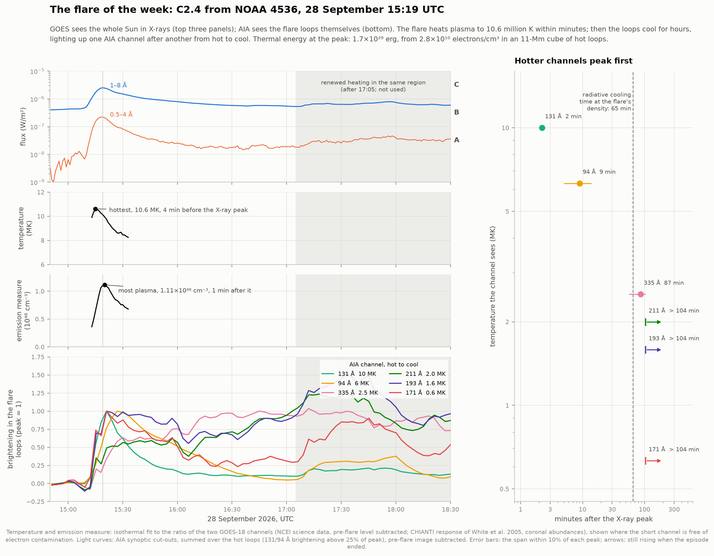
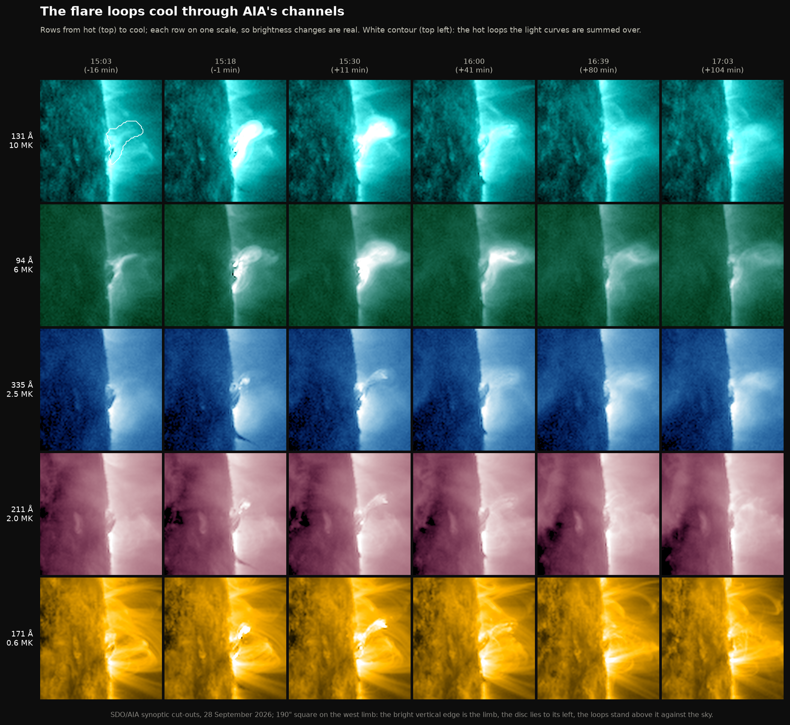
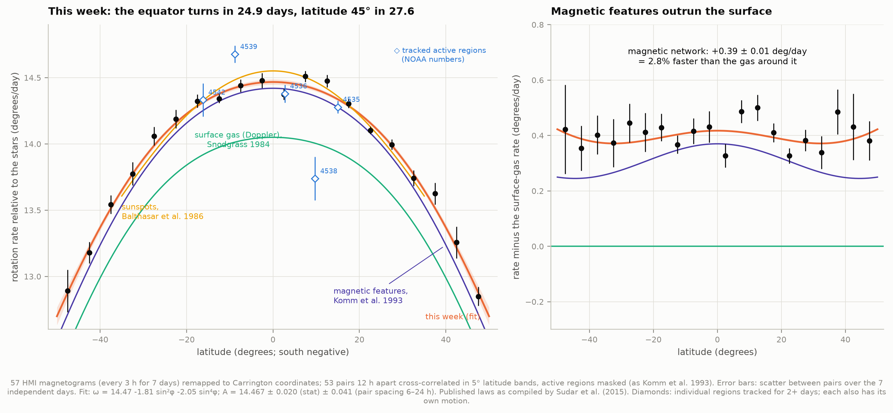
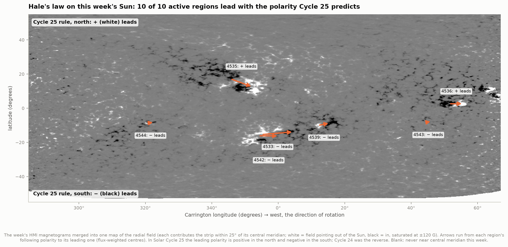
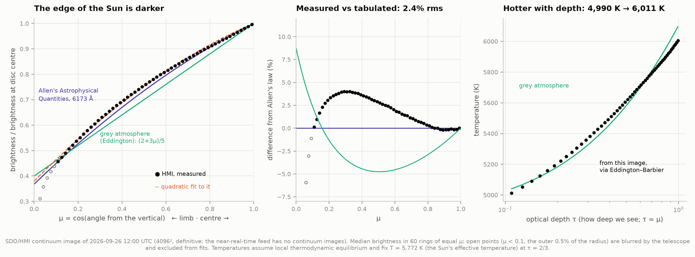
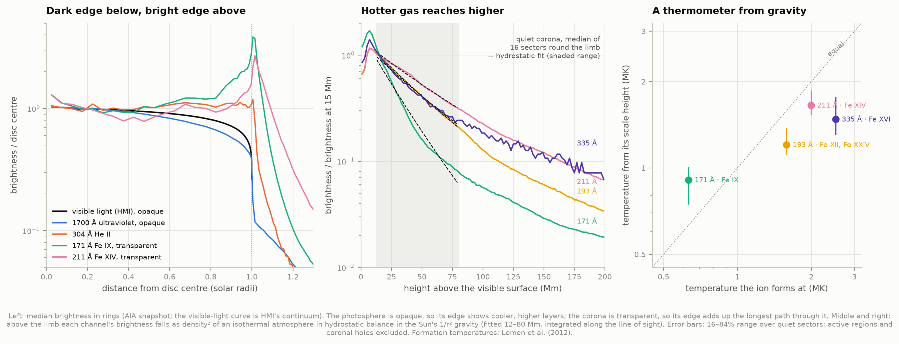

# F2 — The Sun today

**What does the Sun look like right now, and what can one week of real spacecraft data tell us
about how it works?**

This project takes the Sun as NASA's Solar Dynamics Observatory (SDO) saw it on **29 September
2026 at 20:00 UTC**, plus the week before, and measures six things from the raw images and X-ray
fluxes:
- the Sun's atmosphere in twelve views, from the 5,800 K surface to 6-million-degree loops;
- the week's X-ray flares;
- the week's most energetic flare, heated to 10.6 million K and then cooling for hours;
- how fast the Sun rotates at each latitude;
- Hale's magnetic polarity law;
- the temperature of the corona, weighed with gravity.

Everything is re-runnable for any other moment, including *now* (`python run.py --epoch now`).





*The week in 193 Å (full-quality video: [figures/sun_week_193.mp4](figures/sun_week_193.mp4);
interactive explorer: [figures/sun_today.html](figures/sun_today.html), a single offline file).*

---

## The headline numbers

| What | Measured here | Compared with |
|---|---|---|
| Flares in the week | **35** (20 B-class, 15 C-class, none M or X); largest **C3.1** | a quiet week, two years past the maximum of Cycle 25 |
| Flare of the week | **C2.4** on the west limb (NOAA 4536), 28 Sep 15:19 UTC | SWPC's real-time list: C2.5 |
| Its peak temperature | **10.6 MK**, 4 min *before* the X-ray peak; most plasma 1 min *after* | heating first, then evaporation (standard flare picture) |
| Its cooling | 131 Å (10 MK) +2 min → 94 Å (7 MK) +9 min → 335 Å (2.5 MK) +87 min → 211/193/171 Å > +104 min | radiative cooling time at its density: 65 min |
| Equatorial rotation | **14.47 ± 0.02 (stat) ± 0.04 (sys) °/day**: 24.9 days (26.7 as seen from Earth) | magnetic features, Komm et al. 1993: 14.42 |
| Full profile | ω = 14.47 − 1.81 sin²φ − 2.05 sin⁴φ °/day | Komm et al.: 14.42 − 2.00 sin²φ − 2.09 sin⁴φ |
| Magnetic features vs gas | network rotates **0.39 ± 0.01 °/day (2.8%) faster** than the surface gas | Doppler rate, Snodgrass 1984 |
| Hale's law | **10 of 10** bipolar regions lead with Cycle 25's polarity | expected: all |
| Limb darkening (6173 Å) | matches Allen's tabulated law to **2.4% rms** | a grey atmosphere is off by 5.8% |
| Photosphere temperature | **4,990 K at τ = 0.1 → 6,010 K at τ = 1** | grey atmosphere: 5,030 → 6,100 K |
| Corona, from its scale height | **0.9 MK** (171 Å), **1.2 MK** (193 Å), **1.7 MK** (211 Å) | hotter channels, hotter gas; the quiet corona is 1–1.5 MK |

All numbers are in `data/20260929T2000/results.json` after a run, and `python run.py` prints them.

---

## What SDO sees, and why twelve pictures of one Sun look so different

SDO sits in a geosynchronous orbit and photographs the whole Sun around the clock. This project
uses two of its instruments:

- **AIA** (Atmospheric Imaging Assembly) takes an image every 12 seconds in ten wavelengths.
  Seven are in the extreme ultraviolet (EUV), each tuned to spectral lines of one or two ions.
  An ion such as Fe IX (iron that has lost 8 electrons) only exists in a narrow range of
  temperatures, so **each channel is effectively a thermometer**: it shows only the gas at its
  temperature.
- **HMI** (Helioseismic and Magnetic Imager) measures the magnetic field at the surface, from the
  way the field splits an iron spectral line (the Zeeman effect).

| Channel | Ion | Temperature | What it shows |
|---|---|---|---|
| 4500 Å | continuum | 5,000 K | the photosphere, the "surface" we see in white light |
| 1700 Å | continuum | 5,000 K | the top of the photosphere; bright magnetic plage |
| 1600 Å | C IV + continuum | 100,000 K & 5,000 K | upper photosphere, transition region; flare ribbons |
| 304 Å | He II | 50,000 K | chromosphere and transition region; prominences |
| 131 Å | Fe VIII, Fe XXI | 0.4 MK & 10 MK | transition region, and flares |
| 171 Å | Fe IX | 0.6 MK | quiet corona: loops tracing magnetic field lines |
| 193 Å | Fe XII, Fe XXIV | 1.6 MK & 20 MK | the corona; coronal holes show as dark patches |
| 211 Å | Fe XIV | 2.0 MK | active-region corona |
| 335 Å | Fe XVI | 2.5 MK | the hottest long-lived active-region gas |
| 94 Å | Fe XVIII | 6 MK | flaring loops |

(Temperatures: Lemen et al. 2012, Table 1. They are the peaks of broad response curves, good to
about ±25%.)

The **surprise of the Sun's atmosphere is visible in the ordering**. The surface is 5,800 K and the
gas gets *cooler* for the first few hundred kilometres upward. Then, over a thin transition region
a few thousand km thick, it heats to over a million degrees. Why the corona is so hot is still
one of astrophysics' open questions, and the leading ideas all involve the magnetic field.
Figure 2 zooms into the largest active region of the day, NOAA 4535. It shows the field
concentrated in spots and plage at the surface, and hot gas held in loops above it.



What was on the Sun on 29 September 2026:
- **Five numbered NOAA active regions** on the visible disc, mostly small, and two more just
  rotated over the west limb. The largest, **NOAA 4535**
  (N15), is a bipolar complex of ~6×10²¹ Mx of each polarity.
- **A large coronal hole** east of disc centre, dark in 193 and 211 Å. There the field lines open
  into space and the fast solar wind streams out. It is dark because the gas is thin, not cold.
- Bright loops of a region rotating into view over the north-east limb.

---

## The week in X-rays

NOAA's GOES satellites measure the whole Sun's soft X-ray output. A flare's **class** is its peak
flux in the 1–8 Å band: A, B, C, M, X for 10⁻⁸, 10⁻⁷, 10⁻⁶, 10⁻⁵ and 10⁻⁴ W/m². Each letter is
ten times the one before, and the number gives the position within the decade (C2.4 = 2.4×10⁻⁶
W/m²).



- **35 flares** in the 7 days: 20 B-class, 15 C-class, no M or X. The largest was a
  **C3.1 on 26 September at 16:55 UTC**. The X-ray background between flares was **B4.7**, with a
  daily minimum between B2.3 and B4.9.
- This is a calm week. Cycle 25 peaked in late 2024, and the Sun is in the declining phase.
- **Data quality, checked:**
  - For the six days NOAA NCEI has already archived, SWPC's real-time fluxes and NCEI's
    science-quality fluxes agree to a median ratio of **1.003** (5–95%: 0.96–1.09, 8,143
    minutes).
  - Two kinds of minutes are dropped. GOES-18 passes through Earth's shadow for ~66 minutes each
    day around the equinox (near 09 UTC). And sometimes energetic electrons around the satellite
    swamp the detector.

---

## The flare of the week

The week's most energetic flare, by soft X-ray energy (background-subtracted 1–8 Å fluence), was a
**C2.4** (C2.5 in SWPC's real-time list). It peaked on **28 September 2026 at 15:19 UTC**.

**Where:** comparing hot-channel AIA images from before and at the X-ray peak puts the brightening
at (971″, 71″). That is **1.7% of a solar radius beyond the west limb**. The flare came from
**NOAA 4536** (N02) as it rotated over the edge of the disc: 89.5° from the central meridian at the
time. So we see its loops side-on against dark sky.



**How hot:**
- The ratio of GOES's two X-ray channels is a thermometer: hotter plasma emits relatively more at
  the shortest wavelengths.
- With the CHIANTI-based response of White, Thomas & Schwartz (2005), our own implementation
  agrees with sunkit-instruments' to machine precision.
- The flare reached **10.6 million K at 15:15, four minutes *before* the X-ray peak**.
- The **emission measure**, EM = ∫n_e² dV (roughly "how much plasma is glowing"), peaked a minute
  *after* it, at **1.1×10⁴⁸ cm⁻³**.
- That order is the textbook flare sequence. Energy released in the corona first heats the loops.
  Then heated chromospheric gas "evaporates" up into them and fills them with dense, bright
  plasma.

**How much energy:**
- The hot loops cover 1.3×10¹⁸ cm² in 131 Å, so their volume is about (11 Mm)³.
- Together with the emission measure, that gives a density of **2.8×10¹⁰ electrons/cm³**.
- The thermal energy is **≈ 1.7×10²⁹ erg**, about 4 million megatons of TNT, from
  a small C-class flare.
- The volume estimate (area^3/2) is crude, and the energy is uncertain by a factor of a few.

**How it cooled:**
- As loops cool, they pass through AIA's temperature bands one after another. Summed over the hot
  loops, the channels peak in order of temperature:

| Channel | Gas it sees | Peak, after the X-ray peak |
|---|---|---|
| 131 Å | Fe XXI, 10 MK | +2 min |
| 94 Å | Fe XVIII, 6 MK | +9 min |
| 335 Å | Fe XVI, 2.5 MK | +87 min (plateau 56–104 min) |
| 211 Å, 193 Å, 171 Å | 2.0, 1.6, 0.6 MK | still brightening at +104 min |

- At +106 minutes (17:05) new heating started in the same region: GOES shows the flux rising again,
  and 131/94 Å re-brighten. So the analysis stops there, and the three coolest channels only get
  lower limits.
- The 7 → 2.5 MK stage took about 80 minutes. That is consistent with the radiative cooling
  time at the measured density, **65 minutes** (loss function of Cargill, Mariska & Antiochos
  1995).
- In the impulsive phase every channel flickers at once, including the cool ones. The energy lands
  at all temperatures, and 1600 Å (the chromosphere) peaks 3 minutes *before* the X-rays.



---

## The Sun's rotation, measured from a week of magnetograms

The Sun is not a solid ball: its equator rotates faster than its poles (**differential
rotation**).

**Method:** the magnetic-feature cross-correlation method of Snodgrass (1983) and Komm, Howard &
Harvey (1993).
- Each of the week's 57 HMI magnetograms is remapped onto a grid of **Carrington longitude**. That
  frame turns once every 25.38 days, so a feature rotating at exactly that rate stands still on the
  grid.
- Each 5° latitude band of each grid is cross-correlated with the grid 12 hours later, which
  measures the drift of the small-scale magnetic network (active regions masked). That gives 53
  pairs, 20 bands, and the equator out to ±47.5°.



- **ω(φ) = 14.47 − 1.81 sin²φ − 2.05 sin⁴φ °/day** (sidereal, i.e. relative to the stars).
  - Uncertainties: A ± 0.020 (stat) ± 0.041 (systematic: 6-, 18- and 24-hour pairs give A = 14.43,
    14.45 and 14.39), B ± 0.25, C ± 0.51.
  - χ² = 22.0 for 17 degrees of freedom.
- **Rotation periods:** the equator turns once in **24.9 days** relative to the stars. As seen from
  the orbiting Earth that is **26.7 days**, because Earth moved 0.98°/day in the same direction this
  week. At 30° latitude it takes 25.9 days, at 45° 27.6 days.
- **Against the published profiles**, band by band:
  - It matches the **magnetic-feature** profile of Komm et al. (1993) within 0.074 ± 0.011 °/day
    (0.5%). B and C agree within their errors.
  - It is 0.39 °/day (**2.8%**) faster than the Doppler rate of the surface gas (Snodgrass 1984) and
    0.30 °/day faster than the helioseismic surface rate (Schou et al. 1998).
- **Why the magnetic features run ahead:** it is long established that magnetic features rotate
  faster than the gas around them. The usual reading is that they are anchored below the surface,
  where helioseismology finds a faster-spinning "near-surface shear layer".
- **Individual active regions** tracked for 2+ days scatter around the profile by ±0.3 °/day, as
  expected: regions also have motions of their own. NOAA 4539 ran fast (14.68). NOAA 4538, emerging
  near the east limb, lagged (13.74).

---

## Hale's law on this week's Sun

Sunspots come in pairs of opposite magnetic polarity: a **leading** spot (westward, in the
direction of rotation) and a **following** one. **Hale's law** (1919) says:
- within one hemisphere, all regions lead with the same polarity;
- the two hemispheres are opposite;
- the pattern flips every ~11-year cycle.

In **Cycle 25**, positive leads in the north and negative in the south. Cycle 24 was the reverse.



- **All 10 bipolar NOAA regions** tracked this week obey it: 3 of 3 in the north lead positive, 7 of
  7 in the south lead negative. (Regions whose weaker polarity has less than a fifth of the stronger
  one's flux are too lopsided to say which half leads, and are not counted.)
- **Joy's law** says the leading spot sits a little closer to the equator. 7 of the 10 are tilted
  that way; with 10 regions and tilts scattered by ±15°, that is a consistent hint, not a
  measurement.

---

## The limb: the edge of the Sun, dark below and bright above



**Visible light: limb darkening.**
- The photosphere is opaque, so we see down to roughly one "optical depth" τ along our line of
  sight. At the disc centre that depth lies deep in the hot interior. Near the edge the line of
  sight runs at a slant and reaches τ = 1 higher up, where the gas is cooler, so the edge looks
  darker.
- An HMI continuum image at 6173 Å (26 September; see caveats) gives **I(μ)/I(centre)**. Here μ is
  the cosine of the viewing angle: 1 at centre, 0 at the limb. The measured profile matches Allen's
  *Astrophysical Quantities* law at 6173 Å to **2.4% rms** (4.0% at worst, around μ ≈ 0.3). A
  **grey atmosphere** (the Eddington approximation, I ∝ 2 + 3μ) misses by **5.8% rms**.
- The **Eddington–Barbier** relation says the light leaving at angle arccos μ carries the
  temperature at optical depth τ = μ. So the curve maps temperature against depth: **4,990 K at
  τ = 0.1 rising to 6,010 K at τ = 1**, using the Sun's effective temperature (5,772 K) at τ = 2/3
  as the one anchor. The photosphere gets hotter with depth, the fact that makes stars' spectra show
  absorption lines.



**Extreme UV: limb brightening.** The corona is transparent to its own EUV light, so every pixel
adds up the emission along its line of sight. That path through the corona is longest at the limb,
and the EUV Sun has a bright rim (in 171 Å, 2.8× the disc centre) instead of a dark one.

**A thermometer from gravity:**
- Above the limb, the corona thins out with height. In hydrostatic balance, pressure falls by a
  factor e every scale height H = kT/(μ m_H g). That is ~50 Mm per million kelvin, so **hotter gas
  reaches higher**.
- Each channel's brightness goes as density², so fitting its fall-off above the limb gives the
  temperature of the gas it sees. The fit uses an isothermal atmosphere in the Sun's 1/r² gravity,
  integrated along the line of sight, over 12–80 Mm.
- Measured in the 16 quiet sectors of the limb (active regions and coronal holes set aside):

| Channel | Ion forms at | Temperature from its scale height |
|---|---|---|
| 171 Å | 0.63 MK | **0.91 MK** (16–84%: 0.74–1.01) |
| 193 Å | 1.58 MK | **1.21 MK** (1.11–1.38) |
| 211 Å | 2.0 MK | **1.65 MK** (1.53–1.87) |
| 335 Å | 2.5 MK | **1.48 MK** (1.31–1.77) |

- **The ordering holds.** Channels that see hotter ions see gas with larger scale heights. But the
  temperatures are compressed toward the corona's typical 1–1.5 MK, because each channel's response
  spans a range of temperatures and the quiet corona is mostly 1–1.5 MK gas.
- 335 Å breaks the order. On the quiet Sun, much of its faint signal comes from cooler lines of Mg,
  Al and Si rather than Fe XVI (O'Dwyer et al. 2010).
- Fitting a plain exponential instead would ignore gravity weakening with height and the
  line-of-sight geometry, and would overestimate the temperatures by ~25% (0.98, 1.65, 2.17 MK).
  `test_physics.py` checks this on a synthetic atmosphere.

---

## How to run

```bash
cd ~/Desktop/astrophysics/16-sun-today
../.venv/bin/python run.py                 # the pinned epoch, 2026-09-29 20:00 UTC
../.venv/bin/python run.py --epoch now     # the Sun as it is right now
../.venv/bin/python run.py --epoch 2026-10-05T12:00
../.venv/bin/python test_physics.py        # 43 checks of the physics and conventions
```

- The first run for an epoch downloads ~190 MB, taking ~15–30 minutes depending on the archive.
- Later runs work offline from the cache in about 5 minutes. This was checked with the network cut
  (`unshare -rn`).
- Each epoch caches into `data/<epoch>/`. Figures for any epoch other than the pinned one go to
  `figures/<epoch>/`.
- Packages beyond the atlas venv: `sunpy[map,net,image,timeseries,visualization]`,
  `sunkit-instruments`, `scikit-image`, `reproject`; `ffmpeg` for the video.

## Data provenance

All data retrieved 29–30 September 2026. Every file's URL, size, SHA-256 and retrieval time is in
`data/20260929T2000/manifest.json` (741 files, 191 MB).

| Data | Source | Used for |
|---|---|---|
| AIA near-real-time synoptic images, 10 channels, 1024², 2.4″ px, 3-min cadence | JSOC, Stanford ([jsoc1.stanford.edu/data/aia/synoptic/nrt](https://jsoc1.stanford.edu/data/aia/synoptic/nrt/)) | snapshot, week (193 Å every 3 h), flare cut-outs |
| HMI line-of-sight magnetograms (720 s), 1024², hourly | JSOC ([jsoc.stanford.edu/data/hmi/fits](http://jsoc.stanford.edu/data/hmi/fits/)) | snapshot, rotation, active regions |
| HMI continuum image (hmi.Ic_45s, 4096², 2026-09-26 12:00 UTC) | JSOC via the Virtual Solar Observatory (sunpy Fido) | limb darkening |
| GOES-18 XRS 1-min fluxes, flare list, NOAA region list | NOAA SWPC real-time JSON feeds | the X-ray week, flare timing, region names |
| GOES-18 XRS L2 science data (avg1m, flsum), 22–28 Sep | NOAA NCEI | fluxes where archived; cross-check |
| GOES CHIANTI temperature response table | SolarSoft (`goes_chianti_response_latest.fits`) | flare temperature and emission measure |

SDO is a NASA mission. AIA data courtesy of NASA/SDO and the AIA science team; HMI data courtesy
of NASA/SDO and the HMI science team. GOES data courtesy of NOAA SWPC and NCEI.

## Caveats

- **Near-real-time data.** The SDO images are quicklook products (quality bit 30 set), made before
  the final calibration. The pointing and exposure information are good enough for everything here.
  The images are 4×4-binned (2.4″ pixels), so flare loops are only 10–20 pixels long.
- **The continuum image is three days old.** HMI's continuum images reach the public archive only
  after definitive processing. So limb darkening uses 26 September; the photosphere's limb
  darkening does not change from day to day. The "today" grid uses AIA's 4500 Å instead, which has
  strong stray light (the diagonal streaks).
- **Limb darkening residuals.** The measured curve sits up to 4% above Allen's law around μ ≈ 0.3.
  Two effects push that way:
  - light scattered inside the telescope (0.7% of the disc-centre brightness still shows just
    outside the limb);
  - HMI's "continuum" is reconstructed from six samples across a spectral line, not measured
    directly.

  The Eddington–Barbier temperatures also assume local thermodynamic equilibrium, and the τ = 2/3
  anchor comes from a grey atmosphere.
- **Hydrostatic temperatures assume hydrostatic, isothermal gas** along each line of sight. The real
  corona is structured (loops, streamers) and multi-thermal. Scattered light from the disc adds a
  little brightness at the largest heights, which is why the fit stops at 80 Mm. The numbers are
  "the temperature the fall-off implies", with the spread over sectors as a guide to their
  reliability.
- **The flare was on the limb.** Its footpoints may have been partly hidden, so GOES may have seen
  less than the whole flare. Its GOES class, temperature and energy are for what was visible.
- **The volume and energy of the flare are order-of-magnitude estimates** (volume ≈ area^3/2).
- **The rotation profile is one week of data.** Its statistical errors assume the 7 days are
  independent samples: pairs starting 3 hours apart share most of their magnetic features. The
  spread between pair separations (±0.04 °/day in A) is a better guide to the real uncertainty
  than the formal error. The comparison laws were averaged over decades; the Sun's rotation varies
  slightly over the cycle (the "torsional oscillation", ~±0.03 °/day).
- **Region tracking uses a simple threshold-and-group detector** (field above 50 G, patches within
  17 Mm grouped). NOAA's numbers are attached by position. Three regions that never reached central
  meridian (4538, 4540, 4541) were measured nearer the limb, where the field's projection is less
  favourable.
- **The GOES X-ray flux** is the whole Sun's. A flare's class counts its own emission plus
  everything else on the disc, and a flare behind the limb can be missed or under-counted.

## Files

| File | What it does |
|---|---|
| `config.py` | the epoch, data sources, channel table, every tunable choice (with reasons) |
| `fetch_data.py` | downloads and caches everything, with a manifest; resumable |
| `sdo.py` | reading SDO images; disc geometry; finding and cutting out the flare |
| `goes.py` | X-ray fluxes (SWPC + NCEI), flare list, flare selection, temperature/EM |
| `flare.py` | the flare in AIA: hot-loop mask, light curves, cooling sequence, energetics |
| `rotation.py` | Carrington remapping, rotation cross-correlation, region tracking, Hale's law |
| `limb.py` | limb darkening, radial profiles, coronal scale heights |
| `solar_physics.py` | the formulas (hydrostatics, rotation laws, Planck, Eddington–Barbier, …) |
| `analysis.py` | runs every measurement → `results.json` |
| `figures.py`, `movie.py`, `interactive.py` | figures, time-lapse, explorer page |
| `run.py` | everything, end to end, with a printed summary |
| `test_physics.py` | 43 checks against known answers |

## References

- Balthasar, H., Vázquez, M. & Wöhl, H. 1986, A&A 155, 87 (sunspot rotation)
- Cargill, P. J., Mariska, J. T. & Antiochos, S. K. 1995, ApJ 439, 1034 (flare cooling)
- Cox, A. N. (ed.) 2000, *Allen's Astrophysical Quantities*, 4th ed. (limb darkening; as fitted
  in SolarSoft's `darklimb_u/v`)
- Hale, G. E. et al. 1919, ApJ 49, 153 (polarity law)
- Komm, R. W., Howard, R. F. & Harvey, J. W. 1993, Sol. Phys. 145, 1 (magnetic-feature rotation)
- Lemen, J. R. et al. 2012, Sol. Phys. 275, 17 (AIA)
- O'Dwyer, B. et al. 2010, A&A 521, A21 (AIA channel contributions)
- Pesnell, W. D., Thompson, B. J. & Chamberlin, P. C. 2012, Sol. Phys. 275, 3 (SDO)
- Prša, A. et al. 2016, AJ 152, 41 (IAU nominal solar values)
- Scherrer, P. H. et al. 2012, Sol. Phys. 275, 207 (HMI)
- Schou, J. et al. 1998, ApJ 505, 390 (helioseismic rotation)
- Snodgrass, H. B. 1983, ApJ 270, 288; Snodgrass, H. B. 1984, Sol. Phys. 94, 13
- Sudar, D. et al. 2015, A&A 575, A63 (compilation of rotation laws, their Table 2)
- Thomas, R. J., Starr, R. & Crannell, C. J. 1985, Sol. Phys. 95, 323 (GOES temperatures)
- White, S. M., Thomas, R. J. & Schwartz, R. A. 2005, Sol. Phys. 227, 231 (GOES CHIANTI response)
