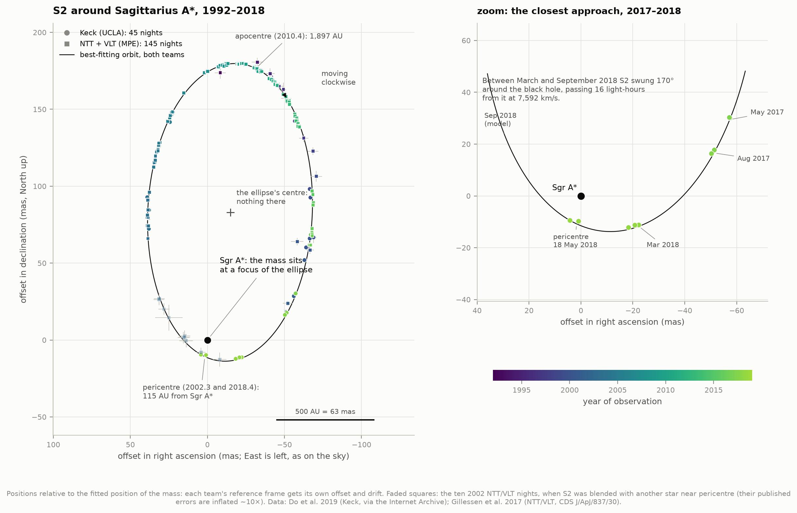
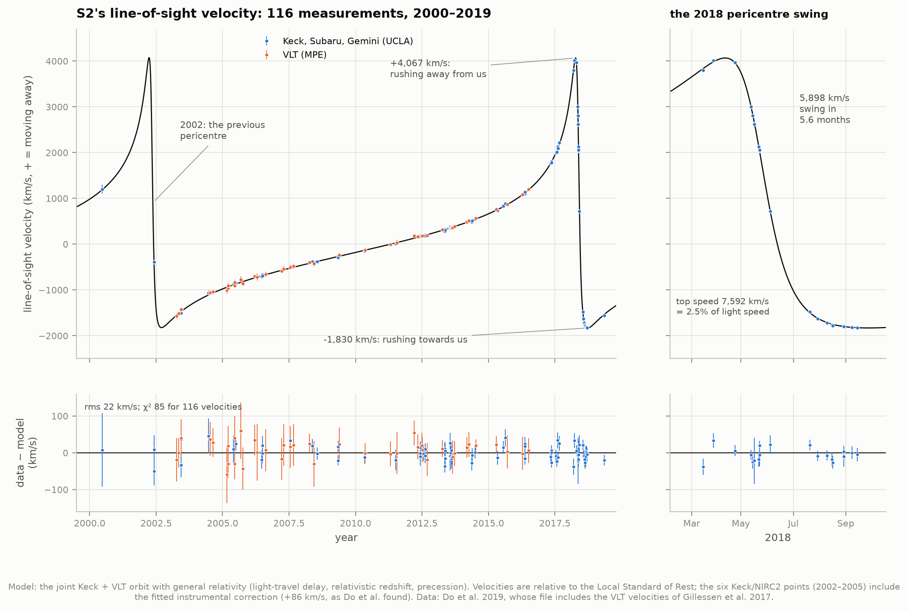
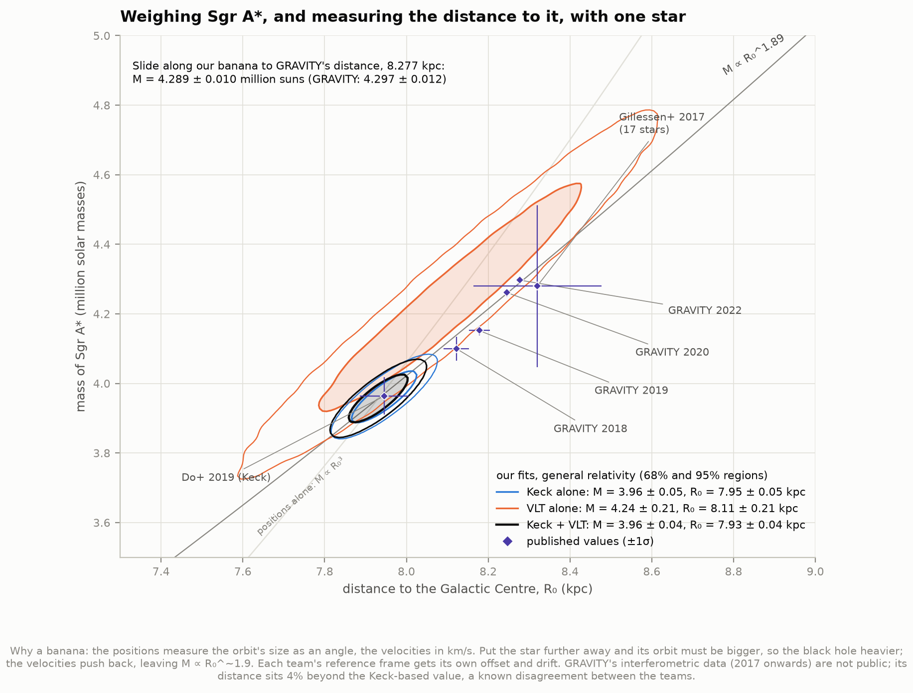
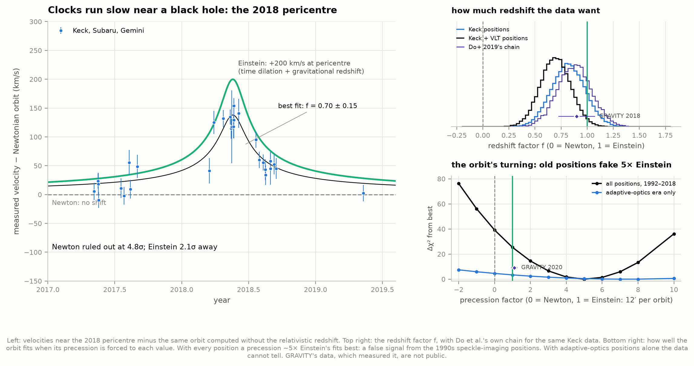
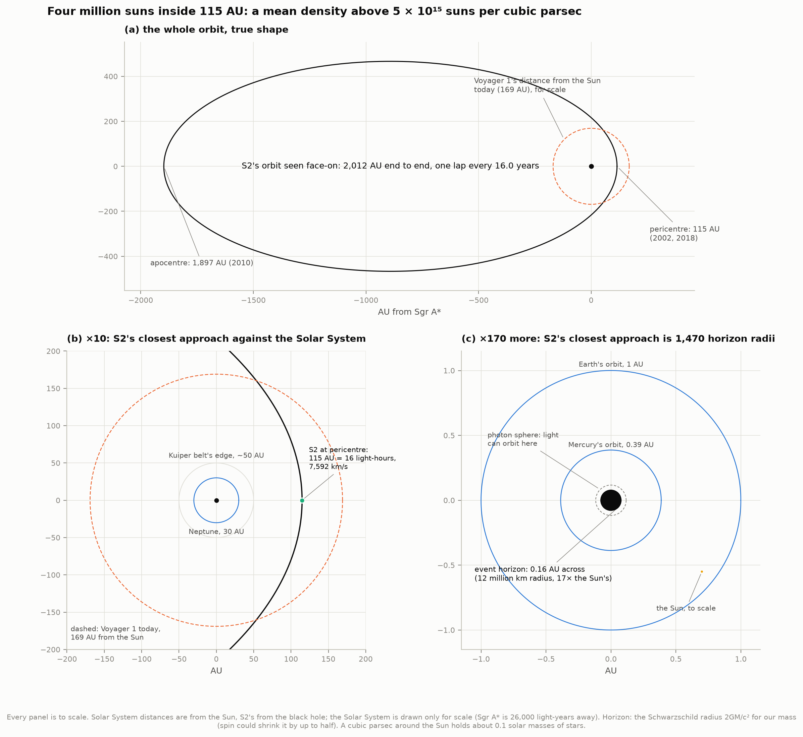
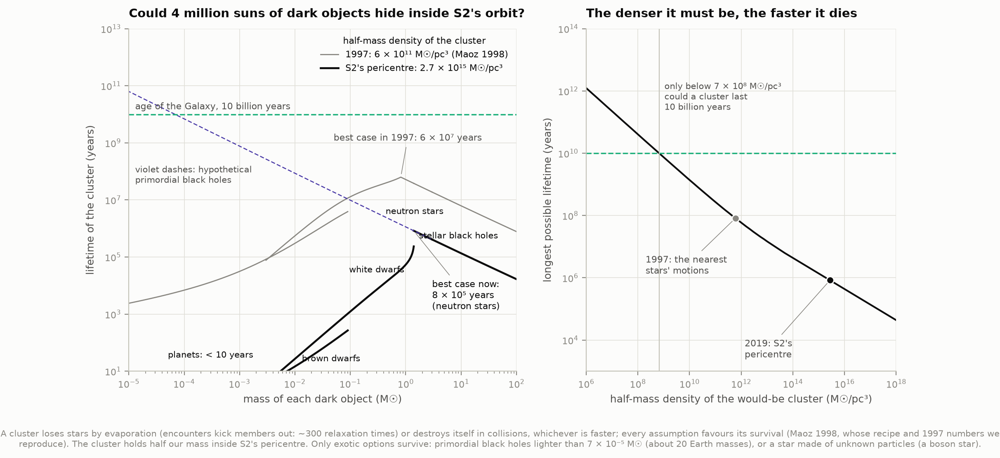
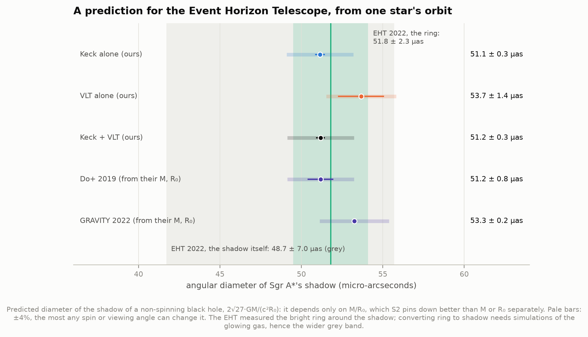
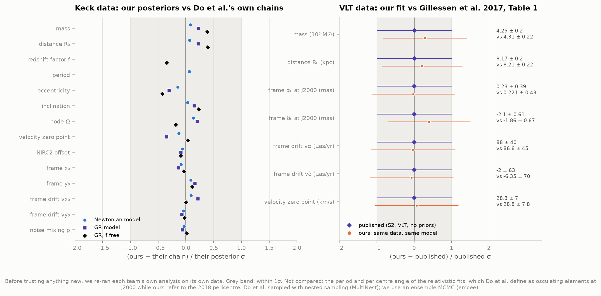

# H1 — Weigh the black hole at the Galactic Centre

**A star called S2 circles the centre of the Milky Way every 16 years. From its orbit alone, how
massive is the object it orbits, how far away is it, and must it be a black hole?**

S2 orbits **3.96 ± 0.04 million solar masses**, **7.93 ± 0.04 kiloparsecs** away (26,000
light-years). At its closest approach, on 19 May 2018, it passed **115 AU** from that mass, less
than Voyager 1's distance from the Sun, at **7,590 km/s (2.5% of the speed of light)**. Four
million suns packed that tightly cannot be a cluster of dark stars. Even the longest-lived such
cluster would evaporate or smash itself apart within **800,000 years**, a blink in the Galaxy's
10 billion. S2's light also carries **Einstein's redshift**: near the black hole its clock runs
slow, and the data rule out Newton's prediction of no shift at **5σ**.

Everything here comes from the published positions and velocities of the two teams who followed
S2 for 25 years. Andrea Ghez and Reinhard Genzel shared half of the 2020 Nobel Prize in Physics
for this work. We re-fit their raw measurements with our own orbit code, first each team's data
exactly as they did, then both together.

| Team | Telescopes | Positions | Velocities |
|---|---|---|---|
| UCLA (Ghez), who call the star S0-2 | Keck, 1995–2018 | 45 nights: 19 speckle (median error 0.86 mas), 26 adaptive optics (0.21 mas) | 75 from Keck, Gemini and Subaru, 2000–2019 |
| MPE (Genzel) | ESO NTT and VLT, 1992–2016 | 145 nights: 11 NTT speckle (3.3 mas), 1 Gemini, 133 VLT adaptive optics (0.40 mas) | 41 from the VLT, 2003–2016 |

A milliarcsecond (mas) is the width of a coin seen from 4,000 km. At the Galactic Centre it
spans 7.9 AU, so the best positions pin S2 down to about 2 AU.

---

## Results

### 1. The orbit on the sky



27 years of positions, coloured by date: circles from Keck, squares from the NTT and VLT. The
star goes round clockwise on the sky once every **16.045 ± 0.002 years**, on an ellipse of
eccentricity **0.8859 ± 0.0004**. The black dot is where the fit puts the mass.
**It sits at a focus of the ellipse, not at its centre (+)**: this is Kepler's first law,
holding 26,000 light-years away around something we cannot see.

We see the orbit tilted. Its true size and shape come out of the fit with its three orientation
angles (inclination 133.8°, node 227.8°, pericentre 66.5°). In three dimensions S2 swings from
**1,897 AU** from the black hole at apocentre (May 2010, crawling at 460 km/s) to **115 AU**
at pericentre (moving 16.5 times faster). It spends only four of its 192 months within 200 AU.

The two teams' positions only line up after each is corrected for its own **reference frame**.
Neither team measures S2 relative to the black hole directly. The black hole is dark, and its
faint infrared flicker is not a usable anchor. Each team instead ties its images to a grid of
stars whose positions relative to Sgr A* are known from radio telescopes (masers). The two grids
were built independently, so each gets its own four fitted numbers: where the mass sits in it
and how it drifts. Treat the two teams' positions as one frame and the fit gets worse by
**χ² = 1,537** (for 496 measurements). The frames differ by 1.6 mas and 1.5 mas in the two
directions at 2009.0.

Next pericentre: **5 June 2034** (± 0.6 days).

### 2. The velocity curve



Spectra measure S2's speed along our line of sight from the Doppler shift of its absorption
lines. 116 velocities trace the 16-year cycle: a slow drift for most of the orbit, then two
violent swings. In spring 2018 the star receded at **+4,067 km/s**. Four months after its
closest approach it was coming towards us at **−1,830 km/s**, a swing of 5,900 km/s in
5.6 months. The model runs through every point, with 22 km/s rms scatter (χ² = 85 for 116
velocities).

The six Keck/NIRC2 velocities from 2002–2005 need a correction of **+86 ± 18 km/s**. Do et al.
found the same instrumental offset (81 ± 19).

### 3. Kepler's third law, by hand

Before any statistics, the whole idea fits in three lines.

- The orbit's semi-major axis on the sky is **a = 126.9 mas**, and the period is
  **P = 16.045 years**.
- At a distance of 7.93 kpc, 126.9 mas is **1,006 AU**.
- Kepler's third law in solar units: M = a³/P² = 1,006³ / 16.045² = **3.96 million suns**.

The catch is the distance. Positions alone give the orbit's size only as an angle, so they give
M ∝ R₀³: at 7 kpc the same angles would mean 2.7 million suns, and at 9 kpc 5.8 million. What
breaks the tie is the velocities. They measure the orbit's size in km/s, independently of
distance. Asking the two to agree is a geometric distance measurement, with no distance ladder
involved.

### 4. The mass and the distance



| Fit (general relativity) | Mass (million suns) | Distance R₀ (kpc) |
|---|---|---|
| Keck positions + all velocities | 3.961 ± 0.046 | 7.946 ± 0.048 |
| VLT positions + VLT velocities | 4.24 ± 0.21 | 8.11 ± 0.21 |
| **Both teams** | **3.957 ± 0.042** | **7.931 ± 0.043** |

The posteriors are long thin "bananas". The fits pin down M ∝ R₀^1.89 to 0.2%, but slide along
that line far more freely: mass and distance are 98% correlated. The VLT data end in 2016,
before the 2018 pericentre, and give a banana five times longer, consistent with the others.
Adding the VLT positions to Keck's barely moves the answer, because each team's frame has its
own offset and drift: the VLT positions then mostly fix the orbit's shape, and the 2018
velocities fix the distance.

**Systematics.** We re-ran the joint fit nine other ways: a separate velocity zero point for the
VLT's spectrograph, Keck errors taken as independent instead of correlated, the VLT errors
rescaled, the confused 2002 VLT positions dropped, the NIRC2 velocities dropped instead of
corrected, the Keck speckle positions dropped, and the priors Gillessen et al. use (Sgr A* at
rest along the line of sight; the VLT frame's origin within 0.2 mas of the radio source, drifting
under 0.1 mas/yr). The distance stays between **7.87 and 7.96 kpc** (rms shift 0.03), and the
mass between 3.92 and 3.98. Our result is

> **M = 3.96 ± 0.04 (stat) ± 0.02 (sys) million solar masses, R₀ = 7.93 ± 0.04 (stat) ± 0.03 (sys) kpc.**

**Against the published values.** On the same Keck data and model, Do et al. (2019) published
3.964 ± 0.047 and 7.946 ± 0.050. We match them to 0.04σ and 0.00σ. GRAVITY's interferometer at
the VLTI, with 50-µas positions from 2017 onwards (not public), measures **R₀ = 8.277 ± 0.009 kpc**
and **4.297 ± 0.012 million suns**. That distance is 4% beyond ours, 7.8σ in our statistical
error alone. The disagreement is known. GRAVITY's team fitted both data sets themselves
(GRAVITY Collaboration 2021, appendix C) and traced the ~300 pc gap about half to the radial
velocities and half to a modest offset of the Keck coordinate system in declination. A fifth
of the velocity part comes from the Doppler formula in the Keck spectral-fitting code; they
could not say whose data carry the rest. GRAVITY's own distance had moved by 0.1 kpc
(8.18 → 8.28 kpc for the same data) once they modelled optical aberrations inside their
instrument. At this level every detail of the pipeline matters.

What the teams do agree on is the black hole. Slide along our banana to GRAVITY's distance and
our posterior gives **4.289 ± 0.010 million suns**, against their 4.297 ± 0.012: **0.5σ**. The
tension lies entirely in *where along the banana* the truth sits. That is set by the subtlest
parts of the analysis: reference-frame drifts and velocity zero points at the level of a few
km/s. The VLT data alone (8.11 ± 0.21 kpc) are consistent with both.

### 5. Testing Einstein



**The redshift.** General relativity predicts that a clock deep in a gravitational well, moving
fast, runs slow as seen from far away. For S2 two effects add up. One is time dilation from its
speed, v²/2c. The other is the gravitational redshift from sitting close to four million suns,
GM/rc. Together they add **198 km/s** to its apparent velocity at pericentre, and nothing
measurable elsewhere. We multiply that term by a factor *f* (0 = Newton, 1 = Einstein) and let
the data choose:

| Data | f | from Newton | from Einstein |
|---|---|---|---|
| Keck positions + all velocities | **0.82 ± 0.16** | 5.1σ | 1.1σ |
| both teams' positions + all velocities | **0.70 ± 0.15** | 4.8σ | 2.1σ |
| published: Do et al. 2019 (Keck) | 0.88 ± 0.17 | 5σ | 0.7σ |
| published: GRAVITY 2018 (VLTI) | 0.90 ± 0.17 | 5σ | 0.6σ |

With Einstein's value fixed, the fit beats Newton's by **Δχ² = 30** on Keck's data and 22 on
both teams'. The likelihood ratio is ~20,000:1 on Keck's data, for the same number of parameters;
Do et al. found odds of 43,000:1 with Bayesian evidence. Across our nine analysis variants, f
ranges from 0.61 to 0.91. The largest swing comes from dropping Keck's 1990s speckle positions,
which gives 0.91 ± 0.18.

Ignoring relativity is not harmless. A Newtonian fit to the same data shifts the mass by
+0.20 million suns and the distance by +0.19 kpc, four times the statistical error. It also
explains an old puzzle. Gillessen et al.'s Keplerian fit needed the black hole to *recede* at
28 km/s, which they suspected came from line-shape systematics. Add relativity and the offset
drops to 11 ± 7 km/s. The difference, about 18 km/s, is S2's gravitational redshift plus time
dilation averaged over its orbit, 1.5 GM/(ac) = 17.5 km/s. A Newtonian model can only absorb
it as a velocity.

**The light-travel delay.** We see S2 where it was when its light left. At pericentre the star
is behind the black hole and its light is **0.5 days late**. At apocentre it is in front and
**7.3 days early**. The model includes this delay. Leaving it out of Do et al.'s own relativistic
solution raises the χ² of their data by 65.

**The precession: a false alarm, and a lesson.** In general relativity the ellipse itself turns,
by **11.7′ per orbit** for S2. GRAVITY detected this in 2020 (f_SP = 1.10 ± 0.19). Asked to
measure it, our fit to all positions returns **f_SP = 5.0 ± 0.8**: five times Einstein's value,
formally 5σ from Einstein and 6σ from Newton. We do not believe it. Forcing the precession to
each value in turn and re-fitting everything else shows where it comes from (bottom right of
the figure). With every position, Einstein's value fits worse than five times Einstein by
Δχ² = 25. With only the adaptive-optics positions (VLT from 2002, Keck from 2005), the curve is
almost flat: Newton, Einstein and seven times Einstein all fit within Δχ² ≈ 5 of each other.
So the "signal" comes from the speckle-imaging positions of 1992–2005. A turn of almost 1° per
orbit moves the early part of the orbit by a few mas relative to the late part. The speckle
positions carry random errors of 1–3 mas each, and systematic errors of that size, in 1990s
speckle astrometry and in how each frame drifts, are known. Gillessen et al. warn exactly this
in their data release: "non-closing orbits do not mean automatically that post-Newtonian effects
have been detected." Measuring the real precession, 0.2° per orbit, took GRAVITY's 50 µas
positions around the 2018 pericentre.

### 6. How small, how dense



Four million suns sit inside S2's closest approach, a sphere of radius 115 AU. That is a mean
density above **5.5 × 10¹⁵ suns per cubic parsec**. Around the Sun the figure is about 0.1.
The event horizon of that mass (the Schwarzschild radius 2GM/c²) is **0.078 AU**, 17 times the
Sun's radius. It would fit inside Mercury's orbit, and S2's closest approach is still
**1,470 horizon radii** away. The horizon is not probed directly here. What S2 shows is that the
mass is concentrated at a density no cluster of stars can survive.

### 7. Why it must be a black hole



Could the four million suns be a swarm of dark objects instead: brown dwarfs, white dwarfs,
neutron stars, stellar black holes? Maoz (1998) turned this into arithmetic, and we redo it with
S2's numbers. A cluster of N objects dies in one of two ways.

- **Evaporation.** Close encounters keep kicking members above escape speed; this takes about
  300 relaxation times.
- **Collisions.** Puffy objects smash into each other, helped along by gravitational focusing.

Light, puffy objects die by collision, heavy compact ones by evaporation, so for every kind of
object one process or the other wins. Maoz made every assumption favour the cluster: equal
masses, the least concentrated profile, the smallest possible radii, and no core collapse. Our
code reproduces his worked examples and his 1997 Galactic Centre numbers.

| Constraint | Half-mass density | Best case for a dark cluster |
|---|---|---|
| 1997: nearest stars' proper motions (Maoz 1998) | 6 × 10¹¹ M☉/pc³ | 6 × 10⁷ years (white dwarfs of 0.8 M☉) |
| **S2's pericentre** (half our mass within 115 AU) | **2.7 × 10¹⁵ M☉/pc³** | **8 × 10⁵ years** (neutron stars) |

To last 10 billion years, a dark cluster would need to be 4 million times *less* dense than S2
shows it is (below 7 × 10⁸ M☉/pc³). Two exotic options survive, and no argument from orbits
can rule them out. One is a swarm of *primordial* black holes lighter than 7 × 10⁻⁵ M☉ (about
20 Earth masses; the 1997 limit was 0.004). No known process makes those. The other is a
"boson star" made of hypothetical particles.

### 8. A prediction for the Event Horizon Telescope (project I5)



A black hole captures every light ray that passes within √27·GM/c². The dark silhouette it
casts on the glowing gas behind it is **2√27·GM/(c²R₀)** across. That depends only on M/R₀, the
combination S2 measures best (0.5%). Our prediction:

> **Shadow diameter = 51.2 ± 0.3 µas** (± 2 µas for any spin or viewing angle);
> **θ_g = GM/(c²R₀) = 4.92 ± 0.03 µas.**

The Event Horizon Telescope's 2022 image of Sgr A* showed a ring **51.8 ± 2.3 µas** across. Its
estimate of the shadow itself, which needs simulations of the glowing gas, was 48.7 ± 7.0 µas.
Both agree with a prediction made from one star's orbit 1,000 AU out. GRAVITY's mass and
distance give 53.3 µas: the Keck–GRAVITY distance tension shows up here as a 4% difference,
about the size of the EHT's own uncertainty.

### 9. Graded against both teams



Before believing anything new, we re-ran each team's own analysis on its own data.

| Keck data, model as Do et al. 2019 | Ours | Their chain / paper |
|---|---|---|
| Newtonian: mass, distance | 4.161 ± 0.049, 8.131 ± 0.050 | 4.158 ± 0.051, 8.127 ± 0.052 |
| GR: mass, distance | 3.961 ± 0.046, 7.946 ± 0.048 | 3.964 ± 0.047, 7.946 ± 0.050 (paper) |
| f free: mass, distance, f | 3.997 ± 0.057, 7.982 ± 0.059, 0.82 ± 0.16 | 3.975 ± 0.058, 7.959 ± 0.060, 0.88 ± 0.16 |

| VLT data, model as Gillessen et al. 2017 | Ours | Their Table 1, row 1 |
|---|---|---|
| mass, distance | 4.31 ± 0.22, 8.21 ± 0.22 | 4.25 ± 0.20, 8.17 ± 0.20 |
| frame α₀, δ₀ at J2000 (mas) | 0.22 ± 0.43, −1.86 ± 0.67 | 0.23 ± 0.39, −2.10 ± 0.61 |
| frame drift vα, vδ (µas/yr) | 87 ± 45, −6 ± 70 | 88 ± 40, −2 ± 63 |
| velocity zero point | 28.8 ± 7.8 km/s | 28.3 ± 7.0 km/s |

The Newtonian Keck fit matches all 16 of Do et al.'s posteriors to within 0.15σ, with the same
widths. The relativistic ones match to within 0.45σ. The small remaining offsets come from our
closed-form relativistic orbit versus their numerical integration, which agree to 0.03 mas.
Every VLT number agrees to within 0.3σ.

### An orbit explorer

[`figures/s2_orbit_explorer.html`](figures/s2_orbit_explorer.html) is a single self-contained page
(160 kB, works offline, light or dark). A clock runs from 1992 to 2035 and shows S2's position on
the sky, its line-of-sight velocity, its distance and speed, with a live table: distance in AU,
light-hours and horizon radii, speed as a fraction of light, the relativistic redshift, and the
light-travel delay. Measured points appear as the clock passes the night they were taken. After
2019 the curve is a prediction, through the next pericentre in June 2034.

---

## How it works

**1. Download.** `fetch_data.py` fetches four files (18 MB, nearly all of it the UCLA team's
posterior chains) and records each file's URL, retrieval time and SHA-256 in
`data/manifest.json`. The UCLA group's page went offline around 2023 (the atlas's link now
returns 404). The Internet Archive kept the original `data.zip`, captured on 1 September 2019,
and that is what we fetch. The hash pins the exact bytes.

**2. Read, and get the signs right.** `s2data.py` puts both teams' data in one form: decimal
Julian years, offsets in milliarcseconds with x positive to the **East**, velocities in km/s
relative to the Local Standard of Rest. The UCLA files hide two sign traps. Their `x` column is
East-positive (the position angles in the same file prove it), but the frame offsets in their
chains are West-positive. And their supplement describes the light-travel delay with the
opposite sign to the one their data actually want. Each was settled by a test: Do et al.'s own
chain values, pushed through our code, must fit their own data (`test_physics.py`).

**3. The orbit.** `orbit_physics.py` solves Kepler's equation and projects the ellipse onto the
sky with the three orientation angles (inclination *i*, node Ω, pericentre argument ω), using
the visual-binary convention both teams use. X points East, Y North, Z away from us. Kepler's
third law turns the period and the mass into the orbit's size in AU; dividing by R₀ turns AU
into milliarcseconds (1 AU seen from 1 kpc is exactly 1 mas). Three effects beyond Newton can
be switched on:

- **Light-travel (Rømer) delay.** We see the star where it was when the light left. Light from
  the far side of the orbit arrives up to 7.8 days later than light from the near side.
- **Relativistic redshift.** Time dilation from S2's speed (v²/2c) plus the gravitational
  redshift from sitting in the black hole's potential well (GM/rc), scaled by a factor *f*: 0
  is Newton, 1 is Einstein.
- **Schwarzschild precession.** In general relativity the ellipse turns by 6πGM/(c²a(1−e²)) per
  orbit. We model it the way pulsar timing does (Damour & Deruelle 1986): the pericentre
  direction advances in proportion to the true anomaly, which is the exact first-order
  post-Newtonian orbit shape, in closed form. `test_physics.py` checks it against a brute-force
  numerical integration of the post-Newtonian equations of motion (the method Do et al. used):
  the two agree to 0.03 mas on the sky and 2 km/s along the line of sight, several times below
  the measurement errors.

**4. The reference frames.** Neither team measures positions relative to Sgr A* directly. The
black hole is invisible, and its faint infrared glow flickers. Each team instead builds a
coordinate grid tied to radio masers, stars whose positions relative to Sgr A* are known from
radio interferometry. The two grids were built independently, and each can be offset and drift
slowly. So every fit gives each team's frame four parameters of its own: position (x₀, y₀) and
drift (vx₀, vy₀) of the mass in that grid.

**5. The likelihood.** Keck positions use Do et al.'s correlated-noise model: part of the error
in neighbouring positions on the sky is shared, because the same unseen stars confuse them. It
has a correlation length and a mixing fraction, both fitted. VLT positions use the errors
Gillessen et al. published (already inflated for the confused 2002 epochs). Velocities use
their published errors, with a fitted zero point and the NIRC2 instrumental offset Do et al.
found. All priors are flat, as in Do et al.

**6. Sampling.** For every model a Nelder–Mead and Powell search finds the best fit. emcee
(differential-evolution moves, 4 walkers per parameter) then runs 5,000 burn-in and 20,000 kept
steps. The longest integrated autocorrelation time is about 160 steps, so every chain is at
least 120 autocorrelation times long. Chains are cached in `data/chains/`.

**7. The dark-cluster test.** `black_hole_case.py` follows Maoz (1998) exactly. A Plummer
cluster of equal-mass dark objects, with half our mass inside S2's pericentre, loses its
members by evaporation (300 median relaxation times) and destroys itself by physical collisions
(with gravitational focusing). The cold mass–radius relations are Zapolsky & Salpeter (1969)
for planets and brown dwarfs and Nauenberg (1972) for white dwarfs. Neutron stars have 12 km
radii, and stellar black holes cannot collide. The cluster's best case is the longest lifetime
over every kind of object. `test_physics.py` reproduces Maoz's worked examples.

**8. Systematics and the precession profile.** `analysis.py` re-fits the joint model under nine
alternative analysis choices, for both the GR and the free-redshift model: best fit, with errors
from the curvature of the likelihood. For the precession it fixes the factor at each value from
−2 to 10, re-optimises everything else, and records how much worse the fit gets. This is done
once with every position and once with the adaptive-optics positions alone.

**9. Tests.** `python test_physics.py` runs 18 checks. The Kepler solver is checked to 10⁻¹¹.
Kepler's third law gives 1 AU for the Earth. Velocities are checked as derivatives of positions,
and energy is conserved. S2 moves clockwise on the sky. The closed-form precession turns the
ellipse by exactly 6πGM/(c²a(1−e²)) per orbit and matches a numerical post-Newtonian
integration. The redshift at pericentre is ~200 km/s, and the shadow sizes match published
values. Do et al.'s own Newtonian solution must fit their data through our loaders: this pins
every sign convention. The light-travel delay has the sign their data demand. The
correlated-noise likelihood matches scipy's multivariate normal. Maoz's worked examples are
reproduced.

---

## What these data cannot tell you

- **The distance, to better than a few percent.** Our R₀ is set mostly by the Keck positions and
  the 2018 velocities. It agrees with Do et al. and sits 4% below GRAVITY's interferometric value.
  The disagreement lies in reference frames and velocity zero points, and neither team's data
  alone settles it. The mass *at a given distance* is robust to 0.2%.
- **The Schwarzschild precession.** A free fit claims 5× Einstein's value at 5σ. That is a
  systematic, not physics: it comes from the 1990s speckle positions. With adaptive-optics
  positions alone the precession cannot be measured. GRAVITY's 2017–2020 positions, which
  measured it, are not public.
- **The redshift to better than ~20%.** The data want Einstein's redshift over Newton's by 5σ,
  but the fitted factor ranges 0.61–0.91 across reasonable analysis choices, and our joint value
  sits 2σ below 1. Treat it as "relativistic redshift detected, measured to ~20%".
- **Anything about the horizon itself.** S2 never comes closer than 1,470 horizon radii. The case
  for a black hole rests on the density: a mass this compact cannot be a cluster of dark objects
  that survives. It says nothing about spin, and nothing that rules out exotic alternatives
  (a boson star, a swarm of Earth-mass primordial black holes). The EHT shadow (project I5) and
  GRAVITY's flares orbiting at a few horizon radii probe much closer.
- **Whether *all* the mass is inside S2's pericentre.** The density argument assumes it. A mass
  spread over S2's orbit would make the ellipse precess backwards; published fits limit it to
  about 1% (Gillessen et al. 2017) and below 0.1% (GRAVITY 2022). We did not fit an extended mass.
- **The frames' own motion.** In the joint fit the mass drifts through both teams' grids at about
  0.1–0.25 mas/yr (4–9 km/s at the Galactic Centre); the black hole's true motion is well
  under 1 km/s. The fitted drifts absorb this, as in both teams' papers, at the cost of
  information about the orbit's orientation. The VLT data on their own want no drift in
  declination; combined with Keck they need 0.19 mas/yr, a 2.6σ tension between the data sets.
- **A detail of the UCLA file.** It contains one velocity (2019 May 11) that may not have been
  used in Do et al.'s own fit (GRAVITY Collaboration 2021, appendix C). We keep it; our Keck-only
  fits still match theirs to 0.04σ.

---

## Reproduce

```bash
cd astrophysics/17-galactic-centre
../.venv/bin/python fetch_data.py     # ~18 MB, once
../.venv/bin/python run.py            # every fit, number, figure and the explorer
../.venv/bin/python test_physics.py   # 18 self-checks
```

The first `run.py` samples nine posteriors, re-fits 20 analysis variants and profiles the
precession: about 30 minutes on four cores. Everything is cached in `data/chains/`, so afterwards
a re-run takes about two minutes and needs no network. `run.py --resample` starts over. Needs
numpy, scipy, matplotlib, astropy (for dates only) and emcee.

| File | What it does |
|---|---|
| `fetch_data.py` | downloads, hashes and unpacks the four source files |
| `config.py` | paths, sources, excluded epochs, published values we grade against |
| `s2data.py` | reads both teams' tables into one convention (East-positive, mas, km/s, Julian years) |
| `orbit_physics.py` | Kepler, sky projection, light-travel delay, redshift, precession; brute-force 1PN integrator |
| `fitting.py` | likelihood (published, scaled or correlated errors), best fit, emcee sampling |
| `black_hole_case.py` | Maoz's dark-cluster lifetimes |
| `analysis.py` | every fit, systematics, profile, derived numbers → `data/results.json` |
| `figures.py`, `plotstyle.py` | the eight figures |
| `viewer.py` | the orbit explorer page |
| `run.py` | runs it all and prints every headline number next to its published counterpart |

---

## Data and credits

- **Keck (UCLA Galactic Center Group):** Do, T., Hees, A., Ghez, A. et al. 2019, *Science* 365,
  664, "Relativistic redshift of the star S0-2 orbiting the Galactic center supermassive black
  hole". Their data release (positions, velocities including the VLT's, and posterior chains),
  originally at `astro.ucla.edu/~ghezgroup/gc/gr/data.zip`, is fetched from the Internet Archive's
  1 September 2019 capture (SHA-256 `0012041d…c3d4`), because the original page no longer exists.
- **VLT (MPE Galactic Center Group):** Gillessen, S., Plewa, P. M., Eisenhauer, F. et al. 2017,
  *ApJ* 837, 30, "An update on monitoring stellar orbits in the Galactic Center"; tables via CDS
  VizieR, J/ApJ/837/30 (doi:10.26093/cds/vizier.18370030).
- **Comparison values:** GRAVITY Collaboration 2018 (A&A 615, L15), 2019 (A&A 625, L10), 2020
  (A&A 636, L5), 2021 (A&A 647, A59) and 2022 (A&A 657, L12); Event Horizon Telescope
  Collaboration 2022 (ApJL 930, L12).
- **Method references:** Damour & Deruelle 1986 (closed-form post-Newtonian orbits); Maoz 1998
  (ApJ 494, L181; dark-cluster lifetimes); Zapolsky & Salpeter 1969 and Nauenberg 1972
  (mass–radius relations); Foreman-Mackey et al. 2013 (emcee).
- Retrieved 30 September 2026. Every file's URL, retrieval time and hash is in
  `data/manifest.json`.
