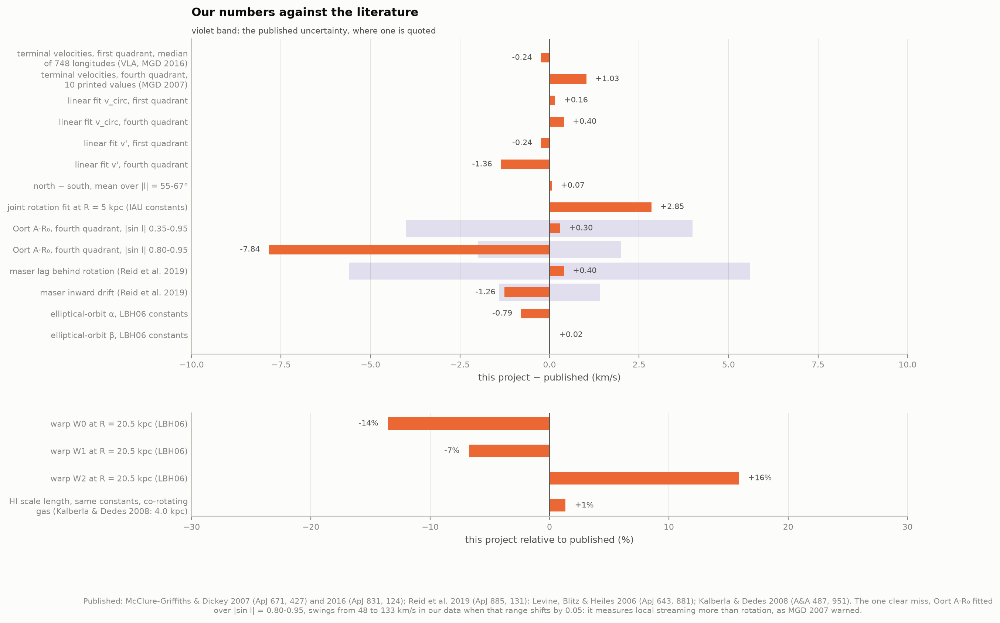
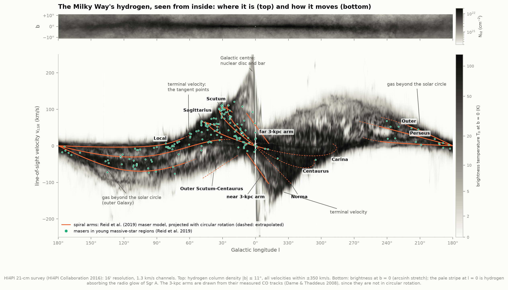
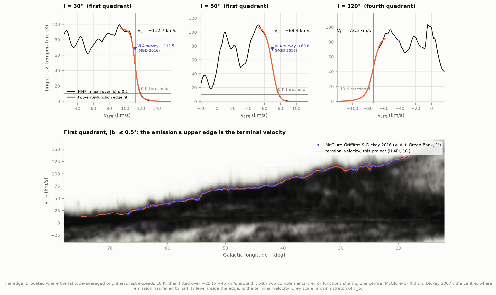
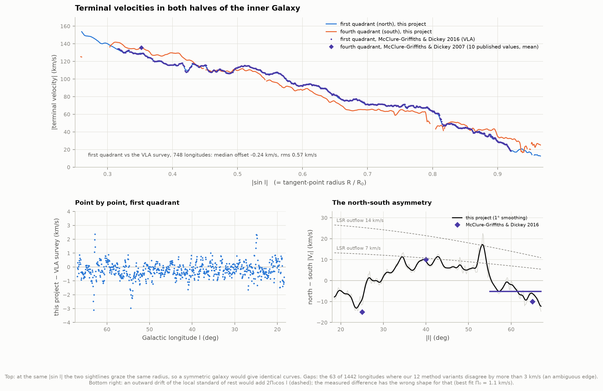
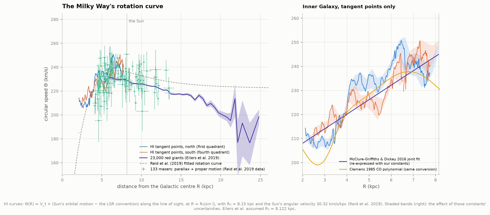
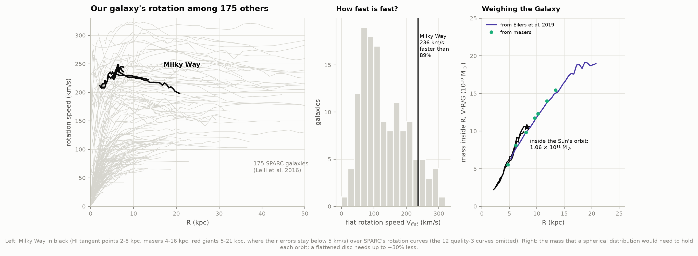
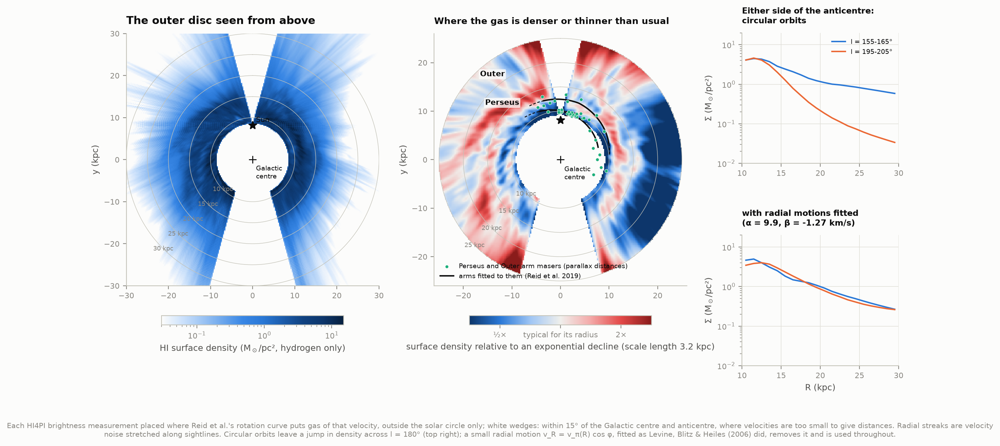
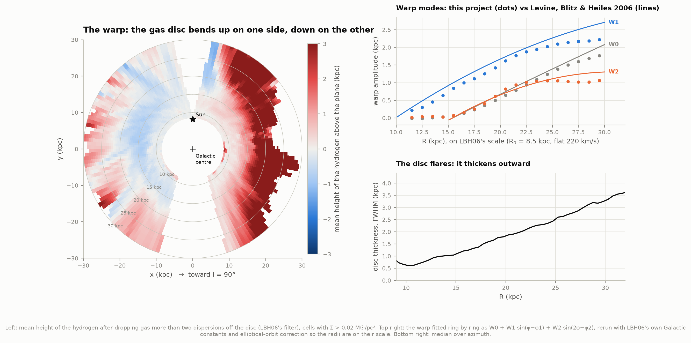

# H2 — Our own rotation curve from 21-cm hydrogen

**Project D4 measured how fast 175 other galaxies spin. Can we do the same for our own,
from inside it, using only the radio glow of its hydrogen gas?**

Yes. Cold hydrogen atoms emit a faint radio line at 21 cm (1420.4 MHz). The line's Doppler
shift tells us how fast the gas moves toward or away from us. This project takes the
HI4PI all-sky 21-cm survey and turns those velocities into three things:

1. **The inner rotation curve**: how fast the Galaxy turns from 2 to 8 kpc from its centre,
   measured separately in its northern and southern halves.
2. **A map of the outer disc seen from above**, out to 30 kpc: its spiral arms, its
   lopsidedness, and how it thins out with distance.
3. **The warp.** Far from the centre, the gas disc bends up on one side and down on the
   other, like a brim that has been sat on.

Every number is measured from the survey itself, from our own code, and then graded
against published results.

| | This project | Published |
|---|---|---|
| Terminal velocities, first quadrant, 748 longitudes | median offset −0.24 km/s, rms 0.57 | VLA + Green Bank survey, McClure-Griffiths & Dickey 2016 |
| Same, fourth quadrant (the 10 printed values) | mean offset +1.0 km/s | McClure-Griffiths & Dickey 2007 |
| North–south difference at \|l\| = 55–67° | −5.1 km/s | −5.2 km/s (MGD 2016) |
| Inner rotation curve, 4–7.7 kpc | 225–250 km/s, rising outward | (see below) |
| Young stars' lag behind rotation, from maser astrometry | 4.7 km/s | 4.3 ± 5.6 (Reid et al. 2019) |
| Mass inside the Sun's orbit | 1.06 × 10¹¹ M☉ | (V²R/G, spherical) |
| Outer HI disc scale length (same constants) | 4.05 kpc | 4.0 kpc (Kalberla & Dedes 2008) |
| Warp tilt W1 at R = 20.5 kpc | 1.62 kpc | 1.74 kpc (Levine, Blitz & Heiles 2006) |



---

## The Galaxy's hydrogen in one picture



**Top:** the hydrogen of the Galactic plane over all 360° of longitude, within 11° of the
plane. We sit inside the disc, so it wraps all the way around us.

**Bottom:** the keeper. Each column is one direction along the plane (b = 0°). Each dark
pixel is hydrogen emitting at that line-of-sight velocity. Galactic rotation turns this into
a lopsided "S":

- **Between l = 0° and 90°** (left of centre) gas is receding (positive velocities). Looking
  inward at longitude l, the fastest gas sits where the line of sight grazes the smallest
  orbit it meets, the **tangent point**, at radius R = R₀ sin l. The sharp upper edge of the
  emission is that gas: the **terminal velocity**. The same edge appears at negative
  velocities between l = 270° and 360°.
- **Between l = 90° and 270°** we look outward, through gas orbiting outside the Sun's
  circle: negative velocities on one side of the anticentre, positive on the other.
- The **orange tracks** are the spiral arms of Reid et al. (2019), traced by radio parallaxes
  of 199 masers in newborn massive-star regions (the green dots). Each track is projected into
  this diagram assuming circular orbits. The masers sit on hydrogen ridges, so the ridges are
  the arms.
- The **3-kpc arms** near the centre expand toward and away from us at 53–56 km/s. They are
  drawn from their measured CO tracks, because no circular orbit would put them there.
- The dark spike at l = 0° reaching ±250 km/s is the nuclear disc and bar. The pale vertical
  stripe through it is hydrogen seen in absorption against the radio glow of Sgr A.

A first finding is already visible here. In the second quadrant (l ≈ 100–135°) the 13 Perseus
masers sit a median 9 km/s (up to 29 km/s) more negative than circular rotation predicts at
their measured distances. The arm's gas and stars move toward us faster than circular rotation. Anyone who converts their
velocities to distances assuming circular orbits (a "kinematic distance") puts them too
far away. For 27 Perseus masers the kinematic distance is 1.17× the parallax distance
(median), and up to 4.7× for the worst. Xu et al. (2006) found this with the arm's first
parallax: W3(OH) is 1.95 kpc away, about half its kinematic distance.

---

## Measuring a terminal velocity



In a perfectly cold disc the emission would stop dead at the terminal velocity. Real gas
has random motions of several km/s, which soften the cliff into a slope, so "where the
emission ends" needs a definition. We use McClure-Griffiths & Dickey's (2007, 2016):

1. Average the spectra over |b| ≤ 0.5°.
2. Find the most extreme velocity where the brightness still exceeds 10 K. This only
   *locates* the cliff.
3. Fit the cliff with two error functions sharing one centre. That is the shape a step takes
   after being blurred by random motions of two different widths (a cold and a warm
   component). The shared centre is the terminal velocity: the point where the emission has
   fallen to half its level just inside the edge.

The bottom panel is the result along the whole first quadrant. Our orange line lies on top of
the VLA survey's points so closely that they are hard to tell apart. That survey used a
different telescope with 16× finer resolution (1′ against HI4PI's 16′). At l = 30° we measure
+112.7 km/s and they measured +112.5; at l = 50°, +69.4 against +69.8.

---

## Terminal velocities in both halves of the Galaxy



- **First quadrant.** Across all 748 of McClure-Griffiths & Dickey's longitudes (l = 18.4–67°),
  our values differ from theirs by a median of −0.24 km/s with an rms of 0.57 km/s. After
  smoothing their 1′ curve to our 16′ beam the rms is 0.43 km/s; the worst single point
  is 3.1 km/s off.
  They warned that single-dish surveys like HI4PI should read *low* next to bright radio
  sources: gas in front of a source absorbs its radio emission instead of emitting, which
  dims the spectrum near the edge. We see no sign of it here. Our largest residuals are at
  l = 54° and 63°, not at the brightest sources (W43 at 30.8°, W49 at 43.2°, W51 at 49.4°).
- **Fourth quadrant.** Their 2007 paper printed only 10 of its 1,000 values (the full table sits
  behind the journal's bot wall). There we differ by +1.0 km/s.
- **The standard summary fits** |V_t| = v_circ(1 − |sin l|) + v′ come out at 172.7 and 20.5 km/s
  in the north and 178.1 and 17.0 km/s in the south. McClure-Griffiths & Dickey (2016) found
  172.5, 20.7 and 177.7, 18.4.
- **Robustness.** We re-measured every longitude 12 ways: thresholds of 10 and 20 K, fitting
  windows of 20, 25 and 30 km/s, mean or median over latitude. The median spread is 0.45 km/s
  (north) and 0.55 km/s (south). Where the 12 disagree by more than 3 km/s the edge itself is
  ambiguous, and those longitudes are left out: 11 of 721 in the north and 52 of 721 in the
  south. Three stretches account for most of them: the Carina arm's tangent (l ≈ 288°), the
  G305 star-forming complex (l ≈ 305–307°), and the end of the bar (l = 342–345°), where gas is
  not on circular orbits. A different, model-free edge (where emission falls to half its
  nearby peak) lands within 0.12–0.25 km/s of the fit (median).

**The two halves do not rotate alike.** At the same |sin l| the two sightlines graze the same
radius, so a symmetric galaxy would give identical curves. The difference, north minus south,
is −9 km/s at |l| = 25°, +9 at 40° and −6 at 65°. McClure-Griffiths & Dickey (2016) describe
the same pattern as −15, +10 and −10 km/s. Over |l| = 55–67° the mean is −5.13 km/s; they
measured −5.2. An old explanation is that the local standard of rest drifts outward at a speed
Π₀, which would add 2Π₀cos l. The best fit is Π₀ = 1.1 km/s, and it removes none of the scatter
(rms 7.4 km/s before and after). The asymmetry is in the gas's own motions: spiral arms and the
bar.

**Oort's A constant, and where our reproduction fails.** Near l = 90° the slope of the terminal
velocities measures 2A·R₀, where Oort's A describes how the rotation rate changes near the
Sun. Over |sin l| = 0.35–0.95 we get A·R₀ = 89.3 ± 0.5 km/s against MGD07's 89 ± 4. Over the
narrow range 0.80–0.95 they found 110 ± 2 and we find 102. But in our data that local value
swings from 48 to 133 km/s when the range shifts by just 0.05 in sin l. It measures local
streaming more than rotation, as MGD07 themselves warned.

---

## The rotation curve



At a tangent point the gas's orbit runs straight along the line of sight, so its whole orbital
speed shows up as Doppler shift: Θ(R) = V_t + (our own motion along that line of sight). "Our
own motion" needs care. The survey's velocities are quoted relative to the **LSRK**, a frame
defined by an early-20th-century convention as the Sun minus 20 km/s toward RA 18h,
Dec +30° (1900 coordinates). It is not
a circular orbit. So we need the Sun's *true* orbital speed. It is best known from Sgr A*, the
black hole at the centre, which drifts across our sky at 6.4 mas/yr purely because the Sun
orbits: the Sun's angular speed is 30.32 ± 0.27 km/s/kpc (Reid et al. 2019). With
R₀ = 8.15 kpc, the LSRK frame moves at 231.8 km/s in the direction of rotation. The
textbook shortcut (the LSR moves at Θ₀ = 236 km/s) would put every point 1–4 km/s too high.

What comes out, in 0.25 kpc bins:

| R (kpc) | 2.6 | 3.1 | 3.6 | 4.1 | 5.1 | 6.1 | 7.1 | 7.6 |
|---|---|---|---|---|---|---|---|---|
| North, Θ (km/s) | 207 | 208 | 217 | 232 | 236 | 243 | 241 | 236 |
| South, Θ (km/s) | 213 | 215 | 216 | 228 | 226 | 239 | 245 | 244 |

The curve rises from about 210 km/s at 2.5–3.5 kpc to 235–245 km/s at 6–7.6 kpc, with bumps
of ~10 km/s at the spiral arms' tangents. The largest is the Sagittarius arm's at l ≈ 50°
(R ≈ 6.2 kpc) in the north. The shaded bands show how the curve moves if R₀, the Sun's
angular speed and its radial motion are varied within their uncertainties: typically 2–8 km/s. Changing
R₀ slides points along a line of slope 30 km/s/kpc, because R and the Sun's contribution scale
together.

Recomputed with the old IAU constants (R₀ = 8.5 kpc, Θ₀ = 220 km/s), a joint straight-line fit
gives Θ/Θ₀ = 0.181 R/R₀ + 0.896. McClure-Griffiths & Dickey found 0.171, 0.889 (2016) and
0.186, 0.887 (2007).

**Two independent checks.**

- **Masers, measured with distances instead of tangent points.** From Reid et al.'s published
  parallaxes, proper motions and velocities we computed each maser's full 3D orbital velocity
  ourselves. The same cuts as theirs (R > 4 kpc, parallax errors under 20%, their 11 outliers
  removed) keep 144 sources; they kept 147. On average these young stars lag circular
  rotation by 4.7 km/s and fall inward at 4.7 km/s. Reid et al. fitted 4.3 ± 5.6 and
  6.0 ± 1.4 km/s.
- **Red giants (Eilers et al. 2019)**: 23,000 stars from Gaia, APOGEE and WISE, 5–25 kpc
  from the centre. Their curve sits at 227–231 km/s from 5 to 8 kpc, 5–15 km/s below our
  gas tangent points at 6–8 kpc, with the masers in between. Part of that gap is a known
  3% disagreement over the local circular speed: Eilers et al. derive 229 km/s, Reid et al.
  236 km/s. Part is that tangent points pick out the fastest gas on each sightline, arm
  streaming included.

---

## The Milky Way among other galaxies



Put next to project D4's 175 SPARC galaxies, the Milky Way is a big, fast spiral. It rises
fast and stays nearly flat. Only 15 of the 135 SPARC galaxies with a measured flat speed
(11%) rotate faster.

The speed of an orbit weighs everything inside it. Assuming a spherical mass distribution,
M = V²R/G:

- 4.8 × 10¹⁰ M☉ inside 4 kpc and 1.03 × 10¹¹ M☉ inside 7.5 kpc, from our tangent-point curve;
- 1.06 × 10¹¹ M☉ inside the Sun's orbit, with Reid et al.'s 236 km/s;
- 2.3 × 10¹¹ M☉ inside 25 kpc, from the red giants.

A flattened disc needs up to ~30% less than the spherical estimate. Either way, the mass keeps
growing long after the stars thin out, as in D4's galaxies.

---

## The outer disc seen from above



Outside the Sun's orbit, a line of sight crosses each orbit only once. So if the gas moves on
circular orbits, its velocity gives its distance. Every HI4PI measurement then becomes gas at
a point in space, and the survey can be redrawn as a view of the disc from above. (Inside
the solar circle this fails: every line of sight crosses each orbit twice, near and far.) We
follow Levine, Blitz & Heiles (2006, "LBH06"). Walk out along each of 1.1 million
sightlines in 0.1 kpc steps. At each step, read the brightness at the velocity the rotation
curve predicts there. Brightness per unit velocity times how fast velocity changes with
distance gives the gas density. Directions within 15° of the Galactic centre and anticentre
are skipped: there the velocities are too small to give distances.

**Circular orbits do not quite work.** With pure circular orbits the map shows a jump in density
across the anticentre (l = 180°): at R = 29 kpc the two sides differ 17-fold (top right). LBH06
fixed this with a small, slowly growing radial motion v_R = v_π(R) cos φ, where
v_π = α(R − R₀)/R₀ + β((R − R₀)/R₀)². They chose α and β to make the two sides match. We
repeated their fit on HI4PI:

| | α (km/s) | β (km/s) |
|---|---|---|
| LBH06 (LAB survey, R₀ = 8.5 kpc, flat 220 km/s) | 8.67 | −1.08 |
| This project, same constants | 7.9 | −1.06 |
| This project, our constants (used for every map) | 9.9 | −1.27 |

With it, the mismatch drops from χ² = 1137 to 0.6. The implied radial motions are only 8 km/s
at 16 kpc and 17 km/s at 30 kpc, well under 10% of the rotation speed.

What the map shows:

- **An exponential disc.** The hydrogen thins out with a scale length of 3.2 kpc (12–25 kpc)
  with our constants. With the old IAU constants it is 4.05 kpc. Kalberla & Dedes (2008) found
  4.0 kpc with those constants for gas that co-rotates at all heights, as we assume, and
  3.75 kpc if high gas lags. With the same constants, our surface densities agree with theirs
  within ~20% beyond 16 kpc. Inside 14 kpc ours are ~40% lower (5.7 M☉/pc² against their ~10). There our |b| ≤ 11°
  limit misses high-latitude gas close to the Sun. Kalberla & Dedes also note their inner
  value is twice that of earlier reviews.
- **Spiral structure, blurred.** The right panel shows density relative to the exponential
  decline. Arcs of denser gas are visible. The clearest sweeps from R ≈ 13 kpc at l ≈ 225° out
  to R ≈ 20 kpc at l ≈ 280°. But kinematic distances are uncertain by 1–2 kpc (the Perseus
  masers show how much), so the arcs are smeared. They do not line up cleanly with the arms
  fitted to the masers, which are measured only within a few kpc of the Sun.
- **A lopsided disc.** Beyond ~15 kpc, the half of the disc on the l ≈ 90° side holds less gas
  than the other half. LBH06 report a low-density region at R ≈ 27 kpc, φ ≈ 90° on the same
  side.
- In total we map 3.0 × 10⁹ M☉ of hydrogen outside R = 8.65 kpc, not counting the excluded
  wedges or helium.

---

## The warp and the flare



The mean height of the gas above the plane (left) shows the warp. On the side toward
l ≈ 90° the disc rises steadily, reaching 3 kpc at R ≈ 20–25 kpc. On the other side it dips
slightly and then curls back up. Following LBH06, we fit each ring with a lift (W0), a tilt
(W1) and a saddle (W2): z(φ) = W0 + W1 sin(φ − φ1) + W2 sin(2φ − φ2).

Rerun with LBH06's own constants so the radii line up, our amplitudes at R = 20.5 kpc are
W0 = 0.64 kpc, W1 = 1.62 kpc and W2 = 0.82 kpc. Their growth curves give 0.74, 1.74 and 0.71.
The tilt's highest point stays at φ ≈ 80–90° from 14 to 27 kpc, just as LBH06 found (the warp's
"line of nodes" lies close to the Sun–centre line). The W0 and W2 terms together push *both*
sides up at large radius. That is why the northern warp looks so much bigger than the southern
one.

Before trusting this we checked the coverage. With the Galactic-plane cubes alone (|b| ≤ 11°),
the top of the warped layer ran off the data in 20–44% of map cells beyond R = 16 kpc, on the
rising side. That would have made the warp look smaller than it is. So the project also
fetches the seven HI4PI cubes just north of the plane at l = 20–160° (b up to +31°).

**The flare.** The disc thickens outward. Its apparent full thickness grows from 0.6 kpc at
R = 10 kpc to 3.3 kpc at 30 kpc. Kalberla & Dedes' flaring law gives 0.36 and 2.8 kpc. Our
values are upper limits, most inflated close in, because velocity scatter of a few km/s
smears kinematic distances and so smears the heights computed from them.

---

## How it works

```
HI4PI cubes (CDS, HTTP byte ranges)
   │
   ├── latitude-averaged longitude-velocity diagrams ──► terminal velocities (edge fits, 12 variants)
   │                                                       └─► rotation curve Θ(R), both quadrants
   └── every sightline, |b| ≤ 11° (to +31° in the north) ──► kinematic distances ──► face-on maps,
                                                              warp and flare, anticentre fit
Reid et al. 2019 masers ──► our own 3D orbits ─────────────► independent rotation check
McClure-Griffiths & Dickey, Eilers et al., SPARC, LBH06 ────► comparison only
```

**The data.** HI4PI (HI4PI Collaboration 2016) merges the Effelsberg-Bonn HI Survey (north of
the celestial equator) with the Parkes Galactic All-Sky Survey (south of it): 16.2′ resolution,
1.29 km/s channels, 43 mK noise. It is released as 20° × 20° cubes of 264 MB each. A cube stores
one sky image per velocity channel, one after another. So the velocities we need
(|v| ≤ 350 km/s, which holds all the disc's gas) form one contiguous stretch of bytes, and HTTP
range requests fetch exactly that. We take 25 cubes, 3.8 GB instead of 6.6 GB. Each saved file
records which bytes of which original it holds. (The two telescopes meet at l = 33° in the
plane. There is no step in the terminal velocities there: against the single-telescope VLA
survey, our mean residual stays between −0.25 and −0.05 km/s in every 2° bin from l = 29° to 37°.)

**Conventions**, pinned in `test_physics.py`: the Galaxy turns clockwise seen from the north
Galactic pole. The survey's velocities are LSRK, converted explicitly. A terminal velocity is
checked to equal the extreme velocity found by brute-force search along a model sightline. A
star put on a circular orbit, turned into parallax, proper motion and LSRK velocity and back,
returns its orbital speed to 0.001 km/s. Reid et al.'s spiral-arm model reproduces their
published fourth-quadrant tangent longitudes to within 0.3°.

---

## What to watch out for

- **Terminal velocities measure gas, not gravity.** They record the fastest gas on each
  sightline, streaming motions near arms included (±5–10 km/s). The bumps in the rotation curve
  are real motions, not errors, but they are not all circular rotation.
- **The Galactic constants are inputs.** R₀ = 8.15 ± 0.15 kpc, the Sun's angular speed
  30.32 ± 0.27 km/s/kpc and its radial motion 10.6 ± 1.2 km/s (Reid et al. 2019) enter every
  rotation speed and every distance. The shaded bands show their effect on the inner curve.
- **Where the method stops.** Inside l ≈ 15° the bar drives non-circular orbits (the
  fourth-quadrant values already go unstable at l > 342°). Beyond |sin l| ≈ 0.95 the terminal
  velocity shrinks to the size of the random motions. That limits the tangent-point curve to
  R ≈ 2–7.7 kpc.
- **Kinematic distances in the outer disc** are only as good as the circular-orbit assumption.
  Perseus-arm distances come out 17% too large on average and up to 4.7× for the worst
  maser. The radial streaks in the maps are velocity noise stretched along sightlines. The
  elliptical-orbit correction is empirical, as it was for LBH06.
- **Beyond ~22 kpc in the far fourth quadrant**, some mapped "disc" may be the Magellanic
  Leading Arm, gas torn from the Magellanic Clouds that crosses that part of the sky at
  similar velocities.
- **Optically thick gas** is corrected assuming a spin temperature of 155 K (LBH06's choice);
  outside the solar circle almost all the gas is optically thin anyway.
- **Masses** use V²R/G, which assumes a spherical distribution.

---

## Running it

```bash
cd ..                       # repository root
source .venv/bin/activate   # numpy, scipy, matplotlib, astropy

cd 18-milky-way-rotation
python fetch_data.py        # 3.8 GB from CDS, ~30-40 min the first time, resumable
python run.py               # everything: analysis, 8 figures, graded summary
python test_physics.py      # 38 self-checks on the geometry and frames
```

The first `run.py` also builds the outer-disc maps and fits the elliptical-orbit correction,
which takes about 12 minutes. After that everything is cached in `data/products/` and a rerun
takes about 2 minutes, with no network. `python run.py --refresh-outer` rebuilds the maps.

| File | What it does |
|---|---|
| `config.py` | Paths, data sources, every assumed number |
| `fetch_data.py` | Downloads the HI4PI velocity subsets by byte range, plus the reference tables, with a provenance manifest (URL, byte range, SHA-256) |
| `survey.py` | Treats the 25 cubes as one survey; the longitude-velocity diagrams and column-density map |
| `galaxy.py` | Velocity frames, rotation curves, sightline geometry, kinematic distances, the spiral-arm model |
| `terminal.py` | The terminal-velocity edge fit |
| `outer.py` | The face-on maps, vertical structure, warp fits and the anticentre fit |
| `reference.py` | Readers for the comparison data; the maser orbits |
| `analysis.py` | Every measurement and comparison, written to `data/results.json` |
| `figures.py`, `plotstyle.py` | The figures (PNG and SVG) |
| `run.py` | Runs everything and prints the graded summary |
| `test_physics.py` | Checks the conventions against known answers |

**Figures:** `00_comparison` our numbers against the literature · `01_lv_diagram` the hydrogen
sky and the longitude-velocity diagram · `02_measuring_terminal_velocity` the edge fit ·
`03_terminal_velocities` both quadrants, point by point, and the asymmetry ·
`04_rotation_curve` HI, masers and red giants · `05_milky_way_among_galaxies` SPARC context
and the enclosed mass · `06_outer_disc` the face-on map and the anticentre fit · `07_warp`
warp and flare. The colours follow the portfolio's colourblind-safe palette: blue for the
north, orange for the south, violet for published results.

---

## Data credits

- **HI4PI**: HI4PI Collaboration, Ben Bekhti et al. 2016, A&A 594, A116, from the CDS
  (`J/A+A/594/A116`), retrieved 2026-09-30. It combines EBHIS (Winkel et al. 2016;
  Effelsberg 100-m) and GASS (McClure-Griffiths et al. 2009; Kalberla & Haud 2015; Parkes 64-m).
- **Terminal velocities**: McClure-Griffiths & Dickey 2016, ApJ 831, 124 (CDS
  `J/ApJ/831/124`); McClure-Griffiths & Dickey 2007, ApJ 671, 427 (the values and fits
  printed in the paper).
- **Masers**: Reid et al. 2019, ApJ 885, 131 (CDS `J/ApJ/885/131`); their spiral-arm model
  (Table 2) and rotation curve (Appendix B).
- **Red giants**: Eilers, Hogg, Rix & Ness 2019, ApJ 871, 120 (Table 1, from the arXiv
  source).
- **SPARC**: Lelli, McGaugh & Schombert 2016, AJ 152, 157.
- **Comparison only**: Clemens 1985, ApJ 295, 422 (CO rotation curve polynomial); Dame &
  Thaddeus 2008, ApJ 683, L143 (3-kpc arms); Levine, Blitz & Heiles 2006, ApJ 643, 881 (warp,
  elliptical orbits); Kalberla & Dedes 2008, A&A 487, 951 (surface density, flaring); Xu et
  al. 2006, Science 311, 54 (Perseus parallax).
