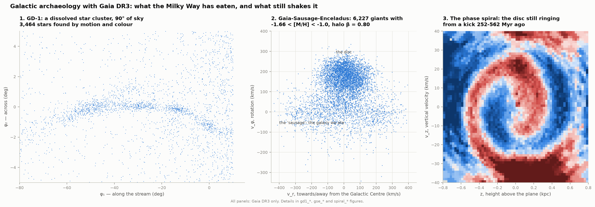
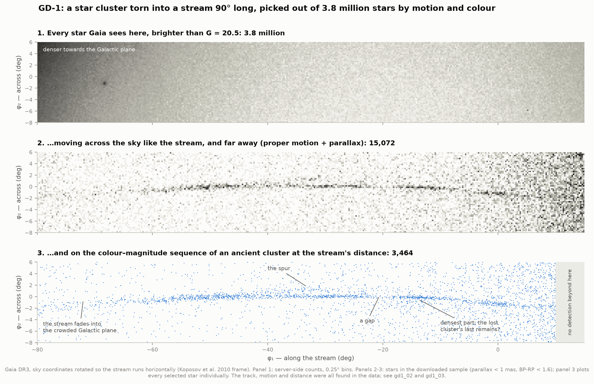
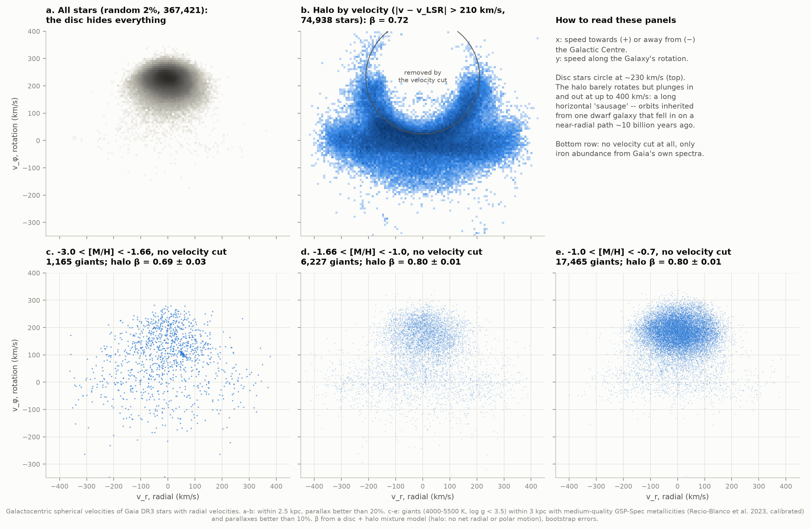
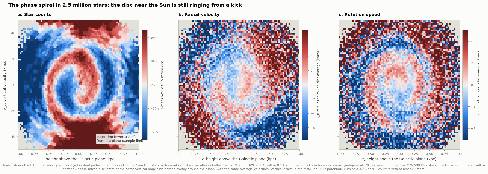

# H3 — Galactic archaeology with Gaia

**The Milky Way grew by swallowing smaller galaxies and star clusters. Can we find their
remains in Gaia's six-dimensional catalogue — a star cluster torn into a stream, the debris of
a galaxy eaten ten billion years ago — and see the disc still ringing from a more recent
disturbance?**

Yes, all three, from Gaia DR3 alone:

| | What it is | What we found |
|---|---|---|
| **1. GD-1** | A globular cluster pulled apart by the Milky Way's tides into a thin stream across the northern sky | Picked out of 3.8 million stars by its motion and colour: 3,464 members over 90° of sky, 7.8 kpc away at its nearest and 11.6 kpc at its far end, a 78%-deep gap, and the "spur" of stars knocked off the stream (33 stars where 2 are expected) |
| **2. Gaia-Sausage-Enceladus** | A dwarf galaxy of a few billion suns that fell into the Milky Way ~10 billion years ago | Its stars' strongly radial orbits (anisotropy β ≈ 0.8), found both with a velocity cut and — the non-circular route — with Gaia's own metallicities and no velocity cut at all; typical [M/H] = −1.16; poorer in α-elements than the Milky Way's thick disc at the same iron abundance |
| **3. The phase spiral** | A "snail shell" in the up-and-down motions of 2.5 million stars near the Sun | The disc was disturbed 250–560 Myr ago (median 360 Myr), in a potential that matches the local disc's measured mass; published: 300–900 Myr |

Plus an offline interactive page, **`figures/halo_explorer.html`**: slide through iron
abundance and watch the halo change shape, with no velocity cut anywhere.



(1 kpc = 1,000 parsecs = 3,262 light years; the Sun is 8.1 kpc from the Galactic Centre. A
proper motion of 1 mas/yr is a drift of a thousandth of an arcsecond across the sky per year.
[Fe/H] or [M/H] is iron abundance relative to the Sun on a log scale: −1 means a tenth of the
Sun's.)

---

## Results

### 1. GD-1: a star cluster torn into a stream



The pipeline is told only **where** GD-1 lies on the sky — its track has been known since its
discovery in 2006, and Koposov et al. (2010) defined coordinates along it (φ₁ along the stream,
φ₂ across). Its motion and its distance are found in the data.

| | This work (Gaia DR3 only) | Published |
|---|---|---|
| Stars brighter than G = 20.5 in the 95° × 14° field | 3,800,803 | |
| Members (motion + colour–magnitude + parallax) | **3,464**; 1,521 within 0.75° of the midline, of which ~213 are expected field stars | |
| Detected along | **φ₁ = −80° … +10° (90°)** | ≈ −90° … +10° (PWB2018, Gaia DR2 + Pan-STARRS) |
| Proper motion at φ₁ = −13.7° (μφ₁, μφ₂) | (−10.92, −2.50) mas/yr: **0.17 mas/yr** from theirs | (−10.76, −2.54) mas/yr (PWB2018, rotated into the stream frame) |
| Distance at φ₁ = −45°, −25°, −5° | **7.81, 8.65, 10.04 kpc** | 7.59, 8.69, ≈9.5 kpc (Koposov et al. 2010) |
| Distance gradient | **0.0098 ± 0.0012 mag/deg** | ≈0.012 (Koposov et al. 2010) |
| Members' mean parallax vs the photometric distance | agree: **−0.0036 ± 0.0079 mas**, χ² = 8.9 for 8 segments | |
| Gap G-20 | **φ₁ = −20.5°, 78% deep, 5.6σ** | −20° (PWB2018; Bonaca et al. 2019) |
| Gap G-40 | a 36% dip at −39.5°, 2.3σ (marginal here) | −40.5° (Bonaca et al. 2019) |
| Gap at −6.5° | **65% deep, 4.2σ** | "roughly symmetric under-densities on either side" of −13.5° (PWB2018) |
| Densest point | **φ₁ = −14.5°** | −13.5°: candidate site of the dissolved cluster (PWB2018) |
| The spur (φ₁ −36…−30°, 0.9–1.7° above the stream) | **33 stars vs 2** in the mirror box below (p = 10⁻²⁸) | significant (PWB2018) |
| The blob (φ₁ −18…−12°, below) | 26 vs 12 (p = 3 × 10⁻⁴) | marginal (PWB2018) |
| Spectroscopic members of Huang et al. (2019) | **65 of the 66 in our field recovered** | 67 confirmed |
| Gaia radial velocities of our brightest members | 3 of 4 on the published velocity curve | |

### 2. Gaia-Sausage-Enceladus: the galaxy we ate



| | This work | Published |
|---|---|---|
| Halo stars within 2.5 kpc (\|v − v_LSR\| > 210 km/s) | **74,938 — 0.41% of all stars** | Helmi et al. (2018)'s definition |
| Halo anisotropy with that velocity cut | β = 0.72 | |
| Halo anisotropy **with no velocity cut**, by metallicity | **β = 0.26–0.34** below [M/H] ≈ −2.2 → **0.74–0.83** above −2.0 | 0.2–0.4 → ≈0.9 above [Fe/H] ≈ −1.7 (Belokurov et al. 2018) |
| What a velocity cut keeps of the chemically found halo | **44–57%** of the round metal-poor halo, **73–83%** of the sausage; 79–95% of what it keeps is halo | |
| Stars in the published boxes, halo within 5 kpc | GSE 77,205 (Helmi box) / 12,343 (Koppelman box); Sequoia 723; Thamnos 391 + 5,746; Helmi streams 382 | |
| GSE metallicity (near-radial orbits, 403 giants) | **median −1.16**, quartiles −1.42 / −0.91 | −1.17 ± 0.34 (Feuillet et al. 2021); peak −1.3 (Myeong et al. 2019); peak −1.6 (Helmi et al. 2018) |
| Sequoia metallicity (11 giants) | median −1.63 | −1.6 (Myeong et al. 2019) |
| [α/Fe], GSE minus thick disc at the same [M/H] | **−0.037 ± 0.010 dex** (3.5σ) | ≈ −0.1 to −0.15 dex with APOGEE (Helmi et al. 2018) |
| The halo's colour–magnitude diagram | two parallel sequences; GSE stars on the blue one | Helmi et al. (2018) Fig. 2c |

### 3. The phase spiral: the disc is still ringing



| | This work | Published |
|---|---|---|
| Stars in the ring (R₀ ± 0.1 kpc) | **2,499,904** (3,031,433 before the RUWE cut) | 935,590 in DR2 (Antoja et al. 2018) |
| Time since the disturbance | **250–560 Myr** across tracers and orbit ranges, median **360 Myr** | 300–900 Myr, best ≈500 (Antoja et al. 2018) |
| … from star counts / rotation speed / radial velocity (orbits reaching 0.3–1 kpc) | 360 / 494 / 324 Myr | |
| Local disc surface density Σ(\|z\| < 1.1 kpc) in the potential used (McMillan 2017) | 76 M☉/pc² | 68 ± 4 measured (Bovy & Rix 2013) |
| … in the Helmi et al. (2017) potential | 97 M☉/pc²: too heavy, so the spiral looks too young (192–292 Myr) | |

---

## Five things worth looking at

1. **`gd1_01_stream_emerges`** — the before and after. 3.8 million stars make a smooth grey
   sea; keeping only those that move like GD-1 and look like an ancient, metal-poor
   population leaves 3,464, and they draw a line 90° long across the sky. Nothing about GD-1's
   motion or distance was typed in.

2. **`gd1_05_spur`** — 33 stars sit 1–1.7° above the stream near φ₁ = −33°, where the mirror box
   below it holds 2. Bonaca et al. (2019) showed that a compact object of 10⁶–10⁸ M☉ flying
   through GD-1 would open the neighbouring gap and throw exactly this kind of spur off the
   stream. No known star cluster or dwarf galaxy came close enough, which makes a clump of dark
   matter the leading suspect.

3. **`halo_explorer.html` / `gse_02_sausage`** — stars grouped *only by iron abundance* (from
   Gaia's own spectra), no cut on velocity at all, and the sausage appears: from [M/H] ≈ −2
   upwards the halo's stars barely rotate but plunge in and out of the Galaxy at up to
   400 km/s. Below −2.2 the halo is a round cloud instead (β ≈ 0.3): the swallowed galaxy
   brought stars of middling metallicity, not the most metal-poor ones.

4. **`gse_06_hr_diagram`** — halo stars form two parallel colour–magnitude sequences, and the
   stars in the Gaia-Enceladus box sit on the bluer one: a separate, more metal-poor
   population, another galaxy's stars.

5. **`spiral_01_snail_shell`** — 2.5 million stars, each compared with what a perfectly settled
   disc would look like, leave a spiral in height against vertical velocity. It exists only
   because something (most likely the Sagittarius dwarf galaxy) disturbed the disc a few
   hundred million years ago, and the stars have been shearing apart ever since.

---

## How it works

### Data (Gaia DR3, from ESA's archive)

| Sample | Cut made on the server | Rows | Size |
|---|---|---|---|
| GD-1 field | φ₁ −80…+15°, φ₂ −8…+6°, G < 20.5, parallax < 1 mas, BP−RP < 1.6 | 1,677,170 | 173 MB |
| GD-1 count map | every star with G < 20.5 in the field, counted in 0.25° bins on the server | 3,800,803 stars | 0.5 MB |
| M92 | 0.3° cone | 26,343 | 3 MB |
| Ring | radial velocity, parallax/error > 5, \|R − R₀\| < 0.105 kpc | 3,175,932 | 273 MB |
| Fast stars + 2% random | radial velocity, parallax/error > 5, \|v − v_LSR\| > 150 km/s **or** random_index in the first 2%; GSP-Spec and Bailer-Jones distances joined | 3,245,982 | 629 MB |
| Metal-poor | radial velocity, parallax/error > 5, GSP-Spec [M/H] < −0.7; no cut on velocity | 381,943 | 74 MB |

Plus the SFD dust map (NASA LAMBDA, 25 MB) and Huang et al.'s (2019) GD-1 members (VizieR
J/ApJ/877/13). The all-sky samples were fetched as 48 or more patches of sky and each checked
row for row against a server-side count. Stream coordinates, Galactic velocities and the ring
radius were computed inside the archive's queries; `test_physics.py` evaluates those exact
ADQL strings with numpy and checks them against astropy (to 10⁻¹² km/s).

### 1. GD-1

1. **The filter.** M92 is an ancient ([Fe/H] = −2.31), metal-poor globular cluster at almost the
   same distance as GD-1 (8.50 kpc), so its colour–magnitude diagram — as Gaia measured it, with
   Gaia's noise at the same apparent magnitudes — is a ready-made template. 4,983 M92 members,
   picked by their shared motion outside the crowded core, give the sequence and its width. GD-1
   itself was discovered in 2006 with a filter built from another cluster.
2. **The motion.** Stars on the stream track and in control bands 2–5.5° beside it are counted
   in proper-motion space, 10° at a time along the stream. The stream is a knot on the track
   that the control bands lack, up to 89σ. A second pass follows the fitted midline and searches
   near the first-pass track; a cubic through the detections is the stream's motion.
3. **The distance.** Stars moving with the stream minus the scaled control bands form a
   colour–magnitude sequence; sliding M92's over it (a matched filter weighted by the field's
   own colours) gives the distance modulus in 10° segments, with bootstrap errors.
4. **Members** match the motion (χ² < 5.99, allowing 0.5 mas/yr of spread), lie within 2σ of
   M92's sequence at the local distance, have a parallax consistent with being beyond 4 kpc, and
   lie where the stream's motion was detected.
5. **Density** along the stream: members within 0.75° of the midline minus the area-scaled
   control bands, in 3° windows. A **gap** is a dip below the lower of the highest points within
   10° on either side.

### 2. Gaia-Sausage-Enceladus

- Galactocentric positions and velocities with astropy's solar parameters (R₀ = 8.122 kpc,
  z☉ = 20.8 pc, v☉ = (12.9, 245.6, 7.78) km/s); distance = 1/parallax, as the papers compared
  with did.
- **Two potentials, because a published box only means something in its own:** Helmi et al.
  (2017)'s disc + bulge + NFW halo for Helmi et al.'s (2018) box in energy and angular momentum;
  McMillan (2017), via galpy, for Koppelman et al.'s (2019b) boxes in energy and circularity.
- **The non-circular route:** metallicities from Gaia's own RVS spectra (GSP-Spec, Recio-Blanco
  et al. 2023): medium-quality flags, their calibration, cool giants only (4000–5500 K,
  log g < 3.5), parallaxes better than 10%, within 3 kpc. In each metallicity bin a Gaussian
  mixture fits one or two disc components (chosen by BIC) plus a halo with no net radial or
  polar motion; β is the halo's, 1 − (σ_θ² + σ_φ²)/(2σ_r²).

### 3. The phase spiral

- The ring: stars with 3D motions within 0.1 kpc of the Sun's Galactocentric radius (Antoja et
  al.'s cut, in DR3).
- Each star's vertical orbit in the McMillan (2017) potential gives its **amplitude**, its
  **frequency** Ω_z and its **phase** θ_z around the loop (checked against a direct integration
  with galpy's forces to 0.01%).
- **Maps:** each star is compared with a perfectly phase-mixed disc, in which stars of the same
  amplitude spread evenly around the loop with the same average velocities.
- **Dating:** a spiral that has wound for a time t has phase θ = θ₀ + Ω t. Stars are grouped by
  frequency; each group's lopsidedness is a complex number whose phase is rotated back by Ω t,
  and the t at which the groups add up best is the age. Three tracers (star counts, rotation
  speed, radial velocity) and six ranges of orbit amplitude: the spread is the uncertainty.

---

## What this cannot tell you

- **GD-1's gaps are not proof of dark matter.** They are what a dark-matter clump would do, but
  the dissolving cluster itself may have made G-20 (PWB2018), and the Galactic bar or giant
  molecular clouds are possible, if unlikely for GD-1's orbit. With Gaia photometry alone, G-40
  is only a 2.3σ dip; deeper photometry shows it clearly.
- **Every halo selection shapes the halo.** The velocity cut finds only half of the round,
  metal-poor halo, so it over-represents Gaia-Enceladus. The chemical route selects too:
  GSP-Spec measures bright giants (G ≲ 13), so that halo lives within ~3 kpc, and ~0.1–0.2 dex
  metallicity errors blur the bins.
- **The published boxes are selections, not detections.** Their chemistry says what they catch:
  Sequoia's giants have [M/H] = −1.63 and Thamnos 2's −1.29, both halo-like, but only 11 and 136
  giants have trustworthy spectra, and 3 in Thamnos 1.
- **Energies and the spiral's age depend on the model of the Galaxy's gravity.** A disc 30% more
  massive than McMillan's makes the spiral look ~40% younger. The spiral need not come from a
  single event either: several passages of the Sagittarius dwarf, or the bar, could overlap —
  which may be part of why the tracers disagree (250–560 Myr).

---

## Honest notes on the numbers

- **Things that went wrong and were fixed** (each is commented in the code):
  - The GD-1 midline was first a 4th-order polynomial that missed the bend near φ₁ = −5°, so the
    control bands caught stream stars and biased the blob test. A smoothing spline fixed it, and
    made the stream detectable over 90° instead of 60°.
  - The stream's motion is a polynomial fitted where it was detected; beyond that it runs into
    the field stars' own motion and thousands of them would pass as members. Members are limited
    to where the stream was detected.
  - Members' mean parallaxes first disagreed with the photometric distances at 6σ. The error bars
    had assumed each star's own parallax error was the only uncertainty, but one bright field star
    at 0.5 mas moves a segment's mean far more. Bootstrap errors and subtracting the control bands
    give agreement (−0.0036 ± 0.0079 mas).
  - Half of GSP-Spec's "[M/H] < −1.66" stars sat on cold thin-disc orbits, with a median
    temperature of 7,475 K: GSP-Spec metallicities are unreliable for hot stars, and the kinematics
    gave them away. Only cool giants are used (11% of those metal-poor giants are on disc orbits,
    as a real metal-weak disc would be).
  - galpy's McMillan (2017) potential, tabulated on a grid for speed, had the right values but a
    midplane curvature a few per cent off; that curvature sets the vertical frequencies, so the
    vertical profile is evaluated directly.
- **The distances** are tied to M92's (8.50 ± 0.07 kpc; Baumgardt & Vasiliev 2021). The distance
  modulus the Gaia collaboration adopted for M92 in its HR-diagram paper (14.595; Babusiaux et al.
  2018) puts it at 8.30 kpc; every GD-1 distance would then scale down by the same 2.4%. Koposov et al.'s distances are 10% lower
  than their isochrones gave, by their own correction; they noted an M92-based fiducial "may give
  more consistent results". The parallaxes, which use no stellar models, agree with ours.
- **The proper motion** matches Price-Whelan & Bonaca's to 0.17 mas/yr at φ₁ = −13.7° (7 km/s at
  9 kpc): our track is a smooth curve through 10° segments, theirs a local mean.
- **Only 3 of the 4** Gaia radial velocities among our brightest members follow the published
  curve: the bright giant branch is where field stars contaminate the selection most.
- **GSP-Spec's [α/Fe]** separates Gaia-Enceladus from the thick disc by a third of what APOGEE
  finds, and rises steeply towards low metallicity for both populations.
- **The anisotropies** (0.74–0.83) sit below Belokurov et al.'s ≈0.9, and the change from round to
  radial comes at [M/H] ≈ −2.1 on GSP-Spec's scale rather than −1.7 on SDSS's. Our stars are
  within 3 kpc and near the disc, theirs 1–10 kpc away; the metallicity scales differ; and a
  Gaussian halo is only a rough description of a sausage.
- **The data are 1.2 GB**, above the atlas's 0.2–1 GB estimate: the fast-star file is 629 MB,
  half of it distant inner-disc stars whose speed relative to the Sun comes from the disc's
  rotation. They are dropped on loading; nothing uses stars beyond 5 kpc.

---

## Running it

```bash
cd astrophysics
source .venv/bin/activate
pip install gala galpy gaiadr3-zeropoint   # once; wheels exist for Python 3.14
cd 19-galactic-archaeology
python fetch_data.py      # ~1.2 GB from ESA's Gaia archive, ~75 minutes
python run.py             # every number, figure and the explorer; ~8 minutes, no network
python test_physics.py    # 48 self-checks against astropy, gala, galpy and known answers
```

### Files

| File | What it does |
|---|---|
| `config.py` | Paths, solar parameters, the two potentials, every selection number, and the published values used only for grading |
| `gaia_archive.py` | ESA synchronous TAP client: FITS output, chunking by sky, splitting on timeouts, row-cap and column-name checks |
| `fetch_data.py` | Builds the ADQL (stream coordinates and velocities computed on the server) and fetches everything |
| `galaxy.py` | Coordinate frames, Galactocentric velocities, solar reflex correction, potentials, circularity |
| `photometry.py` | SFD dust, Gaia extinction coefficients, BP/RP quality |
| `gd1.py`, `halo.py`, `spiral.py` | The three parts |
| `analysis.py`, `run.py` | Orchestration; writes `data/results.json` |
| `figures.py`, `plotstyle.py` | Figures |
| `interactive.py` | `figures/halo_explorer.html` |
| `test_physics.py` | Self-checks |

### Figures

| File | Shows |
|---|---|
| `00_overview` | The three results side by side |
| `gd1_01_stream_emerges` | 3.8 million stars → motion → colour–magnitude: the stream appears |
| `gd1_02_how_it_was_found` | M92's template, the motion search, the motion track, GD-1's own diagram |
| `gd1_03_distance` | Distance along the stream against Koposov et al. (2010), and the parallax check |
| `gd1_04_density_and_track` | Stars per degree (gaps, peaks) and the midline against Koposov et al. (2010) |
| `gd1_05_spur` | The spur, the blob and a control field, with counts |
| `gd1_06_confirmation` | Huang et al.'s spectroscopic members; radial velocities from three sources |
| `gse_01_toomre` | Thin disc, thick disc and halo by speed |
| `gse_02_sausage` | The sausage with a velocity cut and without one |
| `gse_03_anisotropy` | β against metallicity, against Belokurov et al. (2018); what a velocity cut does |
| `gse_04_integrals_of_motion` | Energy and angular momentum with the published debris boxes |
| `gse_05_chemistry` | [α/Fe] against [M/H]; Gaia-Enceladus's metallicity distribution |
| `gse_06_hr_diagram` | The halo's two sequences |
| `spiral_01_snail_shell` | The phase spiral in star counts, radial and rotation velocity |
| `spiral_02_dating` | The spiral unwound, the dating curves, the spread of ages |
| `halo_explorer.html` | Interactive: the halo in 0.3-dex windows of iron abundance, with a velocity-cut toggle and a table of every window's numbers |

---

## Next steps

- **An orbit for GD-1**: fit its track, motion, distance and radial velocities with one orbit in
  a Milky Way potential; the stream is retrograde, and its shape constrains the dark matter halo
  (Koposov et al. 2010; Bovy et al. 2016).
- **APOGEE DR17** chemistry for the halo (the atlas's optional add-on): sharper α sequences than
  GSP-Spec.
- **The phase spiral across the disc** (Hunt et al. 2022): its shape changes with guiding radius,
  which would test the single-kick picture.
- **More streams in the same data**: Pal 5, Jhelum, the Orphan–Chenab stream.

## Data credits

This work has made use of data from the European Space Agency (ESA) mission Gaia
(https://www.cosmos.esa.int/gaia), processed by the Gaia Data Processing and Analysis Consortium
(DPAC, https://www.cosmos.esa.int/web/gaia/dpac/consortium). Funding for the DPAC has been
provided by national institutions, in particular the institutions participating in the Gaia
Multilateral Agreement. Gaia DR3: Gaia Collaboration, Vallenari et al. (2023), A&A 674, A1.
GSP-Spec: Recio-Blanco et al. (2023). Distances: Bailer-Jones et al. (2021). Parallax zero-point:
Lindegren et al. (2021). Dust: Schlegel, Finkbeiner & Davis (1998) via NASA LAMBDA; Schlafly &
Finkbeiner (2011). Extinction coefficients: Gaia Collaboration, Babusiaux et al. (2018). GD-1
spectroscopic members: Huang et al. (2019), VizieR J/ApJ/877/13 (CDS). Potentials: McMillan
(2017) via galpy (Bovy 2015); Helmi et al. (2017). Stream frame: Koposov, Rix & Hogg (2010),
cross-checked with gala (Price-Whelan 2017). Data retrieved 30 September 2026.
