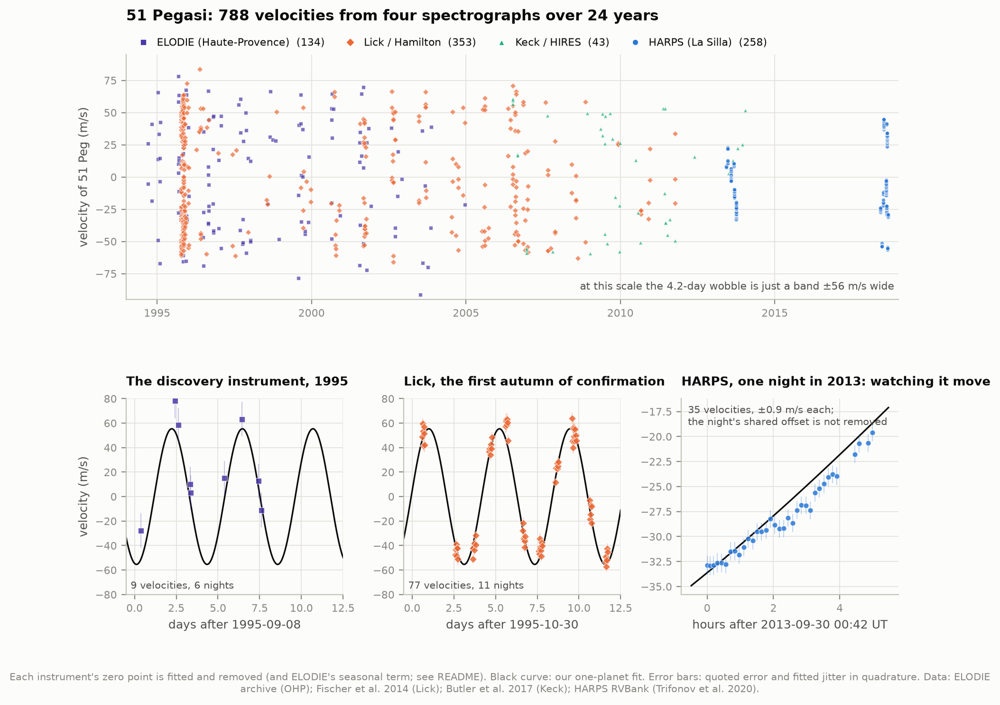
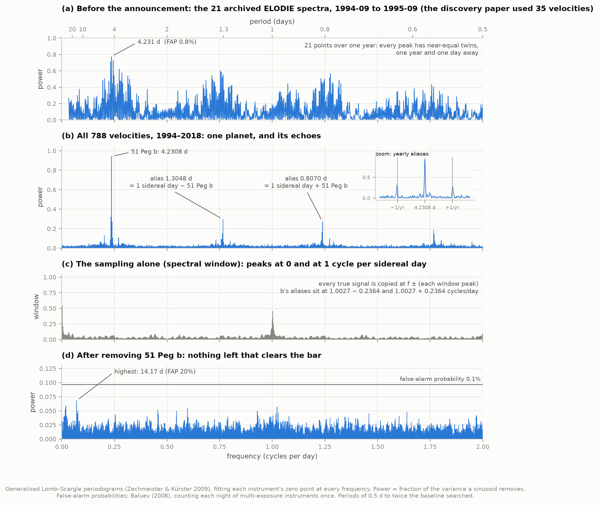
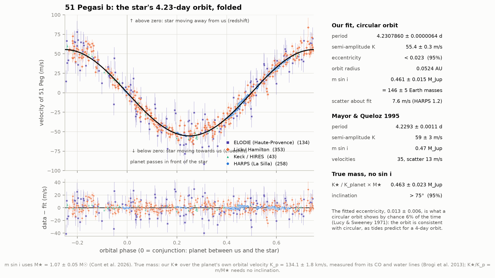
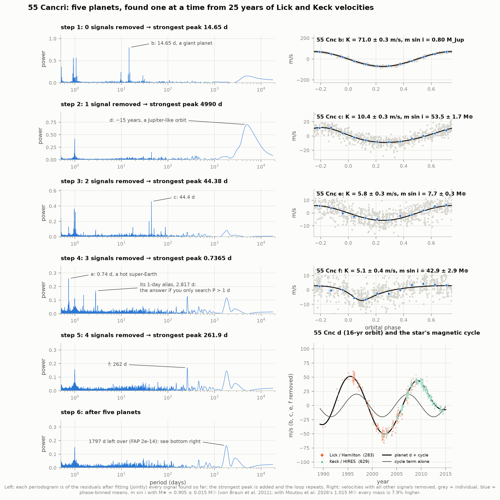
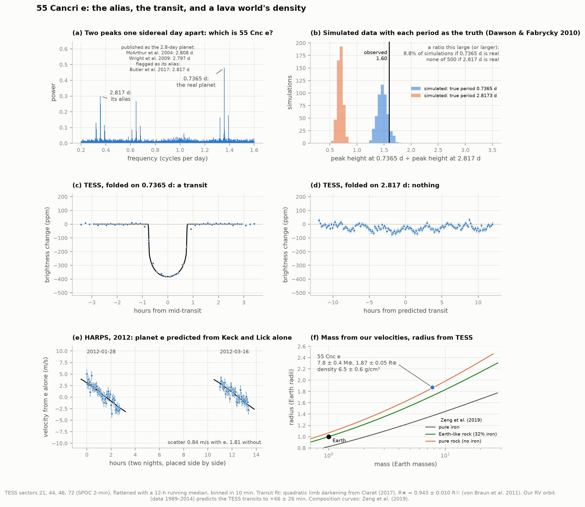
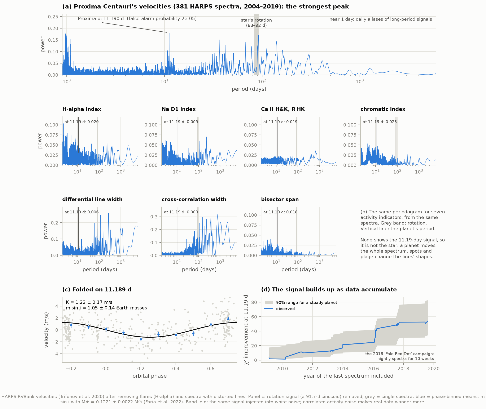
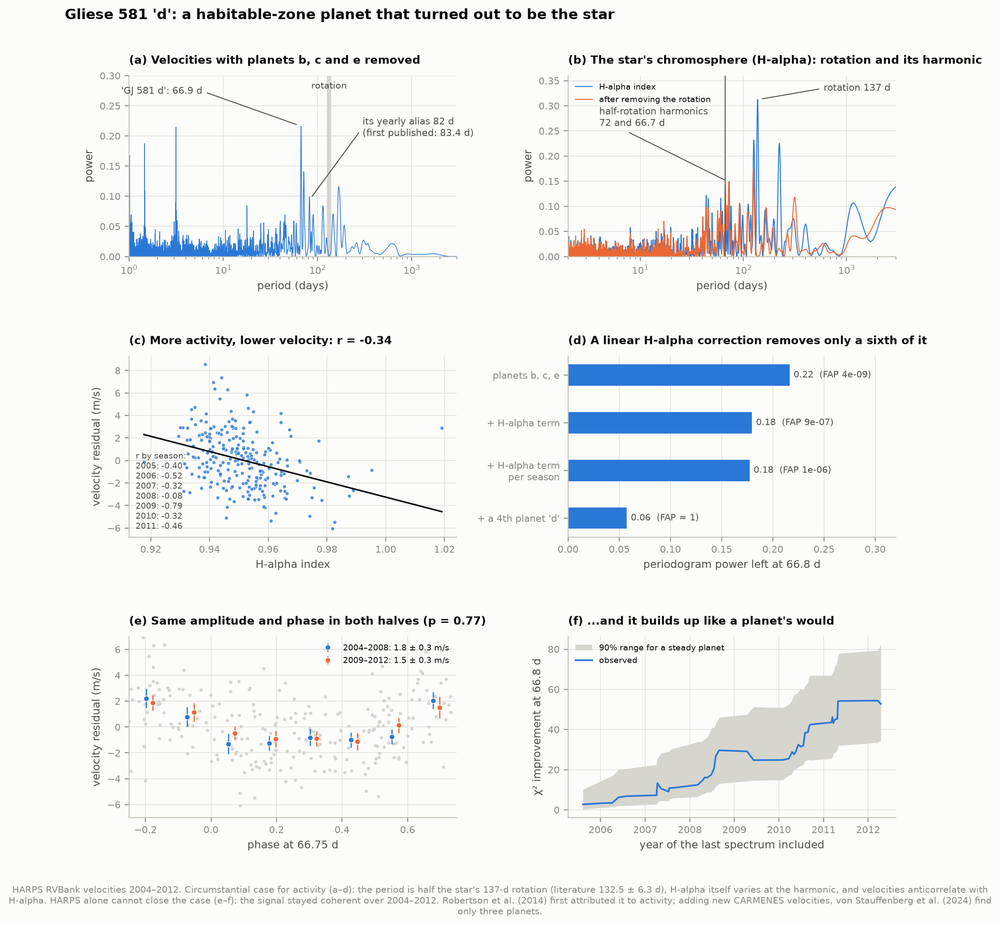
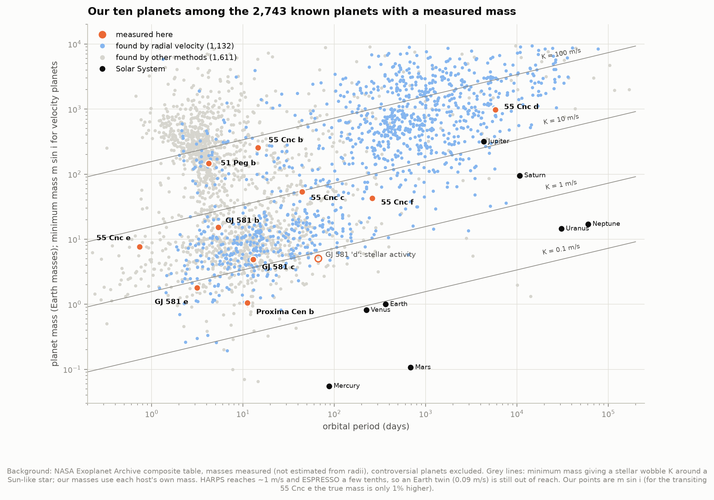
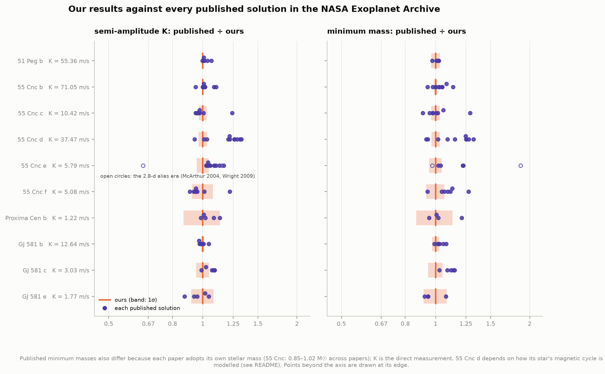

# A3 — Radial velocities: weighing planets by their stars' wobble

**Can we detect a planet we cannot see, from the tiny back-and-forth Doppler shift it causes in
its star, and weigh it?**

A planet and its star both orbit their common centre of mass, so an unseen companion pulls the star
back and forth. Along our line of sight that motion is a velocity that swings up and down once per
orbit, by a few metres per second to a few hundred. A spectrograph measures it as a shift of thousands
of absorption lines: 1 m/s is a shift of 3 parts in a billion.

This project fits **2,328 velocities of four stars, measured by four spectrographs between 1989 and
2019**, with its own periodogram, orbit fitter and noise model:

- **51 Pegasi b**, the first planet found around a Sun-like star (Nobel Prize 2019), from the
  discovery instrument's own archived spectra through to HARPS. Minimum mass **0.461 ± 0.015
  Jupiter masses**. Combined with the planet's own orbital speed, measured from its spectrum by other
  astronomers, the true mass is **0.463 ± 0.023**.
- **55 Cancri**: five planets found one at a time. One of them, 55 Cnc e, had its period published
  wrong for six years because of an alias. The velocities pick its true 0.74-day period, and TESS
  transits confirm it and give it a size: **7.75 ± 0.37 Earth masses, 1.87 ± 0.05 Earth radii,
  6.5 ± 0.6 g/cm³**.
- **Proxima Centauri b**: a 1.2 m/s wobble in the noise of a flaring red dwarf. Minimum mass
  **1.05 ± 0.14 Earth masses**.
- **Gliese 581 "d"**: a habitable-zone planet, published and then retracted, that turned out to be
  the star's own rotation. Our analysis shows why it fooled people for years.

An offline page, `figures/rv_explorer.html`, lets you fold the velocities yourself.

---

## How a wobble becomes a mass

A single planet makes the star's velocity follow a Keplerian curve,

    v(t) = γ + K [cos(ν(t) + ω) + e cos ω],

where ν is the planet's position along its orbit (found by solving Kepler's equation), e the
eccentricity, ω the orientation of the ellipse, γ the star's own velocity and **K the semi-amplitude**.
K, the orbital period P and the star's mass M★ give the planet's mass through the *mass function*,

    (m sin i)³ / (M★ + m)² = P K³ (1 − e²)^(3/2) / (2πG).

Only **m sin i** comes out, because we see only the velocity along our line of sight; the tilt i of
the orbit is unknown. Every mass in this project is therefore a **minimum mass**, unless a transit or
the planet's own spectrum supplies i. For scale, computed with `rv_physics.py`: Jupiter moves the Sun
at 12.5 m/s, Earth at 0.09 m/s.

---

## The data, and the traps in it

| Spectrograph | Telescope | Velocities used | Source |
|---|---|---|---|
| ELODIE | 1.93 m, Haute-Provence | 134 of 51 Peg (1994–2004) | ELODIE archive (Moultaka et al. 2004): cross-correlation velocities, plus each spectrum's FITS header for its time |
| Hamilton + iodine cell | Lick 3 m and 0.6 m | 353 of 51 Peg (1995–2011), 283 of 55 Cnc (1989–2011) | Fischer, Marcy & Spronck 2014, VizieR J/ApJS/210/5 |
| HIRES + iodine cell | Keck I 10 m | 43 of 51 Peg, 629 of 55 Cnc (2001–2014) | Butler et al. 2017, VizieR J/AJ/153/208 |
| HARPS | ESO 3.6 m, La Silla | 258 of 51 Peg, 381 of Proxima, 247 of GJ 581 (2004–2019) | HARPS RVBank Ver. 02 (Trifonov et al. 2020; Perdelwitz et al. 2024) |

The other inputs are four sectors of TESS photometry of 55 Cnc (2020–2023), and host-star masses plus
every published solution for our planets from the NASA Exoplanet Archive. `fetch_data.py` caches 27
files (14 MB) and records each file's URL, date, size and SHA-256 in `data/manifest.json`.

Each archive needed care before any fitting:

1. **Every instrument has its own zero point.** Iodine-cell velocities are relative, and every
   hardware change moves the zero point. So each gets a free offset:
   - each of Lick's CCD dewars (for 51 Peg the fitted offsets are +22.3, +14.4 and −8.1 m/s,
     30 m/s apart);
   - Lick before 1995;
   - HIRES before and after its August 2004 CCD upgrade (a 61-day gap in the Keck table);
   - HARPS before and after its May 2015 fibre exchange (placed from the RVBank files themselves,
     between 2015-05-16 and 05-21).
2. **Many exposures in one night are not many measurements.** HARPS took up to 48 spectra of 51 Peg
   in a night, on only 17 nights. Stellar granulation and nightly calibration shifts move all of a
   night's velocities together. A fit that treats them as independent lets a handful of nights
   dominate: it gave 51 Peg b a spurious eccentricity (e = 0.08 from the 2018 HARPS nights alone).
   Here, instruments like that get a *night-to-night* noise term, a random offset shared by each
   night, and false-alarm probabilities count each night once. With it, HARPS's velocities scatter
   within a night by just their quoted errors (~1 m/s), and from night to night by a further
   1.0–1.2 m/s.
3. **ELODIE's archived velocities drift with the seasons.** Against the final orbit, ELODIE's
   residuals follow the barycentric correction, the Earth's velocity toward the star, which for
   51 Peg tracks the season: +0.69 ± 0.07 m/s per km/s (correlation 0.62). One term removes it and
   cuts ELODIE's scatter from 18 to 14 m/s. These data cannot tell whether the cause is telluric
   lines in the cross-correlation mask or the instrument's seasonal temperature.
4. **Some HARPS spectra do not show the star's motion.** Proxima's spectra of 2017-09-24 and 25 have
   distorted lines: line widths 16 robust σ above normal and chromatic indices of −675 and −1,062
   (typically +26 ± 14). Their velocities are +37 and +39 m/s, where the rest scatter by a few m/s.
   A cut on SERVAL's line-shape indicators (6 robust σ) removes 15 Proxima spectra, 3 of GJ 581's
   and none of 51 Peg's. A further 17 Proxima spectra taken during flares (H-alpha 4σ high) are
   dropped.
5. **Times on one clock.** Lick's table gives Julian dates of observation; they are converted to
   barycentric dynamical time here (shifts of up to 8.7 minutes). The alternative reading, that
   they are already barycentric, fits 51 Peg slightly worse (Δ ln L = 0.7).

---

## Results

### 1. 51 Pegasi b: the planet that started it all



On a 24-year scale the 4.2-day wobble is only a band 110 m/s wide (top panel). Zoom in and it is a
clean sine wave. The panels show it three times:
- in ELODIE's archived spectra from 1995;
- in the Lick velocities from the autumn Marcy and Butler confirmed it (the first is dated
  12 October 1995, six days after the announcement);
- in one HARPS night of 2013, where 35 exposures follow the star as it accelerates.



**Finding the period.** At each trial period, the periodogram measures how much of the variance a sine
wave removes. For all 788 velocities the answer is unambiguous: **4.2308 days**, removing 94% of it.

Its echoes are the point of this figure. A star can only be observed at night, and it rises
3.9 minutes earlier each night, so the sampling repeats every **sidereal** day (23 h 56 min). Every
real signal is therefore copied at 1.0027 cycles per day minus and plus its own frequency: here at
**1.3048 d** and 0.8070 d. Observing seasons do the same at ±1 cycle per year (4.182 and 4.280 d).
Panel (c) shows the sampling pattern alone; each alias is a copy of it placed around the planet.

**What the discoverers had.** The ELODIE archive holds 21 usable spectra from before the 6 October
1995 announcement (the discovery paper used 35 velocities). On their own these give
P = 4.2305 ± 0.0020 d and K = 53 ± 6 m/s, matching the published 4.2293 ± 0.0011 d and 59 ± 3 m/s.
But from 21 points spread over one year, the peak's twins are nearly as tall (panel a): its
false-alarm probability is 0.8%.

Once the planet is removed, nothing else remains. The tallest leftover peak, at 14.17 d, has a
false-alarm probability of 20%.



| | This project | Published |
|---|---|---|
| Period | 4.2307860 ± 0.0000064 d | 4.230797 ± 0.000003 d (Cont et al. 2026); 4.2293 ± 0.0011 (Mayor & Queloz 1995) |
| Semi-amplitude K | 55.36 ± 0.32 m/s | 55.77 ± 0.15 (Cont et al. 2026); 55.73 ± 0.32 (Rosenthal et al. 2021) |
| Eccentricity | < 0.023 (95%) | 0.006 (Cont et al. 2026); 0.004 (Rosenthal et al. 2021) |
| m sin i | 0.461 ± 0.015 M_Jup = 146 ± 5 M⊕ | 0.45–0.47 M_Jup |
| Orbit radius | 0.0524 AU, one-seventh of Mercury's | |

**Eccentricity.** A free fit gives e = 0.013 ± 0.006. Noise always pushes a fitted e above zero, and
a truly circular orbit measured this well shows at least this much 6% of the time (Lucy & Sweeney
1971). So the orbit is consistent with circular, as tides predict for a four-day orbit.

**The true mass.** Brogi et al. (2013) detected 51 Peg b's own carbon monoxide and water lines with the
CRIRES spectrograph and measured the planet's orbital speed directly: K_p = 134.1 ± 1.8 km/s. The two
bodies' speeds are in the inverse ratio of their masses, so our K★ / K_p = m / M★, with no need for the
inclination. That gives **0.463 ± 0.023 Jupiter masses**, and an orbit tilted at least 74.5° to the sky
(95%). The minimum mass is very nearly the true mass.

### 2. 55 Cancri: five planets, one at a time



55 Cancri, 41 light-years away, is a star a little cooler than the Sun. Lick has watched it since 1989,
and Keck since 2001. The search that found 51 Peg b ran on its 912 velocities with no hint of what to
expect. It found five planets, in this order: **b (14.65 d), d (13.7 yr at that step), c (44.4 d),
e (0.7365 d) and f (262 d)**. Each step refits all the orbits found so far together, and every new
peak has a false-alarm probability below 10⁻¹⁴.

| | Period | K (m/s) | e | m sin i | Published K (Bourrier et al. 2018) |
|---|---|---|---|---|---|
| b | 14.65164 ± 0.00009 d | 71.05 ± 0.31 | < 0.010 | 0.801 ± 0.010 M_Jup | 71.37 ± 0.21 |
| c | 44.3893 ± 0.0066 d | 10.42 ± 0.30 | 0.13 ± 0.04 | 53.5 ± 1.7 M⊕ | 9.89 ± 0.22 |
| d | 5,801 ± 130 d (15.9 yr) | 37.5 ± 1.2 | 0.167 ± 0.018 | 3.06 ± 0.09 M_Jup | 38.6 ± 1.3 |
| e | 0.7365503 ± 0.0000026 d | 5.79 ± 0.26 | (circular) | 7.65 ± 0.35 M⊕ | 6.02 ± 0.24 |
| f | 260.42 ± 0.36 d | 5.08 ± 0.40 | 0.43 ± 0.08 | 42.9 ± 2.9 M⊕ | 5.14 ± 0.26 |

**What is left after five planets, and what it does to d.** A significant long-period signal remains
(1,797 d in the search; false-alarm probability 2 × 10⁻¹⁴), seen by both Lick and Keck. The star has a
magnetic cycle like the Sun's: its calcium emission in the Keck spectra (the S-index) rises and falls
with a **10.5-year period** (3,842 d), and a star's magnetic activity changes its measured velocity.

Bourrier et al. (2018) were the first to fit a cycle term alongside planet d (3,822 d, K = 15 m/s).
One recent study argues that d cannot be established from velocities alone (Harrell &
Dodson-Robinson 2025). The model adopted here follows Bourrier et al.: five planets plus a sinusoid
at the S-index's period, with free amplitude and phase (fitted K = 20.1 ± 1.6 m/s).

Planets b, c, e and f barely notice how this is done. Planet d does (best-fit values):

| How the long-period power is modelled | d: period (d) | d: K (m/s) | ln L |
|---|---|---|---|
| five planets only | 5,271 | 44.2 | −2459.3 |
| five planets + a free sinusoid (fitted: 1,890 d) | 5,304 | 45.0 | −2367.6 |
| five planets + cycle term, period free in 3,000–4,600 d (fitted: 3,930 d) | 5,896 | 36.0 | −2376.9 |
| **adopted**: five planets + cycle term at the S-index period | 5,786 | 37.6 | −2377.0 |

Letting the cycle's period float changes the fit by only 0.1 in ln L, and d trades amplitude with it.
The velocities alone cannot separate the two, just as Harrell & Dodson-Robinson found. Published
periods for d range from 4,517 to 5,574 days, and ours from 5,271 to 5,896.

### 3. 55 Cancri e: the alias, the transit, the density



**The alias.** In 2004 a fourth planet of 55 Cnc was announced with a 2.8-day orbit (McArthur et al.
2004), and it kept that period through the analyses that followed (Fischer et al. 2008; Wright et al.
2009). In 2010 Dawson & Fabrycky showed it was an alias. Nightly sampling copies a 0.7365-day signal to
1/(1.3577 − 1.0027) = 2.817 days, and the true planet is the shorter one. In 2011 it was caught
transiting at 0.7365 d (Winn et al. 2011; Demory et al. 2011). The Keck team's 2017 catalogue still
lists the 2.817-d signal, flagged as an alias of the transiting planet, because their search stopped
at a period of one day.

Our search goes down to half a day, and **0.7365 d wins**, with power 0.258 against 0.169 for 2.817 d.
Panel (b) repeats Dawson & Fabrycky's test. Data are simulated with each candidate period as the
truth, sampled exactly as observed and with the fitted noise, to see which reproduces the observed
peak heights. With 0.7365 d as the truth, all 500 simulations make the 0.7365-d peak the taller, and
9% reproduce a ratio of peak heights as large as the observed 1.6. With 2.817 d as the truth, none of
the 500 make the 0.7365-d peak the taller.

**The transit.** TESS watched 55 Cnc for four sectors between 2020 and 2023: 64,042 two-minute
brightness measurements. A blind box-least-squares search, the method of project A1, finds the
strongest transit signal at **0.73656 days**. Folded on 0.7365 d, the light shows a 382-ppm dip;
folded on 2.817 d, nothing (panels c and d).

The velocities end in 2014, yet they predict when the 2020–2023 transits happen, 6,700 orbits later,
with an error of only **66 ± 26 minutes**. That is 6% of an orbit, though a 2.5σ difference is worth
noting. The period from the velocities alone, 0.7365503 ± 0.0000026 d, agrees with the transit period
(0.7365530 d) at 1σ.

**A check the fit never saw.** HARPS observed 55 Cnc on two nights in 2012 (88 spectra), which were
left out of the fit. Predicted from the Keck and Lick orbits alone, planet e's motion within each
night is visible in them. The HARPS velocities scatter by 0.84 m/s around the prediction that
includes e, and by 1.81 m/s without it (panel e).

**Mass, size, density.** The transit fit gives Rp/R★ = 0.01822 ± 0.00046 with quadratic limb darkening.
With the star's interferometric radius (von Braun et al. 2011) that is a radius of **1.87 ± 0.05 R⊕**.
The inclination is 82 (+4/−5)°, so the true mass is **7.75 ± 0.37 M⊕** and the density
**6.5 (+0.6/−0.5) g/cm³**. The transit's shape alone implies a stellar density of 0.97 (+0.33/−0.27) ρ☉,
consistent with the 1.08 ρ☉ adopted.

At this mass, a rocky planet with Earth's composition would have a radius of 1.72 R⊕ (8.35 g/cm³).
55 Cnc e is larger. It sits on the curve for pure rock with no iron core (1.86 R⊕; Zeng et al. 2019),
or it has a lighter layer on top. JWST has since detected a secondary atmosphere rich in CO₂ or CO,
over what is probably a lava surface (Hu et al. 2024). Published values: 7.99 ± 0.32 M⊕, 1.875 ± 0.029 R⊕,
6.66 ± 0.43 g/cm³, i = 83.6° (Bourrier et al. 2018); 1.856 ± 0.024 R⊕ from later transits (Zhao et al.
2023). Our K for e is 4% below Bourrier et al.'s. In fact every K for e published since the transit
discovery is 2–17% above ours (figure 0); we have not tracked down why.

### 4. Proxima Centauri b: hard mode



Proxima is the nearest star to the Sun (4.2 light-years), an M5.5 red dwarf that flares. Its planet
moves it by little more than 1 m/s, less than the scatter of the velocities (about 2 m/s).

**Found blind.** After the cuts above, the strongest peak in 381 HARPS velocities is at **11.190 days**,
with a false-alarm probability of 2 × 10⁻⁵. Next come 0.971 d, the daily alias of a 36.9-d signal,
and 91.6 d, the star's rotation (90 ± 4 d; Faria et al. 2022).

**Is it the star?** The same spectra give seven activity indicators:
- chromospheric emission: H-alpha, sodium D and calcium H&K;
- the colour-dependence of the velocity (chromatic index);
- the width and asymmetry of the lines (line width, cross-correlation width, bisector span).

Spots and plage change these; a planet does not. None shows power at 11.19 d (all ≤ 0.025, panel b),
while the line widths vary strongly on timescales of 60 to 800 days. The planet's signal also builds
up steadily as data accumulate, as a real orbit should. It jumps in 2016, when the Pale Red Dot
campaign observed Proxima on 48 nights in ten weeks (panel d; Anglada-Escudé et al. 2016).

**The mass.** With the rotation modelled by a 91.7-day sinusoid, K = **1.22 ± 0.16 m/s** and
m sin i = **1.05 ± 0.14 M⊕**, at 0.0486 AU. Depending on how the activity is treated, K ranges from
1.19 to 1.34 m/s:

| Activity model | K (m/s) | m sin i (M⊕) |
|---|---|---|
| none (white noise only) | 1.33 | 1.14 |
| **adopted**: rotation sinusoid (91.7 d) | 1.24 | 1.06 |
| rotation + half-rotation sinusoids | 1.19 | 1.03 |
| linear in line width | 1.33 | 1.15 |
| linear in line width, H-alpha, chromatic index | 1.34 | 1.15 |

Published values: 1.38 ± 0.21 m/s (Anglada-Escudé et al. 2016, HARPS + UVES), 1.24 ± 0.07 (Faria et
al. 2022, ESPRESSO), 1.226 ± 0.062 (Suárez Mascareño et al. 2025). The 0.39-m/s Proxima d that
ESPRESSO later found is beyond HARPS's reach.

### 5. Gliese 581 "d": when the star fakes a planet



GJ 581 d was hailed in 2007 as a super-Earth in the habitable zone. Its story ran:
- first published at 83.4 days (Udry et al. 2007);
- moved to 66.8 days, once 83 d was recognised as a one-year alias (Mayor et al. 2009);
- still counted as one of four planets by Hatzes (2013);
- attributed to stellar activity by Robertson et al. (2014);
- defended by Anglada-Escudé & Tuomi (2015);
- dismissed again by von Stauffenberg et al. (2024), with new CARMENES data.

The NASA archive now lists three planets.

**Run blind, the search that found everything else finds it too.** From 247 HARPS velocities it finds
b (5.37 d), c (12.9 d), then **66.87 days (false-alarm probability 4 × 10⁻⁹)**, then e (3.15 d). Fitted
as a circular orbit, the 66.8-d signal has K = 1.8 m/s, as in Hatzes's (2013) circular fit
(1.74 ± 0.17 m/s); his eccentric fit gives 2.20 ± 0.19.

**The case that it is the star** (panels a–c):
- The star rotates in 137 days in its own H-alpha emission (von Stauffenberg et al. 2024:
  132.5 ± 6.3 d), and 66.8 d is half of that. Spots on opposite sides of a star produce such a
  half-period signal.
- With the rotation removed, H-alpha itself still varies at 125, 72 and 66.7 days.
- The velocities anticorrelate with H-alpha: r = −0.34 overall, and −0.79 in 2009.

**Why it was hard** (panels d–f):
- A linear H-alpha correction, even fitted season by season, removes only a sixth of the signal
  (periodogram power 0.22 → 0.18). A spot's velocity signal depends on where the spot sits on the
  turning star, so it follows the rotation's harmonics more than the activity level itself.
- Within 2004–2012 the signal also behaves like a planet: the same amplitude and phase in both halves
  of the data (1.76 ± 0.32 vs 1.50 ± 0.31 m/s, p = 0.77), and it builds up at the rate a steady
  signal would.

HARPS alone cannot close the case. It took new data: von Stauffenberg et al. (2024) added CARMENES
velocities to reprocessed HARPS and HIRES data, found only three planets, and attributed the 66.7-day
signal to stellar activity.

The three real planets, with the 66.8-d signal modelled as activity:

| | P (d) | K (m/s) | e | m sin i (M⊕) | Published K (von Stauffenberg et al. 2024) |
|---|---|---|---|---|---|
| b | 5.36867 ± 0.00007 | 12.64 ± 0.15 | < 0.03 | 15.3 ± 0.4 | 12.3 ± 0.1 |
| c | 12.9151 ± 0.0020 | 3.03 ± 0.15 | < 0.11 | 4.9 ± 0.3 | 3.1 ± 0.1 |
| e | 3.14923 ± 0.00022 | 1.77 ± 0.15 | (circular) | 1.8 ± 0.2 | 1.8 ± 0.1 |

### 6. Our planets among the known ones



This figure shows our ten planets among the 2,743 known planets whose masses have been measured, not
estimated from their radii. The grey lines show what a given K means for a Sun-like star: m sin i
grows with K and with the cube root of the period. This is why radial velocities found hot Jupiters
first (51 Peg b moves its star at 55 m/s). It is also why 1 m/s, where HARPS's precision ends,
reaches only Earth-mass planets on tight orbits around small stars (Proxima b, GJ 581 e). An Earth
twin moves the Sun by 0.09 m/s, which no spectrograph here can detect.

### 7. Against every published solution



For every planet, each published K in the NASA Exoplanet Archive (violet) is plotted against ours
(orange). Most published values fall within 10% of ours. The exceptions are the ones discussed
above:
- 55 Cnc d depends on how the magnetic cycle is modelled;
- 55 Cnc e's two alias-era papers (open circles) measured the 2.8-day ghost;
- every K for 55 Cnc e published since 2011 is 2–17% above ours.

Published minimum masses scatter more than the K values, because every paper adopts its own
stellar mass.

---

## Fold it yourself

`figures/rv_explorer.html` is a self-contained page (323 kB, no network). Pick 51 Peg, 55 Cnc e,
Proxima b or GJ 581 "d", click any peak in the periodogram, and the velocities fold on that period.
A live readout gives the fraction of the variance a sine wave at that period explains.

Fold 51 Peg on 4.2308 d and every point falls on one curve (99.4% explained). Fold it on the 1.3048-d
alias and the points scatter everywhere, even though a sine wave at that period still explains 63%:
aliases are tempting precisely because they fit so much. The same two clicks with 55 Cnc e's 0.74-d and
2.8-d peaks tell the whole story of section 3. A slider fine-tunes the period to show how sharply the
true one is defined.

---

## How it works

**Periodograms** (`rv_physics.gls`). This is the generalised Lomb–Scargle periodogram of Zechmeister &
Kürster (2009). At each trial frequency it makes a weighted least-squares fit of a sine wave plus a
constant, and reports the fraction of the variance removed. Here it is extended to fit a separate
constant for every instrument at every frequency, since instrument offsets of tens of m/s would
otherwise swamp signals of a few. With one instrument it matches astropy's implementation to 10⁻⁹
(tested). Frequencies are sampled ten times per peak width, from 0.5 days (55 Cnc e orbits in 0.74 d)
to twice the time span.

**False alarms** (`rv_physics.fap_baluev`). Baluev's (2008) analytic probability that noise alone
would produce a peak this tall anywhere in the search, matching astropy's to 10⁻¹⁰ (tested). One
change: each night of a multi-exposure instrument counts as one measurement, not dozens. A signal is
taken seriously below 0.1%.

**The search** (`rv_fit.search_planets`) loops:
1. periodogram of the residuals;
2. circular orbit at the tallest peak;
3. refit *everything* jointly;
4. repeat until the tallest peak is no longer significant.

The same code runs on every star and is told nothing about what to expect.

**The model and its noise** (`rv_fit.KeplerModel`). Keplerian orbits plus, for each instrument, a zero
point and a "jitter": white noise added to the quoted errors. Stars add noise of their own
(granulation, oscillations, spots), and a fit that ignores it produces error bars that are too small.
Instruments with many exposures a night also get the night-to-night term described above.

The covariance is then block-diagonal, with closed-form inverse and determinant (Sherman–Morrison),
checked against dense linear algebra to 10⁻⁸. Zero points, trends and activity coefficients enter
linearly and are integrated out analytically, which is exact for flat priors. That leaves only the
orbits and the noise to sample.

**Fitting and sampling.** The best fit alternates two steps. One is a least-squares step on the
orbits, with the noise held fixed and the residuals exactly whitened. The other adjusts the noise,
including a per-instrument grid search that avoids false optima in the jitter-versus-night-noise
trade-off.

Posteriors come from emcee (Foreman-Mackey et al. 2013) with differential-evolution moves:
12,000–30,000 steps, chains 119–289 autocorrelation times long. A few choices matter:
- Walkers start in a ball of 1% of a peak width around the best fit.
- Eccentricities are sampled as √e cos ω and √e sin ω, which gives uniform priors on e and ω.
- Each short period is confined to its own periodogram peak, which keeps out its yearly aliases.
- m sin i solves the mass function exactly, with a fresh stellar mass drawn for every sample.

A first attempt without the period limit and the tight starting ball did not converge. Walkers
stranded on sidelobes of 55 Cnc e's period, only 6 × 10⁻⁵ d apart, gave a false low-K tail, and the
sampler hopped between GJ 581 e's 3.149-d period and its 3.122-d alias.

**Transits** (`transit.py`). The limb-darkened transit is integrated exactly, ring by ring, across the
part of the star the planet covers. Limb darkening is quadratic, from Claret (2017), interpolated to
55 Cnc's temperature, gravity and metallicity (u₁ = 0.412, u₂ = 0.220). The model is checked against
the uniform-disc and small-planet limits.

**Tests.** `python test_physics.py` runs 40 checks:
- Kepler's equation to 10⁻¹¹, and the Sun's 12.5 m/s and 0.09 m/s wobbles;
- the periodogram and false-alarm probability against astropy;
- the likelihood against dense linear algebra;
- a simulated planet recovered blind (the only simulated data anywhere, used only as a test);
- the transit model's limits;
- sanity checks on the cached data.

## Honest notes

- **Every mass is a minimum mass**, except where a transit (55 Cnc e) or the planet's own spectrum
  (51 Peg b) supplies the inclination.
- **Masses inherit the star's mass**, as M★^(2/3). For 55 Cnc, the archive's 17 parameter sets
  range from 0.85 to 1.015 M☉. We adopt 0.905 ± 0.015 (von Braun et al. 2011), the value Bourrier et
  al. (2018) used; with Moutou et al. (2026)'s 1.015 M☉, every 55 Cnc mass would be 7.9% higher.
- **55 Cnc d is entangled with its star's magnetic cycle** (section 2). Its period is 5,300–5,900 d
  depending on the model; treat the adopted 5,801 ± 130 d as conditional on the cycle model.
- **55 Cnc c and f come out more eccentric than in published solutions**: 0.13 ± 0.04 for c, against
  0.02–0.09 in every solution since 2008, and 0.43 ± 0.08 for f, against 0–0.32. The eccentricity of
  a weak signal soaks up leftover noise, and a weaker residual near 35 d (false-alarm probability
  10⁻⁴, close to the star's 38.8-day rotation; Bourrier et al. 2018) is not modelled.
- **Stellar activity sets the floor for Proxima b**: K ranges from 1.19 to 1.34 m/s with the activity
  model, a spread larger than ESPRESSO's whole error bar (±0.07 m/s).
- **GJ 581 d**: our data reproduce the circumstantial case against it, not the proof, which needed
  new CARMENES data.
- **HARPS drifts within a night.** On a few 2018 HARPS nights of 51 Peg the residuals drift by up to
  0.7 m/s per hour. Trifonov et al. (2020) found small intra-night drifts in SERVAL velocities after
  2015. The night-to-night term absorbs the offsets but not the slopes.
- **ELODIE's archive**: 21 usable spectra from before the 1995 announcement (the discovery paper used
  35), with a seasonal systematic modelled by one term (trap 3). These velocities have no quoted
  errors; their scatter is fitted.
- **False-alarm probabilities** are analytic approximations for white noise. Correlated stellar noise
  makes real false alarms more likely, which is why each candidate signal was also checked for
  consistency across instruments and over time.
- **Keck zero points**: Tal-Or et al. (2019) corrected the Keck velocities for small zero-point
  drifts (typically under 1 m/s, plus a 1.5 m/s jump in 2004); with their version, 51 Peg's K
  changes by 0.03 m/s.

## Running it

```bash
cd astrophysics/20-radial-velocities
../.venv/bin/python fetch_data.py     # 14 MB, a few minutes (ELODIE headers come one by one)
../.venv/bin/python run.py            # everything: numbers, figures, explorer
../.venv/bin/python test_physics.py   # 40 checks
```

The first `run.py` takes about an hour, most of it the 33-parameter 55 Cnc model. The MCMC chains and
best fits are then cached in `data/cache/`, so later runs take about three minutes, and work offline
(verified with the network switched off). `run.py --only 51peg` redoes one star. The code needs numpy,
scipy, astropy, pandas, matplotlib, emcee and lightkurve, all in the shared `.venv`.

### Files

| File | What it does |
|---|---|
| `config.py` | every source, instrument epoch, cut and literature value, in one place |
| `fetch_data.py` | downloads and caches the data, with a provenance manifest |
| `rvdata.py` | loads each archive, applies the cuts, puts times on BJD(TDB), splits instruments |
| `rv_physics.py` | Kepler's equation, the velocity curve, mass function, periodograms, false alarms |
| `rv_fit.py` | the noise model, likelihood, best fits, planet search, MCMC |
| `transit.py` | TESS light curves, limb-darkened transit model and fit |
| `analysis.py` | the science, one function per star |
| `figures.py`, `plotstyle.py` | every figure |
| `explorer.py` | builds `figures/rv_explorer.html` |
| `run.py` | runs everything and prints the summary |
| `test_physics.py` | 40 self-checks |
| `data/results.json` | every number quoted here |

## Data credits and references

**Data.**
- ELODIE archive, Observatoire de Haute-Provence (Moultaka et al. 2004, PASP 116, 693).
- Lick planet search (Fischer, Marcy & Spronck 2014, ApJS 210, 5).
- Keck/HIRES LCES velocities (Butler et al. 2017, AJ 153, 208) and their correction (Tal-Or et al.
  2019, MNRAS 484, L8).
- HARPS RVBank, built from ESO archive spectra (Trifonov et al. 2020, A&A 636, A74; Perdelwitz et al.
  2024, A&A 683, A125).
- TESS (NASA; SPOC light curves via MAST).
- NASA Exoplanet Archive (Caltech/IPAC, doi:10.26133/NEA13).
- Limb darkening: Claret 2017, A&A 600, A30. Interior models: Zeng et al. 2019, PNAS 116, 9723.
- This research used VizieR (CDS, Strasbourg).

**Methods.**
- Zechmeister & Kürster 2009, A&A 496, 577 (generalised Lomb–Scargle).
- Baluev 2008, MNRAS 385, 1279 (false alarms).
- Lucy & Sweeney 1971, AJ 76, 544 (eccentricity).
- Dawson & Fabrycky 2010, ApJ 722, 937 (aliases).
- Mortier & Collier Cameron 2017, A&A 601, A110 (stacked periodograms).
- Foreman-Mackey et al. 2013, PASP 125, 306 (emcee).

**Planets.**
- 51 Peg: Mayor & Queloz 1995, Nature 378, 355; Marcy et al. 1997, ApJ 481, 926; Brogi et al. 2013,
  ApJ 767, 27; Birkby et al. 2017, AJ 153, 138; Rosenthal et al. 2021, ApJS 255, 8; Cont et al. 2026,
  A&A 710, A345.
- 55 Cnc: McArthur et al. 2004, ApJ 614, L81; Fischer et al. 2008, ApJ 675, 790; Wright et al. 2009,
  ApJ 693, 1084; Winn et al. 2011, ApJ 737, L18; Demory et al. 2011, A&A 533, A114; von Braun et al.
  2011, ApJ 740, 49; Bourrier et al. 2018, A&A 619, A1; Zhao et al. 2023, Nat. Astron. 7, 198; Hu et
  al. 2024, Nature 630, 609; Harrell & Dodson-Robinson 2025, arXiv:2509.08076; Moutou et al. 2026,
  A&A 705, A190.
- Proxima: Anglada-Escudé et al. 2016, Nature 536, 437; Faria et al. 2022, A&A 658, A115; Suárez
  Mascareño et al. 2025, A&A 700, A11.
- GJ 581: Udry et al. 2007, A&A 469, L43; Mayor et al. 2009, A&A 507, 487; Hatzes 2013, AN 334, 616;
  Robertson et al. 2014, Science 345, 440; Anglada-Escudé & Tuomi 2015, Science 347, 1080; von
  Stauffenberg et al. 2024, A&A 688, A112.
