# I18 — Giant radio galaxies: the largest structures black holes build

**Some supermassive black holes launch jets that run far beyond their galaxy and inflate radio
lobes millions of light-years across. LOFAR's sky survey found that such "giants" are common, and
one of them, Porphyrion, spans 7 megaparsecs. Can we find giants in the radio maps, measure them,
and see them over images of their host galaxies?**

We take the LOFAR Two-metre Sky Survey's 144-MHz images (LoTSS DR2, and its 2026 successor DR3)
and measure 27 giants ourselves. **Porphyrion** spans **13.6 arcminutes** on the sky along position angle 26°
(the discoverers: 27°). At its redshift, 0.896, that is **6.54 Mpc** projected on the sky:
21 million light-years, 218 Milky Ways end to end. Oei et al. (2024) measured 6.43 Mpc on deeper
images. Corrected for the unknown tilt of its jets, the
most likely true length is **6.8 Mpc** (mean 7.4), matching the published 6.8 (mean 7.28). The
distance from the Milky Way to Andromeda would fit into it more than eight times. Its light left
**7.5 billion years ago**.

How common are such monsters? We redo the measurement of the giants' **length distribution** on
the same 1,473 giants Oei et al. (2023) used, with our own implementation of their model of what
the survey can and cannot see. The chance that a giant is longer than *l* falls as *l*^(ξ+1) with
**ξ = −3.45 ± 0.57** (theirs: −3.5 ± 0.5). Ignoring selection effects would give a quite
different −2.72: the survey misses long giants because their lobes are faint. Tested on simulated
surveys, the method recovers the true answer. With that tail, **0.8% of giants exceed 5 Mpc**.

| What | Ours | Published |
|---|---|---|
| Porphyrion, projected length | 6.54 Mpc (13.6′, PA 26°) | 6.43 ± 0.05 Mpc, PA 27 ± 1° (Oei et al. 2024) |
| Porphyrion, true 3D length (median / mean) | 6.8 / 7.4 Mpc | 6.8 / 7.28 Mpc |
| Length distribution tail index ξ (z < 0.5) | −3.45 ± 0.57 (mode −3.78) | −3.5 ± 0.5 (Oei et al. 2023) |
| 3C 236 lobe ages (continuous injection, their fluxes and field) | 136 / 114 Myr | 129 / 117 Myr (Shulevski et al. 2019) |
| Giant hosts' black holes vs ordinary radio galaxies (same z and radio power) | +0.016 ± 0.012 dex | "do not differ" (Dabhade et al. 2020) |
| Cosmic-web density, giants vs radio galaxies (BORG; recomputed) | 4.73 vs 3.84, KS p = 3 × 10⁻⁶ | 4.8 vs 3.8, p ≲ 10⁻⁶ (Oei et al. 2024) |
| ... vs radio galaxies as powerful (> 10²⁴ W/Hz) | 4.73 vs 4.44, KS p = 0.60 | (their explanation: radio power) |

The giants' black holes weigh **0.9 billion Suns** (median), but that is no more than the black
holes of **ordinary radio galaxies** of the same radio power and distance. Black hole mass also
does not predict how long the jets grow. Giants also live in the **same surroundings** as radio
galaxies of equal radio power. Their apparent preference for denser places comes from their
power, not their size, which supports Oei et al.'s (2024) explanation.

DR3 extends the view to giants that DR2's public images never showed: NGC 2300's, the largest on
the sky (117′ in DR3; published 2.2°), the classic giants NGC 6251 and DA 240, and J1129+2733
(3.7 Mpc). It also checks DR2: the same 17 giants measured on both releases agree in length to
0.1% and in brightness to 0.2% (median).

Not every claimed record survives a look at the images. Four of the five longest giants in the
largest catalogue (7.98, 6.25, 5.79 and 5.66 Mpc) owe their record lengths to radio sources several
arcminutes beyond the host's own emission, which may be unrelated. Counting only the emission
clearly tied to each host, they measure 2.2–3.5 Mpc: real giants, but not record breakers.
Nor are they among the 142 giants above 3 Mpc that Andernach et al. (2025) compiled by
re-examining the literature. And for 101
of the 3,528 giants whose host has an SDSS spectrum (2.9%), the catalogue's redshift is more than
10% off the spectrum's; with the SDSS redshift, 13 of them are no longer giants.

---

## Results

### 1. The gallery

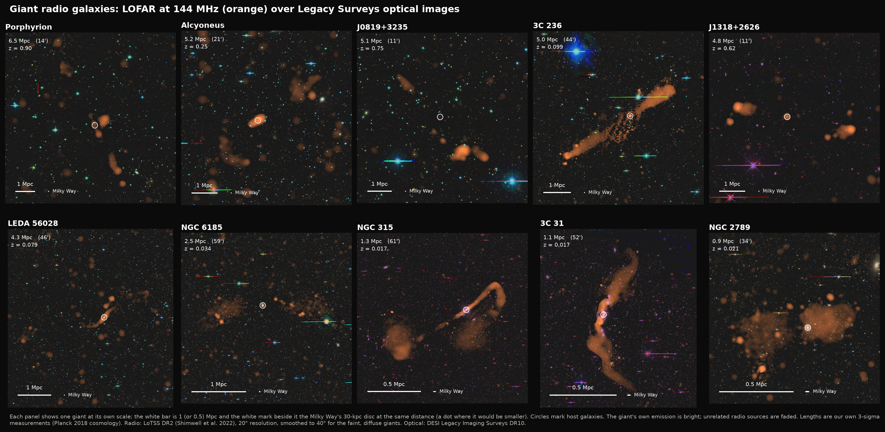

Ten giants, from Porphyrion at redshift 0.9 to NGC 315 next door (z = 0.0165, about 240 million
light-years away). Orange is LoTSS at 144 MHz, over the DESI Legacy Surveys' optical images. The
giant's own emission is bright and every unrelated radio source is faded, using the outline we
measure in section 4. The white bar is 1 Mpc (0.5 for the nearest); the white mark beside it is the
Milky Way's 30-kpc disc at the same distance. At Porphyrion's distance that disc would span
3.7 arcseconds, a fifth of LoTSS's resolution.

Two kinds of giants appear. **FR II** giants (Porphyrion, J0819+3235, J1318+2626, 3C 236) end in
compact *hotspots*, where the jets slam into intergalactic gas. **FR I** giants (NGC 315, 3C 31)
have jets that brighten near the galaxy and fade into plumes. Some giants (Alcyoneus, NGC 6185,
NGC 2789) have faint, diffuse lobes that appear only when the 20″ image is smoothed further. Most
hosts are giant elliptical galaxies, but **NGC 6185 is a spiral**, the largest radio galaxy known to
come from one (Oei et al. 2023). **J1318+2626** comes from a galaxy whose black hole is also a
quasar.

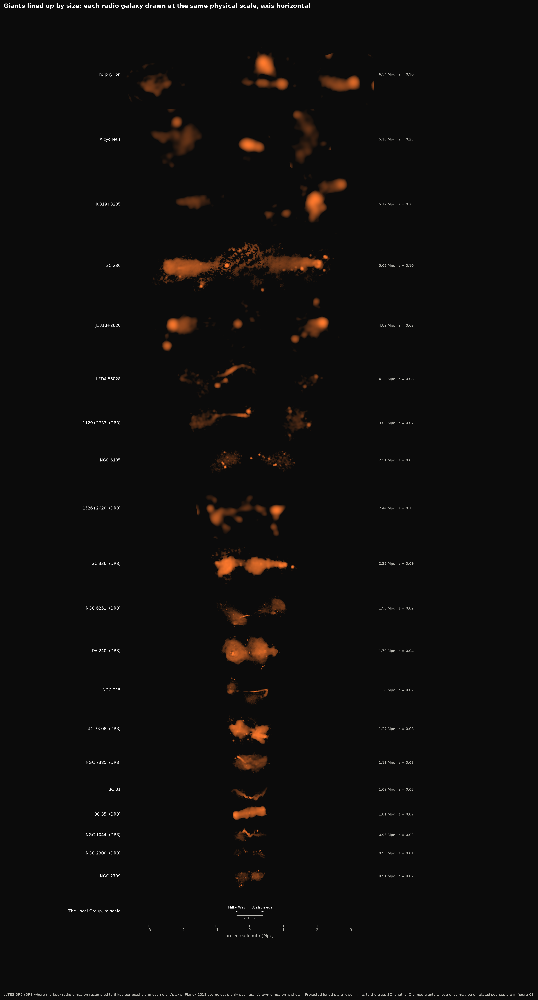

The same giants, plus ten from DR3 (section 11), drawn at **one physical scale**, each turned so
its axis is horizontal, with the Local Group underneath: the Milky Way and Andromeda are dots
761 kpc apart. The distant giants
look blurrier: LoTSS's 20″ beam spans 160 kpc at z = 0.9 but only 7 kpc at z = 0.017.

### 2. The census: 11,585 giants

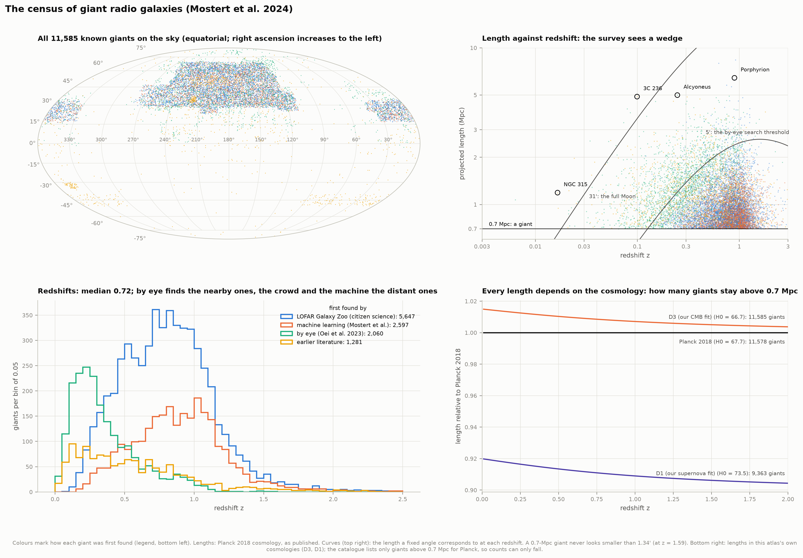

Mostert et al. (2024) compiled **every known giant: 11,585**, all at least 0.7 Mpc long. Half
(5,647) were first spotted by **citizen scientists** in LOFAR Galaxy Zoo (Hardcastle et al. 2023),
2,597 by a **machine-learning** pipeline, 2,060 **by eye** in Oei et al.'s (2023) search, and 1,281
were known before. Most lie in the LoTSS DR2 footprint (27% of the northern sky); the literature
giants elsewhere come from other surveys. The median giant is
0.94 Mpc long at redshift 0.72; 118 exceed 3 Mpc and 5 exceed 5 Mpc. Twenty appear larger on the
sky than the full Moon; the largest, NGC 2300's, spans 2.2°.

The length–redshift plane (top right) shows the selection. Nearby, a survey sees every
giant; but beyond z ≈ 0.2, giants smaller than about 5′ were not inspected in the by-eye
search, and long giants at high redshift are too faint. A 0.7 Mpc giant never looks smaller than
**1.34′** (at z = 1.59, where the angular size of a fixed length is smallest), so a search can safely
ignore smaller sources.

Every length depends on the cosmology. The catalogues use Planck 2018 (H0 = 67.66, Ωm = 0.311);
their lengths come out of our code to **0.014%** from their own angles and redshifts. This atlas's
cosmic-microwave-background fit (project D3: H0 = 66.66, Ωm = 0.325) makes every giant 0.9%
longer. Its supernova fit (D1: H0 = 73.55) makes them 8.9% shorter, and then **2,222 of the 11,585
(19%) fall below 0.7 Mpc**. The Hubble tension decides which radio galaxies count as giants.

The catalogue's redshifts deserve a check too. For the 3,528 giants whose host has an SDSS spectrum
within 3″, 91% of the catalogue redshifts agree with SDSS to 1%. But 101 (2.9%) are off by more
than 10%, nearly all of them quasars, whose photometric redshifts are unreliable. Recomputed with the
SDSS redshift, 13 of those 101 shrink below 0.7 Mpc. Seventeen catalogue redshifts exceed 3 (the
highest 7.0); for one listed at z = 6.01, the SDSS spectrum of the host gives 0.634.

### 3. How long do giants grow?

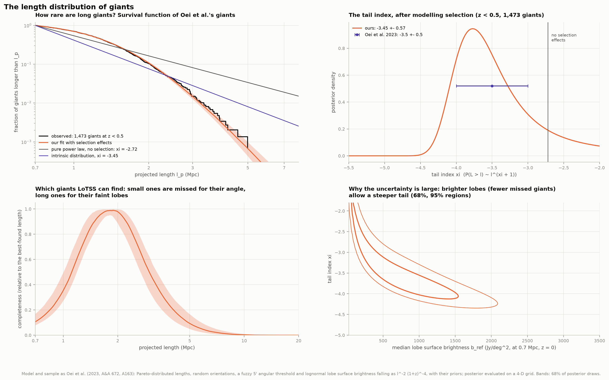

The question in numbers: how much rarer is a 5-Mpc giant than a 1-Mpc one? Oei et al. (2023)
proposed that true lengths follow a power law (a Pareto distribution) with **tail index ξ**: the
chance of exceeding length *l* falls as *l*^(ξ+1). Seen at random orientations, projected lengths
follow the same law with the same ξ (they proved it; our Monte Carlo test agrees to 0.3%).

The difficulty is what the survey misses. Their by-eye search only inspected sources larger than
about 5′, which removes small, distant giants. Lobes also fade as they grow and with redshift,
which removes long ones. We implemented their model of both effects and evaluated the posterior on
a grid of 61 million points over ξ and the three selection parameters, with their priors. On their
sample (1,473 giants with a secure host at z < 0.5):

| | ours | Oei et al. 2023 |
|---|---|---|
| tail index ξ | −3.45 ± 0.57 (joint best fit −3.53) | −3.5 ± 0.5 (best fit −3.55) |
| half-width of the 5′ threshold | 1.97 ± 0.29′ | 1.9 ± 0.2′ |
| median lobe brightness b_ref | 784 ± 461 Jy/deg² | 720 ± 380 Jy/deg² |
| its spread σ_ref | 1.10 ± 0.19 | 1.2 ± 0.2 |

At z < 0.25 (811 giants) we find ξ = −3.53 ± 0.51 (theirs: −3.5 ± 0.4).

A pure power law fitted while ignoring selection gives ξ = −2.72 ± 0.04: a precise but wrong
answer. Long giants are under-represented because their lobes are faint, and that flattens the
apparent tail. The uncertainty of the corrected ξ is large because a steeper tail can be traded for
brighter lobes (bottom right): the data alone cannot tell how many faint giants were missed.

**Does the method work?** We simulated 12 surveys from the full model with known tail indices
(−3.0, −3.5, −4.0) and fitted them as the real data. The 68% intervals contained the truth 10 times
out of 12. The posterior *mode* is unbiased (+0.02 on average); the mean leans 0.27 toward a
shallower tail because the posterior is lopsided (figure 9).

What ξ ≈ −3.5 means: of every 1,000 giants, 8 exceed 5 Mpc and 4 exceed Porphyrion's 6.43 Mpc.
The same tail index converts Porphyrion's projected length into its true one.

### 4. Measuring giants ourselves

The catalogue lengths are measured by eye; we measure the same giants with a fixed rule. Pixels
above **3σ** (three times the image noise) form islands; the islands containing seeds we place by
eye in each lobe (plus the core) are the giant. Its length is the largest separation between any two
of its pixels. That outline also defines what figure 1 shows bright. Faint, diffuse giants are
measured on the 20″ image smoothed to 60″, where their lobes stand out of the noise.

| Giant | z | 6″ | 20″ | adopted | Mpc | catalogues |
|---|---|---|---|---|---|---|
| Porphyrion | 0.896 | — | 13.6′ | 13.6′ (20″) | 6.54 | 6.43 Mpc (Oei et al. 2024); 13.2′ → 6.16 Mpc (Andernach et al. 2025); 17.36′ → 8.39 Mpc (Mostert et al. 2024); 6.9 Mpc (Hardcastle et al. 2023) |
| Alcyoneus | 0.247 | — | — | 21.5′ (60″) | 5.16 | 20.8′ → 4.99 Mpc (Oei et al. 2022/2023); 20.4′ → 4.74 Mpc (Andernach et al. 2025) |
| 3C 236 | 0.0994 | 41.9′ | 44.1′ | 44.1′ (20″) | 5.02 | 42.97′ → 4.88 Mpc (Mostert et al. 2024); 39.0′ → 4.33 Mpc (Andernach et al. 2025); 4.6 Mpc (Oei et al. 2024) |
| LEDA 56028 | 0.0794 | — | — | 45.8′ (60″) | 4.26 | 43.8′ → 4.08 Mpc (Oei et al. 2023) |
| NGC 6185 | 0.0343 | — | — | 59.1′ (60″) | 2.51 | 60.0′ → 2.54 Mpc (Oei et al. 2023) |
| NGC 315 | 0.0165 | 57.4′ | 61.4′ | 61.4′ (20″) | 1.28 | 57.0′ → 1.19 Mpc (Dabhade et al. 2020) |
| 3C 31 | 0.0167 | — | 51.7′ | 51.7′ (20″) | 1.09 | 45.0′ → 0.95 Mpc (Dabhade et al. 2020); 1.1 Mpc (Heesen et al. 2018) |
| J1318+2626 | 0.623 | 11.0′ | 11.5′ | 11.5′ (20″) | 4.82 | 11.0′ → 4.62 Mpc (Oei et al. 2023); 10.72′ → 4.37 Mpc (Andernach et al. 2025) |
| J0819+3235 | 0.753 | 9.0′ | 11.3′ | 11.3′ (20″) | 5.12 | 11.2′ → 5.07 Mpc (Oei et al. 2023); 10.56′ → 4.66 Mpc (Andernach et al. 2025); 10.66′ → 4.93 Mpc (Mostert et al. 2024) |
| NGC 2789 | 0.0212 | — | — | 34.0′ (60″) | 0.91 | 34.5′ → 0.92 Mpc (Oei et al. 2023) |
| J0838+5327 | 0.544 | — | 17.9′ | 17.9′ (20″) | 7.05 | 17.2′ → 6.58 Mpc (Andernach et al. 2025) |
| ILTJ003621.03+253500.9 | 0.625 | — | — | 20.9′ (60″) | 8.78 | 18.97′ → 7.98 Mpc (Mostert et al. 2024) |
| ILTJ132739.02+350643.0 | 0.891 | — | — | 11.4′ (60″) | 5.47 | 13.04′ → 6.25 Mpc (Mostert et al. 2024) |
| ILTJ092754.27+351037.1 | 0.748 | 14.3′ | 14.4′ | 14.4′ (20″) | 6.50 | 12.79′ → 5.79 Mpc (Mostert et al. 2024) |
| ILTJ083456.98+541742.4 | 0.838 | — | 12.2′ | 12.2′ (20″) | 5.72 | 12.02′ → 5.66 Mpc (Mostert et al. 2024) |
| J0103+2305 | 0.265 | — | 24.7′ | 24.7′ (20″) | 6.23 | 24.1′ → 5.9 Mpc (Andernach et al. 2025) |
| J1108+2916 | 0.800 | 11.9′ | 12.3′ | 12.3′ (20″) | 5.71 | 11.56′ → 5.2 Mpc (Andernach et al. 2025) |

"—": the giant's ends are not both detected at that resolution.

The 3σ edge of a bright lobe lies beyond the lobe by up to one beam, so lengths grow with the beam.
At 6″ we agree with the catalogue values: J1318+2626 measures 11.0′ against Oei et al.'s 11.0′, and
NGC 315 57.4′ against 57′. 3C 31 measures 51.7′ at 20″: 1.09 Mpc, as LOFAR's own deep study found
(1.1 Mpc; Heesen et al. 2018). At 60″ we are within −2% and +5% of the catalogues. Where a catalogue's length
differs from ours by much more than a beam, the two have joined different emission: that is the
real source of uncertainty.

### 5. Porphyrion

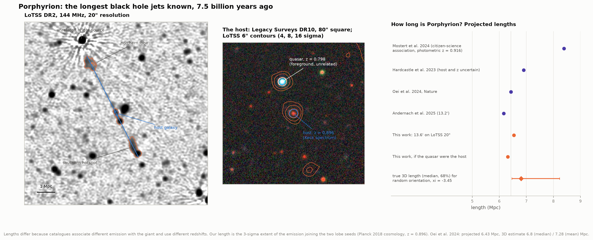

Porphyrion's northern lobe and southern hotspot sit 13.6′ apart. Halfway between them, two
galaxies 19″ apart both have radio cores. The southern one, J152932.16+601534.4, is the host: a
6.7 × 10¹¹ M☉ galaxy that Oei et al. (2024) observed with Keck at z = 0.896. Its jet points along
the axis. The northern one is a quasar in the foreground at z = 0.798 (SDSS BOSS spectrum), unrelated; if it
were the host, the giant would be 6.31 Mpc.

The published lengths of this one object range from 6.16 to 8.39 Mpc. The spread comes from two
choices, not from measurement error:

* **Which emission belongs to it.** The citizen-science association measured 17.4′, about 4′ more
  than the lobes span; a bright unrelated source lies just beyond the northern lobe.
* **Which redshift and host.** The citizen-science catalogue used a photometric estimate,
  z = 0.916. Hardcastle et al. (2023) first reported the giant at 6.9 Mpc, with doubts about its
  host and redshift.

Our 13.6′ at z = 0.896 gives 6.54 Mpc, close to Oei et al.'s 6.43 from deeper images and above
Andernach et al.'s 6.16 (13.2′). LoTSS's 20″ beam spreads each end's edge outward, which accounts
for the difference. To get the true length, add the unknown inclination: for random
orientations and our ξ, the jets are most likely 6.8 Mpc long (68% range 6.5–8.2 Mpc).

### 6. The claimed record breakers

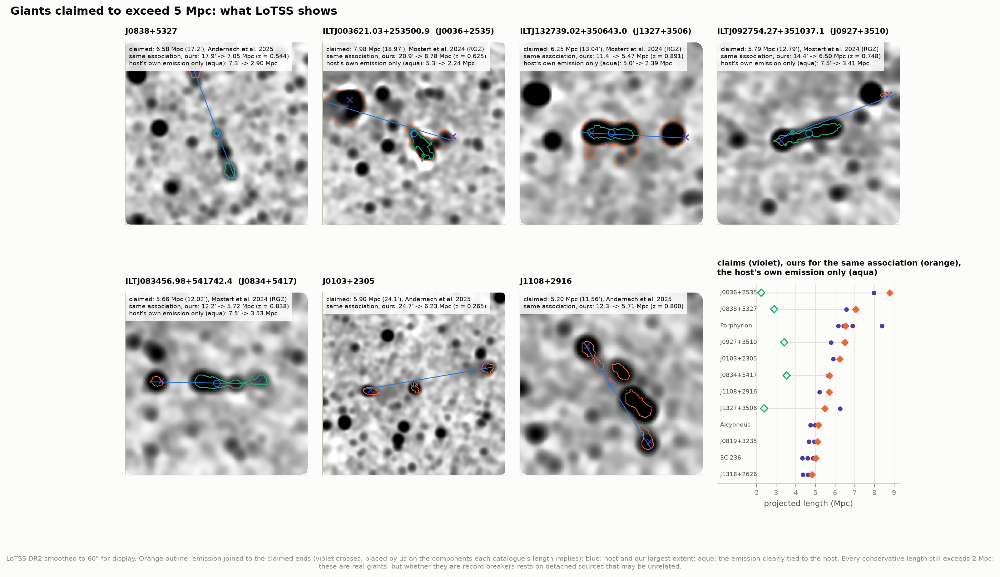

Seven more objects have been claimed to exceed 5 Mpc. We placed seeds where each claimed length
requires the ends to be. That means we measure the same association; this tests the arithmetic, not
whether the association is right:

* **J0838+5327** (Andernach et al.: 17.2′, 6.58 Mpc). A southern arm clearly emerges from the
  host; the claimed northern end is an elongated source 8′ to the north, on the same axis. For that
  association we measure 17.9′ → **7.05 Mpc**, which would beat Porphyrion. The arm alone: 7.3′ →
  2.90 Mpc. Andernach et al. themselves describe the northern side as less clear, and quote their
  length as a lower limit.
* **ILTJ0036+2535** (Mostert et al.: 18.97′, 7.98 Mpc). The record length needs a bright, bent
  source 11′ to the north-east, with its own tailed shape, plus a source to the west. Ours for that
  association: 20.9′ → 8.78 Mpc; the host's own emission: 5.3′ → **2.24 Mpc**.
* **ILTJ1327+3506** (13.04′, 6.25 Mpc). A symmetric double around the host plus a compact source 8′
  west, on the double's axis. Our reconstruction reaches 11.4′ (5.47 Mpc), not the full 13.0′; the
  double alone: 5.0′ → **2.39 Mpc**. If the compact source were an outer lobe, this would be a
  "double-double" from two episodes of jet activity.
* **ILTJ0927+3510** (12.79′, 5.79 Mpc). A 7′ double plus a bright compact source to the
  north-west, off the double's axis. Ours: 14.4′ → 6.50 Mpc; the double: 7.5′ → **3.41 Mpc**.
* **ILTJ0834+5417** (12.02′, 5.66 Mpc). A chain of components plus a compact source 6′ east on the
  same axis. Ours: 12.2′ → 5.72 Mpc, agreeing; without the eastern source: 7.5′ → **3.53 Mpc**.
* **J0103+2305** (Andernach et al.: 24.1′, > 5.9 Mpc). An elongated eastern source pointing at the
  host and a diffuse western lobe; ours 24.7′ → 6.23 Mpc at the assumed z = 0.265. The host is
  uncertain, so, as Andernach et al. say, this is a lower limit.
* **J1108+2916** (11.56′, > 5.2 Mpc). A straight chain of knots across the host, continuous at
  60″; ours 12.3′ → 5.71 Mpc. Its redshift is photometric (0.8), so the length is uncertain by ~10%.

Where we reconstruct the same association, our angles agree with the claims to within 2′. The
exception is ILTJ1327+3506, which we could not reconstruct fully. The disagreements between
catalogues are about *which* emission belongs to the giant. Counting only the emission clearly tied to the host, the four
disputed citizen-science and machine-learning records are 2.2–3.5 Mpc long. They are genuine giants,
but each record rests on detached sources that may be unrelated: exactly the association problem
that made the citizen-science effort necessary.

### 7. How old are the lobes?

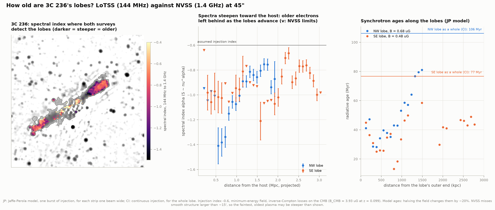

Electrons in a lobe radiate their energy, the most energetic ones fastest, so the spectrum steepens
with time above a *break frequency* that falls as the plasma ages. Comparing LoTSS (144 MHz) with
NVSS (1.4 GHz) at a common 45″ resolution gives the spectral index α (flux ∝ ν^α) and, through a
model, an age. In giant lobes the fields are weaker than the cosmic microwave background's
equivalent field (B_CMB = 3.93 µG at 3C 236's distance), so most energy goes into scattering CMB
photons rather than into synchrotron radiation.

**3C 236**, the first giant ever found (Willis et al. 1974), is the clean case. Both lobes have
α ≈ −0.9 overall (NW −0.90 ± 0.05, SE −0.86 ± 0.05). In the continuous-injection model with our
minimum-energy fields (0.68 and 0.48 µG) the lobes are **106 and 77 Myr** old; any field gives at most
150 and 126 Myr. Along the NW lobe the spectrum steepens from about −0.75 near its outer end to −1.4
some 13′ back toward the host. That is the classic sign of a lobe advancing outward and
leaving older plasma behind: Jaffe–Perola ages rise from ~30 to ~80 Myr. Fed Shulevski et al.'s
(2019) own lobe fluxes and magnetic field, our continuous-injection model returns **136 and
114 Myr** for their 129 and 117 Myr. For the NW lobe our fluxes match theirs (0.75 vs 0.73 Jy at 1.4 GHz; 5.8
vs 5.0 Jy at 144 MHz). Our SE region is larger than theirs (5.8 vs 3.6 Jy; 0.83 vs 0.58 Jy) because
it includes the emission between the lobe and the core.

The other candidates show why such ages need care. NGC 315's eastern lobe (α = −1.07) is steeper
than continuous injection allows, probably because it is larger than the 15′ that NVSS can see: NVSS
misses smooth flux and the spectrum looks too steep. LEDA 56028's south-western lobe is flatter than
injection (α = −0.49), probably because compact background sources sit inside it. Alcyoneus's lobes are not detected by NVSS at
all, giving only limits (α < −0.6). The ages are *model* ages: halving the field strength changes
them by ~20%, and the injection index (−0.6) is assumed.

### 8. The black holes

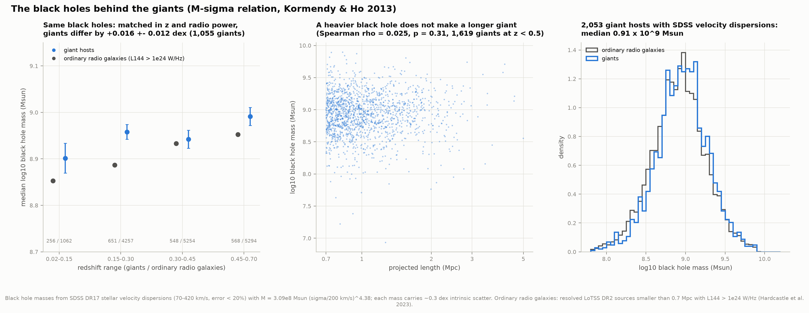

A black hole's mass tracks the speed of the stars around it (the M–σ relation). For the **2,053
giant hosts** with good SDSS velocity dispersions, Kormendy & Ho's (2013) calibration gives a
median of **0.91 × 10⁹ M☉** (10–90%: 0.34–2.28 × 10⁹). That reproduces Oei et al.'s (2023)
1.0 × 10⁹ (0.4–2.2); our masses for the 828 hosts in common agree with theirs to −0.015 dex.

Compared with **ordinary radio galaxies** (resolved LoTSS sources below 0.7 Mpc with 144-MHz power
above 10²⁴ W/Hz), giants' black holes are 0.01–0.07 dex heavier at the same redshift. Matched in
redshift *and* radio power, the difference shrinks to **+0.016 ± 0.012 dex** (1,055 giants), and their
stellar masses differ by +0.015 ± 0.006 dex. Giants are not made by bigger black holes, as Dabhade
et al. (2020) found from a smaller sample. Nor does a heavier black hole make a longer giant
(Spearman ρ = 0.03, p = 0.31 over 1,619 giants). These masses sit on the M–σ scale that project
I1 will calibrate; the quasar hosts, whose spectra show no stellar dispersion, await project I3's
masses from broad emission lines.

### 9. Where giants live

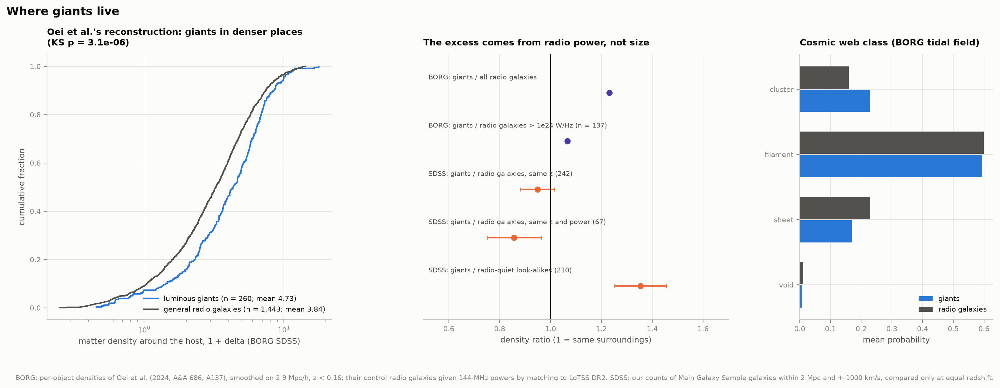

Do giants grow huge because they live in empty places, where nothing stops their jets? Oei et al.
(2024) placed 260 luminous giants and 1,443 ordinary radio galaxies in a reconstruction of the cosmic
web from SDSS (BORG). We recompute their statistics from their table: giants sit in **denser**
places (mean density 4.73 vs 3.84 times the cosmic average, KS p = 3 × 10⁻⁶; their gamma fits
reproduced to within 0.05).

Their explanation is that more powerful radio galaxies live in denser places and giants are
powerful. We test it with their own numbers by giving their control radio galaxies 144-MHz powers
from LoTSS. Against the 137 above the giants' own luminosity cut (10²⁴ W/Hz) the difference
disappears (4.73 vs 4.44, KS p = 0.60).

An independent test with **no reconstruction at all**: in the SDSS Main Galaxy Sample that project D2
mapped, we count galaxies within 2 Mpc of 247
giants and 1,135 radio-loud radio galaxies (z < 0.16), always comparing objects at the same
redshift. Giants have **0.95 ± 0.07** times the neighbours of radio galaxies at the same redshift,
and 0.86 ± 0.11 when also matched in radio power. Both kinds sit in places **1.35 ± 0.10** times as
crowded as radio-quiet galaxies of the same brightness and colour, and the longest giants show no
trend (ρ = 0.00). Giants are ordinary powerful radio galaxies, not radio galaxies that found a void.

### 10. Checks

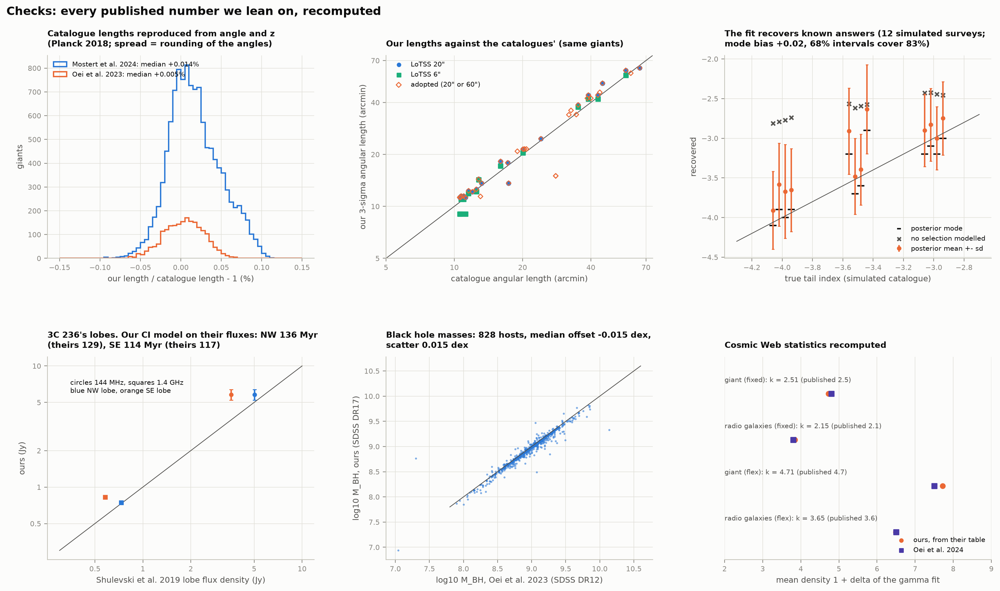

Every published number we lean on, recomputed: the catalogues' lengths from their angles and
redshifts (median agreement 0.014%); our image lengths against theirs; the length-distribution fit
on simulated surveys; 3C 236's lobe fluxes and ages against Shulevski et al.; black hole masses
against Oei et al.; the cosmic-web statistics against Oei et al. 2024. `test_physics.py` adds
checks that need no data: our cosmology against astropy (to 10⁻⁷), projection preserving the tail
index (Monte Carlo), the synchrotron spectra's limits, and lengths measured on synthetic images.

### 11. Beyond DR2: what LoTSS DR3 adds

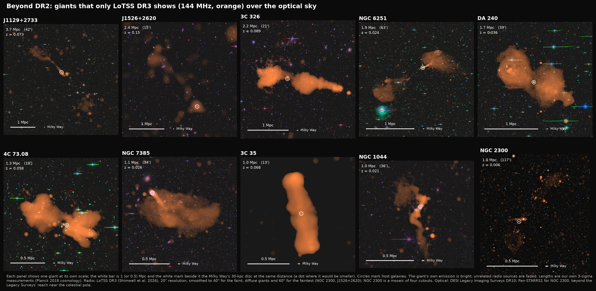

Every giant catalogue here was built from DR2, which covers 27% of the northern sky. LoTSS DR3
(Shimwell et al. 2026) covers 88%, with the same 6″ and 20″ images (9″ south of declination +10°)
from the same cutout service. We used it for ten famous giants that DR2's public images miss,
measured with the same rule:

| Giant | z | 6″ | 20″ | adopted | Mpc | published |
|---|---|---|---|---|---|---|
| NGC 2300 | 0.0063 | — | — | 117.3′ (90″) | 0.95 | 132.0′ → 1.07 Mpc (Oei et al. 2023) |
| NGC 6251 | 0.0240 | — | 63.4′ | 63.4′ (20″) | 1.90 | 65.7′ → 1.97 Mpc (Dabhade et al. 2020) |
| DA 240 | 0.0356 | 37.6′ | 38.7′ | 38.7′ (20″) | 1.70 | 35.15′ → 1.54 Mpc (Dabhade et al. 2020) |
| 4C 73.08 | 0.0581 | 17.1′ | 18.2′ | 18.2′ (20″) | 1.27 | 16.0′ → 1.11 Mpc (Dabhade et al. 2020) |
| 3C 326 | 0.0895 | 20.5′ | 21.5′ | 21.5′ (20″) | 2.22 | 20.1′ → 2.08 Mpc (Dabhade et al. 2020) |
| J1526+2620 | 0.151 | — | — | 15.0′ (120″) | 2.44 | 28.0′ → 4.56 Mpc (Oei et al. 2023); 28.0′ → 4.4 Mpc (Andernach et al. 2025) |
| J1129+2733 | 0.0732 | — | — | 42.3′ (60″) | 3.66 | 38.6′ → 3.34 Mpc (Oei et al. 2023); 40.0′ → 3.34 Mpc (Andernach et al. 2025) |
| NGC 1044 | 0.0212 | — | — | 36.0′ (60″) | 0.96 | 32.7′ → 0.87 Mpc (Oei et al. 2023) |
| NGC 7385 | 0.0262 | — | — | 33.9′ (60″) | 1.11 | 32.0′ → 1.04 Mpc (Oei et al. 2023) |
| 3C 35 | 0.0677 | 12.2′ | 12.6′ | 12.6′ (20″) | 1.01 | 12.5′ → 1.0 Mpc (Dabhade et al. 2020) |

"—": the giant's ends are not both detected at that resolution.

* **NGC 2300**, at declination +85.7°, holds the record for the largest radio galaxy on the sky.
  It needed a mosaic of four cutouts (the service stops at 2°), and an optical image from
  Pan-STARRS1, since the Legacy Surveys do not reach that far north. Its lobes appear only at 90″:
  a loop 23′ south of the galaxy and an arm 65′ to the north-west, 117′ end to end (published
  132′). The difference is the faintest emission our 3σ rule does not reach.
* **NGC 6251, DA 240, 4C 73.08, 3C 326 and 3C 35** are classic giants, found decades ago at higher
  frequencies. LOFAR sees four of them 1–14% larger than the published sizes, which mostly come
  from 1.4-GHz surveys; its low frequency is most sensitive to their oldest, faintest plasma.
  NGC 6251 comes out 4% smaller (63.4′ against 65.7′).
* **J1129+2733** (3.66 Mpc), and **NGC 1044** and **NGC 7385** (two Moon-sized giants), are Oei et
  al.'s discoveries in parts of DR2 that were never made public. Andernach et al. (2025) noted that
  they could not check J1129+2733 and J1526+2620 on public images. DR3 confirms the first three,
  6–10% larger at 60″. NGC 7385's diffuse tail in its galaxy cluster needed a 72′ field.
* **J1526+2620**, claimed at 28′ and 4.56 Mpc, is the exception. Even smoothed to 120″, DR3 shows
  only a 15′ arm from the host to the north-east (2.44 Mpc), and no clear counterpart on the other
  side. The rest may lie below DR3's surface-brightness limit; we report what is secure.

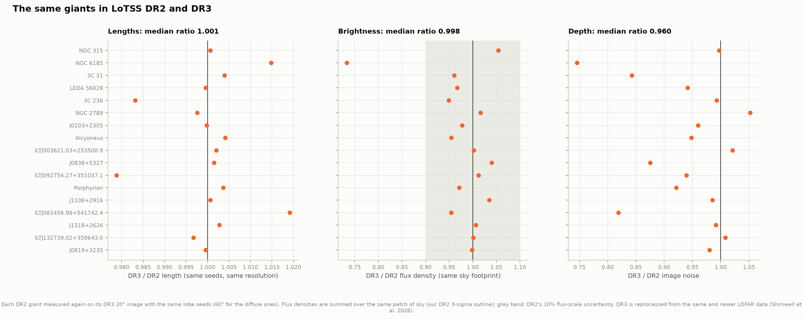

DR3 also checks DR2. The 17 DR2 giants measured again on DR3, with the same seeds at the same
resolution, agree in length to **0.1%** (median; all within 2%). Their brightness, summed over the
same patch of sky, agrees to **0.2%** (median) and within 5% for all but one. DR3 images are 4%
less noisy. The exception is NGC 6185: its very faint, diffuse lobes come out 27% fainter in DR3,
whose noise is also 25% lower there, a sign that the two releases handle the faintest smooth
emission differently.

### An explorer

[`figures/giant_explorer.html`](figures/giant_explorer.html) works offline. Pick one of the 20
giants, fade the radio emission in and out over the optical sky, and drag across the image to
measure any distance in arcminutes, megaparsecs and Milky Ways.

---

## How it works

* `fetch_data.py` downloads everything once, recording each file's source, retrieval time and
  SHA-256 in `data/manifest.json`: CDS catalogues, a VizieR TAP subset of the LoTSS DR2
  value-added catalogue, LoTSS DR2/DR3, NVSS and Legacy Surveys images through their cutout
  services (Pan-STARRS1 through CDS hips2fits near the pole), and SDSS spectra and galaxies through
  SkyServer.
* `catalogs.py` puts every table into one naming convention; `cosmology.py` turns angles into
  lengths (our own integrals, checked against astropy).
* `lengths.py` is the length-distribution model: Pareto lengths, projection, the angular
  threshold, lognormal surface-brightness selection, the completeness integral over the survey
  volume, the 4-D grid posterior, simulated surveys, deprojection.
* `radiomaps.py` measures the images: noise by sigma clipping, smoothing with flux conservation,
  3σ islands from lobe seeds, largest extent and hotspot distance, regridding, and stitching
  mosaics for giants larger than one cutout.
* `spectra.py` holds the synchrotron physics: the Jaffe–Perola and continuous-injection spectra
  (computed from the single-electron kernel), break frequencies from a two-point index, ages and
  minimum-energy fields.
* `hosts.py` and `environment.py` do the black holes and the surroundings; `analysis.py` gathers
  everything; `figures.py` and `interactive.py` draw it; `run.py` runs it all.

Choices made by hand, all in `config.py` with their reasons: the lobe seeds of each giant (the one
step every giant catalogue needs a human for), the resolution each giant is measured at, the
injection index, and the matching tolerances.

## What these data cannot tell you

* **True lengths.** Every length is projected on the sky. Only statistics (the deprojection above)
  connect it to the 3D length; a giant seen nearly end-on could be far longer.
* **Which emission belongs to which galaxy.** Lobes are often detached from their host. Our seeds,
  like every catalogue's associations, are judgements. The record-claims figure shows how lengths
  of the same field differ by a factor two depending on them.
* **The faintest lobes.** LoTSS's surface-brightness limit hides old, faint lobes, so many giants
  are longer than any LoTSS image shows, and some giants are missed entirely. The length-
  distribution model corrects for this statistically, under its assumptions (self-similar growth,
  a constant spectral index of −1, no evolution with redshift below z = 0.5).
* **Redshifts.** About half of Oei et al.'s giants and most of the citizen-science ones have
  photometric redshifts, uncertain by ~10% at best; 2.9% of the hosts with SDSS spectra have
  catalogue redshifts more than 10% off. A wrong redshift is a wrong length.
* **Ages.** Spectral ages assume a field strength (minimum energy), an injection spectrum, and
  that particles are not re-accelerated. They are model ages, not clocks. NVSS's missing short
  spacings make the largest lobes look older than they are.
* **Black hole masses** carry the 0.3 dex scatter of the M–σ relation and SDSS's fibre aperture.
  They exist only for hosts bright enough for SDSS to have taken a spectrum (2,053 of 11,585).
* **DR3** is new (2026) and not yet the basis of any giant catalogue. Its images differ from DR2's
  in how they recover the faintest smooth emission (NGC 6185), so lengths and fluxes of the most
  diffuse giants depend on the release by up to ~25%.
* **Environments** from galaxy counts are only defined below z ≈ 0.16 (where the SDSS Main Galaxy
  Sample maps the cosmic web), so they say nothing about distant giants like Porphyrion.

## Reproduce

```bash
cd astrophysics
source .venv/bin/activate
cd 21-giant-radio-galaxies
python fetch_data.py        # ~1 GB, once
python run.py               # every number and figure: ~9 min the first time, ~4 min after
python test_physics.py      # checks that need no data
```

Needs numpy, scipy, pandas, matplotlib, astropy, reproject and pillow. Once the data are cached,
everything runs offline. The two posterior grids (~2–3 minutes each on 12 cores) are cached in
`data/derived/`.

## Data and credits

* **LoTSS DR2** — Shimwell et al. 2022, A&A 659, A1; **LoTSS DR3** — Shimwell et al. 2026,
  arXiv:2602.15949. Images through the LOFAR Surveys cutout API (lofar-surveys.org). LOFAR is the
  Low Frequency Array designed and constructed by ASTRON.
* **LoTSS DR2 value-added catalogue** — Hardcastle et al. 2023, A&A 678, A151 (via VizieR TAP).
* **Giant catalogues** — Oei et al. 2023, A&A 672, A163; Mostert et al. 2024, A&A 691, A185;
  Andernach et al. 2025, A&A 699, A257 (CDS). Cosmic Web densities: Oei et al. 2024, A&A 686, A137.
* **Porphyrion** — Oei et al. 2024, Nature 633, 537 (arXiv:2411.08630).
* **NVSS** — Condon et al. 1998, AJ 115, 1693, through NASA's SkyView.
* **DESI Legacy Imaging Surveys** — Dey et al. 2019, AJ 157, 168 (DR10 colour images).
  **Pan-STARRS1** — Chambers et al. 2016, arXiv:1612.05560, through CDS's hips2fits service.
* **SDSS DR17** — Abdurro'uf et al. 2022, ApJS 259, 35 (spectra and the Main Galaxy Sample).
* **3C 236** — Shulevski et al. 2019, A&A 628, A69. **M–σ** — Kormendy & Ho 2013, ARA&A 51, 511.
  **Black hole masses of giants** — Dabhade et al. 2020, A&A 642, A153.
* Synchrotron kernel approximation: Aharonian, Kelner & Prosekin 2010, PRD 82, 043002.
  Minimum-energy field: Miley 1980, ARA&A 18, 165. Spectral ageing: Jaffe & Perola 1973;
  Kardashev 1962.

Retrieved October 2026. Everything here is AI-generated (see the atlas README).
