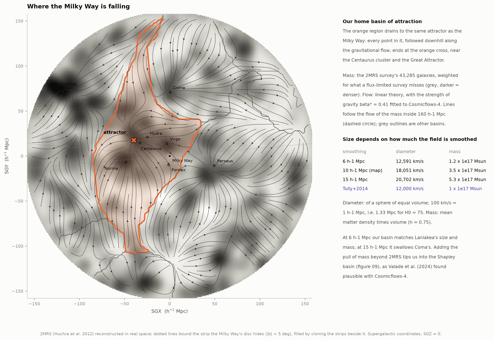
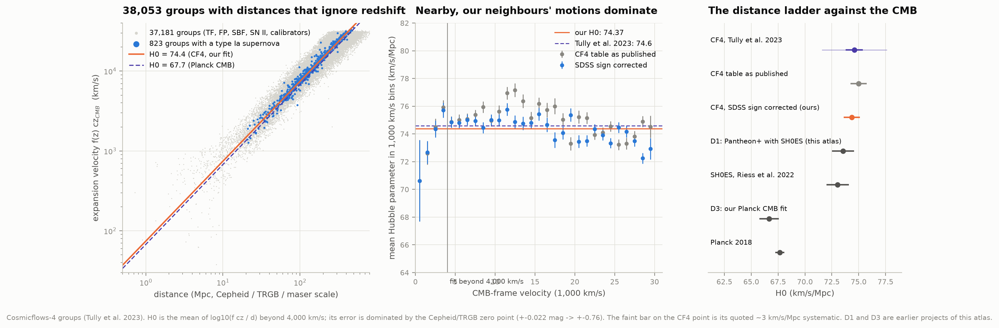
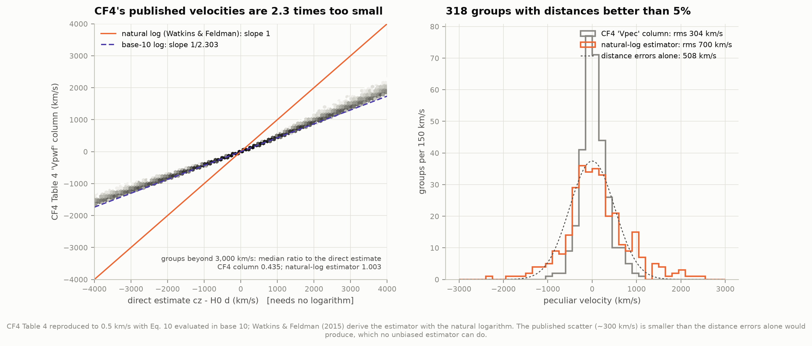
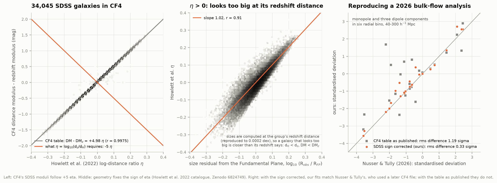
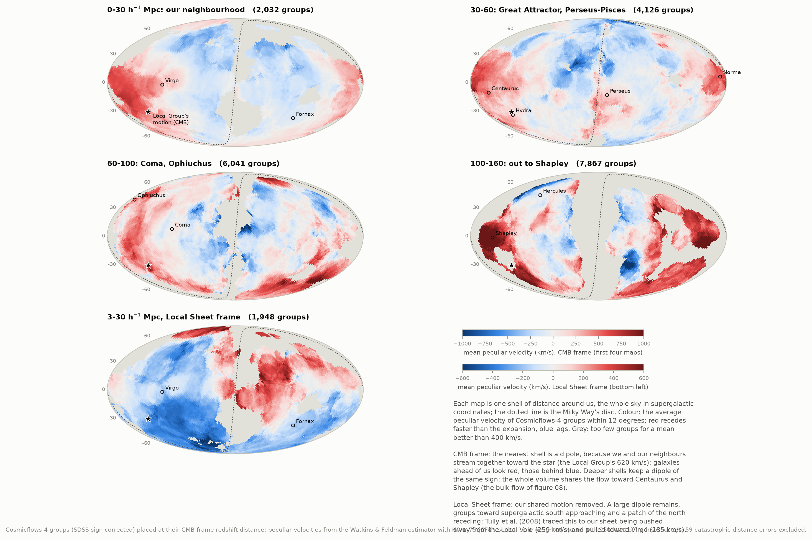
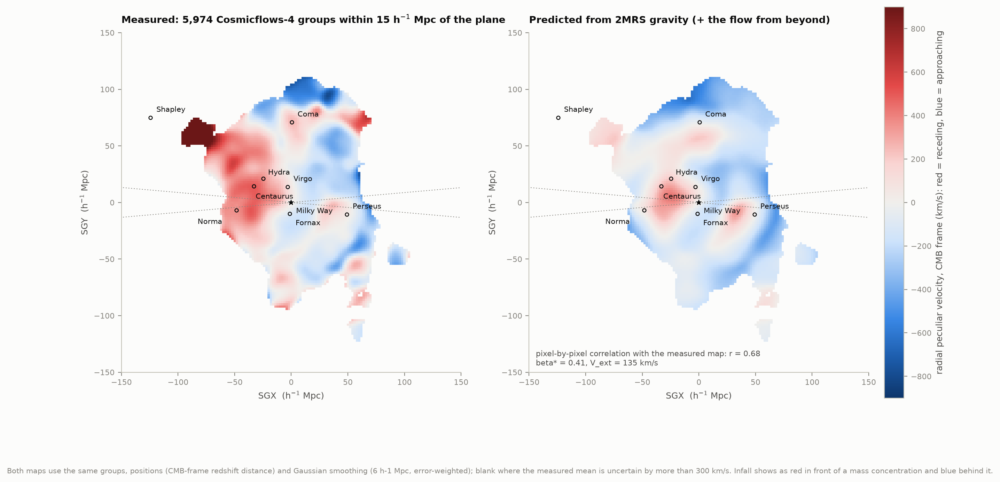
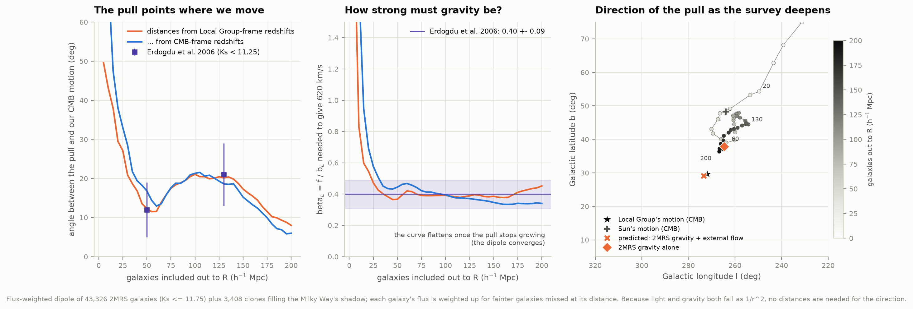
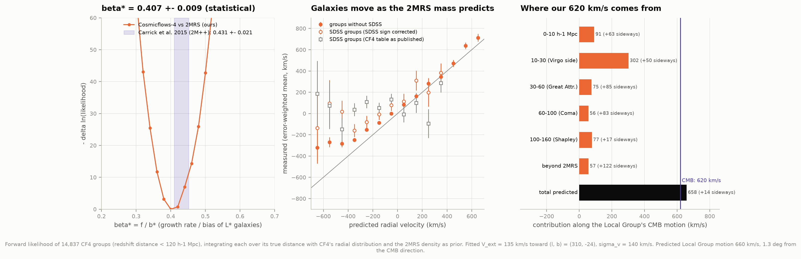
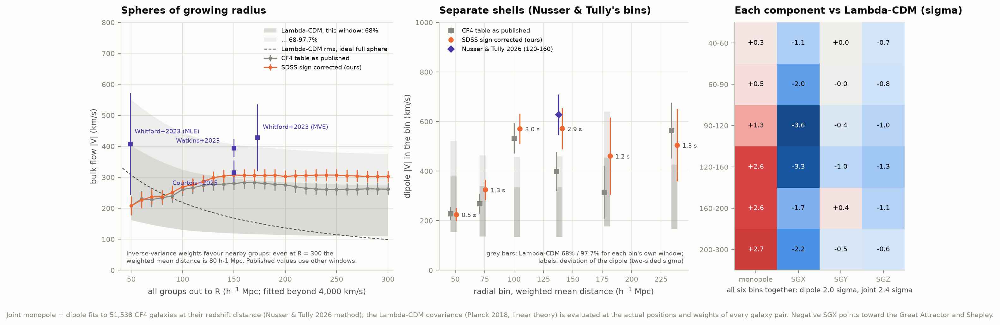
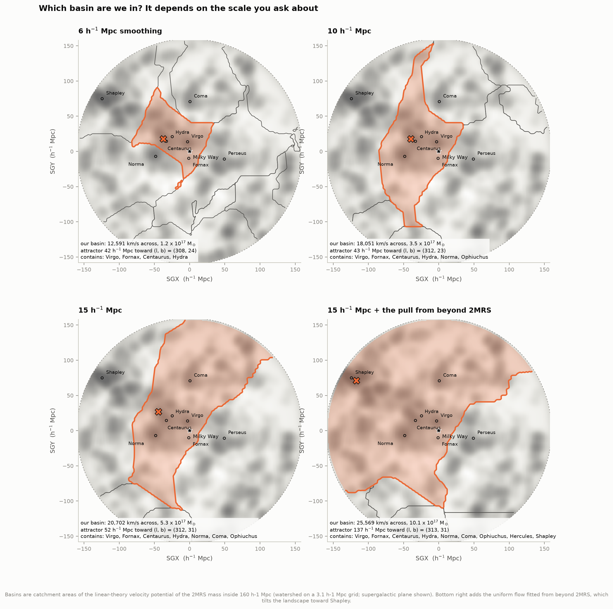

# J4 — Laniakea: the flows of galaxies

**Galaxies don't only recede with the expansion of the universe; they also fall toward
concentrations of mass. Can we map those extra motions, find what the Milky Way is falling
toward, and explain why we move at 620 km/s relative to the cosmic microwave background?**

We use two maps of the nearby universe. **Cosmicflows-4** (Tully et al. 2023) measured the distances
of 55,877 galaxies without using their redshifts, which tells us how each one moves. The **2MASS
Redshift Survey** (Huchra et al. 2012) shows where 44,599 galaxies are, which tells us where the mass is.
Put together, they answer the question. In linear theory the 2MRS mass predicts that the Local
Group moves at **660 km/s toward Galactic (l, b) = (273°, 29°)**. The cosmic microwave background
says **620 ± 15 km/s toward (272°, 30°)**: the direction agrees to **1.3°**. About 60% of the pull comes
from mass within 30 h⁻¹ Mpc (the Virgo side of the sky). The rest comes from the Great Attractor,
Shapley and beyond.

Following that flow downhill, the Milky Way drains into an **attractor 42 h⁻¹ Mpc away toward
(l, b) = (308°, 24°), beside the Centaurus cluster**, the region historically called the Great
Attractor. With 6 h⁻¹ Mpc smoothing, our **basin of attraction** is 12,600 km/s across and holds
1.2 × 10¹⁷ suns. Tully et al. (2014), naming our home supercluster *Laniakea*, found 12,000 km/s and
10¹⁷ suns. How big the basin is depends on how much the field is smoothed. Add the pull of mass
beyond the survey, and on the largest scale we fall into the Shapley basin instead, as Valade et
al. (2024) found plausible.



On the way we found two problems in the Cosmicflows-4 catalogue as published on VizieR (journal
electronic tables). Both matter to anyone who uses it.

1. **Its tabulated peculiar velocities are 2.3 times too small** beyond 3,000 km/s. The Watkins &
   Feldman estimator was evaluated with a base-10 logarithm where it needs the natural one. We
   reproduce all three published velocity columns to 0.25 km/s, so the cause is certain.
2. **The SDSS Fundamental Plane distances, 61% of the catalogue, enter with the wrong sign.** The
   tabulated moduli follow DM_z **+** 5η (r = 0.9975). Geometry fixes Howlett et al.'s η =
   log₁₀(d_z/d_H), so the correct form is DM_z − 5η. With the sign corrected, our fits reproduce a 2026
   bulk-flow analysis by Nusser & Tully (one of them a CF4 author, working from a later file) to
   0.33σ; with the table as published, they don't (1.19σ).

| What | Ours | Published |
|---|---|---|
| H0 from CF4 groups beyond 4,000 km/s | 74.37 ± 0.08 (stat) ± 0.75 (zero point); 74.99 with the table as published | 74.6 ± 0.8 (Tully et al. 2023) |
| Local Group motion predicted by 2MRS gravity | 660 km/s toward (273.3°, 29.1°) | CMB: 620 ± 15 toward (271.9°, 29.6°) (Planck 2018) |
| beta* = f / b* (2MRS vs CF4 velocities) | 0.407 ± 0.009 (stat) | 0.431 ± 0.021 (Carrick et al. 2015, 2M++) |
| External bulk flow from beyond the density field | 135 km/s toward (310°, −24°) | 159 ± 23 toward (304 ± 11°, 6 ± 13°) (Carrick et al. 2015) |
| 2MRS flux dipole, angle to the CMB motion at 60 / 130 h⁻¹ Mpc | 11.6° / 20.1° | 12 ± 7° / 21 ± 8° (Erdoğdu et al. 2006) |
| beta_L = f / b_L from the dipole amplitude | 0.42 ± 0.04 (60), 0.40 ± 0.04 (130) | 0.40 ± 0.09 (Erdoğdu et al. 2006) |
| Bulk flow, 120–160 h⁻¹ Mpc shell | 572 ± 83 km/s; 2.9σ (dipole), 3.6σ (joint) | 628 ± 82; 3.4σ, 3.9σ (Nusser & Tully 2026) |
| All six shells to 300 h⁻¹ Mpc vs ΛCDM | 2.0σ (dipole), 2.4σ (joint) | 2.3σ, 2.4σ (Nusser & Tully 2026) |
| Our basin of attraction (6 h⁻¹ Mpc smoothing) | 12,600 km/s across, 1.2 × 10¹⁷ M☉ | 12,000 km/s, 10¹⁷ M☉ (Tully et al. 2014) |

---

## Background: peculiar velocities in one paragraph

A galaxy's redshift measures its total velocity away from us. Most of it is the expansion of the
universe, H0 times its distance; the rest is its own motion, the **peculiar velocity**: v ≈ cz − H0 d.
So peculiar velocities need distances that don't come from redshifts. Cosmicflows-4 combines eight
such methods. The two big ones are the **Tully–Fisher relation** (a spiral galaxy's rotation speed
predicts its luminosity, the relation project D4 reproduced) and the **Fundamental Plane** (an
elliptical galaxy's size, surface brightness and star velocities are linked). Both give distances
good to about 20%. At 100 Mpc, 20% is 1,500 km/s of error on a velocity of a few hundred, so a single
galaxy says little, and every result here averages thousands. Three reference frames appear
throughout. *Heliocentric* redshifts are what a telescope measures; the *CMB frame* removes the Sun's
369.82 km/s through the cosmic microwave background (Planck 2018); the *Local Group* or *Local Sheet*
frames remove our motion relative to our galactic neighbours. Distances are in h⁻¹ Mpc (H0 = 100 h
km/s/Mpc), so 1 h⁻¹ Mpc is 100 km/s of expansion whatever H0 is.

---

## Results

### 1. The Hubble diagram and H0



Each CF4 group's expansion velocity (CMB-frame cz times CF4's curvature factor) divided by its
distance gives a Hubble parameter. Averaging log H over the 34,992 groups beyond 4,000 km/s, as Tully
et al. (2023) did, gives **H0 = 74.37 ± 0.08 (statistical) ± 0.75 (zero point)**. The scatter of
0.091 dex is CF4's distance error.

- **The table and the paper differ slightly.** The published table gives 74.99, not the paper's 74.6.
  Its distances are shifted onto the Cepheid/TRGB/maser scale by −0.147 mag for every group, while
  the paper's Eq. 8 says −0.138. With the paper's offset the table gives 74.68. Correcting the SDSS
  sign (§3) moves H0 by a further −0.8%, to 74.37.
- **H0 is only as good as the first rungs of the ladder.** A 0.022 mag uncertainty in the zero point
  is ±0.75 km/s/Mpc, ten times the statistical error. To reach Planck's 67.66, every Cepheid and TRGB
  distance would have to be 0.223 mag (11%) too short. That is the Hubble tension in this catalogue.
  The same Cepheid scale gave D1's supernova H0 (73.55 ± 1.02); B4 will build that first rung.
- **The sky is not isotropic.** The southern-celestial, northern-galactic sector gives 76.4, the
  opposite one 74.0, exactly the pattern Tully et al. describe and attribute to our motion toward the
  Great Attractor. This is the bulk flow of §6 in another guise.
- Methods agree by construction (CF4 tied them together): FP 74.2, TF 74.7, SN Ia 75.9, SBF 75.5.
  SN II (35 groups) gives 82.7.

### 2. The peculiar-velocity estimator, and CF4's published velocities



Distance errors are symmetric in the *distance modulus* (a logarithm), not in distance. A galaxy
measured 20% too far gets a large negative velocity; 20% too near, a smaller positive one. So the
direct estimate v = cz − H0 d is biased: with 0.4 mag errors at 10,000 km/s its average in our
simulation is −166 km/s (the lognormal predicts −171). Watkins & Feldman (2015) fixed this with
v = cz/(1+z) · **ln**(cz/H0 d), which is linear in log distance and so unbiased (our test: +4 km/s).

CF4's Table 4 gives three velocity columns. We reproduce all of them to 0.25 km/s (integer rounding):
"Vpds" is the direct estimate with H0 = 75. **"Vpwf" and the adopted "Vpec" (beyond 3,000 km/s) use
log₁₀ instead of ln**, which divides every velocity by ln 10 = 2.303. Two checks need no reading of
equations:

- For small velocities the estimator must agree with the direct one, which has no logarithm at all.
  The natural-log version does (median ratio 1.003); the published column gives 0.435 = 1/2.303.
- For the 318 groups with distances better than 5%, the distance errors alone produce 508 km/s of
  scatter. The published column scatters by 304 km/s, *less than its own errors allow*; the corrected
  one by 700 km/s. The paper's statement that well-measured groups follow "a Gaussian with standard
  deviation 300 km/s" describes the bug.

Work that recomputes velocities from the distance moduli, as most flow analyses do (Watkins et al.
2023; Nusser & Tully 2026; ours), is unaffected. Anyone who used the Vpec column directly is not.

### 3. The sign of the SDSS distances



CF4's largest component is 34,045 SDSS early-type galaxies from Howlett et al. (2022), who publish
for each galaxy a log-distance ratio η = log₁₀(d_z/d_H): redshift distance over Fundamental-Plane
distance (Zenodo record 6824749). In CF4 Table 2 their moduli are **DM = DM_z + 4.978 η + 0.012**
(r = 0.9975, rms 0.033 mag). If η = log₁₀(d_z/d_H), the modulus must *decrease* when η > 0. We
checked the meaning of η from the data, not from its description:

- Howlett's effective radii are angle × the angular-diameter distance of the group's redshift; we
  reproduce them to 0.0002 dex. η equals the Fundamental Plane residual in size (slope 1.02,
  r = 0.91). A galaxy that looks too big *at its redshift distance* has η > 0, and a galaxy that looks
  too big is closer than assumed: d_H < d_z. So DM = DM_z − 5η, and the published table has the sign
  reversed (and uses each galaxy's own redshift where η refers to its group's).
- **Nusser & Tully (2026)**, with a later CF4 file from the Extragalactic Distance Database, find
  SDSS bulk-flow components opposite in sign to those from the published table. Using the SDSS-free
  samples, our implementation of their method matches their supernova and Tully–Fisher results to
  0.01σ, so the method is right. With the SDSS sign corrected and re-levelled, all 24 of their
  standardised All-Individual components agree with ours to 0.33σ rms. With the table as published,
  the rms is 1.19σ and the signs differ beyond 120 h⁻¹ Mpc.
- **The 2MRS gravity field**, which knows nothing about CF4, mildly agrees. SDSS groups within
  120 h⁻¹ Mpc follow the predicted velocities with slope 0.38 ± 0.09 when corrected and −0.01 ± 0.09
  as published.

Our correction is DM = DM_z(z_group) − 4.978 η + 0.012 + Δ, where Δ = −0.055 ± 0.016 mag re-levels SDSS
against Tully–Fisher, supernova and SBF distances in 368 shared groups. CF4 had set the SDSS level
while the sign was reversed. Groups are rebuilt from their members by inverse variance, which
reproduces CF4's own group moduli to 0.004 mag. 22,677 groups change.

Not everything points the same way, and we report it. The full likelihood of §5 fits the published
SDSS values slightly better (Δln L = 6), which a 0.05 mag zero-point difference can absorb. In the
three richest SDSS clusters that host a supernova, the supernova distance sides with the published
sign. Their Fundamental Plane offsets, though, imply peculiar velocities of 1,300–3,000 km/s,
implausible for clusters and more likely the known environment dependence of the Fundamental Plane.
We found no published erratum. Everything below uses the corrected catalogue, with the published
version alongside where it matters.

### 4. Maps of the flows



Groups are placed at their CMB-frame **redshift** distance, which is good to a few h⁻¹ Mpc; their
measured distance would be uncertain by 20%. They are coloured by peculiar velocity (Watkins &
Feldman, natural log, H0 = 75), averaged within 12°, with 59 catastrophic distance errors excluded.
In the CMB frame every shell out to 160 h⁻¹ Mpc is dominated by a dipole of the same sign: the whole
volume streams toward Centaurus and Shapley along with us. In the Local Sheet frame, our shared
motion removed, a large-scale dipole remains (south approaching, a patch of the north receding).
Tully et al. (2008) decomposed our 631 km/s into 259 away from the Local Void, 185 toward Virgo and
455 from larger scales.



The same groups in the supergalactic plane, measured (left) and predicted by 2MRS gravity (right),
both smoothed identically: **r = 0.68** pixel by pixel. Galaxies on the Centaurus/Great Attractor side
recede faster than the expansion (falling away from us toward it), and those toward Perseus–Pisces
approach. The measured infall in front of Shapley is stronger than predicted; Shapley sits at the
edge of what 2MRS can map.

### 5. Gravity against the measured motions

**The flux dipole.** Light and gravity both fall off as 1/r², so if near-infrared light traces mass,
the vector sum of galaxy fluxes points along our gravitational acceleration with no distances needed.
For 43,326 2MRS galaxies plus 3,408 clones filling the Milky Way's shadow, each weighted for the
fainter galaxies a flux-limited survey misses, the pull reaches **11.6° from our CMB motion at
60 h⁻¹ Mpc and 20.1° at 130** (Erdoğdu et al. 2006, from the half-depth survey: 12 ± 7° and 21 ± 8°).
The amplitude implies β_L = f/b_L = 0.42 ± 0.04 (Erdoğdu: 0.40 ± 0.09). Beyond 150 h⁻¹ Mpc the angle
falls to 8°, but there 2MRS sees only galaxies brighter than ~L* and the weights grow tenfold.



**A full reconstruction.** Following Carrick et al. (2015), we turn 2MRS into a real-space density
field. Members of Tully's (2015) groups get their group's redshift, removing fingers of God. A
Schechter luminosity function fitted to the survey (α = −0.948 ± 0.014, M* − 5 log h = −23.38 ± 0.01)
gives the light missed at each distance. The field is rescaled for the luminosity dependence of bias
(b/b* = 0.73 + 0.24 L/L*) and smoothed by 4 h⁻¹ Mpc. Positions are corrected iteratively while gravity
is switched on from β* = 0 to 0.8 in 41 steps. Linear theory then predicts every velocity,
v = β* H0/4π ∫ δ* (x′ − x)/|x′ − x|³ d³x′, computed by FFT convolution on a grid padded to twice its
size so the box has no periodic images (tested against a point mass to 0.1%).

Each of 14,837 CF4 groups inside 120 h⁻¹ Mpc is then compared with the prediction by integrating
over its unknown true distance. The likelihood combines its measured distance modulus, its observed
redshift (predicted velocity plus a scatter σ_v) and a distance prior from CF4's own radial
distribution times the 2MRS density, which corrects inhomogeneous Malmquist bias. A pure r² prior
over-corrects (it ignores that CF4 misses faint, distant galaxies) and pulled H0 to 70.9; the
empirical prior gives 74.39, CF4's own scale.



**β* = 0.407 ± 0.009** (statistical; Carrick et al.: 0.431 ± 0.021). On top of the 2MRS field there is
an **external flow of 135 km/s toward (310°, −24°)** from mass beyond 160 h⁻¹ Mpc (Carrick: 159 ± 23
toward (304°, 6°)), with σ_v = 140 km/s. A fit with the amplitude free on the β* = 0.40
reconstruction prefers 0.37, a sign that systematics (smoothing, the survey edge) exceed the
statistical error. Groups without SDSS galaxies follow the 1:1 line closely; the published SDSS
values don't follow it at all.

**Where our 620 km/s comes from.** Along the CMB direction, mass within 10 h⁻¹ Mpc supplies 91 km/s,
10–30 h⁻¹ Mpc (the Virgo side) 302, the Great Attractor shell (30–60) 75, Coma's shell 56, the
Shapley shell 77, and mass beyond 2MRS 57. In total, 658 km/s, only 14 km/s of it sideways.

### 6. Bulk flows: is ΛCDM in trouble?



The bulk flow is the average velocity of everything in a volume. Several CF4 analyses report flows
too fast for ΛCDM (Watkins et al. 2023: 395 ± 29 km/s within 150 h⁻¹ Mpc, < 0.03% probability;
Whitford et al. 2023: 428 ± 108 at 173). Others are more cautious (Courtois et al. 2025: 315 ± 40;
Nusser & Tully 2026). The trap is the **survey window**: CF4 samples the sky unevenly, so a "sphere"
is never a sphere, and the ΛCDM expectation must be computed for the real galaxy positions and
weights.

We follow Nusser & Tully (2026) exactly. Each galaxy sits at its redshift distance, its velocity is the
linear log-distance estimate u = −K (ln 10/5) (DM − DM_z), and a monopole plus a dipole is fitted in
radial bins. The ΛCDM covariance of the fitted numbers is computed from the linear power spectrum
(CAMB, Planck 2018) for every one of the 2.7 billion pairs of 51,538 galaxies. A chunked sum over thin
shells keeps this to 85 seconds and makes spheres and bins the same computation.

- **Separate shells**: 225 ± 26 km/s at 40–60 h⁻¹ Mpc (0.5σ), 325 ± 41 at 60–90 (1.3σ), **571 ± 62 at
  90–120 (3.0σ)**, **572 ± 83 at 120–160 (2.9σ; 3.6σ with the monopole)**, 461 ± 156 at 160–200,
  505 ± 146 at 200–300. All point within 15° of (l, b) = (298°, −8°), toward the Great Attractor and
  Shapley (negative SGX). All six shells together: 2.0σ for the dipoles, 2.4σ jointly (Nusser &
  Tully: 2.3σ, 2.4σ).
- **Which catalogues drive it**: Tully–Fisher alone gives 4.2σ at 90–120 h⁻¹ Mpc (Nusser & Tully:
  4.2σ), and the 6dFGS Fundamental Plane 4.0σ jointly at 120–160 (theirs: 3.5σ). The supernovae, the
  most precise distances, are consistent with ΛCDM everywhere (0.2–0.4σ overall), and so is SDSS
  through 160 h⁻¹ Mpc.
- **Spheres of growing radius**: |V| = 227 ± 26 km/s within 60 h⁻¹ Mpc, rising to 307 ± 20 within
  150 and staying ~300 out to 300, always toward (294°, −3°). That is above ΛCDM's median but inside
  its 68–97.7% band (p = 0.16 at 150). Inverse-variance weights favour nearby galaxies, so even the
  300 h⁻¹ Mpc "sphere" has a weighted mean distance of only 80 h⁻¹ Mpc. Comparing its 300 km/s with
  the ideal-sphere ΛCDM value at 300 h⁻¹ Mpc (99 km/s rms) would invent a 4.6σ tension.

Our verdict matches Nusser & Tully's: no uniform anomaly, but a localised excess at 90–160 h⁻¹ Mpc
toward the Great Attractor/Shapley direction, driven by the Tully–Fisher and 6dFGS samples, at
~3σ before allowing for the many bins and catalogues examined.

### 7. Basins of attraction: which way is down?



In linear theory, velocities flow down the gradient of a potential whose sources are the density
contrasts. A **basin of attraction** is the region that drains to one minimum, found here like a
river catchment: each grid cell points to its steepest-descending neighbour (watershed on a
3.1 h⁻¹ Mpc grid, tested on two potential wells). Tully et al. (2014) defined Laniakea this way on
the "local" flow, with the pull of distant structure removed, which is what a field built from the
mass inside 160 h⁻¹ Mpc is.

| smoothing | our basin across | mass | attractor | also contains |
|---|---|---|---|---|
| 6 h⁻¹ Mpc | 12,600 km/s | 1.2 × 10¹⁷ M☉ | 42 h⁻¹ Mpc toward (308°, 24°) | Virgo, Fornax, Centaurus, Hydra |
| 10 h⁻¹ Mpc | 18,100 km/s | 3.5 × 10¹⁷ M☉ | 43 toward (312°, 23°) | + Norma, Ophiuchus |
| 15 h⁻¹ Mpc | 20,700 km/s | 5.3 × 10¹⁷ M☉ | 52 toward (312°, 31°) | + Coma |
| 15, with the external flow | 25,600 km/s | 1.0 × 10¹⁸ M☉ | **137 toward (313°, 31°): Shapley** | + Hercules, Shapley |
| Laniakea (Tully et al. 2014) | 12,000 km/s | 10¹⁷ M☉ | Norma/Centaurus | |

(Diameter of a sphere of equal volume; mass = mean matter density × volume, h = 0.75.)
Perseus–Pisces is always a separate basin. Its divide with ours runs between the Milky Way and
Perseus. There is no single answer to "which supercluster are we in": the answer depends on the
scale you smooth to, and on whether the uniform pull from beyond is counted. On small scales we
belong to a Laniakea-sized basin around Centaurus. On the largest, the external flow tilts the whole
landscape toward Shapley. Valade et al. (2024), sampling the CF4 field probabilistically, put "a
slight preference" on Laniakea being part of Shapley's basin.

**Explore it in 3D:** [`figures/laniakea_3d.html`](figures/laniakea_3d.html) (offline; rotate, zoom,
toggle the Perseus–Pisces, Shapley and Coma basins and 7,000 measured groups).

---

## Caveats

- **Linear theory and smoothing.** Predictions are linear theory on a 4 h⁻¹ Mpc-smoothed field
  (σ_v = 140 km/s absorbs the rest). Cluster cores and the Local Group's own neighbourhood are not
  modelled. Basins depend on smoothing by construction.
- **2MRS is shallow.** Beyond ~120 h⁻¹ Mpc each galaxy stands for 3–10 times its own light. Mass
  beyond 160 h⁻¹ Mpc enters only as one uniform external flow. Watkins et al. (2025) argue that this
  external flow is not uniform. In 3D our basins reach the 160 h⁻¹ Mpc edge in some directions, so
  their volumes are partly set by it.
- **The zone of avoidance** (|b| < 5°, 8° toward the bulge) is filled by cloning the strips beside it,
  which cannot know about structures hidden there (part of the Great Attractor, Norma's surroundings).
- **β* has a small statistical error and larger systematics.** The reconstruction's own β*, the free
  amplitude, the survey edge and the CF4 SDSS calibration move it by ±0.04.
- **The CF4 corrections are ours.** Both issues are documented above with their evidence and the
  evidence against. We kept the published versions in every comparison where it changes an answer.
- **ΛCDM tests use linear theory** at z = 0 with the Planck 2018 power spectrum (CAMB). Nonlinear
  velocities enter only through the 100 km/s floor, as in Nusser & Tully. Significances are not
  corrected for the number of bins and samples examined.

---

## Reproduce it

```bash
cd 22-laniakea-flows
python run.py            # fetch (~33 MB), analyse, all figures, data/results.json
python test_physics.py   # 43 checks against known answers
```

The first run takes about 15 minutes: ΛCDM covariances for six catalogues, the reconstruction and
the β* profile. These are cached in `data/derived/`, after which a rerun takes ~3 minutes, offline.
Uses the shared venv: numpy, scipy, pandas, astropy, healpy, camb, matplotlib, plotly, scikit-image.

| File | What it does |
|---|---|
| `config.py` | Paths, sources, reference frames, cosmology, every adopted number with its reference; published values compared against |
| `fetch_data.py` | Downloads the catalogues from CDS and Zenodo; SHA-256 manifest |
| `catalogs.py` | Readers; Galactic/supergalactic rotation; relativistic frame changes; 2MRS ↔ Tully (2015) group matching |
| `cosmology.py` | Distances, CF4's curvature factor, the three velocity estimators, Nusser & Tully's K, CAMB P(k), velocity correlation functions, ideal bulk-flow rms |
| `hubble.py` | H0 and its robustness checks |
| `flows.py` | Peculiar velocities, reproduction of CF4's columns, sky maps, landmarks |
| `cf4fix.py` | The SDSS sign: evidence, zero point, corrected galaxies and groups |
| `bulkflow.py` | Nusser & Tully's fits; the chunked ΛCDM covariance; bins, spheres, p-values |
| `density.py` | 2MRS: luminosity function, weights, bias, zone-of-avoidance cloning, FFT gravity, iterative reconstruction |
| `gravity.py` | Flux dipole; velocity–velocity likelihood; the Local Group's motion by shell; the SDSS sign test |
| `basins.py` | Velocity potential, watershed basins, Laniakea-style reports |
| `analysis.py`, `run.py` | Orchestration, caching, results.json, the printed summary |
| `figures.py`, `interactive.py`, `plotstyle.py` | Figures 00–09 and the 3D explorer |
| `test_physics.py` | Coordinates, cosmology, estimators, linear-theory velocities, fits on planted data, the watershed |

## Data provenance

- **Cosmicflows-4**: Tully, R. B., et al. 2023, ApJ 944, 94; VizieR J/ApJ/944/94, Tables 2–4.
- **2MASS Redshift Survey**: Huchra, J. P., et al. 2012, ApJS 199, 26; VizieR J/ApJS/199/26, Table 3.
- **2MASS groups**: Tully, R. B. 2015, AJ 149, 171; VizieR J/AJ/149/171, Table 5.
- **SDSS peculiar velocity catalogue** (validation only): Howlett, C., et al. 2022, MNRAS,
  doi:10.1093/mnras/stac1681; Zenodo record 6824749 v1.1.0.
- **CMB dipole and Local Group motion**: Planck Collaboration 2020, A&A 641, A1, Tables 2–3.
  **Cosmology**: Planck Collaboration 2020, A&A 641, A6 (TT,TE,EE+lowE+lensing+BAO).

Compared against: Carrick et al. 2015 (MNRAS 450, 317); Erdoğdu et al. 2006 (MNRAS 368, 1515);
Nusser & Tully 2026 (arXiv:2608.14265); Tully et al. 2008 (ApJ 676, 184), 2014 (Nature 513, 71);
Valade et al. 2024 (Nature Astronomy, doi:10.1038/s41550-024-02370-0); Watkins & Feldman 2015 (MNRAS
450, 1868); Watkins et al. 2023 (MNRAS, doi:10.1093/mnras/stad1984); Watkins, Clark & Feldman 2025
(arXiv:2512.03168); Whitford, Howlett & Davis 2023 (MNRAS, doi:10.1093/mnras/stad2764); Courtois et al.
2025 (A&A 701, A187). The Local Group frame uses Diaz et al. (2014) via Planck's Table 3.
