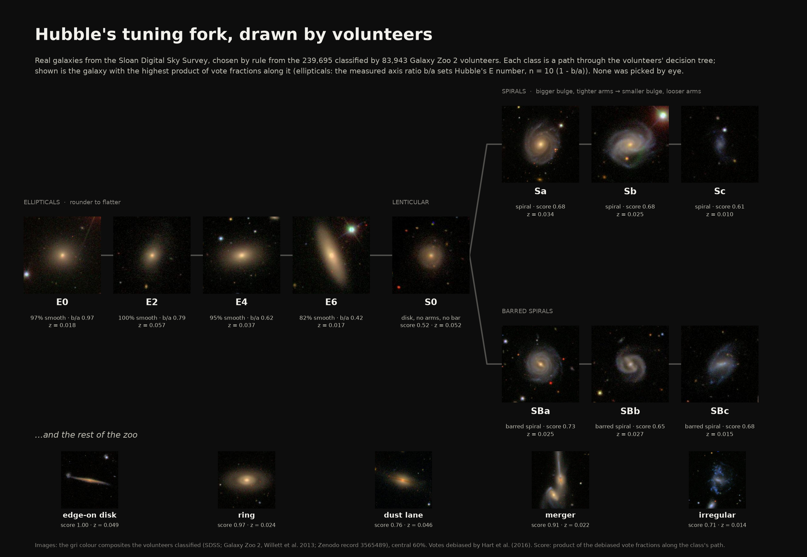
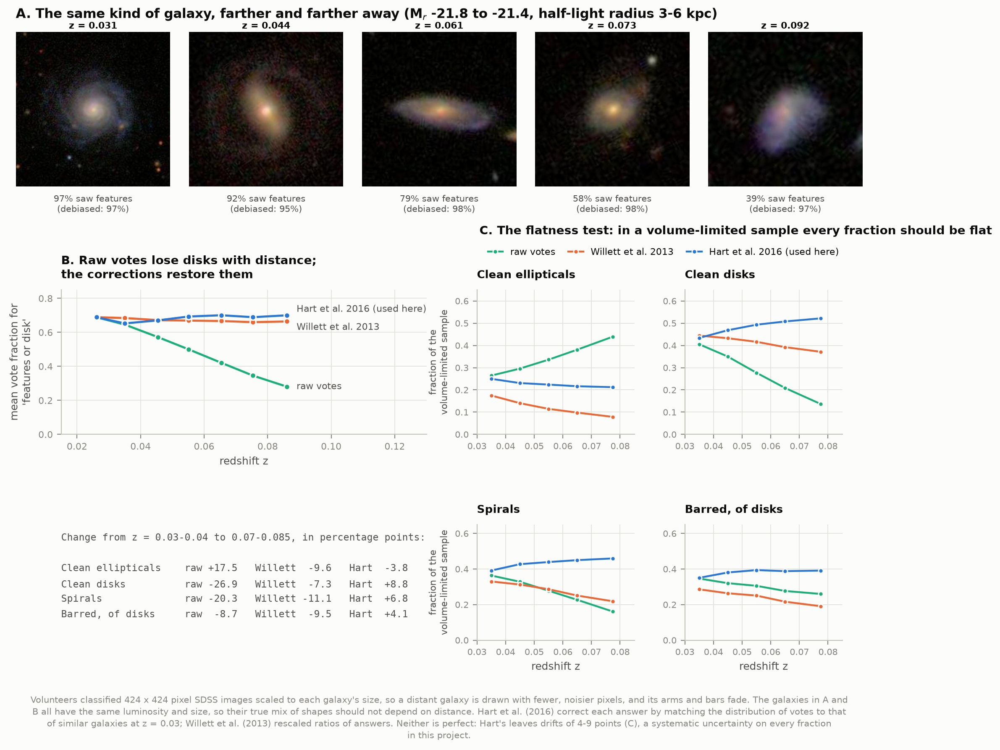
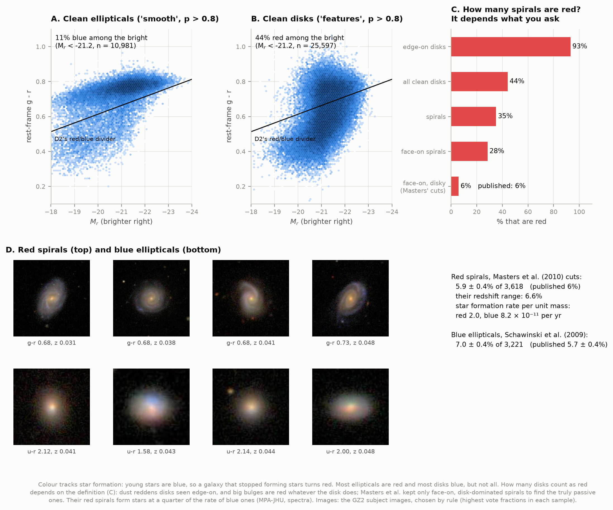
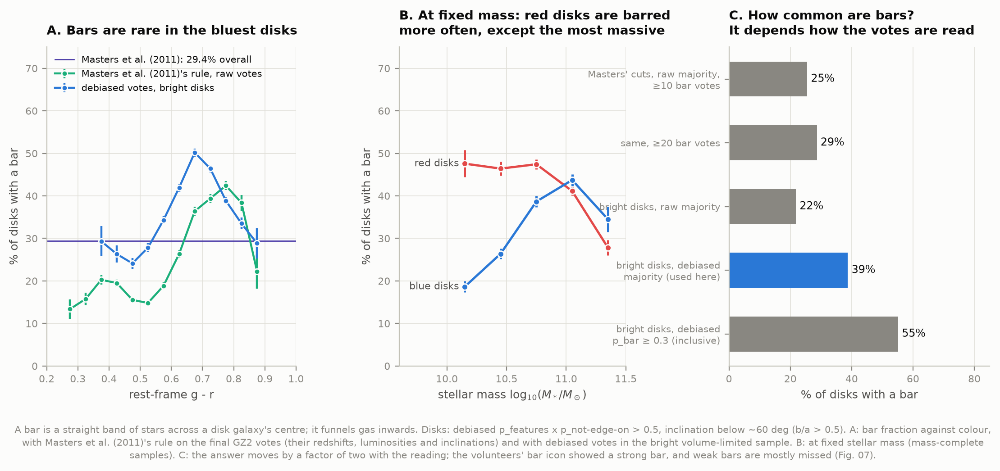
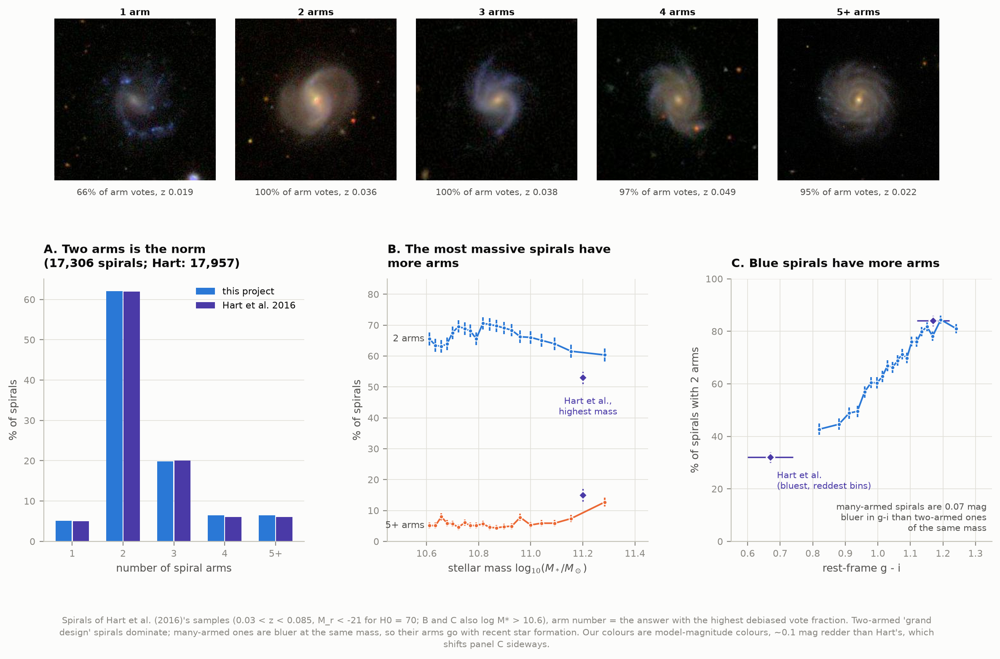
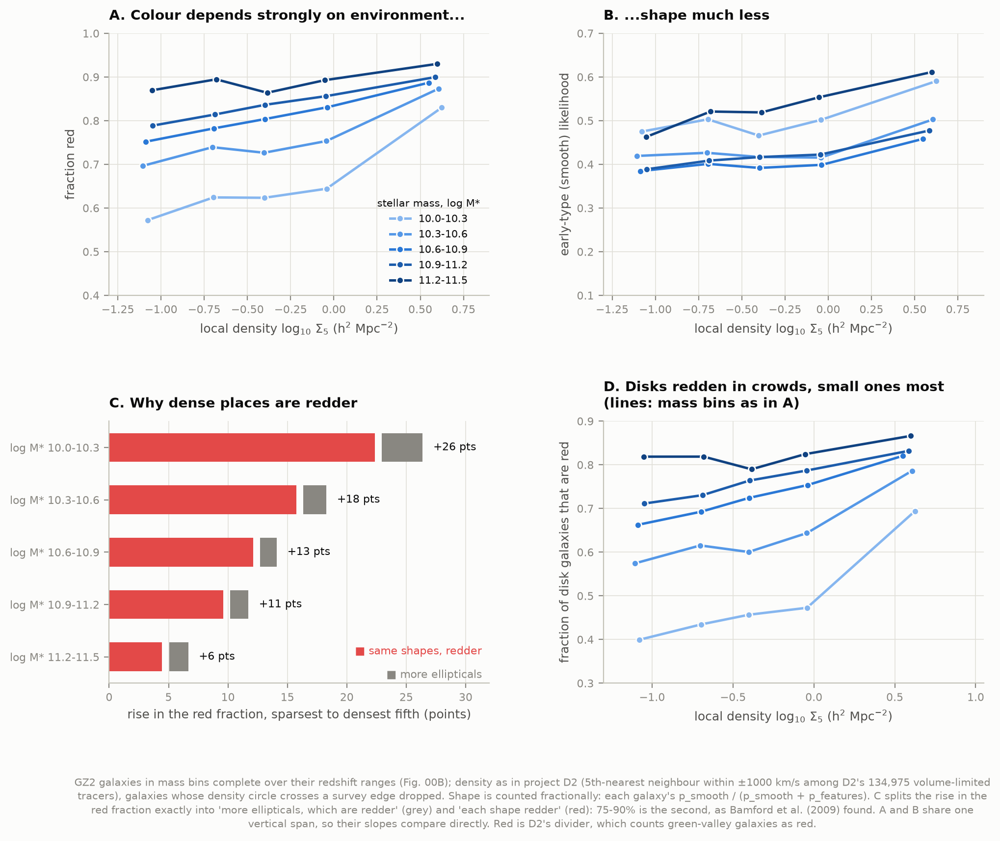
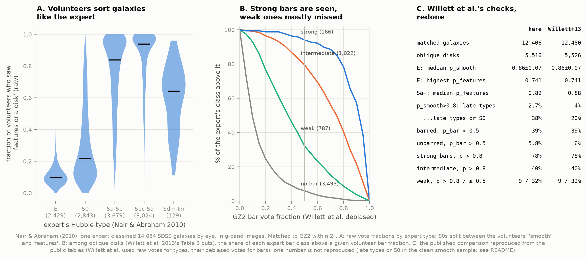
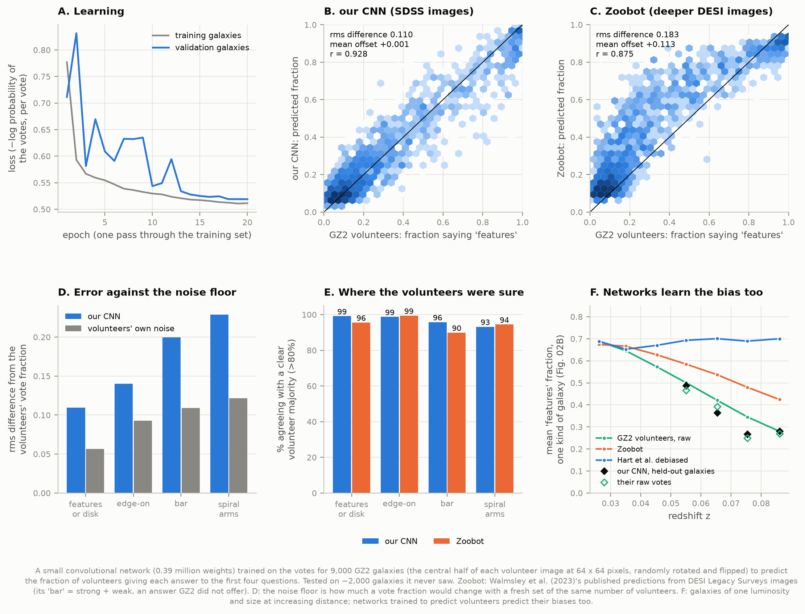

# J2 — Galaxy morphology with Galaxy Zoo

**Hubble sorted galaxies into spirals, ellipticals and lenticulars in 1926. With 16 million
volunteer classifications of nearly 240,000 galaxies, how do shape, colour, mass and environment
relate?**

Between February 2009 and April 2010, 83,943 members of the public answered a tree of questions
("Is it smooth or does it have features? Is it edge-on? Is there a bar? How many spiral arms?")
about SDSS galaxy images for **Galaxy Zoo 2** (GZ2). This project takes those votes, joins them to
SDSS photometry, redshifts and stellar masses, and to the local density measured in project D2,
and asks what the shapes have to do with everything else. Every published number it is compared
with was reproduced from the public tables first, with the original authors' definitions.



*The poster: real SDSS galaxies placed on Hubble's tuning fork. Not one was picked by eye. Each
class is a path through the volunteers' decision tree; the galaxy shown is the one with the
highest product of vote fractions along it, among nearby, well-resolved, well-classified galaxies.
All three candidates per class are in [`01b_tuning_fork_candidates.png`](figures/01b_tuning_fork_candidates.png).*

**The short answer.**

- **Shape and colour go together, but not in lockstep.** Most ellipticals are red and most disks
  blue, yet 6% of face-on, disk-dominated spirals are red (Masters et al. 2010: 6%) and 7% of
  bright ellipticals are blue (Schawinski et al. 2009: 5.7%).
- **Bars live in disks of intermediate colour.** Of bright disks seen face-on enough to tell,
  39% have a bar by the volunteers' majority. At low stellar mass red disks are barred 2.5 times
  as often as blue ones.
- **Two-armed spirals dominate:** 62.0 ± 0.4% (Hart et al. 2016: 62.1 ± 0.4%). Spirals with
  many arms are bluer at the same mass, and more common among the most massive.
- **Crowding turns galaxies red more than it changes their shape.** At fixed stellar mass, the
  red fraction rises by up to 26 points from the emptiest to the most crowded places. 75–90% of
  that rise happens *within* each shape, not by swapping disks for ellipticals. This is the
  conclusion of Bamford et al. (2009), here with D2's density measure.
- **The volunteers agree with a professional:** Willett et al. (2013)'s comparison with the
  expert catalogue of Nair & Abraham (2010) reproduces almost number for number. The exception
  is weak bars, which volunteers mostly miss.
- **A small neural network learns to classify like the volunteers**, agreeing with 99% of their
  clear smooth-or-features majorities on galaxies it never saw. It also learns their blind spot:
  it calls distant galaxies smooth just as they did.

---

## Results

Everything here was measured by the code in this folder. Published values, collected in
[`literature.py`](literature.py), were consulted only afterwards, for grading.

### 1. Reading the votes: distant galaxies look smoother

A vote fraction is the share of volunteers who gave an answer. Two things make it less simple
than it looks. Fractions further down the tree are **conditional**: only volunteers who saw
"features" were asked "is it edge-on?", so a 90% bar vote means "90% of those who saw a face-on
disk saw a bar". And fractions **depend on distance**. Each galaxy was shown in a 424 × 424 pixel
image scaled to its size, so a distant galaxy is drawn with fewer, noisier pixels, and its arms
fade into a smooth blur.



Panel A shows galaxies of one luminosity and one physical size, so of one kind, at increasing
distances. 97% of the volunteers saw features in the nearest; 39% in the farthest. Over all 17,600
such galaxies (panel B), the raw "features" fraction falls from 0.69 at z = 0.026 to 0.28 at
z = 0.086. Galaxies have not changed in the 0.8 billion years between those distances; the
pictures have.

Two published corrections exist. Willett et al. (2013) rescaled ratios of answers; Hart et al.
(2016) map each answer's distribution of votes onto that of similar galaxies at z = 0.03. Panel B
shows both restore the disks. Panel C is the test that matters: in a **volume-limited** sample
(below), the share of galaxies in any class must not depend on distance.

| Change from z = 0.03–0.04 to 0.07–0.085 (points) | raw votes | Willett et al. | Hart et al. |
|---|---|---|---|
| Clean ellipticals (p_smooth > 0.8) | +17.5 | −9.6 | **−3.8** |
| Clean disks (p_features > 0.8) | −26.9 | −7.3 | **+8.8** |
| Spirals (Hart et al.'s product > 0.5) | −20.3 | −11.1 | **+6.8** |
| Barred, of disks (this project's rule) | −8.7 | −9.5 | **+4.1** |

Hart et al.'s correction is the best of the three, so it is used throughout, as the Galaxy Zoo
team recommends. It is not perfect: drifts of 4–9 points remain, a systematic uncertainty on
every fraction below. Its values are designed for **thresholds** (each answer is corrected
separately, so a question's debiased fractions need not sum to one); they are thresholded here,
and normalised per question where averaged.

### 2. Colour and shape: red spirals and blue ellipticals



Colour tracks star formation: young, hot, massive stars are blue and live only a few million
years, so a galaxy that stops forming stars turns red within about a billion years. Panels A and
B use D2's red/blue divider (rest-frame g − r = −0.0500 M_r − 0.386, refitted here on D2's data
with D2's code: identical to five decimals).

| Question | This project | Published |
|---|---|---|
| Bright (M_r < −21.2) clean ellipticals that are blue | 10.7 ± 0.3% of 10,981 | — |
| Bright clean disks that are red | 44.2 ± 0.3% of 25,597 | — |
| Face-on, disk-dominated spirals that are red (Masters et al. 2010's cuts) | **5.9 ± 0.4%** of 3,618 | 6% (294 of 5,433) |
| Ellipticals 3σ bluer than the red sequence (Schawinski et al. 2009's cuts) | **7.0 ± 0.4%** of 3,221 | 5.7 ± 0.4% |

How many spirals are "red" depends on the question (panel C). Dust reddens a disk seen edge-on:
93% of edge-on disks are red by colour alone. A big bulge of old stars is red whatever its disk
does. Masters et al. kept only face-on (axis ratio b/a > 0.63), disk-dominated (fracDeV ≤ 0.5)
spirals and called red only those as red as ellipticals. With their cuts the answer drops to
6%, matching theirs. Their red spirals really have stopped forming stars: their median star
formation rate per unit mass, from SDSS spectra, is a quarter of that of blue spirals
(2.0 vs 8.2 × 10⁻¹¹ per year).

Schawinski et al.'s blue ellipticals are reproduced to 2.1σ: 7.0 ± 0.4% against 5.7 ± 0.4%.
They used Galaxy Zoo 1, whose "elliptical" class was looser, and DR6 photometry. The images in
panel D were chosen by rule (the highest vote fractions in each sample).

### 3. Bars



A bar is a straight band of stars across a disk's centre. Bars drive gas inwards and are thought
to grow slowly in disks that have stopped churning. **How common are they?** It depends on how
the votes are read (panel C):

| Reading | Bar fraction |
|---|---|
| Masters et al. (2011)'s exact cuts on the final catalogue (raw majority, ≥ 10 bar votes) | 25.5 ± 0.3% of 21,312 disks |
| Same, ≥ 20 bar votes | **28.7 ± 0.4%** of 14,879 disks |
| Masters et al. (2011), published | 29.4 ± 0.5% of 13,665 disks |
| This project: bright disks, debiased majority | **38.8 ± 0.3%** of 20,887 |
| Same with Willett et al.'s inclusive cut p_bar ≥ 0.3 | 55.2 ± 0.3% |

Masters et al. worked with the votes collected by July 2009, roughly half the final total, and
required 10 votes on the bar question. On the final catalogue the same rule admits galaxies that
only reached 10 bar votes because twice as many people saw them. Those are the borderline disks
most volunteers called smooth or edge-on, and they rarely have bars. Requiring about twice the
votes (≥ 20) recovers their sample size and their answer (28.7 vs 29.4%).

The definition used here is a disk with debiased p_features × p_not-edge-on > 0.5, seen at
b/a > 0.5 (inclination below ~60°), and debiased p_bar ≥ 0.5. Of the readings tried it is among
the flattest with distance (+4 points over the volume-limited sample; the raw majority falls by 9,
and Hart et al.'s p_bar on Willett et al.'s raw-vote disk selection *rises* by 16, Fig. 02).
The higher fraction than Masters et al.'s is mostly debiasing: bars in distant galaxies are
restored, as the arms were.

- **Colour (A).** Bars are rarest in the bluest disks (24% at g − r ≈ 0.48) and most common at
  g − r ≈ 0.68 (50%), falling again in the reddest disks. Masters et al.'s rule on the final
  votes gives the same rise, from 15% in blue disks to 42% at g − r ≈ 0.78 (they report ~20% for
  blue disks and "over half" for red, bulge-dominated ones; we get 17% and 41% with their cuts).
- **Mass (B).** At 10¹⁰–10^10.3 M☉, 48 ± 3% of red disks are barred against 19 ± 1% of blue
  ones. The gap closes with mass and reverses in the most massive disks (28 vs 35% above
  10^11.2 M☉).
- **Red spirals (Masters et al. 2010's sample).** 42 ± 3% of red face-on spirals are barred
  against 22 ± 1% of blue ones. Masters et al. found 67–70% vs 27%, from two of the authors'
  inspection by eye rather than the votes. Volunteers miss weaker bars (Fig. 07), which narrows
  the gap.

### 4. Spiral arms



Hart et al. (2016)'s samples and definitions (spirals: p_features × p_not-edge-on × p_spiral >
0.5, at least 5 votes naming an arm count; arm number = the answer with the highest debiased
fraction), rebuilt from scratch:

| | This project | Hart et al. 2016 |
|---|---|---|
| Spirals, luminosity-limited (0.03 < z < 0.085, M_r ≤ −21) | 17,306 | 17,957 |
| 1 / 2 / 3 / 4 / 5+ arms | 5.1 / **62.0** / 19.9 / 6.5 / 6.5% | 5 / **62** / 20 / 6 / 6% |
| Two-armed fraction | **62.0 ± 0.4%** | 62.1 ± 0.4% |
| Two-armed, mass-limited (log M* ≥ 10.6) | 66.3 ± 0.5% | 64.2 ± 0.4% |
| Two-armed, highest-mass twentieth | 60.3 ± 2.1% (log M* = 11.28) | 53 ± 2% (11.2 ± 0.1) |
| Five or more arms, highest-mass twentieth | 12.7 ± 1.5% | 15 ± 2% |
| Two-armed, bluest / reddest twentieth in g − i | 43 / 81% | 32 / 84% |
| Two-armed, sparsest / densest tenth | 64 / 73% | 64.3 / 75 ± 2% |

Two-armed "grand design" spirals dominate everywhere. Spirals with more arms are bluer: at the
same stellar mass, many-armed spirals are 0.07 mag bluer in g − i (0.6 of the spread), so their
extra arms go with recent star formation. That is Hart et al.'s conclusion: many-armed structure
is a passing phase of stochastic star formation, two arms the norm. The mass-limited numbers
differ by a few points because stellar masses differ: MPA-JHU's here, Baldry et al. (2006)'s
there. Our g − i colours (model magnitudes, Chilingarian K-corrections) run ~0.1 mag redder than
theirs, so panel C is shifted sideways; the trend is the same.

### 5. Environment: does crowding change a galaxy's shape, or its colour?



Galaxies in crowded places are redder (D2: red fraction 51% → 81% from the emptiest to the
densest eighth) and more often elliptical (the **morphology–density relation**, Dressler 1980).
But ellipticals are red, and crowded places host more massive galaxies, so which is cause and
which is passenger? Three steps separate them:

1. **Fixed stellar mass.** Five mass bins, each complete over its own redshift range (Fig. 00B).
2. **D2's density measure**, Σ₅: the surface density out to the 5th-nearest neighbour within
   ±1000 km/s, counting only D2's 134,975 volume-limited tracer galaxies. Galaxies whose
   density circle crosses the survey edge are dropped (25,800 of 177,000).
3. **An exact split** of the change in red fraction, from the sparsest to the densest fifth of
   environments, into "more ellipticals, which are redder" and "each shape itself redder"
   (Kitagawa–Oaxaca, evaluated at the midpoint so the two terms add up exactly). Shape is
   counted fractionally: each galaxy contributes p_smooth / (p_smooth + p_features).

| log M* | galaxies | rise in red fraction | from more ellipticals | at fixed shape |
|---|---|---|---|---|
| 10.0–10.3 | 3,585 | +25.8 pts | +3.4 ± 0.5 | **+22.4 ± 2.1** |
| 10.3–10.6 | 6,412 | +17.7 | +1.9 ± 0.3 | **+15.7 ± 1.4** |
| 10.6–10.9 | 8,733 | +13.5 | +1.4 ± 0.2 | **+12.1 ± 1.1** |
| 10.9–11.2 | 10,494 | +11.1 | +1.5 ± 0.2 | **+9.6 ± 1.1** |
| 11.2–11.5 | 3,254 | +6.1 | +1.6 ± 0.3 | **+4.5 ± 1.9** |

(Bootstrap errors.) **At every mass, 75–90% of the colour–density relation is colour changing
within each shape.** Small disks in crowded places are red far more often than in voids
(panel D: from 40% to 69% at 10¹⁰ M☉), without becoming ellipticals. That fits gas being
stripped or cut off in groups and clusters, quenching star formation long before the shape can
change. The converse split agrees: at the lowest masses the early-type fraction rises by 11.5
points with density, 9.9 of them only because red galaxies are more often smooth; at fixed colour
it barely moves (+1.7 ± 1.5). Only for the most massive galaxies does shape itself change with
environment (+12.9 ± 2.2 points at fixed colour above 10^11.2 M☉), where the brightest group and
cluster galaxies are giant ellipticals.

Both checks leave the conclusion standing. Dropping edge-on disks (red from dust, not age):
+23.6 of +27.9 points at fixed shape at low mass, and no shape change at fixed colour
(+0.5 ± 1.5). Restricting every mass bin to one common redshift range (z < 0.037, against the
residual debiasing drift): +22.9 of +26.6 at low mass. That range holds too few massive galaxies
to test the top bin.

### 6. Volunteers versus an expert



Nair & Abraham (2010) classified 14,034 SDSS galaxies by eye, one expert, with Hubble types and
bar strengths. Willett et al. (2013) compared GZ2 with them; their comparison is redone here from
the public tables (12,406 galaxies matched within 2″; theirs: 12,480).

| | This project | Willett et al. 2013 |
|---|---|---|
| Expert's ellipticals: median raw p_smooth | 0.86 ± 0.07 | 0.86 ± 0.07 |
| Expert's ellipticals: highest p_features | 0.741 | 0.741 |
| Expert's Sa or later: median p_features | 0.89 | 0.88 |
| Oblique disks in both | 5,516 | 5,526 |
| Expert's barred disks with GZ2 p_bar < 0.5 | 39% | 39% |
| Expert's unbarred disks with p_bar > 0.5 | 5.8% | 6% |
| Strong / intermediate / weak bars with p_bar > 0.8 | 78 / 40 / 9% | 78 / 40 / 9% |
| Weak bars with p_bar ≥ 0.5 | 32% | 32% |
| Late types among p_smooth > 0.8 | 2.7% | 4% |
| Late types **or S0** among p_smooth > 0.8 | 38% | 20% |

Willett et al. used the raw votes for Hubble types and their own debiased votes for bars (the
numbers above match only that way). The one number not reproduced is the last: we find 38% of
the clean "smooth" sample are lenticulars (S0, S0/a) or later, they report 20%. Under no
definition of the expert's S0 class do we get 20% (S0⁻ and S0 only: 33%). The volunteers' smooth
class simply contains many lenticulars: a face-on disk with no arms and a big bulge looks smooth.
Weak bars are mostly missed because the bar question's icon showed a strong bar crossing the
whole disk.

### 7. Teaching a machine (ML extension)



Galaxy Zoo's votes are now mostly used to *train* machines that classify the millions of
galaxies no volunteer will see. Here a small convolutional neural network (0.39 million weights,
five convolution layers) learns from 8,992 GZ2 galaxies. Its input is the central half of each
volunteer image, shrunk to 64 × 64 pixels and randomly rotated and flipped, since a galaxy has
no preferred orientation. It is trained to predict how the volunteers split on the first four
questions. Training maximises the probability of the actual vote counts, so a galaxy seen by 50
volunteers counts for more than one seen by 20. A question nobody was asked contributes nothing,
so the decision tree needs no special handling. This is the idea behind Zoobot (Walmsley et al.
2022, 2023), in miniature. Training took 20 passes, eight minutes on a CPU. It is then tested on
2,063 galaxies it never saw, chosen by a fixed hash of their IDs before any training.

| Test galaxies, clear volunteer majority (> 80%) | Our network | Zoobot (GZ DESI) |
|---|---|---|
| Smooth or features | **99.1%** of 1,282 | 95.6% of 1,223 |
| Edge-on | 98.7% of 1,655 | 99.4% of 711 |
| Bar | 95.8% of 1,433 | 89.9% of 376 (strong + weak) |
| Spiral arms | 93.2% of 1,239 | 94.5% of 308 |
| rms difference from the GZ2 'features' fraction | 0.110 (noise floor 0.057) | 0.183 |
| Mean offset in the 'features' fraction | +0.001 | **+0.113** |

Three things stand out.

- **A tiny network gets close to the volunteers themselves.** If the same galaxy were shown to a
  fresh set of the same number of volunteers, its 'features' fraction would change by 0.057 on
  average, from counting noise alone. Our network's predictions differ from the actual fraction
  by 0.110, twice that floor (panel D), and agree with every clear majority but 1 in 100.
- **Zoobot is not worse; it answers a different question.** It predicts what *Galaxy Zoo DESI*
  volunteers would say about *DESI Legacy Surveys* images, which are 1.4 magnitudes deeper than
  SDSS's. They see more: Zoobot's 'features' fraction runs 0.11 above GZ2's, its strong + weak bar
  fraction 0.20 above GZ2's bar votes (GZ DESI offered "weak bar", GZ2 did not), and its strong bar
  fraction 0.10 below. The disagreements are what deeper images and a different question reveal.
- **Networks learn the bias too (panel F).** For galaxies of one luminosity and size, Zoobot's
  'features' fraction falls from 0.67 at z = 0.026 to 0.42 at z = 0.086, gentler than the GZ2
  volunteers' raw votes (0.69 to 0.28) because its images are deeper, but far from flat. Our
  network, held-out galaxies only, follows their raw votes point for point (0.49, 0.36, 0.27, 0.28
  against 0.47, 0.39, 0.25, 0.27). A network trained to predict volunteers inherits their limits.
  Its outputs need the same debiasing as the votes.

Accuracy on clear majorities flatters every classifier, since those are the easy galaxies (for
bars, mostly obvious non-bars). The rms difference over all test galaxies is the sterner measure,
and there the network is 1.5–1.9 times the noise floor on every question.

---

## How it works

**1. Data.** All public, all fetched by [`fetch_data.py`](fetch_data.py) and cached under `data/`:

- **Votes**: Hart et al. (2016)'s GZ2 table, 239,695 galaxies with spectroscopic redshifts and
  r ≤ 17.0, every answer's vote count, consistency-weighted fraction ("raw") and debiased
  fraction (78 MB, `data.galaxyzoo.org`).
- **SDSS DR17**, joined on SkyServer to Willett et al.'s original table (`zoo2MainSpecz`) by
  object and spectrum IDs: redshifts, Petrosian and model magnitudes, sizes, axis ratios, and the
  MPA-JHU stellar masses and star formation rates (`galSpecExtra`), plus Willett et al.'s debiased
  fractions for comparison. 36 queries in 10° strips of right ascension. 3,752 GZ2 rows carry no
  DR8 object ID (a gap in the original cross-match, mostly along the celestial equator); 2,010 of
  them are recovered by position (nearest DR17 object within 1″, server-side). In all, 238,095
  galaxies (99.3%) have SDSS data, 237,589 a clean redshift.
- **Density tracers**: the SDSS Main Galaxy Sample with D2's exact query. It returns D2's
  656,795 galaxies, D2's 134,975 tracers, D2's footprint (6,934 deg²) and D2's colour divider,
  all identical.
- **Experts**: Nair & Abraham (2010), VizieR J/ApJS/186/427.
- **Images**: the very JPEGs the volunteers classified, archived on Zenodo (record 3565489) as one
  3.35 GB zip of 243,434 images. A zip keeps an index of where each file starts at its end, and
  Zenodo serves byte ranges, so the 39 MB index is read once and then only the wanted images
  are fetched, each by one ranged request: ~12,000 of them (Zenodo allows 133 requests a
  minute). SkyServer's own cutout service is the fallback (throttled to ~0.5 images/s here).
- **Zoobot's predictions**: Galaxy Zoo DESI (Walmsley et al. 2023, Zenodo record 8360385). Only
  16 of its 41 columns are read, again by byte range, out of the 659 MB parquet file.

**2. Luminosities and colours.** D2's physics, copied rather than imported so the folder stands
alone, and tested equal to D2's code to machine precision: Planck 2018 distances, Chilingarian et
al. (2010, 2012) K-corrections. Added here: the u and i bands, for the u − r colours of
Schawinski et al. and the g − i colours of Hart et al. Magnitudes are quoted for Planck's H0; cuts
taken from papers that assume H0 = 70 are converted (+0.074 mag).

**3. Fair samples.** GZ2 is flux-limited: far away, only luminous galaxies are in it, so a
fraction over the whole sample mixes "how common" with "how far" (Fig. 00).

- The **main volume-limited sample**: 0.03 < z < 0.085 (the Galaxy Zoo standard) and
  M_r < −21.20, where even the reddest galaxies (largest K-corrections) at z = 0.085 are brighter
  than r = 16.9. That is 0.1 mag inside GZ2's limit, because GZ2 was cut on DR7 photometry and
  DR17 remeasured it: 50,840 galaxies.
- **Stellar-mass bins**, each complete out to the redshift where the faintest 2% of galaxies of
  its mass (the reddest, highest mass-to-light) would drop out. From 10^10.0–10.3 M☉ complete to
  z = 0.037, up to 10^11.2–11.5 complete to 0.094 (capped at 0.085).
- **Published samples rebuilt exactly** where a comparison needs them (Masters et al. 2010,
  2011; Schawinski et al. 2009; Hart et al. 2016), converted to our magnitudes.

**4. Classes from votes** ([`morphology.py`](morphology.py)): clean ellipticals and disks
(debiased p > 0.8, Willett et al.); spirals (Hart et al.'s product > 0.5); barred disks (above);
arm numbers (Hart et al.). The tuning-fork classes are products along the tree
([`poster.py`](poster.py)). Ellipticals take Hubble's E number from the measured axis ratio,
n = 10 (1 − b/a).

**5. Environment** ([`environment.py`](environment.py)): D2's Σ₅ around each GZ2 galaxy (a galaxy
that is itself a tracer is not its own neighbour), with one refinement over D2. A galaxy is
dropped if the circle out to its 5th neighbour reaches unsurveyed sky, measured from its
distance to the nearest empty footprint pixel.

---

## Is it real? The checks

| Check | What it guards against | Result |
|---|---|---|
| D2's physics, data and divider reproduced | A different "red" or "dense" from D2's | 656,795 galaxies, 134,975 tracers, divider identical to 5 decimals; K-corrections and magnitudes equal to D2's code to < 10⁻¹² |
| K-corrections vs the authors' code | Transcription errors in 6 polynomial fits | Agreement to 3 × 10⁻¹⁴ mag on a 7 × 8 grid |
| The flatness test | A debiasing that does not debias | Hart et al.'s fractions drift ≤ 9 points over z = 0.03–0.085; raw votes up to 27 (Fig. 02) |
| Masters et al. 2010, 2011; Schawinski et al. 2009; Hart et al. 2016 | Wrong cuts, wrong conventions | Reproduced (see tables), differences explained |
| Willett et al.'s expert comparison | A broken match or wrong fraction type | 11 of 12 numbers reproduced exactly or to 1 point |
| Decomposition adds up | An inexact split | Sum of terms = total to 10⁻¹⁶ (200 random cases); a world where colour depends only on shape gives a zero "fixed shape" term |
| Σ₅ on a known configuration | Neighbour counting, the velocity window, self-matching | 5th neighbour at 5.00 h⁻¹ Mpc as placed; decoys outside ±1000 km/s ignored |
| Zip index and byte-range extraction | A broken reader | Exact bytes recovered from an in-memory zip |
| Archived images vs fresh SDSS cutouts of the same galaxies (10 random) | Wrong image filed under a galaxy (the archive's README asks users to check) | Band-passed correlation 0.44–0.90 (median 0.84) for the same galaxy, 0.04–0.27 (median 0.13) against a different one: 10 of 10 correct |
| Environment without edge-on disks; at one common redshift range | Dust; residual debiasing drift | Same conclusion (section 5) |

[`test_physics.py`](test_physics.py) runs 50 of these checks in about 10 seconds, with no network.

---

## Honest notes

- **Debiasing is a statistical correction, not a measurement.** Hart et al.'s fractions say what
  a galaxy would probably have looked like at z = 0.03, from galaxies of similar luminosity and
  size. They fix population fractions well (drifts of 4–9 points remain) but cannot recover a
  particular distant galaxy's arms. Individual classifications of distant galaxies stay uncertain.
- **"Smooth" is not quite "elliptical".** Lenticular (S0) galaxies, disks without arms, split
  between the volunteers' "smooth" and "features" (Fig. 07). And at the smallest masses
  (10¹⁰ M☉), more galaxies are called smooth than at 10^10.6 (Fig. 06B). Small disks look smooth
  at SDSS resolution, and the debiasing only corrects for distance, not for size.
- **A vote fraction is not a probability.** It mixes how obvious a feature is with how sure anyone
  could be. Results here use thresholds and fractional counting side by side where it matters.
- **Red is a definition.** D2's divider sits in the valley between the two colour populations
  and counts green-valley galaxies as red, so "44% of bright disks are red" means "redder than
  the valley". The trend conclusions do not depend on the line; the percentages do. Edge-on dust
  makes 93% of edge-on disks red.
- **Bars are weak-bar-blind.** The GZ2 bar icon showed a strong bar; 68% of the expert's weak bars
  got a debiased bar vote below 0.5. Bar fractions here are strong-and-intermediate bar fractions.
- **The bar definition matters by a factor of two** (22–55% for the same disks, Fig. 04C). The
  one used here was chosen because it stays nearly flat with redshift, not because it gives a
  particular answer. The colour and mass trends hold under every reading tried.
- **Stellar masses are model-dependent.** MPA-JHU's (Kroupa initial mass function, H0 = 70) differ
  from the Baldry et al. (2006) masses Hart et al. used, which is why the mass-limited spiral
  sample differs by 12% in size.
- **Environment is one number.** Σ₅ blends group, cluster and filament environments. D2's tracers
  are volume-limited, so Σ₅ means the same at every redshift, but it is a projected density with
  a ±1000 km/s window that smears cluster cores along the line of sight.
- **Correlation is not causation.** That colour changes at fixed shape in crowds fits gas being
  stripped or starved, but this project does not show the mechanism.
- **0.7% of GZ2 galaxies (1,600) have no SDSS match** (no DR8 ID and no object within 1″ of the
  DR7 position) and are left out.

---

## Running it

```bash
cd ..                       # repository root
source .venv/bin/activate
pip install numpy scipy pandas matplotlib astropy astroquery astropy-healpix scikit-learn requests pillow pyarrow
pip install torch --index-url https://download.pytorch.org/whl/cpu   # only for --cnn

cd 23-galaxy-morphology
python fetch_data.py        # ~280 MB of tables, ~15 min; only needed once
python run.py               # measurements, figures, explorer; first run fetches ~300 images
python run.py --cnn         # also the neural network: fetches ~12,000 images (~1.5 h at
                            # Zenodo's rate limit), trains for ~10 min on a CPU (cached after)
python test_physics.py      # 50 self-checks, ~10 s
```

After the first run everything works offline (`python run.py --offline`).

### Files

| File | What it does |
|---|---|
| `config.py` | Every sample cut and threshold, each with its reason |
| `fetch_data.py` | Galaxy Zoo tables, SkyServer joins, tracers, VizieR, images from the zip by byte range, Zoobot columns from parquet by byte range |
| `physics.py` | D2's distances and K-corrections, plus u and i bands |
| `morphology.py` | From votes to classes: products along the tree, clean samples, bars, arm numbers |
| `environment.py` | D2's Σ₅ and footprint mask, with the edge refinement |
| `analysis.py` | Volume limits, mass completeness, the redshift bias, colours, bars, arms, environment, experts |
| `poster.py` | The tuning fork: classes as paths through the tree, selection by rule, drawing |
| `cnn.py`, `cnn_sample.py` | The neural network and its fixed train/validation/test split |
| `figures.py` | Every static figure |
| `interactive.py` | The offline explorer page |
| `literature.py` | Published numbers, used only for grading |
| `plotstyle.py` | Colours and style, shared with D2 |
| `run.py` | Runs everything and prints the comparison table |
| `test_physics.py` | The self-checks |

## Figures

`00_sample`: flux limit, volume limit, mass completeness · `01_tuning_fork`: the poster ·
`01b_tuning_fork_candidates`: every candidate · `02_redshift_bias`: distant galaxies look
smoother, and the corrections · `03_colours_by_shape`: red spirals, blue ellipticals ·
`04_bars` · `05_spiral_arms` · `06_environment`: shape vs colour in crowds ·
`07_volunteers_vs_experts` · `08_neural_network`.

**[`galaxy_zoo_explorer.html`](figures/galaxy_zoo_explorer.html)**: classify 360 galaxies
yourself, exactly as the volunteers saw them, then see how the volunteers split, the debiased
value, our network's guess and Zoobot's. A browse tab filters them by class. Self-contained
(about 2 MB, works offline) and follows the viewer's light or dark setting.

## Data credits

Galaxy Zoo 2: Willett et al. (2013, MNRAS 435, 2835) and Hart et al. (2016, MNRAS 461, 3663),
`data.galaxyzoo.org`. Images: Galaxy Zoo team, Zenodo doi:10.5281/zenodo.3565489. *This
publication has been made possible by the participation of more than 80,000 volunteers in the
Galaxy Zoo 2 project.* Galaxy Zoo DESI: Walmsley et al. (2023, MNRAS 526, 4768), Zenodo record
8360385.

SDSS Data Release 17 (Abdurro'uf et al. 2022, ApJS 259, 35), via SkyServer, retrieved
2026-10-03. *Funding for the SDSS and SDSS-II has been provided by the Alfred P. Sloan
Foundation, the Participating Institutions, the National Science Foundation, the U.S. Department
of Energy, the National Aeronautics and Space Administration, the Japanese Monbukagakusho, the Max
Planck Society, and the Higher Education Funding Council for England. Funding for the Sloan
Digital Sky Survey IV has been provided by the Alfred P. Sloan Foundation, the U.S. Department of
Energy Office of Science, and the Participating Institutions.* MPA-JHU stellar masses and star
formation rates: Kauffmann et al. (2003), Brinchmann et al. (2004), Salim et al. (2007).

Expert classifications: Nair & Abraham (2010, ApJS 186, 427), via VizieR (CDS, Strasbourg).
K-corrections: Chilingarian, Melchior & Zolotukhin (2010, MNRAS 405, 1409) and Chilingarian &
Zolotukhin (2012, MNRAS 419, 1727), `kcor.sai.msu.ru`. Comparison values: Masters et al. (2010,
MNRAS 405, 783; 2011, MNRAS 411, 2026), Schawinski et al. (2009, MNRAS 396, 818), Bamford et al.
(2009, MNRAS 393, 1324). Density measure and tracers: project D2 (Strauss et al. 2002, AJ 124,
1810; Zehavi et al. 2011, ApJ 736, 59).
