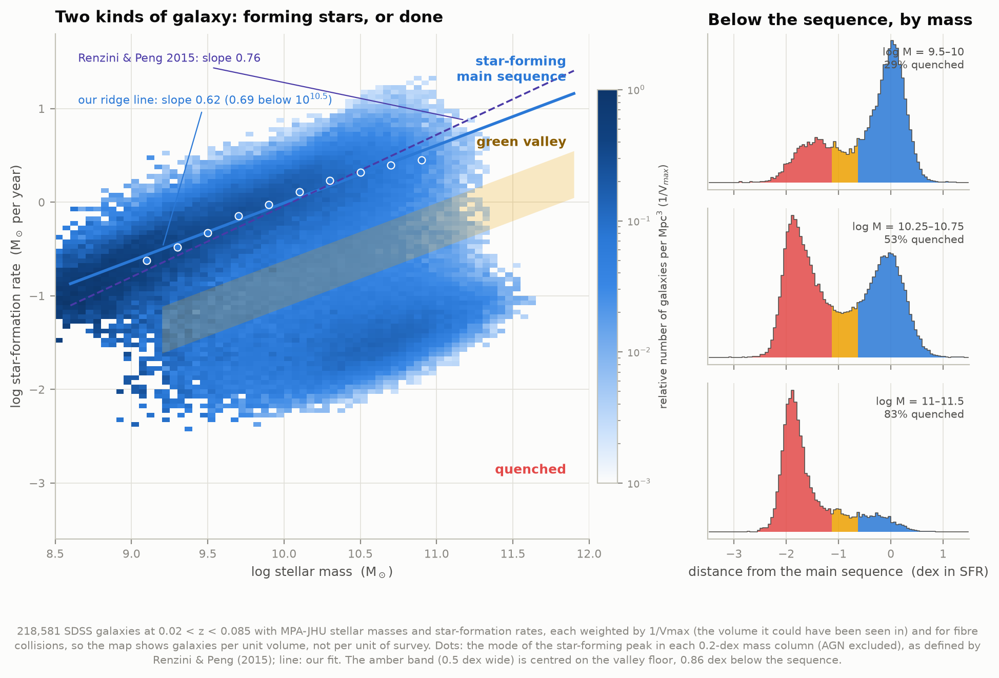
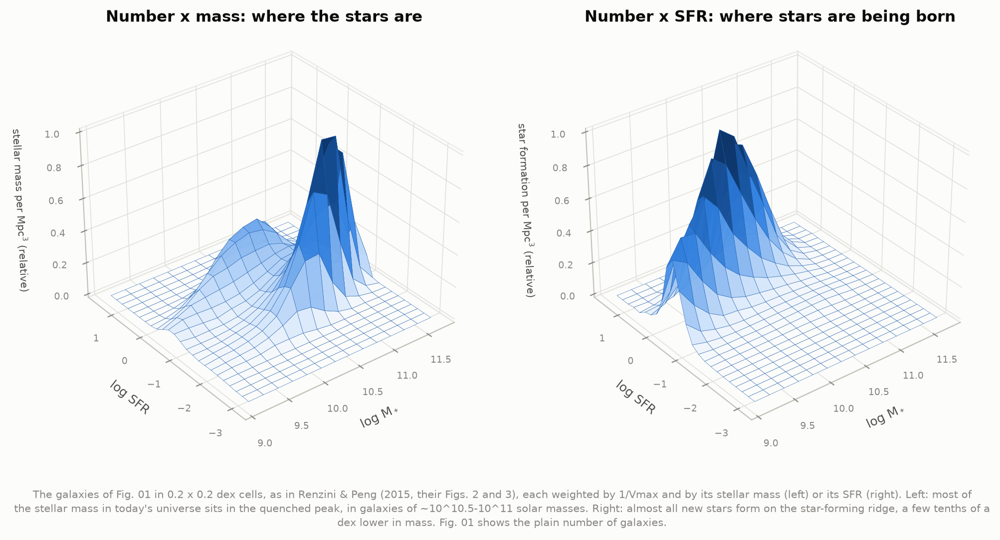
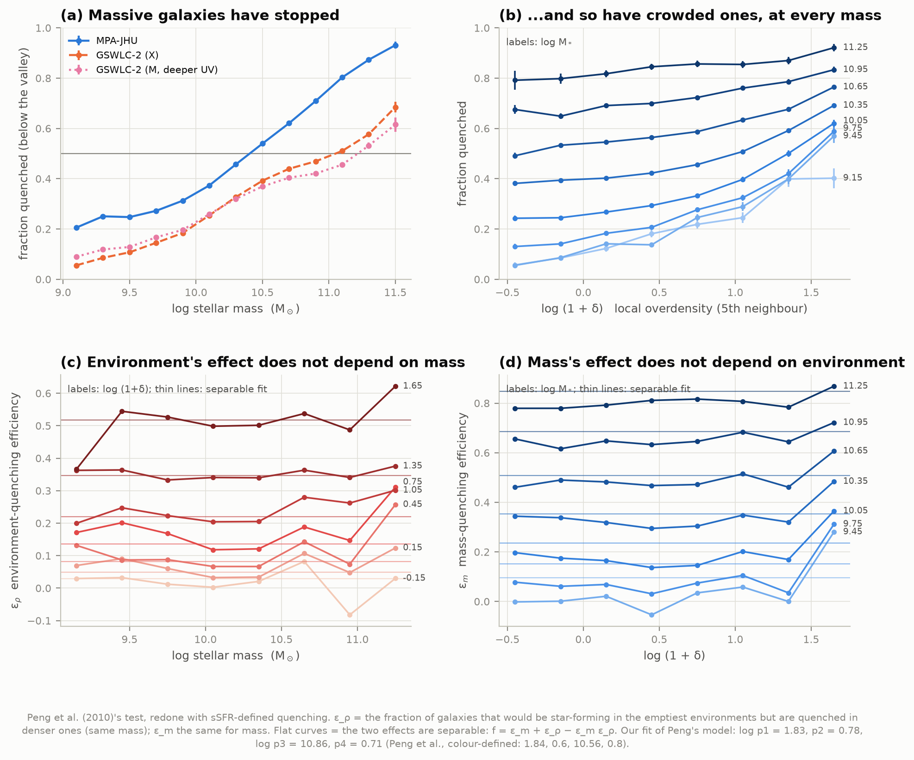
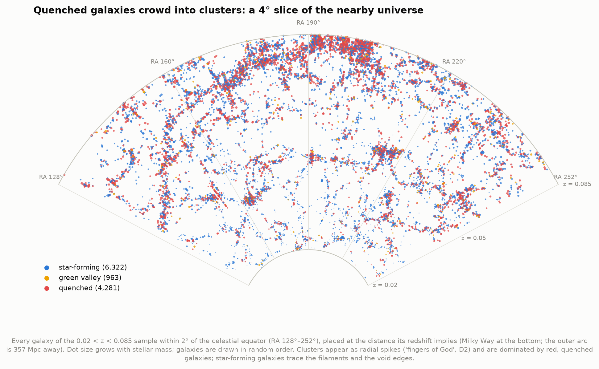
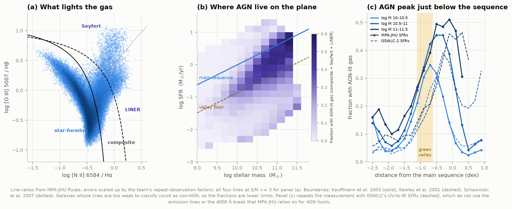
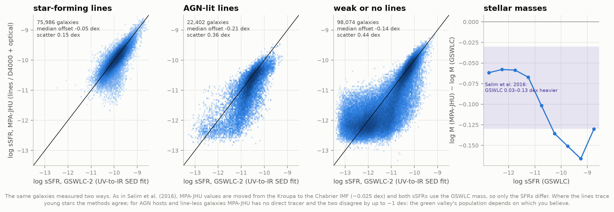
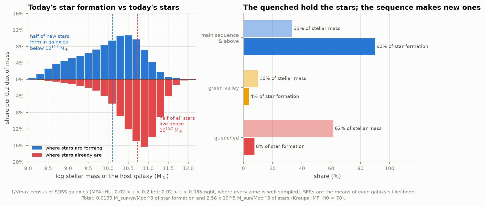
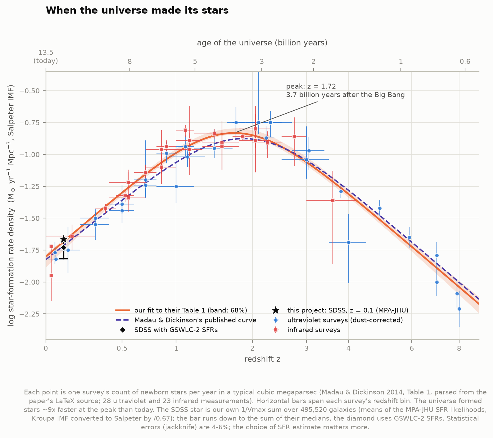
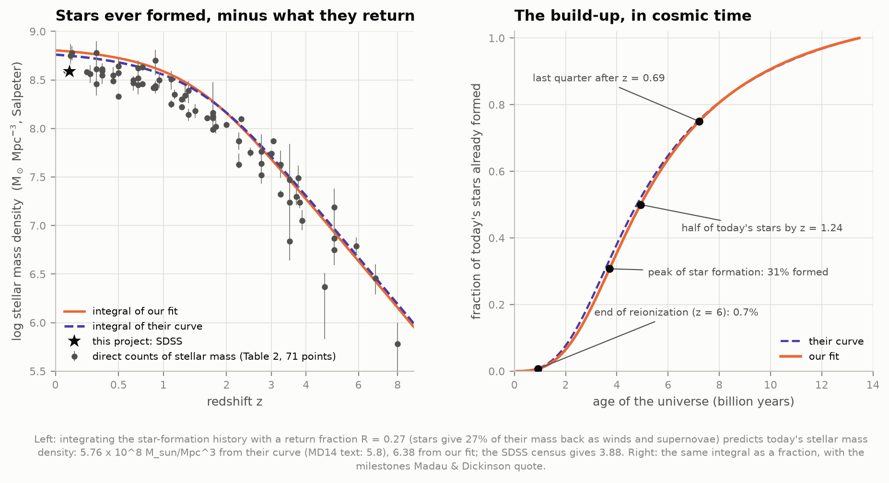
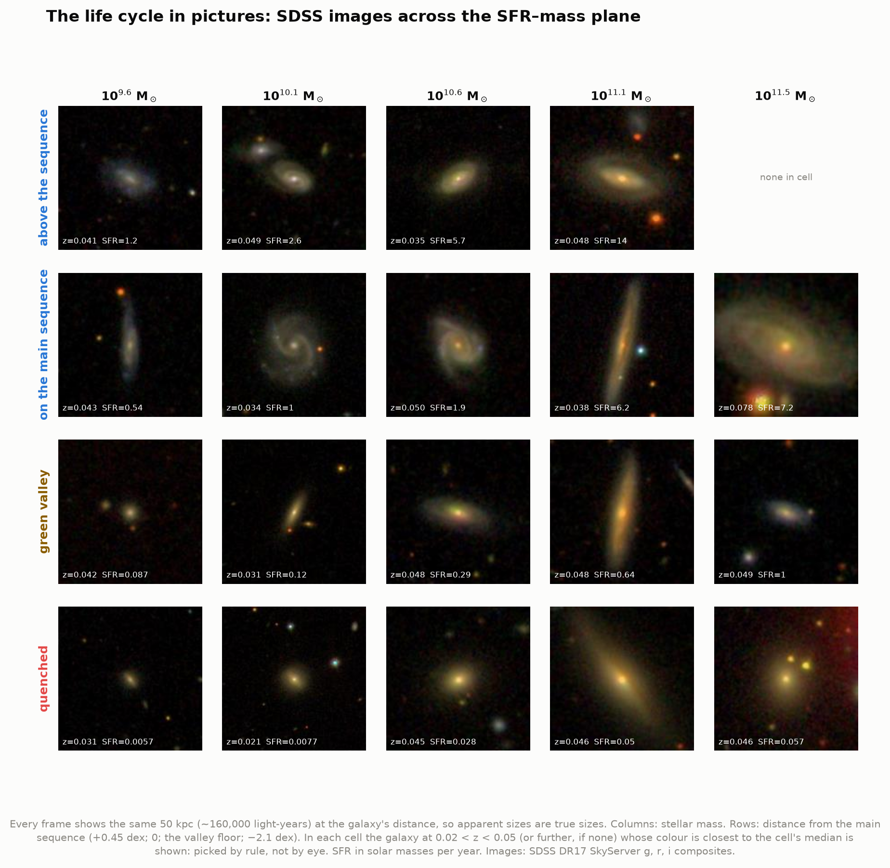

# J3 — The galaxy life cycle

**Galaxies are either busily forming stars or have mostly stopped. How do they cross from one group
to the other, and when did the universe as a whole form most of its stars?**

This project answers both halves with real data. The first half is a census of **656,838 nearby
galaxies** from the Sloan Digital Sky Survey (SDSS), with stellar masses and star-formation rates
(SFRs) from two independent catalogues (MPA-JHU and GSWLC-2). The second half takes the history of the
whole universe's star formation from the 51 survey measurements compiled by Madau & Dickinson (2014),
refits it ourselves, and anchors its near end with our own SDSS measurement.



Each galaxy is a point in the plane of stellar mass (how many stars it has) and star-formation rate
(how many solar masses of new stars it makes per year). Two populations appear. Star-forming galaxies
sit on a tight diagonal band, the **main sequence**, where bigger galaxies form proportionally more
stars. **Quenched** galaxies sit about 100 times lower. Between them lies the sparsely populated
**green valley**, the road from one to the other.

**What we found, in short:**

- **The main sequence** is a ridge with slope **0.69 ± 0.02** between 10⁹ and 10¹⁰·⁵ solar masses
  (0.62 ± 0.03 fitted over 10⁹–10¹¹, Renzini & Peng's range; they found 0.76 ± 0.01). Above ~10¹⁰·⁵ the
  star-forming peak fades into a shoulder and the ridge bends below their straight line. With GSWLC's
  SFRs the clean part has slope **0.75**, matching theirs.
- **The green valley** lies **0.86–0.99 dex below the sequence at every mass from 10⁹·² to 10¹¹**
  (about 8 times below it), a surprisingly fixed distance. Half of all galaxies are quenched above
  **10¹⁰·⁴⁰ solar masses**.
- **Mass and environment quench galaxies independently**, as Peng et al. (2010) found. Our fit of
  their model gives the same environmental threshold (log p₁ = **1.83 ± 0.03** vs their 1.84), and
  letting the environmental effect depend on mass improves nothing (slope −0.07 ± 0.05).
- **"AGN crowd the green valley" depends on which SFRs you believe.** With MPA-JHU's SFRs, 33% of
  green-valley galaxies have AGN-lit gas against 19% on the sequence. With GSWLC's SFRs, which do not
  rely on the spectral features that an active nucleus contaminates, the numbers are 19% and 19%.
- **How many galaxies have stopped also depends on the method.** In GSWLC there is no valley at all,
  only a star-forming peak with a long tail, and the half-quenched mass moves up to 10¹¹·¹.
- **Today's universe forms 0.0145 ± 0.0002 solar masses of stars per year per cubic megaparsec**
  (Kroupa IMF, z = 0.1; from the means of the SFR likelihoods). Converted to the Salpeter convention,
  our three estimates (0.0152 / 0.0186 / 0.0217) bracket Madau & Dickinson's curve (0.0193). The
  stellar mass density, log ρ★ = **8.588**, matches Li & White's 8.59 almost exactly.
- **Cosmic star formation peaked at z = 1.72** (68%: 1.63–1.81), **3.7 billion years after the
  Big Bang**, and has fallen ~9-fold since. Half of today's stars formed before z = 1.24, 8.6 billion
  years ago. Madau & Dickinson's own curve, run through the same code, gives z = 1.86 and 3.45 Gyr.
- **Direct counts of stellar mass fall 0.11–0.18 dex short** of what the star-formation history
  predicts at every epoch, and our SDSS census shows the same shortfall today.

An offline page, `figures/life_cycle_explorer.html`, lets you explore the plane by environment, run a
"cosmic clock" through the history, and browse the galaxies.

---

## The background in brief

**Stellar mass** comes from a galaxy's colours and brightness: fitting models of ageing stellar
populations to its light tells how many stars it takes to shine like that. **Star-formation rate**
comes from tracers of young, short-lived massive stars: the hydrogen Hα line from gas they ionize,
ultraviolet light, or infrared light from dust they heat. The **specific SFR** (sSFR = SFR / mass) is
how fast a galaxy is growing. log sSFR = −10 means it would double its stars in 10 billion years.

A galaxy "quenches" when it stops forming stars: its gas is used up, heated, or removed. The two
suspects are the galaxy's own black hole (feedback from an active galactic nucleus, AGN, project I1)
and its surroundings (being stripped or starved inside a group or cluster, project D2's crowded
regions). Peng et al. (2010) showed that in SDSS the two act as separate processes, "mass quenching"
and "environment quenching".

**The stellar mass spectrum (IMF).** Every mass and SFR depends on an assumed mix of newborn stars,
because faint low-mass stars hold most of the mass but give little light. Catalogues differ: MPA-JHU
uses Kroupa (2001), GSWLC Chabrier (2003), Madau & Dickinson Salpeter (1955). Salpeter gives ~0.2 dex
more mass and SFR. We convert with Madau & Dickinson's factors (SFR ÷ 0.67 Kroupa → Salpeter, ÷ 0.63
Chabrier → Salpeter; masses ÷ 0.66 and ÷ 0.61).

---

## Results

### 1. The main sequence, the valley and the quenched cloud

| Quantity | This project | Published |
|---|---|---|
| Ridge-line slope, 10⁹–10¹¹ M☉ (AGN excluded) | **0.616 ± 0.032** | Renzini & Peng 2015: 0.76 ± 0.01 |
| Ridge-line slope, 10⁹–10¹⁰·⁵ M☉ (clean part) | **0.691 ± 0.024** (GSWLC: 0.745) | — |
| log SFR on the ridge at 10¹⁰·⁵ M☉ | **0.30** | 0.34 |
| Width of the star-forming peak at 10¹⁰·⁵ M☉ | **σ = 0.34 dex** | ≈ 0.3 dex |
| "Number × SFR" ridge above the number ridge | **+0.24 dex** | ≈ 0.2 dex |
| Valley floor below the sequence | **−0.86 dex** (−0.99, −0.86, −0.89, −0.89, −0.94 in mass slices 10⁹·⁰–10¹¹·⁰) | — |
| Mass above which half of galaxies are quenched | **10¹⁰·⁴⁰ M☉** (GSWLC, same cut: 10¹¹·⁰⁵) | — |

**The ridge line.** Renzini & Peng (2015) proposed defining the main sequence without first choosing
which galaxies are "star-forming": count galaxies in 0.2 × 0.2 dex cells of the plane and follow the
crest of the star-forming peak. We did exactly that on 218,581 galaxies at 0.02 < z < 0.085, each
weighted by 1/V_max (see *How it works*). Between 10¹⁰ and 10¹⁰·⁵ M☉ our crest agrees with theirs to
0.02–0.07 dex. Below 10¹⁰ it runs ~0.1 dex higher, and above 10¹⁰·⁵ the peak sinks into the
quenched population's flank and the crest bends, falling 0.19 dex below their line by 10¹⁰·⁹. The
3D view shows why that end is fragile:



Most of today's stellar *mass* sits in quenched galaxies of ~10¹⁰·⁵–10¹¹ M☉ (left), but almost all
star *formation* happens on the ridge (right).

**The valley.** Below the sequence, the distribution of distance from it has two peaks in every mass
slice from 10⁹·⁰ to 10¹¹·⁰ M☉, with the minimum always 0.86–0.99 dex down. Above 10¹¹ there is no
second peak left: the star-forming population has all but disappeared. We define **quenched** as
below the valley floor and **green valley** as the 0.5-dex band centred on it.

**Colour is not the same as quenched.** By rest-frame g − r colour, 30.6% of galaxies (by volume)
are red, but only 24.6% are quenched by SFR. 11.1% are red yet still forming stars: dusty disks,
often seen edge-on. A colour cut mixes "the living and the dead", as Peng et al. put it, which is
why our quenching analysis uses SFR.

### 2. Mass quenching and environment quenching



Local density is measured as in D2: the distance to the 5th-nearest neighbour among 133,495 bright
"tracer" galaxies (every galaxy brighter than M_r ≈ −20.4, so the census is complete to z = 0.089),
counting only neighbours within ±1000 km/s along the line of sight, and expressed as an overdensity
1 + δ relative to the mean. The median distance to the 5th neighbour is 2.5 Mpc. Galaxies whose
5th-neighbour circle pokes outside the survey (7.3%) are left out, as Peng et al. did.

Panel (b) shows the quenched fraction rising with density at every mass. In the 10⁹·⁶–10⁹·⁸ M☉
slice it climbs from 12% in the emptiest quarter of environments to 50% in the most crowded. Panels
(c) and (d) are Peng et al.'s test. ε_ρ is the fraction of galaxies that would be star-forming in
the emptiest places but are quenched in denser ones. If environment acts the same way regardless of
a galaxy's mass, ε_ρ is flat with mass, and likewise ε_m with density. They are, to within a few per
cent except in the densest bin at the extremes of mass. Peng et al.'s separable model, fitted to our
grid:

| Parameter | This project (sSFR-quenched) | Peng et al. 2010 (colour-red) |
|---|---|---|
| log p₁ (environment threshold, in 1 + δ) | **1.83 ± 0.03** | 1.84 ± 0.01 |
| p₂ | **0.78 ± 0.05** | 0.60 ± 0.01 |
| log p₃ (mass threshold, M☉) | **10.86 ± 0.01** | 10.56 ± 0.01 |
| p₄ | **0.71 ± 0.02** | 0.80 ± 0.01 |
| rms residual of the separable model | **2.9%** (max 14%) | "no more than ±0.2 dex" |
| d log p₁ / d log M (0 = separable) | **−0.07 ± 0.05** | — |

The environment threshold matches. The mass threshold is 0.3 dex higher because we count quenched
(low SFR) rather than red galaxies, and dusty star-forming galaxies are red. Run with our colour cut
instead, the model fits badly (χ² 1143 for 60 degrees of freedom) and is not separable
(d log p₁/d log M = −0.83 ± 0.17): our g − r divider is not Peng's U − B one, and the comparison is
only rough.



### 3. Where do galaxies with active nuclei sit?



An accreting black hole lights the galaxy's gas with harder radiation than young stars do, boosting
[O III] and [N II] relative to the hydrogen lines. The "BPT" diagram of those two line ratios (panel a)
separates star-forming galaxies, composites, Seyferts and LINERs. Our classification, from MPA-JHU's
line fluxes with their recommended error corrections, agrees with MPA-JHU's own classes for 100% of
galaxies in each class.

| Fraction with AGN-lit gas, 10¹⁰–10¹¹ M☉ | star-forming | green valley | quenched |
|---|---|---|---|
| MPA-JHU SFRs | **19.2%** | **32.7%** | **10.5%** |
| GSWLC-2 SFRs | **18.8%** | **18.8%** | **6.6%** |

With MPA-JHU SFRs, AGN appear to prefer the green valley, and their fraction peaks 0.1–0.7 dex below
the sequence (35–51% at the peak, rising with mass). But MPA-JHU cannot use Hα for an AGN host, whose
lines are contaminated by the nucleus; it estimates the SFR from the 4000 Å break instead, which
reads systematically low (Salim et al. 2016). With GSWLC's SFRs, fitted to ultraviolet-to-infrared
light, AGN hosts move up: the green-valley excess disappears and at 10¹¹–10¹¹·⁵ M☉ the AGN fraction
peaks 0.3 dex *above* the sequence. AGN are common in massive galaxies near the sequence; whether
they live preferentially in the valley is not something these data can settle.

### 4. Two methods, one universe



The same 196,462 galaxies, measured by MPA-JHU (emission lines and the 4000 Å break inside the fibre,
optical photometry outside it) and by GSWLC-2 (SED fits to GALEX ultraviolet, SDSS optical and WISE
infrared light), both on the Chabrier IMF and normalised by the same mass:

| | median offset (MPA − GSWLC) | robust scatter | Salim et al. 2016 |
|---|---|---|---|
| sSFR, star-forming lines (75,986) | **−0.05 dex** | **0.15 dex** (rms 0.22) | scatter 0.18 dex |
| sSFR, AGN-lit lines (22,402) | **−0.22 dex** | **0.36 dex** | "systematics … up to ~1 dex" |
| sSFR, weak or no lines (98,074) | **−0.14 dex** | **0.44 dex** | same |
| stellar mass | **−0.105 dex** | **0.077 dex** | GSWLC heavier by 0.03–0.13, scatter 0.07 |

Where the lines trace young stars, the methods agree. For galaxies without usable lines, MPA-JHU
piles them up near log sSFR ≈ −12.3, while GSWLC spreads the same galaxies over −13.3 to −11. That
pile-up is what gives MPA-JHU its sharp quenched peak and clean valley. The mass offset grows to
0.13–0.17 dex for the most star-forming galaxies, at and a little beyond the top of Salim et al.'s
range (they used the DR7 masses and GSWLC-M, we the DR8 recomputation and GSWLC-X).

### 5. Who forms the stars today



Summing galaxies by 1/V_max over 0.02 < z < 0.2 (495,520 galaxies, 8,031 deg², errors from 66
jackknife regions of the sky):

| Quantity (Kroupa IMF, H₀ = 70) | This project | Published |
|---|---|---|
| SFR density at z = 0.1, likelihood means | **0.01453 ± 0.00018** M☉ yr⁻¹ Mpc⁻³ | Brinchmann et al. 2004: 0.01915 (+0.0014 / −0.0042 sys.) |
| SFR density at z = 0.1, likelihood medians | 0.01017 ± 0.00013 | — |
| SFR density at z = 0.1, GSWLC-2 (Chabrier) | 0.01172 ± 0.00017 | — |
| Same three in Salpeter units | 0.0217 / 0.0152 / 0.0186 | Madau & Dickinson curve at z = 0.1: 0.0193 |
| Stellar mass density | **2.558 ± 0.020 × 10⁸** M☉ Mpc⁻³ = log **8.588** (Salpeter) | Li & White 2009: 8.59 ± 0.01; Moustakas et al. 2013: 8.59 ± 0.05 |

Half of today's new stars form in galaxies below **10¹⁰·¹⁰ M☉**, while half of all existing stars
live in galaxies above **10¹⁰·⁷³ M☉**. Main-sequence galaxies make 90% of the stars being born (by
likelihood means; 95% by medians) but hold only 33% of the stellar mass. Quenched galaxies hold 62%.

The choice of SFR estimate matters more than the statistics. MPA-JHU gives each galaxy's SFR as a
likelihood distribution, and those distributions are skewed: summing their medians gives 30% less
than summing their means. Our mean-based value sits just below Brinchmann et al.'s systematic range
(0.0149–0.0206). They summed likelihood means too, but from the 2004 version of the method; since DR7
the SFR outside the fibre comes from fitting the outer photometry instead (Salim et al. 2007).

### 6. When the universe made its stars



The 51 points are Madau & Dickinson's Table 1, read from the review's LaTeX source: 28 ultraviolet
and 23 infrared surveys, all on one scale. We refit their function
ψ(z) = A (1+z)^B / (1 + ((1+z)/C)^D) by least squares with asymmetric errors, and bootstrap the
points for uncertainties. Every number below is computed by the same code from both our fit and their
published curve, in their cosmology (H₀ = 70, Ω_m = 0.3, Ω_Λ = 0.7):

| | Our fit (68% range) | Their curve, our code | Their text |
|---|---|---|---|
| Parameters A, B, C, D | 0.0158, 2.92, 2.72, 5.82 | 0.015, 2.7, 2.9, 5.6 | — |
| χ² for 47 degrees of freedom | **40.3** | 64.4 | — |
| Peak redshift | **1.72** (1.63–1.81) | 1.86 | ≈ 1.9 |
| Age of the universe at the peak | **3.72 Gyr** (3.55–3.91) | 3.45 | ≈ 3.5 |
| Half of today's stars formed by | **z = 1.24** (1.22–1.28) | 1.28 | 1.3 |
| Formed before the peak | **31%** (29–33%) | 29% | ≈ 25% |
| Last quarter formed after | **z = 0.71** (0.68–0.73) | 0.70 | 0.7 |
| Formed before reionization ended (z = 6) | **0.66%** | 0.81% | < 1% |
| Stellar mass density today (R = 0.27) | **6.42 × 10⁸** M☉ Mpc⁻³ | 5.76 × 10⁸ | 5.8 × 10⁸ |
| Mass-weighted mean stellar age | **7.98 Gyr** | 8.04 (Planck 2018: 8.24) | 8.3 |
| e-folding time of the decline since z = 1 | data: 4.23 ± 0.23 Gyr (weighted), 3.69 (unweighted) | 4.34 | 3.9 |
| Slope at 3 < z < 8 | (1+z)^**−2.79 ± 0.42** | — | (1+z)^−2.9 |
| Stellar baryon fraction today | 9.3% with D3's Ω_b h² = 0.02221 (5.7% Chabrier) | 9.4% | 9% (5%) |

Everything Madau & Dickinson quote, recomputed from their own curve, comes back within rounding,
except the mean stellar age (8.04 against 8.3 Gyr). An independent integral in redshift gives the
same 8.04; with Planck 2018's slightly older universe the value is 8.24, closer to theirs. Their curve is not the
best fit to their own table, though: every plain fit we tried (log or linear, weighted or not) peaks
at z = 1.72–1.77, and ours has χ² = 40 against their curve's 64. Their round-number parameters look
hand-tuned or rounded. The difference, 0.25 Gyr in the date of the peak, is within the bootstrap
range.



Integrating the history and subtracting the 27% that stars return to the gas as winds and supernovae
predicts the stellar mass in place at each epoch. The direct counts (their Table 2) fall below the
prediction by 0.15 dex at z < 0.5, 0.14 at 0.5–1, 0.17 at 1–2, 0.18 at 2–3 and 0.11 above, and our
SDSS census (3.9 × 10⁸, Salpeter) sits 0.17 dex below today's prediction. Madau & Dickinson call the
match "reasonably good"; the persistent ~40% gap is a known tension that a different IMF, or SFRs
calibrated slightly too high, could explain.

### 7. What it looks like



Real SDSS images across the plane, every frame 50 kpc wide so sizes compare honestly. In each cell
the galaxy shown is the one whose colour is closest to the cell's median, a rule rather than a choice.
Along the main sequence: spirals. In the quenched row: smooth ellipticals and lenticulars, bigger
than the spirals of the same mass. The green valley holds the in-betweens, many of them edge-on
disks. No galaxy in the sample sits 0.45 dex above the sequence at 10¹¹·⁵ M☉.

---

## How it works

**1. Data.** From SkyServer (SDSS DR17): the Main Galaxy Sample selection of D2 (targeted as a
main-sample galaxy, a clean galaxy redshift, dust-corrected Petrosian r < 17.77; 656,838 galaxies),
and the four MPA-JHU tables (`galSpecExtra`, `Info`, `Indx`, `Line`), fetched separately by ranges
of specObjID and joined locally, since a server-side join takes minutes per strip. Also every Main
Galaxy Sample *target*, observed or not (`sdssTiledTargetAll`, 776,234 targets), the spectral class of
targets that are not clean galaxies, and the survey's tiling polygons. GSWLC-2 (X and M catalogues)
from the authors' site; Madau & Dickinson's LaTeX source from arXiv.

**2. Footprint and completeness.** The survey's own tiling polygons give the area: 8,031.0 deg², the
same as the published DR7 legacy spectroscopic area (8,032). Of the targets, 92.9% got a spectrum.
Of those observed in our magnitude window, 1.8% turned out to be stars, 0.8% quasars, 0.5% failed
redshifts, and 0.8% were missing for other reasons. Each galaxy is weighted for fibre collisions
(two fibres cannot sit closer than 55″) by 1 / (fraction of targets within 55″ that were observed),
and the weights are scaled so that they add up to the number of targets that should be galaxies.

**3. 1/V_max.** A flux-limited survey sees faint galaxies only nearby. Each galaxy is weighted by 1/V_max,
the volume within which it would have passed the survey's limits (14.5 < r < 17.6, K-corrected with
D2's polynomials). The faint limit is 17.6 rather than 17.77 because early regions were targeted to
17.6 (D2). The weighted counts are galaxies per unit volume, not per unit of survey.

**4. Main sequence and valley.** Ridge line as in Renzini & Peng (2015), with a parabolic refinement of
each column's peak. The valley is the minimum between the star-forming and quenched peaks of the
smoothed distance-from-sequence distribution, reported only where both peaks exist.

**5. Environment.** Projected 5th-neighbour density in ±1000 km/s cylinders from a volume-limited,
evolution-corrected tracer sample, weighted for fibre collisions, normalised to the tracers' mean
density. A HEALPix map of the tiling polygons (0.013 deg² pixels) measures how much of each galaxy's
5th-neighbour circle lies inside the survey.

**6. Census.** SFR and stellar mass densities by 1/V_max, quoted at z = 0.1 as the average of
SFR ∝ (1+z)⁰ and (1+z)³ evolution (Brinchmann et al.'s convention; the two differ by 9%). The mean of
each galaxy's SFR likelihood comes from its five quoted percentiles, assuming log SFR is piecewise
linear in Gaussian quantile (exact to < 1% for Gaussian likelihoods, tested).

**7. Cosmic history.** Fit, bootstrap (1000 resamplings), and time integrals on a fine redshift grid,
checked against an independent quadrature to 10⁻⁴.

---

## Honest notes

- **The ridge-line slope does not reproduce Renzini & Peng's 0.76.** Our crest agrees with theirs around
  10¹⁰–10¹⁰·⁵ M☉ but is flatter overall. A two-Gaussian decomposition gives the same answer below
  10¹⁰·⁴ and is unstable above. Possible causes: their exact weighting ("V/V_max for masses below the
  completeness limit"), DR7 versus our DR8 recomputation of the same pipeline, and how the high-mass
  shoulder is read. Other SDSS studies (e.g. Popesso et al. 2019) also find the sequence bending at high
  mass.
- **Different SFR indicators disagree for galaxies that are not plainly star-forming.** This one fact
  moves the quenched fraction (half-quenched mass 10¹⁰·⁴ vs 10¹¹·¹), the AGN-in-the-valley result,
  and the local SFR density (±20%). We report both catalogues rather than choose. For GSWLC we
  borrow MPA-JHU's valley position, because GSWLC has no valley of its own.
- **67 galaxies (0.01%) are dropped** because their MPA-JHU SFRs imply log sSFR > −8 (doubling their
  stars in under 100 Myr). Most are star-forming knots of large galaxies that the photometry split off,
  with "stellar masses" of 10⁶–10⁷ M☉. One claims 7,500 M☉ per year and alone carried 3.6% of the
  local SFR density before it was removed.
- **453 galaxies have broken photometry** (observed g − r beyond −0.5 to 2.5, some reaching 5–15).
  Their K-corrections use a typical colour (0.9) and their colours are not used.
- **SDSS fibres see only galaxy centres** (3″). MPA-JHU corrects for the rest with the outer photometry;
  that correction is one source of the indicator differences above.
- **The Peng comparison is not like for like.** We define quenched by SFR, they used U − B colour;
  our density tracers (M_r < −20.4, evolution-corrected) approximate their M_B < −19.3 − z.
- **The area cross-check.** Estimating the area as targets ÷ (target density in a "well-filled interior")
  gives 7,574 deg², 6% low, because picking well-filled pixels selects overdense sky. The survey's
  polygons settle it.
- **Unobserved targets have no DR17 magnitude**, so they are shared among magnitude windows in
  proportion to the observed ones. Fibre collisions do not depend on brightness, so this should hold.
- **Not corrected:** luminosity evolution inside V_max (the census spans z = 0.02–0.2), and cosmic
  variance beyond the jackknife's 66 regions. Madau & Dickinson's points stop at 0.03 L*; our census
  includes everything the survey saw.

---

## Running it

```bash
cd astrophysics/24-galaxy-life-cycle
../.venv/bin/python fetch_data.py        # ~750 MB into data/ (SkyServer, GSWLC, SAS, arXiv)
../.venv/bin/python run.py               # analysis (~5 min), all figures, the explorer
../.venv/bin/python run.py --figures-only  # redraw from the cached analysis (~30 s)
../.venv/bin/python test_physics.py      # 14 checks of the machinery
```

`run.py` fetches whatever is missing first. Once the cache is warm everything runs offline except the
gallery's SDSS image cutouts, which are cached in `data/cutouts/` after the first run.

### Files

| File | What it does |
|---|---|
| `config.py` | paths, URLs, cosmology, IMF factors and every sample cut, with reasons |
| `fetch_data.py` | downloads and caches all data; parses Madau & Dickinson's tables |
| `cosmo_physics.py` | distances, K-corrections (from D2), V_max |
| `galaxies.py` | derived quantities, BPT classes, ridge line, valley, likelihood-mean SFRs |
| `environment.py` | targets, fibre-collision weights, 5th-neighbour densities, edge coverage |
| `mangle.py` | the survey's tiling polygons: which sky it covered |
| `sfh.py` | the cosmic star-formation history: fit, bootstrap, time integrals |
| `analysis.py` | runs everything in order |
| `figures.py`, `plotstyle.py` | the ten figures |
| `explorer.py` | builds `figures/life_cycle_explorer.html` |
| `literature.py` | published values, used only for comparison |
| `test_physics.py` | checks against analytic results and planted signals |
| `run.py` | end to end, with a printed summary |

## Data credits and references

- **SDSS DR17** (Abdurro'uf et al. 2022) via SkyServer; legacy tiling products from the SDSS Science
  Archive Server. Funding for SDSS has been provided by the Alfred P. Sloan Foundation, the
  Participating Institutions, NSF and DOE.
- **MPA-JHU** value-added catalogue: Kauffmann et al. 2003 (MNRAS 341, 33), Brinchmann et al. 2004
  (MNRAS 351, 1151), Tremonti et al. 2004, Salim et al. 2007 (ApJS 173, 267).
- **GSWLC**: Salim et al. 2016 (ApJS 227, 2), Salim, Boquien & Lee 2018 (ApJ 859, 11),
  salims.pages.iu.edu/gswlc.
- **Madau & Dickinson 2014**, ARA&A 52, 415 (arXiv:1403.0007).
- Renzini & Peng 2015 (ApJL 801, L29); Peng et al. 2010 (ApJ 721, 193); Strauss et al. 2002 (AJ 124,
  1810); Baldwin, Phillips & Terlevich 1981; Kauffmann et al. 2003 (MNRAS 346, 1055); Kewley et al.
  2001; Schawinski et al. 2007; Chilingarian et al. 2010, 2012 (K-corrections); Li & White 2009;
  Blanton et al. 2003.
- Images: SDSS DR17 SkyServer image cutouts.
