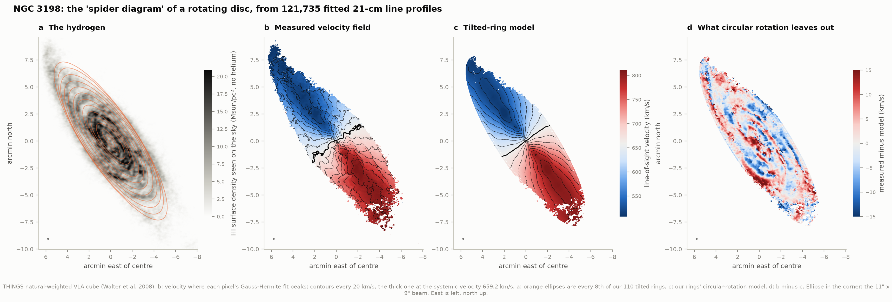
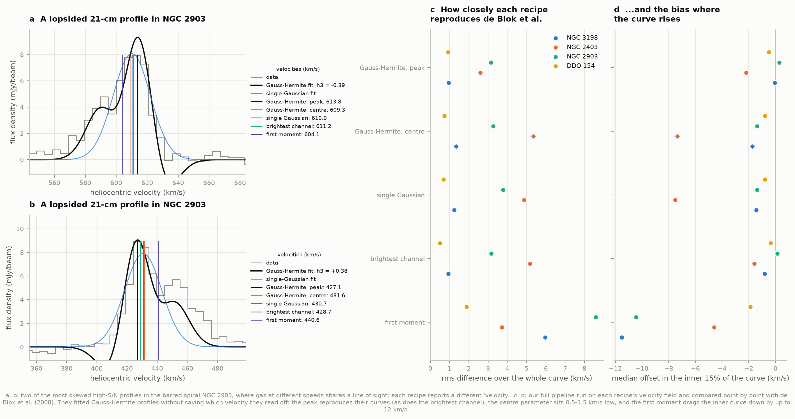
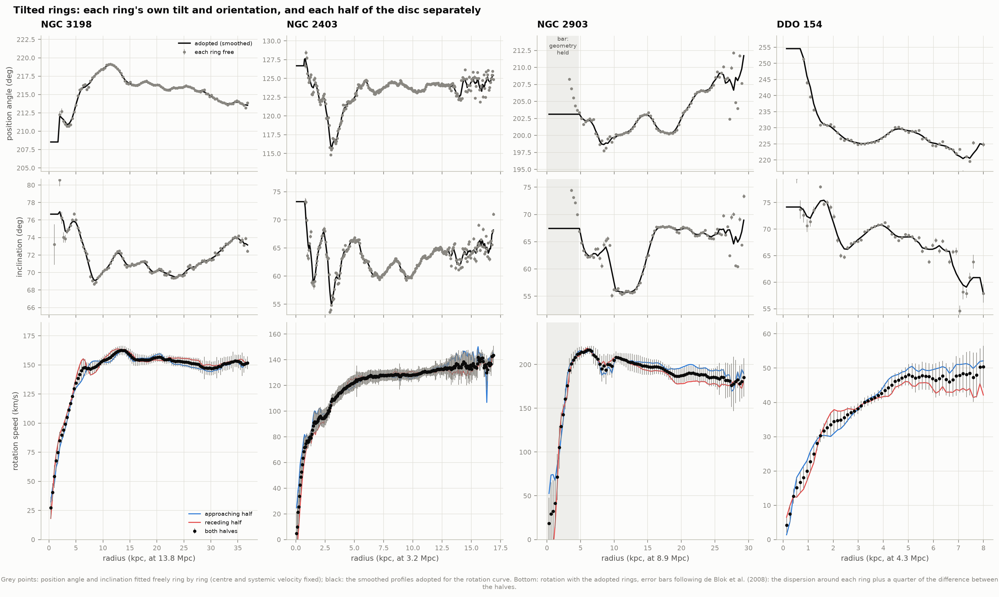
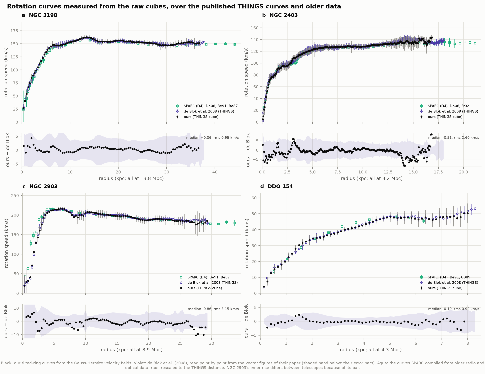
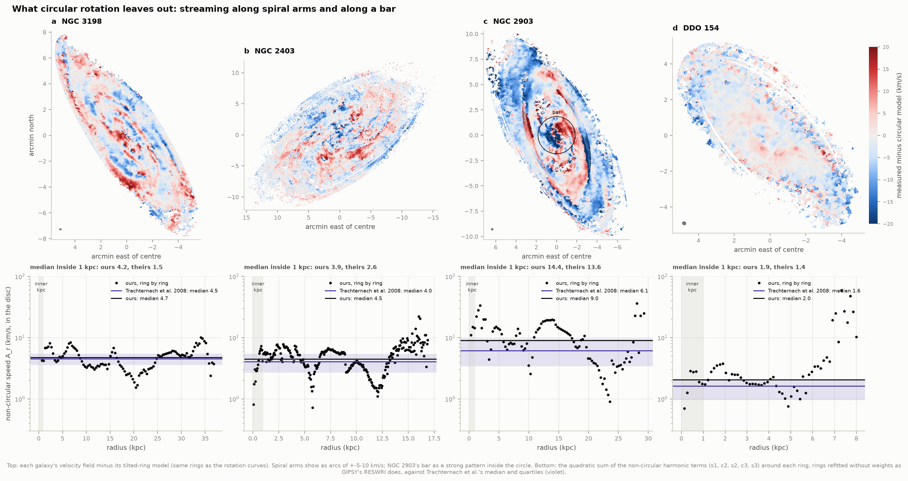
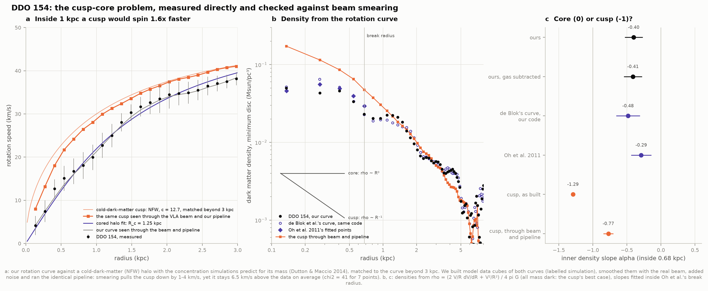
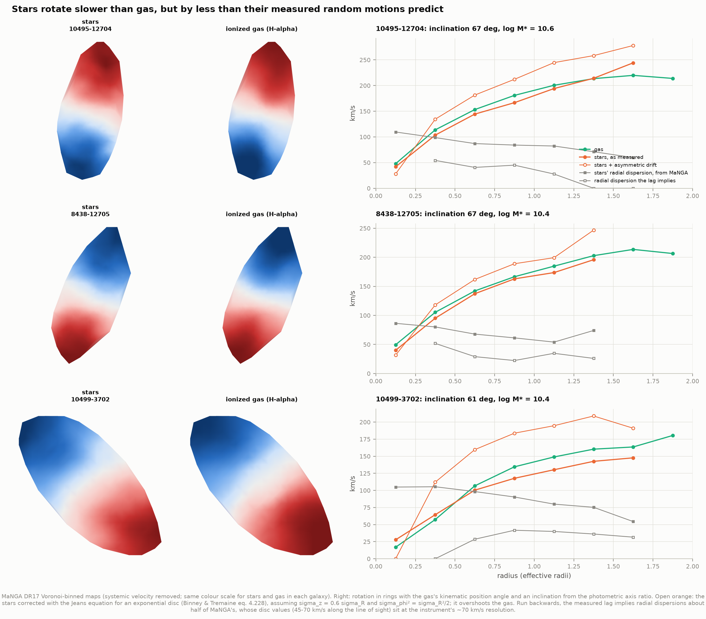
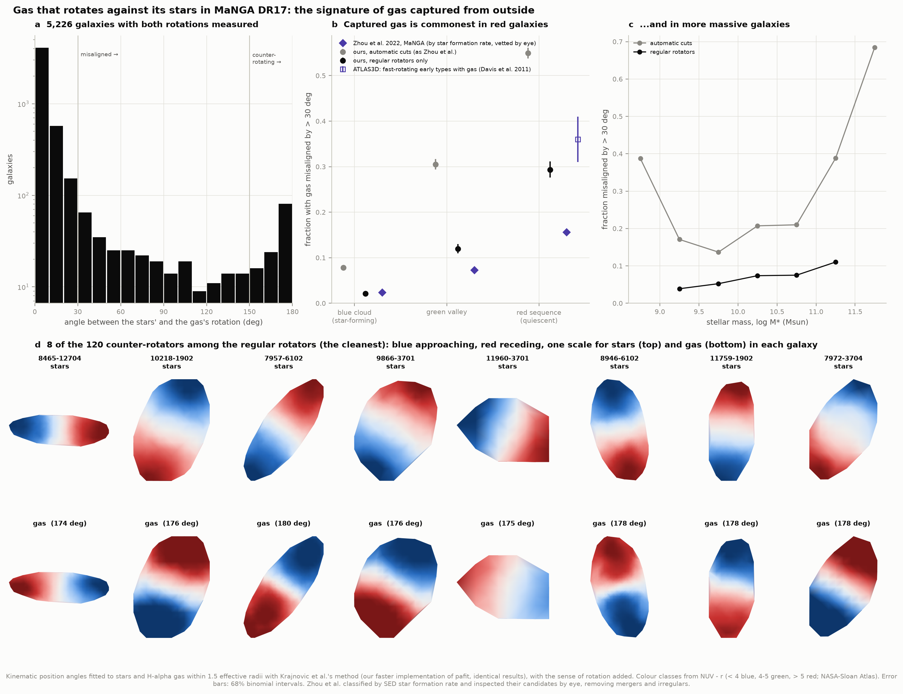
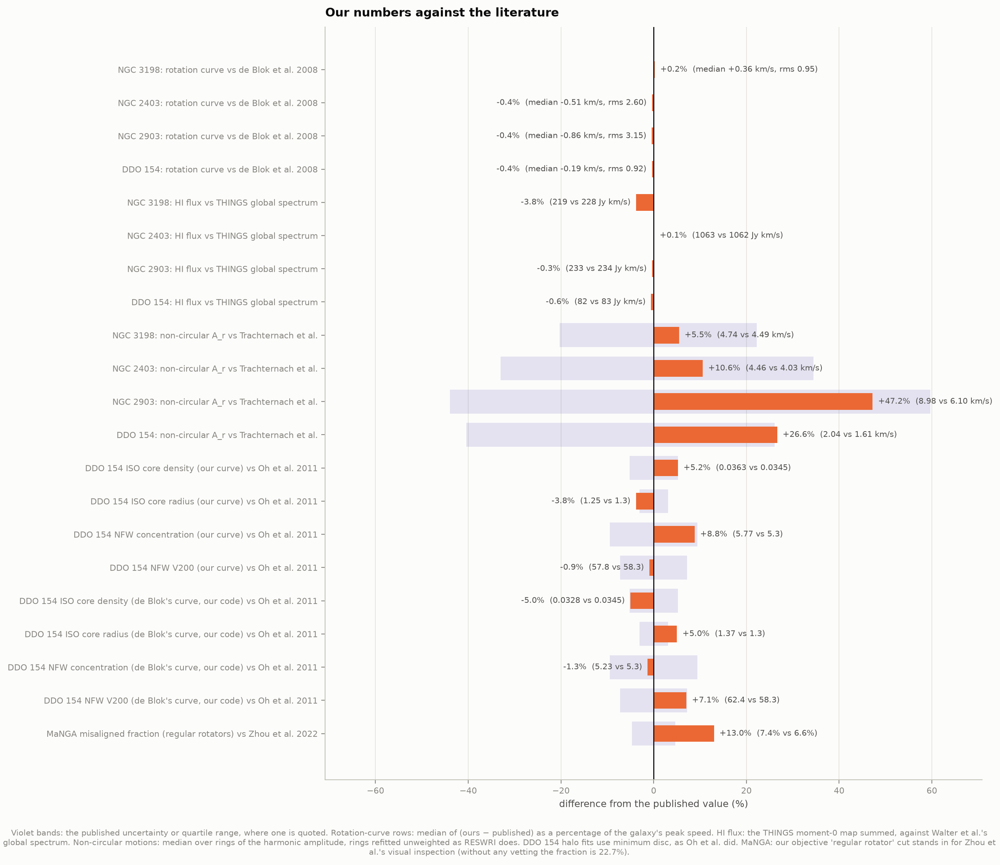

# J1 — Rotation curves from raw velocity fields

**Project D4 took its rotation curves ready-made from the SPARC tables. Can we measure them ourselves,
from the raw radio data, and see what the circular-rotation picture hides?**

Yes. This project starts from the THINGS 21-cm data cubes of four galaxies (VLA images of neutral
hydrogen at 57–87 radio frequencies each, so every pixel holds a spectrum of the hydrogen line). It
fits the line profile of every pixel, from 200,000 to 2.3 million spectra per galaxy, and turns the
Doppler shifts into velocity fields. A rotating, tilted disc then gets fitted ring by ring. The
rotation curves that come out reproduce de Blok et al.'s published THINGS curves to 0.9–3.2 km/s rms.
Those curves survive only as figures in their paper; we read them back from the vector PostScript
point by point.

Then the project looks at what circular rotation leaves out: gas streaming along spiral arms and along
a bar, the warps of the outer discs, and the lopsided halves of each galaxy. It runs the cusp–core test
on the dwarf DDO 154 directly, including a simulation of what the radio beam would do to a
cold-dark-matter cusp. Finally it turns to stars, with the optical MaNGA survey: stars rotate slower
than gas, and in one regularly rotating galaxy in fourteen the gas spins about a different axis from
its stars; in one in forty-four it turns the other way entirely.

| Galaxy | What it is | Why it is here |
|---|---|---|
| NGC 3198 | Classic spiral, 13.8 Mpc | Its flat rotation curve made the case for dark haloes (van Albada et al. 1985). The flagship. |
| NGC 2403 | Nearby spiral, 3.2 Mpc | Imaged at 1-arcsecond pixels; gas streams along its spiral arms. 2.3 million spectra. |
| NGC 2903 | Barred spiral, 8.9 Mpc | Its bar drives gas on elongated orbits: the inner velocity field is not rotation at all. |
| DDO 154 | Gas-rich dwarf, 4.3 Mpc | Its hydrogen extends far beyond its stars: the test case for the cusp–core problem. |

---

## Results

### From a data cube to a velocity field



Each of NGC 3198's 199,751 spectra inside the survey's emission mask gets a fitted line profile. The
121,735 that pass de Blok et al.'s quality tests give panel b: gas on the north-east half comes toward
us (blue), gas on the south-west half moves away (red), and lines of equal velocity fan out from the
centre. That fan, the "spider diagram", is what a tilted, rotating disc looks like in projection.
Panel c is our model: 110 rings, each with its own tilt. Panel d is what the model leaves out:
coherent arcs of ±5–10 km/s, gas streaming along the two spiral arms.

**Which velocity is "the" velocity of a line profile?** Where gas at different speeds shares a line
of sight, the profile is lopsided and each recipe gives a different answer:



We built a full rotation curve from each recipe and compared it point by point with de Blok et
al.'s. They fitted Gauss–Hermite profiles but did not say which velocity they read off:

| rms difference / inner offset (km/s) | GH peak | GH centre | Gaussian | brightest channel | first moment |
|---|---|---|---|---|---|
| NGC 3198 | **0.95** / −0.1 | 1.35 / −1.7 | 1.24 / −1.4 | 0.93 / −0.8 | 5.96 / −11.5 |
| NGC 2403 | **2.60** / −2.2 | 5.34 / −7.3 | 4.86 / −7.5 | 5.18 / −1.6 | 3.72 / −4.6 |
| NGC 2903 | **3.15** / +0.3 | 3.26 / −1.4 | 3.77 / −1.4 | 3.17 / +0.1 | 8.59 / −10.4 |
| DDO 154 | 0.92 / −0.5 | 0.73 / −0.8 | 0.68 / −0.8 | 0.50 / −0.4 | 1.88 / −1.9 |

NGC 2403 decides it. It has the most lopsided profiles, and only the velocity where the fitted
Gauss–Hermite profile *peaks* reproduces de Blok et al.'s curve. The profile's centre parameter misses
by 5.3 km/s rms and 7 km/s in the inner disc. In the dwarf DDO 154, whose profiles are nearly
symmetric, the four fitted recipes agree with each other to within a km/s. The first moment, the intensity-weighted mean that
most software offers by default, drags the inner rise of the big spirals down by 10–12 km/s: the
bias de Blok et al. warned about.

### Tilted rings: warps, and the two halves of a disc



Fitted ring by ring, the discs are not flat. NGC 3198's position angle swings by 8° and its
inclination by 7°: a mild warp. DDO 154's major axis turns by ~30° between 0.8 and 2.5 kpc. In
NGC 2903 the free fits go wild inside 110″, where the bar's streaming motions masquerade as a
changing tilt; there the geometry is held at its value just outside the bar (shaded), as de Blok et
al. did. Fitting the approaching and receding halves separately shows how lopsided the galaxies are:
NGC 3198's halves agree to a median 5 km/s, while across DDO 154's outer disc the approaching half
turns 5–8 km/s faster than the receding one.

### Graded against the published curves



| Galaxy | Rings | Reach | V_sys (dB08) | ⟨i⟩ (dB08) | ⟨PA⟩ (dB08) | Centre offset | Ours − de Blok | Within 1σ |
|---|---|---|---|---|---|---|---|---|
| NGC 3198 | 110 | 36.8 kpc | 659.2 (660.7) | 71.9° (71.5°) | 215.3° (215.0°) | 0.3″ | +0.36 median, 0.95 rms km/s | 100% |
| NGC 2403 | 272 | 16.9 kpc | 132.8 (132.8) | 63.5° (62.9°) | 123.4° (123.7°) | 5.3″ | −0.51, 2.60 | 99% |
| NGC 2903 | 97 | 29.3 kpc | 557.9 (555.6) | 64.5° (65.2°) | 203.3° (204.3°) | 3.4″ | −0.86, 3.15 | 100% |
| DDO 154 | 59 | 8.0 kpc | 377.6 (375.9) | 68.2° (66.0°) | 230.0° (229.7°) | 9.2″ | −0.19, 0.92 | 100% |

V_sys in km/s; "dB08" is de Blok et al. (2008), whose numbers our pipeline never sees until this
comparison. Everything was derived from the cubes alone, from our own starting guesses. Against
SPARC's curves, which come from older telescopes (Begeman's WSRT data, Carignan & Beaulieu, Fraternali,
Daigle), the agreement is 1.7–3.9 km/s rms. The exception is NGC 2903 (21 km/s), where Begeman's inner
points came from a cut along the major axis straight through the bar.

### What circular rotation leaves out



Expanding the velocities around each ring in harmonics measures everything that is not circular
rotation. With the rings refitted the way Trachternach et al. (2008) did it (no minor-axis
down-weighting, as in GIPSY's RESWRI):

| Galaxy | Median A_r, ours | Trachternach et al. | Inner kpc, ours | Inner kpc, theirs |
|---|---|---|---|---|
| NGC 3198 | 4.74 km/s | 4.49 (3.58–5.49) | 4.25 | 1.50 |
| NGC 2403 | 4.46 | 4.03 (2.70–5.42) | 3.88 | 2.60 |
| NGC 2903 | 8.98 | 6.10 (3.42–9.74) | 14.38 | 13.55 |
| DDO 154 | 2.04 | 1.61 (0.96–2.03) | 1.90 | 1.43 |

Non-circular motions are a few percent of the rotation speed in the regular discs: 3% in NGC 3198,
as Trachternach et al. found. The bar in NGC 2903 drives 14 km/s inside a kiloparsec, which matches
their value. Our medians run 10–25% above theirs, and NGC 2903's whole-disc median 47% above. Its
excess comes from rings at 11–17 kpc, where two broad HI spiral arms put kinks in the velocity
contours, and where we find c3 and s1 terms of 10–17 km/s. We could not trace the difference.
Trachternach et al. left out rings where RESWRI did not converge, mostly sparse outer ones; a
difference in which rings entered the median could be part of it.

### DDO 154: the cusp–core problem, measured directly

Cold-dark-matter simulations make haloes whose density keeps climbing toward the centre, roughly as
1/R: a *cusp* (Navarro, Frenk & White 1996). The rotation of many dwarf galaxies instead suggests a
central plateau of constant density, a *core*. The question has always had a catch: a radio beam
blurs the steep inner rise of a rotation curve, and so might make a cusp look like a core.



**The curve.** DDO 154 rotates almost like a solid wheel for its first kiloparsec (speed rising in
proportion to radius), which is the signature of a core. A cored (pseudo-isothermal) halo fits our curve
to 1.2 km/s rms, with a core radius of 1.25 ± 0.09 kpc and a central density of (36 ± 4) × 10⁻³ M☉/pc³.
Oh et al. (2011) found 1.30 ± 0.04 kpc and 34.5 ± 1.8. A cuspy NFW halo fits only with a concentration
of 5.8 ± 0.6 (Oh et al.: 5.3 ± 0.5) and misses by 2.3 km/s rms: half the concentration of 11 that
simulations predict for a halo of that mass (Dutton & Macciò 2014).

**The simulation (labelled as such).** We gave a model galaxy the cusp that cold dark matter predicts:
an NFW halo with c = 12.7, matched to DDO 154's rotation beyond 3 kpc. The model had DDO 154's own gas
distribution, tilt and velocity dispersion. We built its data cube, smoothed it with the real VLA
beam, added noise at the real level, and ran the identical pipeline: profile fits, quality cuts,
rings. The beam pulls the cusp's inner rotation down by 1–5 km/s. Inside 1 kpc it still spins
**6.5 km/s faster than DDO 154, 1.55× on average (χ² = 41 for 7 points)**. The same procedure changes our
measured curve by at most 2 km/s. Beam smearing cannot turn this cusp into what THINGS sees. The test
assumes all the mass is dark ("minimum disc"), the cusp's most favourable case: adding the stars and gas
would only raise the predicted inner speeds further.

**The density slope.** For a spherical galaxy the rotation curve gives the density directly,
ρ = (2 (V/R) dV/dR + V²/R²) / 4πG, and its logarithmic slope α near the centre is 0 for a core and −1
for an NFW cusp. Fitted inside Oh et al.'s break radius (0.68 kpc):

| | Inner slope α |
|---|---|
| DDO 154, our curve | −0.40 ± 0.13 |
| DDO 154, our curve, gas subtracted | −0.41 ± 0.13 |
| de Blok et al.'s curve, through our code | −0.48 ± 0.18 |
| Oh et al. (2011), de Blok et al.'s curve | −0.29 ± 0.15 |
| cold-dark-matter cusp, as built | −1.29 |
| the same cusp, after the beam and our pipeline | −0.77 |

Two lessons hide in this table. First, α is a fragile summary: dV/dR of a measured curve is noisy, and
reasonable ways of smoothing it move α by ~0.3. On de Blok et al.'s curve, local-quadratic derivatives
over 3, 5 and 7 points give −0.61, −0.48 and −0.43. Oh et al.'s own five plotted points give −0.25 with a
plain least-squares line; we read those points from the vector PostScript of their figure, and their
densities imply derivatives that no finite difference of the curve reproduces, so they smoothed too.
Second, a true cusp seen through this beam reads −0.77, not −1, so an observed slope has to be compared
with a simulated one, not with the textbook value. On both counts DDO 154 sits on the core side, and the
velocity-space test, which needs no derivatives, is unambiguous.

### MaNGA: stars rotate slower than gas



Gas clouds collide, lose their random motions and settle onto circular orbits. Stars never collide:
a stellar disc keeps random velocities of tens of km/s, and that "pressure" supports part of its
weight, so stars need less rotation. This is the *asymmetric drift*, and it is why the Sun's
neighbourhood has old stars lagging the young ones. In three clean MaNGA discs (stars and gas
aligned, disc-dominated, inclined 61–67°, observed out to ~2 effective radii), the stars lag the
gas by 7, 7 and 18 km/s between 0.8 and 1.5 effective radii.

The Jeans equation turns the stars' measured velocity dispersion into a predicted lag. With textbook
assumptions (an exponential disc, σ_z = 0.6 σ_R, σ_φ² = σ_R²/2) it predicts 47, 34 and 66 km/s, four
to seven times too much: the corrected stars overshoot the gas. Run backwards, the measured lags imply
radial dispersions of 24, 28 and 39 km/s, close to the Milky Way's near the Sun (σ_R ≈ 35 km/s). MaNGA's
own values are 79, 63 and 82 km/s. The disc dispersions MaNGA measures (45–70 km/s along the line of
sight) sit at the instrument's ~70 km/s spectral resolution. Either they are overestimated there, or
the textbook disc does not describe these galaxies; three galaxies cannot tell which. We report the
lag as measured and the mismatch as found, rather than tuning the assumptions until they agree.

### MaNGA: gas that rotates against its stars



Gas made inside a galaxy, from its own dying stars, rotates with them. Gas captured from outside, in a
merger, from a passing neighbour or along the cosmic web, keeps whatever spin it arrived with. So the
angle between the rotation of the stars and of the gas is a record of where the gas came from. We
fitted the kinematic axes of stars and of H-alpha gas in every MaNGA DR17 galaxy:

| Sample | Galaxies | Misaligned (> 30°) | Counter-rotating (> 150°) | Blue / green / red: misaligned |
|---|---|---|---|---|
| Both axes measured (Zhou et al.'s automatic cuts) | 8,076 | 22.7% | 4.5% | 7.8% / 30.5% / 54.9% |
| Regular rotators (our objective vetting) | 5,226 | **7.4%** | **2.3%** (120) | **2.1% / 11.9% / 29.3%** |
| Zhou et al. 2022 (MaNGA MPL-10, vetted by eye) | 6,958 | 6.6% | — | 2.4% / 7.3% / 15.6% (by SFR) |
| ATLAS3D (Davis et al. 2011), fast-rotating early types with gas | — | 36 ± 5% | — | — |

The distribution of angles (panel a) has its main peak at 0°, as expected. It falls by a factor ~100
to a floor, then rises again to a second peak at 170–180°: counter-rotation is a distinct population,
not the tail of measurement errors. Without vetting, the misaligned fraction is three times Zhou et
al.'s. Most of that excess is disordered gas, whose fitted axis is effectively random. Zhou et al.
removed such galaxies by eye; we remove them by requiring both velocity fields to be dominated by
ordered rotation (rotation amplitude at least 30 km/s and three times the residual scatter, axes good to
20°). That brings the overall fraction to 7.4% against their 6.6%, and the blue (star-forming)
galaxies to 2.1% against their 2.4%.

Red galaxies stay higher, 29% against Zhou et al.'s 16% for quiescent ones. Our "red" is a colour
(NUV − r > 5); theirs is a star-formation rate from fits to the full spectral energy distribution, and
the two select differently among gas-bearing early types. ATLAS3D found 36 ± 5% of fast-rotating
early-type galaxies with ionised gas misaligned, which our red regular rotators (whose stars, by construction, rotate)
resemble more closely. The trend is the robust result. Captured gas is rare in star-forming discs,
which have plenty of gas of their own to swamp it, and common in red galaxies that have little: nearly
one in three.

### Graded against the literature



Everything above was derived from the cubes and survey maps alone. The published numbers enter only
here.

| Quantity | Ours | Published | |
|---|---|---|---|
| Rotation curves, 4 galaxies | rms 0.92–3.15 km/s; 99–100% within 1σ | de Blok et al. 2008 | 512 rings compared |
| Systemic velocities | 659.2, 132.8, 557.9, 377.6 km/s | 660.7, 132.8, 555.6, 375.9 | |
| Mean inclinations | 71.9°, 63.5°, 64.5°, 68.2° | 71.5°, 62.9°, 65.2°, 66.0° | |
| HI flux in the moment-0 maps | −3.8%, +0.1%, −0.3%, −0.6% | Walter et al. 2008 global spectra | |
| Channel velocities of the cubes | to < 0.1 km/s | Walter et al. 2008 global spectra | after the AIPS fix |
| Non-circular motions, median A_r | 4.74, 4.46, 8.98, 2.04 km/s | 4.49, 4.03, 6.10, 1.61 | Trachternach et al. 2008 |
| DDO 154 cored halo | R_c 1.25 ± 0.09 kpc, ρ₀ 36 ± 4 | 1.30 ± 0.04, 34.5 ± 1.8 | Oh et al. 2011 |
| DDO 154 NFW halo | c 5.8 ± 0.6, V200 58 ± 5 km/s | 5.3 ± 0.5, 58.3 ± 4.2 | Oh et al. 2011 |
| DDO 154 inner slope | −0.40 ± 0.13 | −0.29 ± 0.15 | Oh et al. 2011 |
| MaNGA misaligned fraction | 7.4% (regular rotators) | 6.6% | Zhou et al. 2022 |
| … of star-forming / blue galaxies | 2.1% | 2.4% | Zhou et al. 2022 |
| … of red, rotating early types | 29% | 36 ± 5% | Davis et al. 2011 (ATLAS3D) |

(Order: NGC 3198, NGC 2403, NGC 2903, DDO 154.)

### A hands-on version

`figures/velocity_field_explorer.html` is a single self-contained page (2 MB, works offline, light or
dark) with all four velocity fields. A model disc sits beside each measured field, with its inclination,
position angle and systemic velocity on sliders, and the residual map and its rms update as you move
them. Try to beat the fit: a wrong inclination leaves a four-leaf residual pattern, a wrong position
angle a two-leaf one. Click anywhere on a galaxy to see the 21-cm spectrum there, with the fitted
profiles and the velocity each recipe reports. `…/velocity_field_explorer.html#DDO154` opens on a
particular galaxy.

---

## How it works

**1. Download.** `fetch_data.py` fetches the four natural-weighted THINGS cubes and the survey's
moment maps from MPIA (2.1 GB), the arXiv sources of the three papers we grade against, two VizieR
tables of Walter et al. (2008), SPARC's tables, and MaNGA's two DR17 summary catalogues. Every file's
URL, retrieval time and SHA-256 go into `data/manifest.json`. Downloads resume where they stopped.

**2. Stream MaNGA.** Each MaNGA galaxy has a 1–5 MB gzipped MAPS file with ~60 extensions. The nine we
need come first, so `manga_io.py` decompresses the download as it arrives, parses the FITS headers on
the fly and hangs up once the H-alpha velocities have arrived: ~38% of the bytes. Eight connections
stream all 10,502 galaxies in an hour (8 GB). One small table per galaxy is kept, one row per Voronoi
bin (240 MB in all). The extraction is checked byte for byte against a full download.

**3. Read the cubes.** The velocity axis is the subtle part. Three cubes label their channels in
heliocentric velocity ("FELO-HEL"). NGC 3198's lists *observed* frequencies, and AIPS records the
heliocentric velocity of one reference channel separately (`ALTRVAL`); the other channels follow by
Doppler ratios. Converting the frequencies naively puts NGC 3198 24.5 km/s off: the Earth's orbital motion
toward the galaxy on the date it was observed. With the right conversion every channel matches the velocities of
the THINGS global spectra on VizieR to within 0.1 km/s. The clean beam is read from the AIPS history,
and the noise is the robust scatter of the line-free end channels.

**4. Fit every spectrum.** Inside the THINGS emission mask (199,751 to 2.3 million spectra per galaxy)
each spectrum gets a single-Gaussian fit and a Gauss–Hermite fit with a skewness term h3, by a
Levenberg–Marquardt solver vectorized over thousands of spectra at once (~1,000 spectra a second).
A fit counts only if it passes de Blok et al.'s three tests: peak above 3× the channel noise,
width above the channel spacing, and integrated emission above 3σ.

**5. Tilted rings.** `tiltedring.py` reimplements GIPSY's ROTCUR with SciPy: rings half a beam wide,
pixels weighted by |cos θ|, each ring's pixels re-selected as its geometry settles. The sequence is de
Blok et al.'s: all parameters free to find the centre and systemic velocity; then position angle and
inclination free ring by ring; those profiles smoothed over 5 rings; then the rotation speed alone,
for the whole ring and for each half. In the first pass rings are fitted outward from the gas
centroid, each starting from the running median of those before, and a ring whose centre wanders more
than two beams from that median (six until three rings agree) is set aside. The centre and V_sys are
the medians of the rings between two beams and half the disc. Inside two beams (for NGC 2903, inside its
bar) the geometry is carried in from outside. Starting values come from the maps themselves; published
values are never used.

**6. Errors, de Blok et al.'s way.** The dispersion of velocities around each ring plus a quarter of the
approaching–receding difference, in quadrature. ROTCUR's "dispersion" is the |cos θ|-weighted sum of
squared residuals over N − 1, without normalizing the weights. That is ~0.8× the plain rms, and it is
what brings our error bars to within ~20% of theirs.

**7. Non-circular motions.** `harmonics.py` expands the velocities around each ring in cos mθ and
sin mθ to third order, and sums the non-circular terms in quadrature (Schoenmakers 1997; Trachternach
et al. 2008). For the comparison with Trachternach et al. the rings are first refitted without the
|cos θ| weights, as their GIPSY task RESWRI does.

**8. Mass models.** Gas surface density from the moment-0 map, averaged around each ring (empty pixels
count), ×1.4 for helium. Its rotation curve comes from summing the potentials of thin rings (complete
elliptic integrals) through a sech² layer 0.1 kpc thick; checked against Freeman's exact exponential
disc to 0.13%. Densities come from ρ = (2 V/R dV/dR + V²/R²)/4πG with a local-quadratic derivative.

**9. Model galaxies (labelled simulation).** `galmod.py` builds a data cube for a chosen rotation curve
with the observed gas distribution and geometry, a 0.1 kpc sech² layer integrated along each line of
sight, 3×3 sub-pixels and erf-integrated channels. It smooths the cube with the real elliptical beam and
adds beam-correlated noise at the real level. Then it runs the identical pipeline, from profile fits
to rings.

**10. MaNGA axes.** `kinpa.py` is Krajnović et al.'s `fit_kinematic_pa` as in Cappellari's pafit, with
one change: the Delaunay triangulation is built once rather than at each of 361 trial angles, since a
rotation does not change it. Results are identical to pafit's (tested) and come 8× faster. pafit returns
an axis; we add the sense of rotation, i.e. which end recedes.

---

## What these measurements cannot tell you

- **The inside of a bar.** Gas in a bar moves on elongated orbits, so "the rotation speed" inside NGC
  2903's bar is not a well-defined quantity. Any number there depends on how you choose to model it.
  We followed de Blok et al. and froze the ring geometry inside the bar's end (110″). With the
  generic choice (two beams) the inner curve sits 5 km/s lower.
- **The outermost, patchy gas.** DDO 154's curve stops at 7.0 kpc where de Blok et al.'s reaches 8.3
  kpc. Beyond 7 kpc the gas lies in a flocculent warp, and freely fitted rings there let their centres
  wander more than two beams, so they are dropped. Letting those rings in reaches 8.0 kpc, but it drags
  the median centre 9″ and V_sys 1.7 km/s off, and the curve then matches de Blok et al.'s twice less
  closely (0.92 km/s rms instead of 0.45). They extrapolated the outer inclination by hand.
- **Whether a core is dark matter or physics.** A rotation curve measures mass, not what the mass is.
  DDO 154's cored centre is a fact about its mass distribution. Whether supernova-driven outflows
  reshaped a cusp, or dark matter itself behaves differently, is beyond what one curve can say.
- **Exact derivative-based slopes.** A density profile needs dV/dR, and a derivative of a noisy curve
  is noisy. Different reasonable smoothings move DDO 154's inner slope by ~0.3 (see below). The
  velocity-space test, a cusp against the measured curve, does not depend on it.
- **Absolute stellar dispersions from MaNGA discs.** The disc dispersions sit at the instrument's ~70
  km/s resolution, and our asymmetric-drift test suggests they are too high by ~2× for these discs.
  That is a suggestion, not a measurement of the bias.
- **MaNGA's classification of galaxies by eye.** Zhou et al. inspected their misaligned candidates
  visually; our "regular rotator" cut is an objective stand-in, not the same thing.

---

## Running it

```bash
cd ..                       # repository root
python3 -m venv .venv
source .venv/bin/activate
pip install numpy scipy matplotlib astropy pafit plotbin

cd 25-velocity-fields
python fetch_data.py        # ~2.4 GB of THINGS and catalogues + 8 GB streamed from SDSS (~1.5 h)
python run.py               # first run ~2.5 h (fits 3.1 million line profiles); then < 1 min
python test_physics.py      # 43 self-checks on the methods
```

The first run fits every line profile and caches the fits in `data/derived/`; the biggest cube (NGC
2403, 2.3 million spectra) takes about an hour and checkpoints every 256 rows, so an interrupted run
resumes. `python run.py --skip-manga` does the radio half alone. Once the cache is warm, `run.py`
needs no network.

### Files

| File | What it does |
|---|---|
| `config.py` | Paths, the galaxies, every assumed number |
| `fetch_data.py` | Downloads with resume and a SHA-256 provenance manifest |
| `manga_io.py` | Streams MaNGA MAPS files, keeping one row per Voronoi bin; the DR17 catalogues |
| `things.py` | Cubes: velocity axes, beams, noise; the vectorized Gauss–Hermite and Gaussian fits |
| `tiltedring.py` | The tilted-ring fits (our ROTCUR) and model velocity fields |
| `harmonics.py` | Harmonic decomposition of the velocity fields |
| `massmodel.py` | Gas surface density, the gas disc's own rotation curve, densities, slopes, halo fits |
| `galmod.py` | Model galaxies observed through the real beam (the beam-smearing simulation) |
| `literature.py` | Reads the published curves from SM PostScript and the published tables from LaTeX/VizieR |
| `kinpa.py` | Kinematic position angles (pafit's method, faster) with the sense of rotation |
| `manga.py` | MaNGA: catalogues, the misalignment census, asymmetric drift |
| `analysis.py` | Per-galaxy analysis, the comparisons, the DDO 154 cusp test |
| `figures.py`, `interactive.py` | Every figure; the explorer page |
| `run.py` | Runs everything and prints the graded summary |
| `test_physics.py` | Checks every method against cases with known answers |

## Figures

`00_comparison` our numbers against the literature · `01_spider_diagram` NGC 3198's velocity field,
model and residuals · `02_velocity_recipes` five ways to read a line profile · `03_tilted_rings`
geometry ring by ring, and the two halves · `04_rotation_curves` ours over de Blok et al. and SPARC ·
`05_noncircular_motions` residual maps and harmonic amplitudes · `06_cusp_core` DDO 154 and the
beam-smearing simulation · `07_asymmetric_drift` stars against gas in MaNGA discs ·
`08_counter_rotation` the misalignment census and a gallery of counter-rotators ·
`velocity_field_explorer.html` interactive.

PNG and SVG. Colour roles: ink is our measurement, violet a published result, aqua SPARC's older
curves, orange a model we fit or simulate; blue and red are the approaching and receding halves of a
disc. Velocity maps use a diverging blue–grey–red scale centred on the systemic velocity (grey = no
motion along the line of sight), built from the same validated palette as projects A1 and D4.

## Honest notes on the numbers

- **DDO 154's centre is uncertain by ~10″.** In a galaxy rotating like a solid wheel, shifting the
  centre along the major axis mimics a change of systemic velocity. Candidate centres 3–10″ apart leave
  ring residuals within 3% of each other. Our adopted centre is 9.2″ (0.7 beam) from de Blok et al.'s,
  with V_sys 377.6 km/s against their 375.9 (the midpoint of the global profile, our own measurement, is
  375.0). The rotation curves agree to 0.9 km/s rms regardless. We tried fixing V_sys at the profile
  midpoint while finding the centre, and scoring candidate centres on common rings; neither helped
  across all four galaxies, so we kept the simplest rule and report the degeneracy.
- **Error bars are de Blok et al.'s kind, not ours to invent.** They add the dispersion around each
  ring to a quarter of the approaching–receding difference. With ROTCUR's definition of that
  dispersion, ours come out 1.2–1.5× theirs: our velocity fields are slightly noisier. χ² between the
  two curves is therefore tiny, which is why we quote rms differences.
- **The first moment is THINGS' own map**, made with their masks; the other four recipes are our fits
  to the same cubes, with de Blok et al.'s quality cuts.
- **Our cubes' raw flux runs 10–20% above the published global spectra**, because the cubes are not
  "residual-scaled": flux left uncleaned is in units of the dirty beam (Walter et al. 2008). HI masses
  therefore come from the survey's corrected moment-0 maps, which agree with the published spectra to
  0.1–3.8%.
- **SPARC's curves come at other distances and inclinations.** We rescale their radii to the THINGS
  distances but keep their velocities: NGC 2903 sits at 6.6 Mpc in SPARC and 8.9 Mpc in THINGS, and
  DDO 154's SPARC inclination is 64° against our 68°.
- **NGC 3198's "inner kiloparsec" is a single ring** in both Trachternach et al.'s analysis and ours,
  so the 4.25 vs 1.50 km/s difference there means little.
- **MaNGA definitions differ from Zhou et al.'s in two places.** Our "lineless" test uses Voronoi bins,
  whose co-added spectra reach H-alpha more easily than single spaxels, so 11% of galaxies count as
  lineless where they had 25%. And we sort galaxies by NUV − r colour rather than by a star-formation
  rate from SED fits. Stellar dispersions use the DAP's first correction channel, as its documentation
  recommends.

## A little history

The 21-cm line of hydrogen was predicted by Hendrik van de Hulst in 1944 and detected in 1951. Because
radio waves pass through dust and the gas extends far beyond a galaxy's stars, it became the tool for
tracing rotation to large radii. Rogstad, Lockhart & Wright (1974) introduced the tilted-ring model to
describe M83's warped disc. Albert Bosma's thesis (1978) used 21-cm velocity fields of some twenty
spirals to show that their rotation stays flat far outside the light. That is the radio half of the
case for dark matter, alongside Vera Rubin's optical curves. Kor Begeman wrote ROTCUR for his 1987 thesis on
NGC 3198 and others, the data behind van Albada et al.'s (1985) textbook disc-plus-halo picture.
THINGS (2003–2007, ~500 hours of VLA time) mapped 34 nearby galaxies at about ten times Begeman's
resolution. The cusp–core problem dates from the mid-1990s (Flores & Primack 1994; Moore 1994), when
simulations predicted dense central cusps that the rotation of dwarf and low-surface-brightness
galaxies did not show. Integral-field optical surveys came next: SAURON and ATLAS3D for early-type
galaxies, then CALIFA, SAMI and MaNGA (2014–2020, 10,010 galaxies), which made stars and gas
kinematics routine for thousands of galaxies.

## Data credits

THINGS: Walter et al. 2008, AJ 136, 2563, data from
[things.www3.mpia.de](https://things.www3.mpia.de/) (VLA, operated by NRAO). Published results
compared against: de Blok et al. 2008, AJ 136, 2648 (rotation curves and tilted-ring tables, read from
the arXiv source of the paper); Trachternach et al. 2008, AJ 136, 2720; Oh et al. 2011, AJ 141, 193;
SPARC (Lelli, McGaugh & Schombert 2016, AJ 152, 157) with its original data sources (Begeman 1987;
Begeman et al. 1991; Carignan & Beaulieu 1989; Fraternali et al. 2002; Daigle et al. 2006); Zhou et al.
2022, MNRAS 515, 5081; Davis et al. 2011, MNRAS 417, 882; Dutton & Macciò 2014,
MNRAS 441, 3359.

MaNGA: SDSS-IV DR17 (Abdurro'uf et al. 2022, ApJS 259, 35), Bundy et al. 2015; Data Analysis Pipeline
of Westfall et al. 2019, AJ 158, 231, with stellar templates MILES-HC and MaStar SSP models; NASA-Sloan
Atlas photometry. Funding for SDSS-IV was provided by the Alfred P. Sloan Foundation, the U.S.
Department of Energy Office of Science, and the Participating Institutions. Kinematic position angles:
Krajnović et al. 2006, MNRAS 366, 787 (Appendix C), as implemented in Cappellari's `pafit`. All data
retrieved 2026-10-03; URLs and SHA-256 hashes are in `data/manifest.json` and, for the 10,461 MaNGA
galaxies, in `data/manga/survey_index.jsonl`.
