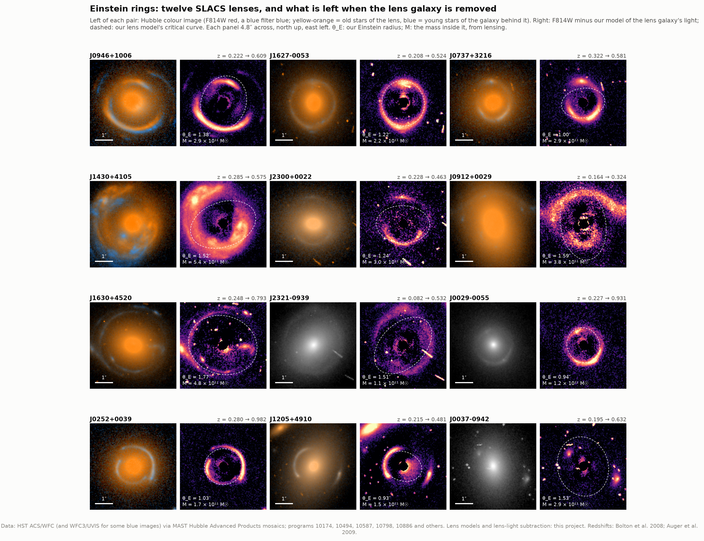
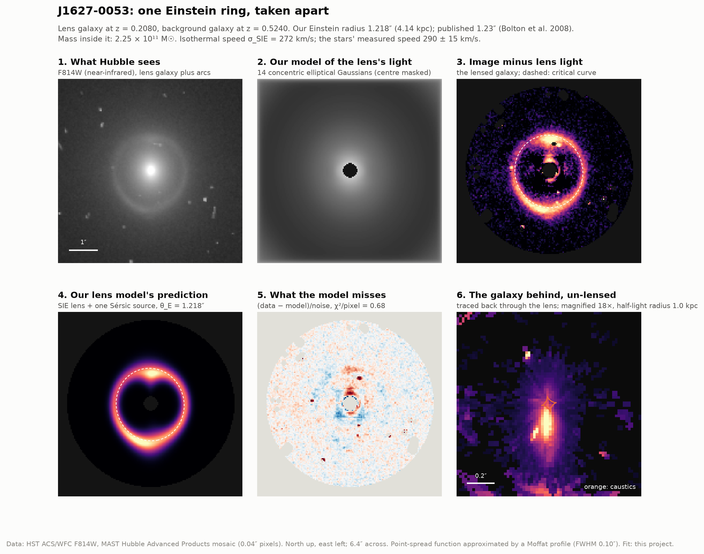
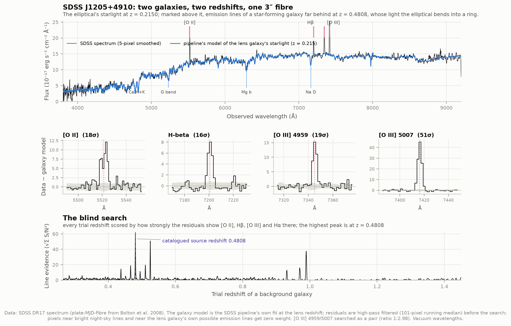
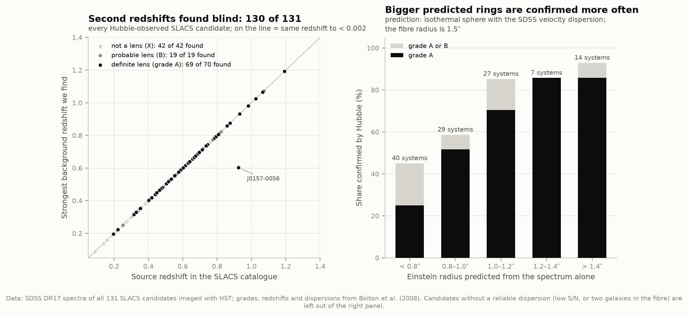
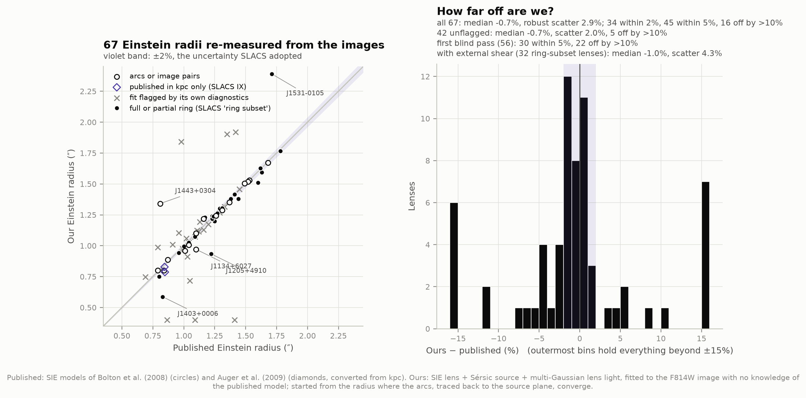
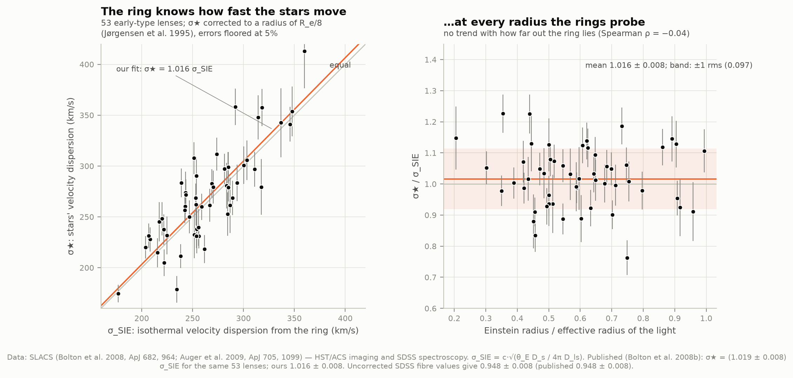
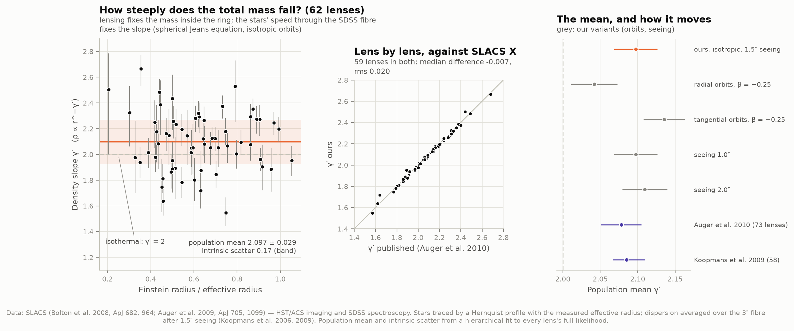
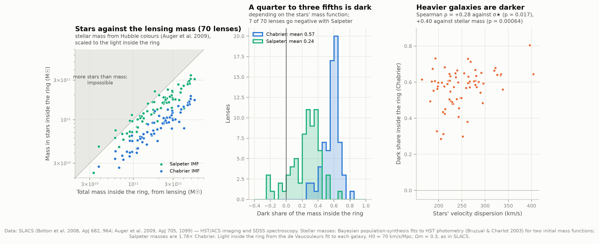
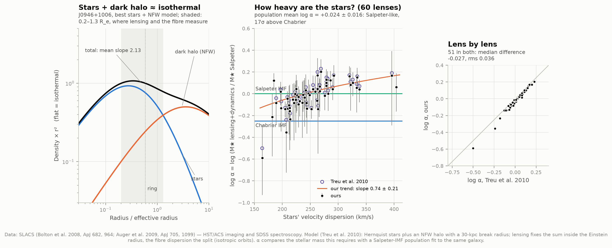
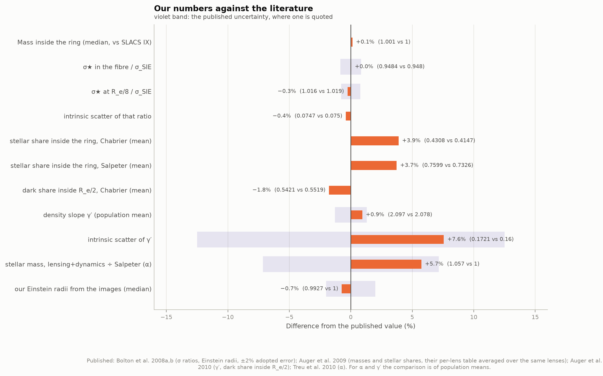

# J5 — Weighing galaxies with Einstein rings

**When a massive galaxy sits almost exactly in front of a more distant one, its gravity bends the
background galaxy's light into arcs or a complete ring. The ring's size weighs the foreground
galaxy, with no assumptions about its stars. How much of that mass is dark?**

This project takes the 85 definite lenses of the Sloan Lens ACS Survey (SLACS) and works from the
raw material: their SDSS spectra, their Hubble images, and the measured speeds of their stars.

**The ring weighs the galaxy.** An Einstein radius of 0.69–1.78″ plus two redshifts gives a mass of
**2.6 × 10¹⁰ to 5.4 × 10¹¹ suns** inside 1.1–7.2 kpc. Our masses match the SLACS team's for all 74
lenses with published Einstein radii to 0.0006 dex (0.13%, median).

**We found the lenses as SLACS did.** Each lens was first spotted as a spectrum with two redshifts:
an elliptical galaxy's starlight plus the emission lines of a star-forming galaxy far behind it. A
blind search of the residuals recovers the published second redshift in **130 of 131** SDSS spectra
that Hubble followed up. Candidates whose predicted ring is bigger are confirmed as lenses more
often: 25% below 0.8″, 86% above 1.2″.

**We re-measured the rings ourselves.** Our own lens models of the Hubble images, which never see
the published answer, recover the SLACS Einstein radii of 67 lenses with a median offset of
**−0.7%** and a robust scatter of **2.9%**; for the 42 fits that pass their own quality checks the
scatter is **2.0%**, the uncertainty SLACS adopted. But 16 of the 67 are off by more than 10%,
mostly disc and spiral lenses whose light our simple galaxy model cannot follow.

**The ring knows how fast the stars move.** If a galaxy's total density falls as 1/r², the
"isothermal" profile with a flat rotation curve, its Einstein radius predicts its stars' velocity
dispersion. For the same 53 lenses Bolton et al. (2008b) used, the stars move at **1.016 ± 0.008**
times the predicted speed (published 1.019 ± 0.008), with 7.5% scatter (published 7.5%). Combining
lensing with the stars' motions in a Jeans model gives the total density slope: **γ′ = 2.097 ±
0.029** with an intrinsic scatter of **0.17** between galaxies (Auger et al. 2010: 2.078 ± 0.027 and
0.16 ± 0.02). Lens by lens, our 59 slopes in common with theirs differ by 0.02 rms.

**Neither the stars nor the dark matter is isothermal; their sum is.** Inside the Einstein radius,
stars account for **43%** of the mass if their mass function is like the Milky Way's (Chabrier),
or **76%** if it is richer in faint low-mass stars (Salpeter). The rest is dark: **57% or 24%**.
Fitting stars plus a dark-matter halo of the shape cosmological simulations predict, the stars must
weigh **1.06 ± 0.04 times** a Salpeter population (log α = +0.024 ± 0.016), 17σ heavier than a
Chabrier one (Treu et al. 2010: log α = 0.00 ± 0.03).

| What | Ours | Published |
|---|---|---|
| Masses inside the ring, vs SLACS IX (74 lenses) | +0.0006 dex median | Auger et al. 2009 |
| Background redshifts found blind in the SDSS spectra | 130 of 131 | Bolton et al. 2008a |
| Our Einstein radii from the images, vs published (67) | −0.7% median, 2.9% scatter; 16 off by >10% | Bolton et al. 2008a (±2% adopted) |
| ... fits that pass their own checks (42) | −0.7% median, 2.0% scatter | |
| σ★ in the fibre / σ_SIE (53 lenses) | 0.948 ± 0.008 | 0.948 ± 0.008 (Bolton et al. 2008b) |
| σ★ at R_e/8 / σ_SIE | 1.016 ± 0.008, scatter 7.5% | 1.019 ± 0.008, scatter 7.5% |
| Density slope ⟨γ′⟩ (62 lenses) | 2.097 ± 0.029 | 2.078 ± 0.027 (Auger et al. 2010) |
| Intrinsic scatter of γ′ | 0.17 ± 0.03 | 0.16 ± 0.02 |
| γ′ lens by lens (59 in common) | median −0.007, rms 0.020 | Auger et al. 2010, Table 1 |
| Stellar share inside the ring, Chabrier / Salpeter (70) | 0.43 / 0.76 | ≈0.4 / ≈0.7 (Auger et al. 2009) |
| Dark share inside R_e/2, Chabrier / Salpeter (59) | 0.54 / 0.19 | 0.55 / 0.21 (same lenses, Auger et al. 2010) |
| Stellar mass vs Salpeter, ⟨log α⟩ (60 lenses) | +0.024 ± 0.016 | 0.00 ± 0.03 ± 0.02 (Treu et al. 2010) |
| log α lens by lens (51 in common) | median −0.027, rms 0.036 | Treu et al. 2010, Table 1 |

---

## Results

### 1. Twelve Einstein rings



Each pair shows a lens as Hubble saw it, in colour, and what remains when our model of the lens
galaxy's light is subtracted. The colour is physical: red is the F814W filter (near-infrared), blue
the bluest filter with at least two exposures (F438W, F390W, F435W or F555W; single snapshot
exposures are full of cosmic rays), both converted to flux per unit frequency and balanced so that
a star like the Sun would look white. The lens galaxies are full of old stars and come out
yellow-orange; at their redshifts the blue filter sees their faint ultraviolet. The galaxies behind
them are forming stars and come out blue. Three lenses with no clean blue image are shown in grey. For these twelve,
the background galaxies lie 1.7 to 5.8 times farther away than the lenses, and their light set out
3.6–7.6 billion years ago.

The dashed curve is our lens model's **critical curve**. A source lying exactly behind the lens is
imaged onto it as a complete Einstein ring. The rings are not all complete: whether you see a full
ring, an arc with a counter-image, or four images depends on where the background galaxy sits
relative to the lens's **caustics** (figure 2, panel 6).

### 2. One ring, taken apart



J1627−0053 is an elliptical galaxy at z = 0.208 with a star-forming galaxy at z = 0.524 almost
exactly behind it. The six panels follow our model from the raw image to the background galaxy
itself:

1. The Hubble F814W image. The ring is faint against the elliptical's light.
2. Our model of the elliptical's light: 14 elliptical Gaussians whose sum can follow any smooth
   galaxy profile. Its centre is masked in the fit, where light models are poorest.
3. The image minus that model. The ring stands out. The dashed curve is our model's critical
   curve; the ring hugs it because the background galaxy sits almost on the lens's axis.
4. What our lens model predicts: a singular isothermal ellipsoid bending the light of one
   elliptical (Sérsic) galaxy. The best fit puts the Einstein radius at **1.218″**; SLACS's model
   gives 1.23″.
5. What the model misses, in units of the noise: mostly noise, with some structure near the
   centre, where the light model is imperfect, and small knots in the ring that one smooth source
   cannot reproduce.
6. The background galaxy un-lensed: every pixel of the ring traced back through our lens model to
   where its light left the source. It is an elongated galaxy about 1 kpc in half-light radius,
   spread across and just beside the diamond-shaped caustic. A compact source inside the caustic
   would make four separate images; one this extended, this close to the lens's axis, is smeared
   into an almost complete ring. The lens magnifies it **18 times**.

The ring is 4.14 kpc in radius and holds **2.25 × 10¹¹ suns** (2.29 × 10¹¹ with SLACS's radius).
An isothermal galaxy of that mass would have σ_SIE = 272 km/s; the stars in the SDSS fibre move at
290 ± 15 km/s.

### 3. Two galaxies in one spectrum



SLACS did not find its lenses by looking at images. The SDSS spectrograph's fibres are 3″ wide,
and when a fibre is placed on a massive elliptical whose Einstein radius is about that size, it also
catches part of the ring. The spectrum then holds two galaxies. In J1205+4910 the elliptical's
starlight shows the absorption lines of old stars (calcium H and K, the G band, magnesium, sodium) at
z = 0.215. Superposed on it are four emission lines that cannot belong to an elliptical: [O II],
Hβ and the [O III] pair of a star-forming galaxy at z = 0.4808. Each is detected at 16–51σ in the
residuals after the SDSS pipeline's model of the elliptical is subtracted.

Our blind search (bottom panel) scores every possible background redshift by how strongly the
residuals show this pattern of lines. Single strong lines create weaker "alias" peaks where they are
mistaken for a neighbouring line; the true redshift is where all the lines line up at once.



Run on all 131 SDSS spectra of the candidates SLACS imaged, the search recovers the catalogued
background redshift (to better than 0.002) in **130**. The miss, J0157−0056, is the most distant lens
(z = 0.51) and has the noisiest spectrum (median S/N 2.9 per pixel); its [O II] falls among the
night-sky lines at 7172 Å.

The search finds a second redshift in candidates that turned out *not* to be lenses as readily as in
the real ones, since every candidate was chosen for having one. What separates them is geometry: the
background galaxy must lie close enough behind the elliptical to be multiply imaged. The right panel
predicts each candidate's Einstein radius from its spectrum alone: an isothermal galaxy with the
measured velocity dispersion, θ_E = 4π (σ/c)² D_ls/D_s. Of the candidates predicted to have
rings smaller than 0.8″, Hubble confirmed 25%. Above 1.2″ it confirmed 86%. A large Einstein radius
means a large region behind the lens in which a galaxy gets multiply imaged, the "cross-section",
which grows as σ⁴. That is also why lens samples favour the most massive galaxies (see "What lensing
cannot tell you").

### 4. Re-measuring the rings ourselves



Every Einstein radius in the SLACS papers comes from the SLACS team's own lens models. We
built our own lens modeller (see "How it works") and ran it on the 76 lenses with ACS F814W images.
It starts from the images alone and is never shown the published models. They were read
afterwards, for the 67 lenses where they exist:

| | Lenses | Median offset | Robust scatter | Within 5% | Off by > 10% |
|---|---|---|---|---|---|
| All our fits | 67 | −0.7% | 2.9% | 45 | 16 |
| Fits our own diagnostics do not flag | 42 | −0.7% | 2.0% | 33 | 5 |
| SLACS's "ring subset" (full or partial rings) | 32 | −0.8% | 2.2% | — | — |
| Our first, fully blind version (see Honest notes) | 56 | −0.3% | 5.2% | 30 | 22 |

("Robust scatter" is 1.48 × the median absolute deviation, which a few outliers do not inflate.)

A fit is *flagged* when its own parameters end up pinned at a bound we set: an Einstein radius
at 0.4″, a mass flattening at axis ratio 0.35, or a background galaxy at the 0.5″ size limit. That
last flag means the "source" is soaking up something extended, usually light our model of the lens
galaxy missed. Flags are decided without the published values. The 42 unflagged fits agree with
SLACS to 2.0%, the uncertainty SLACS itself adopted for its Einstein radii.

Where we fail, the lens galaxy is usually to blame, not the lensing. Of the 11 lenses with disc
(S0) or spiral morphology, 6 are among the 16 failures: our light model, concentric ellipses, cannot
follow arms, bars and dust lanes, and their residuals masquerade as arcs. The 56 ellipticals agree
to a 2.2% robust scatter. The remaining failures have neighbours or faint arcs. In J1205+4910
(in the gallery) and J1403+0006 our model fits the bright arc but not its fainter counter-image on
the far side of the lens, which is what pins the published radius.

We also masked five neighbouring galaxies by hand (see Honest notes); it changed no statistic in
the table.

How much does the answer depend on the lens model? Real lenses feel the pull of neighbouring
galaxies, which a lens model can add as an external "shear". Refitting the 32 ring-subset lenses
with one (typical strength 0.07) moves our Einstein radii by −0.1% on median but by 2.5% lens to
lens, and 8 of 32 by more than 5%. Against SLACS, whose published models had no shear either,
these fits scatter by 4.3% instead of 2.2%. So at the 2–3% level an Einstein radius is partly a
property of the model chosen, and SLACS's adopted ±2% error is about as small as it can honestly
be.

Our radii can stand in for SLACS's in the isothermal test of section 5. For the 36 lenses of that
test with unflagged fits, σ★ = 1.008 ± 0.010 σ_SIE (1.016 ± 0.008 with the published radii).

### 5. The ring knows how fast the stars move



The simplest model of a galaxy's total mass is the **singular isothermal sphere**: density falling
as 1/r², the profile of a self-gravitating cloud whose stars all have the same random speed σ, and
whose rotation curve is flat at √2 σ (the shape D4 found in spiral galaxies). For such a lens,
θ_E = 4π (σ/c)² D_ls/D_s. So every Einstein radius predicts a velocity dispersion, σ_SIE. Only
the *ratio* of the distances enters, so the expansion rate H0 cancels out. Changing to Planck's
cosmology moves σ_SIE by 0.1%.

The stars' own velocity dispersion is measured from the width of absorption lines in the SDSS
spectrum, through the 3″ fibre. For the 53 early-type lenses that Bolton et al. (2008b) used, the
two agree:

- σ★ (fibre) = **0.948 ± 0.008** σ_SIE (published: 0.948 ± 0.008)
- σ★ corrected to a radius of R_e/8 = **1.016 ± 0.008** σ_SIE (published: 1.019 ± 0.008)
- intrinsic scatter **7.5%** of σ_SIE (published: 7.5%), from χ²/dof of 2.6 with measurement
  errors alone.

The match holds whether the ring lies at 0.2 or 1.0 effective radii (right panel; Spearman
ρ = −0.04). A galaxy whose total density fell faster or slower than 1/r² would show a trend
there.

### 6. How steeply does the mass fall?



A sharper test drops the assumption of isothermality. Let the total density fall as r^−γ′ with
γ′ free, and fix its normalisation so that the projected mass inside the Einstein radius equals
the lensing mass. Then solve the spherical Jeans equation, the condition for a cloud of stars to stay
in equilibrium in that gravity, for stars distributed like the galaxy's light. That predicts the
velocity dispersion the SDSS fibre would see (blurred by 1.5″ seeing). A steeper profile packs more
mass near the centre and makes the stars there move faster. Matching the measured dispersion picks
γ′.

For 62 lenses the population mean is **γ′ = 2.097 ± 0.029**, with real galaxy-to-galaxy differences
of **0.17** (intrinsic scatter, from a hierarchical fit). Auger et al. (2010) found 2.078 ± 0.027 and
0.16 ± 0.02, and Koopmans et al. (2009) 2.085 (+0.025 −0.018). Lens by lens our slopes match the
published table to 0.020 rms. The answer depends on the stars' orbits, which we cannot measure through
one fibre: mildly radial orbits (β = +0.25) give 2.042, tangential ones (β = −0.25) 2.136. The
seeing barely matters (1.0″: 2.097; 2.0″: 2.109).

So massive ellipticals are close to isothermal, γ′ = 2, but on average slightly steeper.

### 7. How much of the mass inside the ring is dark?



Lensing weighs everything. To find the dark share we need the mass in stars, which comes from the
galaxy's light and colours through stellar-population models. Auger et al. (2009) fitted these to
each lens's Hubble photometry. The answer depends on the **initial mass function** (IMF): how many
faint, low-mass stars accompany the bright ones. Low-mass stars hardly shine but carry much of the
mass. The Chabrier IMF describes the Milky Way's disc. The Salpeter IMF, a single power law,
contains more low-mass stars, and its galaxies weigh 1.78 times as much for the same light.

Inside the Einstein radius, with the share of light there taken from each galaxy's de Vaucouleurs
profile:

| IMF | Stars | Dark | Lenses where stars exceed the total |
|---|---|---|---|
| Chabrier | 0.43 ± 0.10 | 0.57 | 0 of 70 |
| Salpeter | 0.76 ± 0.18 | 0.24 | 7 of 70 (none by 2σ) |

(± is the scatter between lenses.) Lens by lens, our stellar shares match Auger et al.'s table to
0.035 rms (Chabrier).

The heaviest stellar population each lens allows (all its lensing mass in stars, none dark) is a
median **2.5×** Chabrier, and at least 1.4× in every lens. Salpeter, at 1.78×, is allowed in 89% of
the lenses. Lensing alone cannot say more, because nothing in the ring separates stars from dark
matter.

The dark share grows with the galaxy's mass: Spearman ρ = +0.40 against stellar mass (p = 0.0006)
and +0.28 against velocity dispersion (p = 0.017). Inside half an effective radius, the dark share
is 0.54 (Chabrier) or 0.19 (Salpeter), against 0.55 and 0.21 from Auger et al. (2010) for the same 59
lenses.

### 8. Stars plus a dark halo: the conspiracy, and how heavy the stars are



To split the mass we need a second measurement, and the stars' velocity dispersion provides it. We
model each lens as stars (a Hernquist profile matching its light) plus a dark halo of the
Navarro–Frenk–White (NFW) shape that cosmological simulations produce, with a 30-kpc break radius
(Treu et al. 2010). Lensing fixes the total inside the ring. The stellar dispersion then fixes the
split, because stars are more concentrated than the halo and so raise the central dispersion more.

**Left: the bulge–halo conspiracy.** The stars' density falls much faster than 1/r² at the radii we
probe, and the NFW halo's much slower. Neither is isothermal (flat in this plot). Their sum is close
to it: averaged over 0.2–1.3 effective radii, the two-component models have a total slope of
2.15 ± 0.20 across the 60 lenses, close to the 2.10 measured directly in section 6. Nothing in the
model forces this; it is what the data require. Why the stars and the dark matter arrange themselves
so is not understood. Mergers and dissipation during galaxy formation are thought to push the total
towards isothermal.

**Middle: how heavy are the stars?** α is the stellar mass this decomposition requires, divided by
a Salpeter-IMF population fit to the same galaxy's colours. The population mean is
**log α = +0.024 ± 0.016**: stars as heavy as a Salpeter IMF predicts, and 17σ heavier than a
Chabrier IMF, which would sit at −0.25. Lens by lens we match Treu et al.'s table to 0.036 dex rms.
α rises with velocity dispersion, d log α / d log σ = 0.74 ± 0.21 (Treu et al. quote 1.31 ± 0.16;
their own table through our fitting method gives 1.04 ± 0.20). Massive ellipticals seem to have
more low-mass stars than the Milky Way, more so the more massive they are. Spectroscopy of
IMF-sensitive absorption lines reached the same conclusion independently (van Dokkum & Conroy 2010).

The conclusion depends on the halo. Radial orbits (β = +0.25) give log α = +0.005, a 15-kpc break
radius +0.012, a 60-kpc one +0.034: all Salpeter-like. A halo *more* concentrated than NFW, for
example contracted by the infalling gas that formed the stars, would leave less room for stars and
lower α. Treu et al. noted that the data cannot have both a universal IMF and universal NFW haloes.

### 9. Graded against the literature



Every headline number, as a percentage difference from its published counterpart. Most sit
within the published uncertainty or well under a few percent:

- The **isothermal test** reproduces Bolton et al. (2008b) to 0.3%: the uncorrected ratio exactly,
  and the corrected one within 0.4 of the published error.
- The **stellar shares** inside the ring are 4% above Auger et al.'s (2009) table on average
  (0.431 vs 0.415 for Chabrier), and differ lens by lens by 0.035 rms. We take the share of light
  inside the ring from each galaxy's de Vaucouleurs fit (circular aperture, F814W effective
  radius). Using Bolton et al.'s measured light fractions instead halves the mean offset but leaves
  the lens-to-lens differences; their exact recipe is not in the public tables. Their own effective
  radii (I or V band) do worse.
- Every number with a published uncertainty lies inside it. The largest relative difference is
  the **intrinsic scatter of γ′**, 0.172 against 0.16 ± 0.02 (0.6σ).
- **α** is 5.7% (0.024 dex) above Treu et al. (2010), inside their quoted ±0.03 dex.

### 10. A hands-on version

`figures/lens_explorer.html` is a single self-contained page (works offline, light or dark) with
every lens we modelled. The left panel shows the Hubble image with the lens galaxy's light removed.
The middle panel shows what a lens model predicts. In the right panel you drag the background galaxy
around behind the lens and watch one image become two, then four, then a ring, as it crosses the
caustics. Sliders set the Einstein radius, flattening and orientation, and the page turns them into a
mass and an isothermal velocity dispersion and scores the match to the real ring. Buttons load our
fit, the published model, or the ring an isothermal galaxy would make given the stars' measured
speed. Open `…/lens_explorer.html#J1627-0053` to start on a particular lens.

---

## How it works

**1. Download** (`fetch_data.py`, about 145 MB transferred, 87 MB kept). The SLACS tables from CDS: all 131 candidates
Hubble observed (Bolton et al. 2008a), their 63 published lens models, and the multi-band
photometry and stellar masses of all 85 definite lenses (Auger et al. 2009). The SDSS DR17 spectrum
of every candidate. Cutouts of the Hubble Advanced Products mosaics at MAST around each definite
lens: every filter that covers it, drizzled to 0.04″ pixels. Two published per-lens tables that CDS
does not hold (Auger et al. 2010; Treu et al. 2010) come from the papers' LaTeX sources on arXiv and
are used only for grading. `data/manifest.json` records each file's URL, retrieval time and SHA-256.

**2. Two redshifts in one spectrum** (`spectra.py`). The SDSS pipeline fits each spectrum with a
model of the lens galaxy's starlight. We subtract it, remove slow template mismatch with a
101-pixel running median, give zero weight to pixels near bright sky lines and near the lens
galaxy's own possible emission lines ([O II], Hβ, [O III], [O I], [N II], Hα, [S II] at its
redshift), and rescale the errors so the residuals have unit scatter. For every trial background
redshift from z_lens + 0.05 to 1.45 (steps of 14 km/s), a matched filter measures the
signal-to-noise of [O II] (as a doublet), Hβ, [O III] (the 4959/5007 pair in its fixed 1:2.98
ratio) and Hα at the redshifted wavelengths. The score is the sum of the squared positive S/N
values; the highest peak is our redshift. This is the search that found the SLACS
lenses (Bolton et al. 2004), done blind.

**3. From a ring to a mass** (`lensing.py`). Angular-diameter distances in flat ΛCDM (astropy). The
critical density Σ_cr = c² D_s / (4πG D_l D_ls), the mass inside the Einstein radius
M_E = π Σ_cr (θ_E D_l)², and the isothermal velocity dispersion σ_SIE = c √(θ_E D_s / 4π D_ls). For an
elliptical lens, θ_E is the "intermediate-axis" radius b of the singular isothermal ellipsoid
(Kormann et al. 1994): the mass inside its critical curve is π Σ_cr (b D_l)² whatever its flattening.

**4. Our own lens models** (`lensmodel.py`). For each lens with an ACS F814W image, in a 6.4″ box:

- *The lens galaxy's light:* 14 concentric elliptical Gaussians with free amplitudes (a
  "multi-Gaussian expansion"); those narrower than 0.35″ share one flattening and orientation, the
  wider ones another, so a round bulge inside a flatter disc, or twisting isophotes, can be followed.
  It is fitted first on its own, masking anything that sticks out above it by 3σ *and* by 3% of the
  galaxy's own light, never more than 35% of the area. Pixels much sharper than the telescope's blur
  (cosmic-ray hits, which single 420-s snapshot exposures cannot reject) are masked throughout, and so
  is the central 0.25″, where light models are poorest. (Every SLACS ring is at least 0.69″ across, so
  no lensed light is lost.)
- *A starting Einstein radius from the image alone:* the pixels left over between 0.35″ and 2.3″ are
  traced back through an SIE with the light's shape, for trial radii from 0.4″ to 2.3″. At the right
  radius, all the images of the background galaxy land on the same spot. The three deepest minima of
  that spread are kept as starting points.
- *The full model:* SIE lens (radius, flattening, orientation; centred on the light) plus an
  elliptical Sérsic source, traced 2 × 2 times per pixel and blurred by a Moffat point-spread function
  (FWHM 0.10″, β = 2.5). The 14 light amplitudes, the source brightness and a sky level are solved
  exactly at every step; the 9 shape parameters by trust-region least squares, three starts from each
  starting radius, keeping the best χ². All candidates are judged on the same pixels. Bounds: Einstein
  radius 0.4–3″, mass axis ratio ≥ 0.35 (SLACS found ≥ 0.51), light axis ratios ≥ 0.21, source
  half-light radius ≤ 0.5″.

The published lens models are read only afterwards, to grade the result.

**5. Is the lens isothermal?** (`analysis.isothermal_test`). The SDSS dispersion, measured in the
3″ fibre, is corrected to a radius of R_e/8 with σ_ap/σ_e8 = (R_ap/(R_e/8))^−0.04 (Jørgensen et al.
1995), and compared with σ_SIE by weighted least squares, errors floored at 5% as Bolton et al.
(2008b) did.

**6. How steeply does the mass fall?** (`analysis.density_slopes`). A power-law total density
ρ ∝ r^−γ′ is normalised so that its projected mass inside θ_E equals the lensing mass. The stars are
a tracer with a Hernquist profile matching the measured effective radius. The spherical Jeans
equation (isotropic orbits by default) gives the stars' velocity dispersion at every radius; it is
projected along the line of sight, blurred by 1.5″ seeing, and averaged over the 3″ fibre. Matching
the measured dispersion gives each lens's likelihood for γ′ on a grid from 1.1 to 2.9 (Koopmans et
al. 2006, 2009). The population mean and intrinsic scatter come from a hierarchical fit that uses
every lens's whole likelihood curve.

**7. How much of the mass inside the ring is stars?** (`analysis.dark_fractions`). Auger et al.
(2009) fitted stellar-population models to each lens's Hubble colours, for a Chabrier and for a
Salpeter stellar mass function. We take the share of the de Vaucouleurs light inside θ_E and compare
the stellar mass there with the lensing mass.

**8. Stars plus a dark halo** (`analysis.decompose`). As Treu et al. (2010): stars with a Hernquist
profile, an NFW dark halo with a 30-kpc break radius, isotropic orbits. Lensing fixes their sum
inside θ_E; the fibre dispersion fixes the split. The stellar mass this requires, divided by the
Salpeter stellar-population mass, is α.

## Running it

```bash
cd ..                       # repository root
python3 -m venv .venv
source .venv/bin/activate
pip install numpy scipy pandas matplotlib astropy

cd 26-einstein-rings
python fetch_data.py        # ~145 MB from CDS, SDSS, MAST and arXiv; only needed once
python run.py               # lens models (1-2 h on 4-8 cores, then cached), analysis, figures
python test_physics.py      # 34 checks against known answers, incl. two injection tests
```

Once the cache is warm, `run.py` needs no network (`--offline` makes sure). `python lensmodel.py
--refit J1627-0053` refits one lens and `python run.py --refit` refits them all. The lens models
come in three sets under `data/lens_models/`: the automatic fits (the headline), `--variant
hand_masked` (the five lenses with hand-masked neighbours, in `hand_masked/`) and `--variant shear`
(an external shear added, run for the 32 ring-subset lenses). `pass1/` and `pass2/` keep the
earlier versions' fits. The fits take about 100 MB of disk (`data/` is ignored by git).

### Files

| File | What it does |
|---|---|
| `config.py` | Paths, data sources, every assumed number, the showcase lenses, hand masks |
| `fetch_data.py` | Downloads and caches the data, with a provenance manifest |
| `catalog.py` | Reads the SLACS tables and merges them, one row per lens |
| `literature.py` | Published per-lens results, used only for grading |
| `lensing.py` | The formulas: distances, ring → mass, the SIE, light and mass profiles, the Jeans equation |
| `spectra.py` | SDSS spectra and the blind search for a second redshift |
| `lensmodel.py` | Our lens models of the Hubble images |
| `hstimages.py` | Colour composites, and the lensed galaxy traced back to the source plane |
| `analysis.py` | Every population result |
| `figures.py` | Every static figure |
| `interactive.py` | The lens explorer page |
| `run.py` | Runs everything and prints the graded summary |
| `test_physics.py` | Checks of the formulas against known answers |

---

## What lensing cannot tell you

- **What the dark matter is.** Lensing measures total mass and cannot tell dark matter from extra
  stars, gas or modified gravity on its own. The split in sections 7–8 rests on stellar-population
  models (for the stars) and on simulations (for the halo's shape).
- **The IMF and the halo separately.** A heavier IMF with a lighter halo, or a lighter IMF with a
  more concentrated halo, fit equally well. Treu et al.'s conclusion, and ours, is that the data
  rule out *universal* Chabrier stars inside *universal* NFW haloes, not which assumption fails.
- **Orbits.** One fibre measures one number per galaxy, so orbital anisotropy is assumed. It moves
  γ′ by about ±0.05 (section 6). Spatially resolved spectroscopy can measure it.
- **Typical galaxies.** Lenses are chosen by their cross-section, which grows as σ⁴, so SLACS
  favours the most massive ellipticals: σ★ = 160–404 km/s, stellar masses 10^10.4–10^11.8 suns
  (Chabrier). Bolton et al. (2008a) and Auger et al. (2009) found SLACS lenses otherwise
  indistinguishable from SDSS galaxies of the same σ, but the results here describe massive
  ellipticals, not galaxies in general.
- **Mass far from the ring.** Inside the Einstein radius, lensing is close to model-independent.
  Masses at other radii (inside R_e/2, say) rely on the power-law extrapolation.

---

## Honest notes on the numbers

- **Our lens models went through three versions, and the comparison with the published Einstein
  radii shaped them.** The first, fully blind pass (61 lenses, before all images had arrived) matched
  the published radii with a median offset of −0.3%, but only 30 of 56 within 5%; 22 were off by
  more than 10%, led astray by cosmic rays, neighbouring galaxies, a giant arc from the
  surrounding group (J0216−0813), and light models that failed on bright or disc-shaped galaxies.
  A second version was stopped after 22 lenses when the same kinds of failure showed up. The fixes (cosmic-ray
  rejection, an annulus for arcs, several starting radii, physical bounds, a two-shape light model, a
  larger central mask) are generic and apply to every lens. They were found by looking at failures,
  though, and failures were spotted by comparison with the published values, so the final agreement
  is not a blind test in the strict sense. The headline numbers use the automatic fits. Hand masks came only after a blind inspection of every lens's residual image
  (our fits shown, published values hidden), under a fixed rule: mask objects that are clearly
  separate (stars, compact sources well beyond the arcs, galaxies not curved around the lens) and
  never anything arc-like. Five lenses qualified (J0157−0056, J0728+3835, J0808+4706, J1618+4353,
  J1718+6424); refitting them changed no statistic.
- **The population results use the published Einstein radii,** not ours, so that they compare like
  with like with the papers they are graded against. Our own radii are an independent check: for
  the 36 lenses of the isothermal test whose fits are unflagged, σ★ = 1.008 ± 0.010 σ_SIE with our
  radii against 1.016 ± 0.008 with SLACS's.
- **The blind spectral search also improved after its first run.** It found 127 of 131 at first.
  Two misses were the lens galaxy's *own* emission lines ([N II], Hα, [S II] from weak nuclear
  activity) mistaken for a background galaxy, and one was a tie between the true redshift and an alias.
  Masking the lens's own lines and searching [O III] 4959/5007 as a pair with their fixed 1:2.98
  ratio fixed all three. A first attempt that also masked weak lines (He I, [N I]) hid two sources'
  [O II] and was undone.
- **σ★/σ_SIE at R_e/8 comes out 1.016, against the published 1.019** (0.4σ). The uncorrected fibre
  values match to the third decimal, so the small difference lies in the aperture correction.
  Jørgensen et al.'s formula needs an aperture radius; we use 1.5″, half the fibre's diameter.
  We could not find which radius Bolton et al. used.
- **The velocity dispersions are SLACS's.** SDSS DR17's own pipeline gives values a median 1.2%
  lower for the same spectra, with ±4% scatter between the two. Raising every σ★ by 1% raises
  the mean γ′ by 0.022 and log α by 0.005.
- **We did not fit stellar populations ourselves.** The stellar masses are Auger et al.'s (2009).
  Our stellar shares therefore test the lensing masses and the light inside the ring, not the
  stellar masses.
- **Hierarchical means.** The population mean and intrinsic scatter of γ′ and log α come from a
  fit to every lens's full likelihood curve, not from averaging point estimates, so lenses with broad,
  one-sided constraints are weighted correctly. Our γ′ sample is the 62 early-type lenses with an
  Einstein radius and a dispersion that SLACS V does not flag as unreliable. Auger et al. (2010)
  analysed 73 and tabulate 59; all 59 are among our 62.
- **Noise.** The Hubble mosaics are resampled (drizzled), which correlates neighbouring pixels'
  noise, so most of our reduced χ² values are below 1. Those above 1 belong to lenses whose
  galaxy light, or whose knotty background galaxy (J1430+4105), our smooth models cannot follow.
  The formal errors on our Einstein radii (~0.1%) are far too small; the scatter against the
  published values is the honest error.
- **Not every lens could be modelled.** 8 of the 85 definite lenses were imaged only with WFPC2 after
  ACS failed in January 2007, and MAST's mosaic service does not cover WFPC2. One more (J1436+3640)
  has only an infrared image. 76 were modelled.
- **Cosmology.** H0 = 70 km/s/Mpc and Ωm = 0.3, as in SLACS. With Planck's 67.4 and 0.315, masses
  inside the ring rise by 3.9% and stellar masses by twice that, so stellar shares rise by 3.9%;
  σ_SIE moves by 0.1%.

## A little history

Einstein's 1915 theory doubled the Newtonian deflection of starlight; the 1919 eclipse expeditions
measured 1.75″ at the Sun's edge. In 1936 he worked out that a perfectly aligned star would be
imaged as a ring, and judged that there was no hope of seeing it, since the ring would be far too
small to resolve. A year later Fritz Zwicky pointed out that galaxies, not stars, make practical lenses, and that a lens could
weigh a galaxy. The first lens, the double quasar Q0957+561, was found in 1979 (Walsh, Carswell &
Weymann). The first galaxy-scale Einstein ring in radio light, MG1131+0456, followed in 1988 (Hewitt
et al.). SLACS (2004–2009) took Bolton's idea of finding lenses through SDSS spectra with two
redshifts and turned it into the first large, uniform sample of galaxy-scale lenses with Hubble
imaging, 85 definite lenses whose masses could be compared directly with their stars.

## Data credits

SLACS: Bolton et al. 2008a, ApJ 682, 964 (SLACS V; CDS J/ApJ/682/964); Auger et al. 2009, ApJ 705,
1099 (SLACS IX; CDS J/ApJ/705/1099). Per-lens comparison tables: Auger et al. 2010, ApJ 724, 511;
Treu et al. 2010, ApJ 709, 1195 (from their arXiv LaTeX sources). Published ensemble results:
Bolton et al. 2008b, ApJ 684, 248; Koopmans et al. 2006, ApJ 649, 599; Koopmans et al. 2009, ApJ
703, L51. Search method: Bolton et al. 2004, AJ 127, 1860. Aperture corrections: Jørgensen, Franx &
Kjærgaard 1995, MNRAS 276, 1341.

SDSS DR17 (Abdurro'uf et al. 2022, ApJS 259, 35): funding for SDSS-I/II was provided by the Alfred
P. Sloan Foundation, the Participating Institutions, NSF, DOE, NASA, the Japanese Monbukagakusho,
the Max Planck Society and HEFCE.

Hubble: based on observations made with the NASA/ESA Hubble Space Telescope, obtained from the
Mikulski Archive for Space Telescopes (MAST) at STScI, operated by AURA under NASA contract NAS
5-26555; Hubble Advanced Products mosaics. SLACS programs 10174, 10494, 10587, 10798, 10886 (PIs
Koopmans and Bolton), and others for some filters. All data retrieved 2026-10-03.
