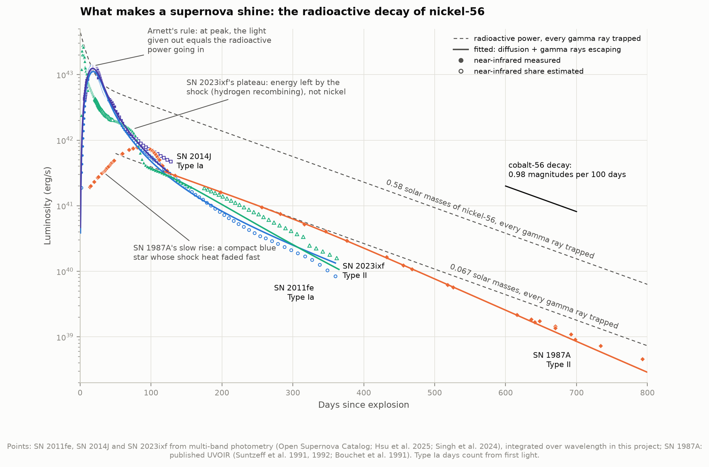
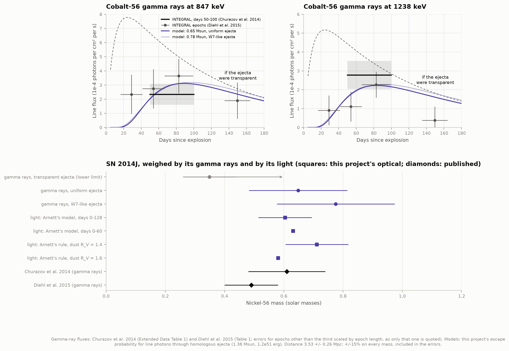
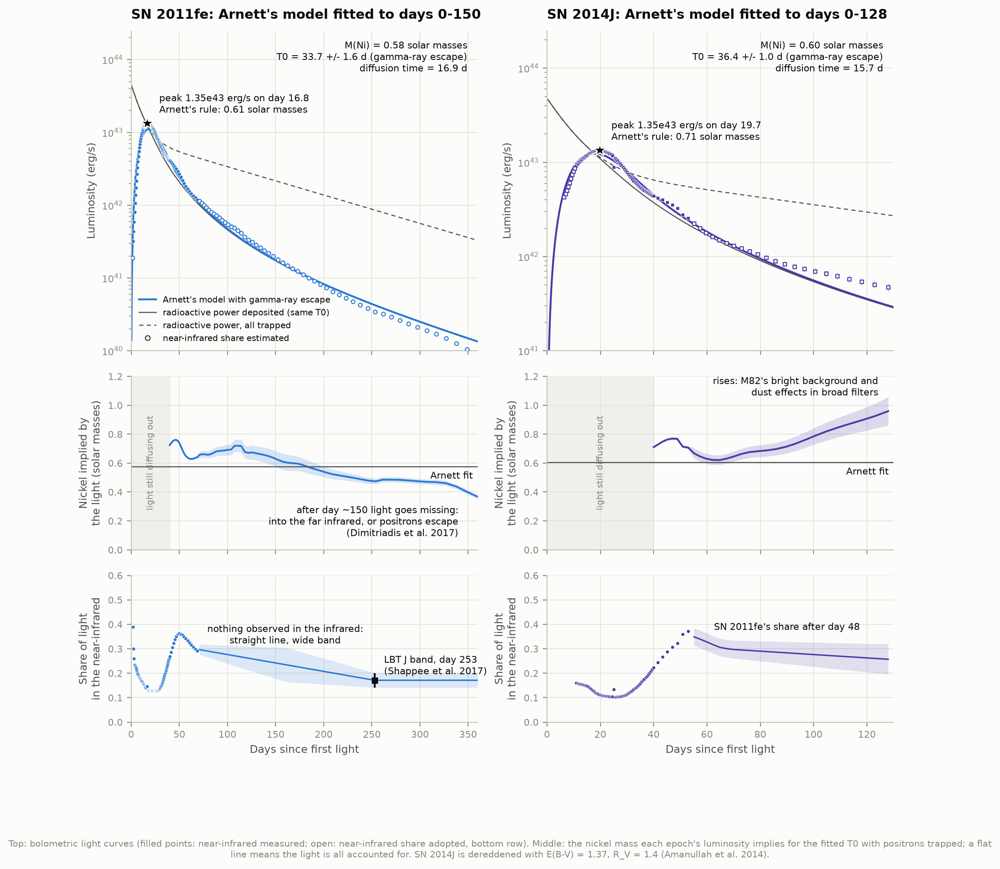
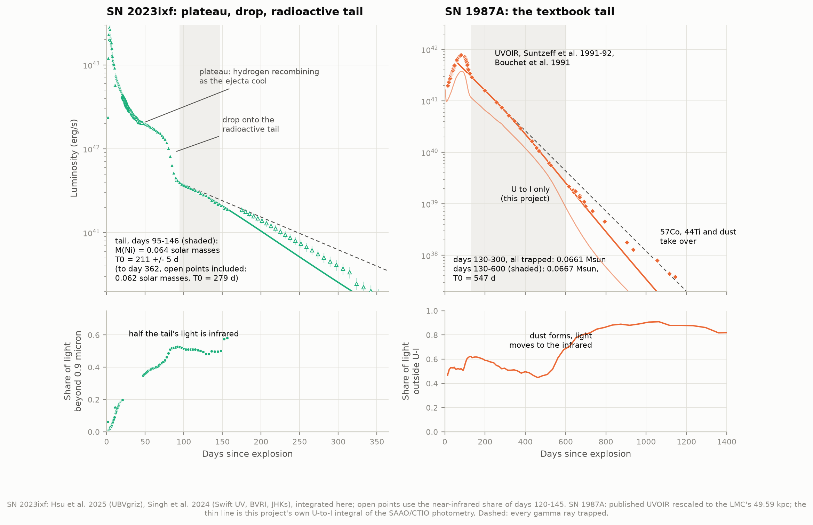
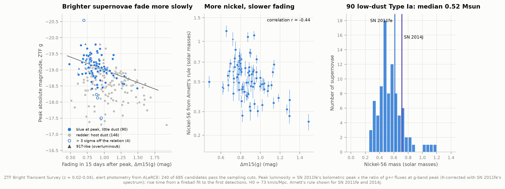

# L1 — What makes a supernova shine? Radioactive nickel

**A supernova stays bright for months, long after the explosion itself is over. Where does that light come from?**

From radioactivity. The explosion forges nickel-56, which decays to cobalt-56 (half-life 6.1
days) and then to stable iron-56 (half-life 77.2 days). Each decay releases gamma rays; the
expanding debris traps them and glows. This project reads that decay in real light curves:
it builds the total ("bolometric") light output of four nearby supernovae from their
photometry, weighs the nickel each one made, and checks the answer three independent ways:
by the shape of the peak, by the radioactive tail, and for SN 2014J by counting its cobalt
gamma rays directly with the INTEGRAL satellite's measurements. It then applies the same
physics to 240 Type Ia supernovae from the Zwicky Transient Facility.

---

## Results

### The nickel each supernova made

| Supernova | What exploded | Our nickel-56 mass (solar masses) | Published |
|---|---|---|---|
| **SN 2011fe** (M101) | a white dwarf (Type Ia) | **0.58 ± 0.03** (Arnett's model) · 0.61 ± 0.03 (Arnett's rule) · 0.64 (tail) · 0.61 (Katz integral) | 0.53 ± 0.11 (Pereira et al. 2013, at 6.4 Mpc with α = 1.2) |
| **SN 2014J** (M82) | a white dwarf (Type Ia), behind thick dust | **0.60 ± 0.09** (Arnett's model) · 0.71 ± 0.11 (Arnett's rule) | 0.61 ± 0.13 (Churazov et al. 2014, gamma rays) · 0.49 ± 0.09 (Diehl et al. 2015) |
| SN 2014J, **from its gamma rays** | | **0.65 ± 0.17** (uniform ejecta) · 0.78 ± 0.20 (W7-like ejecta) · ≥ 0.35 ± 0.09 (no absorption at all) | 0.6 ± 0.1 (Churazov et al. 2014) |
| **SN 2023ixf** (M101) | a red supergiant's core (Type II) | **0.064 ± 0.003** (tail, days 95-146) | 0.068 (Hsu et al. 2025) · 0.059 (Singh et al. 2024) · 0.04-0.071 (three other studies) |
| **SN 1987A** (LMC) | a blue supergiant's core (Type II) | **0.066 ± 0.002** (tail, days 130-300) · 0.067 (days 130-600) | 0.071 ± 0.003 (Seitenzahl et al. 2014) · "~0.07" (the textbook value) |
| **90 ZTF Type Ia** | white dwarfs | median **0.52**, 68% between 0.40 and 0.70 | (SN 2011fe's and SN 2014J's Arnett fits sit at its 60th and 70th percentiles) |

Errors include the distance, which is the largest single uncertainty for SN 2014J (±15% in mass).

### What that shows

- **Two families, ten times apart.** Every Type Ia here made about 0.6 solar masses of
  nickel; both Type II made about 0.065. A white dwarf that blows apart burns a large part of
  its carbon and oxygen all the way to nickel. A collapsing massive star makes nickel only in a
  thin layer just outside the newborn neutron star.
- **The tails follow cobalt's clock.** SN 1987A's four published points between day 130 and
  300 fall at 0.98 magnitudes per 100 days, the decay rate of cobalt-56, and match 0.066 solar
  masses of it to 1% (0.004 dex rms). SN 2023ixf, 36 years later, does the same at 0.064.
- **Gamma rays and light agree for SN 2014J.** The optical estimate (0.60 ± 0.09) and our
  gamma-ray estimate (0.65 ± 0.17) agree, and both agree with Churazov et al.'s 0.6 ± 0.1. The
  gamma rays need no dust correction, which is the optical estimate's weakest point: the
  two published dust laws move it between 0.58 and 0.71.
- **Two clocks in one light curve.** Arnett's model, fitted to SN 2011fe's first 150 days,
  gives the nickel (0.58), the time light takes to diffuse out (16.9 days), and the time when
  the debris starts to let gamma rays escape: **T0 = 33.7 ± 1.6 days**. SN 2014J gives 36.4 ±
  1.0. Published values for normal Type Ia are 31.5-35 days (34.5 for SN 2011fe; Zhang et al.
  2016 via Dimitriadis et al. 2017).
- **One ejecta model fits both.** Of the two simple ejecta models used to turn SN 2014J's
  gamma-ray fluxes into a mass, the uniform-density one implies T0 = 35 days, matching what the
  optical tails measured; the W7-like one implies 45 days. The model the light curves favour
  is the one that gives 0.65 solar masses from the gamma rays.
- **Type II tails leak too, more slowly.** The escape time is T0 = 210 ± 5 days for SN 2023ixf
  (Hsu et al.: 190; Singh et al.: 220) and 550 days for SN 1987A, whose heavier envelope kept
  the gamma rays in for years.
- **Brighter Type Ia fade more slowly, because they made more nickel.** In ZTF's sample the
  peak magnitude dims 0.79 magnitudes per magnitude of 15-day decline, and the nickel mass
  correlates with the decline rate (r = -0.44). This is the Phillips relation that makes
  Type Ia usable as standard candles (project D1).
- **After about day 150, SN 2011fe's light goes missing.** The light it emits falls below what
  its radioactivity deposits: the implied nickel drops from ~0.63 to ~0.40 by day 350. Either
  light is moving beyond the near-infrared, or positrons are escaping. Dimitriadis et al.
  (2017) found the same.

---

## The figures worth looking at

**The keeper: four supernovae against their radioactive power.** Points are the total light
output; dashed lines are what nickel's decay would supply if every gamma ray were trapped; solid
lines are the fitted models. At the Type Ia peaks the light crosses the radioactive power
(Arnett's rule). Afterwards every tail runs parallel to cobalt's decay, then drops below it as
gamma rays escape: the Type Ia within weeks, the Type II over years.



**SN 2014J weighed six ways.** Top: INTEGRAL's measurements of the two cobalt-56 gamma-ray
lines, with the model for 0.65 solar masses. The lines rise as the debris thins enough to let
gamma rays out, then fade with the cobalt. Bottom: every estimate of the nickel, from gamma
rays and from light.



**Type Ia in detail.** Top: the light curves and Arnett's model. Middle: the nickel each day's
luminosity implies. A flat line means the light is accounted for; SN 2011fe's sinks after day
150 (light going missing), SN 2014J's rises (extra light from M82's bright background and from
how heavy dust behaves in broad filters). Bottom: the share of light in the near-infrared,
measured where infrared photometry exists and adopted elsewhere.



**Type II: plateau, drop, tail.** SN 2023ixf glows for 80 days from the explosion's own
heat (hydrogen recombining), drops, and lands on the cobalt tail. SN 1987A, from a compact
blue star, had little stored heat: nickel powered even its slow rise. Bottom: how much of the
light is outside the optical. For SN 2023ixf half the tail's light is infrared; for SN 1987A the
share climbs from ~50% to ~90% between day 500 and 1000 as dust forms in the debris.



**Arnett's rule for 90 ZTF Type Ia.** Left: brighter supernovae fade more slowly (grey points
are redder at peak, most likely dimmed by host-galaxy dust). Middle: more nickel, slower fade.
Right: the nickel mass distribution, with SN 2011fe and SN 2014J marked.



Also: `02_nickel_clock` (the decay chain and the heating it supplies, by channel), and
`07_nickel_census` (every nickel mass in this project beside the published values).

**Try it yourself:** `figures/nickel_explorer.html` is an offline page with the four light
curves and three sliders (nickel mass, diffusion time, gamma-ray escape time). Drag the nickel
slider and watch the whole curve move up and down; drag T0 and watch the tail bend.

---

## Background, in brief

**Two ways to blow up a star.** A *Type Ia* supernova is a white dwarf (the carbon-oxygen
core left by a Sun-like star) that ignites carbon throughout and is destroyed completely.
A *Type II* is a star of more than ~8 solar masses whose iron core collapses into a neutron
star; the rebounding shock throws off the rest. Supernovae are classified by their spectra:
Type II show hydrogen, Type I do not.

**Nickel-56.** Explosive burning that reaches nuclear statistical equilibrium makes mostly
nickel-56 (28 protons, 28 neutrons). It is unstable. Nickel-56 (mean life 8.8 days) captures an
electron and becomes cobalt-56 (mean life 111.4 days), which becomes iron-56, mostly by
electron capture, 19% of the time by emitting a positron. One solar mass of nickel-56 releases
1.9 × 10⁵⁰ erg in all, a fifth of the explosion's kinetic energy, but slowly enough to be seen.

**Why the peak comes late, and Arnett's rule.** At first the debris is so dense that light
takes weeks to diffuse out; the heat builds up inside. The light curve rises while more heat
arrives than escapes, and peaks when the two balance: at that moment the light given out
equals the radioactive power going in. That is Arnett's rule (Arnett 1982), and it turns a
peak luminosity and rise time into a nickel mass. It holds to 10-20% in detailed models.

**The tail, and T0.** Weeks later the light comes out as fast as the decays heat the debris,
so the light curve follows cobalt's decay: 0.98 magnitudes per 100 days. But the debris keeps
expanding and thinning. The gamma rays' optical depth falls as (T0/t)², and once t passes T0
they increasingly escape without heating anything (INTEGRAL caught some of them from SN 2014J).
Positrons, being charged, keep depositing their energy for years.

**Bolometric light.** The radioactive power is total power, so it must be compared with the
light at all wavelengths. Telescopes measure a few colour bands. This project integrates over
them: Swift ultraviolet, UBVRI, and JHKs infrared where they exist. Where the infrared was not
observed, it uses the infrared share measured at other times (see Honest notes).

---

## How it works

1. **Photometry** (`photometry.py`) from five kinds of sources is put in one table: the Open
   Supernova Catalog (SN 2011fe, SN 2014J, SN 1987A), the papers' own data files (SN 2023ixf;
   SN 2011fe and SN 2014J infrared), and ZTF alerts. Magnitudes become fluxes with each filter's
   pivot wavelength and zero point from the SVO Filter Profile Service.
2. **Light curves are interpolated** with a Gaussian process in log(time) (`gp.py`), one band
   at a time, never extrapolated.
3. **Dust is removed** with the Cardelli-Clayton-Mathis law (`extinction.py`): Milky Way
   E(B-V) from Schlafly & Finkbeiner, host dust from the literature (R_V = 1.4 for SN 2014J).
4. **Bolometric light** (`bolometric.py`): trapezoid integral over the bands, plus a UV tail
   (linear to zero at 1600-3000 Å, or a blackbody for Type II in their first weeks) and the
   near-infrared, measured or adopted. Errors by Monte Carlo over the band uncertainties.
5. **Physics** (`nickel.py`): the decay chain from nuclear data; Arnett's model with gamma-ray
   leakage; Arnett's rule; the Katz integral (∫ t L dt = ∫ t Q dt, a check independent of
   diffusion physics); tail fits.
6. **Gamma rays** (`gammarays.py`): photons per cobalt decay → photon flux at Earth; the
   probability that a line photon escapes the debris unscattered, by ray-tracing through a
   homologously expanding sphere (uniform or exponential density, 1.38 solar masses,
   1.2 × 10⁵¹ erg, nickel in a shell outside 0.1 solar masses of stable iron); fitted to
   Churazov et al.'s line fluxes.
7. **ZTF** (`ztf.py`): for each Bright Transient Survey Type Ia at z = 0.02-0.04, the g-band
   peak and its decline (GPs), first light from a fireball fit to the earliest points with
   non-detections as limits, the peak luminosity by scaling SN 2011fe's bolometric peak with
   the g + r flux ratio (K-corrected with SN 2011fe's spectrum), then Arnett's rule.

Every number is checked against an independent answer in `test_physics.py` (42 checks):
Nadyozhin's textbook coefficients for the decay power, energy conservation, Arnett's rule and
the Katz identity inside the model, parameter recovery for both fits, the dust law,
Klein-Nishina, a uniform sphere's exact escape probability, synthetic photometry,
K-corrections of a flat spectrum, a blackbody through the integrator.

---

## Honest notes

**The infrared is the hard part.** A cool supernova emits much of its light beyond 0.9
microns: for SN 2023ixf half of it in the radioactive tail, for SN 1987A half of it even
around its peak (a 5,000 K photosphere puts half its light redward of 0.8 microns). Infrared photometry exists for SN 2011fe to day 69, SN 2014J to day
53, SN 2023ixf to day 156. Beyond that:
- SN 2023ixf: the share is held at its day 120-145 value (0.51 ± 0.10). The headline tail fit
  uses only days 95-146, where it was measured. Including the later, assumed points gives
  0.062 and T0 = 279 days instead of 0.064 and 210.
- SN 2011fe: the share is interpolated from day 69 (0.29, measured) to day 253 (0.17, from the
  LBT J band of Shappee et al. 2017 with assumed nebular J-H and H-K of 0 ± 0.3), with ±0.07
  in the gap. A J point at day 224 (Weyant et al. 2017) disagrees with LBT by 0.8 mag and was
  left out. Late Type Ia move light into the infrared (Sollerman et al. 2004; Leloudas et al.
  2009), so the "missing light" after day 150 may be partly ours.
- SN 2014J: after day 53 SN 2011fe's share is used (+0.03 for borrowing it from a twin).
- We never extrapolate a blackbody into the infrared for these: tested against SN 1987A's
  published UVOIR, that was off by 10-40%.

**SN 2014J's dust.** E(B-V) = 1.37 with R_V = 1.4 (Amanullah et al. 2014) gives a peak of
1.35 × 10⁴³ erg/s; A_V = 1.85, R_V = 1.6 (as Churazov et al. used) gives 1.11 × 10⁴³, matching
their quoted value. Swift ultraviolet is left out entirely: through this dust the correction
would be 7-10 magnitudes. Extinction is applied at each filter's pivot wavelength; for dust
this heavy the true broad-band extinction changes as the spectrum evolves, one likely reason
SN 2014J's tail fades too slowly after day 60 (middle panel of figure 03).

**Arnett's rule is approximate.** We use α = 1. Pereira et al. used α = 1.2, which lowers the
mass by 17%. Our Arnett-model fit (which does not assume the rule) and the Katz integral land
within 6% of the rule for SN 2011fe. Rise times count from first light, not explosion; a
"dark phase" of ~1 day before first light would raise the masses by ~5%.

**Gamma rays.** The line fluxes have 25-35% errors, and turning them into a mass needs the
fraction that escapes, which depends on how the nickel and debris are distributed: 0.56
(uniform) or 0.47 (W7-like) at day 75 for the 847 keV line. Churazov et al.'s fiducial model
had 0.60. The 847 and 1238 keV lines give 0.53 and 0.86 solar masses separately (uniform model);
they are combined with inverse-variance weights. Diehl et al. quote an error only for their
third epoch; the others are scaled by epoch length, for plotting only.

**SN 1987A.** Its bolometric curve is the published UVOIR one (Suntzeff et al. 1991 tables
and Bouchet et al. 1991, as transcribed by D. Jeffery; later points read from the vector
graphics of Seitenzahl et al. 2014, Fig. 2, exact to the plotting precision), rescaled from 50
to 49.59 kpc. Different published versions of the curve differ by 0.03-0.04 dex at days
280-430. Seitenzahl et al. fitted 0.071 with a fuller model (gamma-ray leakage from day 130
with κ = 0.033 cm²/g, freeze-out, cobalt-57, titanium-44); our one-parameter escape law gives
7% less. Past day ~800 other isotopes and dust take over, beyond this project.

**SN 2011fe's late photometry.** The KAIT/Nickel series (Silverman et al. 2012; Stahl et al.
2019) agrees with the others to 0.05 mag until day ~150, then drifts 0.3-1.4 mag faint by day
200-360. The other series join smoothly onto the independent LBT photometry at days 506-653,
so KAIT/Nickel points after day 150 are excluded (`photometry.LATE_CUTS`).

**ZTF.** Alert photometry (5σ detections on difference images), not forced photometry. Host
dust is not corrected; instead the sample is limited to supernovae as blue at peak as SN 2011fe
(g - r ≤ -0.15, 90 objects): the median nickel is 0.49, 0.52 or 0.59 for colour cuts of -0.10,
-0.15 or -0.20. Four supernovae more than 3σ off the brightness-decline relation are flagged
as measurement failures (SN 2019phj would need 1.9 solar masses, more than a white dwarf has):
SN 2019phj, SN 2020scm, SN 2021vju, SN 2025zqi. Every luminosity is scaled from SN 2011fe's,
so a different spectrum shape (91T-like, 91bg-like) or a different H0 shifts it: masses scale
as H0⁻², +17% for H0 = 67.4 instead of 73. Peculiar velocities (300 km/s) add 5-10% per object.

**Distances.** M101 (SN 2011fe and SN 2023ixf): 6.71 ± 0.14 Mpc (Cepheids, Riess et al. 2016).
M82 (SN 2014J): 3.53 ± 0.26 Mpc (tip of the red-giant branch, as used by Churazov et al.).
LMC (SN 1987A): 49.59 kpc (Pietrzyński et al. 2019). Luminosities scale with distance squared.

---

## Running it

```bash
cd ..                       # repository root
python3 -m venv .venv
source .venv/bin/activate
pip install numpy scipy pandas matplotlib astropy

cd 27-supernova-nickel
python fetch_data.py        # ~50 MB plus ~700 small ZTF light curves (~20 min); only needed once
python run.py               # every measurement, all figures and the explorer page, ~1.5 minutes
python test_physics.py      # 42 checks
```

Once the cache is warm, `run.py` needs no network (checked in a network namespace with no
connectivity). `python run.py --figures-only` redraws the figures from the last analysis.
Results are written to `data/results.json`.

### Files

| File | What it does |
|---|---|
| `config.py` | Paths, constants, nuclear data, and each supernova's distance, dust and explosion date, with sources |
| `fetch_data.py` | Downloads and caches every input (Open Supernova Catalog, AAS data files, arXiv sources, VizieR, SVO, ZTF/ALeRCE) |
| `photometry.py` | Filters, magnitudes to fluxes, synthetic photometry, and a loader per data source |
| `gp.py` | The light-curve Gaussian process |
| `extinction.py` | The CCM89 dust law |
| `bolometric.py` | UV + optical + near-infrared integration with Monte Carlo errors |
| `nickel.py` | Decay chain, heating, gamma-ray trapping, Arnett's model and rule, Katz integral, fits |
| `gammarays.py` | Klein-Nishina, line escape through model ejecta, nickel from INTEGRAL's line fluxes |
| `ztf.py` | The ZTF sample: peaks, declines, first light, K-corrections, luminosities, Arnett's rule |
| `analysis.py` | Every measurement and the summary |
| `literature.py` | Published values we compare with (never used in a fit) |
| `figures.py`, `plotstyle.py` | Every figure; colours checked with a colour-blindness validator |
| `interactive.py` | Writes `figures/nickel_explorer.html` |
| `run.py` | Runs everything and prints the summary |
| `test_physics.py` | 42 checks against independently known answers |

## Data credits

- **Open Supernova Catalog**: Guillochon et al. 2017, ApJ 835, 64 (github.com/astrocatalogs).
  Photometry of SN 2011fe from Brown et al. 2014 (Swift), Munari et al. 2013, Tsvetkov et al.
  2013, Richmond & Smith 2012, Silverman et al. 2012 / Stahl et al. 2019; of SN 2014J (UBVRI)
  from Foley et al. 2014, Silverman et al. 2012 / Stahl et al. 2019, Vinkó et al. 2018,
  Tsvetkov et al. 2014, Goobar et al. 2014; of SN 1987A from the SAAO (Menzies et al. 1987; Catchpole et al.
  1987-1989; Whitelock et al. 1988) and CTIO (Suntzeff et al. 1988; Walker & Suntzeff 1991).
- SN 2011fe infrared: Matheson et al. 2012, ApJ 754, 19 (arXiv source table). Late LBT
  photometry: Shappee et al. 2017, ApJ 841, 48 (VizieR J/ApJ/841/48). Spectrophotometry:
  Pereira et al. 2013, A&A 554, A27 (VizieR J/A+A/554/A27; the SNfactory asks that these data
  not be re-hosted, so they are only cached locally).
- SN 2014J infrared: Amanullah et al. 2014, ApJ 788, L21 (VizieR J/ApJ/788/L21). Gamma rays:
  Churazov et al. 2014, Nature 512, 406; Diehl et al. 2015, A&A 574, A72.
- SN 2023ixf: Hsu et al. 2025, ApJ 990, 148 and Singh et al. 2024, ApJ 975, 132 (AAS data
  behind the figures).
- SN 1987A UVOIR: Suntzeff et al. 1991, AJ 102, 1118; Bouchet et al. 1991, A&A 245, 490
  (transcribed by D. Jeffery, physics.unlv.edu/~jeffery); Suntzeff et al. 1992, 1997 via
  Seitenzahl et al. 2014, ApJ 792, 10.
- ZTF Bright Transient Survey: Fremling et al. 2020, ApJ 895, 32; Perley et al. 2020, ApJ
  904, 35. Light curves through the ALeRCE broker (Förster et al. 2021, AJ 161, 242).
- Filters: SVO Filter Profile Service (Rodrigo et al. 2012, 2020).
- Physics: Arnett 1982, ApJ 253, 785; Nadyozhin 1994, ApJS 92, 527; Katz, Kushnir & Dong 2013;
  Cardelli, Clayton & Mathis 1989, ApJ 345, 245; O'Donnell 1994, ApJ 422, 158.

All data retrieved 2026-10-04.
