# L3 — Rewind a supernova remnant: the Crab and Cassiopeia A

**Chinese astronomers recorded a "guest star" in 1054 where the Crab Nebula now sits. Cassiopeia A
exploded around 1670 with no confirmed sighting. If we measure how fast their debris flies outward,
can we run the film backwards to the explosion, and find the neutron stars they left behind?**

This project registers Palomar sky-survey plates from 1951 and 1991 and modern Pan-STARRS images on
Gaia stars, tracks the Crab's filaments across 60 years, measures Cas A's blast wave in fifteen
Chandra X-ray images from 2000 to 2019, and puts both in context: the Galaxy's 310 known remnants
and the speeds of 700 pulsars.

**The Crab's filaments converge in 1106 ± 8 CE, not 1054.** Across 60 years, 810 tracked filaments
move straight away from one point, each at a speed proportional to its distance from it. Run backwards,
they meet in **1106.0 ± 7.8** (the 2025 CFHT study: 1105.5 ± 0.5). The other red-light
pairs agree: 1951→1991 gives 1105, 1991→2012 gives 1098. The 50-year gap to the guest star is not an
error. It means the filaments move **6% faster today than their average since 1054**: the nebula of
particles and magnetic field blown by the pulsar has been pushing them.

**The pulsar was born where the filaments meet.** Gaia DR3 measures the Crab pulsar moving at 11.7 mas/yr
(111 km/s). Wound back to 1054, it lands **2.1″** from the expansion centre we find, while today it is
9.9″ away.

**Cas A's blast wave is slowing down.** Its forward shock expands at **0.185%/yr** (~5,000 km/s), almost
40% below the 0.30%/yr that coasting since ~1671 would need: expansion parameter m = 0.62, between free
expansion (1) and a Sedov–Taylor blast wave (0.4). Sector by sector, 13 of 18 directions agree with Vink
et al. (2022) to 0.03%/yr. The inner ring of shocked debris follows their reverse-shock pattern with
correlation 0.89, including the west, where the reverse shock barely moves.

**Cas A's neutron star sits 7.0″ from the explosion centre** at position angle 169°: 340 km/s if it left
the centre 333 years ago (Fesen et al. 2006: 7″ at 169°, ~350 km/s). Measuring its motion directly
needs a reference frame our images do not have; figure 7 shows why.

| What | Ours | Published |
|---|---|---|
| Crab convergence date, fit (main pair, 810 vectors) | 1106.0 ± 7.8 CE | 1105.5 ± 0.5 (Martin et al. 2025); 1130 ± 16 (Nugent 1998) |
| ... red plates 1951→1991 / 1991→2012 | 1104.9 / 1098.1 | |
| ... "closest approach" method | 1118 | 1140.5 ± 1.4 (Martin et al. 2025) |
| Crab: today's speed / mean speed since 1054 | 1.059 | v/v_h ≈ 1.06 (Martin et al. 2025) |
| Crab pulsar in 1054 vs expansion centre | 2.1″ apart | 3.4″ (from Martin et al. 2025, Table 5) |
| Cas A forward shock, expansion rate | 0.185 %/yr (m = 0.62) | 0.218 ± 0.029 %/yr, m = 0.73 (Vink et al. 2022) |
| ... sectors within 0.03 %/yr of Vink et al. | 13 of 18 | |
| Cas A inner ring vs reverse-shock pattern | r = 0.89 | Vink et al. 2022, Table 4 |
| Cas A neutron star from the centre | 7.0″ at 169° → 340 km/s | 7″ at 169 ± 8°, ~350 km/s (Fesen et al. 2006) |
| Young pulsars, mean 2-D speed | 353 ± 43 km/s | 307 ± 47 km/s (Hobbs et al. 2005) |
| Pulsars moving away from their remnant's centre | 8 of 9 within 35° | by chance: p = 1.5 × 10⁻⁵ |

---

## Results

### 1. Sixty years of the Crab

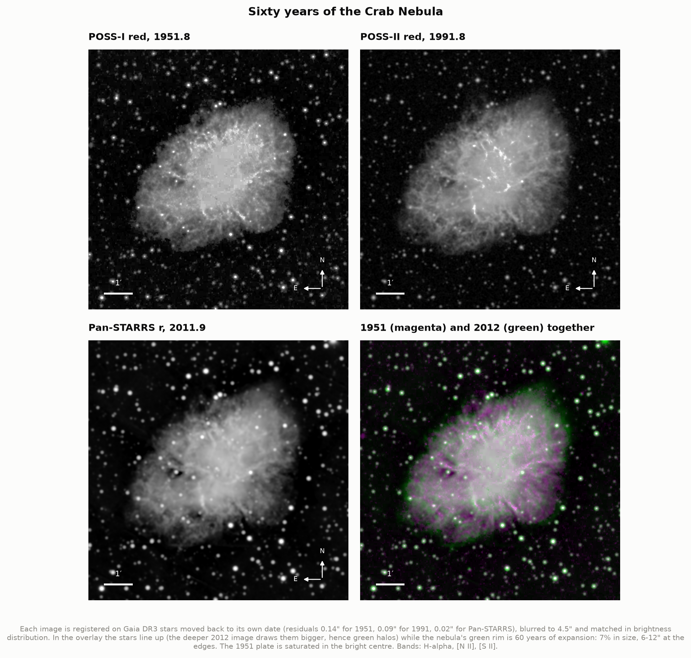

The Crab on the Palomar Observatory Sky Survey plates of 7 November 1951 (POSS-I) and 17 October 1991
(POSS-II), and in Pan-STARRS images taken between 2009 and 2014 (effective date 2011.9). All three are
red-light images dominated by the filaments' emission lines (hydrogen-alpha, [N II], [S II]). Before
anything else, each image is registered on Gaia DR3 stars moved back to its own date: a star moving
20 mas/yr has moved 1.3″ between 1951 and Gaia's epoch. The residuals are 0.15″ for the 1951 plate.
That matters because a filament moves only 6–12″ in 60 years.

In the overlay (1951 magenta, 2012 green) the stars line up, while the nebula wears a green rim all
round: it has grown by 7% in 60 years.

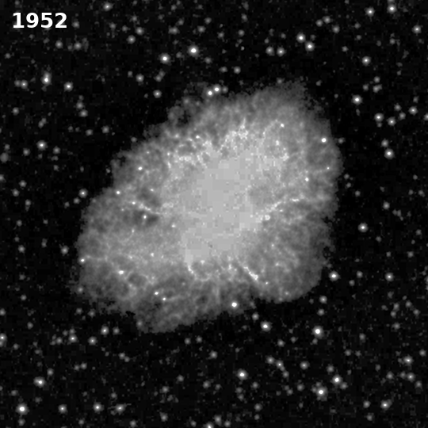

### 2. Every filament moves outward

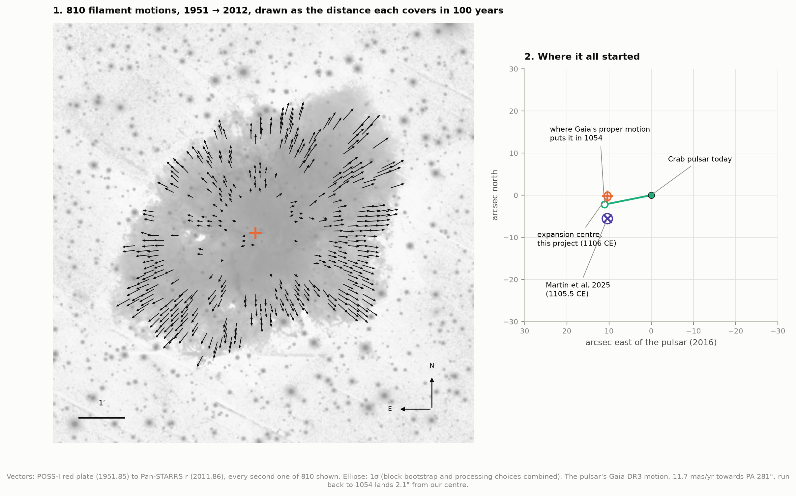

Small patches of the 1951 image are found again in the 2012 image (masked correlation, stars ignored)
and kept only if the reverse match lands back where it started. 875 patches pass; 810 survive the
fit's outlier rejection. Every arrow points away from one region near the middle, and the outer ones
are the longest: a filament 2′ out moves ~0.14″ per year, ~1,300 km/s at 2 kpc; the fastest 5% exceed
1,850 km/s.

Panel 2 zooms on the centre. The fitted expansion centre (orange) lies 10″ east of the pulsar. The
pulsar's own path, from Gaia DR3's proper motion, leads back to within 2.1″ of it in 1054 — the
neutron star was born where the filaments started, and has since moved off at 111 km/s (114 km/s
relative to its Galactic surroundings), a modest kick by pulsar standards (section 10). Martin et al.'s
centre, from 19,974 CFHT vectors, lies 5″ south of ours; centres from our six plate pairs scatter by
±3″, so the two agree within the systematics.

### 3. Rewound to 1106, not 1054

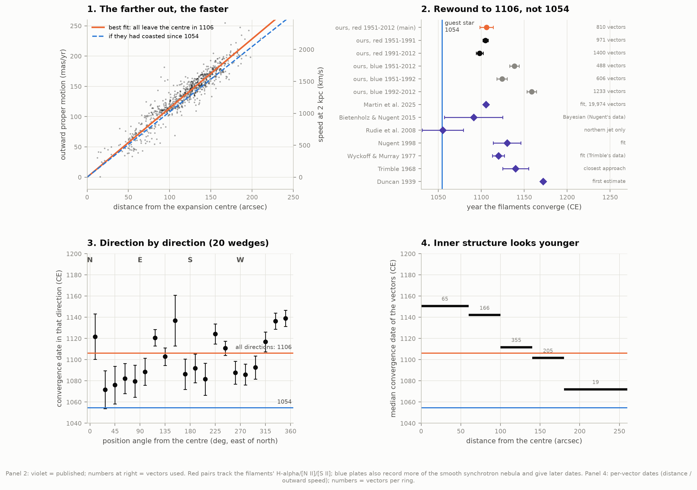

**Panel 1.** Outward proper motion grows in proportion to distance from the centre: a homologous
expansion, the signature of debris that all started from one point at one time. The slope is
1/(age): the best fit says all the filaments left the centre in 1106. The dashed line is what the
slope would be if they had coasted since 1054. It is visibly too shallow.

**Panel 2.** Our dates next to two centuries of measurements. All three red pairs, independent plates
over 20, 40 and 60 years, give 1098–1106. The blue plates give 1124–1159: they also record much of
the smooth synchrotron light, whose internal structure moves differently (radio images of the
synchrotron nebula give 1255 ± 27; Bietenholz & Nugent 2015). The uncertainty of our main result,
± 7.8 years, combines a bootstrap over blocks of sky (± 5.8) with the spread of nine variants of the
processing (± 5.1: patch size, filtering, blur, matching threshold, region); the formal fit error is
± 2.7.

**What the gap means.** The fit returns the date when the filaments *would* have been at the centre had
they always moved at today's speed. The true age at the mid-epoch (1982) is 927 years; the apparent
age is 876. So today's speed is 1.059 times the average speed since 1054. If the push had been steady,
11% of today's speed was gained along the way. The push comes from the pulsar wind nebula, the bubble
of electrons and magnetic field the spinning neutron star blows into the debris: the Crab pulsar loses
4.5 × 10³⁸ erg/s of spin energy (project C2). A pulsar of constant power would grow its nebula as
R ∝ t^(6/5) (Chevalier & Fransson 1992), which would put the apparent date at 1209. The true push was gentler, consistent with
a pulsar that has been slowing down.

**Panel 3.** Direction by direction, the date ranges from ~1072 (north-east and east) to ~1139 (north and
south-east). Martin et al. found the same pattern, the youngest-looking (most accelerated) material to
the north and south and the oldest along the east–west "bays", and attribute it to the pulsar wind
being strongest along the pulsar's rotation axis.

**Panel 4.** Within 1′ of the centre the per-filament dates are ~1150: the inner structure is dominated
by synchrotron features (wisps, the jet, the edges of the bays) that do not move like ejecta. The
global fit is dominated by the bright outer filaments, whose dates (1100–1112) carry the result.

### 4. Running the film backwards

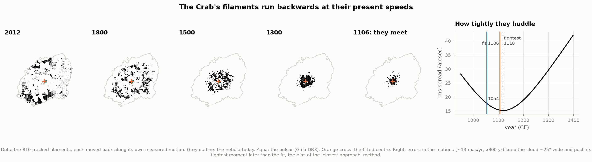

Each filament moved back along its own measured motion. By 1106 the 810 points huddle into a cloud
~30″ across around the fitted centre, with the pulsar (aqua) inside it. The cloud cannot shrink to a
point: each motion is uncertain by ~12 mas/yr, which over 900 years is ±11″. That noise is also why the
other classical method, "closest approach" (find the year the cloud is tightest), lands later, at 1118
(right panel), as Martin et al. found (1140 by closest approach, 1105.5 by the fit). The fit's
straight line is not biased this way.

### 5. Cas A in X-rays, 2000–2019

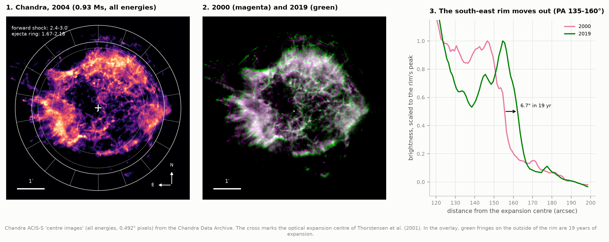

Chandra observed Cas A almost every year. Fifteen epochs cover the whole remnant on the same ACIS-S chip.
The deep 2004 image (0.93 million seconds) shows the bright ring of debris heated by the reverse shock
and, outside it, the thin filaments of the forward shock, the blast wave itself, where electrons
accelerated to TeV energies radiate X-ray synchrotron light. In the 2000 (magenta) vs 2019 (green)
overlay the outer filaments wear green fringes. In the south-east the rim's outer edge moved 6.7″ in
19 years (panel 3).

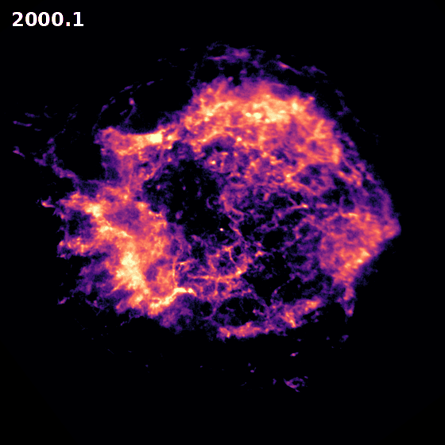

### 6. How fast Cas A expands

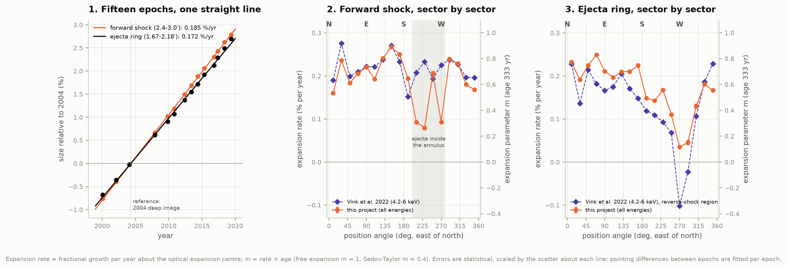

Each epoch is compared with the deep 2004 image stretched about Thorstensen et al.'s expansion
centre (Poisson likelihood, pointing errors fitted per epoch). The stretch grows linearly with time
(panel 1): the forward-shock annulus expands at **0.185 ± 0.001 %/yr**, the inner ring at **0.172 %/yr**.

* **The blast wave is decelerating.** Coasting since 1671 would mean 1/333 = 0.30%/yr today. The
  measured 0.185%/yr gives an expansion parameter m = 0.62: the blast wave has slowed, most likely by
  sweeping up the wind the star blew before it exploded (Cas A was a Type IIb: its progenitor had lost
  most of its hydrogen envelope). At 0.31″/yr
  and 3.4 kpc the shock moves at ~5,000 km/s.
* **Direction by direction** (panel 2) we match Vink et al. (2022) to 0.03%/yr in 13 of 18 sectors.
  The exceptions are three western sectors (PA 210–270°), where we get 0.08–0.09%/yr against their
  0.21–0.23. Their images were cut to 4.2–6 keV, where the shock's synchrotron light dominates; ours
  contain all energies, and in the west the reverse shock sits close to the forward shock, so slow or
  even inward-moving debris enters our annulus.
* **The inner ring** (panel 3) follows their reverse-shock pattern (correlation 0.89): fast in the
  north and east, slowing towards the south-west, nearly stalled at PA 270–290° where Vink et al.
  find the reverse shock moving *inwards* (−0.02 to −0.10%/yr). Ours stays slightly positive there:
  our all-energy images follow the glowing shocked debris, which still drifts outward, rather than the
  reverse shock itself.

### 7. Cas A's neutron star

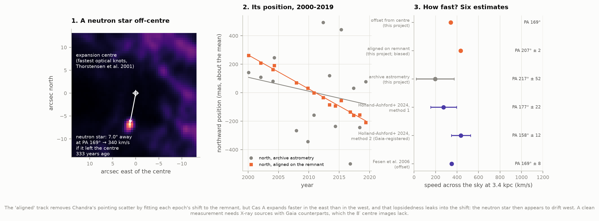

Cas A's neutron star was found in Chandra's first-light image in 1999. In the deep 2004 image it lies
**7.0″ from the expansion centre at PA 169°**, which is 340 km/s at 3.4 kpc if it left the centre 333
years ago. That matches Fesen et al. (2006), and points into the "gap" in the outer debris to the south.

Measuring its motion directly is harder than it looks. Chandra's absolute pointing scatters by ~0.3″
between observations, as much as the neutron star moves in 15 years. With the archive's own
astrometry we get 196 ± 177 km/s: consistent with everything, informative about nothing. Aligning each
epoch on the remnant itself removes the pointing scatter, and gives a tight 434 ± 15 km/s, but at PA
207°, 30–50° west of the published directions. The reason is a degeneracy we cannot break with these
images: the remnant expands faster in the east than in the west, and from one image to the next a
lopsided expansion looks just like a shift. The fitted shift absorbs it, and the neutron star appears
to drift west. Holland-Ashford et al. (2024) broke the degeneracy with X-ray sources that have Gaia
counterparts (436 ± 89 km/s at 158 ± 12°); the 8′ "centre images" we use contain none bright enough.

### 8. Cas A in visible light: an honest failure

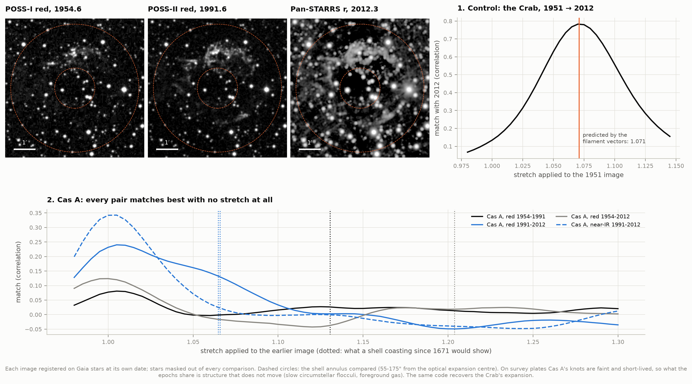

Thorstensen et al. (2001) dated Cas A to 1671.3 ± 0.9 from 17 fast knots on Palomar 5-m plates
(1951–1976) and later CCD and Hubble images. We tried
the same on survey plates (POSS-I 1954, POSS-II 1991, Pan-STARRS ~2012), stretching the whole shell.
The method is the X-ray one: find the single stretch of the earlier image (about the expansion centre,
stars masked out) that best matches the later one, and turn it into a date.

**It does not work for Cas A.** Every pair matches best with no stretch at all: 1.005 for 1954→1991
(a shell coasting since 1671 would show 1.131), 1.007 for 1991→2012 (1.065), 0.996 for 1954→2012 (1.204),
and 1.002 in the near-infrared, where the moving debris glows in [S III] (1.066). Run on the Crab, the
same code finds a stretch of **1.070, against the 1.071 predicted** by the 810 filament vectors, so the
method is sound. Cas A's optical knots are the problem: each lights up when the reverse shock hits it
and fades within years to decades, so the knots of 1954 are mostly not the knots of 2012. What survives
from epoch to epoch and dominates the correlation is structure that does not move: slow "quasi-stationary
flocculi" (circumstellar clumps the star shed before exploding, bright in hydrogen-alpha and [N II]) and
foreground gas. On shallow Schmidt plates the fast knots are too faint to help. That is why Thorstensen et al.
identified individual knots on deep 5-m plates and could follow them for only 23–48 years, and why Fesen
et al. (2006) used Hubble images nine months apart.

### 9. The Galaxy's remnants

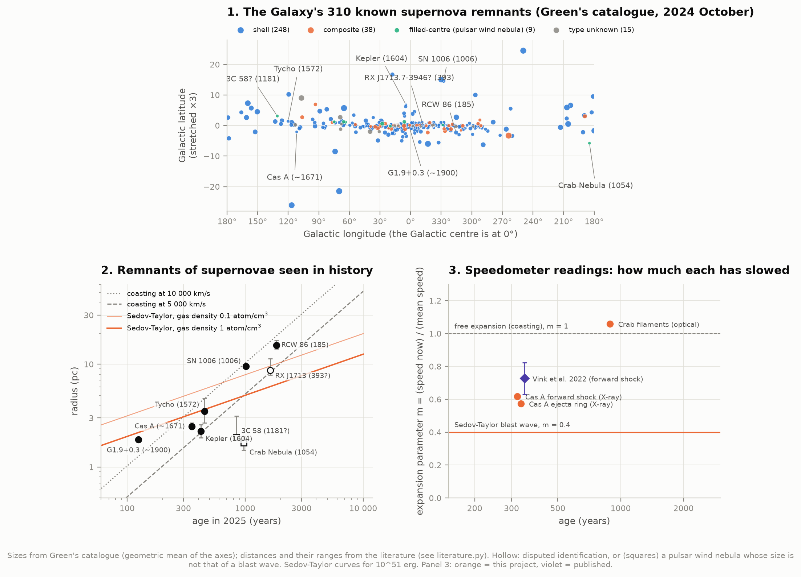

Green's catalogue lists 310 Galactic supernova remnants (2024 October): 248 shells, 38 composites and 9
filled-centre remnants (pulsar wind nebulae like the Crab), crowded into the Galactic plane where
massive stars live and die (panel 1).

Nine have dates from history (panel 2). Their radii, from catalogued angular sizes and published
distances, follow the stages of a blast wave. The young ones (G1.9+0.3, Cas A, Kepler, Tycho) have
average speeds of 5,000–15,000 km/s: their debris is still coasting or only beginning to slow (size alone
cannot tell which; expansion rates can, panel 3). SN 1006, 1,000 years old, is still
fast because it exploded 500 pc above the Galactic plane into very thin gas. RCW 86 (SN 185) is larger
than a Sedov–Taylor blast wave of its age even in thin (0.1 atom/cm³) gas: it is thought to be expanding
into a cavity blown by its progenitor's wind. The Crab and 3C 58 are small because what we see is the pulsar wind nebula; the Crab's
blast wave has never been found.

Panel 3 puts our two expansion measurements side by side: Cas A's forward shock at m = 0.62 (slowing),
and the Crab's filaments at m = 1.06 (speeding up).

### 10. Neutron stars are born moving

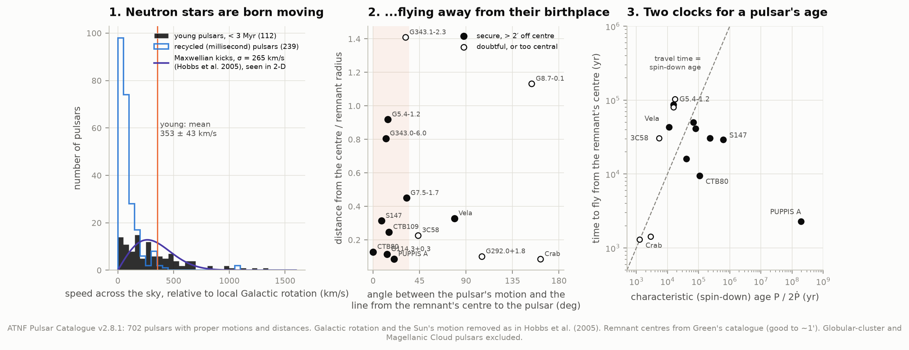

A core-collapse explosion is never perfectly symmetric: if more debris flies out on one side, the
neutron star recoils the other way. The ATNF catalogue has proper motions and distances for 702
pulsars. Removing Galactic rotation and the Sun's motion (as Hobbs et al. 2005 did), young pulsars
(characteristic age < 3 Myr) move at **353 ± 43 km/s** on average across the sky (Hobbs et al.: 307 ± 47);
a Maxwellian of 1-D width 265 km/s describes them. Old recycled (millisecond) pulsars are slower,
100 km/s. Normal pulsars come out at 311 ± 26 km/s against Hobbs et al.'s 246 ± 22. Speeds scale with
distance, and most pulsar distances come from a model of the Galaxy's free electrons: the catalogue now
uses the YMW16 model and newer parallaxes, Hobbs et al. used NE2001, and they noted that their own
switch of model had lowered many speeds.

Panel 2 tests the associations. For 9 pulsars far enough from their remnant's catalogued centre to
tell, 8 move within 35° of straight away from it (CTB 80: 0.1°, S147: 8°); for random directions that
would happen once in ~66,000 tries. (Caution: some associations were proposed *because* the motion
points away, which inflates this.) Panel 3 compares two clocks: the time to fly from the centre, and the
spin-down age P/2Ṗ. They can disagree by orders of magnitude. S147's pulsar would be 620,000 years old by
its spin-down but reached its position in 30,000 years: it was born spinning almost as slowly as now.
The central object in Puppis A, a neutron star with almost no spin-down, has a "spin-down age" of 190
million years.

### Interactive explorer

`figures/remnant_explorer.html` (offline, 0.9 MB): blink the Crab's three epochs, overlay the 810 motions,
and drag a slider to run every filament backwards and watch them converge around 1106 while the pulsar
walks back to its birthplace; then play Cas A's fifteen Chandra epochs.

---

## How it works

### Putting 1951 and 2012 on the same sky

A Schmidt plate is not a perfect map of the sky: the glass was bent over a curved focal surface, the
emulsion and the scanner add their own distortions, and the header that comes with a Digitized Sky
Survey scan is good to about an arcsecond: as large as the signal itself, since a Crab filament moves
6–12″ in 60 years. So every image gets its own plate solution (`astrometry.py`):

1. Take Gaia DR3 stars (G 14–18.5, isolated) and move each one along its own proper motion back to the
   date the image was taken, read from the header (DSS) or computed from the input exposures of the
   stack (Pan-STARRS: `INP_nnnn`/`EXP_nnnn`, exposure-weighted).
2. Centroid each star on the image (Gaussian-weighted, iterated to 0.001 px).
3. Fit a cubic polynomial from pixels to the tangent plane, with outlier rejection.

Residuals: 0.15″ (POSS-I red, 1.7″ pixels), 0.10″ (POSS-II), 0.015″ (Pan-STARRS), from 330–370 stars per
plate. Bright stars (G < 14) sit 0.1–0.3″ off on every plate: the photographic "magnitude equation"
(saturated images respond differently to guiding and optics), which is why we register on faint stars. A
0.15″ error over 60 years is 2.5 mas/yr, against filament motions of 60–200 mas/yr; the plate scale is
fixed to 2 parts in 10⁵, worth 0.3 years in the date. Every image is then resampled onto one north-up
grid of 0.5″ pixels around the pulsar.

### Tracking filaments

`motions.py`, for two registered images:

1. **Stars out.** Stars sit still while the nebula moves, so left in they pull every match towards zero
   shift. Each Gaia star is masked to a radius read off that image's own stacked star profiles, and the
   correlation ignores masked pixels altogether (masked normalised cross-correlation, Padfield 2012).
   An earlier version filled the holes in instead: the edges of the filled holes, sitting still in both
   images, moved the dates of short-baseline pairs by up to 50 years.
2. **Make plate and CCD comparable.** Both are blurred to 5″, and each pixel is replaced by its rank
   among the nebula's pixels: a photographic plate records density, roughly the logarithm of the light,
   a CCD the light itself, and ranks do not care. A 12″ high-pass then keeps the filaments and drops the
   smooth synchrotron glow.
3. **Track.** 20″ patches on a 6″ grid are slid over the later image (±22″); the best match is found
   to a fraction of a pixel, then the match is reversed and kept only if it returns within 1″ of the
   start, with a correlation ≥ 0.5 and a clear margin over the next-best peak.
4. **Rewind.** If every filament has coasted since date T from a centre c, its position halfway between
   the epochs is p = c + μ (t_mid − T): proper motion is a straight line in position whose slope is
   1/(t_mid − T). Fit c and T to all vectors at once (Wyckoff & Murray 1977; Nugent 1998; Martin et al.
   2025), with 4σ clipping.

Errors: a block bootstrap over 30″ cells (overlapping patches are correlated, so cells, not vectors,
are resampled), and the spread of nine processing variants (patch size, high-pass, blur, CCD stretch,
match threshold, region).

### Cas A in X-rays

`casa_xray.py` follows Vink, Patnaude & Castro (2022), who measured the same Chandra observations:

* The 2004 image (eight observations, 0.93 Ms) is the **model**. For every other epoch it is stretched
  about Thorstensen's expansion centre by a factor s, shifted by that observation's pointing error,
  scaled, and compared with the counts actually recorded, pixel by pixel, with Poisson statistics
  (the Cash statistic). First the whole remnant fixes the pointing shift; then each 20° sector of the
  forward-shock annulus (2.4–3.0′) and of the inner annulus (1.67–2.18′) gets its own stretch.
* Stretch against time is a straight line (forced through 1 in 2004) whose slope is the expansion rate.
  Errors are scaled by the scatter about the line.

The images are the archive's ready-made "centre images": every event, all energies, 1024 × 1024 native
0.492″ pixels, 0.7 MB per observation instead of ~520 MB of event lists. Vink et al. used 4.2–6 keV, which
isolates synchrotron light from the shock itself; ours also contain the thermal glow of shocked debris.

## Caveats

* **The Crab's date is the filaments' date**, not the explosion's. The 50-year gap to 1054 is the
  measurement: the filaments have been accelerated by the pulsar wind nebula. The date also depends on
  which filaments you measure: inner, synchrotron-dominated structure gives later dates (panel 4 of
  figure 3), blue plates (which see more synchrotron light) give 1125–1160, and position-angle wedges
  range from ~1070 to ~1140. The global fit is dominated by the bright outer filaments.
* **Distance.** Speeds scale with distance: 2.0 kpc for the Crab (Gaia: 1.96 kpc, ±15%), 3.4 kpc for
  Cas A. Dates and expansion rates do not depend on distance.
* **All-energy X-ray images.** In the west of Cas A the reverse shock sits close to the forward shock and
  our forward-shock annulus includes slow or inward-moving debris; three western sectors come out at
  0.08–0.09%/yr where Vink et al.'s synchrotron images give 0.21–0.23.
* **The pointing/asymmetry degeneracy.** Shifting an image and expanding it lopsidedly look the same.
  Fitting each epoch's pointing shift to the remnant removes Chandra's ±0.3″ pointing scatter but absorbs
  the east–west asymmetry of the expansion; the neutron star then appears to drift west. Separating the
  two needs X-ray point sources with Gaia counterparts, which the 8′ centre images lack.
* **Cas A in visible light** could not be done with survey plates (figure 8).
* **Green's catalogue** gives remnant sizes to ~1′ and centres to ~1′ (coarser for big remnants);
  historical distances are uncertain by 10–40% (Tycho's ranges over 2.3–4 kpc).
* **Pulsar–remnant associations** were sometimes proposed because a pulsar's motion points away from the
  remnant, so "8 of 9 move outward" is not a fully independent test; and Green's centres are good only
  to ~1′, which is why pulsars within 2′ of the centre are left out of it.
* **Pulsar speeds** use the catalogue's best distance (parallax where measured, otherwise the YMW16
  electron-density model); Hobbs et al. (2005) used the older NE2001 model, which gives smaller distances
  for many pulsars.

## Data

All public, no accounts; `fetch_data.py` downloads ~0.5 GB and records each file's URL, date and SHA-256
in `data/manifest.json`.

| Data | Source | Used for |
|---|---|---|
| Palomar Schmidt plates of the Crab: POSS-I red and blue (1951 Nov 7), Quick-V (1983), POSS-II red (1991), blue (1992), near-IR (1998); of Cas A: POSS-I red (1954 Aug 7), POSS-II red and near-IR (1991) | Digitized Sky Survey, STScI (`archive.stsci.edu/cgi-bin/dss_search`) | the old epochs |
| Pan-STARRS1 3π stacks, g r i z (2009–2014) | `ps1images.stsci.edu` fitscut | the modern epoch |
| Gaia DR3 (1,696 stars around the Crab, 1,003 around Cas A) | CDS VizieR I/355 (ASU cone search) | registering every image; the Crab pulsar's motion |
| Chandra ACIS-S, 26 observations of Cas A, 2000–2019, grouped into 15 epochs | Chandra Data Archive, pipeline "centre images" + field-of-view files | X-ray expansion, the neutron star |
| Green's catalogue of Galactic SNRs, 2024 October (310 remnants) | `mrao.cam.ac.uk/surveys/snrs/` (Green 2025, JApA 46, 14) | the Galaxy's remnants |
| ATNF Pulsar Catalogue v2.8.1 | `atnf.csiro.au` (Manchester et al. 2005) | pulsar speeds and associations |
| Published values to compare with | papers listed in `literature.py`, read from the arXiv versions | grading only |

Plate dates come from each scan's own header. Pan-STARRS stacks average exposures from 2009 to 2014; the
exposure-weighted mean (2011.86 in r) is used, and each skycell of the mosaic keeps its own date.

## Running it

```bash
cd astrophysics
source .venv/bin/activate
cd 28-supernova-remnants
python fetch_data.py      # ~0.5 GB, once
python run.py             # ~30-45 min the first time (patch tracking), minutes afterwards
python test_physics.py    # 17 checks of the methods on synthetic inputs with known answers
```

Once `data/` is filled everything runs offline. `run.py --refresh` recomputes the cached analysis
products in `data/derived/`.

## Files

| File | What it does |
|---|---|
| `config.py` | paths, targets, plate list, Chandra epochs, every adopted number with its reason |
| `literature.py` | published results we compare against, with references |
| `fetch_data.py` | downloads and caches all data |
| `astrometry.py` | plate epochs, Gaia stars at any date, centroids, polynomial plate solutions, resampling |
| `plates.py` | registers every image of a remnant onto one grid; mosaics Pan-STARRS skycells |
| `motions.py` | star masks, masked correlation, patch tracking, the expansion fit, bootstrap |
| `crab.py` | the Crab: pairs, variants, wedges, the pulsar, the acceleration |
| `casa_xray.py` | Chandra: epochs, the stretch model, sector fits, the neutron star |
| `casa_optical.py` | Cas A's optical shell (a negative result), with the Crab as control |
| `remnants.py` | Green's catalogue, historical remnants, free expansion and Sedov–Taylor |
| `kicks.py` | ATNF pulsar speeds, Galactic rotation, pulsars traced to their remnants |
| `figures.py`, `plotstyle.py` | every figure and the two animations |
| `interactive.py` | `figures/remnant_explorer.html`, the offline blink comparator |
| `run.py` | everything, end to end, with a summary |
| `test_physics.py` | checks of each method against known answers |

---

*Everything here, code, figures and text, was produced by AI (Claude) at the direction of a hobbyist; the numbers are compared with published work throughout but have not been reviewed by a professional astronomer.*
