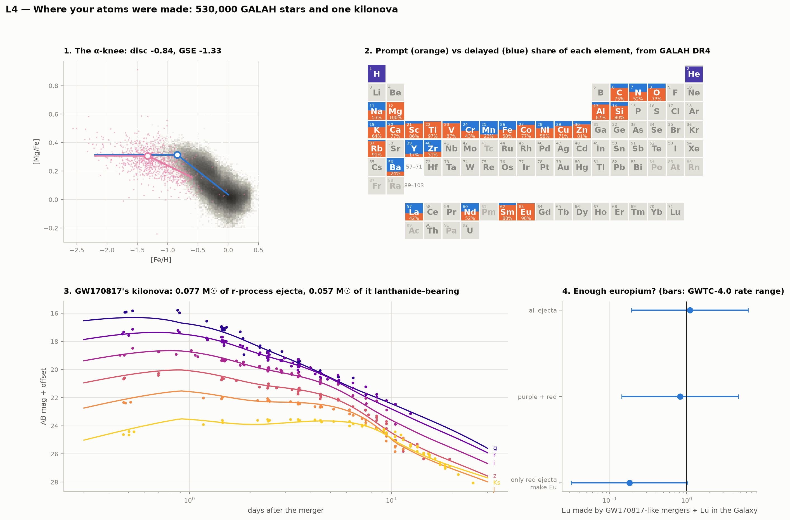
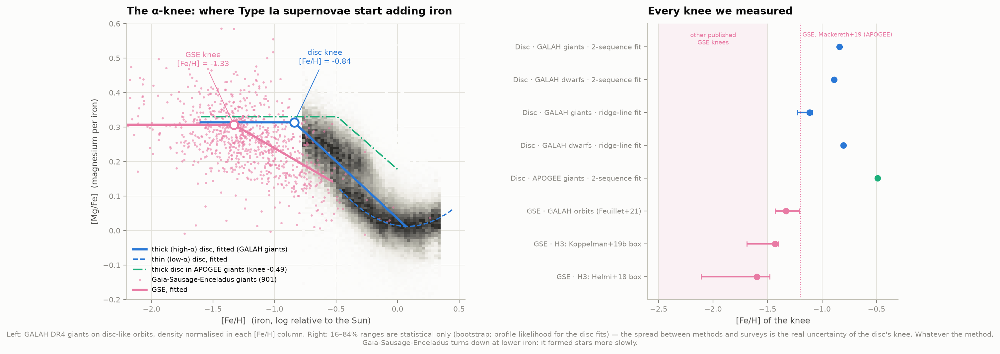
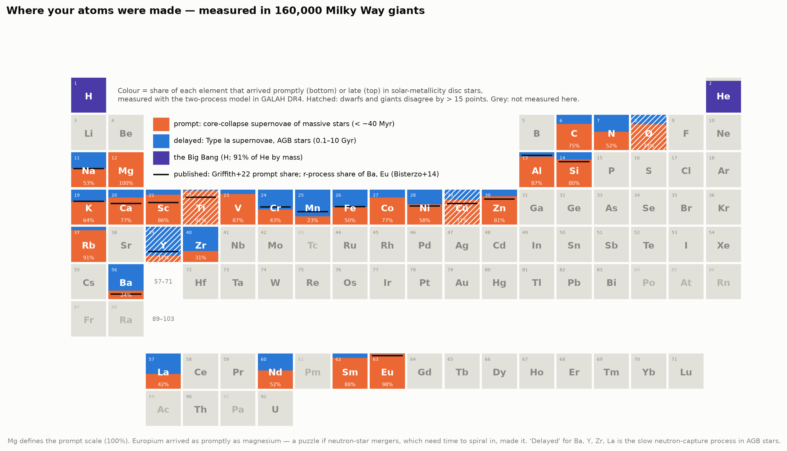
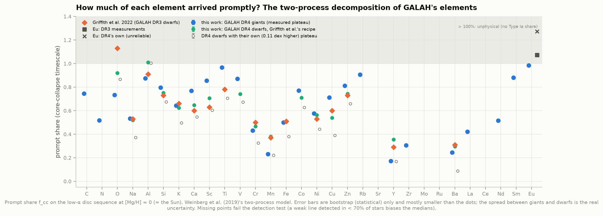
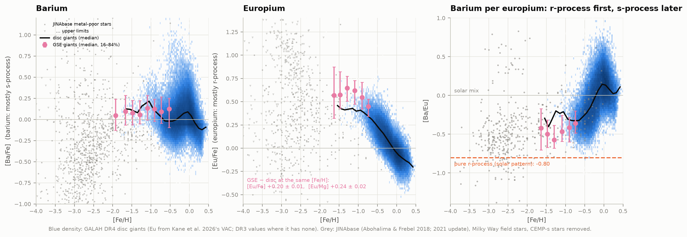
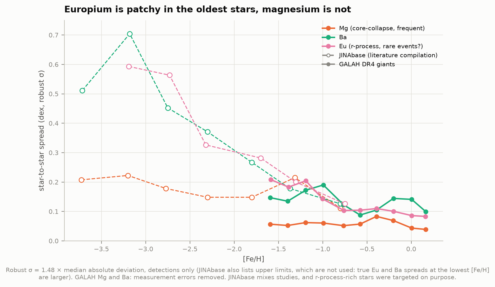
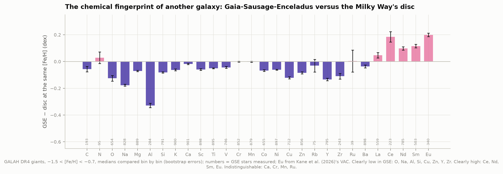
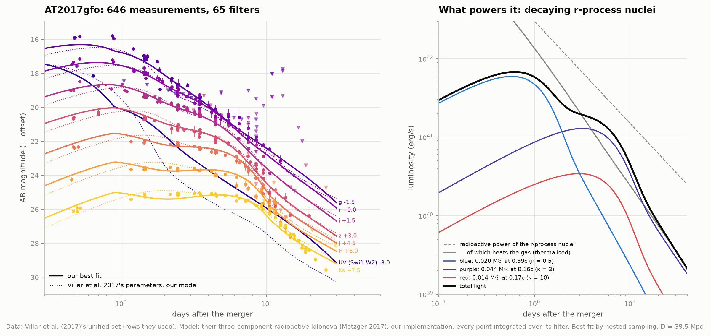
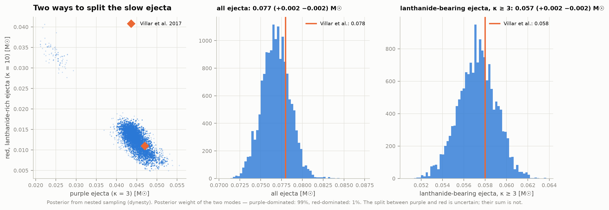
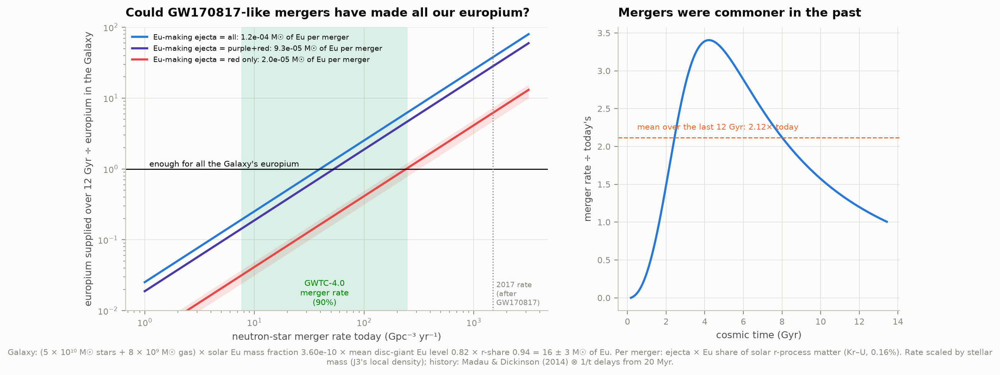

# L4 — Where your atoms were made

**Apart from hydrogen and most of the helium, every atom in your body was made in stars. Can we
read *which* stars — exploding massive stars, exploding white dwarfs, dying giants, merging neutron
stars — in the chemistry of half a million Milky Way stars, and weigh the heavy elements made in
GW170817's kilonova?**

Mostly yes, from GALAH DR4 and Villar et al.'s kilonova photometry:

| | Question | What we found |
|---|---|---|
| **1. The α-knee** | When did Type Ia supernovae start adding iron? | In the Milky Way's thick disc at [Fe/H] ≈ −0.84 (GALAH giants; −0.5 to −1.1 across methods and surveys). In **Gaia-Sausage-Enceladus**, the galaxy the Milky Way ate (project H3), at **−1.33 (−1.43…−1.21)**, 0.5 dex lower: it made 3× less iron before its first Type Ia, i.e. it formed stars more slowly |
| **2. Prompt or delayed?** | How much of each element came from fast-living massive stars? | Prompt shares for 26 elements, e.g. iron **50%** (Griffith et al. 2022: 51%), manganese 23%, barium 24%, and **europium 98 ± 1%**: in the disc, europium arrived as promptly as magnesium |
| **3. r and s** | Rare explosive events vs slow neutron captures | Europium scatters 0.6 dex between the oldest stars (magnesium 0.2); [Ba/Eu] climbs from the pure r-process value −0.8 to solar; GSE has **+0.24 ± 0.02 dex more Eu per Mg** than the disc at the same iron |
| **4. The kilonova** | How much r-process matter did GW170817 make? | **0.077 ± 0.002 M☉** (Villar et al. 2017: 0.078), of which **0.057 M☉** carries lanthanides |
| **5. The budget** | Can such mergers explain all the Galaxy's europium? | The Galaxy holds **16 ± 3 M☉** of r-process europium; GW170817-like mergers at the GWTC-4.0 rate supply **0.14–4.7×** that (0.8× at the middle of the range) — enough only if the true rate is in the upper half |

Plus **`figures/04_periodic_table_of_origins.png`**, a periodic table coloured by what our stars
show, and an offline page, **`figures/element_explorer.html`**: click any element to see its trend
in the disc and in GSE and the numbers behind its colour.



(**[X/Fe]** is the abundance of element X relative to iron, on a log scale relative to the Sun:
+0.3 means twice the Sun's ratio. **[Fe/H]** is iron relative to hydrogen: −1 means a tenth of the
Sun's iron, so roughly older or less processed gas. M☉ = one solar mass. 1 dex = a factor of 10.)

---

## The science in one page

**Massive stars** (> 8 M☉) live 3–40 Myr and explode as core-collapse supernovae. They make most
of the oxygen, magnesium, silicon and calcium (the "α elements"), and about half the iron.
**Type Ia supernovae** are white dwarfs blowing up in binaries, from ~0.1 Gyr to many Gyr after
their stars formed; they make mostly iron, manganese and nickel. **AGB stars** — dying stars of
1–8 M☉ — build barium, lanthanum and yttrium by *slow* neutron captures (the s-process) over
hundreds of Myr. **Europium**, gold and platinum come from *rapid* neutron captures (the
r-process), which need a flood of neutrons — a neutron-star merger, or a rare kind of supernova.

Each source has a clock, so the abundances in a star record when it formed relative to those
clocks. A galaxy starts with only massive-star products: a **plateau** of high [Mg/Fe]. When the
first Type Ia supernovae go off, iron rises faster than magnesium and [Mg/Fe] turns down — the
**knee**. A galaxy that forms stars fast reaches a higher iron level before that happens.

---

## Results

### 1. The α-knee: the disc and the galaxy we ate



| | This work | Published |
|---|---|---|
| GALAH DR4 sample | 917,588 stars → **530,403** clean field stars (178,243 giants, 277,323 dwarfs) | |
| Thick-disc knee, GALAH giants (both sequences fitted together) | **[Fe/H] = −0.84**, plateau [Mg/Fe] = 0.314 | "knee at [Fe/H] > −1 for both discs" (Horta et al. 2023) |
| … GALAH dwarfs | −0.89, plateau 0.429 | |
| … ridge-line method (giants / dwarfs) | −1.12 / −0.81 | |
| … APOGEE DR17 giants on disc orbits (124,359), same fit | **−0.49**, plateau 0.330 | |
| GSE knee, GALAH's own orbits (−500 < L_z < 500, 30 < √J_R < 55; 889 giants) | **−1.33 (−1.43…−1.21)**; a knee beats a straight line by Δχ² = 29.5 | ≈ −1.2 (Mackereth et al. 2019, APOGEE); −2.5 to −1.5 in other studies |
| GSE knee, H3's Koppelman et al. box (277 giants) | −1.43 (−1.69…−1.40); Δχ² = 6.8 | |
| GSE knee, H3's Helmi et al. box (2,023 giants) | −1.60 (−2.11…−1.48); Δχ² = 3.0 (thick-disc contamination) | |
| H3's GSE selections, rerun on H3's Gaia data | 77,205 and 12,343 stars | H3: 77,205 and 12,343 (exact) |
| GSE median [Fe/H], GALAH orbits | −1.25 | −1.16 (Buder et al. 2022, GALAH DR3, same selection) |

**What it means.** By the time Type Ia supernovae started to matter, the Milky Way's young disc had
built up roughly three times as much iron (relative to hydrogen) as Gaia-Sausage-Enceladus had. A
galaxy's iron level at the knee measures how fast it formed stars in its first ~Gyr, so GSE — a
dwarf galaxy of a few 10⁹ M☉ — made its stars more slowly than the young Milky Way.

**How sure.** The GSE–disc gap holds in every variant. The disc's own knee does not have one
value: our three GALAH methods give −0.8 to −1.1, and APOGEE, fitted identically, gives −0.49. The
two surveys agree star by star (3,394 common giants: [Fe/H] +0.005, [Mg/Fe] −0.048 dex,
scatter 0.06), but APOGEE's thick-disc sequence is three times narrower (0.024 vs 0.069 dex), so in
GALAH the turn-down is blurred and starts earlier. The comparison that matters — GSE against the
disc in the same survey, same stellar type, same method — is like with like.

### 2. Prompt or delayed: a periodic table of origins



The **two-process model** (Weinberg et al. 2019; Griffith et al. 2022) treats every disc star as a
mix of two ingredients: *prompt* (core-collapse) and *delayed* (Type Ia, or anything on a similar
clock). Magnesium is taken as purely prompt. High-α stars have no Type Ia iron at all, so their
plateau fixes iron's prompt share: 10^−0.30 = 50%. Comparing any element between the two disc
sequences at the same magnesium level then splits it into the two ingredients.



| Element | Giants (this work) | Dwarfs, Griffith's recipe (this work) | Griffith et al. 2022 (DR3) |
|---|---|---|---|
| Fe | **0.50** | 0.51 | 0.51 |
| Na | 0.53 | 0.52 | 0.53 |
| K | 0.64 | 0.62 | 0.66 |
| Ni | 0.58 | 0.56 | 0.53 |
| Zn | 0.81 | 0.74 | 0.73 |
| Si | 0.80 | 0.75 | 0.73 |
| Ti | 0.97 | 0.78 | 0.78 |
| Ca / Sc | 0.77 / 0.86 | 0.65 / 0.71 | 0.60 / 0.63 |
| Cr / Mn | 0.43 / 0.23 | 0.47 / 0.38 | 0.50 / 0.37 |
| Cu | 0.71 | 0.54 | 0.60 |
| O / Al | 0.73 / 0.87 | 0.92 / 1.01 | 1.13 / 0.91 |
| Y / Ba | 0.17 / 0.24 | 0.36 / 0.30 | 0.29 / 0.31 |
| C, N, V, Co, Rb, Zr, La, Nd, Sm | 0.75, 0.52, 0.87, 0.77, 0.91, 0.31, 0.42, 0.52, 0.88 | | |
| **Eu** (Kane et al.'s VAC) | **0.98 ± 0.01** | | |
| Eu (DR3's own measurements) / DR4's own | 1.07 / 1.27 (unphysical) | | |

- **The method reproduces the published values**: on DR4 dwarfs with Griffith et al.'s exact recipe
  (their dividing line and assumed plateau), 13 of their 16 elements land within 0.07 of their DR3
  results (Fe, Na, Ti, Mn, Ba, Zn within 0.015); O, Al and Sc differ by 0.08–0.21.
- **Giants and dwarfs disagree** for O, Ti, Y and Cu by 0.17–0.19 (hatched in the poster) and for
  Mn and Sc by 0.15: the two kinds of star have different lines and model atmospheres, and DR4's dwarfs have a [Mg/Fe] plateau 0.11 dex
  higher than its giants (0.43 vs 0.31). With that plateau taken at face value, iron would be only
  38% prompt. Bootstrap errors are tiny (< 0.01); the class-to-class spread is the real error bar.
- **Europium arrived as promptly as magnesium.** If neutron-star mergers made it, the mergers that
  enriched the disc must mostly have followed their stars' birth much faster than Type Ia
  supernovae do; otherwise another prompt source (rare magnetorotational supernovae, collapsars)
  made a large share. This is the known tension (e.g.
  Côté et al. 2019), seen here in 42,564 giants.
- Elements whose lines are detected in < 70% of stars (Sr, Mo, Ru, Ce) are left grey: medians of
  detections alone are biased high, by different amounts on the two sequences.

### 3. Barium and europium: slow and rapid neutron captures



| | This work | Published |
|---|---|---|
| Pure r-process [Ba/Eu] (solar pattern; Bisterzo et al. 2014: Ba 85.2% s, Eu 6.0% s) | −0.80 | |
| GSE − disc at fixed [Fe/H], giants: [Eu/Fe] / [Mg/Fe] / [Eu/Mg] | **+0.20 ± 0.01 / −0.07 / +0.24 ± 0.02** | GSE has high [Eu/Mg] (Matsuno et al. 2021) |
| GSE − disc, [Ba/Eu] | −0.22 ± 0.02 (more r-process-like) | |
| GSE medians: [Fe/H], [Mg/Fe], [Eu/Fe], [Ba/Fe] | −1.25, +0.27, +0.58, +0.09 | −1.16, +0.12, +0.48, +0.25 (Buder et al. 2022, DR3) |
| Star-to-star spread of [Eu/Fe], JINAbase, [Fe/H] ≈ −3.2 / −2.7 / −2.3 / −1.7 | 0.59 / 0.56 / 0.33 / 0.28 dex | |
| … of [Mg/Fe] in the same stars | 0.22 / 0.18 / 0.15 / 0.15 | |
| … GALAH giants, −1.6 < [Fe/H] < −1.2: Eu / Ba / Mg (Mg, Ba: errors removed) | 0.18–0.21 / 0.14–0.17 / 0.05–0.06 | |



Magnesium comes from every massive star, so by the time a gas cloud has [Fe/H] = −3 it has been
stirred by many supernovae and its [Mg/Fe] is already uniform. Europium comes from rare events that
each make a lot, so early gas clouds were either lucky or not: a 0.6 dex (factor 4) spread among
the oldest stars, shrinking as more events average in. In GSE, a slowly star-forming galaxy,
europium per magnesium is higher than in the disc at the same iron level: a source with some delay
(mergers?) had more time to contribute before the iron built up — while in the disc the same
element looks prompt. Both fit a source that is slower than core-collapse but faster than most
Type Ia supernovae.



The fingerprint of another galaxy, element by element: GSE is low in Al (−0.33), Na (−0.18), O,
Cu, Y, Zr (−0.11 to −0.13) and high in Eu (+0.20), Ce, Sm and Nd (+0.10 to +0.18) relative to the disc at
the same iron. Cr and Mn are indistinguishable (±0.002).

### 4. GW170817's kilonova



Villar et al. (2017) gathered all 714 published ultraviolet-to-infrared measurements of the
kilonova, homogenised them and fitted a three-component radioactive model. We re-implemented that
model from their paper and MOSFiT's source (r-process heating ∝ t^−1.3, thermalisation from
Barnes et al. 2016, Arnett diffusion, blackbody photospheres with a temperature floor), fed it the
646 points they used, integrated every point over its own filter curve, and sampled the full
posterior by nested sampling (435,000 model evaluations).

| | This work | Villar et al. 2017 |
|---|---|---|
| Blue ejecta (κ = 0.5 cm²/g, lanthanide-poor) | **0.020 ± 0.001 M☉** at 0.39c | 0.020 at 0.27c |
| Purple ejecta (κ = 3) | **0.045 ± 0.002 M☉** at 0.17c | 0.047 at 0.15c |
| Red ejecta (κ = 10, lanthanide-rich) | **0.013 (+0.002 −0.003) M☉** at 0.15c | 0.011 at 0.14c |
| Total r-process ejecta | **0.077 ± 0.002 M☉** | 0.078 |
| Lanthanide-bearing (purple + red) | **0.057 ± 0.002 M☉** | 0.058 |
| Extra scatter needed (per point) | 0.248 mag | 0.242 mag |
| Fit quality, rms of detections | 0.285 mag (their parameters in our model: 0.309) | |



The masses agree within 20% (the total to 1%). The one real difference is the blue component's speed: our posterior
sits at 0.39c, near the 0.4c edge of MOSFiT's prior, because it fits the first day's optical
points that Villar et al. note their model underpredicts. The posterior has a second, minor mode
(1% of the posterior mass) in which purple and red swap mass (0.025 / 0.033 M☉); the sum of the
two is the same in both.

### 5. Is that enough europium?



| Step | Value |
|---|---|
| Europium's share of solar r-process matter (Kr–U; Asplund et al. 2009 × (1 − Bisterzo et al. s fraction), 48 elements) | 0.162% by mass |
| Europium made by GW170817, if the lanthanide-bearing ejecta have the solar pattern | **9.3 × 10⁻⁵ M☉** (all ejecta: 1.2 × 10⁻⁴; red only: 2.0 × 10⁻⁵) |
| r-process europium in the Galaxy today: (5 × 10¹⁰ stars + 8 × 10⁹ gas) × 3.60 × 10⁻¹⁰ × 0.82 (GALAH disc giants' mean) × 0.94 | **16 ± 3 M☉** |
| Mergers needed over 12 Gyr | 1.7 × 10⁵, i.e. 14.5 per Myr on average |
| Mergers available: GWTC-4.0 rate 7.6–250 Gpc⁻³ yr⁻¹, scaled to the Milky Way by stellar mass (J3's local density) | 1.0–32 per Myr today |
| … averaged over the Galaxy's history (Madau & Dickinson 2014 ⊗ 1/t delays) | × 2.12 |
| **Supply ÷ demand** | **0.14 – 4.7** (0.82 at the geometric middle of the rate range) |

In 2017, with the rate then estimated from one event (~1500 Gpc⁻³ yr⁻¹), Villar et al. found
GW170817 had made about ten times what each merger needed. With GWTC-4.0's rate (~35× lower), the
same arithmetic now asks each merger for 0.17 M☉ of light and 0.024 M☉ of heavy r-process matter —
more than GW170817 made. Mergers like GW170817 can still be the main source of the Galaxy's
europium if the rate is in the upper half of today's range, or if many mergers eject more than
GW170817 did. Together with europium's prompt timing (part 2), this is why other r-process sites
are being looked for.

---

## How it works

### Data

| Data | Source | Size |
|---|---|---|
| GALAH DR4 main catalogue (Buder et al. 2025) | Data Central (`galah_dr4_allstar_240705.fits`) | 723 MB |
| GALAH DR4 orbits (actions, energies; McMillan 2017 potential) | Data Central (`galah_dr4_vac_dynamics`) | 155 MB |
| Europium value-added catalogue (Kane et al. 2026) | Data Central (`galah_dr4_vac_europium_v1`) | 21 MB |
| APOGEE DR17 allStar, 331,233 stars with S/N > 70 (abundances, flags, Gaia astrometry, velocities) | VizieR III/286 | 17 MB |
| H3's Gaia DR3 halo sample | project 19-galactic-archaeology (cached there) | |
| AT2017gfo photometry (Villar et al. 2017, Table 3) | arXiv source of 1710.11576 | 74 kB |
| 65 filter transmission curves | SVO Filter Profile Service | |
| Solar abundances (Asplund et al. 2009, Table 1) | arXiv source of 0909.0948 | |
| Solar s-process fractions (Bisterzo et al. 2014) | VizieR J/ApJ/787/10 | |
| JINAbase metal-poor stars (Abohalima & Frebel 2018; 2021 update) | GitHub Mohammad-Mardini/JINAbase-updated | 2 MB |

All retrieved 4 October 2026.

### Cuts

- **GALAH**: field programmes only (GALAH, K2-HERMES, TESS-HERMES; cluster pointings dropped),
  `flag_sp == 0`, `flag_fe_h == 0`, S/N per pixel > 30 in the red camera (the survey's own
  recommendations); an abundance is used only where `flag_X_fe == 0`. Giants: 1.0 < log g < 3.2,
  4000 < Teff < 5500 K; dwarfs: 3.5 < log g < 4.5, 4200 < Teff < 6700 K (Griffith et al.'s).
  Disc orbits: L_z > 0, eccentricity < 0.5, z_max < 3 kpc.
- **Europium**: Kane et al.'s golden sample (CNN predictions for giants passing all their flags;
  Korg syntheses for −1.7 < [Fe/H] < −1), then DR3's own measurements for the stars used to train
  the network. DR4's own [Eu/Fe] is shown only as a warning (figure 7): it correlates with DR3's at
  r = 0.40 and piles up at exactly 0.00.
- **APOGEE**: ASPCAP STAR_BAD unset, [Fe/H] and [Mg/Fe] flags zero, giants as above, parallax
  better than 20%, |v − v_LSR| < 180 km/s.

### Methods

- **Disc knee**: every star's [Mg/Fe] is modelled as coming from one of two sequences — high-α
  (plateau, then a straight decline beyond the knee) or low-α (a parabola in [Fe/H]) — with the
  high-α share a logistic function of [Fe/H] and each star's error added in quadrature. The knee is
  profiled on a grid (analytic gradients, L-BFGS-B, two starting points per grid node). The ridge-line
  cross-check fits one or two Gaussians per 0.1-dex bin instead.
- **GSE knee**: plateau + decline fitted star by star with an intrinsic scatter; 300 bootstrap
  resamples.
- **Two-process model**: each class's [X/Fe] scale is zero-pointed so the low-α sequence is solar
  at [Mg/H] = 0; the plateau comes from the knee fit; stars belong to the high-α sequence if the
  mixture says so with > 50% probability. Medians in 0.1-dex [Mg/H] bins (≥ 30 stars and ≥ 70%
  detections on both sequences), solved bin by bin for q_cc and q_Ia; f_cc averaged over the two
  bins either side of [Mg/H] = 0; 100 bootstrap resamples.
- **Kilonova**: MOSFiT's priors; upper limits as one-sided likelihoods with 0.1 mag error; Milky Way
  extinction E(B−V) = 0.105 (Cardelli et al. 1989 / O'Donnell 1994), z = 0.0097, D = 39.5 Mpc;
  dynesty with 400 live points and multi-ellipsoid bounds. The Arnett integral is done exactly per
  time step in u = t² (a plain trapezoid overshoots by 15% at late times).

---

## What this cannot tell you

- **"Prompt" and "delayed" are clocks, not sites.** The two-process model separates elements by
  when they arrived relative to Type Ia iron. It cannot tell a neutron-star merger with a short
  delay from a rare supernova, or AGB stars from Type Ia supernovae.
- **Abundances carry systematics that depend on the kind of star.** Non-LTE effects (DR4 treats H,
  Li, C, N, O, Na, Mg, Al, Si, K, Ca, Mn, Fe and Ba in non-LTE; the rest in LTE), blends and
  molecular lines differ between giants and dwarfs, which is why both are shown and why several
  elements disagree by 0.15. DR4's [Mg/Fe] for metal-poor GSE giants is 0.15 dex above DR3's
  (Buder et al. 2022).
- **The knee of the disc depends on survey and method** (−0.5 to −1.1); only the GSE–disc difference
  within one survey is robust.
- **The local sample is not the Galaxy.** GALAH observes stars within a few kpc of the Sun, so the
  disc's knee and the mean europium level are local values.
- **Kilonova masses are model masses.** Grey opacities, blackbody spectra, spherical ejecta and a
  single heating law hide factor-of-two systematics; an asymmetric model gives ~50% lower masses
  (Villar et al. 2017). The europium per merger assumes the solar r-process pattern.
- **The rate is the weakest link.** The GWTC-4.0 BNS rate spans a factor of 33 (90%), and the
  scaling to the Milky Way (by stellar mass, with a cosmic-average history) adds a factor ~2.
- **JINAbase is a literature compilation.** Studies differ in method, and r-process-rich stars were
  sought on purpose, which inflates the europium spread. Upper limits (51–83% of Eu below
  [Fe/H] = −2.5) are not used, so the true spreads there are larger still.

---

## Honest notes on the numbers

- **Things that went wrong and were fixed**:
  - GALAH DR4's own europium looked usable but disagrees with DR3 (r = 0.40); the DR4 paper and
    Kane et al. (2026) explain why. With it, europium's prompt share comes out at 1.27 —
    unphysical. The VAC fixes this.
  - The first disc-knee fits landed in degenerate local optima (a constant mixing weight, a broad
    component swallowing the halo). Bounds, a data-driven start and two starts per knee value fixed
    it; a synthetic two-sequence population is recovered to 0.05 dex (`test_physics.py`).
  - The europium VAC covers only high-S/N spectra; measuring "detection fractions" against all
    giants made europium look undetected. Against the VAC's own coverage it is ≥ 88% complete above
    [Fe/H] = −1.
  - The first kilonova fits used a trapezoid for the Arnett integral, which overestimates the
    late-time light by ~15%; with it the posterior preferred a red-heavy solution. With the exact
    integral the posterior moved onto Villar et al.'s solution.
  - The first ridge-line knee followed the high-α ridge onto the low-α sequence near solar
    metallicity; it now stops where the ridge jumps.
- **Villar et al.'s table** marks 647 rows as used; our parser finds 646 (one may be a repeat
  observation). One SkyMapper row has a phase exactly one day off its MJD; we use the MJD.
- **The filters**: where SVO lacks the exact instrument, the standard system the photometry was
  calibrated to is used (SDSS ugriz, Bessell UBVRI, 2MASS JHKs); for a blackbody that shifts a
  magnitude by a few hundredths, well under the 0.25 mag scatter term.
- **GSE's Mn and Cr** match the disc's in DR4, although Buder et al. (2022) list Mn among GSE's
  telltale elements in DR3.

---

## Running it

```bash
cd astrophysics
source .venv/bin/activate
pip install dynesty          # once (nested sampling); everything else is in the shared venv
cd 29-element-origins
python fetch_data.py         # ~0.9 GB, ~15 minutes
python run.py                # every number, figure and the explorer; ~25 min the first time
                             # (slow fits cached in data/cache/), ~10 min afterwards; no network
python test_physics.py       # 12 self-checks
```

`run.py` also needs project H3 (`../19-galactic-archaeology/` with its cached Gaia data) for H3's
GSE stars; the result is cached in `data/cache/h3_gse.npz`.

### Files

| File | What it does |
|---|---|
| `config.py` | Paths, cuts, constants, and the published values used only for comparison |
| `fetch_data.py` | Downloads and caches every input (resumable) |
| `galah.py` | GALAH loading, quality cuts, samples, the europium VAC |
| `gse_h3.py` | Reruns H3's GSE selections in H3's own code (separate process) |
| `knee.py` | Plateau + decline fits; the two-sequence mixture; the ridge line |
| `twoprocess.py` | The two-process decomposition |
| `ncapture.py` | Neutron-capture trends, offsets, scatter; JINAbase; Bisterzo s fractions |
| `kn_data.py`, `kilonova.py` | Villar et al.'s photometry, filters, the kilonova model, nested sampling |
| `budget.py` | Solar r-process pattern, the Galaxy's europium, merger rates through time |
| `periodic.py` | The periodic-table layout |
| `analysis.py`, `run.py` | Orchestration; writes `data/results.json` |
| `figures.py`, `plotstyle.py`, `interactive.py` | Figures and the explorer |
| `test_physics.py` | Self-checks: heating law, Arnett integral, Stefan–Boltzmann, AB zero point, extinction, synthetic knees and prompt shares, parsers |

### Figures

| File | Shows |
|---|---|
| `00_overview` | The four results on one page |
| `01_alpha_knee` | The disc and GSE in [Mg/Fe]–[Fe/H] with their fits; every knee measurement |
| `02_gse_fingerprint` | GSE minus the disc, element by element |
| `03_prompt_fractions` | Prompt shares of 30 elements, against Griffith et al. (2022) |
| `04_periodic_table_of_origins` | The poster |
| `05_neutron_capture` | [Ba/Fe], [Eu/Fe] and [Ba/Eu] from [Fe/H] = −4 to +0.5 |
| `06_scatter` | Star-to-star spreads of Mg, Ba and Eu |
| `07_europium_check` | Why DR4's own europium is not used |
| `08_kilonova_lightcurves` | AT2017gfo in eight bands with the model; what powers it |
| `09_kilonova_masses` | The ejecta posterior against Villar et al. |
| `10_europium_budget` | Europium supplied by mergers against the merger rate |
| `element_explorer.html` | Interactive: click an element |

---

## Next steps

- **C4 (GW170817)** could hand this project the merger's distance and inclination from the
  gravitational waves, and an asymmetric (polar blue, equatorial red) kilonova fit.
- **B11 (MESA)**: core-collapse yields from our own stellar models against the prompt shares.
- **L1 (radioactive nickel)**: the same Arnett machinery for Type Ia light curves gives the iron
  they make, the other half of the iron budget.
- **More europium sources**: does [Eu/Mg] in GSE vary with its stars' ages (GALAH's age VAC)?

## Data credits

This work uses data from the GALAH survey (Buder et al. 2025, PASA 42, e051), based on data
acquired through the Australian Astronomical Observatory; GALAH DR4 is hosted by Data Central. The
europium VAC: Kane et al. (2026), MNRAS. SDSS-IV APOGEE DR17 (Abdurro'uf et al. 2022) via VizieR
(CDS, Strasbourg). Gaia DR3 (Gaia Collaboration, Vallenari et al. 2023) via project H3. Kilonova
photometry: Villar et al. (2017), ApJL 851, L21, and the 18 papers it compiles (their Table 1). Model: Metzger (2017); Korobkin et al. (2012); Barnes et al. (2016);
MOSFiT (Guillochon et al. 2018). Filters: SVO Filter Profile Service (Rodrigo et al. 2012, 2020).
Solar abundances: Asplund et al. (2009). s-process fractions: Bisterzo et al. (2014). JINAbase:
Abohalima & Frebel (2018), updated by Mardini & Frebel. Merger rate: LIGO-Virgo-KAGRA
Collaboration, GWTC-4.0 population properties (2025). Two-process model: Weinberg et al. (2019);
Griffith et al. (2022). Gas mass: Nakanishi & Sofue (2016); stellar mass: Bland-Hawthorn & Gerhard
(2016). Star-formation history: Madau & Dickinson (2014). Data retrieved 4 October 2026.
