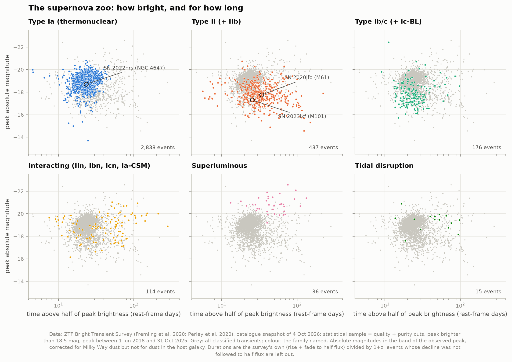
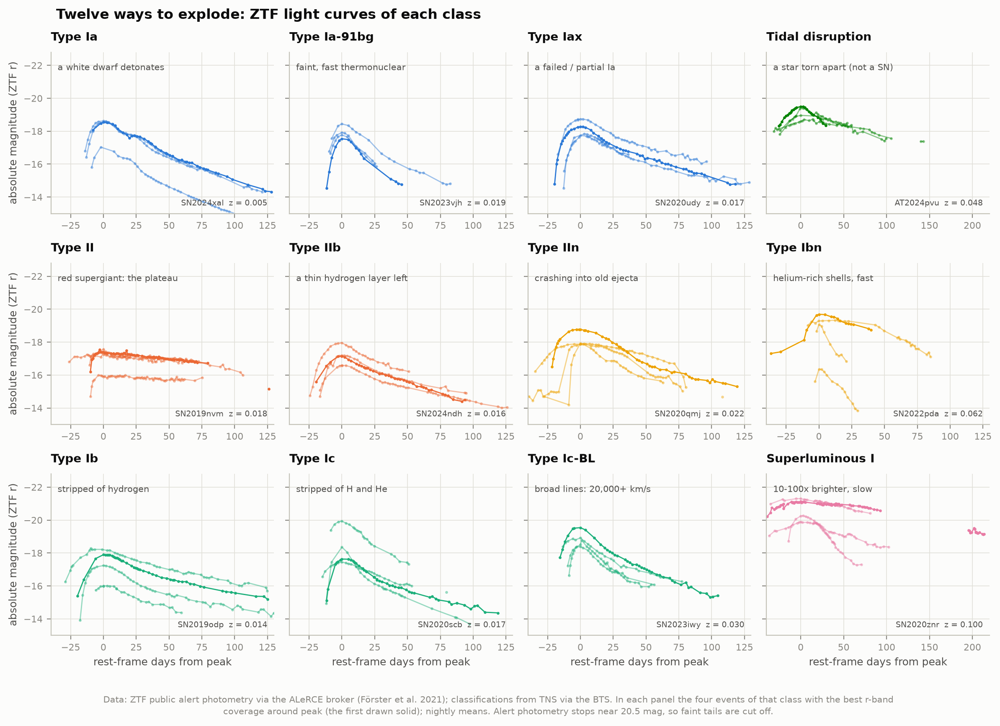
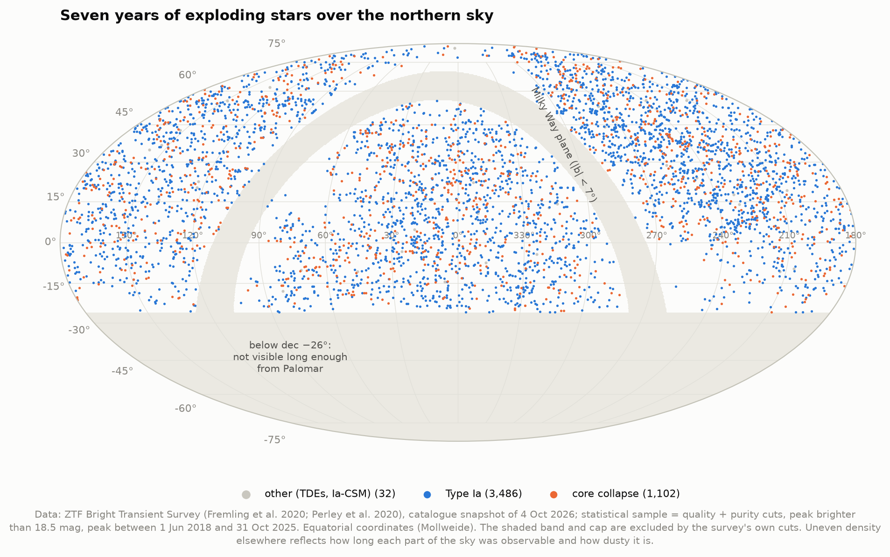
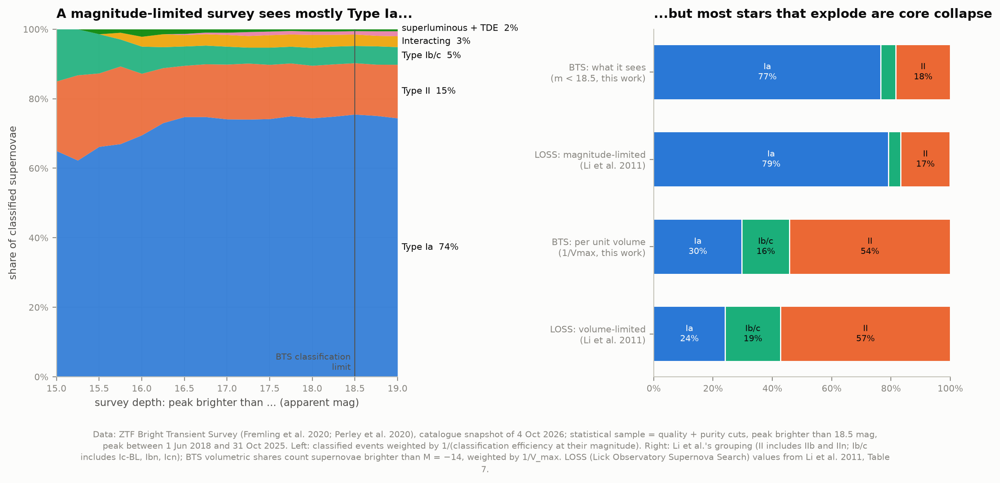
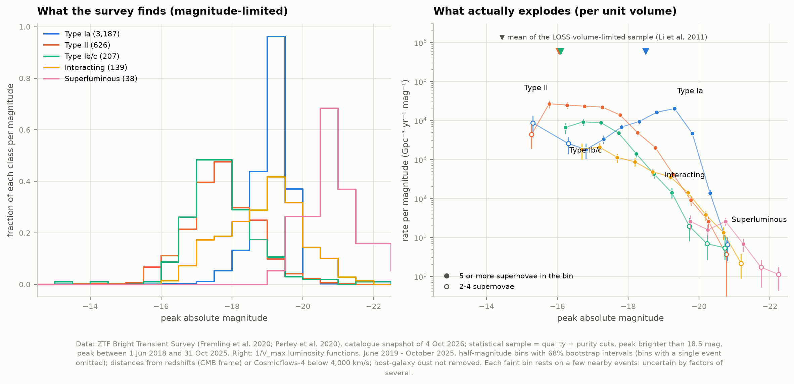
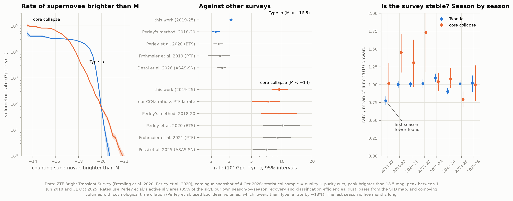
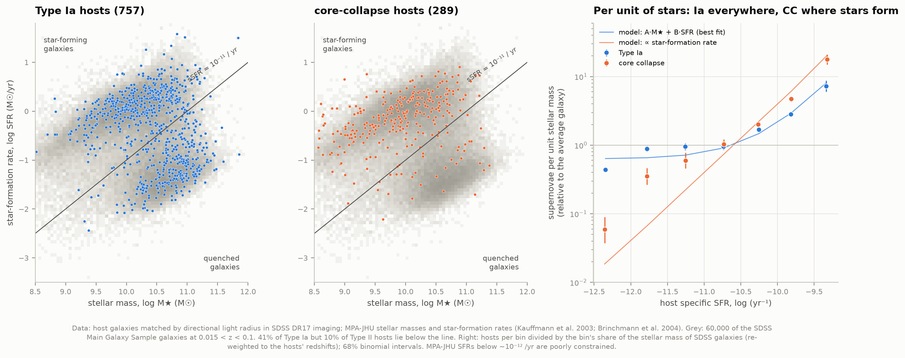
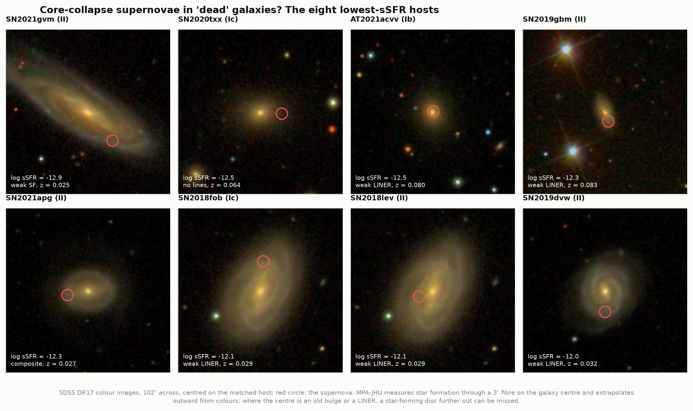
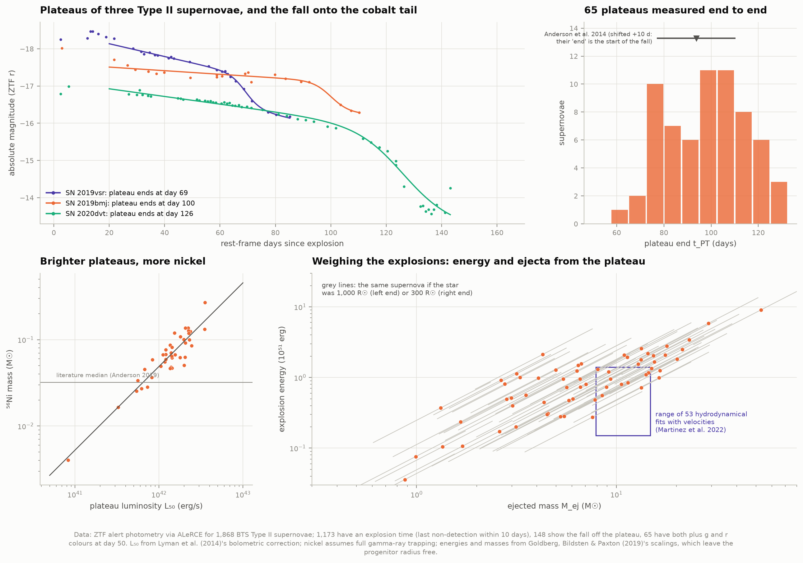
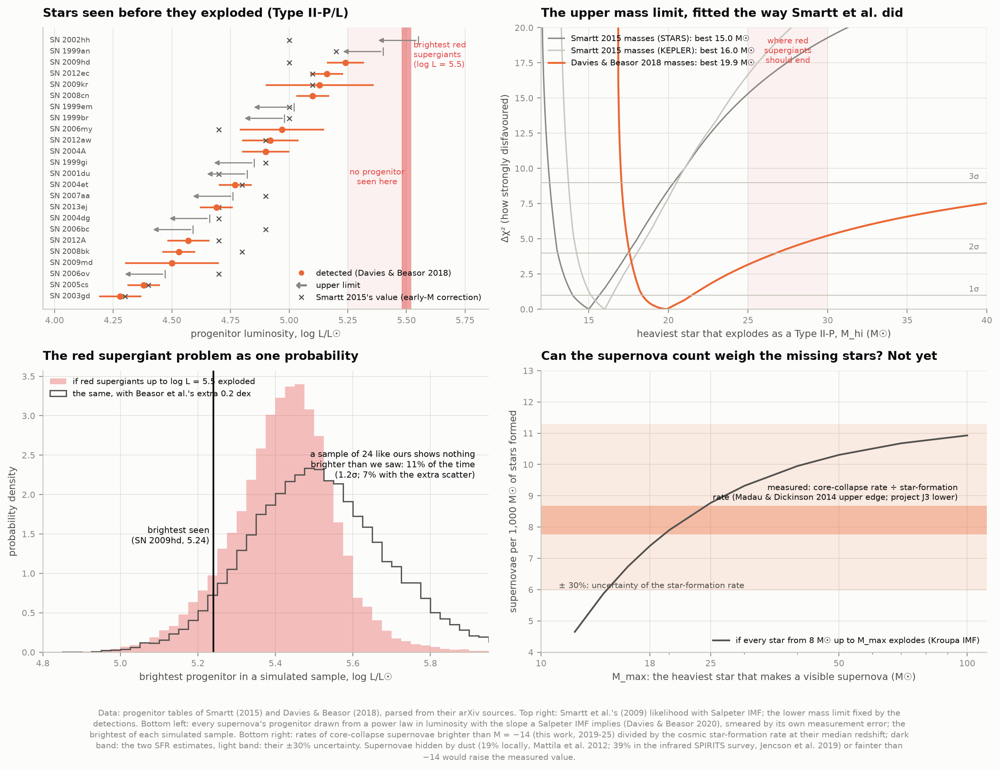

# L2 — A census of exploding stars

**Supernovae come in many types. How common is each, how bright, in which galaxies, and from which
stars? And are the heaviest red supergiants really missing from the list of stars that exploded?**

Since 2018 the Zwicky Transient Facility's **Bright Transient Survey** (BTS) has taken a spectrum of
nearly every transient in the northern sky that peaked brighter than 18.5 mag. Its public catalogue is
the largest spectroscopically complete sample of supernovae ever assembled: we use **5,168 events from
June 2018 to October 2025**, 95% of them classified. From it we build the supernova zoo, measure how
often each kind explodes per unit volume, find out which galaxies host them (SDSS), read the plateaus of
Type II light curves (ZTF photometry via the ALeRCE broker), and re-run the argument for "missing"
massive stars from the published pre-explosion images of nearby supernovae.



Each supernova is a point: how bright it got at peak (absolute magnitude, more negative = brighter) and
how long it stayed above half that brightness. Thermonuclear Type Ia supernovae cluster tightly near
M ≈ −19; core-collapse supernovae of massive stars spread over five magnitudes; superluminous ones shine
10–100 times brighter for months.

**What we found, in short:**

- **A magnitude-limited survey is fooled by brightness.** Among supernovae peaking brighter than 18.5 mag,
  **77% are Type Ia, 18% Type II and 5% Type Ib/c**, almost exactly what Li et al. (2011) predicted from
  the Lick survey (79 / 17 / 4%). Corrected for the volume each kind can be seen in, the census flips:
  **Type Ia 30%, Ib/c 16%, Type II 54%** of the supernovae brighter than M = −14 (Lick's volume-limited
  census: 24 / 19 / 57%). Most stars that explode are massive stars.
- **Rates.** Re-running Perley et al. (2020)'s own method on their own window gives a Type Ia rate of
  **2.20 × 10⁴ per Gpc³ per year** (95%: 2.03–2.41; they found 2.35 ± 0.24) and a core-collapse rate of
  **9.4 × 10⁴** (they found 10.1). Over 2019–2025, with comoving volumes and every survey efficiency
  measured season by season, we get **3.14 × 10⁴ (Ia)** and **9.4 × 10⁴ (core collapse)**. Our Type Ia
  rate sits 20–30% above PTF and ASAS-SN because we had to borrow the survey's sky coverage from
  Perley et al.'s first two years (ZTF's exposure log was offline). The ratio needs no sky coverage:
  **3.0 ± 0.3 core-collapse supernovae per Type Ia** in the same volume, which with PTF's or ASAS-SN's
  Type Ia rate gives **7.3–7.7 × 10⁴ core-collapse supernovae per Gpc³ per year**.
- **The survey changed after its first year**: season by season the Type Ia rate is constant to 5% (rms) from
  June 2019 on, but the first season found 24% fewer than the efficiencies predict.
- **Type Ia supernovae explode everywhere; core-collapse ones only where stars form.** Per unit of
  stellar mass, Type Ia supernovae are **16 times more frequent in the most actively star-forming hosts
  than in quenched ones** (Mannucci et al. 2005: ~20 times), the signature of a prompt and a delayed
  channel; core-collapse supernovae are **300 times more frequent**, tracking star formation. 41% of Type
  Ia hosts are quenched against 10% of Type II hosts, and a look at the "dead" hosts of core-collapse
  supernovae shows that most are spirals whose old bulge fooled a 3″ spectroscopic fibre.
- **Type II plateaus.** For 65 Type II supernovae we see the whole plateau from explosion to its end:
  it lasts **100 days** (median; the drop begins at 87 ± 16 days, Anderson et al. 2014: 84 ± 17),
  and the radioactive tail weighs **0.065 M☉ of nickel**. Recalibrated Popov scalings turn plateau
  length and brightness into an explosion energy of **~1 × 10⁵¹ erg** and **~7 M☉ of ejecta** for a
  500-R☉ star, but the progenitor radius is not fixed by the light curve: 300 R☉ would mean 12 M☉.
- **The red supergiant problem is real but modest.** Smartt's (2015) counting argument reproduces
  exactly (13.6 heavy progenitors expected, at most one found, p = 2 × 10⁻⁵). So does his likelihood
  fit: the heaviest exploding star is ~15–16 M☉. But with bolometric corrections measured on red
  supergiants about to die (Davies & Beasor 2018), the limit moves to **19.9 M☉ (95%: < 26)**, and
  in luminosity a sample like this shows nothing brighter than what was seen **11% of the time even if
  every red supergiant exploded: a 1.2σ tension**, not 4σ.

An offline page, `figures/supernova_explorer.html`, lets you click through the zoo (light curves, hosts,
plateau fits), drag a survey's depth to watch Type Ia take over, and slide the upper mass of exploding
stars to see how many heavy progenitors should have turned up.

---

## The background in brief

**Two ways to explode.** A star born with more than ~8 solar masses (M☉) builds an iron core that
collapses when it reaches ~1.4 M☉; the rebounding shock, revived by neutrinos, blows the star apart
(**core collapse**). The spectrum shows which layers the star still had: hydrogen (**Type II**), only
helium (**Ib**), neither (**Ic**); a thin hydrogen layer gives **IIb**, and supernovae colliding with gas
the star shed earlier show narrow lines (**IIn**, **Ibn**, **Icn**). A white dwarf in a binary that
ignites carbon burns completely (**Type Ia**, thermonuclear). Superluminous supernovae (SLSNe) are rare,
very bright core collapses, probably powered by a newborn magnetar or by collisions with dense shells.
Tidal disruption events (TDEs), stars torn apart by black holes, are not supernovae but look similar
and are in the catalogue.

**Magnitude-limited vs volume-limited.** A survey that classifies everything brighter than 18.5 mag sees
a Type Ia (M ≈ −19) out to ~320 Mpc but a typical Type II (M ≈ −16.5) only out to ~100 Mpc: a volume 30
times smaller. Counting what the survey finds therefore over-represents bright kinds. The **1/V_max
method** undoes this: each supernova counts as 1/V_max, where V_max is the volume within which it would
still have made the survey. Divided by the time the survey ran and the fraction of sky it watched, the
sum is a **volumetric rate**: supernovae per Gpc³ per year.

**The red supergiant problem.** For ~30 nearby supernovae, Hubble or ground-based images taken years
before show the star that exploded (or limit how bright it was). Type II-P supernovae come from red
supergiants, which shine up to log L/L☉ ≈ 5.5 (stars born with ~25–30 M☉). Yet no progenitor was
brighter than log L ≈ 5.1–5.2 (~18 M☉). If the heaviest red supergiants collapse to black holes without
a bright explosion ("failed supernovae"), this is what we would see. The best candidates for a star that
vanished without exploding are N6946-BH1 (Gerke et al. 2015; Adams et al. 2017; JWST found a faint,
dusty source there, so a stellar merger is not excluded: Beasor et al. 2024, Kochanek et al. 2024) and
M31-2014-DS1 in Andromeda, a ~12 M☉ yellow supergiant that faded by a factor of 10⁴ in the optical
(De et al., Science).

---

## Results

### 1. The zoo

| | Type Ia | Type II (+IIb) | Type Ib/c (+Ic-BL) | Interacting (IIn, Ibn, Icn, Ia-CSM) | Superluminous | TDE |
|---|---|---|---|---|---|---|
| Statistical sample (m < 18.5, 2018–2025) | 3,490 | 686 | 230 | 153 | 45 | 24 |

The statistical sample uses the survey's own cuts (Perley et al. 2020): coverage before, around and after
peak, visibility a month later, a clean reference image, Galactic extinction A_V < 1 (the **quality**
cut), a supernova-like light curve or a galaxy match (the **purity** cut), and a peak brighter than
18.5 mag. The catalogue packs these into digit strings; we decoded each bit by querying the explorer one
condition at a time (100% agreement). Classification is 99% complete for peaks brighter than 17 mag and
91% between 18.25 and 18.5 mag; we weight every event by the inverse of that efficiency. Classified
non-supernovae (115 cataclysmic variables, 79 AGN flares, 26 novae, ...) are left out.

Our absolute magnitudes reproduce the catalogue's own column to **0.0007 mag** (median; 99% within
0.007 mag) when we use its conventions (heliocentric redshift, H₀ = 70, a K-correction of
2.5 log(1+z)). For our own analysis we move redshifts to the CMB frame and, below cz = 4,000 km/s, take
**redshift-independent distances from Cosmicflows-4** (Tully et al. 2023; Cepheids, TRGB, Tully-Fisher,
...; shifted to the H₀ = 70 scale). For the nearest supernovae this matters: 154 events change by a
median 0.35 mag. SN 2023ixf in M101 (z = 0.0008, the brightest supernova of the survey at 12.0 mag)
goes from M = −15.7 to **−17.3**, and SN 2020nlb, a Type Ia in the Virgo cluster, from −17.9 to −19.0,
where a normal Type Ia belongs.





### 2. What a survey sees, and what really explodes



| Share (Li et al. grouping) | Type Ia | Type Ib/c | Type II (+IIb, IIn) |
|---|---|---|---|
| BTS, peaks brighter than 18.5 mag (this work) | 76.6% | 5.0% | 18.3% |
| LOSS, magnitude-limited prediction (Li et al. 2011, Table 7) | 79.2% | 4.1% | 16.6% |
| BTS, per unit volume, M < −14 (this work, 1/V_max) | 29.8% (68%: 27.1–32.5) | 16.0% (12.8–19.1) | 54.2% (50.8–57.5) |
| LOSS, volume-limited (Li et al. 2011) | 24.1% (+3.7 / −3.5) | 18.7% (+3.5 / −3.3) | 57.2% (+4.3 / −4.1) |

Two independent surveys, one targeting nearby galaxies (LOSS, 1998–2008) and one blind (BTS), agree on
both the apparent and the true mix. Within Type II, IIb make up 7.6% and IIn 4.4% per unit volume
(Li et al.: 11.9% and 8.6%; LOSS classified many objects from a single early spectrum, Shivvers et al.
2017). The volumetric shares depend a little on how faint one counts: Type Ia are 30% of supernovae
brighter than M = −14, 32% brighter than −15, 33% brighter than −16.

### 3. Luminosity functions and rates



The luminosity function is the rate of supernovae per unit volume and per unit of peak magnitude. Type
Ia form a narrow peak at M ≈ −19 to −19.5; Type II spread from −14 to −19 and dominate below −17.5; the
superluminous tail reaches −22.5 at a few per Gpc³ per year. The faint end of every class rests on a
handful of nearby events and is uncertain by factors of several.



**Replicating Perley et al. (2020).** With their window (June 2018 – July 2020), their survey factors
(active sky f_sky = 0.35, dust f_ext = 0.82, recovery f_rec = 0.60, classification efficiency 1 → 0.9
toward 18.5 mag), their Euclidean volumes and today's classifications:

| | This work, Perley's method | Perley et al. 2020 |
|---|---|---|
| Type Ia, M < −16.5 (10⁴ Gpc⁻³ yr⁻¹, 95%) | 2.20 (2.03–2.41), 878 SNe | 2.35 ± 0.24, 875 SNe |
| Core collapse, M < −14 | 9.4 (6.2–14.0) | 10.1 (+5.0 / −3.5) |
| Superluminous, M < −21 (Gpc⁻³ yr⁻¹) | 3.7 | 5.6 (+5.4 / −2.8) |
| Recovery fraction (easy SNe Ia passing the cuts) | 414 / 691 = 0.599 | 412 / 690 = 0.60 |

The 6% difference in the Type Ia rate is within their interval; the volume convention alone moves it by
±10% (V_max from the luminosity distance in a Euclidean volume: 2.20; a comoving volume: 2.42; comoving
plus cosmological time dilation, which is what a rate per unit volume and time needs: 2.53).

**Our rates.** We measure the survey factors ourselves, season by season (June to May): classification
efficiency against magnitude, Perley's recovery fraction, and the time the survey actually ran (gaps of
more than three weeks with no candidates at all are removed: 22 days in October 2018, ~80 days over the
winter of 2021–22). Galactic dust from the SFD map over the survey footprint costs 20% of the volume for
peaks in r and 26% in g. Only the active sky area cannot be measured from the catalogue; we keep Perley
et al.'s 35% (14,400 deg²), derived from ZTF's exposure log for 2018–2020.

| Season | 2018–19 | 2019–20 | 2020–21 | 2021–22 | 2022–23 | 2023–24 | 2024–25 | 2025 (5 mo) |
|---|---|---|---|---|---|---|---|---|
| recovery fraction | 0.54 | 0.64 | 0.72 | 0.55 | 0.61 | 0.55 | 0.67 | 0.64 |
| Type Ia rate (10⁴) | **2.40** | 3.12 | 3.13 | 3.16 | 3.41 | 2.81 | 3.15 | 3.17 |

From June 2019 on the Type Ia rate, which cannot really change, is constant with a 5% scatter (2.81–3.41). The first season
falls 24% short even after its lower recovery and classification efficiencies are taken out. During
2018 ZTF was still building its reference images (a field needs ≥15 good exposures before it produces
alerts; Masci et al. 2019) and the alert filter was replaced in June 2019 (Perley et al. 2020), so our
main window starts in June 2019:

| June 2019 – October 2025 | Rate (10⁴ Gpc⁻³ yr⁻¹, 95%) | Number |
|---|---|---|
| Type Ia, M < −16.5 | **3.14** (3.01–3.26) | 3,176 |
| Core collapse, M < −14 | **9.4** (8.0–11.3) | 1,002 |
| Type II | 6.4 (5.2–7.8) | 561 |
| Type Ib/c | 1.84 (1.21–2.87) | 155 |
| Type IIb | 0.55 (0.41–0.73) | 64 |
| Type IIn | 0.32 (0.22–0.43) | 109 |
| Type Ic-BL | 0.26 (0.16–0.37) | 51 |
| Superluminous, M < −21 | 4.9 (3.8–6.1) Gpc⁻³ yr⁻¹ | 14 |
| **Core collapse per Type Ia** | **3.00** (68%: 2.69–3.28) | |

Our Type Ia rate is **20–30% above** PTF (2.43 ± 0.29; Frohmaier et al. 2019) and ASAS-SN
(2.55 ± 0.12; Desai et al. 2026). The culprit is most likely the borrowed sky coverage: if ZTF watched
~40% of the sky after 2019 instead of 35% (its public survey switched to a two-night
cadence of the whole northern sky in December 2020), the rates would agree. We could not check: IRSA's ZTF metadata service returned errors throughout the day
we built this (`fetch_data.py` fetches the exposure log when it is up). The **ratio** of core-collapse
to Type Ia supernovae needs no sky coverage, survey time or recovery fraction, and it ties our census to
the other surveys' Type Ia rates: **7.3 ± 1.1 × 10⁴** (via PTF) or **7.7 ± 0.8 × 10⁴** (via ASAS-SN)
core-collapse supernovae per Gpc³ per year, between PTF's 9.1 (+1.6 / −1.3) and ASAS-SN's 7.0 (+1.0 /
−0.9) (Frohmaier et al. 2021; Pessi et al. 2025). Using redshift distances instead of Cosmicflows-4
changes the rates by less than 2%.

**How many massive stars explode?** Divided by the cosmic star-formation rate at the same redshift
(z = 0.03; Madau & Dickinson 2014, and project J3's own SDSS measurement), our core-collapse rate means
**7.8–8.7 supernovae per 1,000 M☉ of stars formed**. For a Kroupa initial mass function that is how
many stars are born between 8 and ~25 M☉ (8.8); if every star up to 50 M☉ exploded we would expect
10.3, if only up to 18 M☉, 7.4. With a ±30% uncertainty in the star-formation rate, and 19–39% of
nearby core-collapse supernovae hidden by dust from optical surveys (Mattila et al. 2012; Jencson et al.
2019), the supernova count cannot yet tell whether stars above ~18 M☉ fail (Fig. 10, bottom right).

### 4. Host galaxies



For every supernova in SDSS imaging (4,402 have a host galaxy) we pick the host by its **directional
light radius** (the separation in units of the galaxy's radius in that direction), and take the MPA-JHU
stellar mass and star-formation rate from SDSS spectra where they exist and the redshifts agree (93% of
host spectra do). 1,050 supernovae of the statistical sample (757 Type Ia, 289 core collapse) have hosts
at 0.015 < z < 0.1 with measurements. To compare with "what a random star would host", the SDSS galaxy
population is weighted by stellar mass (or by star formation) and re-weighted to the hosts' redshifts.

| Fraction of hosts with specific SFR below | Type Ia | Type II | Type Ib/c | IIn | if ∝ stellar mass | if ∝ star formation |
|---|---|---|---|---|---|---|
| 10⁻¹¹ per year ("quenched") | 41.2% | 10.3% | 21.9% | 13.6% | 67% | 4% |
| 10⁻¹² per year (deeply quenched) | 18.0% | 2.1% | 4.1% | 0% | 41% | 0.8% |

Per unit of stellar mass (Fig. 7, right), **Type Ia supernovae become 16 times more frequent from the
most quenched to the most actively star-forming hosts** (0.44 → 7.2 relative to the average galaxy),
following the "A + B" picture of a delayed component proportional to stellar mass plus a prompt one
proportional to star formation (Mannucci et al. 2005: ~20 times between late-type and E/S0 galaxies).
Our best A + B fit has log(B/A) = 10.4 (yr), higher than Sullivan et al. (2006)'s 9.9; the ratio rests on
MPA-JHU's star-formation rates for passive galaxies, which are poorly constrained. **Core-collapse
supernovae become 300 times more frequent** over the same range (0.06 → 17.7), as star formation does.
Comparing star-forming with quenched galaxies, the Type Ia rate per unit mass differs by 2.9 ± 0.2.

With today's sample and the BTS's own host photometry, Perley et al.'s Table 2 comes out the same:
red-sequence hosts 32.8% of Type Ia and 12.3% of core collapse (theirs: 31 ± 2 and 11 ± 2%), green valley
19.4 / 17.3% (19 / 19%), blue cloud 43.3 / 63.6% (47 / 64%).



Core-collapse supernovae in quenched hosts still exceed the star-formation prediction 2.6-fold (10.3% vs
4.0%). The images of the eight lowest-sSFR hosts explain most of it: six are disc galaxies with spiral arms
(SN 2018fob and SN 2018lev even exploded in the same spiral), whose 3″ spectroscopic fibre landed on an
old central bulge or a LINER nucleus. Two, SN 2020txx (Ic) and AT 2021acvv (Ib, close to the nucleus),
sit in galaxies that look genuinely early-type, like the rare cases Perley et al. (2020) singled out
(their SN 2019ape is also in our sample). The 22% of Type Ib/c in quenched hosts (16 of 73) is not explained
by faint calcium-rich impostors: they are as luminous as the rest (median M = −17.5).

### 5. Type II plateaus: energies and ejected masses



From 1,868 Type II light curves (ZTF alert photometry, which stops near 20.5 mag), 1,173 have an
explosion time (the last non-detection at most 10 rest-frame days before discovery), 148 show the fall
off the plateau in a fit of Valenti et al.'s (2016) step function, and **65** have both plus g and r
colours at day 50 (one more, SN 2019lkw, has a "plateau" at M = −19.2 and a "tail" needing 1.2 M☉ of
nickel: clearly powered by collision with surrounding gas, it is left out).

| | This work (65 SNe II) | Literature |
|---|---|---|
| End of plateau t_PT (middle of the fall) | median 100 d, mean 98 ± 17 d | — |
| Start of the fall (t_PT − 2w) | 87 ± 16 d | 83.7 ± 16.7 d (Anderson et al. 2014, V band, 116 SNe II) |
| Plateau brightness at day 50 | median M_r = −17.0 (−16.1 per unit volume) | — |
| ⁵⁶Ni from the tail (40 SNe) | median 0.065 M☉, ∝ L₅₀^0.97 | median 0.032 M☉ (Anderson 2019) |
| Explosion energy, R = 500 R☉ | 0.95 × 10⁵¹ erg (68%: 0.29–2.0) | 0.15–1.4 (Martinez et al. 2022) |
| Ejected mass, R = 500 R☉ | 6.6 M☉ (68%: 2.9–15) | 7.9–14.8 M☉ (Martinez et al. 2022) |

The magnitude-limited survey favours luminous Type II supernovae, which make more nickel: that is why
our median nickel mass is twice the literature's. Energies and masses come from **Popov's (1993) analytic
scalings as recalibrated on 57 MESA + STELLA explosions by Goldberg, Bildsten & Paxton (2019)**:
plateau luminosity grows with energy and radius, plateau duration with mass and nickel. Two
observables cannot fix three unknowns, so each supernova is a line, not a point: if the star was
300 R☉ instead of 500, the median ejected mass becomes 11.7 M☉ and the energy 2.2 × 10⁵¹ erg; at
1,000 R☉, 3.0 M☉ and 0.31 × 10⁵¹ erg. Breaking the degeneracy needs expansion velocities from spectra,
which Martinez et al. had. 18% of our events need more than 15 M☉ of ejecta at 500 R☉. Unlike Perley
et al.'s full-sample durations, plateau length and plateau brightness are not correlated in our 65
(Spearman ρ = 0.09, p = 0.48).

### 6. The red supergiant problem



We parse the progenitor tables of Smartt (2015) and Davies & Beasor (2018) from their arXiv sources and
re-run three arguments.

**Smartt's counting.** 30 progenitors (13 Type II detections, 13 upper limits, 3 IIb, 1 Ib) lie below
log L = 5.1. A Salpeter IMF puts **68.8%** of 8–100 M☉ stars below 18 M☉, so the full sample should
hold 43.6 stars and **13.6** above 18 M☉; at most one (SN 2009ip) was found: Poisson **p = 1.8 × 10⁻⁵**
(Smartt 2015: 70%, 13, 3 × 10⁻⁵, reproduced).

**Smartt et al.'s likelihood** (their own: an IMF probability integrated over each mass error range,
upper limits as cumulative probabilities, the lower mass limit fixed by the detections):

| Masses | M_hi from detections | M_hi with limits (95%) | Δχ² at M_hi = 25 M☉ | Published |
|---|---|---|---|---|
| Smartt 2015, STARS models | 16.2 M☉ | 15.0 (13.1–17.4) | 15.3 (3.9σ) | 16.5 ± 2.5 |
| Smartt 2015, KEPLER models | 18.3 M☉ | 16.0 (14.3–17.9) | 16.7 | 18.5 (+3 / −4) |
| Davies & Beasor 2018 | 19.9 M☉ | 19.9 (17.6–26.4) | 3.2 (1.8σ) | 19.0 (+2.5 / −1.3), < 27 |

The jump from Smartt's to Davies & Beasor's numbers comes from one assumption. A single-filter
measurement becomes a luminosity through a bolometric correction that depends on the star's spectral
type. Smartt assumed early-M red supergiants; Davies & Beasor showed that red supergiants evolve to
late-M types just before dying, which makes every progenitor brighter. Beasor, Smith & Jencson (2024)
tested the recipe on 139 red supergiants in M31 with full infrared SEDs: the early-M correction
underestimates luminosities by **0.3 dex** (a factor of 2), the late-M one is right on average but
scatters by **0.2 dex**.

**In luminosity space** (Davies & Beasor 2020), with the slope a Salpeter IMF implies (L^−1.675): the
brightest exploding red supergiant is at **log L_hi = 5.27** (68%: 5.20–5.39; theirs 5.28 +0.12 / −0.06),
and the observed upper limit of red supergiants, log L = 5.5, is disfavoured at **1.5σ**. As one
probability: if red supergiants up to log L = 5.5 (~25 M☉) exploded, a sample of these 24 supernovae,
each with its own measurement error, would show nothing brighter than the brightest progenitor seen
(SN 2009hd, log L = 5.24) **10.6% of the time (1.2σ)**. Beasor et al.'s extra scatter does not rescue the
missing stars: it makes bright measured values more likely, so the chance drops to 7.1% (1.5σ), and the
fitted limit to 5.11.

**Since 2015.** The three progenitors with the best infrared data, SN 2017eaw, SN 2023ixf and SN 2024ggi,
all have log L ≈ 4.7–5.1 (Beasor et al. 2024's summary), again below 5.2. SN 2023ixf is the brightest
event of the BTS (12.0 mag); SN 2018aoq, SN 2020jfo, SN 2021yja, SN 2022acko, SN 2024abfl and SN 2025pht,
all with progenitor studies, and the Type Ib SN 2019yvr are also in the catalogue.

**Verdict.** The deficit of luminous progenitors is in every version of the data, but its significance
has fallen from ~4σ to ~1.2–2σ as the luminosities were corrected and the uncertainties counted
properly. Nebular spectra (Fang, Moriya & Maeda 2025: cut-off at log L = 5.21, 2–3σ) and light-curve
modelling (Martinez et al. 2022: upper mass 21.3 M☉) point the same way. Many more progenitors, now
coming with JWST, are needed to decide whether the heaviest red supergiants really die quietly.

---

## How it works

1. **`fetch_data.py`** downloads (once) the BTS catalogue (every candidate, no cuts, and the subset in
   SDSS imaging), ALeRCE light curves for 2,187 objects (every Type II, plus the 16 brightest
   quality-cut events of each class), SDSS galaxies within 30 kpc of every classified supernova in SDSS
   imaging with spectra and MPA-JHU measurements, the MPA-JHU galaxy population at z < 0.1, the
   Cosmicflows-4 tables, the SFD dust map, and the LaTeX sources of Smartt (2015) and Davies & Beasor
   (2018). Optionally ZTF's exposure log from IRSA.
2. **`bts.py`** parses the catalogue, decodes the quality and purity bits, maps TNS classes to
   families, and computes absolute magnitudes (the BTS convention, checked against its column, and ours).
   **`distances.py`**: CMB frame and Cosmicflows-4 distances.
3. **`rates.py`**: V_max (Euclidean for the replication; comoving with time dilation for ours), survey
   factors per season, bootstrap rates, luminosity functions, ratios, magnitude-limited fractions.
4. **`hosts.py`**: directional-light-radius host matching, z-matched mass and SFR weighting, A + B fit,
   per-mass rates.
5. **`lightcurves.py`**: explosion epochs, the plateau fit, Lyman et al.'s bolometric correction, nickel
   from the tail, and Goldberg et al.'s scalings.
6. **`progenitors.py`**: table parsing, Smartt's counting and likelihood, the luminosity-space fit and
   the one-probability test.
7. **`analysis.py`** runs it all; **`figures.py`** and **`explorer.py`** draw; **`run.py`** prints every
   number next to the published one ([CHECK] lines). **`test_physics.py`** holds 20 checks against
   analytic results and published inputs.

---

## Honest notes

- **The sky coverage after 2019 is borrowed.** Absolute rates use Perley et al.'s active area for
  2018–2020 (35% of the sky). Our seasonal check shows the survey was stable from 2019 on, but not whether
  its area grew; our Type Ia rate is 20–30% above other surveys', and this is the likely reason. Ratios
  and fractions do not depend on it.
- **The first season is left out** of the main rates because it found 24% fewer Type Ia than its
  measured efficiencies predict; we do not know the full reason (reference images still being built,
  a first-generation alert filter, or a smaller active area).
- **Classifications are a snapshot** (4 October 2026). The catalogue is updated every few hours, and
  low-resolution classification spectra mix subtypes (Ib vs Ic, II vs IIb). From November 2025 the
  classification completeness falls (84% in December, 30% in January 2026), so our window ends in
  October 2025.
- **K-corrections and peak magnitudes follow the BTS**: the band of the brightest point (g or r), a
  flat-spectrum K-correction, and no correction for dust in the host galaxy, so many core-collapse
  supernovae appear fainter than they are. Luminosity functions are "as observed", like Li et al.'s.
- **The faint end** of each luminosity function rests on a few nearby events with large weights; the
  core-collapse rate's uncertainty is dominated by them.
- **Host matching** uses SDSS photometry: big nearby galaxies are shredded into pieces, so we restrict
  host statistics to z > 0.015. MPA-JHU star-formation rates come from a 3″ fibre plus colours outside it;
  for bulge-dominated spirals and LINERs they can be far too low (Fig. 8).
- **Light curves are alert photometry**: no forced photometry (ZTF's service needs an account), so faint
  tails are missed and only 148 of 1,868 Type II light curves show the end of the plateau. Tail
  luminosities assume g − r = 1.2 where g is missing, and Lyman et al.'s plateau-phase bolometric
  correction; nickel masses carry ~30% systematics.
- **Ejecta masses depend on the assumed radius** (M_ej ∝ R^−1.1); quoted values are for 500 R☉ and
  analytic scalings, not hydrodynamical fits.
- **Progenitor luminosities are the published ones.** We did not re-measure any pre-explosion image;
  the 2016–2025 progenitors are discussed, not added to the statistical sample, because no homogeneous
  compilation of them exists yet.

---

## Running it

```bash
cd astrophysics/30-supernova-census
../.venv/bin/python fetch_data.py      # ~30 min the first time (ALeRCE is the slow part)
../.venv/bin/python run.py             # ~1-2 min with a warm cache; prints every [CHECK]
../.venv/bin/python run.py --figures-only
../.venv/bin/python test_physics.py
```

`run.py --no-fetch` never touches the network; with the cache in `data/` (116 MB) everything reruns
offline. `fetch_data.py --refresh-bts` takes a new snapshot of the catalogue (numbers will change
slightly as classifications are added).

### Files

| File | What it does |
|---|---|
| `config.py` | Paths, sources, conventions, every cut with its reason |
| `literature.py` | Published values we compare with, with sources |
| `fetch_data.py` | All downloads, cached under `data/` |
| `bts.py`, `distances.py` | The catalogue, flags, classes, distances, absolute magnitudes |
| `rates.py` | V_max, survey factors, rates, luminosity functions, fractions |
| `hosts.py` | Host matching and host-galaxy statistics |
| `lightcurves.py` | Type II plateau fits, bolometric luminosities, nickel, energies, masses |
| `progenitors.py` | The red supergiant problem, three ways |
| `analysis.py`, `run.py` | Run everything; summary with [CHECK] lines |
| `figures.py`, `plotstyle.py` | The ten figures (PNG + SVG) |
| `explorer.py` | `figures/supernova_explorer.html`, offline and self-contained |
| `test_physics.py` | 20 checks of the physics and machinery |

---

## Data credits and references

**Data.** ZTF Bright Transient Survey (Fremling et al. 2020, ApJ 895, 32; Perley et al. 2020, ApJ 904,
35), Sample Explorer at `sites.astro.caltech.edu/ztf/bts`. ZTF is supported by the NSF and a
collaboration of partner institutions (Bellm et al. 2019; Graham et al. 2019; Masci et al. 2019). ALeRCE
broker (Förster et al. 2021, AJ 161, 242). SDSS DR17 (Abdurro'uf et al. 2022) and the MPA-JHU
value-added catalogue (Kauffmann et al. 2003; Brinchmann et al. 2004; Salim et al. 2007; Tremonti et al.
2004). Cosmicflows-4 (Tully et al. 2023, ApJ 944, 94; VizieR J/ApJ/944/94). SFD dust map (Schlegel,
Finkbeiner & Davis 1998; Schlafly & Finkbeiner 2011) from NASA LAMBDA. Progenitor tables: Smartt
(2015, PASA 32, e016) and Davies & Beasor (2018, MNRAS 474, 2116), via arXiv.

**Methods and comparisons.** Adams et al. 2017, MNRAS 468, 4968 · Anderson et al. 2014, ApJ 786, 67 ·
Anderson 2019, A&A 628, A7 · Beasor, Smith & Jencson 2024, arXiv:2410.14027 · Beasor et al. 2024
(N6946-BH1 with JWST), arXiv:2309.16121 · Davies & Beasor 2020, MNRAS 493, 468 · De et al., Science (M31-2014-DS1;
arXiv:2410.14778) · Desai et al. 2024, MNRAS 530, 5016; Desai et al. 2026, arXiv:2602.00223
· Fang, Moriya & Maeda 2025, arXiv:2504.14502 · Frohmaier et al. 2019, MNRAS 486, 2308; 2021, MNRAS 500,
5142 · Gerke, Kochanek & Stanek 2015, MNRAS 450, 3289 · Goldberg, Bildsten & Paxton 2019, ApJ 879, 3 ·
Gupta et al. 2016, AJ 152, 154 · Jencson et al. 2019, ApJ 886, 40 · Kochanek 2020, MNRAS 493, 4945 · Kochanek et al. 2024 (N6946-BH1), arXiv:2310.01514 ·
Li et al. 2011, MNRAS 412, 1441 · Lyman, Bersier & James 2014, MNRAS 437, 3848 · Madau & Dickinson 2014,
ARA&A 52, 415 · Mannucci, Della Valle & Panagia 2005, A&A 433, 807 · Martinez et al. 2022, A&A 660, A41
· Masci et al. 2019, PASP 131, 018003 · Mattila et al. 2012, ApJ 756, 111 · Nadyozhin 1994, ApJS 92,
527 · Pessi et al. 2025, A&A 703, A34 · Popov 1993, ApJ 414, 712 · Shivvers et al. 2017, PASP 129,
054201 · Smartt et al. 2009, MNRAS 395, 1409 · Sullivan et al. 2006, ApJ 648, 868 · Valenti et al. 2016,
MNRAS 459, 3939.
