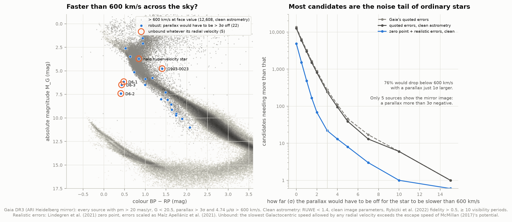
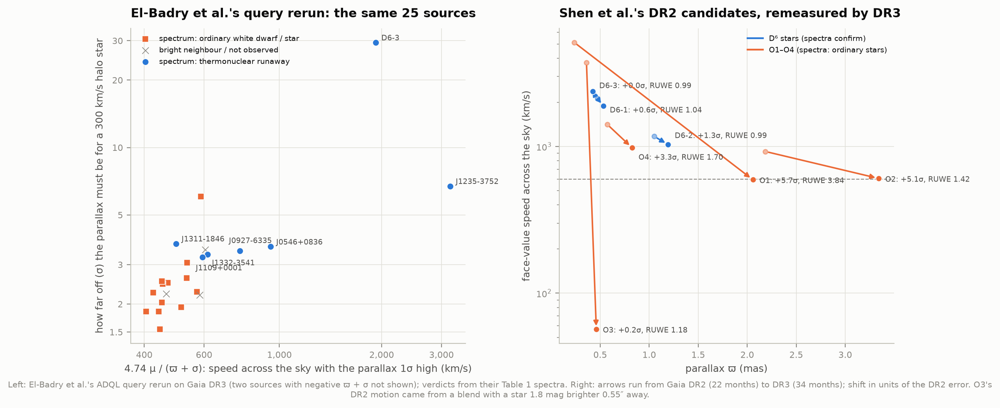
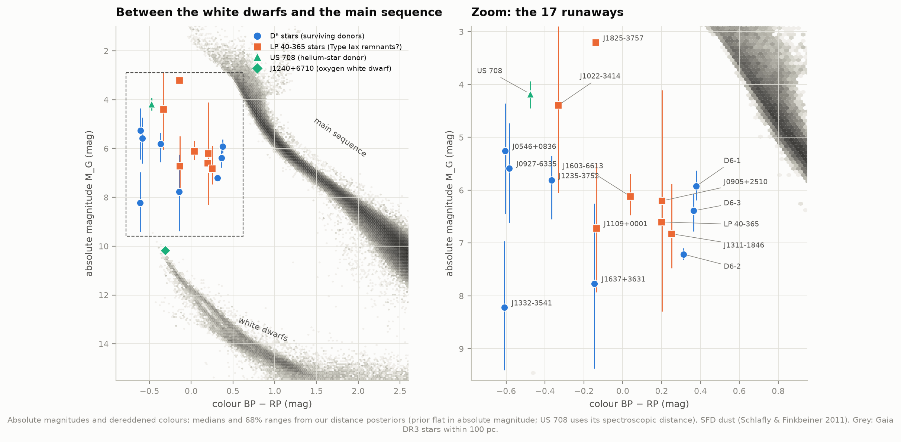
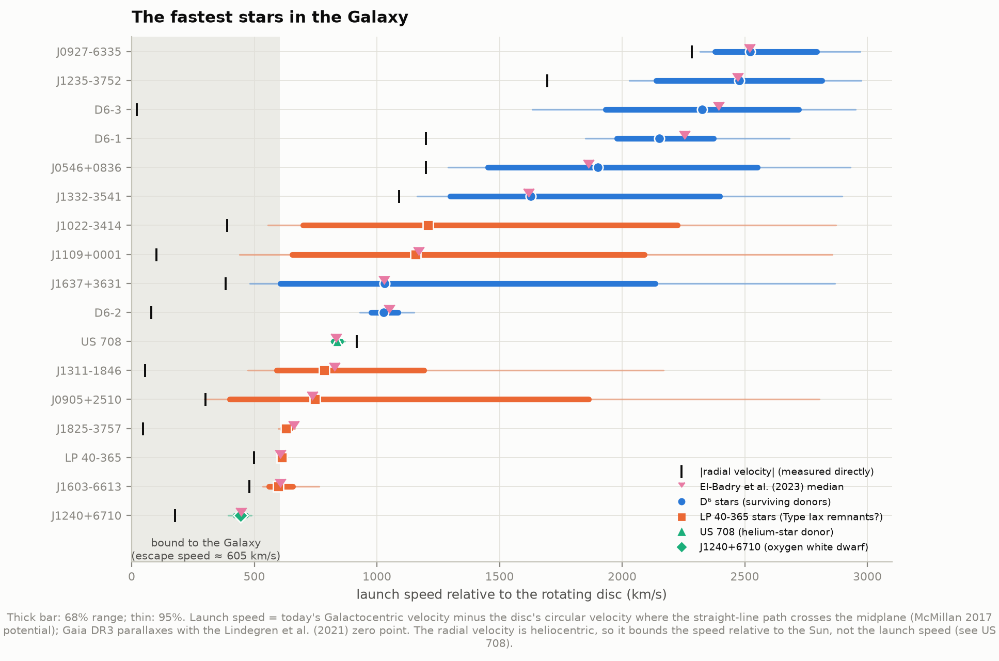
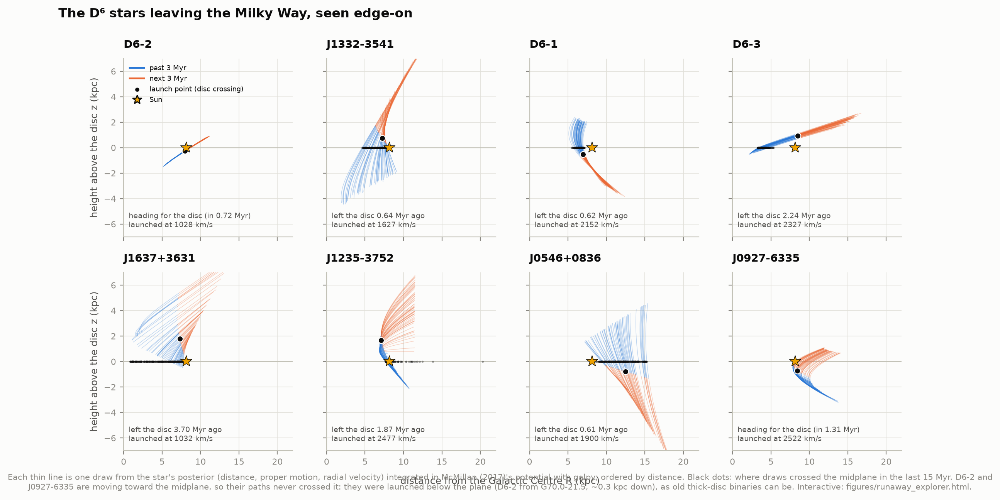
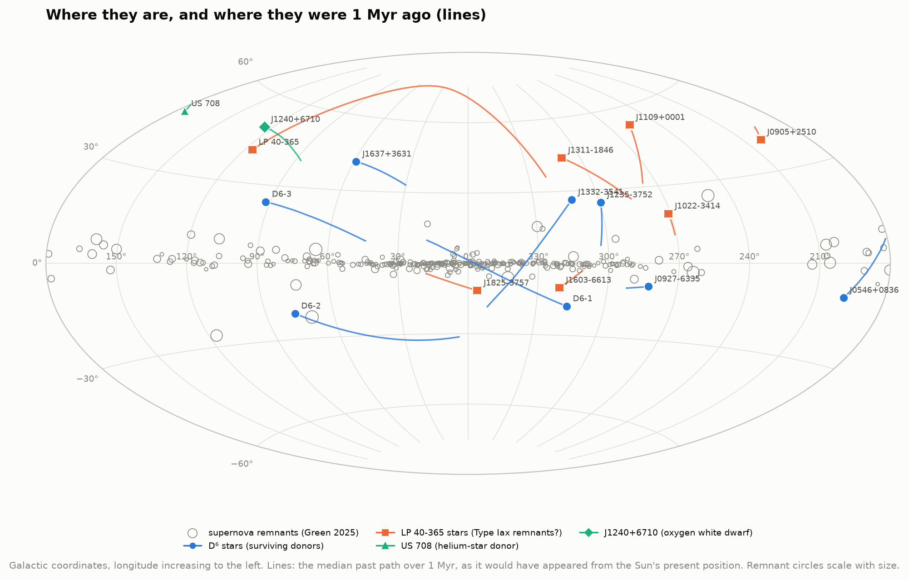
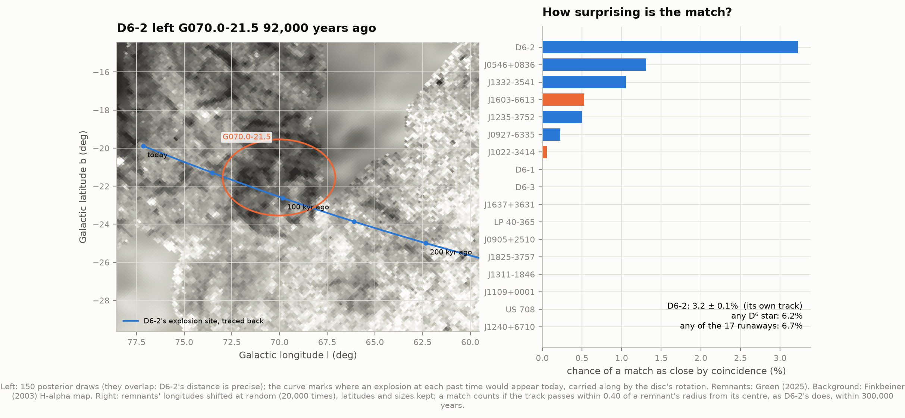
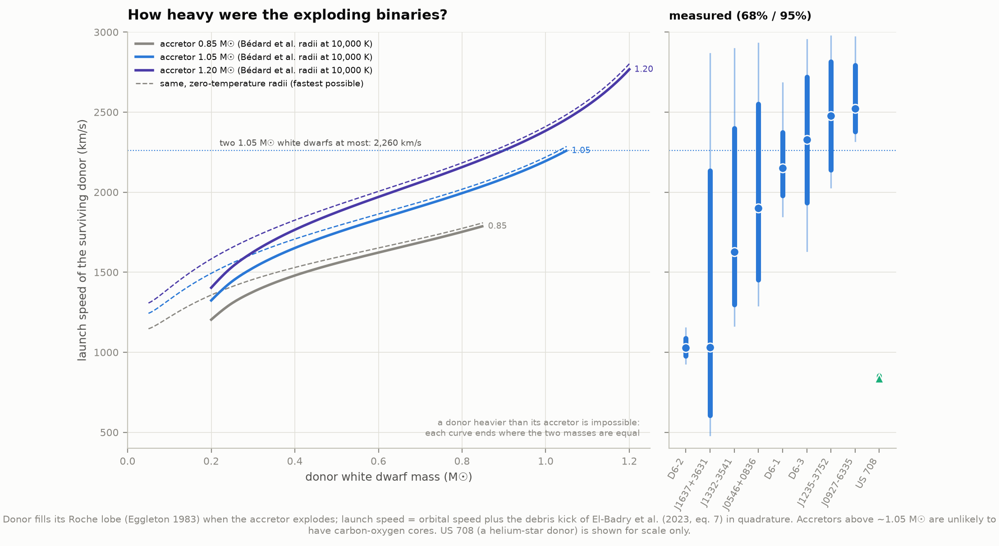
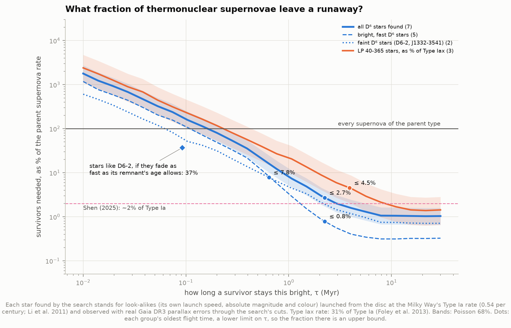

# L5 — Runaway survivors of Type Ia supernovae

**What exactly explodes in a Type Ia supernova? One scenario leaves a witness. When one white dwarf in
a tight pair explodes, its companion flies off at the orbital speed it had at that instant, over
1,000 km/s, faster than any normal star. Can we find these survivors with Gaia, and what do they say?**

A Type Ia supernova is a white dwarf destroyed by runaway carbon burning. Something in a binary
triggers it, and astronomers still argue about what. In the **"D⁶" scenario** (dynamically driven
double-degenerate double detonation; Shen et al. 2018), two white dwarfs spiral together until the
heavier one starts tearing helium off the lighter one. The stream ignites the helium on the heavier
star's surface, and that detonation drives a shock inward that detonates its carbon core. The heavier
star is destroyed. The lighter one, the *donor*, can survive. With nothing left to orbit, it shoots off
in a straight line at its orbital speed. White dwarfs are about the size of the Earth, so these orbits
last minutes and the speeds are enormous.

This project rebuilds the evidence from public data:

- **The search, repeated.** Gaia DR3 holds 13,538 stars whose motion across the sky, taken at face
  value, exceeds 600 km/s. For 76% of them the parallax would only have to be 1σ larger to make them
  ordinary halo stars. With Gaia's known parallax offset and realistic errors, only 22 are robust, and
  only 5 cannot be bound to the Galaxy whatever their radial velocity: the three D⁶ stars of Shen et
  al. (2018), a known impostor and one known halo hypervelocity star.
- **El-Badry et al.'s search, rerun.** Their published ADQL query returns the **same 25 sources** today.
  Their spectra show that 7 of the 22 they observed are runaways.
- **Parallax errors, caught in the act.** All four of Shen et al.'s DR2 candidates that spectra
  showed to be ordinary stars carry bad astrometry in DR3. Three parallaxes grew by 3.3–5.7σ, with
  binary-like RUWE; the fourth's motion came from a blend with a brighter star 0.55″ away.
- **The fastest stars in the Galaxy.** 3D velocities for all 17 proposed survivors. El-Badry et al.'s
  Table 3 is reproduced to ~1%, but only *without* Gaia's parallax zero-point correction. With it, the
  nearby stars come out up to 6% closer and 5% slower (D6-1: 2,150 instead of 2,250 km/s).
- **D6-2 and its supernova remnant.** Traced back, D6-2's path runs through the faint remnant
  G70.0−21.5 92,000 years ago in every posterior draw (Shen et al.: 0.9° from its centre 90,000 years
  ago; ours: 0.96°). We quantify what they left for future work. A match this close happens by chance
  for **3.2%** of tracks like D6-2's, and for **6.2%** of the eight D⁶ stars' tracks taken together.
- **How heavy were the binaries?** The fastest stars need two massive white dwarfs. J0927−6335
  (2,520 km/s) is too fast for any pair of ordinary carbon-oxygen white dwarfs; with a 1.2 M☉ partner
  it needs a donor of ≥ 0.95 M☉.
- **How common are survivors?** Forward-modelling Gaia's selection shows that bright, fast survivors
  come from **at most ~0.8% of Type Ia supernovae** (68%: 0.4–1.3%), because we still see them 2.2 Myr
  after launch. Faint ones like D6-2 could be far more common (up to ~40%) if they fade within
  100,000 years.

An offline page, `figures/runaway_explorer.html`, flies all 17 stars through a 3D Milky Way.

---

## The physics in three lines

1. **The donor fills its Roche lobe** (the teardrop inside which its own gravity wins) when mass
   transfer starts. Eggleton's (1983) formula gives the lobe's size as a fraction of the separation,
   so the donor's radius fixes the separation *a*.
2. **Kepler** then fixes the donor's orbital speed: v = M_acc √(G / ((M_acc + M_don) a)).
3. **Heavier white dwarfs are smaller** (R ∝ M^−1/3 at low mass, shrinking toward zero at the
   Chandrasekhar mass), so heavier donors sit in tighter orbits and are flung faster: ~1,300 km/s
   for a 0.2 M☉ donor, 2,250 km/s for two 1.05 M☉ dwarfs (orbital period 19 seconds).

Our code reproduces Shen et al.'s fiducial speeds: 1,766–1,798 km/s for 0.6 on 1.0 M☉ (hot or cold
radii; theirs 1,800), and 2,121–2,144 km/s for 1.0 + 1.0 (theirs 2,200). It also matches El-Badry et
al.'s maximum for two 1.05 M☉ dwarfs (2,253 vs ~2,235 km/s).

Two related kinds of survivor appear below. **LP 40-365 stars** are thought to be the partly burnt
*remains* of a white dwarf that exploded weakly (a Type Iax supernova, ~31 for every 100 Type Ia;
Foley et al. 2013), kicked out at ~600 km/s. **US 708** is a hot helium star thrown out at ~900 km/s
when its white-dwarf companion exploded.

---

## The data

| Source | What | How |
|---|---|---|
| Gaia DR3 (ESA) | astrometry, photometry | ARI Heidelberg's full mirror (ESA's archive was overloaded on 4 Oct 2026; VizieR's TAP returned 503) |
| Rybizki et al. 2022 | spurious-astrometry classifier (`fidelity_v2`) | ARI, `gaiaedr3_complements.spurious_astrometry` |
| Shen et al. 2018; El-Badry et al. 2023; Hollands et al. 2025; Bhat et al. 2026; Raddi et al. 2019; Geier et al. 2015; Gänsicke et al. 2020; Chandra et al. 2022 | the census of 17 proposed survivors, and their radial velocities | copied from the papers (`literature.py`) |
| Green 2025 (VizieR VII/297) | 310 Galactic supernova remnants | VizieR |
| Bédard et al. 2020 | white dwarf cooling sequences, 0.20–1.30 M☉ | Montreal group website |
| Schlafly & Finkbeiner 2011 (SFD) | dust reddening toward each star | IRSA DUST service |
| Finkbeiner 2003 | all-sky H-alpha map | NASA LAMBDA |

`fetch_data.py` caches everything (50 MB) and records each file's URL, date, size and SHA-256 in
`data/manifest.json`. Every Gaia query also has a JSON sidecar holding its exact ADQL and the service
that answered.

**Getting a whole-sky Gaia search through on a bad day.** A query that must read every Gaia source
is slow on any server: the full `gaia_source` table has ~150 columns per star. El-Badry et al.'s query
ran for 85 minutes on ARI's asynchronous queue. For our broad search we ran the cut on ARI's 51-column
`gaia_source_lite` table instead, in 72 patches of sky (source_id ranges; dense patches toward the
Galactic Centre split further). We then fetched the full records of the 13,543 stars it returned by
source_id.

---

## Results

### 1. The search: how many candidates are real?



A star's speed across the sky is **v_tan = 4.74 μ / ϖ** (km/s, for proper motion μ in mas/yr and
parallax ϖ in mas). Nothing bound to the Milky Way moves faster than its escape speed, ~600 km/s here,
so a cut at 600 km/s should leave only runaways. But a parallax measured too *small* inflates v_tan,
and Gaia has measured 1.5 billion of them.

**13,538 stars** pass (proper motion > 20 mas/yr, G < 20.5, parallax > 3σ). In the HR diagram they are
overwhelmingly ordinary stars: halo dwarfs, subgiants and giants. Three tests tell us how many are
real:

1. **The mirror test says catastrophic errors are rare.** A negative parallax can only be an error.
   Only **5 sources** have a parallax below −3σ *and* would pass the speed cut, against 13,538 positive
   ones. Wild astrometric failures are not what fills the sample.
2. **The noise tail does.** For **76%** of the candidates, a parallax just 1σ larger would bring them
   under 600 km/s; 886 need more than 2σ and 46 more than 5σ. These are mostly halo stars that really
   do move at 300–550 km/s, scattered over the line by ordinary measurement noise. Gaia's quoted errors
   make it worse: they are too small, and the parallaxes carry a zero-point offset (median −0.032 mas
   here; Lindegren et al. 2021). Correcting the offset and scaling the errors as Maíz Apellániz et al.
   (2021) found with globular clusters (k ≈ 1.3–1.9, plus 10.3 µas) leaves **22 candidates** with clean
   astrometry that would need a > 3σ error.
3. **Escape speed, whatever the radial velocity.** A heliocentric cut also catches halo stars orbiting
   *against* the Galaxy's rotation: the Sun's own ~250 km/s adds to their apparent speed. So for each
   robust candidate we computed the slowest Galactocentric speed any radial velocity allows. Only
   **5 of the 22** must be unbound:

| Gaia DR3 | What it is | M_G | Parallax error needed | Galactocentric speed ≥ (escape speed) |
|---|---|---|---|---|
| 5805243926609660032 | D6-1 | 6.2 | 12.1σ | 1,619 km/s (619) |
| 1798008584396457088 | D6-2 | 7.4 | 9.7σ | 1,084 km/s (608) |
| 2156908318076164224 | D6-3 | 6.5 | 9.5σ | 2,232 km/s (602) |
| 3841458366321558656 | halo hypervelocity star, RV −100 km/s (Carballo-Bello et al. 2025) | 3.7 | 4.7σ | 867 km/s (589) |
| 4265540383431508736 | J1903−0023: an eclipsing binary that spectra showed to be *bound*, its parallax distance too large (Bhat et al. 2025) | 4.8 | 3.0σ | 733 km/s (629) |

A blind search with honest errors recovers exactly the three precise-parallax D⁶ stars, and they sit
apart in the HR diagram, between the white dwarfs and the main sequence. The other two are normal
halo stars: one known impostor, and one genuine hypervelocity star of a different kind.



**El-Badry et al.'s query, rerun** (left), returns the same 25 sources their Table 1 lists. They took
spectra of 22: five are D⁶ stars, two LP 40-365 stars, the rest ordinary white dwarfs and main-sequence
stars. All five sources with the highest "speed with the parallax 1σ high" are D⁶ stars, as they
noted. Below that the impostors mix in: for all but one of them the parallax needs to be off by only
1.5–3σ for the star to be a 300 km/s halo star (the exception needs 6σ). The parallax alone cannot
tell them apart. Under a prior flat in absolute magnitude, the impostors get a median 69% probability
of moving faster than 1,000 km/s, against 76–100% for the five D⁶ stars. Only spectra (a radial velocity of 1,000+ km/s, a hydrogen-free atmosphere)
decide.

**Shen et al.'s DR2 candidates, remeasured** (right). Three D⁶ stars and four "ordinary stars" (O1–O4)
followed up in 2018. In DR3, with 34 instead of 22 months of data:
- the three D⁶ stars' parallaxes moved by 0.0–1.3σ, and their RUWE is 0.99–1.04 (clean);
- O1, O2 and O4's parallaxes **grew by 5.7σ, 5.1σ and 3.3σ**, and their DR3 RUWE is 3.84, 1.42 and
  1.70 (a poor single-star fit, typical of binaries). O1 also has a companion 0.45″ away;
- O3's DR2 proper motion of 285 mas/yr has **vanished**: DR3 measures 5.5 mas/yr. A star 1.8 mag
  brighter sits 0.55″ away, and DR2 had confused the two.

### 2. The fastest stars in the Galaxy



**In the HR diagram** the survivors sit where no ordinary star does: too bright to be ordinary white
dwarfs, too faint to be ordinary stars. The three D⁶ stars Shen et al. found form a cool, puffed-up
clump at BP−RP ≈ 0.35. The four El-Badry et al. found are hot and blue. Most have absolute magnitudes
of 5–7, whatever their temperature.

**Turning motions into velocities.** Proper motions are precise, but for 9 of the 17 stars the parallax
is under 3σ. Their distance, and hence their speed across the sky, comes from a posterior. That is
Gaia's parallax likelihood times a prior flat in absolute magnitude, with one physical constraint: no
launch faster than 3,000 km/s (two 1.3 M☉ white dwarfs could not do better). This is El-Badry et al.'s
method, rebuilt. Because the posterior factorises, distances come from a 1D grid. The proper motions
are then drawn *conditioned on the parallax*, through Gaia's correlations between them (a test checks
this against brute-force importance sampling). Launch speed = today's velocity minus the disc's
circular velocity where the path crosses the midplane.



| Star | d (kpc) | Speed today (km/s) | Launch speed (km/s) | El-Badry et al. | Flight time from the disc (Myr) |
|---|---|---|---|---|---|
| D6-1 | 1.80 (−0.21 +0.26) | 1,948 | 2,152 (−173 +221) | 2,254 | 0.62 |
| D6-2 | 0.82 (−0.04 +0.05) | 1,127 | 1,028 (−51 +58) | 1,051 | −0.72 |
| D6-3 | 2.22 (−0.36 +0.36) | 2,201 | 2,327 (−394 +392) | 2,393 | 2.24 |
| J1235−3752 | 4.07 (−1.17 +0.97) | 2,670 | 2,477 (−339 +337) | 2,471 | 1.87 |
| J0927−6335 | 4.48 (−1.70 +2.18) | 2,750 | 2,522 (−143 +271) | 2,519 | −1.31 |
| J0546+0836 | 4.16 (−1.76 +2.14) | 1,742 | 1,900 (−447 +651) | 1,864 | 0.61 |
| J1332−3541 | 1.65 (−0.69 +1.30) | 1,478 | 1,627 (−328 +771) | 1,619 | 0.64 |
| J1637+3631 | 3.09 (−1.61 +3.10) | 1,184 | 1,032 (−426 +1,103) | 1,030 | 3.70 |
| LP 40-365 | 0.60 (−0.01 +0.01) | 834 | 614 (−5 +6) | 607 | 4.63 |
| J1603−6613 | 1.95 (−0.29 +0.42) | 819 | 597 (−38 +60) | 606 | 1.61 |
| J0905+2510 | 4.65 (−2.88 +7.54) | 537 | 747 (−347 +1,115) | 737 | – |
| J1825−3757 | 0.92 (−0.02 +0.02) | 405 | 631 (−17 +17) | 662 | 1.60 |
| J1311−1846 | 1.77 (−0.46 +0.96) | 912 | 786 (−194 +406) | 827 | 3.86 |
| J1109+0001 | 2.85 (−1.22 +2.17) | 1,359 | 1,157 (−502 +934) | 1,171 | 3.91 |
| J1022−3414 | 7.47 (−3.98 +7.40) | 1,292 | 1,207 (−508 +1,017) | – | 2.80 |
| US 708 | 8.51 (−1.00 +1.02) | 996 | 837 (−14 +16) | 833 | 11.61 |
| J1240+6710 | 0.43 (−0.02 +0.02) | 244 | 443 (−20 +22) | 446 | – (bound) |

Negative flight times: the star is still heading *toward* the midplane. J1637+3631 uses Hollands et al.
(2025)'s radial velocity (384 km/s); J1022−3414 is the LP 40-365 star of Bhat et al. (2026).

**The zero point.** Gaia DR3 parallaxes are too small by a few hundredths of a milliarcsecond,
depending on magnitude, colour and position (Lindegren et al. 2021). El-Badry et al. say they correct
for it, but their Table 3 is reproduced almost exactly only *without* the correction. With uncorrected
parallaxes we get D6-1 at 1.91 kpc with a launch speed of 2,255 km/s (theirs: 1.91, 2,254), D6-3 2,391
(2,393) and LP 40-365 607 (607). With the correction, the precisely measured nearby stars are 2–6%
closer and 3–5% slower; for the distant ones it is lost in the noise. We adopt the corrected parallaxes.

**Fourteen of the 17 are unbound**: they move faster than the escape speed of McMillan (2017)'s
potential along their paths (550–620 km/s). J1825−3757 and J1240+6710 are bound; J0905+2510 is a
coin toss (48%).

**The prior matters for the faint stars.** For J1637+3631, J1022−3414 and J0905+2510 the median launch
speed changes by 50–100% between a prior flat in distance and an exponentially falling space density,
and for J1332−3541 by 20–27%. For J0927−6335, J1235−3752 and the three precisely measured D⁶ stars it
changes by < 5%: their radial velocities or parallaxes fix the speed. J0927−6335's −2,285 km/s is the fastest radial velocity of any star.

### 3. Where they came from



Each draw from a star's posterior is an orbit, integrated in McMillan's potential with galpy. For the
D⁶ stars the Galaxy hardly matters over these times: launch speeds from integrated orbits and from
straight lines agree within 1% (2,154 vs 2,152 km/s for D6-1), because near the Sun gravity changes
a star's speed by only ~7 km/s per Myr. It matters for slower, older runaways: 893 vs 837 km/s for US
708, launched 11 Myr ago.

Six of the eight D⁶ stars left the disc 0.6–3.7 Myr ago, between 3.8 and 11.7 kpc from the Galactic
Centre. **D6-2 and J0927−6335 are moving toward the midplane**, so their paths never crossed it: they
were launched from below the disc, D6-2 about 300 pc down, among the old stars of the thick disc.



### 4. D6-2 and the remnant G70.0−21.5



A supernova remnant stays visible for perhaps 10⁴ to a few 10⁵ years. At 1,000–2,500 km/s a survivor
travels 1–2.5 kpc per million years, so only the youngest can still be near theirs. For every star and
every posterior draw we computed where the explosion site would appear *today* (before the explosion,
the binary was orbiting with the disc's rotation) for explosions up to 300,000 years ago. We then
checked Green's 310 remnants against those tracks.

**One match, the one Shen et al. reported.** All 600 tracks of D6-2 pass inside G70.0−21.5, closest
0.95° from its centre, 92,000 years ago (the remnant's radius is 2.35°). No other star's track
passes inside any remnant.

**How likely is that by chance?** We shifted every remnant's longitude at random 20,000 times,
keeping its latitude and size. A track like D6-2's passes as deep inside some remnant (within 0.40 of
its radius) in **3.2%** of the shuffles. But we searched 17 tracks, not one: the chance that *some* D⁶
star shows such a match is **6.2%**, or 6.7% for all 17. So the match is suggestive, not proof. It is
helped by how few remnants are known 20° from the plane: only two of Green's lie in D6-2's latitude
band.

**Is the remnant the right size?** At D6-2's distance (0.82 kpc) its radius is 33 pc. A standard
10⁵¹-erg blast wave (Sedov–Taylor) grows that large in 92,000 years in gas of 0.6 atoms per cm³. That
is reasonable, though gas 300 pc below the disc is usually thinner, and an old remnant that has started
to radiate grows more slowly. The distance estimated from its shock speeds, 1–2 kpc (Fesen et al. 2015),
is somewhat beyond D6-2.

### 5. How heavy were the exploding binaries?



Inverting the orbital-speed relation at each star's 2σ lower limit on its launch speed (Bédard et al.
radii at 10,000 K, debris kick included):

| Star | Launch speed > (2σ) | Donor mass ≥ (accretor ≤ 1.05 M☉) | (accretor ≤ 1.20 M☉) |
|---|---|---|---|
| J0927−6335 | 2,319 km/s | impossible | 0.95 M☉ |
| J1235−3752 | 2,029 km/s | 0.84 M☉ | 0.66 M☉ |
| D6-1 | 1,850 km/s | 0.62 M☉ | 0.48 M☉ |
| D6-3 | 1,634 km/s | 0.38 M☉ | 0.30 M☉ |
| J0546+0836, J1332−3541, D6-2, J1637+3631 | 481–1,291 km/s | any (≥ 0.2 M☉) | any |

- **J0927−6335 is too fast for any pair of carbon-oxygen white dwarfs** up to 1.05 M☉, the heaviest
  that single stars make, as El-Badry et al. found. A 1.2 M☉ accretor, grown by accreting helium,
  needs a donor of ≥ 0.95 M☉: two massive white dwarfs together well above the Chandrasekhar mass.
- **The answer depends on the donor's temperature.** El-Badry et al.'s limits for their four stars
  (0.27, 0.34, 0.96 M☉; J0927 impossible) are reproduced to 0.01 M☉ if the radii are taken at
  20,000 K without the debris kick. At 10,000 K they become 0.21, 0.28 and 0.95.

### 6. How common are survivors?



If every Type Ia supernova (0.54 per century in the Milky Way; Li et al. 2011) left a D⁶ survivor,
how many would Gaia have found? We launched simulated survivors from the disc. Each got the launch
speed, absolute magnitude and colour of one of the D⁶ stars actually found. They were dimmed and
reddened by a dust layer, measured with the parallax errors of real Gaia sources of the same magnitude,
and put through the search's cuts: El-Badry et al.'s, without their parallax-significance limit, a
selection that finds 7 of the D⁶ stars. Each star found then stands for a population of look-alikes
(a 1/V_max estimate).

Of the 17 precise-parallax sources this selection adds to El-Badry et al.'s 25, three are known
survivors (D6-1, D6-2, J1825−3757). According to SIMBAD the other 14 are blue halo stars
(horizontal-branch, A-type, blue stragglers; M_G 0–4) and one ordinary DA white dwarf. None sits in
the survivors' part of the HR diagram.

The answer hinges on one unknown: **how long a survivor stays this bright (τ)**. A star seen t years
after launch has stayed bright at least that long. So each group's oldest flight time is a lower limit
on τ, which gives an *upper* limit on the fraction:

| Group | Found | Oldest flight time | At most, % of parent supernovae (68%) |
|---|---|---|---|
| D⁶ stars, all | 7 | 2.24 Myr | 2.7% (1.7–4.2%) of Type Ia |
| bright, fast D⁶ stars | 5 (D6-1, D6-3, J1235, J0927, J0546) | 2.24 Myr | **0.8%** (0.4–1.3%) |
| faint D⁶ stars | 2 (D6-2, J1332) | 0.64 Myr | 7.8% (2.8–18%) |
| LP 40-365 stars | 3 (J1825, J1311, J1109) | 3.91 Myr | 4.5% (2.1–9.0%) of Type Iax |

These bracket the published estimates. El-Badry et al. found 3–5% for the fast stars (with τ = 1 Myr)
and ~100% for faint ones like D6-2 (τ = 10⁵ yr). Shen (2025), with evolutionary models for how
survivors fade, found ~2% overall, and Igoshev et al. (2023) "at least two orders of magnitude" below
the Type Ia rate. If faint survivors fade as fast as D6-2's age allows (92,000 years), stars like it
alone need 37% of Type Ia supernovae.

**The bright, fast survivors are rare: well under one Type Ia supernova in a hundred makes one.**
Whether most Type Ia supernovae are D⁶ explosions depends on the faint survivors, and on how fast they
fade, which nobody yet knows.

---

## Honest notes

- **Candidates stay candidates without spectra.** The search finds where survivors could be; only a
  hydrogen-free spectrum and a large radial velocity confirm one. All 17 survivors here were confirmed
  by others' spectroscopy. Our part is the kinematics.
- **Distances.** For 9 of the 17 stars the parallax is under 3σ, so distances, speeds and flight
  times lean on the prior (section 2). The radial velocities give robust *lower* limits on the speeds.
- **The Type Ia rate** (0.54 ± 0.12 per century) carries a 22% statistical uncertainty and a factor-2
  systematic one (Li et al. 2011), on top of the Poisson errors shown.
- **The population model** places explosions like the stars of the thin disc. It ignores the thick
  disc and halo (D6-2 and J0927−6335 started below the plane), uses a simple dust layer, and assumes the
  RUWE cut never removes a survivor.
- **The chance-alignment test** uses the known remnants. High-latitude remnants are hard to find
  (G70.0−21.5 was discovered in deep H-alpha images), so the sky probably holds more than Green lists,
  which would make a chance match more likely. Green gives sizes, not shapes: remnants are treated as
  circles of the geometric-mean radius.
- **Parallax errors.** Maíz Apellániz et al. give k ranges (1.1–1.7 for G > 13, 1.7–2.0 for
  11 < G < 13, above 2 for G < 9.2); we use mid-range values, and the counts depend on that choice.
  After the zero-point correction, quoted errors leave 53 robust candidates (13 unbound for any radial
  velocity), ours 22 (5), and errors 30% larger still 14 (4). D6-1, D6-2, D6-3 and the Carballo-Bello
  et al. star survive every choice. The ones that come and go are mostly distant giants with
  parallaxes of 0.1–0.2 mas, where a 0.01-mas systematic error matters.
- **Radial velocities are literature values**, with their published errors. For D6-2 we use Chandra
  et al. (2022)'s 80 ± 10 km/s (Shen et al. measured 20 ± 60), and for J1637+3631 Hollands et al.
  (2025)'s 384 ± 6 km/s. Gravitational redshifts (a few km/s) are ignored.
- **White dwarf radii** come from carbon-oxygen models. Below ~0.45 M☉ a real donor would have a helium
  core and a slightly larger radius, and so a lower speed.

## Running it

```bash
cd astrophysics/31-hypervelocity-survivors
../.venv/bin/python fetch_data.py     # 50 MB; the two whole-sky Gaia queries take hours on a slow day
../.venv/bin/python run.py            # everything: numbers, figures, explorer (~2 minutes)
../.venv/bin/python test_physics.py   # 14 checks
```

Once the cache is full, `run.py` works offline. The code needs numpy, scipy, astropy, pyvo, galpy,
healpy, matplotlib, plotly and `gaiadr3-zeropoint`, all in the shared `.venv`. The McMillan (2017)
potential is tabulated once (~50 s) into `data/cache/`.

### Files

| File | What it does |
|---|---|
| `config.py` | paths, the Galaxy's constants, every cut |
| `literature.py` | the census of 17 survivors, radial velocities, published values |
| `fetch_data.py`, `gaia_tap.py` | downloads with provenance; Gaia queries (mirror fallback, patch-by-patch scans) |
| `search.py` | the mirror and parallax-shift tests, El-Badry et al.'s query, Shen et al.'s candidates in DR3 |
| `kinematics.py` | distance posteriors, Galactocentric velocities, launch speeds |
| `orbits.py` | McMillan (2017) potential (galpy), orbit integration, escape speeds |
| `remnants.py` | explosion-site tracks, remnant matches, the chance test |
| `binary.py` | white dwarf radii, Roche lobes, orbital speeds, donor masses |
| `population.py` | the forward model of what Gaia can find |
| `analysis.py` | runs each step; `run.py` runs them all and prints the summary |
| `figures.py`, `plotstyle.py`, `interactive.py` | every figure and the explorer |
| `test_physics.py` | self-checks against independent calculations |
| `data/results.json` | every number quoted here |

## Data credits and references

**Data.** This work has made use of data from the European Space Agency (ESA) mission Gaia
(https://www.cosmos.esa.int/gaia), processed by the Gaia Data Processing and Analysis Consortium (DPAC);
Gaia Collaboration, Vallenari et al. 2023, A&A 674, A1. Mirror: Astronomisches Rechen-Institut,
Heidelberg (gaia.ari.uni-heidelberg.de). Rybizki et al. 2022, MNRAS 510, 2597. Green 2025, J. Astrophys.
Astron. 46, 14 (VizieR VII/297, CDS Strasbourg). Bédard et al. 2020, ApJ 901, 93. Schlegel, Finkbeiner &
Davis 1998, ApJ 500, 525; Schlafly & Finkbeiner 2011, ApJ 737, 103 (IRSA). Finkbeiner 2003, ApJS 146,
407 (LAMBDA). SIMBAD (CDS, Strasbourg). Lindegren et al. 2021, A&A 649, A4 (parallax zero point);
Maíz Apellániz, Pantaleoni González & Barbá 2021, A&A 649, A13 (parallax uncertainties).

**Survivors.** Shen et al. 2018, ApJ 865, 15; El-Badry et al. 2023, OJAp 6, 28; Hollands et al. 2025,
MNRAS 541, 2231; Bhat et al. 2026, A&A (arXiv:2602.23900); Raddi et al. 2019, MNRAS 489, 1489; Vennes
et al. 2017, Science 357, 680; Geier et al. 2015, Science 347, 1126; Gänsicke et al. 2020, MNRAS 496,
4079; Kepler et al. 2016, Science 352, 67; Chandra et al. 2022, MNRAS 512, 6122; Igoshev et al. 2023,
MNRAS 518, 6223; Bauer et al. 2021, ApJL 923, L34; Shen 2025, ApJ 982, 6; Fesen et al. 2015, ApJ 812,
37; Carballo-Bello et al. 2025, A&A 700, A172; Bhat et al. 2025, A&A (arXiv:2507.17101).

**Methods.** Eggleton 1983, ApJ 268, 368; Verbunt & Rappaport 1988, ApJ 332, 193; McMillan 2017, MNRAS
465, 76; Bovy 2015, ApJS 216, 29 (galpy); Astraatmadja & Bailer-Jones 2016, ApJ 832, 137; Casagrande &
VandenBerg 2018, MNRAS 479, L102; Li et al. 2011, MNRAS 412, 1473; Foley et al. 2013, ApJ 767, 57;
Bland-Hawthorn & Gerhard 2016, ARA&A 54, 529.
