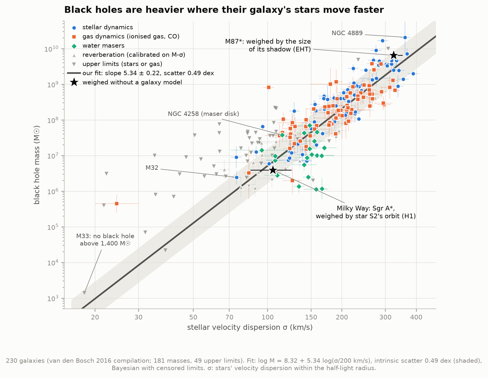
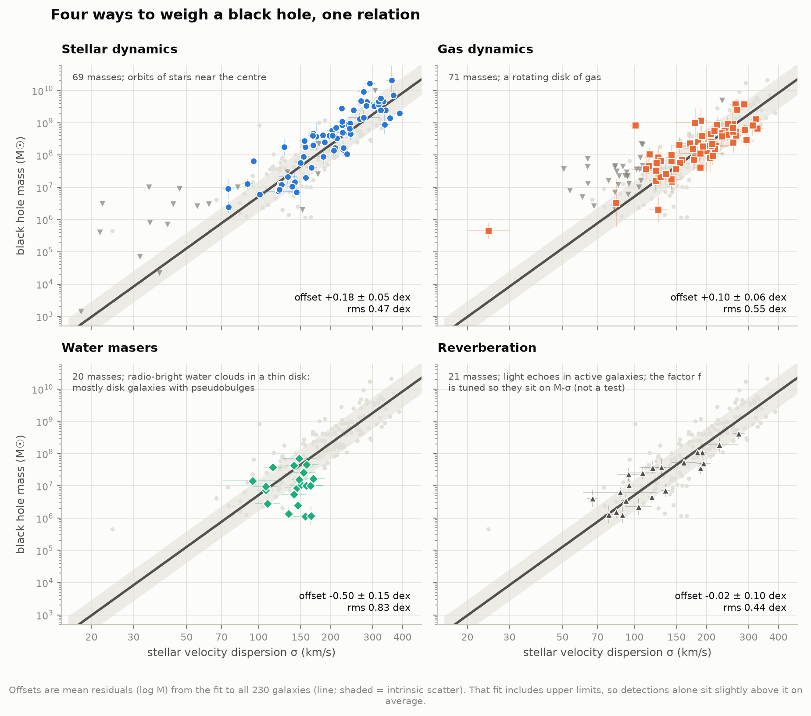
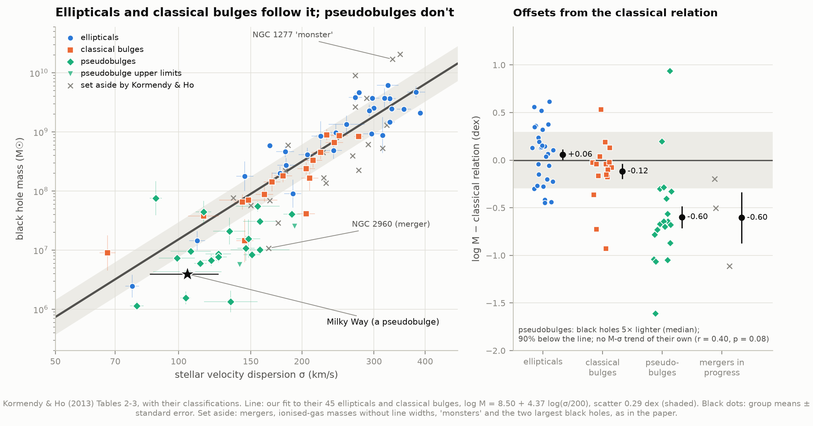
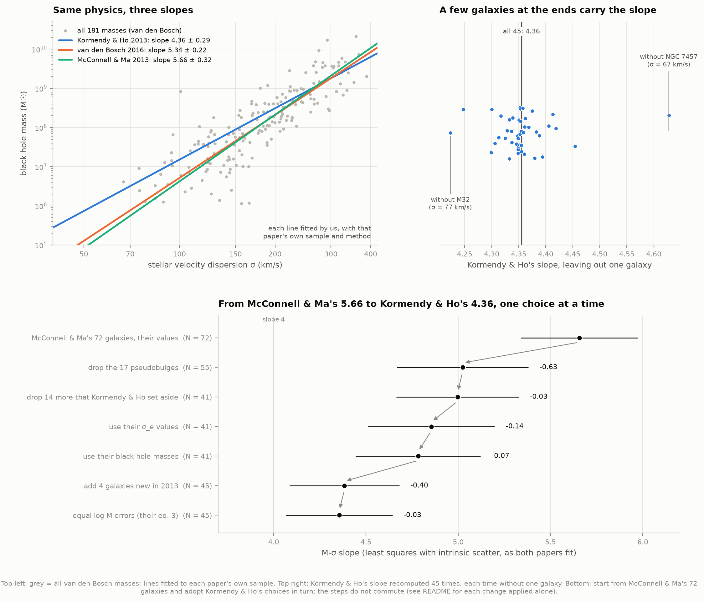
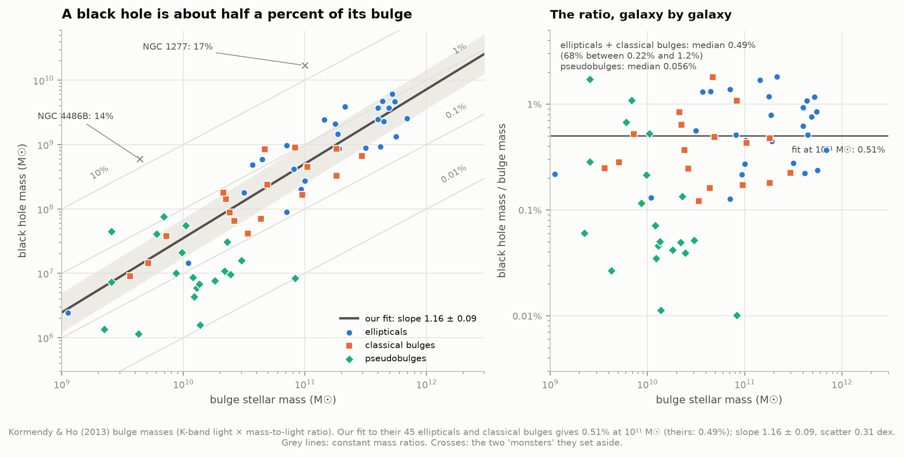
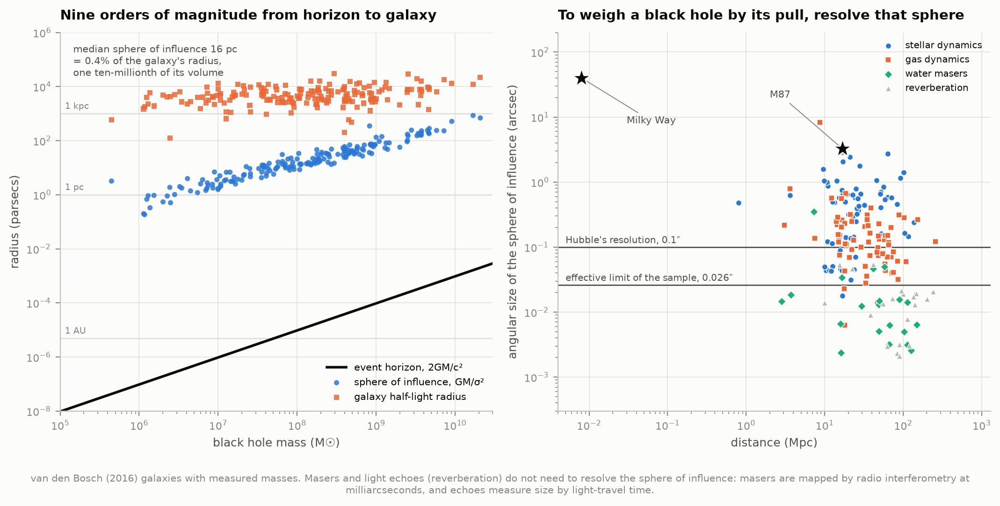
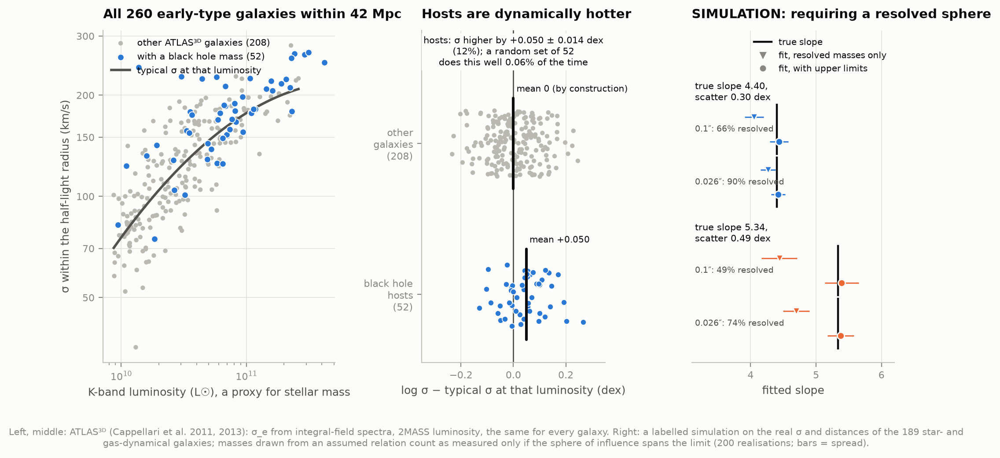
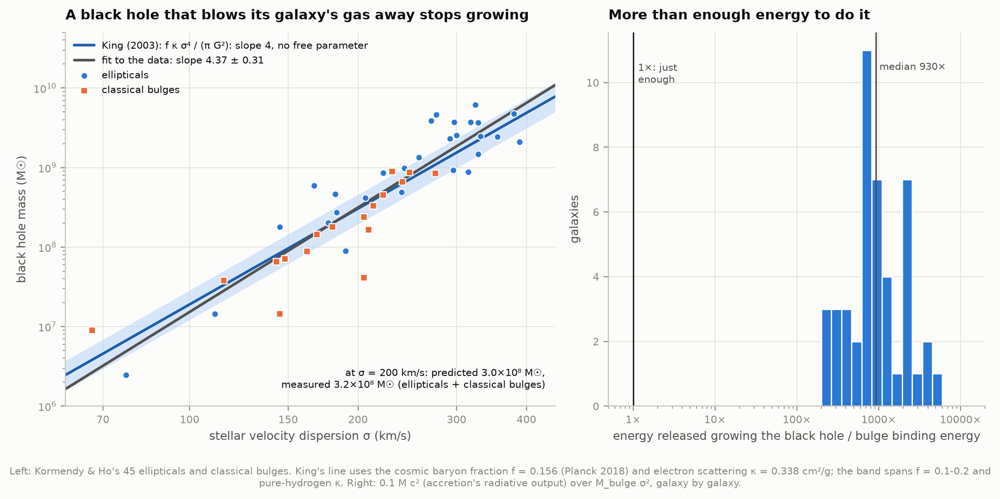
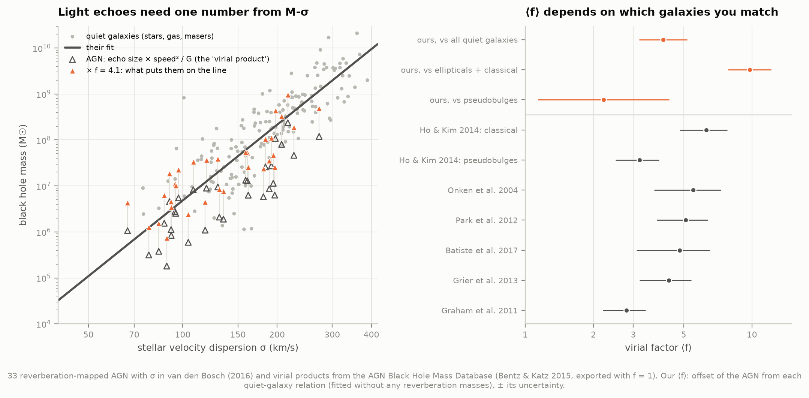
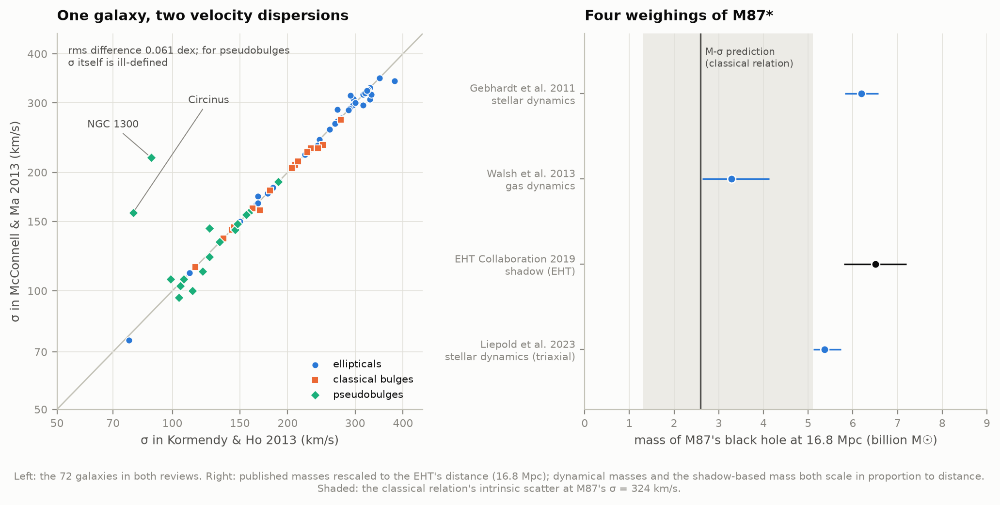

# I1 — The M–σ relation: black holes grow with their galaxies

**A galaxy's central black hole weighs only about half a percent of the galaxy's central bulge,
and its gravity rules a region about a ten-millionth of the galaxy's volume. Yet its mass tracks
how fast the bulge's stars move, hundreds of times farther out. How tight is that relation, and
what does it imply?**

Very tight, for the right galaxies. Across 230 galaxies the black hole mass rises as the stars'
velocity dispersion σ to the power **5.3**, with a spread of a factor of three. In the
ellipticals and classical bulges the spread shrinks to a **factor of two** and the power drops to
**4.4 ± 0.3**. That is what a black hole that blows its galaxy's gas away and stops its own growth
would produce. King's (2003) feedback argument predicts the power **4** and, with no free
parameter, a mass of **3.0 × 10⁸ M☉** at 200 km/s; the measured value is **3.2 × 10⁸**. Disk
galaxies with *pseudobulges*, including our Milky Way, do not follow the relation: their black
holes are about **five times lighter** and do not correlate with σ at all.

We rebuilt the three most-cited versions of the relation from their own tables and refitted each
with our own code. Each published slope comes back within a tenth of its error bar. The three
disagree (4.4, 5.4 and 5.6) because the papers counted different galaxies, not because the data
disagree. A galaxy-by-galaxy "slope budget" below shows which choices matter. Two black holes weighed
without any model of a galaxy anchor the plot: **Sgr A\*** from the orbit of the star S2 (this
atlas's project H1) and **M87\*** from the size of its shadow (Event Horizon Telescope).

| Compilation | Galaxies | What it contains | Their slope | Ours, same sample and method |
|---|---|---|---|---|
| Kormendy & Ho 2013 (ARA&A) | 45 | ellipticals and classical bulges only; mergers, "monsters", ionised-gas masses without line widths set aside | 4.38 ± 0.29 | **4.36 ± 0.29** |
| van den Bosch 2016 (ApJ) | 230 | every dynamical and reverberation mass, plus 49 upper limits | 5.35 ± 0.23 | **5.34 ± 0.22** |
| McConnell & Ma 2013 (ApJ) | 72 | all galaxy types | 5.64 ± 0.32 | **5.66 ± 0.32** |

---

## Results

### 1. The relation



**log M = 8.32 ± 0.04 + (5.34 ± 0.22) log(σ / 200 km/s), intrinsic scatter 0.49 ± 0.03 dex**
for van den Bosch's 230 galaxies (181 masses, 49 upper limits). Van den Bosch published
8.32 ± 0.04, 5.35 ± 0.23 and 0.49 ± 0.03. A galaxy whose stars move twice as fast hosts a black
hole about forty times heavier.

"Intrinsic scatter" is the spread the measurement errors cannot explain. 0.49 dex means a
factor of three either way: the relation predicts a black hole's mass to within a factor of three,
given only σ.

How we fit matters, and we checked each choice:

| Variant | Slope | Zero point | Scatter |
|---|---|---|---|
| **our fit**: errors in both axes, true σ distribution modelled, upper limits censored | **5.34 ± 0.22** | 8.32 | 0.49 |
| the 49 upper limits taken as hard limits at the top of their range | 5.31 ± 0.22 | 8.32 | 0.50 |
| the true σ distribution as two Gaussians instead of one | 5.33 ± 0.23 | 8.32 | 0.49 |
| upper limits left out (181 masses) | 4.95 ± 0.24 | 8.34 | 0.49 |
| measured σ taken at face value (no σ distribution) | 5.20 ± 0.22 | 8.31 | 0.49 |

The last row is biased, and we can show it. On simulated samples with a known slope of 5, taking
noisy σ values at face value returns 4.91 ± 0.03. That is the textbook "regression dilution"
τ²/(τ² + σ_err²) = 0.978. Our fit returns 5.03 ± 0.03, and the least-squares method the 2013
papers used returns 5.02 ± 0.03 (20 simulated samples; `test_physics.py`). Leaving out the upper
limits flattens the slope, because at low σ only the black holes heavy enough to be detected
are counted. Section 7 simulates exactly that.

**Our two anchors.** S2's orbit gave H1 **3.96 ± 0.05 million M☉** for Sgr A\*. With the
Milky Way's bulge dispersion of 105 ± 20 km/s, it sits **0.23 dex below** the all-galaxy relation
and **0.68 dex below** the relation for ellipticals and classical bulges. The latter predicts
19 million M☉ for a bulge like ours; it would need σ = 73 km/s to fit. The Milky Way's bulge
is a pseudobulge (section 3), and pseudobulges sit low. **M87\***: the EHT's 6.5 ± 0.7 billion M☉
sits **0.40 dex above** the classical relation, 1.2 times its scatter, a normal giant elliptical.

### 2. Four ways to weigh a black hole



| Method | Masses | Mean offset from the relation | rms | How it works |
|---|---|---|---|---|
| stellar dynamics | 69 | +0.18 ± 0.05 dex | 0.47 | orbits of stars modelled near the centre |
| gas dynamics | 71 | +0.10 ± 0.06 | 0.55 | a rotating disk of ionised gas or CO |
| water masers | 20 | **−0.50 ± 0.15** | 0.83 | radio-bright water clouds in a thin disk, mapped by radio interferometry |
| reverberation | 21 | −0.02 ± 0.10 | 0.44 | light echoes in active galaxies; *calibrated* on M–σ |

(The relation includes the upper limits, so detections alone sit slightly above it.) Stars and
gas agree with each other. Masers sit three times lower, because they are found in spiral
galaxies, most of which have pseudobulges (section 3). Reverberation masses sit on the line by
construction: their unknown geometry factor is chosen to put them there (section 8).

### 3. Ellipticals and classical bulges follow it; pseudobulges don't



Kormendy & Ho split disk galaxies into **classical bulges** (made like small ellipticals, in
mergers) and **pseudobulges** (grown slowly inside a disk; flatter, rotating, often barred).
Their Table 3 encodes the split only in colour: red for classical, blue for pseudobulges,
cyan for masses they did not fit. The table exists only as a PostScript file in their arXiv
source, so we rendered it and read each word's colour off the pixels (section "How it works").

Against our fit to their 45 ellipticals and classical bulges
(**log M = 8.50 ± 0.05 + (4.37 ± 0.31) log(σ/200), scatter 0.29 ± 0.04 dex**):

| | Galaxies | Mean offset | rms |
|---|---|---|---|
| ellipticals | 28 | +0.06 ± 0.06 dex | 0.30 |
| classical bulges | 17 | −0.12 ± 0.08 | 0.34 |
| **pseudobulges** | 20 (+2 limits) | **−0.60 ± 0.12** | 0.52 |
| mergers in progress | 3 | −0.60 ± 0.27 | |

Ellipticals and classical bulges share one relation (their offsets differ by 1.8σ). Pseudobulges
do not: 90% of them sit below the line, with black holes typically **five times lighter**. A
two-sample Kolmogorov–Smirnov test says the two sets of offsets come from the same distribution
with probability 5 × 10⁻⁸. Among themselves, pseudobulges show no clear trend with σ
(correlation r = 0.40, p = 0.08; fitted slope 2.7 ± 1.2). Kormendy & Ho's interpretation is
that black holes grow together with bulges built in mergers, not with structures that disks build
slowly. Our numbers agree.

The two "monster" black holes Kormendy & Ho set aside, NGC 1277 (17% of its bulge's mass) and
NGC 4486B (14%), are not outliers *in σ*: they sit +0.77 and +0.43 dex above the line, 2.6 and 1.5
times the scatter. Their bulges are underweight for their σ, not their black holes.

### 4. Three slopes, and where the difference comes from



All three published fits come back from each paper's own table and method:

| Fit | Galaxies | Slope: ours / published | Zero point: ours / published | Scatter |
|---|---|---|---|---|
| Kormendy & Ho eq. 3 (equal mass errors) | 45 | 4.355 ± 0.288 / 4.377 ± 0.290 | 8.491 / 8.490 | 0.293 / 0.29 |
| Kormendy & Ho eq. 5 (individual errors) | 45 | 4.383 ± 0.298 / 4.414 ± 0.295 | 8.502 / 8.499 | 0.280 / 0.28 |
| Kormendy & Ho eq. 12 (σ < 270 km/s) | 29 | 4.249 ± 0.443 / 4.26 ± 0.44 | 8.461 / 8.46 | 0.300 / 0.30 |
| McConnell & Ma, all | 72 | 5.656 ± 0.316 / 5.64 ± 0.32 | 8.326 / 8.32 | 0.380 / 0.38 |
| McConnell & Ma, early types | 53 | 5.214 ± 0.365 / 5.20 ± 0.36 | 8.394 / 8.39 | 0.344 / 0.34 |
| McConnell & Ma, late types | 19 | 5.068 ± 1.156 / 5.06 ± 1.16 | 8.068 / 8.07 | 0.455 / 0.46 |
| van den Bosch | 230 | 5.34 ± 0.22 / 5.35 ± 0.23 | 8.32 / 8.32 | 0.49 / 0.49 |

Every slope comes back within 0.11σ of the published one and every zero point within 0.13σ. Starting from McConnell & Ma's
72 galaxies and adopting Kormendy & Ho's choices one at a time:

| Step | Galaxies | Slope | Change |
|---|---|---|---|
| McConnell & Ma's sample and values | 72 | 5.66 ± 0.32 | |
| drop the 17 pseudobulges | 55 | 5.02 | **−0.63** |
| drop 14 more that Kormendy & Ho set aside (gas masses without line widths, mergers, NGC 3842, NGC 4889, NGC 4342, NGC 3607) | 41 | 5.00 | −0.03 |
| use Kormendy & Ho's σ values | 41 | 4.85 | −0.14 |
| use Kormendy & Ho's black hole masses | 41 | 4.78 | −0.07 |
| add the 4 galaxies new in their sample (NGC 4526, NGC 4751, NGC 6861, NGC 7457) | 45 | 4.38 | **−0.40** |
| equal mass errors (their eq. 3) | 45 | 4.36 | −0.03 |

Two choices dominate. Dropping the pseudobulges, which pile up at low σ below the line, flattens
the slope by 0.6. Adding four galaxies at the extremes of σ (NGC 7457 at 67 km/s, NGC 4751
and NGC 6861 above 350 km/s) flattens it by another 0.4. The order matters; applied alone to
McConnell & Ma's full sample, the changes are −0.63 (pseudobulges), +0.10 (set-asides), −0.38
(σ values: for pseudobulges σ is poorly defined; see section 9) and +0.06 (masses).

How much a few galaxies carry: leaving out NGC 7457 alone raises Kormendy & Ho's slope from
4.36 to 4.63; leaving out M32 lowers it to 4.22. A slope quoted to ±0.3 rests on the dozen
galaxies at either end. The interactive page lets you make these choices yourself: van den
Bosch's 230 galaxies under Kormendy & Ho's rules give **4.61 ± 0.30** (127 galaxies).

### 5. Half a percent of the bulge



With Kormendy & Ho's method and their bulge masses (K-band light times a mass-to-light ratio) we
get **M/M_bulge = 0.490% at 10¹¹ M☉**, slope 1.158 ± 0.077, scatter 0.29 dex. They published
0.49% (+0.06/−0.05), 1.16 ± 0.08 and 0.29. Our own Bayesian fit gives **0.51% (0.45–0.57%)**,
slope 1.16 ± 0.09, scatter 0.31 dex. Galaxy by galaxy the median ratio is 0.49%; two-thirds of
them lie between 0.22% and 1.2%. Pseudobulges hold far less: median **0.056%**. The two monsters
hold 14% and 17%.

McConnell & Ma's 35 dynamically measured bulge masses give a lower ratio, **0.28%** (their
published fit reproduced: zero point 8.45 vs 8.46, slope 1.05 vs 1.05). The difference is how a
bulge is weighed: Kormendy & Ho use stellar populations with a dynamical zero point; McConnell &
Ma use the dynamical models. The "half a percent" is a 0.25–0.5% band, depending on that choice.

### 6. How small is the sphere of influence?



A black hole dominates the orbits around it only inside its **sphere of influence**,
r = GM/σ². For the 181 measured masses the median is **16 pc** (5–95%: 1–230 pc), only
**0.45%** of the galaxy's half-light radius, about one ten-millionth of its volume. The event
horizon is another million times smaller still. For Sgr A\*, r = 1.5 pc, 40″ on the sky, while
its horizon is 0.08 AU. For M87\*, r = 270 pc (3.3″), horizon 128 AU.

To weigh a black hole from stars or gas, the sphere of influence must be resolved. Hubble and
adaptive optics reach about 0.1″, but 17% of the stellar-dynamical and 37% of the gas-dynamical
masses come from spheres smaller than that (modelling can push somewhat below the resolution).
At 20 Mpc, a galaxy with σ = 100 km/s must host at least 2 × 10⁷ M☉ for its sphere to span
0.1″. The relation predicts 5 × 10⁶. So in small, distant galaxies only overweight black holes
can be seen. Masers (radio interferometry, milliarcseconds) and reverberation (light-travel
time) escape this limit.

### 7. Are black hole hosts ordinary galaxies?



Shankar et al. (2016) found that galaxies with measured black holes have higher σ than other
galaxies of the same stellar mass. If so, the M–σ relation may be fine, but black hole mass
relations at fixed galaxy *mass* would be biased high. Kormendy (2020) argues that the relations for
ellipticals and classical bulges are not biased. We tested this with **ATLAS³ᴰ**: every early-type
galaxy within 42 Mpc and brighter than M_K = −21.5 (260 galaxies), all with σ_e from the same
integral-field spectrograph and luminosities from the same 2MASS photometry. 52 of them host a
measured black hole (or an upper limit).

At fixed K-band luminosity, black hole hosts have **σ higher by 0.050 ± 0.014 dex (12%)** than
the other 208. A random set of 52 ATLAS³ᴰ galaxies does this well 0.06% of the time; hosts sit
higher in every luminosity bin. Through the M–σ slope, a 12% excess in σ means black hole masses
**0.26 dex (1.8×) above** what a random galaxy of the same luminosity would host, if σ is what
the black hole follows. The bias is real; how much it distorts a given relation depends on
whether black holes follow σ or the galaxy's mass.

**Simulation (labelled as such).** We kept the real σ and distance of the 189 galaxies weighed
by stars or gas, drew black hole masses from a known relation, and counted a mass as measured
only if its sphere of influence spanned a resolution limit. An effective limit of 0.026″
reproduces the real fraction of detections (74%). Fitting only the detected masses then gives
a slope **4.70 ± 0.20** when the truth is 5.34 (scatter 0.49 dex), or **4.27 ± 0.11** when the truth
is 4.4 (scatter 0.30 dex). Including the upper limits as censored points recovers the truth (5.38,
4.42). With a strict 0.1″ limit the bias doubles. So the bias is real, it flattens the slope,
and it is undone only if the non-detections are published and fitted, as van den Bosch did.

### 8. What it implies: feedback and energy



Why should a black hole know about stars thousands of times farther out? One answer
(Silk & Rees 1998; Fabian 1999; King 2003): while it grows, the black hole shines near its
**Eddington limit**, where the push of its light on electrons balances gravity. That light drives a
wind. The wind's momentum, L/c, can sweep the galaxy's gas out of its potential once the hole
reaches

> **M_σ = f_g κ σ⁴ / (π G²)**   (King 2003)

with f_g the gas fraction (we use the cosmic baryon fraction 0.156 from Planck 2018) and κ the
electron-scattering opacity (0.338 cm²/g). Once the gas is gone, both star formation and black
hole growth stop, so the black hole ends up tied to σ. The prediction has no free parameter. It
gives slope **4** and **3.04 × 10⁸ M☉** at σ = 200 km/s. Ellipticals and classical bulges show
slope **4.37 ± 0.31** (1.2σ from 4) and **3.15 × 10⁸ M☉** (1.04 times the prediction). The mixed
samples are steeper (5.3–5.7, 5–6σ from 4) and 0.69 times lower. The agreement is suggestive, not
proof: f_g is uncertain by a factor of two, and a wind that conserves energy instead of momentum
gives slope 5.

**Energy.** Growing each black hole released about 10% of its rest-mass energy as light. For
each of Kormendy & Ho's 45 galaxies we compared that energy with its bulge's binding energy,
roughly M_bulge σ². The ratio has a median of **930** (68% between 360 and 2,150; minimum 230). A black
hole that coupled even a tenth of a percent of its output to the gas could unbind its bulge.
The puzzle is not whether black holes *can* shape their galaxies, but why they don't
destroy them outright.

### 9. Active galaxies need M–σ to be weighed



**Reverberation mapping** (project I2) times how long the gas around an active black hole takes
to echo the flickering of its disk. Echo size R = cτ and gas speed ΔV give a "virial product"
R ΔV²/G, but the mass is f times that. The factor f, of order unity, depends on the
unknown shape and tilt of the gas. f is calibrated by assuming that active galaxies follow the same M–σ as
quiet ones. We redid that calibration for the 33 reverberation-mapped AGN that have σ, against
relations fitted *without* any reverberation masses:

| Matched to | ⟨f⟩ |
|---|---|
| all quiet galaxies (van den Bosch, no reverberation masses) | **4.1** (3.2–5.2) |
| ellipticals + classical bulges | **9.8** (7.9–12.2) |
| pseudobulges | **2.2** (1.1–4.3) |
| published: Grier et al. 2013 / Park et al. 2012 / Onken et al. 2004 | 4.3 / 5.1 / 5.5 |
| published: Ho & Kim 2014, classical / pseudobulges, each AGN by its own bulge type | 6.3 / 3.2 |

Our ⟨f⟩ against all quiet galaxies matches the values the database offers (4.3–5.5). It moves by a
factor of four depending on which galaxies one assumes active ones resemble. Ho & Kim's
split values sit inside our range. Every reverberation mass inherits this choice: these masses
can extend M–σ to low masses, but cannot test it independently.

### 10. Same galaxy, different numbers



For the 72 galaxies in both reviews, σ differs by 0.061 dex rms. It differs most for
pseudobulges: Circinus has 79 km/s in one and 158 km/s in the other, NGC 1300 88 vs 218 km/s.
Including or excluding the rotation of a disk, or the region inside the sphere of influence,
changes σ. Van den Bosch's σ differs from Kormendy & Ho's by more than 0.05 dex for 22% of
galaxies. Masses differ by 0.05–0.06 dex rms, mostly through distances: a dynamical mass scales in
proportion to the assumed distance, and for the 25 galaxies whose distances changed, log M
moved by 1.00 times log D.

M87\* shows how far one black hole's mass can move. Rescaled to the EHT's 16.8 Mpc: gas
dynamics 3.3, stellar dynamics 6.2 (Gebhardt et al. 2011) and 5.4 billion M☉ (Liepold et al.
2023, triaxial models), the shadow 6.5 billion. Why the gas-dynamical mass came out low is still
debated (non-circular gas motions and the disk's tilt are suspects). Doubts of this kind are why
Kormendy & Ho set aside gas masses that ignore the width of the emission lines.

---

## The figures worth looking at

- **`01_m_sigma.png`**: the keeper. 230 galaxies, four kinds of measurement, our fit, Sgr A\*
  and M87\*.
- **`03_bulges.png`**: the cleanest relation, and the galaxies that refuse to follow it.
- **`04_three_slopes.png`**: why papers disagree, one choice at a time.
- **`m_sigma_explorer.html`**: open in a browser and fit the relation yourself. Choose the
  compilation, switch measurement methods, pseudobulges, set-aside galaxies and upper limits in or
  out; the slope is refitted live with the same likelihood as our headline fit. Hover for each
  galaxy's details; table view included; light and dark themes. Self-contained, works offline.

---

## Background, in brief

- **Velocity dispersion σ** is the spread of the stars' speeds along our line of sight, measured
  from how much the absorption lines in a galaxy's spectrum are broadened. Here σ_e is measured
  within the half-light radius r_e (the radius containing half the light). Through the virial
  theorem, σ² measures the depth of the bulge's gravitational well.
- **Dynamical black hole masses** come from orbits close enough to the centre that the black hole's
  pull shows: stars (orbit-superposition models), gas disks (rotation curves), water masers
  (Keplerian disks mapped with radio interferometry), or light echoes (reverberation).
- **Bulges.** Ellipticals and the classical bulges of S0 and spiral galaxies are thought to be
  built by mergers. Pseudobulges form slowly from disk material. They look flatter, rotate more and
  often contain bars.
- **dex** means a factor of ten in a logarithm: 0.3 dex is a factor of 2, 0.5 dex a factor of 3.

---

## How it works

1. **`fetch_data.py`** downloads (about 3 MB; 0.5 MB kept): van den Bosch's FITS table from
   his GitHub repository, plus VizieR's copy of the published table to check it; the arXiv
   source bundles of Kormendy & Ho and McConnell & Ma; two exports of the AGN Black Hole Mass
   Database (virial factor 1 and 4.3); two ATLAS³ᴰ tables. A manifest records size, SHA-256 and
   date for every file.
2. **`catalogs.py`** reads every table into one form. Kormendy & Ho's Table 3 is a dvips
   PostScript file whose colours carry the fit flags. Ghostscript renders it to PDF (on enlarged
   media: part of the table lies outside the letter page). Poppler's `pdftotext` reads the text
   and word positions, and each galaxy name's and mass's colour is read off a 200-dpi rendering:
   red (238, 38, 46) classical, blue (44, 76, 145) pseudobulge, cyan (14, 149, 198) not fitted.
   The reading is checked against the paper three ways. It finds their 45 fitted galaxies, 29 of
   them below 270 km/s as they state, and a mean mass error of 0.117 dex, exactly their quoted value.
3. **`fitting.py`**: two estimators. MPFITEXY-style least squares (scatter tuned until χ²/dof = 1),
   as the 2013 papers used. And a Bayesian model following Kelly (2007): errors in both axes,
   intrinsic scatter, the distribution of true σ as a Gaussian, upper limits as censored points,
   sampled with emcee (32 walkers × 8,000 steps, 3,000–3,500 independent samples per fit; seeded, so every run gives identical numbers).
4. **`analysis.py`** computes every number in this README; **`figures.py`** and
   **`interactive.py`** draw them; **`physics.py`** holds the formulas; **`literature.py`** holds
   published values, which are never used as fit inputs.
5. **`test_physics.py`**: 30 checks. Physical constants and scales; King's formula by hand; the
   fitter recovering known slopes on simulated data, including censoring and the estimator-bias
   test above; name matching; the table readers against the papers' own counts; two published
   fits reproduced.

---

## Honest notes

- **Our slope is van den Bosch's, refitted.** The 230 galaxies, their σ and masses are his
  compilation of the literature. We did not measure any black hole mass here. Our contributions are
  the refits, the comparisons and the tests.
- **Upper limits** are stored in van den Bosch's table as the centre and half-width of the allowed
  range (log M ± Δ); the limit itself is log M + Δ. M33's decodes to < 1,400 M☉, as published
  (< 1,500). We fit them as he did; treating them as hard limits changes the slope by −0.02.
- **The Milky Way's σ** is ill-defined: we see the bulge from inside, and the value depends on
  the tracer and radius. The three compilations use 101, 103 and 105 km/s, each ± 20; we use
  Kormendy & Ho's 105. Its offset (−0.68 dex from the
  classical relation) is 1.5 times the total scatter once that σ error is included.
- **Selection.** The ATLAS³ᴰ test compares hosts with non-hosts within one volume-limited sample,
  using luminosity as a proxy for stellar mass. A difference in mass-to-light ratio between the
  two groups would mimic part of the effect. The resolution simulation treats σ and distance as
  fixed and the resolution limit as sharp. Real target selection was more complicated: observers
  chose galaxies expected to have big spheres of influence.
- **Bulge masses** are only as good as their mass-to-light ratios: Kormendy & Ho's and McConnell
  & Ma's differ systematically (0.49% vs 0.28%).
- **Distances.** Dynamical masses scale with distance, and most compilations do not include
  distance errors in the mass errors. Distance changes of a few percent are common between
  compilations.
- **King's argument** is order-of-magnitude physics. Its match to 4% at 200 km/s is partly luck;
  the gas fraction alone is uncertain by a factor of two.
- **Reverberation masses** in the relation are not independent tests (section 9). We show them
  in grey.
- **What we did not do**: measure σ from spectra ourselves (atlas project B7), refit any dynamical
  model, or use masses published after 2016 (e.g. MASSIVE survey, newer masers, JWST).

---

## Running it

```bash
cd 32-m-sigma-relation
../.venv/bin/python run.py                 # fetch (~3 MB), analyse (~6 min), draw, summarise
../.venv/bin/python run.py --figures-only  # redraw from the cached analysis
../.venv/bin/python test_physics.py        # 30 checks
```

Needs Ghostscript (`gs`) and poppler (`pdftotext`, `pdftoppm`) to read Kormendy & Ho's Table 3,
and numpy, scipy, pandas, matplotlib, astropy, emcee and Pillow from the shared venv. Every run is
seeded and reproducible; once `data/` is filled the analysis works offline.

### Files

| File | What it does |
|---|---|
| `config.py` | paths, constants, URLs, the Milky Way and M87\* anchors |
| `fetch_data.py` | downloads and caches every input, with a manifest |
| `catalogs.py` | reads the four compilations and ATLAS³ᴰ; name matching |
| `fitting.py` | least squares (MPFITEXY-style) and Bayesian (Kelly-style) line fits |
| `physics.py` | sphere of influence, horizon, King's M_σ, energy ratio |
| `literature.py` | published numbers we compare against |
| `analysis.py` | every result; `data/results.json` |
| `figures.py`, `plotstyle.py` | the ten figures |
| `interactive.py` | `figures/m_sigma_explorer.html` |
| `run.py` | end to end |
| `test_physics.py` | checks |

---

## Data credits

- **van den Bosch, R. C. E. 2016**, ApJ 831, 134: the black hole mass compilation (github.com/remco-space/Black-Hole-Mass-compilation; VizieR J/ApJ/831/134), with masses
  from the original papers it cites.
- **Kormendy, J. & Ho, L. C. 2013**, ARA&A 51, 511: Tables 2 and 3 and the fits (arXiv:1304.7762 source).
- **McConnell, N. J. & Ma, C.-P. 2013**, ApJ 764, 184: Table A1 and Table 2 (arXiv:1211.2816 source).
- **The AGN Black Hole Mass Database**: Bentz, M. C. & Katz, S. 2015, PASP 127, 67 (astro.gsu.edu/AGNmass), with the
  reverberation measurements from the papers listed there; virial factors from Onken et al. 2004,
  Park et al. 2012, Grier et al. 2013, Batiste et al. 2017, Graham et al. 2011; Ho & Kim 2014, ApJ 789, 17.
- **ATLAS³ᴰ**: Cappellari et al. 2011, MNRAS 413, 813 and 2013, MNRAS 432, 1709 (tables from the project website).
- **Anchors**: Sgr A\* from this atlas's project H1 (data: Do et al. 2019; Gillessen et al. 2017); M87\*: Event Horizon
  Telescope Collaboration 2019, ApJL 875, L6. M87 masses: Gebhardt et al. 2011, ApJ 729, 119; Walsh et al. 2013,
  ApJ 770, 86; Liepold et al. 2023, ApJL 945, L35.
- **Methods and physics**: Tremaine et al. 2002 (least squares with intrinsic scatter); Williams, Bureau & Cappellari 2010
  (MPFITEXY); Kelly 2007, ApJ 665, 1489 (Bayesian regression); King 2003, ApJL 596, L27; Silk & Rees 1998; Fabian 1999;
  Shankar et al. 2016, MNRAS 460, 3119; Kormendy 2020 (IAU Symp. 353); Planck Collaboration 2020 (baryon fraction).

All data retrieved 2026-10-04.
