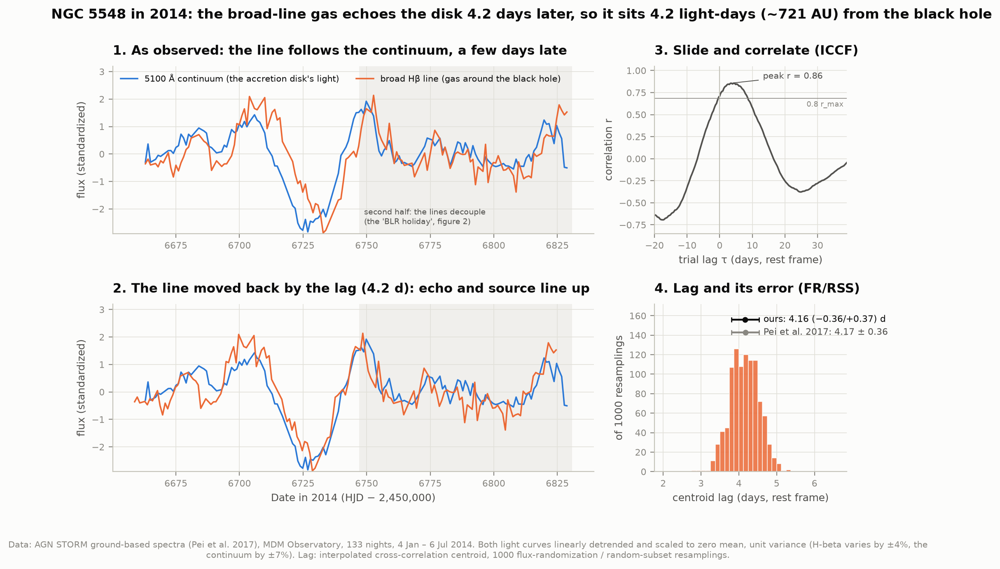
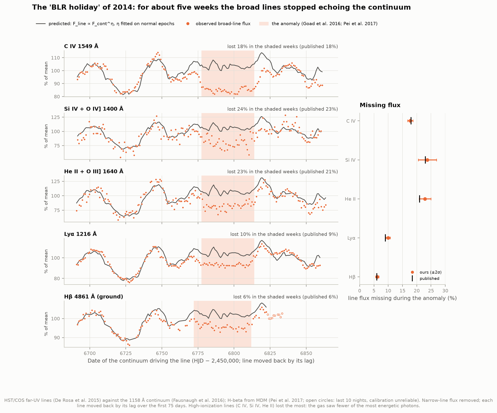
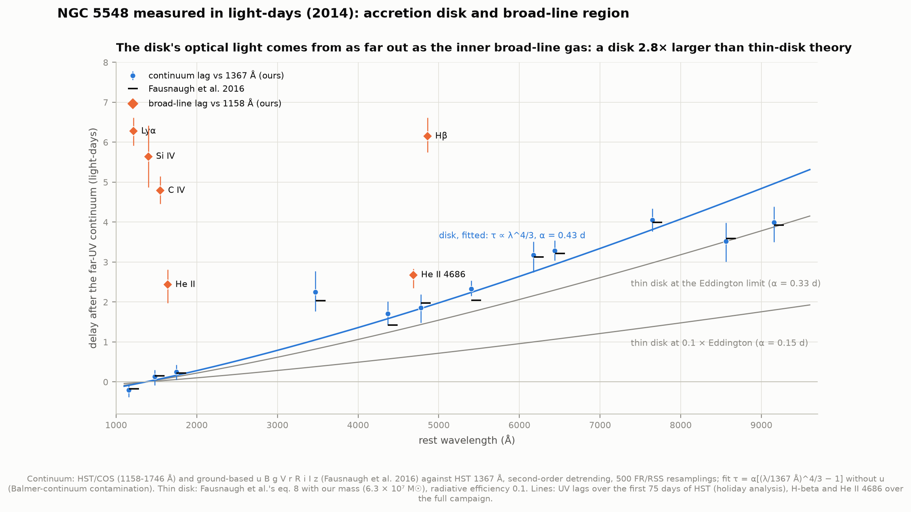
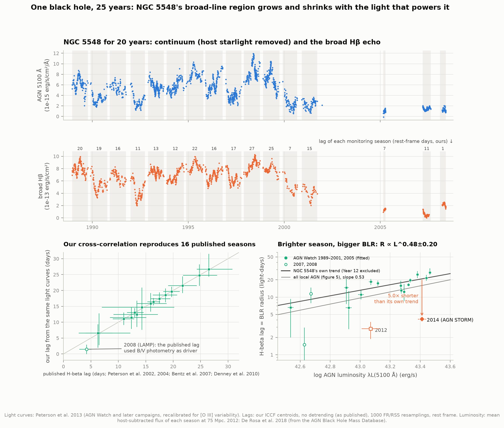
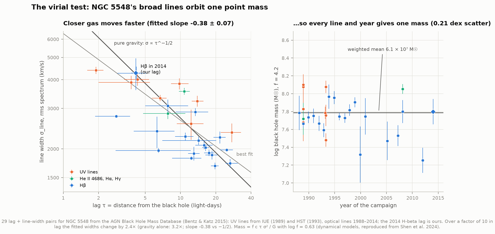
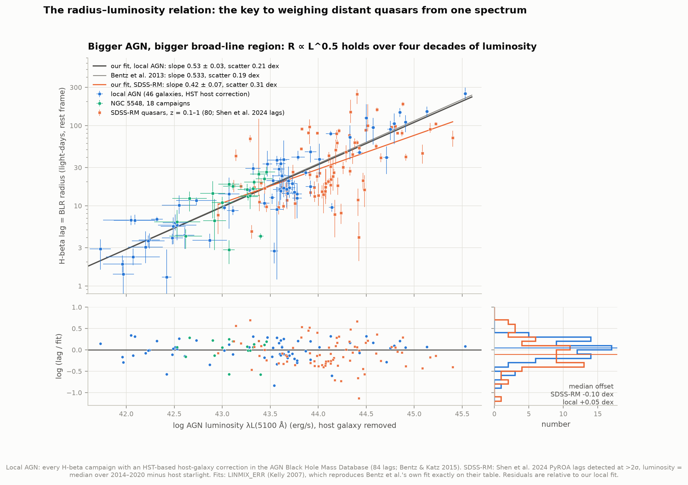
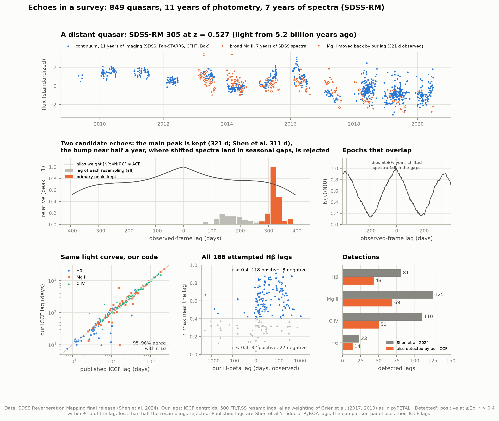
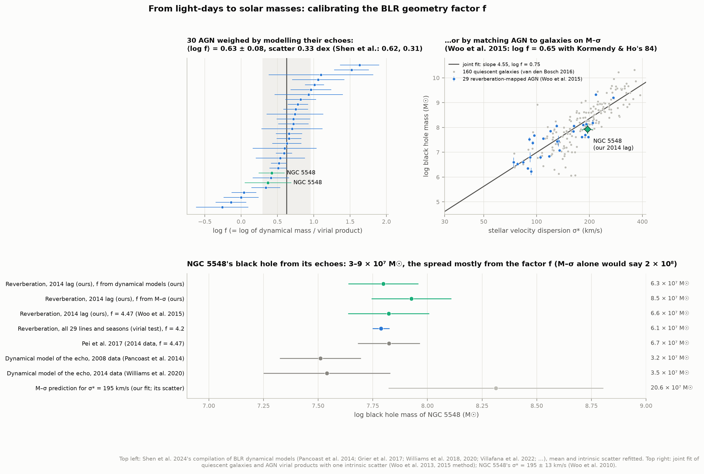

# I2 — Light echoes: weigh a black hole by reverberation mapping

**The broad emission lines of active galaxies come from gas orbiting close to the black hole, far too
small to resolve with any telescope. Can we measure its size from light-travel-time echoes, and so weigh
the black hole?**

Yes. When the accretion disk around a supermassive black hole brightens, the gas clouds around it
brighten too, a few days later: the time light takes to reach them. This project measures that delay
with its own cross-correlation code in three kinds of data. The first is the most intensive campaign
of its time, on **NGC 5548 in 2014** (AGN STORM). The second is **20 years of the same galaxy** (AGN Watch,
1988–2008). The third is **849 distant quasars** from the SDSS Reverberation Mapping survey. From the
delays come the size of the broad-line region, the black hole's mass, the radius–luminosity relation
that weighs every distant quasar, and a few surprises.



The broad Hβ line of NGC 5548 (orange) repeats the flickering of the continuum light (blue) **4.2 days
later**. Sliding it back by that delay lines the two up (panel 2). The delay is found by correlating
the two curves at every trial shift (panel 3); resampling the data 1000 times gives its error (panel 4).

**What we found, in short:**

- **NGC 5548's broad-line gas sits 4.16 (−0.36/+0.37) light-days from the black hole**, 721 times the
  Earth–Sun distance. This reproduces Pei et al. (2017)'s 4.17 ± 0.36 days from the same nights. With
  the published line width (4278 km/s) the virial product is **1.49 ± 0.48 × 10⁷ M☉** (Pei et al.:
  1.49 ± 0.49). The black hole weighs **6.3 × 10⁷ M☉** with the geometry factor we calibrate below
  (6.6 × 10⁷ with Pei et al.'s f = 4.47).
- **The "BLR holiday" found and measured.** For about five weeks in mid-2014 the broad lines stopped
  following the continuum. Predicting each line from the far-UV continuum, the missing flux is
  **C IV 17.7%, Si IV 23.7%, He II 22.9%, Lyα 10.0%, Hβ 6.2%**. Goad et al. (2016) and Pei et al. (2017)
  found 18, 23, 21, 9 and 6%. The high-ionization lines lost 18–24%, the hydrogen lines 6–10%: the gas
  was briefly short of its most energetic photons.
- **The accretion disk echoes too.** Continuum light at longer wavelengths lags the far-UV, from 0.1 day
  at 1500 Å to 4 days in the z band. The pattern follows the λ^4/3 a heated disk predicts, but the disk
  is **2.8× larger than standard thin-disk theory** allows (Fausnaugh et al. 2016: 3.0×). Its optical
  light comes from as far out as the inner broad-line gas.
- **One black hole over 25 years.** Our code, run on the 20-year light curves, reproduces **15 of 16
  published seasonal lags within 1σ** (median difference 0.08 day). The broad-line region grew and
  shrank with the luminosity, as **R ∝ L^(0.52 ± 0.20)**, the slope of 0.5 expected if the gas sits
  where the ionizing light has a fixed intensity. Bentz et al. (2007) quoted 0.73 ± 0.14; the
  difference comes mostly from how the luminosity errors are treated (see section 4). In 2014 the
  lag was **5.0× shorter** than this trend predicts. Pei et al. said "nearly five times".
- **Gravity rules the gas.** Across 29 lag and line-width pairs from 25 years and seven emission lines,
  gas closer in moves faster. Every pair gives the same virial product to **0.21 dex**, while the lags
  span a factor of 10. The fitted slope, −0.38 ± 0.07, is shallower than the −0.5 of pure gravity at
  1.8σ.
- **The radius–luminosity relation.** From the 84 Hβ lags of 47 local AGN with host-galaxy starlight
  removed: slope **0.528 ± 0.034**, scatter 0.21 dex. Our LINMIX run on Bentz et al. (2013)'s own table
  returns their numbers to the last digit (1.527, 0.533, 0.19). SDSS-RM quasars give a shallower slope,
  **0.42 ± 0.07** with 0.31 dex scatter, and lie **0.08 dex below** the local relation. Their Mg II and
  C IV relations (slopes 0.31 and 0.32, scatter 0.32 and **0.51 dex**) reproduce Shen et al. (2024) to
  0.01. Masses from C IV are the least reliable.
- **Survey lags, remeasured.** Our own lags for 444 SDSS-RM lines agree with Shen et al.'s ICCF lags
  (median ratio 0.995 for Hβ, 1.000 for Mg II and C IV, **95–96% within 1σ**). Among all 186 attempted
  Hβ lags, 118 are positive and 8 negative at r > 0.4: a false-positive rate near **7%** (Shen et al.:
  4–17%).
- **The geometry factor f.** From 30 AGN weighed by modelling their echoes: ⟨log f⟩ = **0.626 ±
  0.075**, intrinsic scatter 0.33 dex (Shen et al.: 0.62 ± 0.07, 0.31). From matching AGN to quiescent
  galaxies on M–σ: log f = **0.75 ± 0.12** (Woo et al. 2015: 0.65 ± 0.12 with a different galaxy
  sample). On M–σ, NGC 5548 sits 0.39 dex below the relation, 0.8σ of its scatter.

---

## Results

### 1. NGC 5548 in 2014: echo, size, mass

AGN STORM monitored NGC 5548 almost daily for six months in 2014: ground-based spectra from five
telescopes, ultraviolet spectra from Hubble, and photometry. We take the MDM Observatory spectra (133
nights) as Pei et al. (2017) did. We use their settings too: lags from −20 to +40 days in 0.25-day steps,
both light curves linearly detrended, 1000 resamplings. All lags are in the galaxy's rest frame.

| Light curves | Ours (days) | Pei et al. 2017 |
|---|---|---|
| Hβ vs 5100 Å continuum, full campaign | **4.16 (−0.36/+0.37)** | 4.17 ± 0.36 |
| … first half (before 6747) | 4.92 ± 0.48 | 4.99 (−0.47/+0.40) |
| … second half (the holiday) | 2.57 (−0.65/+0.80) | 3.10 (−0.80/+0.77) |
| Hβ vs far-UV 1158 Å (HST) | 6.15 (−0.40/+0.47) | 6.23 (−0.44/+0.39) |
| Hβ vs 1367 Å (HST) | 5.89 (−0.39/+0.40) | 5.89 ± 0.37 |
| He II 4686 vs 1158 Å | 2.68 (−0.33/+0.16) | 2.69 (−0.25/+0.24) |
| He II 4686 vs 5100 Å | 0.38 ± 0.36 | 0.79 (−0.34/+0.35) |
| 5100 Å continuum vs 1158 Å | 2.31 (−0.34/+0.26) | 2.23 (−0.26/+0.31) |

The size of the broad-line region: **R = cτ = 4.16 light-days = 721 AU**, 24 times Neptune's orbit.
Hβ lags the far-UV continuum by 2 days more than it lags the optical continuum, because the optical
continuum itself lags the UV by 2.3 days (section 3).

The mass needs the line's width in the rms spectrum, σ_line = 4278 ± 671 km/s. That number we take from
Pei et al.; it needs the nightly spectra, which are not public. The virial product c τ σ²/G is
**1.49 ± 0.48 × 10⁷ M☉** (Pei et al.: 1.49 ± 0.49). Multiplied by f, it gives:

| f | Source | Mass of NGC 5548's black hole |
|---|---|---|
| 4.2 (log f = 0.626) | our fit to 30 dynamical models (section 8) | **6.3 × 10⁷ M☉** |
| 4.47 | Woo et al. 2015 (used by Pei et al.) | 6.6 ± 2.2 × 10⁷ M☉ (Pei et al.: 6.66 ± 2.17) |
| 5.7 (log f = 0.75) | our M–σ calibration (section 8) | 8.5 × 10⁷ M☉ |

The AGN luminosity during the campaign: the mean 5100 Å flux (11.91 × 10⁻¹⁵ erg/s/cm²/Å) minus
host-galaxy starlight in the 5″ × 15″ slit (4.52, from Hubble images; 38% of the light). This gives
λL(5100 Å) = 10^43.41 erg/s, matching the AGN mass database's 43.40 ± 0.03.

### 2. The BLR holiday



A line's flux normally tracks the continuum that ionizes it. Before and after the anomaly, each line
follows a power law of the lagged continuum, F_line ∝ F_cont^η (η is the line's "responsivity"). We fit
η on the normal epochs, as Goad et al. (2016) did, and predict the line flux everywhere. During the
anomaly (the shaded weeks) every line falls below its prediction:

| Line | Lag over the first 75 days (obs. days): ours / published | η: ours / published | Flux missing: ours / published |
|---|---|---|---|
| C IV | 4.87 / 4.97 ± 0.39 | 0.240 ± 0.011 / 0.25 ± 0.01 | **17.7%** / 18% |
| Si IV + O IV] | 5.74 / 5.80 ± 0.58 | 0.435 ± 0.028 / 0.45 ± 0.01 | **23.7%** / 23% |
| He II 1640 + O III] | 2.48 / 2.42 ± 0.44 | 0.523 ± 0.019 / 0.58 ± 0.04 | **22.9%** / 21% |
| Lyα | 6.38 / 6.69 ± 0.41 | 0.293 ± 0.011 / 0.30 ± 0.01 | **10.0%** / 9% |
| Hβ | 6.49 / (8, Pei et al.) | 0.148 ± 0.013 / 0.15 ± 0.01 | **6.2%** / 6% |

During the anomaly Hβ's responsivity drops to 0.04 ± 0.05: the line almost stopped responding (Pei et
al.: 0.02 ± 0.03). The high-ionization lines (C IV, Si IV, He II, whose He⁺ needs 54 eV photons) lost
18–24% of their flux, the hydrogen lines only 6–10%. Goad et al. argue that the ionizing spectrum
briefly lost its most energetic photons, perhaps behind a veil of gas between the disk and the clouds.
Pei et al. point out that a campaign of the ~40 days needed to map the gas's velocities would have
measured a lag and never noticed the anomaly.

### 3. The accretion disk echoes too



The continuum also has delays. Light in each optical band lags the far-UV, and the redder the band, the
longer the lag. This is what a disk heated from above should do: its hot inner rings shine in the UV,
its cooler outer rings in the optical, farther away. We repeat Fausnaugh et al. (2016)'s measurement:
every band against Hubble's 1367 Å light curve, during the Hubble campaign only.

| Band (rest λ) | 1158 | 1479 | 1746 | u 3472 | B 4369 | g 4776 | V 5404 | r 6176 | R 6440 | i 7648 | I 8561 | z 9157 |
|---|---|---|---|---|---|---|---|---|---|---|---|---|
| Ours (days) | −0.20 | 0.13 | 0.25 | 2.25 | 1.71 | 1.86 | 2.33 | 3.18 | 3.28 | 4.05 | 3.52 | 4.00 |
| Fausnaugh et al. | −0.17 | 0.15 | 0.22 | 2.03 | 1.42 | 1.98 | 2.04 | 3.13 | 3.22 | 3.99 | 3.59 | 3.93 |

Fitting τ = α[(λ/1367 Å)^4/3 − 1] gives **α = 0.427 ± 0.015 days** without the u band (Fausnaugh et
al.: 0.42 ± 0.02). The u band is contaminated by Balmer-continuum light from the broad-line region; with
all bands α = 0.430 ± 0.015 (0.43 ± 0.02). A standard thin disk around our 6.3 × 10⁷ M☉ black hole,
shining at 10% of its Eddington limit, would give α = 0.155 day. The real disk is **2.8× larger**
(Fausnaugh et al., with 5.2 × 10⁷ M☉: 3.0×). Even a disk at the Eddington limit only reaches 0.33 day.
With λ^β free, we get β = 0.81 ± 0.22 (their 0.99 ± 0.14 includes five Swift UV bands we do not use;
α and β are 99.7% correlated).

The figure puts the disk and the broad lines on one scale. The disk's i- and z-band light arrives 4 days
after the far-UV, later than He II (2.4 days) and nearly as late as C IV (4.8 days).

### 4. Twenty years of NGC 5548: a breathing broad-line region



The AGN Watch consortium monitored NGC 5548 every year from 1988 to 2001, and later campaigns followed
in 2005, 2007 and 2008. Peterson et al. (2013) republished the full light curves: the AGN continuum with
host starlight removed, and broad Hβ with the narrow line removed. We cut them at each published
campaign's dates and cross-correlate.

- **Our lags reproduce the published ones**: 15 of 16 campaigns within 1σ, median difference 0.08 day
  (e.g. 1989: 19.7 vs 19.7; 1998: 26.7 vs 26.5; 2000: 6.6 vs 6.5). This works only *without*
  detrending, which the original analyses did not use. With a linear detrend, several seasons move by
  3–6 days (1998: 21.0 instead of 26.7). The one miss is 2008 (1.5 vs 4.2 days): that campaign (LAMP,
  Bentz et al. 2009) measured its lag against B- and V-band photometry that started a week before the
  spectra, while the table we use has only the spectroscopic continuum.
- **The luminosity of each season**, from its mean AGN flux at 75 Mpc, matches the database's to 0.01
  dex.
- **The broad-line region breathes**: brighter seasons have longer lags. Fitting the 14 campaigns Bentz
  et al. (2007) used (1989–2001 and 2005) gives **R ∝ L^(0.52 ± 0.20)**, and 0.48 ± 0.20 without the
  poorly sampled Year 12. The photoionization expectation is 0.5.
- **Why Bentz et al. found 0.73 ± 0.14 (0.66 ± 0.13 without Year 12).** Mostly the luminosity errors.
  The published per-season errors are ~0.1 dex, largely the uncertainty of the host starlight
  subtracted. With those errors LINMIX takes the luminosities to be noisier than they are and steepens
  the slope to correct for it: our lags and luminosities then give **0.64 (−0.26/+0.30)**, and the
  published lags, luminosities and errors give **0.71 (−0.24/+0.28)**, Bentz et al.'s value. But the
  starlight correction is one number subtracted from every season. It moves all points together and
  cannot scatter them. Counted as a common systematic (±10% of the host flux), it moves our slope
  between 0.45 and 0.55.
- **2014 was different.** At the 2014 luminosity, NGC 5548's own trend predicts a 20.8-day lag. The
  measured 4.16 days is **5.0× shorter** (Pei et al.: "nearly five times"). The 2012 campaign (De Rosa
  et al. 2018) was also short, at 2.8 days. Pei et al. suggest the continuum flickered faster in 2014
  (on a ~10-day timescale), so mostly the inner broad-line region could respond; simulations by Goad &
  Korista (2014) show that this shortens the measured lag.

### 5. The virial test: gravity sets the line widths



If the broad-line gas orbits one central mass, gas closer in must move faster: σ ∝ τ^−½. NGC 5548 has
lags and widths for seven lines over 25 years: the UV lines from IUE (1989) and HST (1993), Hβ, He II
4686 and Hα from the ground. The fitted slope is −0.38 ± 0.07: over a factor of 10 in lag the widths
change by a factor 2.4, where pure gravity (slope −0.5) predicts 3.2. Bentz et al. (2007)
found −0.5 ± 0.1. The mass every pair implies is constant to **0.21 dex**, weighted mean **6.1 × 10⁷
M☉** with f = 4.2. The slope's 1.8σ shortfall may come from widths measured in different ways over 25
years, or from non-gravitational motions (outflow or inflow) in part of the gas.

### 6. The radius–luminosity relation



| Sample | N | Intercept (log days at 10⁴⁴ erg/s) | Slope | Scatter (dex) | Published |
|---|---|---|---|---|---|
| Bentz et al. 2013's table, our LINMIX | 71 | 1.527 ± 0.031 | 0.533 ± 0.034 | 0.189 | 1.527, 0.533, 0.19 |
| AGN mass database, all Hβ lags with HST host correction | 84 (47 AGN) | 1.513 ± 0.032 | **0.528 ± 0.034** | 0.205 | — |
| … one point per AGN | 47 | 1.500 ± 0.038 | 0.549 ± 0.038 | 0.209 | — |
| SDSS-RM Hβ (Shen et al.'s lags) | 80 | 1.457 ± 0.037 | **0.42 ± 0.07** | 0.31 | 1.458, 0.41, 0.32 |
| SDSS-RM Mg II (vs L₃₀₀₀/10⁴⁵) | 124 | 2.083 ± 0.031 | 0.31 ± 0.06 | 0.32 | 2.086, 0.31, 0.32 |
| SDSS-RM C IV (vs L₁₃₅₀/10⁴⁵) | 89 | 1.840 ± 0.075 | 0.32 ± 0.11 | **0.51** | 1.840, 0.32, 0.51 |

- **Four decades of luminosity, one relation.** From the faintest Seyfert (10⁴¹·⁷ erg/s, a 3-day lag)
  to luminous quasars (10⁴⁵·⁵, 250 days), R ∝ L^0.53.
- **SDSS-RM quasars sit 0.08 dex below** the local relation at fixed slope (intercept 1.444 vs 1.520).
  Shen et al. note that their starlight corrections are 30–40% smaller than image-based ones. Correcting
  that would remove most of the offset. Quasars accreting fast also have shorter lags (Du et al. 2016).
- **The scatter sets the precision of every single-epoch mass** (project I3): 0.2–0.3 dex for Hβ and
  Mg II, 0.5 dex for C IV. Without the host-galaxy correction, the SDSS-RM Hβ slope is 0.46 and its
  intercept 0.09 dex lower: starlight inflates the luminosities of faint AGN.
- The database lists 46 more Hβ lags without an HST-based host correction, among them most of the
  fast-accreting "SEAMBH" AGN, which are known to fall below the relation. They are left out here.

### 7. SDSS-RM: echoes in a survey, measured ourselves



SDSS-RM followed 849 quasars at z = 0.1–4.5 with 11 years of imaging and 7 years of spectra (Shen et al.
2024). We measured 444 lags ourselves, with the same alias weighting as their pipeline:

| Line | Lags measured | Shen et al.'s detections | Ours (ICCF only) | Median ratio, ours / their ICCF | Within 1σ |
|---|---|---|---|---|---|
| Hβ | 186 (all attempted) | 81 | 57 (43 in common) | 0.995 | 95% |
| Mg II | 125 | 125 | 69 | 1.000 | 96% |
| C IV | 110 | 110 | 50 | 1.000 | 95% |
| Hα | 23 | 23 | 14 | 1.010 | 96% |

- **Seasonal gaps fake echoes.** A quasar can only be observed for part of each year, so a shift of half
  a year puts the shifted spectra into the gaps, where there is nothing to disagree with. RM305 (figure,
  middle) shows the effect: its lag distribution has a main peak at 321 days and a bump near half a year
  where the overlap drops to 20%. The weighting rejects the bump and keeps 321 (−14/+16) days. Shen et
  al.'s fiducial lag is 311 ± 42 days.
- **False positives.** With a symmetric search, noise gives as many negative as positive lags. At r >
  0.4 we find 118 positive and 8 negative: about **7%** of the positive lags are flukes (Shen et al.:
  4–17%). Below r = 0.4 the ratio is 22 to 32: mostly noise.
- **Why fewer detections.** Shen et al. detect with PyROA, which models the light curves and gives tighter
  errors. Our ICCF-only rule needs a 2σ lag from the cross-correlation's wider distribution. Our
  detected subsets give shallower R–L slopes with smaller scatter (Hβ 0.28 ± 0.07, 0.24 dex; Mg II 0.24
  ± 0.07). This is the selection bias Shen et al. warn about: stricter cuts keep the cleanest, shorter
  lags.
- **A lag comes with a method attached.** For RM078, Shen et al.'s own showcase, our ICCF lag is 154
  (−26/+17) days, matching their ICCF lag of 157 days. Their PyROA lag is 84 days: the correlation peak
  is broad, and centroid and model fit disagree.

### 8. The geometry factor f, and NGC 5548 on M–σ



- **From dynamical models.** Fitting the full velocity-resolved echo with a model of orbiting clouds
  weighs a black hole directly. Shen et al. (2024) compiled 30 such masses; mass / virial product is
  each AGN's own f. Refitting their table gives ⟨log f⟩ = **0.626 (−0.077/+0.074)**, intrinsic scatter
  **0.33 dex** (maximum likelihood: 0.624, 0.309; Shen et al.: 0.62 ± 0.07, 0.31 ± 0.07). For any single
  AGN, f is uncertain by a factor of 2.
- **From M–σ.** We fit van den Bosch (2016)'s 160 quiescent galaxies and Woo et al. (2015)'s 29 AGN
  together, with one intrinsic scatter (Woo et al.'s method). The joint fit gives slope 4.55 ± 0.25,
  scatter 0.49 dex, **log f = 0.75 ± 0.12**. Woo et al. got 0.65 ± 0.12 with Kormendy & Ho (2013)'s 84
  galaxies (slope 4.97). The galaxy sample alone moves f by 0.1 dex.
- **NGC 5548**: log M = 7.80 (f from dynamical models), 7.93 (f from M–σ), 7.82 (Woo et al.'s f).
  Direct dynamical models of its echo give 7.51 (Pancoast et al. 2014) and 7.54 (Williams et al. 2020).
  For its σ* = 195 km/s, M–σ predicts 8.31. NGC 5548 sits 0.39 dex below, within the relation's 0.49
  dex scatter.

### The explorer

`figures/echo_finder.html` is an offline page: pick NGC 5548 (2014, 1989, 1998, 2005) or one of three
SDSS-RM quasars, then slide the line's light curve back in time. The correlation at each shift is read
from this project's cross-correlation function, and the page turns your shift into a distance
(light-days, AU) and a black hole mass.

---

## The background in brief

**Active galaxies.** Some galaxies have a nucleus far brighter than all their stars: gas spiralling
into a supermassive black hole heats up in an **accretion disk** and glows from X-rays to the infrared.
Farther out, clouds of gas lit by the disk's ultraviolet light emit **broad emission lines** (Hβ, C IV,
Mg II, ...). The lines are broad (thousands of km/s) because the clouds orbit fast, deep in the black
hole's gravity. This **broad-line region** (BLR) is a few light-days to a few light-months across. NGC
5548 is 245 million light-years away (75 Mpc), where 4 light-days span 10 micro-arcseconds, about
1/5000 of what the Hubble Space Telescope can resolve.

**Echoes measure size.** The disk's brightness flickers by tens of per cent over days to years. The
clouds see each flicker only after its light has travelled out to them, so the line flux repeats the
continuum's pattern with a **delay τ**: the light-travel time to the clouds. Their distance is
**R = cτ** (Blandford & McKee 1982). Finding τ is a matching game: slide the line's light curve back in
time until it lines up with the continuum (the **cross-correlation function**).

**Size plus speed weighs the black hole.** Gas orbiting at radius R with speed v needs a central mass
M = R v² / G. The line width gives v (the spread of Doppler velocities, σ_line), measured in the **rms
spectrum**, the part of the spectrum that varies (so constant light from elsewhere drops out). The
**virial product** VP = c τ σ²/G is what the data give; the mass is **M = f × VP**, where f, of order
a few, accounts for the BLR's unknown shape and our viewing angle. f is calibrated on AGN whose masses
are known independently.

**Why it matters beyond one galaxy.** Across AGN, the BLR radius grows with luminosity as **R ∝ L^½**:
every AGN puts its broad lines where its ultraviolet light has the same intensity. That **radius-
luminosity (R-L) relation** lets one spectrum of a distant quasar give R (from L) and v (from the line
width), and so a black hole mass. Every quasar mass at high redshift (project I3) rests on it.

## How it works

1. **Light curves** (`lightcurves.py`): AGN STORM 2014 spectra and photometry of NGC 5548 (VizieR copies
   of the journals' machine-readable tables), the 1988-2008 AGN Watch light curves, and the SDSS-RM
   light curves of 363 quasars.
2. **Cross-correlation** (`iccf.py`): our own interpolated cross-correlation function, vectorized; a
   test checks it against a literal loop transcription to 10⁻¹⁶. Peak and centroid follow PyCCF's
   rules exactly (centroid over r > 0.8 r_max; realizations with r_max < 0.2 or a peak on the grid edge
   fail). Errors by flux randomization and random subset selection (Peterson et al. 1998, 2004).
   For survey light curves, the alias weighting of Grier et al. (2017, 2019) as in pyPETAL.
3. **NGC 5548** (`ngc5548.py`): Pei et al.'s settings (−20 to 40 d in 0.25 d steps, linear
   detrending, 1000 resamplings, MDM spectra); the holiday's line-response model (log F_line =
   A + η log F_cont, fitted on normal epochs, Goad et al. 2016); season-by-season lags for 1988-2008.
4. **Accretion disk** (`disk.py`): continuum lags against the HST 1367 Å light curve as in Fausnaugh et
   al. (2016), and their thin-disk prediction.
5. **Regression** (`regression.py`): LINMIX_ERR (Kelly 2007; the Python port by J. Meyers) for every
   R-L relation, as Bentz et al. and Shen et al. used; our own errors-in-both likelihood (emcee) for
   fixed-slope fits and population means.
6. **R-L relation** (`rl.py`): the database's local AGN, SDSS-RM, NGC 5548 alone.
7. **SDSS-RM** (`sdssrm.py`): our lags for every detected quasar and every attempted H-beta lag, run in
   parallel and cached.
8. **Masses** (`masses.py`): f from dynamical models and from M-σ; NGC 5548's virial test.
9. **Everything else**: `agnmass.py` parses the database pages, `literature.py` holds published values
   and parses three papers' tables from their arXiv TeX, `physics.py` holds the unit conversions,
   `figures.py` and `explorer.py` draw, `run.py` runs it all.

## Honest notes

- **Line widths are borrowed.** Lags are ours. The rms line widths come from the papers (NGC 5548:
  Pei et al. 2017 and the AGN mass database; SDSS-RM: Shen et al.'s PrepSpec values), because the
  nightly spectra are not public. For the same reason there are no velocity-resolved lags here.
- **Detrending matters, and it is a choice.** NGC 5548 2014: 4.16 days detrended (as Pei et al.), 4.03
  without. The second half of the campaign moves from 2.57 (detrended, Pei et al.: 3.10) to 4.00 days
  (not). AGN Watch seasons reproduce the published lags only without detrending; with it, several move
  by 3–6 days. We follow each paper's own choice.
- **He II vs 5100 Å** is our largest 2014 discrepancy: 0.38 ± 0.36 against 0.79 ± 0.35 days (0.8σ).
  He II's light curve is noisy and partly narrow-line flux.
- **The holiday's segments are the papers'.** Goad et al.'s colour-coded dates (their figure 1 caption)
  for the UV lines, Pei et al.'s for Hβ; the responsivity is fitted where they fitted it. The UV lags are
  observed-frame over the first 75 days of Hubble, as Goad et al. measured them.
- **The disk comparison** uses 12 of Fausnaugh et al.'s 19 bands (not the Swift UV and X-ray bands).
  The thin-disk prediction depends on the assumed Eddington ratio (0.1) and efficiency (0.1); the disk
  being "too big" is robust to both (an Eddington-limited disk is still too small).
- **NGC 5548's own R–L slope** depends on the luminosity errors (section 4): 0.5 with season-to-season
  errors, 0.64–0.71 if the common host-starlight error is counted per season.
- **The f calibrations differ by 0.13 dex** (0.63 vs 0.75), and both assume one f for all AGN. Its
  intrinsic scatter (0.33 dex) is the floor on any single reverberation mass.
- **The local R–L sample is selected**: only AGN with Hubble-based host-galaxy corrections, which leaves
  out most fast-accreting AGN. SDSS-RM's own selection (flux-limited, lags must fit in the baseline) is
  different again. Shen et al. caution against fitting the two together, so we fit them separately.
- **SDSS-RM**: 500 resamplings per lag instead of 3000, and no 5σ outlier clipping of the continuum.
  Neither changes the median lags (95–96% agreement within 1σ). Luminosity errors are not published and
  were set to 0.001 dex.
- **The M–σ sample**: van den Bosch (2016)'s fitted galaxies with upper limits removed (160). Kormendy &
  Ho (2013)'s spiral-galaxy table is only available as PostScript, so their exact sample was not used.
  Project I1 (built in parallel) studies M–σ itself.

## Running it

```bash
cd ..                       # repository root
python3 -m venv .venv
source .venv/bin/activate
pip install numpy scipy pandas matplotlib astropy emcee beautifulsoup4 lxml pyarrow
pip install "git+https://github.com/jmeyers314/linmix.git"

cd 33-reverberation-mapping
python fetch_data.py        # ~27 MB: 4 VizieR tables, 86 database pages, 807 SDSS-RM light curves (~15 min)
python run.py               # every measurement, all figures and the explorer (first run ~45 min on 4 cores)
python test_physics.py      # 30 checks
```

The first run measures 444 SDSS-RM lags (~20 minutes on 4 cores) and caches them. After that,
`run.py` takes ~25 minutes, mostly LINMIX regressions. It needs no network: the run was checked inside a
network namespace with no connectivity. `python run.py --figures-only` redraws the figures from the last
analysis. Results are written to `data/results.json`.

### Files

| File | What it does |
|---|---|
| `config.py` | Paths, constants, and every adopted input with its source (NGC 5548's distance, host flux, σ*; each paper's analysis settings) |
| `fetch_data.py` | Downloads and caches every input |
| `lightcurves.py` | Loaders for all light curves |
| `iccf.py` | Our cross-correlation function, FR/RSS errors and alias weighting |
| `ngc5548.py` | NGC 5548: 2014 lags and mass, the holiday, the 1988–2008 seasons |
| `disk.py` | Continuum lags against wavelength and the thin-disk prediction |
| `rl.py` | The radius–luminosity relation for the three samples |
| `sdssrm.py` | Our lags for SDSS-RM, comparison and false-positive test |
| `masses.py` | The virial factor from dynamical models and from M–σ; the virial test |
| `regression.py` | LINMIX wrapper; our errors-in-both likelihood and population fits |
| `agnmass.py` | Parses the AGN Black Hole Mass Database pages |
| `literature.py` | Published values (never used in a fit) and three tables parsed from arXiv TeX |
| `physics.py` | Virial products, luminosities, extinction |
| `simulate.py` | Simulated damped-random-walk light curves, for the tests only |
| `analysis.py` | Every measurement and the summary |
| `figures.py`, `plotstyle.py` | Every figure; colours checked with a colour-blindness validator |
| `explorer.py` | Writes `figures/echo_finder.html` |
| `run.py` | Runs everything and prints the summary |
| `test_physics.py` | 30 checks against independently known answers |

## Data credits and references

- **NGC 5548, 2014 (AGN STORM)**: Pei et al. 2017, ApJ 837, 131 (VizieR J/ApJ/837/131); De Rosa et al.
  2015, ApJ 806, 128 (J/ApJ/806/128); Fausnaugh et al. 2016, ApJ 821, 56 (J/ApJ/821/56); Goad et al.
  2016, ApJ 824, 11.
- **NGC 5548, 1988–2008**: Peterson et al. 2013, ApJ 779, 109 (J/ApJ/779/109), from the AGN Watch
  campaigns (Peterson et al. 2002, ApJ 581, 197 and references there), Bentz et al. 2007, ApJ 662, 205,
  Denney et al. 2010, ApJ 721, 715, and Bentz et al. 2009, ApJ 705, 199. De Rosa et al. 2018, ApJ 866,
  133 (2012 campaign).
- **AGN Black Hole Mass Database**: Bentz & Katz 2015, PASP 127, 67 (astro.gsu.edu/AGNmass), with the
  original papers it compiles. Host-corrected luminosities: Bentz et al. 2013, ApJ 767, 149; Dalla Bontà
  et al. 2020, ApJ 903, 112.
- **SDSS-RM**: Shen et al. 2024, ApJS 272, 26 (ariel.astro.illinois.edu/sdssrm/final_result); alias
  weighting from Grier et al. 2017, ApJ 851, 21 and 2019, ApJ 887, 38; pyPETAL (github.com/Zstone19/pypetal).
- **Virial factor and M–σ**: Shen et al. 2024 (dynamical-model compilation); Woo et al. 2015, ApJ 801, 38;
  Woo et al. 2010, ApJ 716, 269 (σ* of NGC 5548); van den Bosch 2016, ApJ 831, 134; Kormendy & Ho 2013,
  ARA&A 51, 511; Pancoast et al. 2014, MNRAS 445, 3073; Williams et al. 2020, ApJ 902, 74.
- **Methods**: Gaskell & Peterson 1987, ApJS 65, 1; White & Peterson 1994, PASP 106, 879; Peterson et
  al. 1998, PASP 110, 660; Peterson et al. 2004, ApJ 613, 682; Sun, Grier & Peterson 2018 (PyCCF);
  Welsh 1999, PASP 111, 1347; Kelly 2007, ApJ 665, 1489 (LINMIX_ERR; Python port by J. Meyers).

All data retrieved 2026-10-04.
