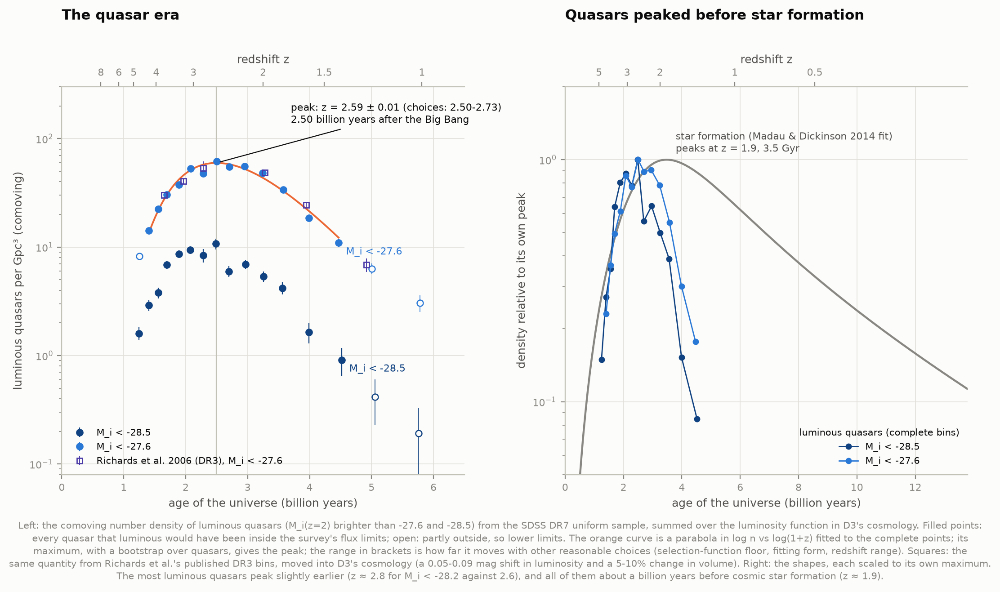
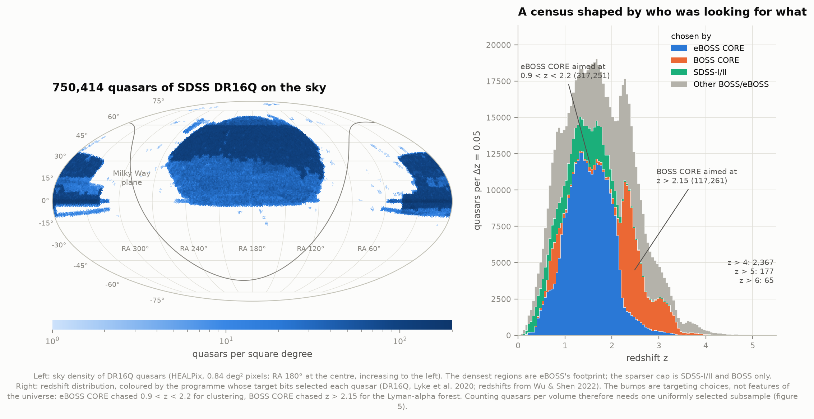
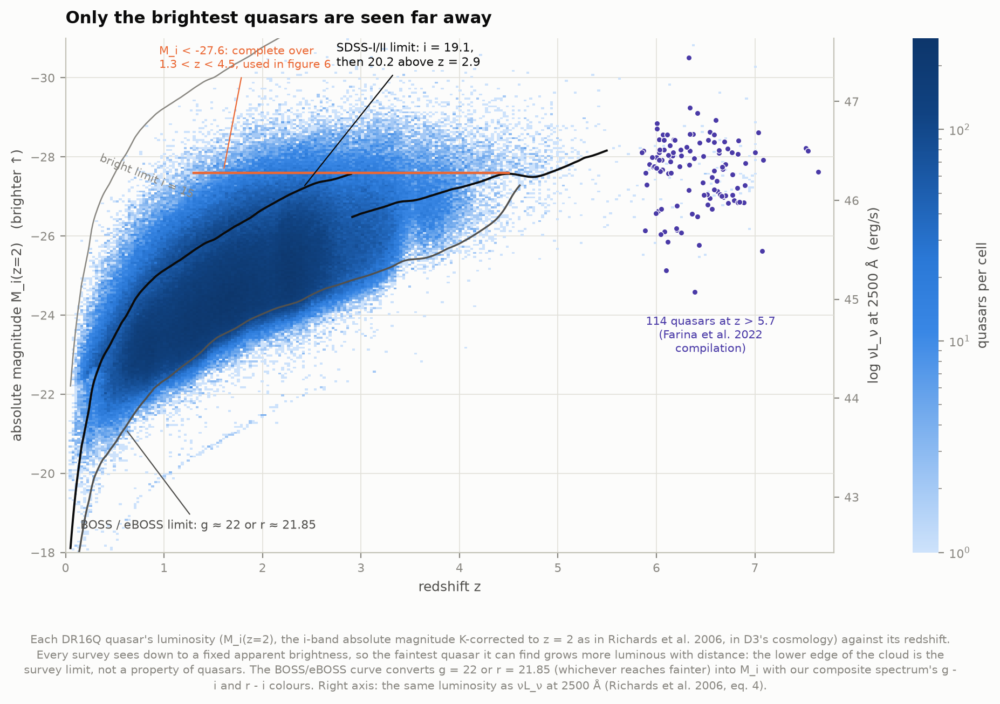
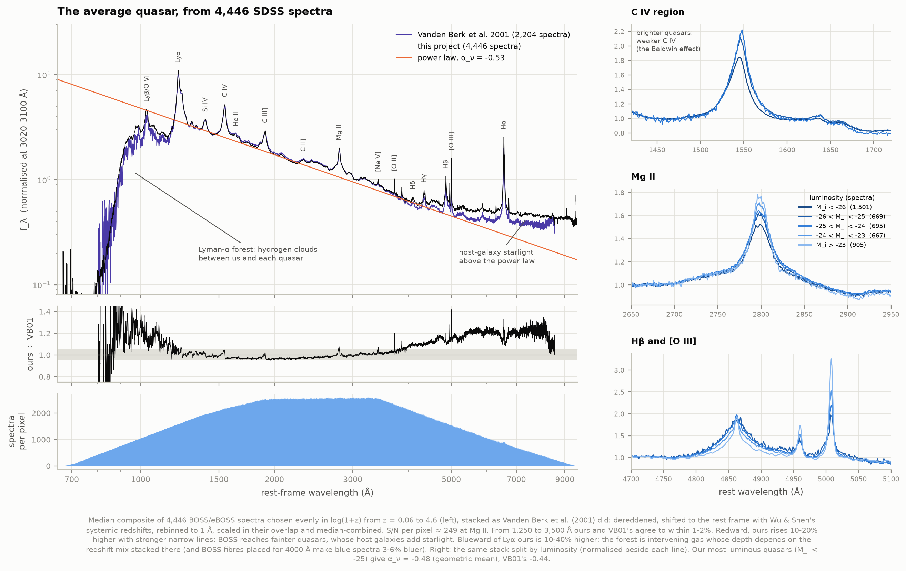
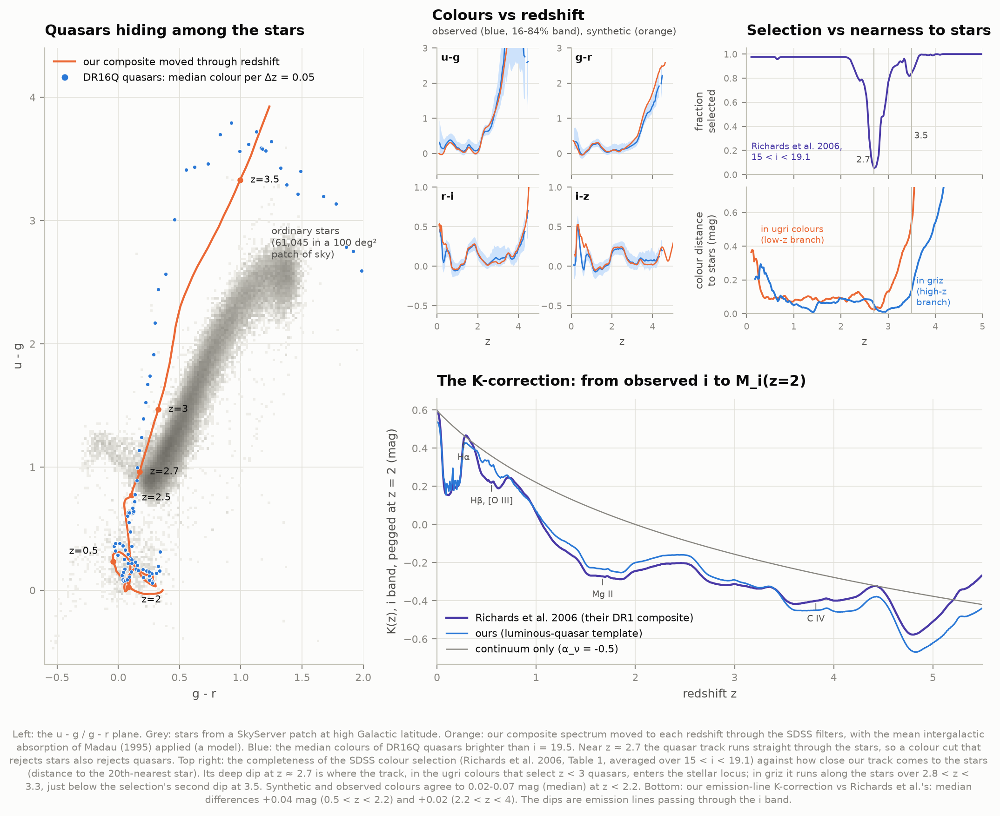
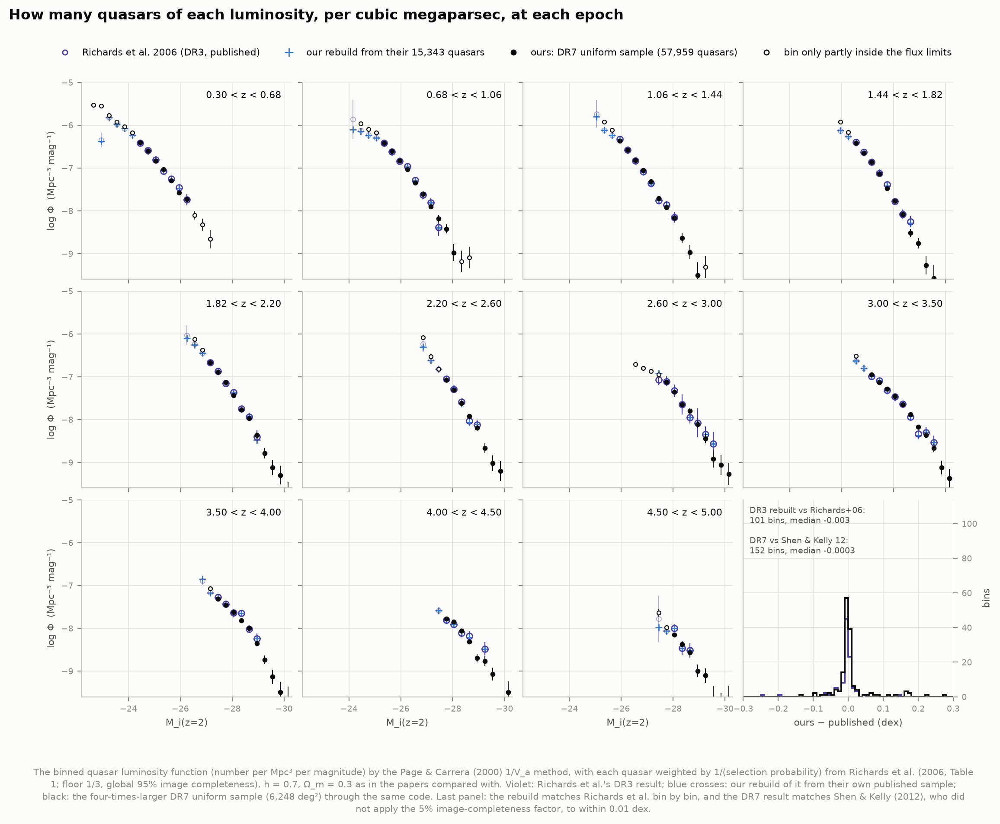
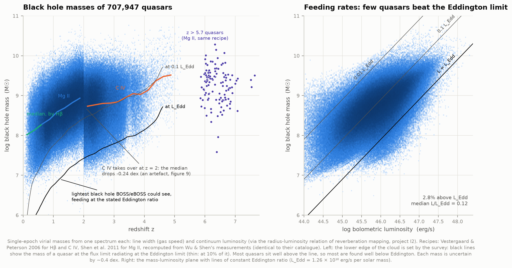
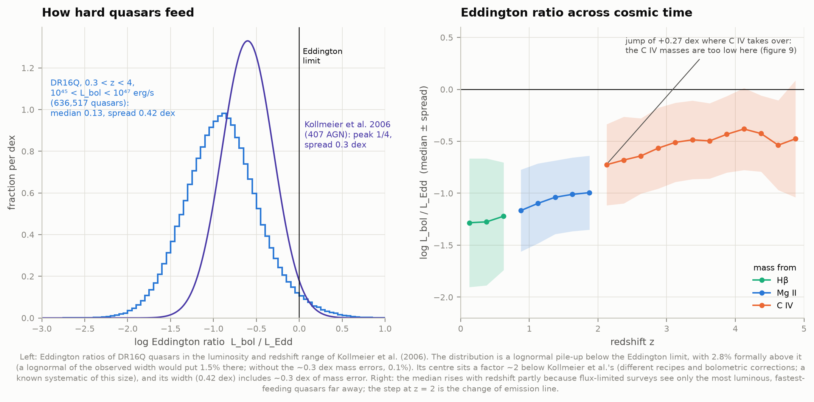
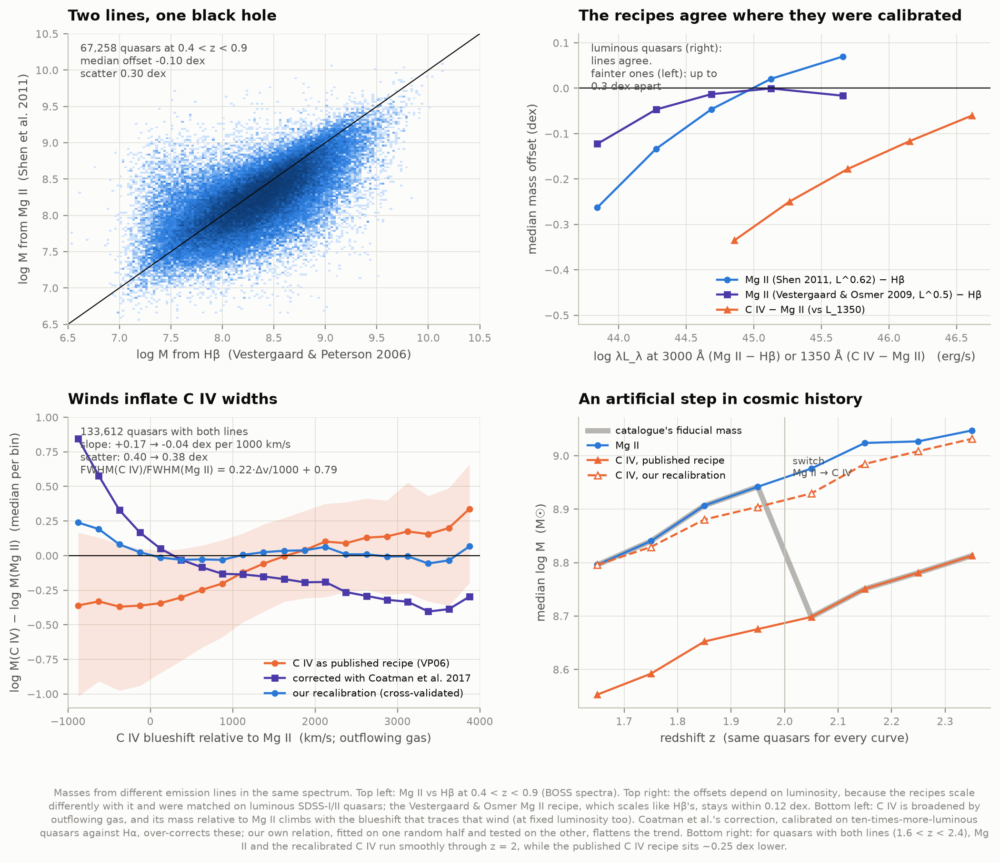
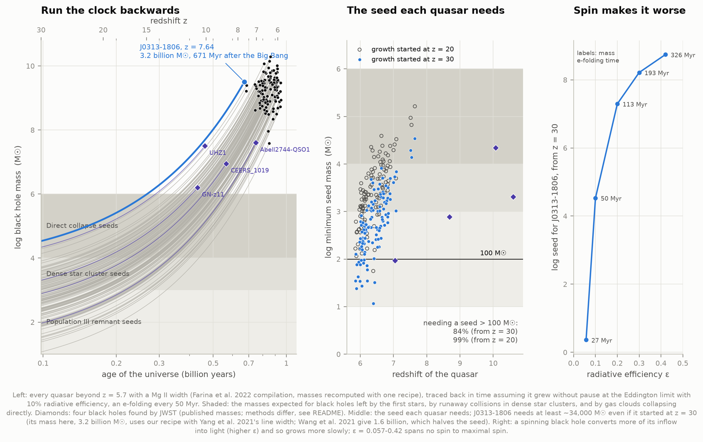

# I3 — Quasars across cosmic time

**Quasars are supermassive black holes swallowing gas so fast that they outshine their whole galaxy.
When were they most common, how massive did they get, and how did some reach billions of solar
masses within a billion years of the Big Bang?**

This project answers all three with real data: the **750,414 quasars** of the SDSS DR16 quasar
catalogue (DR16Q) and Wu & Shen's (2022) measurements of their spectra; the uniformly selected
**DR7 quasar sample** (57,959 quasars) for counting them; **4,446 SDSS spectra** that we stack into our
own average quasar spectrum; and **114 quasars beyond redshift 5.7**, compiled by Farina et al. (2022),
for the growth problem. Every published number we lean on is first reproduced from its own inputs.



**What we found, in short:**

- **The quasar era peaked 2.5 billion years after the Big Bang.** The number of luminous quasars
  (M_i(z=2) < −27.6) per unit volume rose to **60 per cubic gigaparsec at z = 2.59 ± 0.01**
  (2.50–2.73 across every reasonable analysis choice we tried), four to five times more than at
  z = 4.3 or z = 1.4. The most luminous quasars peaked slightly earlier (z ≈ 2.8). All of this came
  about a billion years before cosmic star formation peaked (z ≈ 1.9, project J3).
- **Our counting machinery reproduces the published luminosity functions bin by bin.** Rebuilt from
  Richards et al.'s (2006) own 15,343 quasars, 93% of their 101 bins agree within 0.05 dex (median
  −0.003 dex). Our DR7 result matches Shen & Kelly (2012) to **−0.0003 ± 0.009 dex** once we notice
  that they left out a 5% image-completeness factor.
- **Black hole masses:** 707,947 single-epoch masses, from 10⁸ M☉ (median, z < 0.25) to 10⁹·⁵ M☉
  (z ≈ 4.8). The rise with redshift is mostly the survey's flux limit, not growth: far away we see
  only the brightest quasars, so only the biggest black holes.
- **Quasars feed below the Eddington limit:** Eddington ratios pile up in a lognormal with median
  **0.13** and spread 0.42 dex; 2.8% are formally above the limit, about what the ~0.4 dex mass errors
  produce. The median is a factor 2 below Kollmeier et al.'s (2006) 1/4, a known calibration
  systematic.
- **The three "rulers" disagree in telling ways.** H β and Mg II masses agree where the recipes were
  calibrated (luminous quasars) but drift 0.26 dex apart for faint ones. C IV masses grow with the
  blueshift of the line (outflowing gas): **+0.17 dex per 1000 km/s**, at fixed luminosity too. The
  published correction (Coatman et al. 2017) over-corrects these fainter quasars; our own
  cross-validated recalibration removes the trend and an **artificial 0.24 dex drop in black hole mass
  at z = 2**, where the catalogue switches from Mg II to C IV.
- **The growth problem is real.** J0313−1806 (z = 7.64), 671 Myr after the Big Bang with 1.6 billion
  solar masses, needs a seed of **at least 17,000 M☉** even if it grew without pause at the
  Eddington limit from z = 30 (82,000 from z = 20; 490,000 from z = 15), matching Wang et al.'s
  (2021) 10⁴–10⁵. Of the 114 quasars beyond z = 5.7, **84% need seeds heavier than 100 M☉**, more than
  a dead first-generation star leaves. A spinning black hole, which turns more of its food into light,
  would need a seed of 10⁷ M☉ or more.
- **Our average quasar matches Vanden Berk et al. (2001) to within 1–2% from 1,250 to 3,500 Å**, and
  its most luminous members give their continuum slope (α_ν = −0.48 vs −0.44). Fainter quasars show
  their host galaxies' starlight and stronger emission lines (the Baldwin effect: C IV's equivalent
  width falls from 46 to 35 Å as luminosity rises).
- **Why the SDSS missed quasars at z ≈ 2.7:** moving our spectrum through the five SDSS filters, its
  colours cross the stellar locus at z = 2.70, exactly where the survey's selection completeness
  bottoms out at 5%.

An offline page, `figures/quasar_time_machine.html`, lets you drag a quasar through redshift and watch
its spectrum move through the filters, its colours enter the stellar locus, and the cosmic clock tick.

---

## The background in brief

**A quasar** is the brightest kind of active galactic nucleus: gas spirals into a black hole of
millions to billions of solar masses, heats up in an accretion disk and radiates up to thousands of
times the light of all the stars in its galaxy. Fast-moving gas clouds near the black hole make the
broad emission lines that identify a quasar in a spectrum.

**Weighing a black hole from one spectrum.** Project I2 measures how far the broad-line gas sits from
the black hole by timing light echoes (reverberation mapping). That distance grows with luminosity,
R ∝ L^~0.5. So one spectrum gives a size (from the luminosity) and a speed (from the line width), and
gravity gives the mass, M = f R v² / G. These **single-epoch virial masses** come packaged as recipes,
log M = a + b log L + 2 log FWHM, calibrated on reverberation-mapped AGN. Each is uncertain by ~0.4 dex
(a factor of 2.5). Only part of the spectrum (~3,600–10,400 Å) is observed, so different lines serve at
different redshifts: H β to z ≈ 0.7, Mg II to z ≈ 2, C IV beyond.

**The Eddington limit.** Infalling gas is pushed back by the radiation it creates. Above
L_Edd = 1.26 × 10³⁸ erg/s per solar mass, radiation pressure wins. The **Eddington ratio** L/L_Edd
measures how hard a black hole is feeding. Growing at the limit while radiating 10% of the inflow's
rest-mass energy, a black hole's mass e-folds every **50 Myr**: 100 M☉ takes 807 Myr to reach 10⁹ M☉.

**Counting quasars.** A survey sees down to a fixed apparent brightness, so faint quasars are found only
nearby. The **luminosity function** Φ(L, z), the number per unit volume per unit luminosity, corrects for
that with the volume each quasar could have been seen in (the 1/V_a method). It also needs every
quasar the survey missed: the SDSS chose its targets by their colours, and at some redshifts quasars
have the same colours as ordinary stars.

---

## Results

### 1. Who is in the catalogue



| Programme (target bits in DR16Q) | Quasars | Median z | Selected for |
|---|---|---|---|
| eBOSS CORE (2014–2019) | 317,251 | 1.50 | 0.9 < z < 2.2, galaxy-clustering cosmology |
| BOSS CORE (2009–2014) | 117,261 | 2.41 | z > 2.15, the Lyman-α forest |
| SDSS-I/II (2000–2008) | 73,325 | 1.29 | everything to i = 19.1 (20.2 at high z) |
| Other BOSS/eBOSS | 242,575 | 1.96 | bonus, variability, re-observation and ancillary programmes |

DR16Q is the union of several surveys that wanted different quasars, so its redshift distribution is a
record of targeting choices: the two big bumps are eBOSS's and BOSS's target ranges. 2,367 quasars lie
beyond z = 4, 177 beyond z = 5 and 65 beyond z = 6 (the highest at z = 7.01). Redshifts are Wu & Shen's
improved systemic ones where available.

### 2. Only the brightest quasars are seen far away



The lower edge of the cloud is the survey limit, not a property of quasars. We compute each quasar's
M_i(z=2), the i-band absolute magnitude K-corrected to z = 2 (Richards et al. 2006), in D3's cosmology.
The BOSS/eBOSS limit (g < 22 or r < 21.85) is converted with our own composite's colours.

### 3. The average quasar



We stacked 4,446 BOSS/eBOSS spectra, chosen at random but evenly in log(1+z) from z = 0.06 to 4.6, as
Vanden Berk et al. (2001, "VB01") did: corrected for Milky Way dust, shifted to the rest frame, rebinned
to 1 Å, scaled to each other where they overlap and median-combined. The result covers 668–9,562 Å with
a signal-to-noise of ~250 per Å at Mg II.

| Quantity | This project | Vanden Berk et al. 2001 |
|---|---|---|
| Spectra | 4,446 | 2,204 |
| ours ÷ VB01, 1,250–2,000 Å / 2,000–3,500 Å | 0.977 / 0.991 | — |
| α_ν, geometric mean (1350 & 4215 Å windows), all | −0.66 | −0.44 ± 0.1 |
| α_ν, geometric mean, our M_i < −25 quasars only | **−0.48** | −0.44 |
| α_ν, median composite, all / M_i < −25 | −0.53 / −0.41 | −0.46 |
| α_ν redward of H β, geometric mean / median | −2.16 / −1.49 | −2.45 / −1.58 |

**Why ours is redder overall.** The slope is fixed by two windows, 1350 Å (reached by only 22 of the
1,982 spectra in the geometric-mean stack, at z ≈ 1.7–2.3) and 4215 Å (reached by 1,636 of them, at
median z ≈ 0.5). BOSS and eBOSS also chose quasars by
infrared colours and variability, not only by the UV excess that SDSS-I/II used, so they include redder
quasars and ones dominated by their host galaxy. Split by luminosity, the slope between 3060 and 4215 Å
runs from +0.08 for M_i < −25 to −1.22 for M_i > −23. Restricted to luminous quasars like VB01's, our
slope matches theirs.

**The luminosity sequence** (right panels): brighter quasars have weaker C IV (equivalent width 46, 43,
35 Å from M_i ≈ −24.5 to < −26: the **Baldwin effect**), slightly weaker Mg II, and weaker
[O III] (20 → 15 Å). Faint quasars sit on visible starlight.

**Below Lyman α** our stack is 10–40% higher than VB01's. That region is not the quasar but the
**Lyman-α forest**, intervening hydrogen whose depth grows steeply with redshift, so it depends on the
redshift mix stacked at each wavelength. We also tested BOSS's practice of placing quasar fibres for
4,000 Å light: at matched redshift those spectra are 3–6% bluer, too little to explain it. Nothing
below Lyman α is used quantitatively.

### 4. Quasars hiding among the stars



Moving the composite through the five SDSS filters, with the mean intergalactic absorption of Madau
(1995) applied below Lyman α, reproduces the median observed colours of DR16Q quasars to **0.01–0.07 mag
at z < 2.2** (all four colours) and 0.01–0.13 mag at 2.2 < z < 3.5. In the u−g / g−r plane the track
runs into the stellar locus: its distance to the stars (in the ugri colours that SDSS used below z = 3)
is smallest at **z = 2.70**, where Richards et al.'s selection function bottoms out at **5%**, also at
z = 2.70. In griz the track hugs the stars over 2.8 < z < 3.3, just below the selection's second dip at
z ≈ 3.5. Above z ≈ 3.5, g − r disagrees by ~0.36 mag: the Madau model and our forest-free extension
blueward of Lyman α are only approximate there.

**The K-correction** that turns an observed i magnitude into M_i(z=2), built from our template of
luminous quasars (an α_ν = −0.5 continuum term plus an emission-line term measured from the composite,
host light removed, as Richards et al. did), agrees with Richards et al.'s Table 4 to **+0.04 mag
(median, 0.5 < z < 2.2)** and +0.02 mag (2.2 < z < 4); the largest difference is 0.12 mag, above z = 4.

### 5. The luminosity function



| Test | Bins | Median Δ log Φ | Scatter | Within 0.05 dex |
|---|---|---|---|---|
| Richards et al. 2006 rebuilt from their 15,343 quasars | 101 | −0.003 | 0.009 | 93% |
| Our DR7 (57,959) vs Shen & Kelly 2012, same sample | 152 | +0.022 → **−0.0003** without the 5% factor | 0.009 | 85–86% |
| Our DR7 vs Richards et al.'s DR3, same bins | 98 | +0.007 | 0.064 | 52% |

We use the Page & Carrera (2000) form of 1/V_a with each quasar weighted by the inverse of Richards et
al.'s selection function (floored at 1/3, times a global 95% image completeness), exactly as Richards
et al. describe. The rebuild misses 7 of 101 bins by more than 0.05 dex. Five have only 0.5–32% of
their area inside the flux limits, where the volume is very sensitive to the limit curve. One holds 8
quasars and differs by a single quasar at a bin edge (the magnitudes are published to 0.01). The
seventh (z = 2.6–3.0, M_i = −27.45) is listed by Richards et al. with 73 quasars, a count reached only
by including 21 quasars fainter than the i = 19.1 limit that their Figure 17 caption says were
excluded. The DR7 sample is four times larger and agrees with DR3 within its noise.

### 6. The quasar era

The density of luminous quasars in redshift bins, summed over the luminosity function in D3's
cosmology (figure at the top):

| z | 1.4 | 1.6 | 1.8 | 2.0 | 2.2 | 2.4 | 2.6 | 2.8 | 3.1 | 3.3 | 3.7 | 3.9 | 4.3 |
|---|---|---|---|---|---|---|---|---|---|---|---|---|---|
| quasars per Gpc³ with M_i < −27.6 | 11 | 18 | 34 | 48 | 56 | 55 | **62** | 48 | 53 | 38 | 30 | 23 | 14 |

A parabola in log n vs log(1+z) through these complete bins peaks at **z = 2.59** (bootstrap 68%:
2.58–2.60), **2.50 Gyr after the Big Bang**, at 60 quasars per Gpc³. Richards et al. found that "the
space density of luminous quasars peaks between redshifts 2 and 3". How much the peak moves with our
choices:

| Choice | z_peak |
|---|---|
| baseline (floor 1/3, parabola in log(1+z), 1.3 < z < 4.5) | 2.59 |
| selection-function floor 0.2 / 0.5 / none | 2.59 / 2.58 / 2.59 |
| no selection-function correction at all | 2.50 |
| parabola in z instead of log(1+z) | 2.73 |
| only z < 4.1 / only z > 1.9 | 2.58 / 2.50 |
| brighter cut, M_i < −28.2 | 2.76 |
| fainter cut, M_i < −27.0 (incomplete at 2.3 < z < 2.9) | 2.32 |

Brighter quasars peaking earlier is the pattern called **downsizing**, but SDSS reaches too shallow a
range of luminosity to prove it on its own. The dip at z ≈ 2.8 sits where the selection function is
lowest, so it is probably a residual of that correction.

### 7. Black hole masses and how hard they feed





We recomputed Wu & Shen's masses from their line widths and continuum luminosities with their recipes
(Vestergaard & Peterson 2006 for H β and C IV, Shen et al. 2011 for Mg II): identical to their catalogue
in every case (to 10⁻⁶ dex). The median mass rises from 10⁸·⁰ M☉ at z < 0.25 to 10⁹·⁵ at z ≈ 4.8, and the
heaviest DR16Q values reach 10¹⁰·⁸–10¹¹·³ (individual extremes are unreliable; we quote percentiles).
Bolometric luminosities use L₃₀₀₀ wherever measured (Wu & Shen's catalogue used L₅₁₀₀ at z < 0.7 by
mistake, as their README notes).

| Eddington ratios, 0.3 < z < 4, 10⁴⁵ < L_bol < 10⁴⁷ erg/s | This project (636,517 quasars) | Kollmeier et al. 2006 (407 AGN) |
|---|---|---|
| peak / median L/L_Edd | 0.13 | ~0.25 |
| spread | 0.42 dex (0.29 after removing 0.3 dex of mass error) | 0.3 dex |
| above the Eddington limit | 2.8% | — |

A lognormal of our width would put 1.5% above the limit; the observed tail is somewhat heavier. The
factor-of-2 offset from Kollmeier et al. is within the calibration systematics (recipes, bolometric
corrections, the f factor). The median Eddington ratio rises with redshift, from 0.05 at z < 0.25 to
0.4 at z ≈ 4, partly because far away only the most luminous, fastest-feeding quasars make the flux
limit. It also jumps by +0.27 dex at z = 2, the next section's artefact.

### 8. Three rulers for one black hole



| Mass offset | Median | Scatter | Where |
|---|---|---|---|
| Mg II (Shen 2011) − H β | −0.10 dex | 0.30 dex | 67,258 quasars, 0.4 < z < 0.9 |
| … at L₃₀₀₀ ≈ 10⁴³·⁸ / 10⁴⁴·³ / 10⁴⁴·⁷ / 10⁴⁵·¹ / 10⁴⁵·⁷ erg/s | −0.26 / −0.13 / −0.05 / +0.02 / +0.07 | | |
| Mg II (Vestergaard & Osmer 2009) − H β, same bins | −0.12 / −0.05 / −0.02 / −0.00 / −0.01 | | |
| C IV − Mg II | −0.23 dex | 0.40 dex | 128,228 quasars, 1.7 < z < 2.2 |

**The recipes agree where they were calibrated.** Shen et al.'s Mg II recipe scales as L^0.62, H β's
as L^0.50; they were matched on luminous SDSS-I/II quasars and diverge for fainter BOSS ones. The
Vestergaard & Osmer recipe, which scales like H β's, stays within 0.12 dex. Which exponent is right is
an empirical question, answered by reverberation mapping: project I2
([33-reverberation-mapping/](../33-reverberation-mapping/)) measured R ∝ L^0.53 for H β, but much
shallower slopes, 0.31 and 0.32, for the Mg II and C IV lags of SDSS-RM quasars, with C IV scattering by
0.51 dex. If those hold, both the Mg II and the C IV recipes here lean too steeply on luminosity.

**Winds inflate C IV.** C IV comes partly from gas blown off the accretion disk; its blueshift relative
to Mg II traces that wind (median 560 km/s, 90th percentile 1,400 km/s). The C IV/Mg II width ratio
rises from 0.79 to 1.54 between −200 and +3,300 km/s, and the C IV mass relative to Mg II climbs by
**+0.17 dex per 1000 km/s**. The trend holds at fixed luminosity (+0.06 to +0.23 dex per 1000 km/s in
four luminosity slices), so it is the outflow, not luminosity, driving it. Coatman et al.'s (2017)
correction, calibrated on ~10 times more luminous quasars against H α, turns the trend around
(−0.21 dex per 1000 km/s). We fitted our own relation, FWHM(C IV)/FWHM(Mg II) = 0.218 Δv/1000 + 0.785,
with the zero point set against Mg II. Fitted on one random half of the quasars and tested on the
other, it leaves −0.04 dex per 1000 km/s, a median offset of 0.000 and less scatter (0.40 → 0.38 dex).
The two halves give the same coefficients to 0.004.

**The artefact it removes:** where the catalogue switches from Mg II to C IV (z = 2.0 for BOSS spectra)
the median mass drops from 10⁸·⁹⁴ to 10⁸·⁷⁰ and the median Eddington ratio jumps. For the same
quasars, Mg II (which we extend to z = 2.4 with our own error estimates) and our recalibrated C IV run
smoothly through z = 2.

### 9. The growth problem



| J0313−1806 (z = 7.6423) | This project | Wang et al. 2021 |
|---|---|---|
| age of the universe | 671 Myr (D3's cosmology) | ~670 Myr |
| mass from their Mg II width and L₃₀₀₀ (VO09 recipe) | 1.60 × 10⁹ M☉ | (1.6 ± 0.4) × 10⁹ M☉ |
| mass, Shen 2011 recipe with Yang et al.'s width (4,219 km/s) | 3.2 × 10⁹ M☉ | — |
| minimum seed, growth from z = 30 / 20 / 15 | 1.7 × 10⁴ / 8.2 × 10⁴ / 4.9 × 10⁵ M☉ | 10⁴–10⁵ M☉ for z ≈ 15–30 |

For all 114 quasars beyond z = 5.7 in Farina et al.'s (2022) compilation, masses recomputed with one
recipe (median 10⁹·³ M☉, up to 10¹⁰·³ for J0100+2802; the VO09 recipe gives 0.17 dex less), assuming
uninterrupted Eddington-limited growth with 10% radiative efficiency:

| Seed needed | growth from z = 30 | from z = 20 | from z = 15 |
|---|---|---|---|
| more than 100 M☉ (heavier than a first-star remnant) | 84% | 99% | 100% |
| more than 10⁴ M☉ (a direct-collapse black hole) | 2.6% | 17.5% | — |

The assumptions are generous: a black hole must accrete at the limit without a break for half a billion
years. Growing at each quasar's observed Eddington ratio (median 0.54) instead, 86% need more than
100 M☉ even from z = 30. Spin makes it much worse: a spinning black hole radiates more efficiently and
so grows more slowly. For J0313−1806 (with our 3.2 × 10⁹ M☉ mass) the required seed goes from 2 M☉
(ε = 0.057, no spin; e-folding in 27 Myr) through 3 × 10⁴ M☉ (ε = 0.1) to 10⁷·³ M☉ (ε = 0.2) and
10⁸·⁷ M☉ (ε = 0.42, maximal spin).

**JWST's black holes** (published values, plotted as diamonds; masses from different methods):
GN-z11 (z = 10.6, 10⁶·² M☉, ~5× Eddington; Maiolino et al. 2024), UHZ1 (z = 10.07, 10⁷–10⁸ M☉ from its
X-rays assuming Eddington; Bogdán et al. 2024, redshift Goulding et al. 2023), CEERS_1019 (z = 8.68,
10⁶·⁹⁵ M☉; Larson et al. 2023), and Abell2744-QSO1 (z = 7.05, 4 × 10⁷ M☉; Furtak et al. 2024). With
Eddington growth from z = 30, UHZ1 needs a seed of ≥ 2 × 10⁴ M☉, the "heavy seed" Bogdán et al.
argue for. GN-z11, if it really feeds at 5× Eddington, needs no special seed at all. The masses of
JWST's broad-line AGN, and above all of the "little red dots" like Abell2744-QSO1, are debated: Rusakov
et al. (2025, arXiv:2503.16595) argue their broad lines are widened by electron scattering, which would
make the black holes up to 100 times lighter, while others find the line profiles inconsistent with
that picture (e.g. arXiv:2507.08929).

### The time machine

`figures/quasar_time_machine.html` (138 kB, works offline): a redshift slider moves our composite through
the SDSS filters (with intergalactic absorption), marks where the quasar falls among real stars and how
complete the colour selection is there, and reads off the age of the universe, the density of luminous
quasars, the black hole masses seen at that epoch and the seed they would need. It has light and dark
themes and is keyboard-operable (arrow keys on the slider).

---

## How it works

**1. Data.** DR16Q's target bits and redshift sources from VizieR (VII/289, 36 RA strips); Wu & Shen's
catalogue (1.39 GB gzipped FITS from the authors' site), from which a streaming reader keeps ~60 of
its 115 columns without ever holding the 2.6 GB table in memory (`fitsstream.py`); the DR7 uniform
sample (Shen et al. 2011 + Schneider et al. 2010, VizieR); Richards et al. 2006 Tables 1, 4, 5, 6 and
Shen & Kelly 2012 Tables 2, 3 (VizieR); the z > 5.7 compilations (VizieR); Vanden Berk et al.'s composite
from the arXiv source of their paper; SDSS filter curves; 61,045 stars from SkyServer; 4,446 spectra
from the SDSS Science Archive Server.

**2. Programmes.** eBOSS_TARGET1 bit 10 (eBOSS CORE), BOSS_TARGET1 bits 40/10 (BOSS CORE), spectra
before MJD 55000 (SDSS-I/II), everything else.

**3. Masses.** The four recipes of Shen et al. 2011 (eqs. 5–8), recomputed from Wu & Shen's FWHMs and
continuum luminosities; measurement errors computed from the width and luminosity errors (identical to
Wu & Shen's where they give one); lines kept with 1,000 < FWHM < 20,000 km/s and error < 0.5 dex. C IV
blueshift: the flux-bisecting wavelength of C IV relative to the Mg II systemic redshift, as Coatman et
al. define it. L_Edd = 4πGm_pc/σ_T = 1.257 × 10³⁸ erg/s per M☉ (Wu & Shen use 1.3 × 10³⁸).

**4. Composite.** Median and geometric-mean stacks as VB01 (their section 3): dereddening with Cardelli,
Clayton & Mathis (1989), R_V = 3.1 and Wu & Shen's E(B−V); flux-conserving rebinning to 1 Å; iterative
scaling of each spectrum to the composite over its overlap (excluding the forest), six iterations
(converged to 0.2%); pixels flagged FULLREJECT, NOSKY, BRIGHTSKY or NODATA masked.

**5. Photometry.** AB magnitudes for photon-counting detectors through the SDSS point-source response
curves; a forest-free intrinsic spectrum below Lyman α (a power law of α_ν = −1.76 per Telfer et al.
2002, plus the mirrored red wing of Lyman α) with Madau (1995) mean transmission applied; K-corrections
pegged at z = 2 as Richards et al. define them.

**6. Luminosity function.** Page & Carrera (2000) 1/V_a on a 600-step redshift grid per bin, with each
bin's accessible part from the flux limits (15 < i < 19.1 below z = 2.9, < 20.2 above for DR7; z = 3.0
for DR3) through Richards et al.'s K-correction. Selection weights interpolated (bilinear) in Richards et
al.'s grid by morphology and radio detection (51,467 point sources, 4,946 FIRST-detected, 1,546
extended).

**7. The era.** Luminosity functions in 19 redshift bins between z = 0.3 and 5 in D3's cosmology (D3's own fit: H₀ = 66.66,
Ω_m = 0.325), summed over magnitude bins brighter than the cut. A bin counts as complete only if every
quasar between M_i = −29.6 and the cut would have been inside the flux limits. Richards et al.'s points
are moved into D3's cosmology (a 0.05–0.09 mag luminosity shift and the ratio of volume elements). The
peak's error is a 300-fold bootstrap over quasars.

**8. Growth.** M(t) = M_seed exp(λ (1−ε)/ε · t/t_Edd) with t_Edd = σ_Tc/(4πGm_p) = 450.5 Myr; ages from
D3's cosmology with radiation and a 0.06 eV neutrino.

---

## Honest notes

- **Single-epoch masses are estimates**, uncertain by ~0.4 dex each and by more for C IV. Everything
  built on them (Eddington ratios, seeds) inherits that. The seeds scale with mass: J0313−1806's
  needed seed halves with Wang et al.'s mass instead of ours.
- **The Page & Carrera estimator reads low in bins only partly inside the flux limits** when Φ is
  steep across the bin. In our planted-signal test it is 1–7% low at 90–10% coverage, so such bins are
  drawn open and never used for the peak.
- **The selection function is a simulation** (Richards et al. 2006) and the correction at z ≈ 2.7 is
  large (weights up to 3, where the floor caps it). The peak redshift moves to 2.50 with no correction
  at all; the residual dip at z ≈ 2.8 is probably the correction's imperfection.
- **One published bin is inconsistent with its own stated rule** (section 5). We follow the rule.
- **The composite depends on whom you stack** (section 3). The headline composite is the BOSS/eBOSS
  mix, redder than VB01's UV-selected quasars; luminous quasars alone match VB01.
- **Colours beyond z ≈ 3.5** depend on an intergalactic absorption model (Madau 1995) and an assumed
  continuum below Lyman α; g − r is off by 0.36 mag there.
- **Our C IV recalibration is for this population** (DR16Q quasars at L₁₃₅₀ ~ 10⁴⁵–10⁴⁶·⁵ erg/s, widths
  measured by Wu & Shen's fitting code), and it is tied to Mg II, itself 0.1 dex below H β at these
  luminosities. It is not a universal replacement for Coatman et al.'s.
- **The z > 5.7 sample is a literature compilation**, not a complete one; its masses come from spectra
  of different quality and depth. The JWST masses are quoted, not measured here, and come from different
  methods (UV lines, X-rays, broad H β).
- **Not done:** the bright-end slope's evolution, a parametric luminosity-function fit, the fainter
  BOSS/eBOSS luminosity functions (their selection functions are modelled differently), and duty
  cycles in the growth argument (pauses only make the problem worse).
- **Spec deviation:** the atlas spec estimated ~1–2 GB of downloads; the full run fetches ~2.9 GB
  (1.39 GB property catalogue, 0.94 GB of spectra). The Fan, Bañados & Simcoe (2023) review has no
  machine-readable quasar list, so Farina et al.'s (2022) compilation stands in for it.

---

## Running it

```bash
cd astrophysics/34-quasars
../.venv/bin/python fetch_data.py         # ~2.9 GB into data/, ~15 min (spectra at ~10/s)
../.venv/bin/python run.py                # analysis (~1.5 min), ten figures, the explorer, a summary
../.venv/bin/python run.py --figures-only # redraw from the cached analysis
../.venv/bin/python test_physics.py       # 22 checks of the machinery
```

`run.py` fetches whatever is missing first. Once the cache is warm everything runs offline. Peak memory
is ~3.4 GB.

### Files

| File | What it does |
|---|---|
| `config.py` | paths, URLs, constants, recipes, cosmologies and every cut, with reasons |
| `fetch_data.py` | downloads and caches everything; VizieR in sky strips; resumable downloads |
| `fitsstream.py` | reads chosen columns from a gzipped FITS table in one pass |
| `catalogue.py` | joins DR16Q and Wu & Shen; programmes, magnitudes, M_i(z=2), masses |
| `masses.py` | virial recipes, errors, bolometric luminosities, Eddington ratios, C IV corrections |
| `physics.py` | cosmologies, ages, distances, Eddington growth |
| `composite.py` | dereddening, rebinning, median and geometric-mean stacks, power-law fits |
| `photometry.py` | synthetic photometry, Madau absorption, colour tracks, K-corrections |
| `qlf.py` | selection function, survey limits, Page & Carrera 1/V_a |
| `highz.py` | the z > 5.7 sample, seeds, growth tracks, JWST comparison |
| `analysis.py` | runs every step and collects the numbers |
| `figures.py`, `plotstyle.py` | the ten figures |
| `explorer.py` | builds `figures/quasar_time_machine.html` |
| `literature.py` | published values, used only for comparison |
| `test_physics.py` | 22 checks against analytic results, planted signals and published numbers |
| `run.py` | end to end, with a printed summary |

## Data credits and references

- **SDSS DR16Q**: Lyke et al. 2020, ApJS 250, 8 (VizieR VII/289). **SDSS DR7 quasars**: Schneider et
  al. 2010, AJ 139, 2360 (VII/260); Shen et al. 2011, ApJS 194, 45 (J/ApJS/194/45). Spectra and images:
  SDSS DR16/DR17 (Ahumada et al. 2020; Abdurro'uf et al. 2022). Funding for SDSS has been provided by
  the Alfred P. Sloan Foundation, the Participating Institutions, NSF, DOE and NASA.
- **Wu & Shen 2022**, ApJS 263, 42 (catalogue: quasar.astro.illinois.edu/paper_data/DR16Q; tutorial:
  github.com/QiaoyaWu/sdss4_dr16q_tutorial).
- **Luminosity functions**: Richards et al. 2006, AJ 131, 2766 (J/AJ/131/2766); Shen & Kelly 2012,
  ApJ 746, 169 (J/ApJ/746/169); Page & Carrera 2000, MNRAS 311, 433.
- **Composite**: Vanden Berk et al. 2001, AJ 122, 549 (arXiv:astro-ph/0105231); Baldwin 1977.
- **Masses**: Vestergaard & Peterson 2006, ApJ 641, 689; Vestergaard & Osmer 2009, ApJ 699, 800;
  Shen et al. 2011; Coatman et al. 2017, MNRAS 465, 2120; Kollmeier et al. 2006, ApJ 648, 128.
- **z > 5.7 quasars**: Farina et al. 2022, ApJ 941, 106 (J/ApJ/941/106); Shen et al. 2019, ApJ 873, 35;
  Yang et al. 2021, ApJ 923, 262; Bañados et al. 2016; Wang et al. 2021, ApJL 907, L1 (J0313−1806);
  Fan, Bañados & Simcoe 2023, ARA&A 61, 373.
- **JWST black holes**: Maiolino et al. 2024, Nature 627, 59; Bogdán et al. 2024, Nat. Astron. 8, 126;
  Goulding et al. 2023, ApJL 955, L24; Larson et al. 2023, ApJL 953, L29; Furtak et al. 2024, Nature
  628, 57; Rusakov et al. 2025, arXiv:2503.16595.
- **Other**: Madau 1995, ApJ 441, 18; Telfer et al. 2002, ApJ 565, 773; Cardelli, Clayton & Mathis 1989,
  ApJ 345, 245; Madau & Dickinson 2014, ARA&A 52, 415; seed scenarios reviewed by Inayoshi, Visbal &
  Haiman 2020, ARA&A 58, 27. Stars: SDSS DR17 SkyServer. Filter curves: SDSS DR7 (classic.sdss.org).
