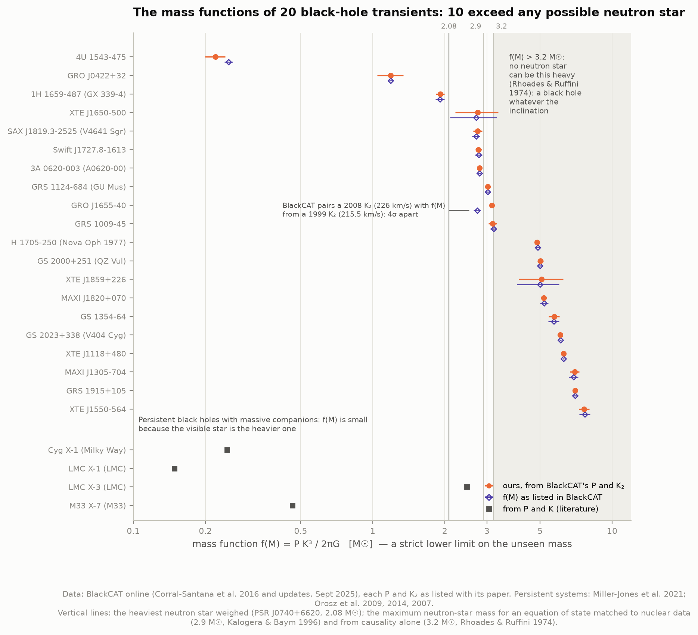
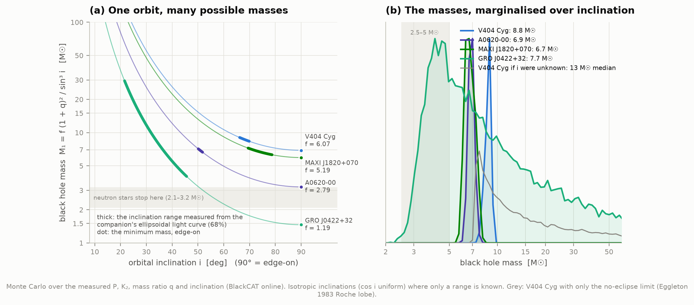
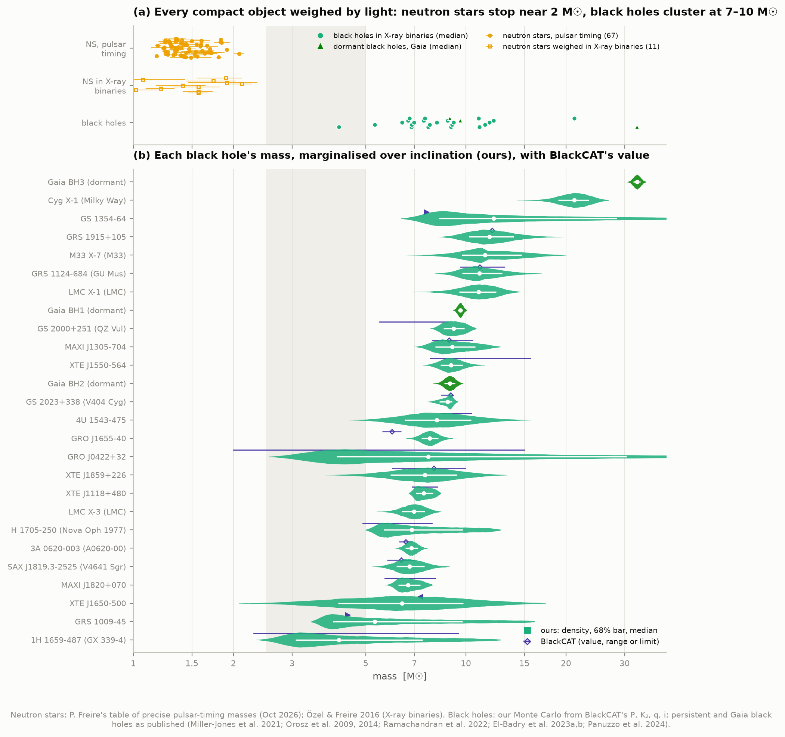
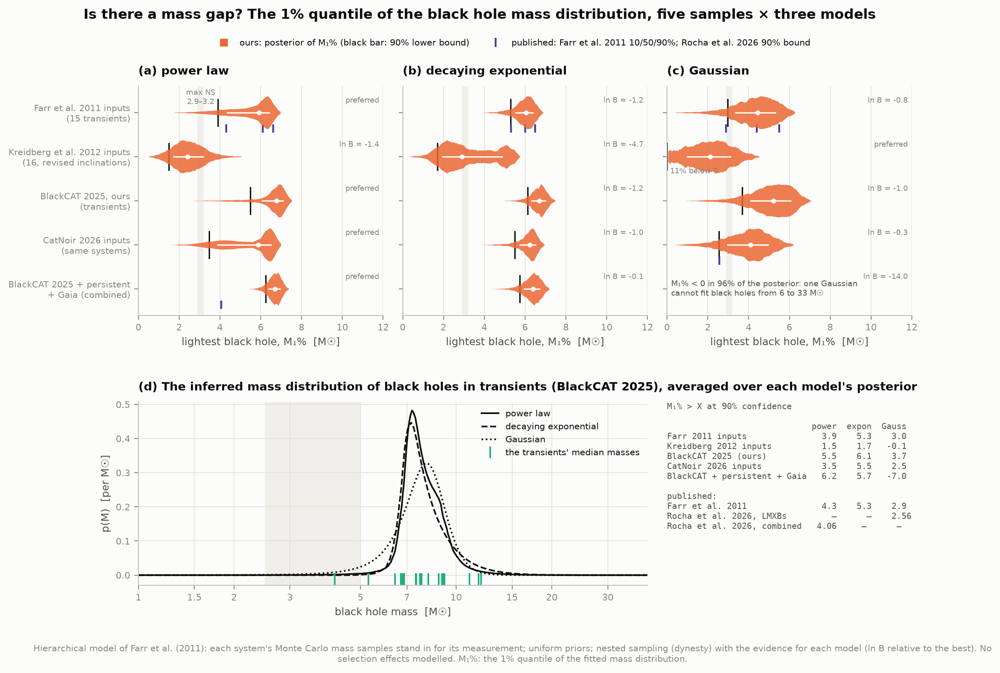
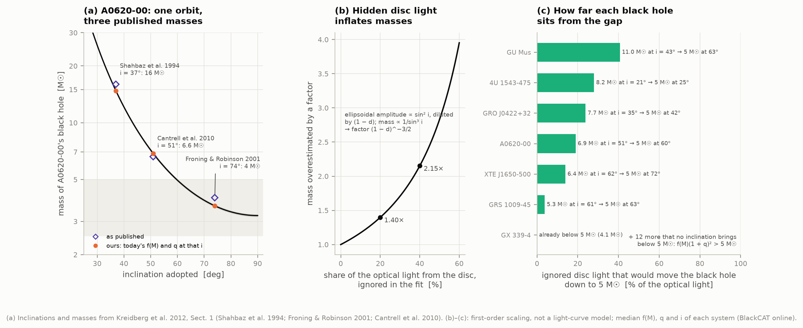
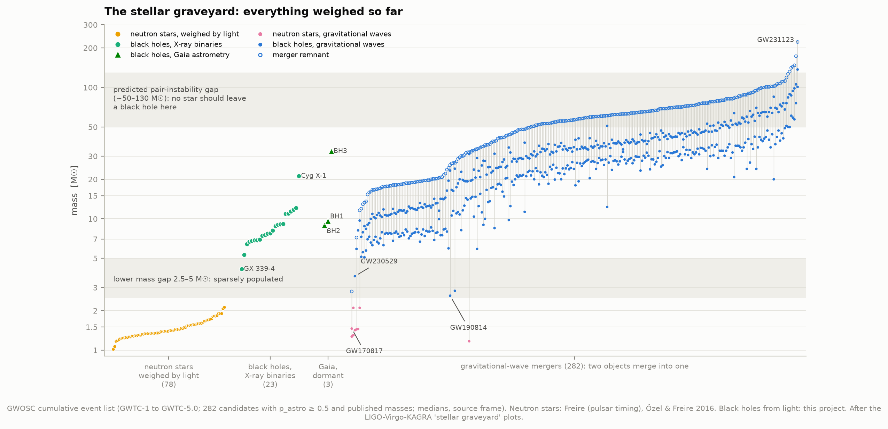
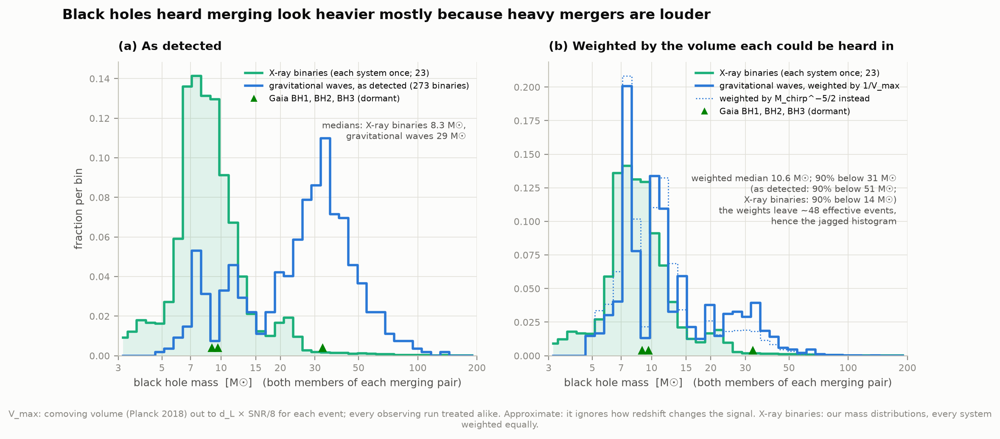
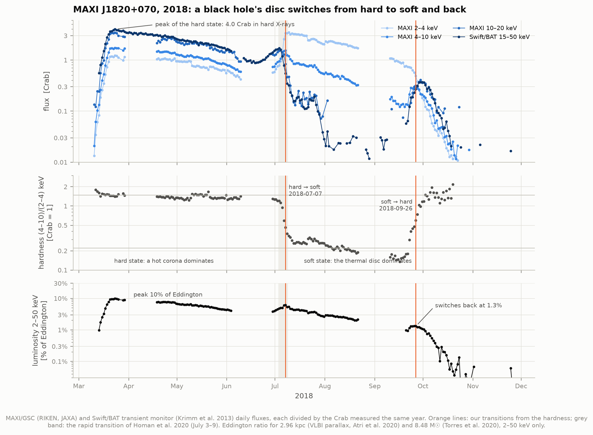
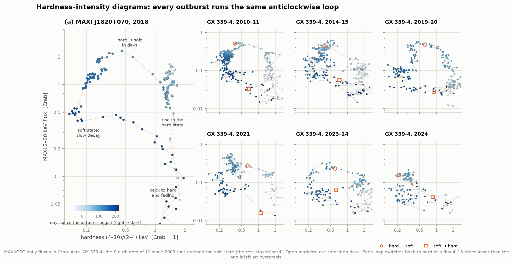
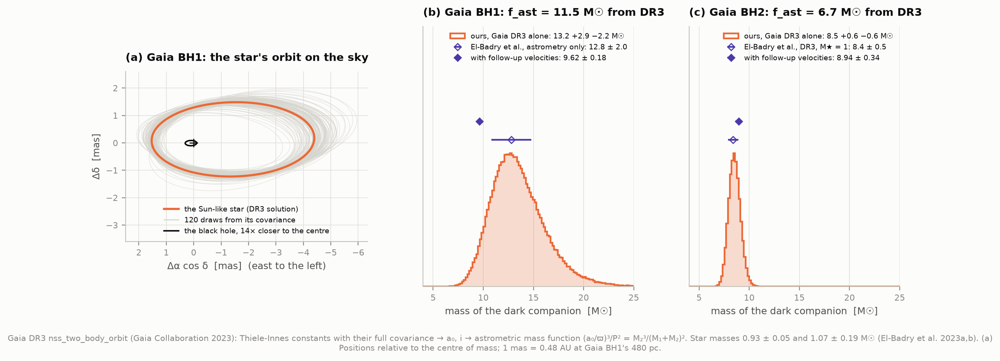

# I4 — Stellar-mass black holes in X-ray binaries

**How do you weigh something you cannot see, and why do the black holes found this way look lighter
than the ones LIGO hears merging?**

The first black holes were found in binary stars. A normal star orbits an unseen companion, and gas
pulled off the star spirals onto the companion and heats up to millions of degrees, so the system
shines in X-rays. The star's spectrum swings back and forth as it orbits. That Doppler wobble weighs
the companion. If the companion is heavier than any neutron star can be, it is a black hole.

This project weighs **every dynamically confirmed black hole in BlackCAT**, the catalogue of black-hole
X-ray transients (Corral-Santana et al. 2016, online version of September 2025), from its published
orbits. It adds the persistent black holes Cyg X-1, LMC X-1, LMC X-3 and M33 X-7, and Gaia's dormant
black holes. It then sets them beside 67 neutron stars from pulsar timing and 282 gravitational-wave
mergers:

- **Mass functions.** For each of the 20 transients, f(M) is recomputed from the catalogue's own period
  and velocity amplitude. **10 exceed 3.2 M☉**, more than any neutron star can weigh in general
  relativity, whatever the orbit's tilt. Our V404 Cyg value is **6.068 ± 0.044 M☉**; Casares & Charles
  (1994) found 6.08 ± 0.06. Recomputing also exposes a 4σ inconsistency in BlackCAT's entry for GRO J1655-40.
- **Masses.** We marginalise over the inclination with Monte Carlo draws. **Cyg X-1 comes out at
  21.2 ± 2.3 M☉** from its orbit alone (Miller-Jones et al. 2021: 21.2 ± 2.2).
- **The mass gap.** We redo the classic Bayesian test of Farr et al. (2011): their published quantiles are
  reproduced for two of three models and roughly for the third. **With today's BlackCAT the gap is still
  there:** the lightest black hole is above 5.5 M☉ (power law) or 3.7 M☉ (Gaussian) at 90% confidence.
  An independent 2026 compilation of the same 19 systems (CatNoir) gives a Gaussian bound of
  **2.54 M☉**; its authors published 2.56. Whether the gap is empty hinges on two or three poorly pinned
  systems, exactly as Kreidberg et al. (2012) warned.
- **Light against gravitational waves.** Merging black holes have a median mass of 29 M☉, X-ray binaries
  8 M☉. Weighting each merger by the volume in which it could have been heard brings the median down to
  **10.6 M☉**. Most of the difference is selection: heavy mergers are louder. A real tail to 30 M☉ and
  beyond remains. The Milky Way has such black holes too: Gaia BH3 (33 M☉) orbits a very metal-poor star.
- **An outburst.** MAXI J1820+070 brightened to 4 Crab in 2018. Our hardness-based clock puts its
  switch from the hard to the soft state on **2018 July 7**; Homan et al. (2020) give July 3–9. It
  switched back on September 26 at about 1.3% of the Eddington luminosity in 2–50 keV, or ~2.4%
  bolometric. GX 339-4 has run the same loop **6 times since 2009**.
- **Gaia BH1 from its DR3 orbit alone:** a photocentre orbit of **3.01 mas** tilted at **121°**, giving a
  dark companion of **13.2 +2.9 −2.2 M☉** (El-Badry et al. 2023, same data: 12.8 ± 2.0). Their follow-up
  velocities pin it at 9.62 ± 0.18 M☉.

An offline page, `figures/black_hole_explorer.html`, lets you drag an orbit's inclination and watch the
mass change, and replay the 2018 outburst day by day.

---

## How a wobble becomes a mass

A star of mass M₂ orbits an unseen object of mass M₁ with period P. Along our line of sight its
velocity swings with semi-amplitude **K₂**. Kepler's third law then gives the **mass function**

    f(M) = P K₂³ / (2πG) = M₁³ sin³ i / (M₁ + M₂)²  =  M₁ sin³ i / (1 + q)²,   q = M₂/M₁.

The right-hand side can only be *smaller* than M₁ (sin i ≤ 1, q ≥ 0). So f(M) is a **strict lower
limit** on the unseen mass that needs nothing but a velocity curve. If it exceeds the heaviest possible
neutron star, the companion is a black hole, whatever the geometry. Neutron stars have a maximum mass:

- the heaviest one weighed is PSR J0740+6620, at 2.08 ± 0.07 M☉;
- for any equation of state matched to nuclear data the limit is 2.9 M☉ (Kalogera & Baym 1996);
- from general relativity and causality alone it is 3.2 M☉ (Rhoades & Ruffini 1974).

To get M₁ itself we need two more numbers:

- the **mass ratio q**, from how fast the star rotates. It fills its Roche lobe and spins in step with
  the orbit, so its line broadening v sin i scales with q.
- the **inclination i**, from the star's *ellipsoidal* light curve. Tidally stretched into an egg, the
  star shows its long side twice per orbit and brightens and fades by an amount that depends on i.

Then M₁ = f(M) (1 + q)² / sin³ i. The sin³ i is the trouble. At i = 40° the factor is 3.8, at 60° it
is 1.5, so a 10° error in i can change the mass by 50%. When only a range of inclinations is known we
draw orientations *isotropically* (cos i uniform), as random tilts would be. A missing inclination
means the mass has no upper bound, only a lower one.

For a **massive companion** (Cyg X-1's 40 M☉ supergiant) f(M) is small, 0.25 M☉. It measures the
black hole's pull on a star heavier than itself, and the mass follows only once the star's own mass is
known: M₁³ sin³ i / (M₁ + M₂)² = f is solved for M₁.

Gaia measures orbits on the sky instead. For a dark companion, the star's orbit about the centre of
mass (angular size a₀) and the parallax ϖ give the **astrometric mass function**
(a₀/ϖ)³/P² = M₂³/(M₁ + M₂)², in AU, years and M☉. It equals f(M) without the sin³ i, because the
astrometric orbit shows its own tilt.

---

## The data

| Source | What | Size |
|---|---|---|
| BlackCAT online (astro.puc.cl/BlackCAT, last modified Sept 2025) | 73 X-ray transients; 20 dynamically confirmed, each with P, K₂, f(M), q, i, M₁ and the ADS link of every value | 73 pages, 1.4 MB |
| BlackCAT 2016 (VizieR J/A+A/587/A61) | the published table of 18 dynamical systems, for what changed since | 72 kB |
| CatNoir v1.0 (catnoir.iag.usp.br; Rocha et al. 2026, arXiv:2609.14154) | an independent living catalogue of 42 Galactic black holes with measurement distributions, used as a cross-check | 102 kB |
| P. Freire, *NS masses* (MPIfR) | 67 precise neutron-star masses from pulsar timing (Oct 2026) | 118 kB |
| Özel & Freire 2016, ARA&A 54, 401, Table 3 | 11 neutron stars weighed dynamically in X-ray binaries | in `literature.py` |
| GWOSC event API, cumulative GWTC | 391 candidates (GWTC-1 to GWTC-5.0); 282 with p_astro ≥ 0.5 and published masses | 738 kB |
| MAXI/GSC (RIKEN, JAXA) | daily 2–4, 4–10, 10–20 keV light curves of MAXI J1820+070, GX 339-4 and the Crab, 2009–2026 | 1.2 MB |
| Swift/BAT transient monitor (Krimm et al. 2013) | daily 15–50 keV light curves of the same three | 2.2 MB |
| Gaia DR3 `nss_two_body_orbit` | the orbits of Gaia BH1 and BH2 with their full correlation matrices | 4 kB |

Persistent black holes and Gaia BH3 come from their papers (`literature.py`): Miller-Jones et al. 2021
(Cyg X-1), Orosz et al. 2009 and 2014 (LMC X-1, LMC X-3), Ramachandran et al. 2022 (M33 X-7),
El-Badry et al. 2023a,b and Panuzzo et al. 2024 (Gaia BH1, BH2, BH3). `fetch_data.py` caches 89 files
(5.7 MB) and records each one's URL, date, size and SHA-256 in `data/manifest.json`.

### What it took to turn BlackCAT into numbers

The online catalogue is a set of web pages. Each value is text: "124±4", "0.25 – 0.31", "≤79",
"9⁺⁰·²₋₀.₆", or two values from two papers on separate lines. `blackcat.py` parses every page and keeps
every value with its references, then turns each system into distributions by fixed rules (written out
at the top of that file):

- the most recent paper wins;
- the period comes from the same paper as the velocity amplitude, so each mass function is one
  consistent orbit;
- a range of inclinations is isotropic;
- an upper limit on q is uniform from zero;
- a missing q is uniform on 0–0.5, Farr et al.'s convention.

Three traps:

1. **Literal "<" signs.** BlackCAT writes an upper limit as `<70` straight into the HTML. A generic tag
   stripper deletes it, and our first quick look reported XTE J1859+226's inclination as missing when
   the page says `<70` (2011) and `67±4` (2022).
2. **Mixed papers within one entry.** Recomputing each f(M) from the listed P and K₂ reproduces the
   listed f(M) for 18 of 20 systems. **GRO J1655-40** fails by 4.3σ: its K₂ = 226.1 km/s is from 2008, but
   its f(M) = 2.73 M☉ comes from a 1999 paper that used K₂ = 215.5. Its mass ratio and inclination date from
   2002–2003, so with the listed values the mass is 7.8 ± 0.5 M☉, not the listed 6.0 ± 0.4. CatNoir's more
   recent q and i give 6.75. **4U 1543-475** pairs an old K₂ (124 ± 4 km/s, f = 0.22) with a later
   f(M) = 0.25 (1.3σ). **GS 2000+251**'s quoted mass range, 5.5–8.8 M☉, does not follow from its own f(M),
   q and i = 54–60°, which give 8.4–10.3 M☉. We use the listed values and report the difference.
3. **Two mass ratios that contradict their sources**, fixed by explicit overrides in `blackcat.py`:
   - **V4641 Sgr** (SAX J1819.3-2525) is listed with q = 0.63–0.70, citing MacDonald et al. 2014, who find
     M_BH/M₂ = 2.2 ± 0.2, i.e. q = 0.45 ± 0.04. The listed range is the older solution of Orosz et al. 2001.
     With MacDonald's q the mass is 6.8 +0.7 −0.6 M☉ against their 6.4 ± 0.6; with BlackCAT's, 8.9.
   - **GX 339-4** is listed with q ≤ 0.18 ± 0.05, but Heida et al. 2017 measure q = 0.18 ± 0.05; the "≤"
     reflects their K₂ being a lower limit.

Swift J1727.8-1613 (discovered 2023) has no measured q and only i < 74°, so its mass has no upper
bound: we quote its minimum, **3.11 ± 0.10 M☉** (BlackCAT: >3.1 ± 0.1), and leave it out of the population
fits. Since 2016 BlackCAT has added MAXI J1305-704, MAXI J1820+070 and Swift J1727.8-1613 to its
dynamical list; Swift J1357.2-0933, whose companion has never been seen, is no longer flagged.

---

## Results

### 1. Mass functions: ten are too heavy for any neutron star



Orange is ours, from each system's P and K₂; violet is the f(M) BlackCAT lists. The two agree except
for GRO J1655-40 (above). **Ten** transients have f(M) above 3.2 M☉ and **thirteen** above 2.9 M☉.
For those, no assumption about the orbit is needed: they are black holes. The other seven need q and i
before their masses exceed the neutron-star limit, and all of them do.

The persistent systems in the bottom block show the opposite case: Cyg X-1 has f(M) = 0.247 ± 0.004 M☉
because its visible star is a 40 M☉ supergiant. The black hole's mass comes from the star's mass.

### 2. From a mass function to a mass



**(a)** The same orbit gives very different masses at different tilts. The thick segments are the
inclinations measured from each companion's light curve. V404 Cyg (i = 67 +3 −1°) and A0620-00
(51 ± 0.9°) are pinned. GRO J0422+32, listed at 10–50°, could hold anything from 3.5 to 30 M☉ within
its 68% range. The dots are the minimum masses, at i = 90°.

**(b)** The Monte Carlo masses. V404 Cyg comes out at **8.8 +0.3 −0.5 M☉**, matching Khargharia et al.'s
9.0 +0.2 −0.6. Had its inclination been unknown (grey, only "no eclipses"), the median would be 13 M☉,
with a long tail.



All 26 black holes weighed by light, against 78 neutron stars. Selected values (68% intervals; all 20 in
`data/blackcat_adopted.csv`):

| | Ours (BlackCAT inputs) | BlackCAT lists | CatNoir inputs, our method | CatNoir |
|---|---|---|---|---|
| A0620-00 | 6.9 ± 0.3 | 6.6 ± 0.3 | 6.6 | 6.6 |
| V404 Cyg | 8.8 +0.3 −0.5 | 9.0 +0.2 −0.6 | 8.7 | 8.6 |
| XTE J1118+480 | 7.5 +0.5 −0.4 | 6.9–8.2 | 7.5 | 7.3 |
| MAXI J1820+070 | 6.7 +0.6 −0.4 | 5.7–8.1 | 6.8 | 6.6 |
| GRS 1915+105 | 11.8 +2.2 −1.6 | 12 | 13.6 | 13.4 |
| GRO J1655-40 | 7.8 +0.5 −0.4 | 6.0 ± 0.4 | 6.75 | 6.8 |
| GRO J0422+32 | 7.7 +22.8 −3.6 | 2–15 | 4.9 | 4.1 |
| GRS 1009-45 | 5.3 +4.3 −1.3 | ≥ 4.4 | 4.5 | 4.4 |
| GX 339-4 | 4.1 +3.3 −1.1 | 2.3–9.5 | 4.2 | 3.5 |
| Cyg X-1 | 21.2 +2.3 −2.2 | (Miller-Jones et al.: 21.2 ± 2.2) | — | 14.1* |

\*CatNoir uses the 2011 model of Cyg X-1 (14.8 M☉), from before its distance was revised by Miller-Jones
et al. (2021).

Neutron stars stop at 2.08 M☉. Most black holes sit at 6–12 M☉. Between them, only GX 339-4 (poorly
constrained), GRS 1009-45 and Swift J1727.8-1613's minimum mass reach into 2.5–5 M☉.

### 3. Is there a mass gap? A Bayesian test, replicated and updated



We follow Farr et al. (2011) exactly. Each system's Monte Carlo mass samples stand in for its
measurement. Three shapes are fitted to the black-hole mass distribution: a power law, a decaying
exponential and a Gaussian, each with Farr's priors. The lightest black hole is defined as **M₁%**, the
1% quantile of the fitted distribution. We use nested sampling (dynesty), which also gives each model's
evidence. M₁% quantiles, 10/50/90%, in M☉:

| Inputs | power law | exponential | Gaussian | preferred |
|---|---|---|---|---|
| Farr et al. 2011 (15 transients), **ours** | 3.9 / 5.9 / 6.6 | 5.3 / 6.0 / 6.5 | 3.0 / 4.4 / 5.5 | power law |
| Farr et al. 2011, **published** (Table 8) | 4.3 / 6.1 / 6.6 | 5.3 / 6.0 / 6.5 | 2.9 / 4.4 / 5.5 | power law |
| Kreidberg et al. 2012 (16, revised inclinations) | 1.5 / 2.4 / 3.5 | 1.7 / 2.9 / 5.1 | −0.1 / 1.9 / 3.4 | Gaussian |
| **BlackCAT 2025** (19 transients) | **5.5** / 6.8 / 7.2 | 6.1 / 6.7 / 7.1 | **3.7** / 5.2 / 6.3 | power law |
| CatNoir 2026 inputs (same 19) | 3.5 / 5.9 / 6.6 | 5.5 / 6.2 / 6.6 | **2.5** / 4.1 / 5.2 | power law |
| BlackCAT + persistent + Gaia (26) | 6.2 / 6.7 / 7.1 | 5.7 / 6.4 / 6.8 | (below 0) | power law |

- **Replication.** The exponential and Gaussian quantiles match Farr et al. to 0.1 M☉, and the evidence
  ranks the models in their order. The power law's median and upper quantile agree; its 10% quantile
  comes out at 3.9–4.1 against their 4.3, depending on the random draws. That tail is set by the rising
  power laws, a separate branch of the posterior, and it is the least stable number in the table.
- **Kreidberg et al.'s point holds.** Their revised inclinations, especially GRO J0422+32 at 64° instead
  of 45°, pull M₁% below 3 M☉: no gap.
- **Today's BlackCAT keeps the gap.** At 90% confidence the lightest black hole is above 5.5 M☉ (power
  law) or 3.7 M☉ (Gaussian), and the three models are nearly tied.
- **CatNoir's inputs for the same 19 systems** give a Gaussian M₁% > 2.54 M☉. Rocha et al. (2026) report
  2.56 for their 28 low-mass binaries. The difference from BlackCAT comes almost entirely from
  GRO J0422+32 (CatNoir: i = 33–49°, mass 4.9 M☉) and GRS 1009-45 (i = 78 ± 8°, 4.5 M☉).
- Rocha et al.'s combined sample gives M₁% > 4.06 (power law); ours gives 6.2. Theirs includes
  candidates we leave out (2MASS J0521+4359 at 2.5 M☉, G3425 at 3.4 M☉).

So the answer depends on two or three systems whose inclinations are uncertain. Nothing in the
statistics is robust to that.

A methods note: the integral over each system's samples is done on a fine log-mass grid, with each
model integrated exactly over every bin (`masses.PopulationLikelihood`). Our first version evaluated
the model at bin centres instead. That let an exponential collapse onto a single mass shared by every
system and claim an infinite likelihood (ln Z = +422). A test now guards against it.

### 4. Inclination: the dominant systematic



**(a)** A0620-00 has had published inclinations from 37° to 74° over the years, so its "mass" has
ranged from 16 to 4 M☉ for the same orbit. Cantrell et al. (2010) traced the spread to light from the
accretion disc and fitted only the star's quiet, "passive" light curves: 51° and 6.6 M☉. Today's f(M)
and q give 14.8, 6.9 and 3.6 M☉ at those three angles.

**(b)** Why this biases masses *upwards*. The ellipsoidal amplitude grows roughly as sin² i. If a share
d of the optical light comes from the disc and the model ignores it, the diluted amplitude is fitted
with too low an inclination, and the mass comes out (1 − d)^−3/2 times too high: 1.4× for 20% disc
light, 2.2× for 40%.

**(c)** How much ignored disc light it would take to bring each black hole down to 5 M☉:

- GRS 1009-45 needs 4% and XTE J1650-500 14%; A0620-00 19%, GRO J0422+32 24%, 4U 1543-475 28%,
  GU Mus 41%.
- GX 339-4 is already below 5 M☉ (4.1 M☉).
- For the other **12** no inclination at all would do it, since even edge-on their f(M)(1 + q)²
  exceeds 5 M☉: XTE J1550-564, MAXI J1820+070, XTE J1118+480, V4641 Sgr, MAXI J1305-704, GRO J1655-40,
  V404 Cyg, XTE J1859+226, Nova Oph 1977, GRS 1915+105, QZ Vul and GS 1354-64.

The bias can thin the gap, but it cannot fill it with these systems.

### 5. The stellar graveyard



Everything weighed so far:
- 78 neutron stars weighed by light;
- 23 black holes in X-ray binaries and 3 from Gaia;
- the 282 gravitational-wave candidates with published masses, each pair drawn with its remnant.

Gravitational waves also reach into both gaps. GW230529's primary sits at 3.7 M☉ and GW190814's
secondary at 2.6 M☉. Mergers from GW190521 to GW231123 (137 + 101 M☉) sit in or beyond the
pair-instability gap, which only second-generation black holes, merged before, should fill.



**Why merging black holes look heavier.** An inspiral is heard out to a distance ∝ M_chirp^5/6, so the
surveyed volume grows as M_chirp^5/2: a binary three times heavier is heard in ~16 times the
volume. We weight each of the 273 binary black holes by the inverse of the volume it could have been seen
in. V_max is the comoving volume out to d_L × SNR/8 from its own signal-to-noise ratio; the cruder
M_chirp^−5/2 weighting is shown dotted. Black-hole masses in M☉, both members of each pair:

| | 10% | median | 90% | heavier than 20 M☉ |
|---|---|---|---|---|
| X-ray binaries (each system once) | 5.6 | 8.3 | 13.8 | 5% (Cyg X-1) |
| gravitational waves, as detected | 8.3 | 28.6 | 51.0 | 75% (primaries) |
| weighted by 1/V_max | 7.0 | 10.6 | 30.8 | 27% |
| weighted by M_chirp^−5/2 | 6.6 | 10.0 | 24.3 | — |

After weighting, both populations peak near 7–10 M☉. Most of the apparent difference is the
detectors' bias toward loud events. The merging population still keeps a genuine tail: about a quarter
of its primaries are heavier than 20 M☉, against one X-ray binary in twenty. Part of the reason is
metallicity. Stars poor in heavy elements lose less mass to winds and leave heavier black holes. The
Milky Way's X-ray binaries formed from metal-rich gas, while many mergers come from distant, younger,
metal-poor galaxies. Gaia BH3, 33 M☉ beside a star with 1/360 of the Sun's iron, is the local example.
The weights are concentrated: they leave the equivalent of ~48 events, hence the jagged histogram.

### 6. An outburst: watching a disc change state



MAXI J1820+070 was discovered in March 2018. It became one of the brightest X-ray sources in the sky,
**4.0 Crab** in hard X-rays on 2018 March 23. Fluxes are divided by the Crab Nebula's, measured by the
same instrument in the same year, so instrument drifts cancel (BAT's Crab rate wanders by up to 11%
over 21 years).
The hardness ratio, (4–10)/(2–4) keV in Crab units, splits the outburst cleanly:

- **Hard state** (hardness ~1.5): a hot corona of electrons up-scatters disc photons into hard X-rays,
  and a steady radio jet shines.
- **Hard → soft**: our hardness crosses its midpoint on **2018 July 7** (window July 4–11). Homan et al.
  (2020) find the rapid transition on July 3–9 in NICER data, with a radio flare from a jet ejection.
- **Soft state** (hardness ~0.22): a thermal disc reaching close to the black hole dominates. The soft
  X-rays peak at 3.5 Crab on July 9.
- **Soft → hard** on **2018 September 26**, at a flux 4.5 times lower than the one it left at:
  *hysteresis*.

With the VLBI parallax distance (2.96 ± 0.33 kpc, Atri et al. 2020) and the mass for the radio-jet
inclination (8.48 +0.79 −0.72 M☉, Torres et al. 2020):

- the 2–50 keV peak reaches **9.9 +2.6 −2.2% of the Eddington luminosity**. Atri et al. find 15 ± 3%
  bolometric for 10 M☉; our band misses the emission above 50 keV.
- the switch back comes at **1.3 ± 0.3%** in 2–50 keV. Our flux there, 1.33 × 10⁻⁸ erg cm⁻² s⁻¹, is 53%
  of the bolometric flux Atri et al. use (2.5 × 10⁻⁸). Scaled up, the switch is at ~2.4% of Eddington,
  inside the 1–4% Maccarone (2003) found for black-hole binaries in general.



The same loop in the hardness–intensity diagram: up the right side, across the top, down the left and
back along the bottom. GX 339-4 had **11 outbursts** in MAXI's 17 years:

- **6 completed the loop**: 2010–11, 2014–15, 2019–20, 2021, 2023–24 and a faint one in 2024.
- **5 never left the hard state**: 2013, 2017–18, 2018–19, 2022 and 2025–26. These are "failed"
  outbursts.
- It softened at 0.16–0.51 Crab and hardened again at 0.016–0.065 Crab, 4 to 18 times lower.

**Transitions as a standard candle (a demonstration).** Suppose GX 339-4 switches back at the same
fraction of Eddington as MAXI J1820+070, whose distance is known. Then its six switches, with its
BlackCAT mass (4.1 +3.3 −1.1 M☉), put it at **6.6 +2.9 −1.8 kpc**. Maccarone (2003) argued for ≥ 7.6 kpc
the same way. The error bars are as wide as the method is crude: the transition luminosity scatters
by a factor of 4 between GX 339-4's own outbursts.

### 7. Gaia's dormant black holes



Gaia DR3 published Gaia BH1's photocentre orbit as four Thiele-Innes constants with their full
covariance; its solution type is astrometric only. `gaia_orbits.py` samples that covariance and
converts every draw to orbital elements and a mass. With the star at 0.93 ± 0.05 M☉:

| Gaia BH1, DR3 alone | ours | El-Badry et al. 2023a, astrometry only |
|---|---|---|
| a₀ (mas) | 3.01 +0.23 −0.20 | 3.00 ± 0.22 |
| inclination (deg) | 121.2 +2.4 −3.2 | 121.2 ± 2.8 |
| Ω (deg) | 89.6 +4.4 −2.9 | 89.6 ± 3.7 |
| ω (deg) | −10.5 +12.7 −10.8 | −10.3 ± 11.6 |
| f_ast (M☉) | 11.5 +2.9 −2.2 | 11.2 ± 1.9 |
| M₂ (M☉) | 13.2 +2.9 −2.2 | 12.8 ± 2.0 |

The star itself swings on an orbit 1.44 AU across, under a dark companion of ~10 M☉ or more. Nothing
that massive and dark can be anything but a black hole. El-Badry et al.'s follow-up velocities shrink
the range to **9.62 ± 0.18 M☉**. DR3 alone only rules out a star.

Gaia BH2's solution also uses Gaia's own velocities. Those fix which way round the orbit goes, so our
Ω = 268.7 ± 2.1° and ω = 130.2 ± 2.5° match El-Badry et al.'s 266.4 and 131.2. Its astrometric mass
function is **6.73 +0.53 −0.47 M☉** (DR3 paper value as quoted by El-Badry et al. 2023b: 6.72 ± 0.5).
For a 1 M☉ star that is **8.42 +0.54 −0.49 M☉** (theirs: 8.4 ± 0.5); with follow-up velocities, 8.94 ± 0.34.

Gaia BH3 (32.7 ± 0.8 M☉, 11.6-year orbit) cannot be in DR3: its period is four times DR3's 34-month
baseline. It was found in pre-release DR4 data. Project I11 hunts the DR3 orbits blind.

### 8. The explorer

`figures/black_hole_explorer.html` (24 kB, offline, light and dark themes) has two tools:
- pick any of the 20 BlackCAT black holes and drag the inclination slider to watch f(M) become a mass,
  against the measured range and the neutron-star limit;
- replay MAXI J1820+070's 2018 outburst on its light curve and hardness–intensity diagram.

---

## Caveats

- **Selection effects are not modelled**, here or in Farr et al. Black holes enter BlackCAT only if they
  have an X-ray outburst, are close enough for spectroscopy of a faint companion, and outside the
  dustiest parts of the plane. Özel et al. (2010) argued that this flux limit does not bias the mass
  distribution, but it certainly shapes the sample.
- **The population likelihood** treats each system's Monte Carlo mass samples as its likelihood. That
  carries an implicit prior from the (q, i) distributions, as in Farr et al. The tails of the M₁%
  posteriors, especially for the power law, move by ~0.2 M☉ with the random draws.
- **Inclinations from ellipsoidal light curves** are the weakest link (section 4). Systems with only a
  range get isotropic draws, which give long high-mass tails (GS 1354-64, GRO J0422+32).
- **Persistent and Gaia black holes** enter with their published masses. Only Cyg X-1 is recomputed,
  ignoring the correlation between its fitted star mass and inclination. Its spread is nonetheless the
  published one.
- **Gravitational-wave weights** assume every observing run was equally sensitive in shape, and that an
  event's signal-to-noise ratio scales as 1/d_L. Redshift also changes the signal, which this ignores.
  The weights leave ~48 effective events. Median masses hide broad, correlated posteriors, and
  source-frame masses assume a cosmology.
- **Crab-unit fluxes** become energy fluxes by assuming each band's spectrum looks like the Crab's: rough
  for a very soft disc. Our luminosities are 2–50 keV only. Transition days come from a hardness
  threshold, not from timing or spectral fits.
- **The GX 339-4 distance** is an illustration, not a measurement.
- **Gaia DR3 uncertainties** may be underestimated, by ~30% for single stars near Gaia BH1's magnitude
  (El-Badry et al. 2023a); BH1's own orbit has unusually large errors.

## Corrections to the atlas spec

- The spec says Gaia BH1 is "~9.6 M☉ from DR3's orbit solutions". DR3's orbit alone gives 12.8 ± 2.0 M☉
  (13.2 here). The 9.62 ± 0.18 needs the follow-up velocities of El-Badry et al. (2023a).
- C5 (the gravitational-wave population) is not built yet. This project fetches GWOSC itself; the
  cumulative list now holds 391 candidates up to GWTC-5.0.

## Reproduce

```bash
cd 35-x-ray-binaries
../.venv/bin/python run.py          # fetch (6 MB, ~2 min), analyse, 10 figures + explorer, summary
../.venv/bin/python test_physics.py # 14 checks of the physics and parsers
```

The first run spends 10–15 minutes on the 15 population fits. They are cached in `data/cache/`; later
runs take ~30 s, all offline. Every random draw is seeded (`config.RANDOM_SEED`). Python packages:
numpy, scipy, pandas, matplotlib, astropy, dynesty.

## Files

| File | Role |
|---|---|
| `config.py` | paths, URLs, constants, cuts |
| `fetch_data.py` | downloads with provenance manifest |
| `literature.py` | every published number used, with its source |
| `blackcat.py` | parses BlackCAT (online and 2016) into measurement distributions |
| `masses.py` | mass functions, Monte Carlo masses, Roche lobes, population models |
| `gaia_orbits.py` | Thiele-Innes → orbit → astrometric mass function |
| `outbursts.py` | Crab-normalised light curves, hardness, transitions, Eddington ratios |
| `graveyard.py` | neutron-star masses, gravitational-wave events and their weights |
| `analysis.py` | all analyses → `data/results.json` |
| `figures.py`, `plotstyle.py` | the figures |
| `explorer.py` | the offline interactive page |
| `run.py` | end to end, with a printed summary |
| `test_physics.py` | checks against known answers |

## Credits

BlackCAT: Corral-Santana et al. 2016, A&A 587, A61, and the online catalogue by J. M. Corral-Santana.
CatNoir: Rocha et al. 2026, arXiv:2609.14154. Neutron-star masses: P. Freire (MPIfR); Özel & Freire 2016.
Gravitational waves: GWOSC (LIGO, Virgo and KAGRA collaborations). MAXI: RIKEN, JAXA and the MAXI team
(Matsuoka et al. 2009). Swift/BAT transient monitor: Krimm et al. 2013. Gaia: ESA, Gaia DPAC, DR3
(Gaia Collaboration 2023). Methods: Farr et al. 2011; Kreidberg et al. 2012; Eggleton 1983; Halbwachs et
al. 2023 and DPAC's `nsstools` for the Thiele-Innes conventions.
