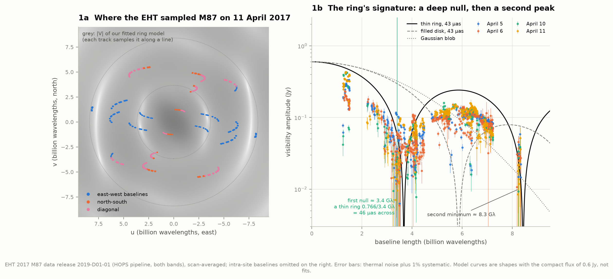
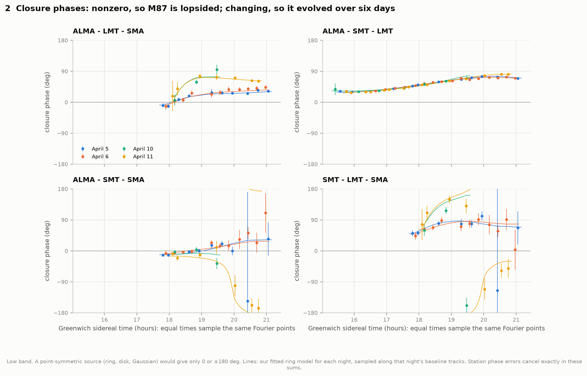
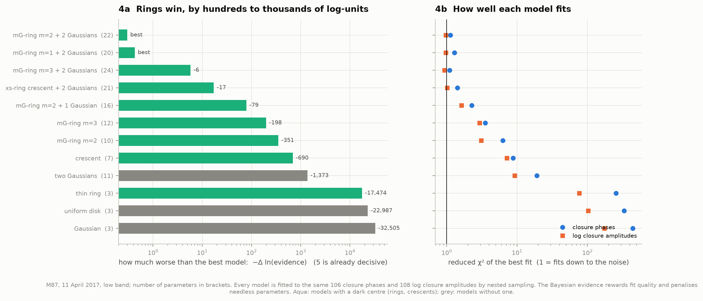
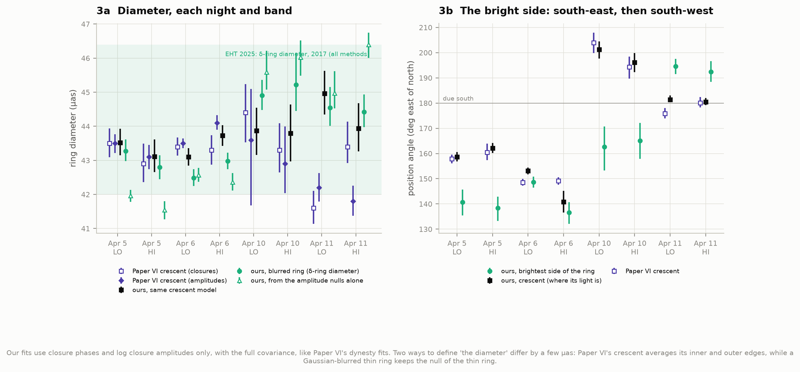
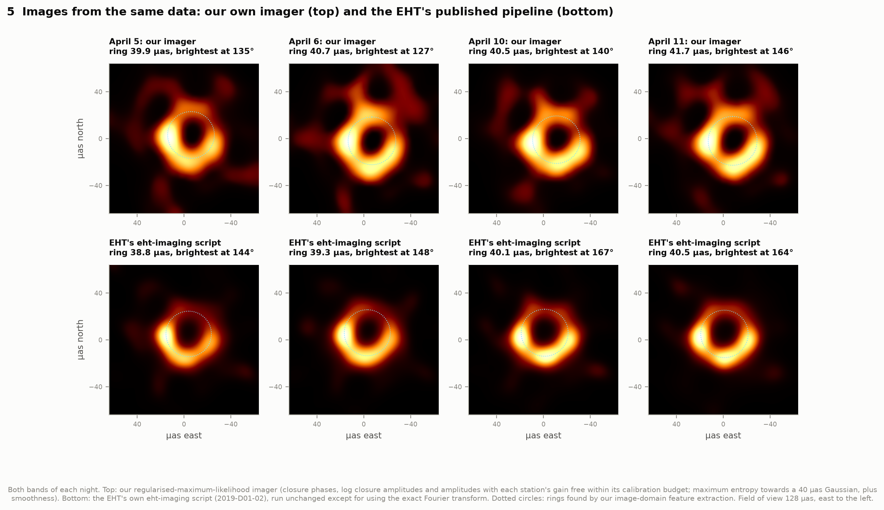
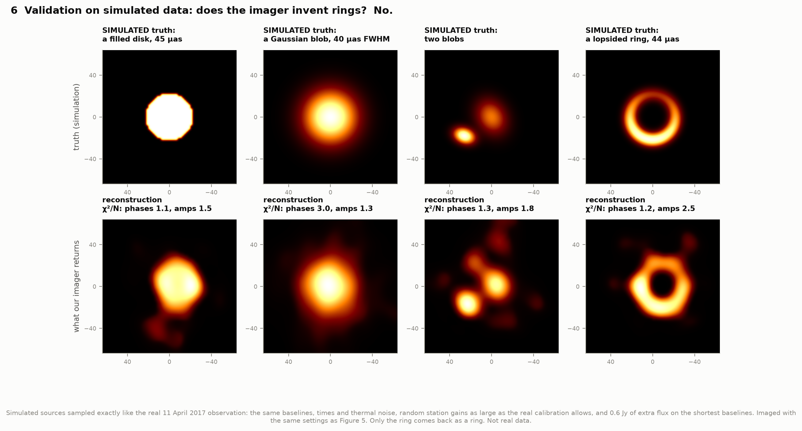
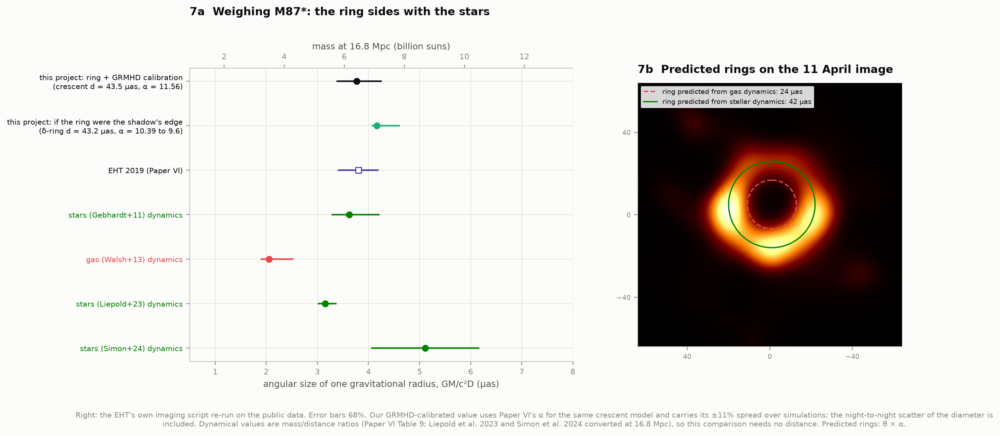
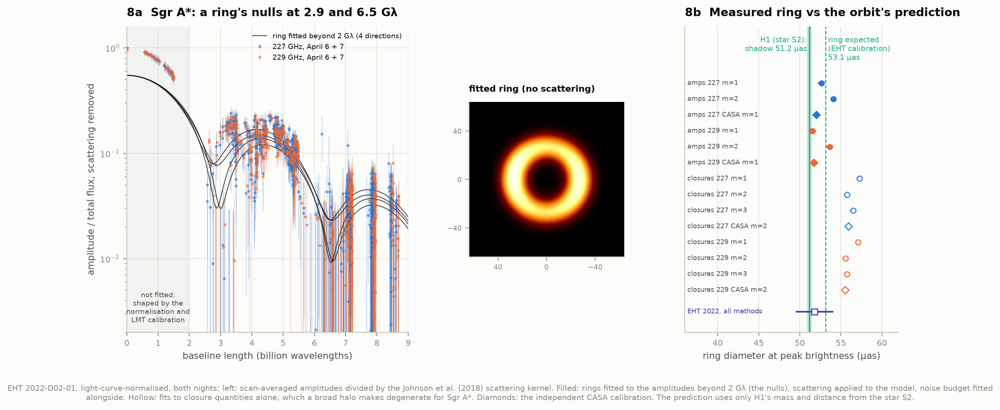
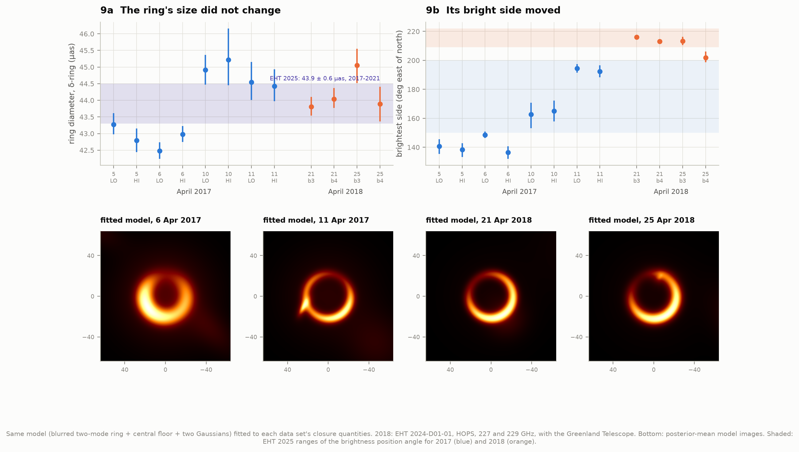

# I5 — The shadow of M87* from Event Horizon Telescope data

**In 2019 the Event Horizon Telescope showed the first image of the glowing ring around a black hole. Can we
measure that ring ourselves, straight from the calibrated interferometer data, and turn it into a mass?**

Yes. Fitted to the EHT's own public measurements from April 2017, the ring around M87* is
**43.8 µas across** (night-to-night scatter 1.1 µas; the EHT's 2017–2021 average is 43.9 ± 0.6).
The same crescent model the EHT used gives 43.8 ± 0.2 µas, within 0.6 µas of the EHT's own
fits on seven of eight data sets. With the EHT's simulation-based ring-to-mass calibration that is a
black hole of **6.4 (+0.9 / −0.7) billion solar masses** (EHT: 6.5 ± 0.7). The ring sides with the
mass from stellar motions, not the half-as-large mass from gas motions. A year later, in April
2018, the ring was the same size (44.2 µas), but its bright side had moved. Two independent images
of the same data, one from our own imager and one from the EHT's published pipeline re-run here,
both show the ring, and our imager returns no ring at all when fed simulated data from a disk or a
blob.

The same data release includes the black hole at the centre of our own Galaxy. Project H1 weighed it
from the orbit of the star S2 and predicted a shadow 51.2 µas across. The ring we measure in the EHT
data is **53.9 ± 1.3 µas**, exactly the ring the EHT's own calibration expects for H1's mass (53.1 µas).

No telescope took a picture of M87*. The Event Horizon Telescope (EHT) links radio dishes from
Hawai'i to Spain and Chile into one Earth-sized instrument, observing at a wavelength of 1.3 mm. Each
pair of dishes records one number every few seconds, a **visibility**: one Fourier component of the
sky's brightness, at a spatial frequency set by how far apart the two dishes look from M87. On
11 April 2017 seven telescopes at five sites made 21 such pairs, and the rotating Earth swept them along short arcs. The
famous image rests on about 220 scan-averaged Fourier samples per frequency band. Everything here
starts from those numbers.

| Source | Nights | Data | EHT release |
|---|---|---|---|
| M87 | 5, 6, 10, 11 April 2017 | 7 telescopes at 5 sites; two 2-GHz bands at 227 and 229 GHz; 10-s visibilities, EHT-HOPS calibration | 2019-D01-01 |
| M87 | 21 and 25 April 2018 | 8 telescopes at 6 sites (adds the Greenland Telescope); 227 and 229 GHz | 2024-D01-01 |
| Sgr A* | 6 and 7 April 2017 | 7-8 telescopes (adds the South Pole Telescope); light-curve-normalised | 2022-D02-01 |
| (the EHT's own imaging script) | | the eht-imaging pipeline that made the 2019 picture | 2019-D01-02 |

A microarcsecond (µas) is a millionth of an arcsecond: a doughnut on the Moon, seen from Earth, is
about 40 µas across, the size of M87's ring. M87* sits 16.8 million parsecs (55 million light-years)
away.

### Some words used below

* **Baseline**: a pair of telescopes. Its length, measured in wavelengths as seen from the source,
  sets which detail it sees: 8 billion wavelengths (8 Gλ) resolves about 25 µas.
* **Visibility amplitude**: how much of the source's light shows up as structure of that size and
  orientation. A smooth blob gives large amplitudes on short baselines and almost none on long ones.
  A ring gives a characteristic pattern of dips (nulls).
* **Closure phase** and **closure amplitude**: combinations of visibilities around a triangle or a
  quadrangle of telescopes in which every telescope's own calibration error cancels exactly. They are
  the backbone of everything below.
* **Gravitational radius**: GM/c², half the radius of the event horizon of a non-spinning black hole.
  Seen from a distance D it spans an angle θ_g = GM/(c²D). The shadow of a non-spinning black hole is
  2√27 ≈ 10.39 of them across.

---

## Results

### 1. What the EHT actually measured



Left: each dot is one 10-second measurement on 11 April 2017, placed at the spatial frequency (u, v)
it sampled; every baseline appears twice, because (u, v) and (−u, −v) carry the same information. The
grey background is the Fourier transform of our fitted ring model: the EHT sampled it only along these
arcs, which is why an image cannot simply be "inverted" from the data, and why we fit models first.

Right: the amplitudes of all four nights against baseline length. They fall from about 0.4 Jy on the shortest baselines between sites to a deep
minimum near **3.4 Gλ**, rise to a second peak around 5-7 Gλ, and fall again towards a second minimum
near 8.3 Gλ. A filled disk with its first null at 3.4 Gλ would have its second at 6.2 Gλ, right where
the data peak, and a smooth blob has no minima at all. A thin ring of diameter d has its first null at 0.766/d, so a null at 3.4 Gλ
means **d ≈ 46 µas**, before any fitting. Blurring a ring does not move its nulls; making it lopsided
fills them in, which is why the data's minimum is not a perfect zero.

### 2. Closure phases: lopsided, and changing



Adding the visibility phases around a triangle of telescopes cancels every telescope's own phase error
exactly; what survives belongs to the source. For any point-symmetric shape (ring, disk, Gaussian) it
would be exactly 0° or 180°. M87's closure phases take values all around the circle: the source is lopsided.
They also changed between the first pair of nights (5 and 6 April) and the second (10 and 11 April),
at the same sidereal times and so on the same Fourier points, by up to ~140° on the triangles through
the SMA. The bright side of the ring moved within six days.

### 3. Is it really a ring?



We fitted twelve models to the same 106 closure phases and 108 log closure amplitudes of 11 April
(low band) and ranked them by their Bayesian evidence, which rewards a good fit and penalises
parameters the data do not need (a difference of 5 in ln Z is already decisive).

| Model (parameters) | Δ ln Z | χ²/N closure phases, log closure amplitudes | Diameter (µas) |
|---|---|---|---|
| lopsided ring, 2 brightness modes, + floor + 2 Gaussians (22) | **0** | 1.13, 0.97 | 44.5 |
| the same with 1 brightness mode (20) | −0.4 | 1.29, 0.97 | 45.2 |
| the same with 3 brightness modes (24) | −5.8 | 1.09, 0.93 | 45.4 |
| Paper VI's slashed crescent + 2 Gaussians (21) | −17 | 1.41, 1.01 | 45.0 |
| lopsided ring + floor + 1 Gaussian (16) | −79 | 2.26, 1.62 | 45.7 |
| lopsided ring + floor, no extra components (10-12) | −198 to −351 | 3.5-6.3, 2.9-3.1 | 44.8-45.8 |
| top-hat crescent (7) | −690 | 8.8, 7.1 | 42.1 |
| two elliptical Gaussians (11) | −1,373 | 19, 9.2 | — |
| symmetric thin ring (3) | −17,474 | 255, 77 | — |
| uniform disk (3) | −22,987 | 333, 102 | — |
| Gaussian blob (3) | −32,505 | 439, 174 | — |

Shapes without a dark centre lose by thousands of log-units. A symmetric ring fails too: the closure
phases demand lopsidedness. The winners are lopsided rings with some faint extra emission around them
(two broad Gaussians carrying 10-35% of the compact flux; M87 Paper VI needed the same). Every
lopsided-ring model puts the diameter between 44.5 and 45.9 µas.

### 4. The ring, night by night



Three independent measurements of the diameter for each of the eight data sets: the fiducial
blurred ring (closure quantities), the crescent model of M87 Paper VI (the same closure
quantities), and the positions of the amplitude nulls alone (no closure phases; the LMT left out).

| Night | Band | Blurred ring d (µas) | Crescent d (µas) | Paper VI crescent | Amplitude nulls d | Bright side (°) | Paper VI (°) |
|---|---|---|---|---|---|---|---|
| April 5 | LO | 43.3 ± 0.3 | 43.5 ± 0.4 | 43.5 | 42.0 ± 0.2 | 159 | 158 |
| April 5 | HI | 42.8 ± 0.4 | 43.1 ± 0.5 | 42.9 | 41.5 ± 0.3 | 162 | 161 |
| April 6 | LO | 42.5 ± 0.2 | 43.1 ± 0.3 | 43.4 | 42.6 ± 0.2 | 153 | 149 |
| April 6 | HI | 43.0 ± 0.2 | 43.7 ± 0.3 | 43.3 | 42.4 ± 0.3 | 141 | 149 |
| April 10 | LO | 44.9 ± 0.5 † | 43.9 ± 0.7 | 44.4 | 45.6 ± 0.6 | 201 | 204 |
| April 10 | HI | 45.2 ± 0.8 † | 43.8 ± 0.8 | 43.3 | 46.0 ± 0.5 | 196 | 194 |
| April 11 | LO | 44.5 ± 0.6 | **45.0 ± 0.7** | **41.6** | 45.0 ± 0.6 | 181 | 176 |
| April 11 | HI | 44.4 ± 0.5 | 43.9 ± 0.7 | 43.4 | 46.4 ± 0.4 | 181 | 180 |
| **mean** | | **43.8** (rms 1.1) | **43.8** (rms 0.6) | 43.2 (rms 0.7) | 43.9 (rms 2.0) | | |

(Bright side: where the crescent's light is centred, in degrees east of north. † Posterior sampled
locally around the best solution; see "Sampling" below.)

The crescent fits reproduce Paper VI to within 0.6 µas on seven of the eight data sets, and its
position angles to within 8° on all eight. The exception is April 11 at 227 GHz, where we find
45.0 µas and Paper VI found 41.6 µas; our other two methods agree with ours there (44.5 and 45.0), and
Paper VI's two crescent variants (with and without an inner Gaussian) disagree on that night's
orientation by 25° (176° and 201°), so this data set seems to allow more than one solution. All three of our methods see the ring slightly larger on April 10-11
than on April 5-6: 44.8 vs 42.9 µas (blurred ring), 44.1 vs 43.4 (crescent), 45.7 vs 42.1 (nulls). The black hole's mass did not change in five days;
what changes is where the hot gas shines around the shadow, and a fitted ring follows the light. That
is the main reason the EHT quotes its diameter as 42 ± 3 µas, and why we use the night-to-night
scatter, not the much smaller error bars of single fits, as the uncertainty.

The bright side moved from the south-east (≈ 140-160°) on April 5-6 to due south (≈ 180-200°) on
April 10-11, as Paper VI found. (The blurred-ring model's brightness angle, which counts the first
brightness mode only, shows the same drift, offset by up to 40° on some nights.)

### 5. Images



Top: our own regularised-maximum-likelihood imager, written for this project (closure phases, log
closure amplitudes, and amplitudes with each station's gain left free within its calibration
budget; χ²/N of 0.9-1.1, 0.8-1.0 and 1.1-1.2 for the three on every night). Bottom: the EHT's own
eht-imaging script from 2019, re-run here on the public data. Its April 11 image fits our closure
phases at χ²/N = 1.00. Both show a ring with a dark centre on every night. Read off the images, the
rings measure 39.9-41.7 µas (ours) and 38.8-40.5 µas (EHT pipeline; the EHT's imaging paper describes
a ring about 40 µas across). Image rings come out a few µas smaller than the model diameters because blurring
pulls the brightness peak inward; the EHT calibrates each method separately for exactly this reason.
Our images keep more faint structure around the ring than the EHT's. That structure changes with the
imaging settings and is not to be trusted; the ring, its dark centre and its brighter southern half do
not change.

### 6. Does the imager invent rings?



A fair worry: with so few Fourier samples, does the imaging method put a ring into whatever it is
given? We fed it simulated data (labelled as such) from a filled disk, a Gaussian blob, two blobs and a
lopsided ring, sampled exactly like the real 11 April observation: same baselines and times, same
thermal noise, random telescope gains as large as the real calibration allows, and extra flux on the
shortest baselines like M87's jet. The disk comes back as a filled blob, the blob as a blob, the
double as a double. Only the ring comes back as a ring. The ring in Figure 5 comes from the data.

### 7. From ring to mass



A diameter d becomes an angular gravitational radius θ_g = d/α and a mass M = θ_g D c²/G. The
question is α. If the bright ring traced the edge of the shadow exactly, α would be 2√27 = 10.39
(9.6-10.4 for any spin and viewing angle). In reality the glowing gas sits a little outside, so the
EHT calibrated α on hundreds of simulated images of hot, magnetised gas around black holes: for the
crescent model's diameter, α = 11.56, with an 11% spread between simulations. We apply that
calibration to our own crescent fits (8 data sets, 43.5 µas; weighted mean):

> **θ_g = 3.77 (+0.49 / −0.39) µas, M = 6.4 (+0.9 / −0.7) × 10⁹ M☉ at 16.8 Mpc**
> (EHT 2019: 3.8 ± 0.4 µas, 6.5 ± 0.7 × 10⁹ M☉)

The error is almost entirely the calibration: with α fixed, the night-to-night scatter and the 5%
distance error give 6.4 ± 0.3 × 10⁹ M☉. If the ring were the shadow's edge itself, the same data would
mean 7.1 ± 0.4 × 10⁹ M☉ (up to 7.7 for a spinning hole seen face-on): the gap between those two
numbers is the size of the "the ring is not the shadow" systematic.

**Which earlier mass does the ring support?** Stellar and gas dynamics measure the same quantity,
mass over distance, so the comparison needs no distance at all. The ring agrees with the stars
(Gebhardt et al. 2011: θ_g = 3.62 µas, 0.2σ away; Liepold et al. 2023: 3.16 µas, 1.2σ; Simon et al.
2024: 5.11 µas, 1.2σ) and disfavours the gas (Walsh et al. 2013: 2.05 µas, 2.6σ). The gas-dynamics mass
would make a ring only 24 µas across, half of what we see (Figure 7b).

### 8. Sgr A*: testing H1's prediction



Project H1 weighed the black hole at the centre of our Galaxy from the orbit of the star S2:
M = 3.96 million suns at R₀ = 7.93 kpc. That fixes its angular gravitational radius,
θ_g = GM/(c²R₀) = **4.924 ± 0.027 µas**, and so the predicted shadow, 2√27 θ_g = **51.2 ± 0.3 µas**,
before anyone looks at the EHT data. Here we look.

Sgr A* is harder than M87. It is about 1,600 times less massive, so gas near it orbits in half an
hour instead of a month, and the image changes during a night; and it lies behind the Galactic disk,
whose turbulent gas blurs it by about 24 × 12 µas. Following the EHT's Sgr A* Paper IV we fit both
nights at once, apply the scattering blur to the model, and fit the noise budget (residual calibration
errors, refractive scattering and the source's own flickering, 1.3-1.5% of the total flux at 4 Gλ,
close to Paper IV's 1.9%) together with the ring.

The ring is read off where it leaves its clearest mark: the **nulls** of the amplitudes, at about 2.9
and 6.5 billion wavelengths (left). Fitting the amplitudes beyond 2 Gλ gives a peak-brightness
diameter of **54.1 ± 0.4 µas** (227 GHz) and **53.6 ± 0.5 µas** (229 GHz) for the rings the evidence
prefers (two brightness modes), with χ²/N = 0.99 and 0.98. Simpler rings and the independent CASA
calibration give 51.5-52.6 µas. Taking half of that spread as a systematic:

> **Sgr A*'s ring: 53.9 ± 1.3 µas** (EHT 2022: 51.8 ± 2.3 µas).
> **In units of H1's θ_g: 10.95 ± 0.27.** The shadow's edge would be 10.39; the EHT's simulations put the
> bright ring at about 10.8.

So the ring around Sgr A* has the size that a star's orbit, 1,000 AU out, predicts: 1.4 ± 2.5% larger
than the ring the EHT's calibration expects for H1's mass (53.1 µas), and 5% larger than the bare
shadow edge, which is where simulations say the light should be.

**A trap, and how we got out.** Our first fits used closure quantities alone, as for M87, and gave
55.5-57.3 µas (hollow points, right). Removing the intra-site baselines from those fits gave 36 µas: a
tiny, maximally lopsided crescent inside a broad halo, which fits the closures just as well. For Sgr A*
closure quantities alone cannot tell a ring from a crescent-plus-halo; the amplitudes, which say how
much light sits at each scale, break the tie. Paper IV fitted amplitudes for the same reason. For M87
the problem does not arise: there three independent measurements agree (Section 4).

### 9. M87 a year later



The same model fitted to the 2018 data (now with the Greenland Telescope) gives 43.8, 44.0, 45.1 and
43.9 µas on 21 and 25 April: **44.2 µas**, within 0.4 µas of 2017. The EHT's own analyses found the
same (2018: 43.3 +1.5/−3.1 µas; 2017-2021 average 43.9 ± 0.6 µas). The brightest side, however, had moved
to 202-216° (EHT: 209-222°), from 137-195° in 2017. A ring set by the hole's mass should stay the same
size; the gas around it should not stay the same. Both happened.

### Interactive: fit the black hole by hand

[`figures/ring_explorer.html`](figures/ring_explorer.html) is a self-contained page (no internet
needed). Drag sliders for the ring's diameter, thickness, lopsidedness and bright side, and see at once
what the EHT would have recorded from it on the real baselines of any 2017 night, drawn over what it did
record: amplitudes against baseline length and closure phases on three triangles, with the χ² as you
drag, and the mass your ring implies. "Use our fitted ring" loads the fits above. The page's ring model
was checked against `models.MGRing` in a browser to six decimals.

---

## How it works

**1. Reading the data.** `uvdata.read_uvfits` reads the EHT's uvfits files with astropy. The releases
store Stokes I in both circular hands (RR = LL = I, each with √2 times I's error), so I = (RR + LL)/2.
The test suite checks all 7,447 records of April 11 (low band) against ehtim, the EHT's own library:
identical to float precision.

**2. Scan averaging.** Each baseline is averaged over each scan (3-7 minutes): a plain mean of the
complex visibilities with σ = √(Σσᵢ²)/N, exactly as ehtim's `avg_coherent` does it. This is allowed
because the EHT-HOPS pipeline already removed the atmosphere's phase wander within scans. April 11's low
band gives 216 averaged visibilities, the number in M87 Paper VI's Table 1; all eight data sets match
that table exactly, with and without the intra-site baselines.

**3. Closure quantities.** Every station corrupts its signals by an unknown complex gain gᵢ, so a
visibility arrives as gᵢ gⱼ* Vᵢⱼ. Two combinations are immune:

* the **closure phase** around a triangle, arg(Vᵢⱼ Vⱼₖ Vₖᵢ): each station's phase enters once with
  each sign and cancels;
* the **log closure amplitude** around a quadrangle, ln|Vᵢⱼ| + ln|Vₖₗ| − ln|Vᵢₖ| − ln|Vⱼₗ|: each
  station's amplitude gain enters once in the numerator and once in the denominator.

For each scan we enumerate all triangles and quadrangles and keep a *minimal* set by Gram–Schmidt, the
most precise first, as long as each adds new information (Paper VI's prescription). Their full
covariance follows exactly from the baseline errors (σ/|V| for phases, σ/A for log amplitudes); with the
full covariance, any minimal set gives the same χ², which the tests check. A 1% systematic is added to
every amplitude first, as in Paper VI. Closure phases leave out triangles with an intra-site baseline
(ALMA–APEX, SMA–JCMT): two telescopes at one site see the same Fourier point, so those closure phases
should be zero. They are a calibration check: their median is 5°, with χ²/N = 0.9-3.1 about zero, so small
non-closing errors exist beyond the thermal noise plus 1%. Closure amplitudes keep the intra-site
baselines, which ties the long baselines to the total flux, so the M87 models carry a large-scale
component for the arcsecond-scale jet. Visibilities below S/N 1 are not used. With these choices our
closure counts land within 5 of Paper VI's on every data set, and the tests find our closure phases
identical to ehtim's to 10⁻⁶ degrees.

**4. Models.** `models.py` defines each shape in the image and evaluates its exact Fourier transform:
Gaussians, a uniform disk, a thin ring, two Gaussians, a top-hat crescent (Kamruddin & Dexter 2013),
Paper VI's slashed "xs-ring" crescent (re-derived here), and the **mG-ring** of Johnson et al. (2020): a
thin ring whose brightness varies around it as Σ βₖ e^{ikφ}, blurred by a Gaussian of width w, plus a
Gaussian "floor",

&nbsp;&nbsp;&nbsp;&nbsp;V(ρ, φᵤ) = e^{−(πwρ)²/4 ln 2} Σₖ βₖ Jₖ(πdρ) e^{ik(φᵤ+π/2)} + floor.

The sign convention, V = ∫ I e^{+2πi(ux+vy)} with x to the east, is the data's and ehtim's; the papers
print their formulas in the opposite convention, and a wrong sign would turn every image by 180°. Every
model is tested against a brute-force Fourier transform of its own image computed with ehtim's DFT
matrix (agreement to 10⁻¹³ for rings, 10⁻³ for sharp-edged shapes, from pixelisation). The fiducial
M87 model has two brightness modes, a floor, two "nuisance" elliptical Gaussians and the large-scale
component: 22 parameters.

**5. Sampling, and checking it.** dynesty nested sampling, the code Paper VI used for its closure-only
fits, gives posteriors and Bayesian evidences. A ring plus nuisance Gaussians has a rugged,
many-peaked posterior, and the default random-walk sampler got stuck: three runs on April 11 gave best
χ² of 276-280 with posteriors only 0.05 µas wide, and evidences that disagreed by 20. Random-slice
sampling with 1000 live points found χ² = 222 and reproduced ln Z to 0.3, the diameter to 0.1 µas and
the position angle to 1° between independent runs, so all fits use it (500 live points for models
without nuisance Gaussians). Even so, some fits settled on a worse peak. So every fit is *checked*
(`analysis.verify_fits`): we polish its own best point and the best points of every other data set
fitted with the same model, and if a solution started elsewhere beats the sampler's best by more than 3
in ln L, the fit is redone with a new seed and 2000 live points. This caught six of the 52 fits. Four
(three crescent fits, one ring) were fixed by refitting. For the two ring fits of 10 April the sampler
kept missing a narrow, much better peak (by 30 in ln L), so their posteriors were sampled locally with
emcee around the polished solution; their χ²/N fell from 2.0 to 1.0. All 36 fits with peers pass the
check now.

**6. Ring to mass.** θ_g = d/α and M = θ_g D c²/G with D = 16.8 ± 0.8 Mpc; α = 11.56 ± 11% for the
crescent diameter (Paper VI's GRMHD calibration, applied to the same model), or 10.39 (9.6-10.4) for the
shadow's edge. The crescent diameter's uncertainty is its night-to-night scatter.

**7. Images.** `imaging.py` is a ~300-line regularised-maximum-likelihood imager: 64 × 64 pixels over
128 µas, positive by construction (I = F·softmax(z)); data terms for closure phases, log closure
amplitudes and visibility amplitudes, with each station's gain free per scan within the a-priori
calibration budget of M87 Paper III (the LMT, whose 2017 gains were unstable, loosely); regularisers:
maximum entropy towards a 40 µas Gaussian, total squared variation, total variation and a weak centroid
term. L-BFGS with analytic gradients (checked against finite differences), four rounds with blurring in
between, as the EHT pipelines do. Separately, `analysis.ehtim_pipeline_image` runs the EHT's own
`eht-imaging_pipeline.py` unchanged except for one line: it asks for the NFFT library, which is not
installed, so it uses the exact Fourier transform instead. Ring properties are read off both kinds of
image by the EHT's image-domain feature extraction (REx: radial profiles from the centre where their
peaks scatter least).

**8. Sgr A\*.** Sgr A* changes within minutes and is blurred by interstellar scattering. Following Sgr A*
Paper IV, we use the light-curve-normalised data of both nights together, apply the Johnson et al.
(2018) scattering kernel to the model, and fit the noise budget alongside the ring:
σ² = σ_th² + (f|V|)² + σ_ref² + σ_var(|u|)², with a fractional term f (it absorbs residual gain errors;
the data want ~25%), a refractive floor σ_ref and Paper IV's broken power law for the source's own
variability. In the closure fits these noise parameters change the closure covariances, so that
likelihood includes their determinants (batched Cholesky per scan; tested against the direct
full-covariance χ²). ehtim's scattering class fails on numpy ≥ 2.5, so `uvdata.Johnson2018Kernel`
re-implements its formulas; the tests compare it with ehtim's own class (made to run by handing its
integrator a scalar): identical to 6 × 10⁻⁷. The primary ring measurement fits the amplitudes beyond
2 Gλ, where the nulls are, with the model's flux scale free; shorter baselines are shaped by the
light-curve normalisation and by the LMT's size-based calibration and are left out (the fitted ring
carries only 54% of the normalised total flux; the rest is on scales the long baselines cannot see). The same amplitude-null fit, without scattering and without the
LMT, is the third M87 estimate in Section 4.

---

## What these data cannot tell you

- **The mass, without simulations.** The ring is not the shadow's edge: it is light from hot gas just
  outside it, bent around the hole. How far outside depends on the gas, which the EHT modelled with
  general-relativistic magnetohydrodynamic (GRMHD) simulations. Our mass borrows that calibration
  (α = 11.56 ± 11%); we did not calibrate it ourselves. Reading the ring as the shadow's edge instead
  changes the mass by 10-20%. The calibration, not the data, dominates the error.
- **The distance.** Masses scale with D = 16.8 ± 0.8 Mpc. The comparison with stellar and gas dynamics
  is made in θ_g = GM/(c²D), which those methods also measure, so it does not depend on D.
- **Spin.** For any spin and viewing angle the shadow is 9.6-10.4 θ_g across, a 4% effect that is below
  what these data and the calibration can resolve. That is exactly why the ring is a clean mass
  measurement.
- **A unique image.** About 220 Fourier samples per band cannot determine a 4,096-pixel image.
  Different reasonable imaging choices change the faint structure outside the ring; only what all of
  them share (the ~40 µas ring, its dark centre, its brighter southern half) is robust. The measurements
  come from model fits; the images are illustrations.
- **"The" diameter.** The δ-ring diameter of a blurred thin ring, the crescent diameter (the mean of
  inner and outer edges) and the peak-brightness diameter read off images answer slightly different
  questions and differ by up to 2-4 µas. We always compare like with like.
- **Error bars from one fit.** Single fits give diameters to ±0.2-0.8 µas; the ring's apparent size
  changes from night to night by more than that (rms 1.1 µas), because the gas does. We quote the
  scatter. The posteriors are also multimodal; the mode check guards every fit, but a missed mode that
  no other data set's solution can reach would go unnoticed.
- **One night, April 11 at 227 GHz,** is where we differ most from Paper VI (crescent 45.0 vs 41.6 µas).
  Paper VI's own two crescent variants disagree there (41.6 and 42.2 µas, oriented 176° and 201°), and
  our three methods all give 44.5-45.0 µas; the data allow more than one crescent.
- **Sgr A*'s average ring, not its movie.** A static ring with a fitted variability budget describes the
  average of two nights; Sgr A*'s bright side is poorly defined for that reason. Its diameter moves by
  ~2.5 µas between the ring models we tried (51.5-54.1), which is included in the quoted error. Closure
  quantities alone are degenerate for it (Section 8).
- **Not analysed.** Polarisation (released separately); the 2018 bands at 213 and 215 GHz; 22 April 2018
  (four or five stations); the 2021 observations (not public as of October 2026).

---

## Reproduce

```bash
cd astrophysics/36-m87-shadow
../.venv/bin/python fetch_data.py     # ~11 MB, once
../.venv/bin/python run.py            # every fit, check, image, number, figure and the explorer page
../.venv/bin/python test_physics.py   # 20 self-checks, a few seconds once data/cache exists
```

The first `run.py` performs 52 nested-sampling fits (about 260 million likelihood evaluations,
8 hours of wall-clock time summed over fits, each on six cores), checks each for missed modes, and images four nights twice. Everything is cached
in `data/cache/` (~400 MB), so a re-run takes a few minutes and needs no network; `run.py --refit` starts
the fits over. Needs numpy, scipy, matplotlib, astropy, dynesty, emcee and ehtim (the EHT's imaging
library, for the reference pipeline and the tests; `pip install ehtim` works on Python 3.14).

| File | What it does |
|---|---|
| `fetch_data.py` | downloads the four EHT releases at pinned commits, hashes and unpacks them |
| `config.py` | paths, sources, constants and every published number we compare with |
| `uvdata.py` | uvfits reader, scan averaging, closure phases and log closure amplitudes with full covariance, Sgr A* scattering kernel and noise budget |
| `models.py` | geometric models (Gaussians, disk, rings, crescents, mG-rings) with exact Fourier transforms |
| `fitting.py` | closure, fitted-noise and amplitude likelihoods; dynesty nested sampling |
| `imaging.py` | our regularised-maximum-likelihood imager |
| `validation.py` | imaging tests on simulated sources (labelled as simulations) |
| `analysis.py` | the fit groups, mode check, images, ring extraction, mass and Sgr A* arithmetic → `data/results.json` |
| `figures.py`, `plotstyle.py` | the nine figures |
| `viewer.py` | the ring explorer page |
| `run.py` | runs everything and prints each headline number next to its published counterpart |
| `test_physics.py` | checks against ehtim and Paper VI, gain invariance, model transforms, gradients, units, kernel |

---

## Data and credits

- **M87 2017:** Event Horizon Telescope Collaboration 2019, ApJL 875, L3 (M87 Paper III); data product
  2019-D01-01, github.com/eventhorizontelescope/2019-D01-01 at commit 27ae76a.
- **M87 2018:** EHT Collaboration 2024, A&A 681, A79; data product 2024-D01-01 (commit fda41da). Its README
  names the third night 27 April; the files are day-of-year 115, 25 April.
- **Sgr A* 2017:** EHT Collaboration 2022, ApJL 930, L13 (Sgr A* Paper II); data product 2022-D02-01
  (commit 52640fe).
- **Imaging script:** EHT Collaboration 2019, ApJL 875, L4 (M87 Paper IV); data product 2019-D01-02
  (commit 80d230e), run with eht-imaging (Chael et al. 2016, 2018) version 1.3.2.
- **Numbers we compare with:** M87 Papers I, IV and VI (EHT Collaboration 2019, ApJL 875, L1, L4, L6);
  Sgr A* Paper IV (2022, ApJL 930, L15); EHT Collaboration 2025 (A&A, arXiv:2509.24593, M87* 2017-2021);
  Gebhardt et al. 2011 (ApJ 729, 119); Walsh et al. 2013 (ApJ 770, 86); Liepold, Ma & Walsh 2023
  (ApJL 945, L35); Simon et al. 2024 (MNRAS 527, 2341); distance 16.8 ± 0.8 Mpc (Paper VI, from
  Blakeslee et al. 2009, Bird et al. 2010, Cantiello et al. 2018).
- **Methods:** Johnson et al. 2020 (Science Advances 6, eaaz1310; m-rings); Kamruddin & Dexter 2013
  (MNRAS 434, 765; crescents); Johnson et al. 2018 (ApJ 865, 104; Galactic Centre scattering);
  Speagle 2020 (dynesty); Foreman-Mackey et al. 2013 (emcee).
- **Our own earlier work:** the Sgr A* mass and distance come from project H1 (`17-galactic-centre/`),
  fitted to the orbit of the star S2.
- Retrieved 4 October 2026. Every file's URL, retrieval time and SHA-256 hash is in `data/manifest.json`.
