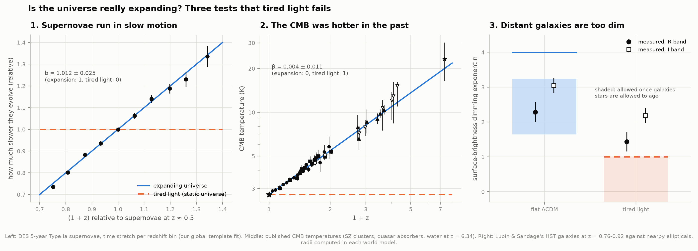
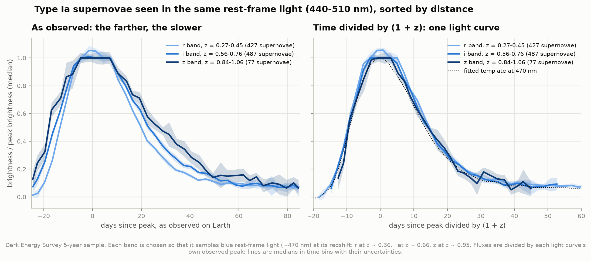
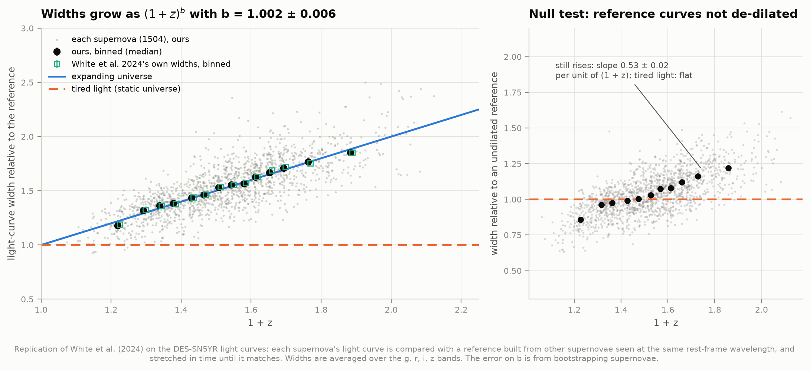
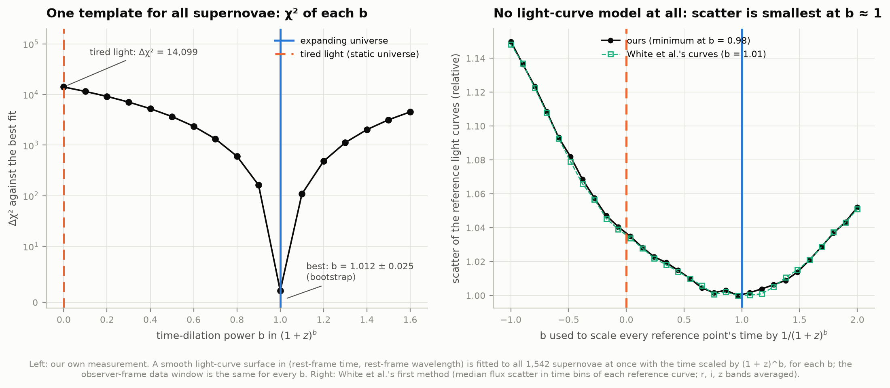
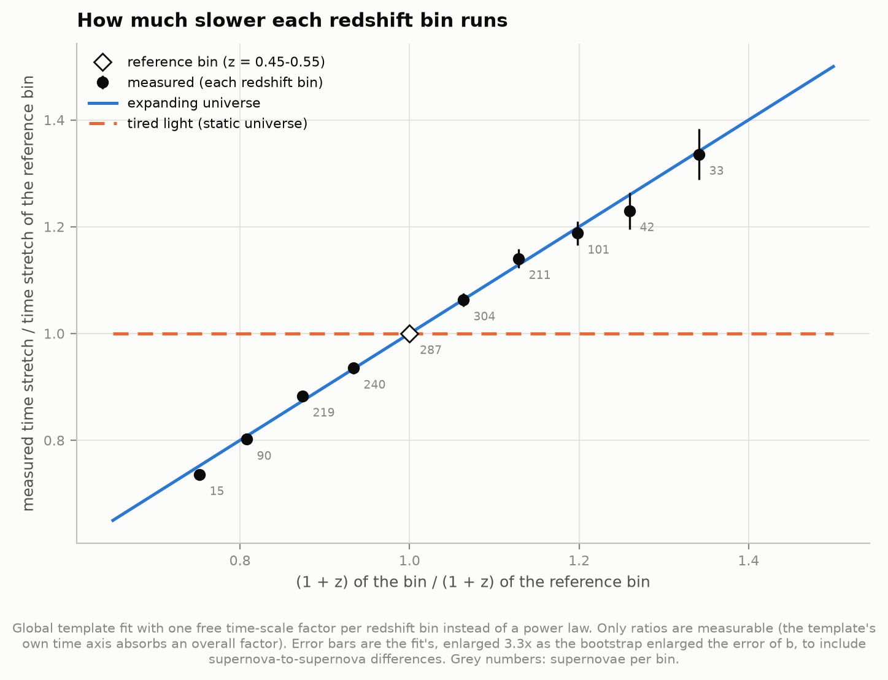
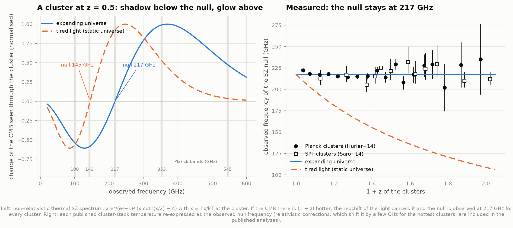
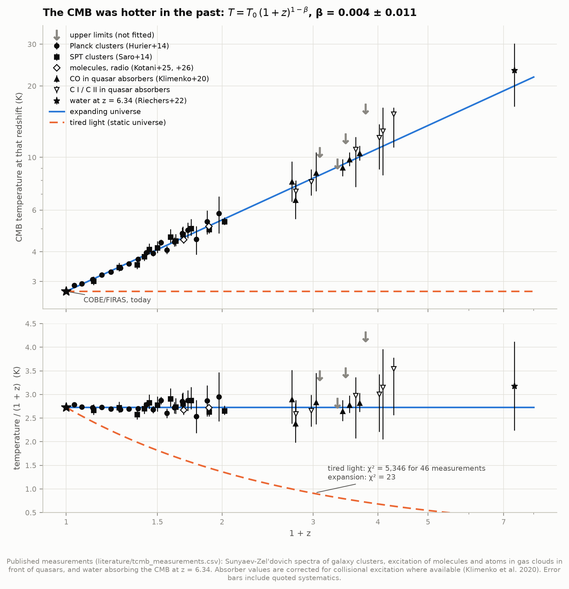
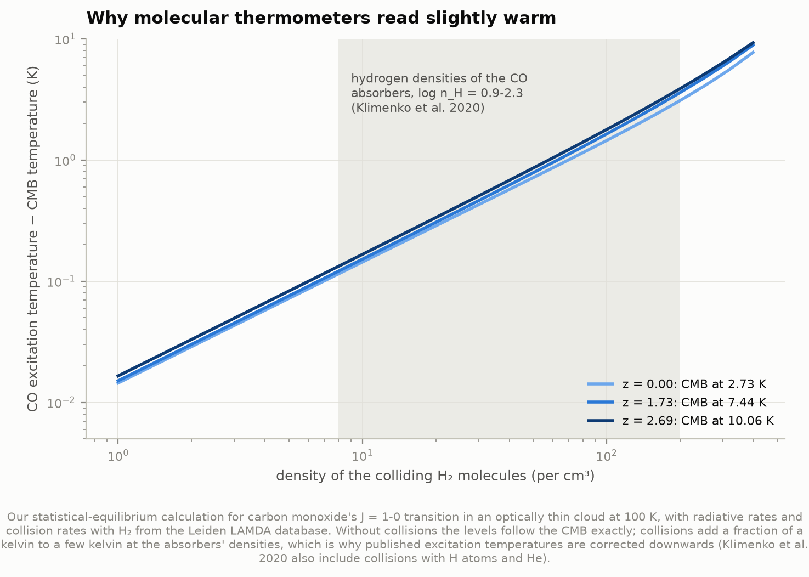
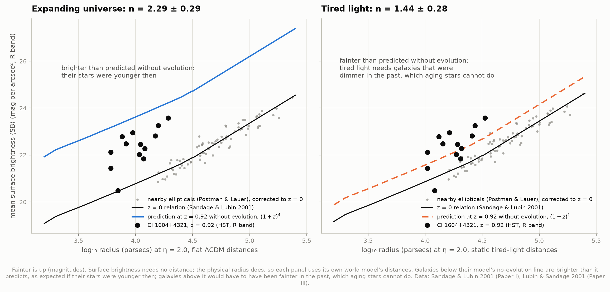
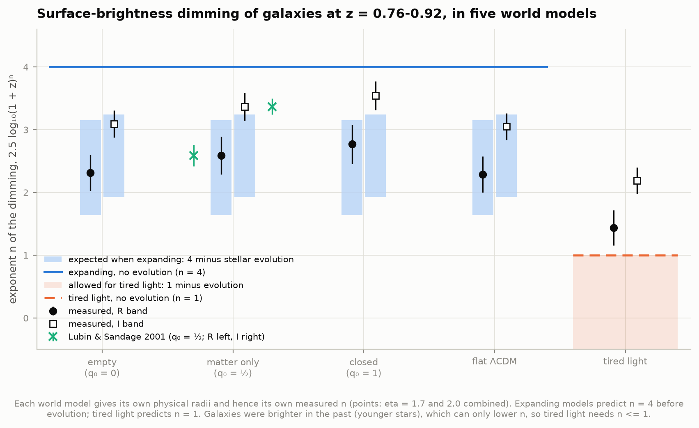

# D7 — Is the universe really expanding? Three tests that tired light fails

**Distant galaxies are redshifted, and the farther they are, the more. Is that because space
is expanding, or could light simply lose energy on its long way to us?**

The second idea is "tired light" (Fritz Zwicky, 1929). It explains the redshift–distance
relation as well as expansion does, so the redshifts alone cannot decide. This project runs
three tests on which the two ideas disagree, each with its own public data:

| Test | If space expands | If light tires | Measured here |
|---|---|---|---|
| **1. Supernovae in slow motion.** Do distant explosions unfold more slowly? Light-curve width ∝ (1 + z)^b | b = 1 | b = 0 | **b = 1.012 ± 0.025** from 1,542 DES supernovae with our own method, **1.002 ± 0.006** with White et al.'s (tired light: Δχ² = 14,099) |
| **2. A hotter past.** The temperature of the cosmic microwave background (CMB) at redshift z, T = T₀ (1 + z)^(1−β) | β = 0 | β = 1 (T = 2.725 K everywhere) | **β = 0.004 ± 0.011** from 46 published measurements to z = 6.34 (tired light: χ² = 5,346 against 23) |
| **3. Dimmer galaxies.** Surface brightness falls as (1 + z)^−n | n = 4, minus the brightening of younger stars | n = 1, minus the same brightening | n = 2.29 ± 0.29 and 3.05 ± 0.21 in the R and I bands (flat ΛCDM radii); 1.44 ± 0.28 and 2.19 ± 0.21 with tired-light radii, which would need galaxies to have been *fainter* in the past |

Tired light fails all three. The first two are decisive on their own; the third, the oldest
test (Tolman 1930), is the weakest because galaxies evolve, but it points the same way.



---

## 1. Supernovae in slow motion

### The idea

A Type Ia supernova is a white dwarf blowing itself apart, and every one rises and fades on
much the same schedule: about three weeks to peak, then a decline over months. If space
stretches while the light travels, everything about the light arriving from far away is
stretched by the same factor 1 + z: the wavelengths (that is the redshift itself), and the
time between any two moments of the explosion. A supernova at z = 1 should take twice as long
to rise and fade as a nearby one. If instead light merely tires on its way, its wavelengths
stretch but nothing slows down.

There is one complication: a supernova's light curve looks different in different colours
(redder light peaks later and fades more slowly), and a fixed filter sees bluer and bluer
rest-frame light as the redshift grows. A fair comparison therefore matches supernovae by the
*rest-frame* colour they are seen in: the r band at z ≈ 0.36 sees the same light as the i band
at z ≈ 0.66 and the z band at z ≈ 0.95.



On the left, three groups of supernovae seen in the same blue rest-frame light (440–510 nm),
on the clock of an observer on Earth: the farther the group, the slower its light curve. On
the right, the same measurements with time divided by 1 + z: the three groups fall onto one
light curve. Tired light predicts the left panel to look like the right one already.

### Results

| Measurement | b (expansion 1, tired light 0) | Published |
|---|---|---|
| **Our global template fit, 1,542 supernovae, raw photometry** | **1.012 ± 0.025** (bootstrap) | — |
| … tired light (b = 0) against the best fit | Δχ² = 14,099; b is 41σ from 0 | — |
| White et al.'s method replicated (widths averaged over bands, 1,504 supernovae) | 1.002 ± 0.006 (bootstrap; formal 0.005) | 1.003 ± 0.005 (stat) ± 0.010 (sys) |
| … as a straight line, width = m (1 + z) + c | m = 0.993 ± 0.016, c = 0.012 ± 0.024 | m = 0.988 ± 0.016, c = 0.020 ± 0.024 |
| … their own published widths, refitted | 1.003 ± 0.006 (χ²/dof = 1.441) | χ²/dof = 1.441 |
| … per band: g, r, i, z | 1.017 ± 0.027, 1.003 ± 0.008, 0.987 ± 0.008, 0.997 ± 0.008 | — |
| White et al.'s model-free scatter method (r, i, z) | scatter smallest at b = 0.98 | b ≈ 1 (their curves: 1.01) |
| Earlier: Goldhaber et al. 2001 (35 supernovae); Blondin et al. 2008 (spectral ageing, 13) | — | 1.07 ± 0.06; 0.97 ± 0.10 |

* **Time dilation is there, at the expected strength.** Light curves widen exactly as (1 + z):
  a supernova at z = 1 takes twice as long to unfold as a nearby one. Tired light (b = 0) is
  excluded overwhelmingly by every method.
* **White et al.'s analysis replicates almost exactly.** Run on the same light curves with
  their published choices, our code selects the same 1,504 supernovae and finds the same b,
  the same linear fit and the same χ²/dof (1.450 against their 1.441). Light curve by light
  curve, our widths match theirs with a median ratio of 1.000 and a scatter of 0.8–1.1%.



* **Our own method agrees**, without SALT3's rest-frame data window and without reference
  curves: b = 1.012 ± 0.025, and with no power law assumed at all (figure 04, below).
* **It is a cruder instrument, though.** Its error is four times White et al.'s, and the
  bootstrap error is 3.3 times what the χ² curvature claims. The reason: every supernova has
  its own intrinsic stretch (±10%), which shifts all of its points together, while a χ² over
  points treats them as independent. The weighting then concentrates on bright, well-sampled,
  nearby supernovae that have little leverage in redshift. White et al.'s method measures one
  width per supernova and averages them, which handles this naturally. Giving each supernova
  its own stretch with a population prior in the global fit would close the gap; that is left
  as an extension.

### Two measurements, two methods

**Our own: one template for every supernova, with the dilation law free.** Every flux
measurement is modelled as an amplitude times a single smooth surface S(τ, λ): rest-frame time
τ = t / (1 + z)^b against rest-frame wavelength λ. The surface is cubic B-splines (3-day knots
in time, 0.045-dex knots in wavelength), fitted to all 77,800 measurements at once, with a
free amplitude for each of the 5,479 light curves (one per supernova and band). For each trial
b the surface is refitted from scratch, so it knows nothing about time dilation. It is simply
the best single light-curve family once the times are divided by (1 + z)^b. The chi-square of
each b is compared on *exactly* the same points with the same errors: the data window is fixed
at −25 to +85 days around peak in the observer's frame, so no choice of b can change which
measurements count.



The left panel is the measurement: the χ² of the best template for each b, on the same
77,800 points. It has a sharp minimum at b = 1.01; b = 0 is worse by 14,099. The right panel is
White et al.'s first and most model-free method: take each target's reference supernovae
*without* any time correction, stretch each point's time by 1/(1 + z_j)^b, and see which b makes
the pile of light curves tightest. Our curves and White et al.'s published ones lie on top of
each other.

**Does the fit find the right answer when the answer is known?** We simulated the DES data
(the real epochs, bands, redshifts and errors) with fluxes from the fitted template stretched
by (1 + z)^b_true, plus a random 8% stretch per supernova and noise, and refitted blind:

| True b | Recovered (3 simulations each) |
|---|---|
| 0 (a tired-light universe) | 0.025 ± 0.079 |
| 0.5 | 0.57 ± 0.10 |
| 1 (an expanding universe) | 1.03 ± 0.05 |

The fit neither invents time dilation nor hides it.

**Robustness.** The same fit with changed settings and on subsamples (errors from the χ²
curvature; multiply by ~3.3 for the honest error, as the bootstrap showed):

| Variant | b | Supernovae |
|---|---|---|
| baseline | 1.012 | 1,542 |
| error floor 2% / 10% of peak (5% baseline) | 1.002 / 1.002 | 1,542 |
| template knots every 2 / 4 days (3 baseline) | 1.003 / 1.011 | 1,542 |
| only rest wavelengths > 350 nm | 1.023 | 1,542 |
| data window −20 to +60 days (−25 to +85 baseline) | 1.039 | 1,542 |
| without the g band | 1.006 | 1,542 |
| deep fields only / shallow fields only | 0.977 / 1.059 | 480 / 1,062 |
| host galaxy mass ≥ / < 10¹⁰ M☉ | 1.046 / 0.967 | 1,067 / 475 |
| z < 0.6 only | 1.072 | 1,009 |
| probability of being Type Ia > 0.99 | 1.001 | 1,464 |

Every variant is within about 2σ of b = 1 once the subsample's size is accounted for (the
deep/shallow and high/low-mass pairs differ by 0.08 ± 0.05). Shallow fields find only the
brighter, slower supernovae at high redshift, which would push b up; the deep fields, which
reach fainter, give 0.98.

**No power law needed.** Instead of (1 + z)^b, give each redshift bin its own free time-stretch
factor. Only ratios are measurable, so they are shown relative to the bin at z = 0.45–0.55.
They follow (1 + z): the bin at z ≈ 1.0 runs 1.34 ± 0.05 times slower than the reference bin,
exactly the 1.34 that expansion predicts. Tired light predicts 1 for every bin.



---

## 2. The CMB was hotter in the past

### The idea

The cosmic microwave background is the light of the hot early universe, cooled by expansion
to 2.725 K today. Expansion stretches every photon's wavelength by (1 + z), so at redshift z
the background was hotter: T = 2.725 K × (1 + z). In a static universe with tired light the
background would have the same temperature everywhere and at every distance.

Two kinds of thermometer read the CMB temperature far away:

* **Galaxy clusters** (the Sunyaev–Zel'dovich, or SZ, effect). Hot electrons in a cluster
  scatter some CMB photons to higher energies. Seen through the cluster, the background is
  dimmer below a certain frequency and brighter above it. That crossover sits at
  hν/kT = 3.83, where T is the CMB temperature *at the cluster*. The light then reaches us
  redshifted. If T = T₀ (1 + z), the two factors cancel and every cluster, near or far, shows
  its crossover at 217 GHz. If T = T₀, a cluster at z = 0.5 would show it at 145 GHz.
* **Molecules and atoms in gas clouds in front of quasars.** CMB photons excite the rotational
  levels of carbon monoxide (CO), HCN and other molecules, and the fine-structure levels of
  carbon atoms. The ratio of populations is a thermometer.



### Results

| Data | β (expansion 0, tired light 1) | Published |
|---|---|---|
| **Our compilation, 46 measurements, z = 0.04–6.34** | **+0.0040 ± 0.0107** (χ² = 23.0 for 45 dof) | — |
| SZ clusters only (Planck + SPT, 31 bins) | +0.007 ± 0.015 | — |
| Molecules and atoms only (16) | +0.001 ± 0.015 | — |
| Noterdaeme et al. 2011's data set (SZ of 13 clusters + carbon + CO) | −0.005 ± 0.027 | −0.007 ± 0.027 |
| … SZ alone / SZ + carbon / SZ + CO | +0.063 ± 0.080 / +0.040 ± 0.054 / −0.009 ± 0.029 | +0.040 ± 0.079 / +0.029 ± 0.053 / −0.012 ± 0.029 |
| Riechers et al. 2022's table, every row | +0.0032 ± 0.0086 | +0.0034 (+0.0081 / −0.0073) |
| Kotani et al. 2026 (~80 measurements) | — | +0.0039 (+0.0074 / −0.0082) |

* **Tired light is ruled out at about 90σ.** It predicts β = 1, against a measured
  β = 0.004 ± 0.011. Put directly: with T = 2.725 K at every redshift the 46 measurements give
  χ² = 5,346; with T = 2.725 K × (1 + z) they give χ² = 23.
* **The CMB temperature today, measured from far away.** Fitting only the distant
  measurements with T = T₀ (1 + z) gives T₀ = 2.7232 ± 0.0091 K. COBE/FIRAS measured
  2.72548 ± 0.00057 K here and now (project D3). Klimenko et al. 2020 found 2.719 ± 0.009 K
  the same way.
* **The two kinds of thermometer agree** with each other and with expansion, and they have
  completely different systematics: clusters at z < 1, gas clouds at z = 0.7–3.3, and water
  vapour in a galaxy at z = 6.34, 12.8 billion years ago (16.4–30.2 K, against 20.0 K
  expected).



### Why molecular thermometers read slightly warm

Collisions in the gas also excite molecules, so a measured excitation temperature is only an
upper limit on the CMB temperature until corrected. A small statistical-equilibrium calculation
for CO (radiative and collision rates from the Leiden LAMDA database) shows the size of the
effect: at the densities of these clouds collisions add a few tenths of a kelvin to a couple
of kelvin. That is why Klimenko et al. (2020) corrected the CO temperatures downward by up to
1 K, which our compilation uses.



---

## 3. Distant galaxies are too dim: the Tolman test

### The idea

Surface brightness, the light per square arcsecond, does not depend on distance in ordinary
static space: a galaxy twice as far is four times fainter but also four times smaller in
area. In an expanding universe it drops as (1 + z)⁴ (Tolman 1930). One factor of (1 + z) comes
because each photon arrives with less energy, one because photons arrive less often (time
dilation again), and two because the galaxy was closer when the light left it, so it appears
larger on the sky than its present distance suggests. Tired light keeps only the first factor,
(1 + z)¹.

The catch: to compare a distant galaxy with nearby ones *of the same physical size*, its
angular size must be turned into a size in parsecs. That needs a distance, which depends on
the world model. So each world model is tested on its own terms: compute the radii in that
model, measure the dimming exponent n, and ask whether it matches the model's prediction
once galaxy evolution is allowed for. The galaxies were seen when their stars were billions of
years younger, hence brighter, which makes n come out *below* the model's value.

### Data

Lubin & Sandage (2001, Papers I–IV) measured 34 early-type galaxies in three clusters at
z = 0.76, 0.90 and 0.92 with the Hubble Space Telescope, and compared them with 118 brightest
cluster ellipticals nearby (Postman & Lauer 1995), all inside the same Petrosian radii (a
radius defined by the light profile itself, so no distance is needed to choose it). Their
tables are read straight from the papers' TeX sources on arXiv.



### Results

| World model | n (R band, z = 0.92) | n (I band, z = 0.76, 0.90) | Evolution needed |
|---|---|---|---|
| Matter only, q₀ = ½ (Lubin & Sandage's choice) | 2.59 ± 0.30 | 3.37 ± 0.22 | brighter in the past ✓ |
| … as published | 2.59 ± 0.17 | 3.37 ± 0.13 | |
| Empty, q₀ = 0 | 2.31 ± 0.29 | 3.09 ± 0.22 | brighter ✓ |
| Closed, q₀ = 1 | 2.77 ± 0.31 | 3.54 ± 0.23 | brighter ✓ |
| **Flat ΛCDM (Ωm = 0.3), today's model** | **2.29 ± 0.29** | **3.05 ± 0.21** | **brighter by 2.5 log₁₀(1 + z)^1.7 and ^0.95 ✓** |
| **Tired light (static space)** | **1.44 ± 0.28** | **2.19 ± 0.21** | **fainter in the past ✗** |

* **The replication is nearly exact.** In Lubin & Sandage's own world model our 15 per-cluster
  depressions (three clusters × five Petrosian radii) match their Tables 5–7 to within
  0.036 mag (most within 0.02), and the final exponents agree to the second decimal. Their
  q₀ = 0 and q₀ = 1 values (2.28/3.06 and 2.81/3.55) agree to 0.04.
* **In an expanding universe the galaxies were brighter in the past**, by 1.2 mag (R) and
  0.6 mag (I) for flat ΛCDM. Stellar-population models of galaxies that formed their stars at
  z > 2.5 predict 2.5 log₁₀(1 + z)^p with p = 0.85–2.36 (R) and 0.76–2.07 (I) (Lubin & Sandage's
  Bruzual & Charlot calculations); flat ΛCDM's p = 1.71 (R) and 0.95 (I) fall inside both.
* **In a static universe the same galaxies would have to have been fainter in the past**:
  p = −0.44 ± 0.28 (R) and −1.19 ± 0.21 (I), 1.6σ and 5.7σ below zero. A population of stars
  can only fade as it ages; star formation makes a galaxy *brighter* in the past, not fainter.
  Allowing even the smallest brightening Paper IV considers (p > 0.7) puts tired light 4.0σ (R)
  and 9σ (I) away.



---

## Background, in brief

**Redshift.** Light from a distant galaxy arrives with every wavelength stretched by the same
factor, 1 + z. In the standard picture this is the factor by which the universe has grown
while the light travelled.

**Tired light.** Zwicky proposed in 1929 that photons might lose energy over cosmic distances
by some unknown process, making redshift grow with distance in a static universe. No physical
mechanism was ever found; any process that saps a photon's energy by scattering would also
blur images of distant galaxies, which are sharp. The idea survives in alternative-cosmology
circles (e.g. Gupta 2023's "CCC+TL"), and occasionally in the press, so the decisive tests
are worth redoing with today's data.

**Why the three tests are independent.** Time dilation is a property of clocks (how fast the
explosion runs), the CMB test is a property of the radiation field far away, and the Tolman test
is a property of how light spreads out over an area. They use different telescopes, different
physics and different systematics.

---

## How it works

**Data** (all public, ~91 MB, every file's URL, size and SHA-256 recorded in
`data/manifest.json`):

* **DES-SN5YR** (GitHub `des-science/DES-SN5YR`, tag 1.3): scene-modelling photometry of all
  19,706 DES transients, the SALT3 fits of the 1,635 cosmology supernovae, and their
  Hubble-diagram metadata (peak dates, probabilities of being Type Ia). The repository's main
  branch has since moved to the 2026 "Dovekie" recalibration; the photometry and SALT3 files
  are byte-identical in both, and tag 1.3 is the release White et al. used.
* **White et al. (2024)'s widths** (GitHub `ryanwhite1/DES-Time-Dilation`): their per-supernova
  widths and scatter curves, used only as an answer key. They are Python pickles, read with an
  unpickler that refuses anything but numpy/pandas containers.
* **CMB temperatures**: `literature/tcmb_measurements.csv`, typed from the papers' tables
  (Riechers et al. 2022's Extended Data Table 1, Klimenko et al. 2020, Noterdaeme et al. 2011,
  Luzzi et al. 2009, Muller et al. 2013, Kotani et al. 2025 and 2026). `test_tcmb_table.py`
  re-reads every value from the arXiv sources and checks it.
* **Tolman test**: Lubin & Sandage's tables, parsed from the TeX of Papers I, III and IV.
* **CO molecular data**: the LAMDA file `co.dat` (Schöier et al. 2005; collision rates of
  Yang et al. 2010).

**Test 1, step by step.**

1. *Sample.* The 1,635 DES-SN5YR cosmology supernovae, keeping the 1,542 with a probability
   above 0.5 of being Type Ia (White et al.'s cut). Redshifts are heliocentric: time dilation
   is set by the redshift we actually observe.
2. *White et al.'s method* (`reference_method.py`), with their published choices: the points
   SALT3 fitted, minus those with flux errors above 20; fluxes divided by the SALT3 model's
   peak in each band; time measured from SALT3's peak date. For a target light curve, every
   other supernova whose band samples the same rest-frame wavelength (within 1/16 of the band
   width) goes into the reference, its times divided by its own (1 + z). The target's width w
   minimises a χ² against the running median of the reference (±2 rest-frame days), by
   Nelder–Mead started at w = 1 + z; the error is the larger of a 200-draw Monte Carlo and the
   reference's own scatter × (1 + z). The running median is precomputed on a 0.01-day grid,
   which makes ~4,600 fits × 201 runs affordable. Widths are averaged over bands per
   supernova and fitted with (1 + z)^b. The *null test* repeats everything without dividing
   the reference's times by (1 + z), and the *scatter method* stretches raw reference times by
   (1 + z_j)^b for 30 values of b and records the median scatter in 15 time bins.
3. *Our global fit* (`template_fit.py`): every flux in the raw DES photometry within −25 to
   +85 observer-frame days of peak, rest-frame wavelengths 300–860 nm, rejected photometry
   flags removed (77,800 measurements, 5,479 light curves). Each light curve gets a free
   amplitude; one B-spline surface S(τ, λ) describes them all; τ = t / D(z). Each point's error
   gets a floor of 5% of its light curve's observed peak so that bright nearby supernovae do
   not dominate with residuals that are really intrinsic stretch differences. The model is
   solved by Gauss–Newton with the amplitudes profiled out, with D either (1 + z)^b or one
   factor per redshift bin. S is normalised to 1 at τ = 0 at every wavelength, which removes
   a degeneracy with the amplitudes and does not depend on D.
4. *Errors* on the global b: 200 bootstrap resamplings of supernovae, each refitted.
5. *Injection tests*: the real epochs, bands, redshifts and errors, with fluxes replaced by the
   fitted template stretched by (1 + z)^b_true, an 8% random stretch per supernova, and noise;
   then refitted blind.

**Test 2.** Published temperatures fitted with T = T₀ (1 + z)^(1−β), T₀ = 2.72548 K (FIRAS),
on a fine grid of β, with split-normal errors (the upper error applies when the model lies
above a measurement) and quoted systematics added in quadrature. Upper limits are shown but not
fitted; Riechers et al.'s 1σ range for HFLS3 enters as its midpoint ± half-width. The
*baseline* uses one analysis per cluster sample (Hurier et al.'s Planck stacks, Saro et al.'s
SPT stacks) and per absorber (Klimenko et al.'s collision-corrected values where they exist),
plus the newest radio-molecular measurements. The SZ null frequency of each cluster stack is
3.83 kT(z)/h / (1 + z). The CO model solves the rate equations for the lowest 12 rotational
levels with CMB radiation and H₂ collisions (thermal ortho/para ratio) at 100 K.

**Test 3.** Paper I's local relations (⟨SB⟩ against log R at each Petrosian η, with its
correction at small radii) are moved into each world model: local radii shift by the model's
angular-diameter distance at the local galaxies' redshifts, and the local surface brightness
is brought to z = 0 with the model's own dimming. The distant galaxies' radii come from their
angular radii and the model's distance at z = 0.76–0.92. The depression from the local line,
averaged over each cluster's galaxies, gives n = Δ⟨SB⟩ / 2.5 log₁₀(1 + z); η = 1.7 and 2.0 are
combined as in Paper IV (smaller η are biased by Hubble's point-spread function). Errors combine
the galaxies' scatter about their mean with the local line's zero point, the small-radius
correction and the K-correction.

## Honest notes

**What is ours and what is inherited.** Test 1 is fully redone from the photometry, except
for the supernova classification, the redshifts and the peak dates, which come from the DES
release; White et al.'s method also inherits SALT3's peak fluxes. Test 2 compiles published
temperatures; the physics of how they were measured (SZ spectra, line excitation) is the
authors'. Test 3 recomputes the analysis from Lubin & Sandage's measured photometry, but the
K-corrections, the Petrosian photometry and the small-radius correction of the local relation
are theirs.

**Time dilation.**
* *SALT3's fit window assumes the answer.* The points DES's SALT3 fits used, and therefore
  the data of White et al.'s method, were chosen in a window of −15 to +45 days in each
  supernova's *rest frame*, i.e. with (1 + z) already applied. Our global fit avoids this by
  using the raw photometry in a fixed observer-frame window, and finds the same answer.
* *Peak dates* also come from SALT3 (in both methods). They mark the moment of maximum light,
  which the data around peak pin down; a scatter in them blurs the template but cannot make
  light curves wider at high redshift.
* *Selection.* At high redshift a flux-limited survey finds the brighter supernovae, which also
  have slower light curves. The DES stretch distribution shows no trend with redshift (SALT3
  x1 slope 0.03 ± 0.14 per unit z), and splitting the sample by depth of field, host-galaxy
  mass and redshift range moves b by up to 0.06, within about 2σ of each subsample's own
  error; the deep fields, which reach the faintest supernovae, give 0.98.
* *White et al.'s quoted error is slightly optimistic.* Their ±0.005 assumes the band-averaged
  widths' errors are right, but χ²/dof is 1.45; resampling supernovae gives ±0.0055–0.006.
  Their ±0.010 systematic (a possible drift of stretch with redshift) dominates anyway.
* *Their Nelder–Mead start does not matter.* Starting each width fit at the expected answer
  w = 1 + z is a reasonable worry on a step-shaped χ². Started at w = 1 instead, b = 0.998;
  taking each light curve's global minimum on a grid, b = 1.001. For 5–20% of light curves the
  width changes by more than 5%, but with no net direction.
* *Their scatter method is weak in the bluer bands.* The scatter is smallest at b = 0.64 (g)
  and 0.72 (r), where the matched supernovae span only a small range of redshift; r, i, z
  together give 0.98. We follow White et al. in quoting the r, i, z average.

**CMB temperature.**
* χ² = 23 for 45 degrees of freedom: the published errors are generous, or (for the SZ bins)
  partly correlated, since the Planck and SPT samples share some clusters and the same sky.
  Neither changes the conclusion.
* The absorber values depend on corrections for collisions and ultraviolet pumping. Three
  versions exist for several clouds (uncorrected, Maeder 2017, Klimenko et al. 2020); using
  every version of every row, as in Riechers et al.'s table, gives β = 0.0032 ± 0.0086, the
  same answer.
* A transcription slip in Klimenko et al. (2020): their summary table gives J0857+1855 a CO
  temperature of 9.8 K, which is J0000+0048's value; their CO table has 7.9 K, used here.
* A static universe could in principle have a CMB of local origin (thermalised starlight, as
  some alternative models propose). That changes nothing here: the test is whether the radiation
  far away was hotter, and the SZ null frequency shows it was.

**Tolman test.** It is the weakest of the three, for three reasons.
* *Evolution.* Its conclusion depends on how much brighter the galaxies' younger stars made
  them. We do not model that ourselves but use the stellar-population calculations quoted in
  Paper IV. The tired-light argument needs only the sign: aging stars fade.
* *The local relation at small radii.* The distant galaxies (log R = 3.6–4.3) are smaller than
  every nearby galaxy in the comparison sample (log R ≥ 4.0), so the test leans on Paper I's
  correction of the local line at small radii, derived from data (Sandage & Perelmuter 1991)
  not included in these tables. Paper I does not say which line it fitted; an OLS-bisector fit
  through the nearby galaxies reproduces its η = 2.0 line to 0.004 mag at log R = 4.5 (and its
  η = 1.7 line to 0.01 mag), and we use the published lines throughout.
* *Tired light treated consistently.* The nearby galaxies (z ≈ 0.037) must be brought to zero
  redshift with the model's own dimming: (1 + z)⁴ = 0.16 mag when expanding, (1 + z)¹ = 0.04 mag
  for tired light. We get n = 1.44 (R) and 2.19 (I) for tired light; Paper IV has 1.61 and
  2.27. Keeping expansion's 0.16 mag in the tired-light case reproduces Paper IV's R value
  exactly (1.60), so that is apparently what Paper IV did; the same change gives 2.37 in the I
  band, 0.10 above Paper IV, a difference we could not trace. Tired light still fails, but by
  less than Paper IV's ">10σ": 1.6σ (R) and 5.7σ (I) without any evolution, and 4.0σ and 9.0σ
  allowing Paper IV's minimum brightening (p > 0.7).
* Our errors on n (±0.21–0.30) are larger than Paper IV's (±0.13–0.17): we include the
  scatter of the galaxies and the uncertainty of the local line at small radii, and Paper IV
  does not say how its errors were computed.

**Smaller points.** The R − I colour of 0.62 that moves the local relations into the I band
is Paper IV's. Look-back times to the three clusters are 6.6–7.4 Gyr in flat ΛCDM and
7.9–9.1 Gyr in a static universe (H₀ = 70), so tired light gives the stars even more time to
fade, not less.

## Running it

```bash
cd ..                       # repository root
python3 -m venv .venv
source .venv/bin/activate
pip install numpy scipy pandas matplotlib astropy pyarrow threadpoolctl

cd 37-expansion-tests
python fetch_data.py        # ~91 MB from GitHub, arXiv and LAMDA; only needed once
python run.py               # everything; 30-60 min the first time, ~1 min afterwards
python test_physics.py      # 46 checks of the physics and statistics
python test_tcmb_table.py   # every transcribed CMB temperature against its paper
```

The slow steps (the replication, the bootstrap and the injection tests) are cached in
`data/derived/`. Set `D7_WORKERS` for the number of processes (default 6).
`python run.py --figures-only` redraws the figures from the last run.

### Files

| File | What it does |
|---|---|
| `config.py` | Data sources, method settings, and the published values we compare against |
| `fetch_data.py` | Downloads and caches the data; loaders (FITS, SNANA text, restricted unpickler) |
| `supernovae.py` | Builds the supernova sample: SALT3 view (White et al.'s data) and raw-photometry view |
| `reference_method.py` | White et al.'s reference-curve widths and scatter-minimisation, replicated |
| `template_fit.py` | Our global template fit with the dilation law free |
| `timedilation.py` | Test 1: runs both methods, bootstrap, subsamples, per-bin factors, injection tests |
| `tcmb.py` | Test 2: T(z) fits, replications, the SZ null, CO statistical equilibrium |
| `tolman.py` | Test 3: the Tolman test in five world models |
| `analysis.py`, `run.py` | Run everything, save `data/results.json`, print the summary |
| `figures.py`, `plotstyle.py` | Every figure (colour-blind-safe palette shared with D1) |
| `test_physics.py`, `test_tcmb_table.py` | Self-checks |
| `literature/tcmb_measurements.csv` | The compiled CMB temperatures, with sources |

## Figures

`00_summary` the three tests · `01_slow_motion` light curves at one rest-frame colour ·
`02_light_curve_widths` White et al.'s method replicated · `03_measuring_b` our χ² against b
and the scatter method · `04_dilation_by_redshift` one dilation factor per redshift bin ·
`05_cmb_temperature` T(z) · `06_sz_null` what the cluster measurements mean ·
`07_molecular_thermometer` collisions and CO · `08_tolman_diagram` surface brightness against
radius · `09_tolman_exponents` the Tolman exponent in five world models. PNG and SVG.

## Data credits

- **DES-SN5YR**: DES Collaboration 2024, ApJL 973, L14; Vincenzi et al. 2024, ApJ 975, 86;
  Sánchez et al. 2024, ApJ 975, 5. Time dilation: White et al. 2024, MNRAS 533, 3365
  (code: github.com/ryanwhite1/DES-Time-Dilation).
- **CMB temperatures**: Fixsen 2009, ApJ 707, 916 (FIRAS); Hurier et al. 2014, A&A 561, A143;
  de Martino et al. 2015, ApJ 808, 128; Saro et al. 2014, MNRAS 440, 2610; Luzzi et al. 2009,
  ApJ 705, 1122; Noterdaeme et al. 2011, A&A 526, L7; Klimenko et al. 2020, Astron. Lett. 46,
  715; Muller et al. 2013, A&A 551, A109; Kotani et al. 2025 (arXiv:2509.20760); Kotani, Oka &
  Enokiya 2026 (arXiv:2602.22399); Riechers et al. 2022, Nature 602, 58; Avgoustidis et al.
  2016, PRD 93, 043521; earlier absorber values from Cui et al. 2005, Ge et al. 1997, Srianand
  et al. 2000, 2008, Molaro et al. 2002, Noterdaeme et al. 2010, 2017; Maeder 2017.
- **LAMDA**: Schöier et al. 2005, A&A 432, 369; CO–H₂ rates Yang et al. 2010, ApJ 718, 1062.
- **Tolman test**: Sandage & Lubin 2001, AJ 121, 2271 (Paper I); Lubin & Sandage 2001, AJ 121,
  2289; AJ 122, 1071; AJ 122, 1084 (Papers II–IV); local data Postman & Lauer 1995, ApJ 440, 28.
- Tired light: Zwicky 1929, PNAS 15, 773. Tolman 1930, PNAS 16, 511.

All data retrieved 2026-10-04.
