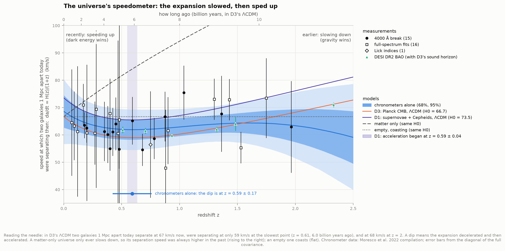
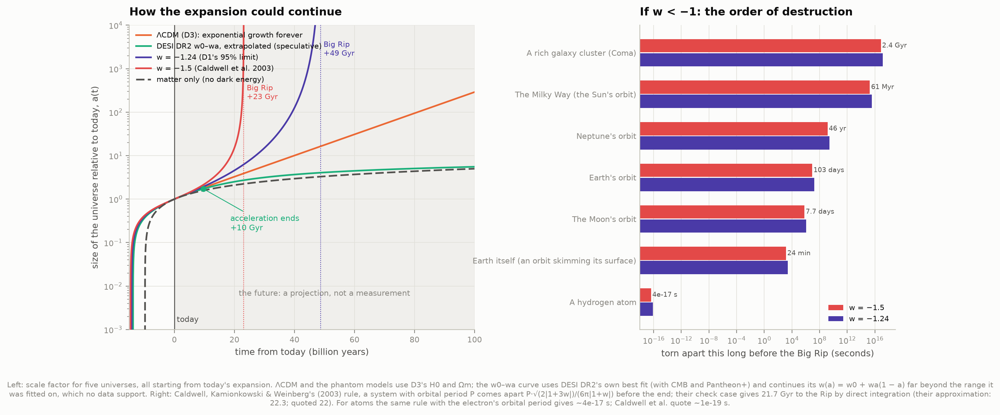
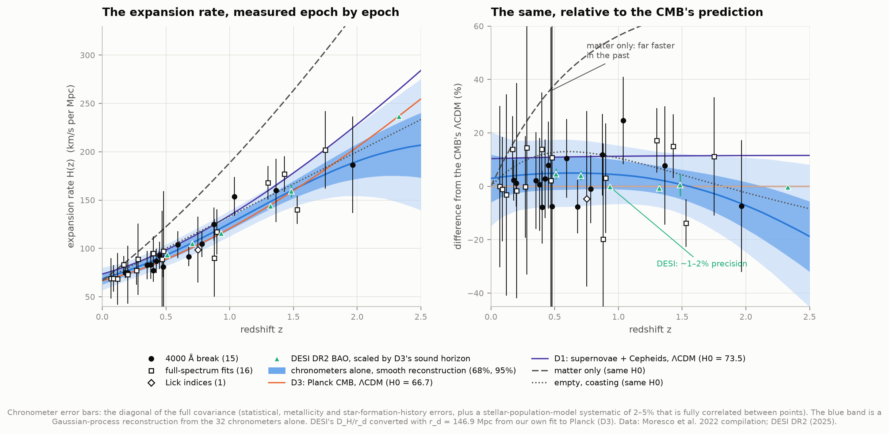
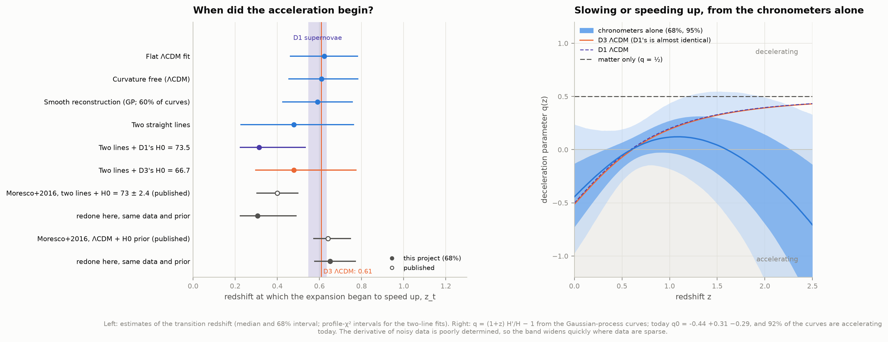
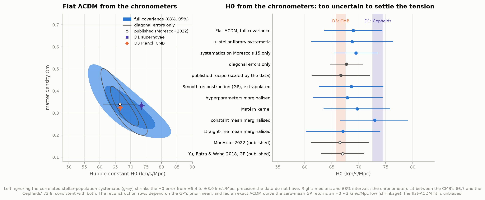
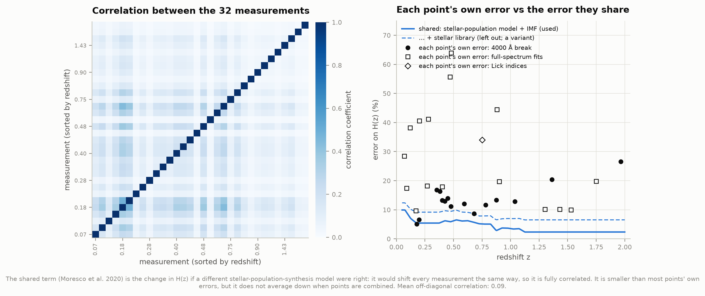
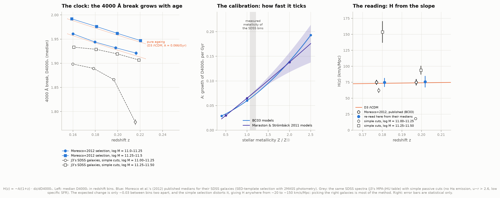
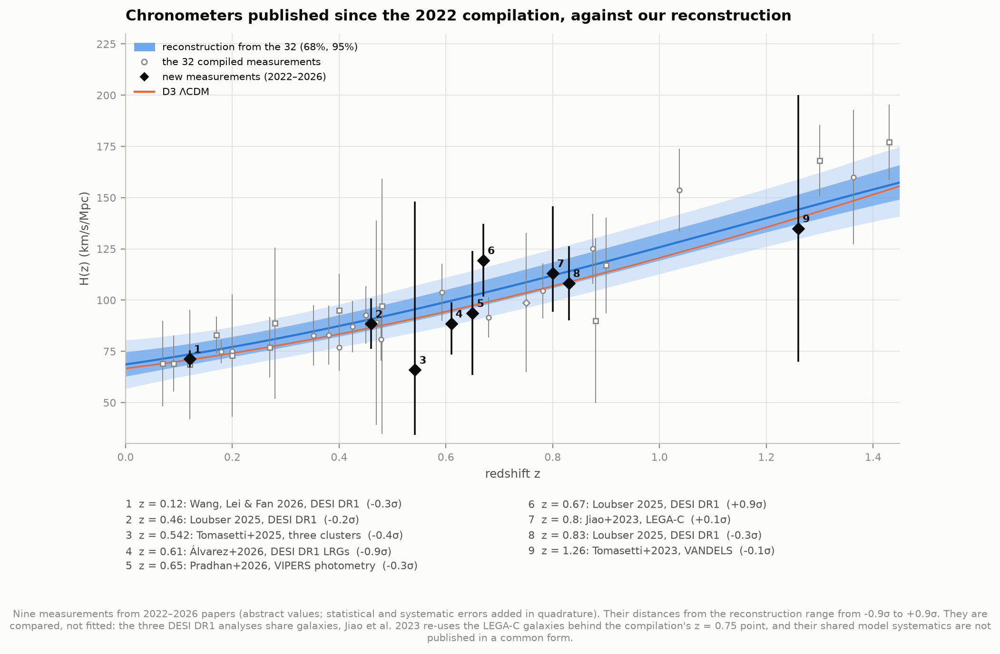
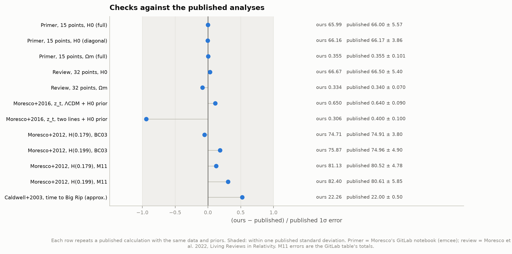
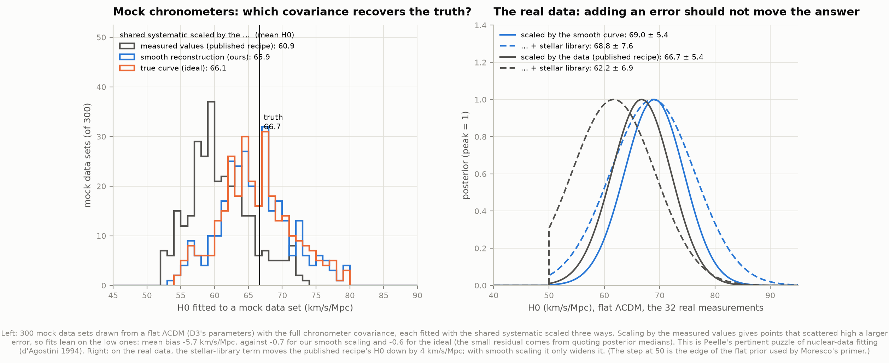

# D8: The universe's speedometer, H(z) from cosmic chronometers

**Can we measure how fast the universe was expanding at each epoch, see the slowdown turn into a speed-up, and say where that leads?**

Mostly, yes. The oldest, most massive galaxies are clocks: their stars all formed early and
at nearly the same time, so their age difference between two nearby redshifts tells us how much
cosmic time passed in between. Redshift interval divided by time interval gives the expansion
rate H(z) directly, epoch by epoch, without assuming a cosmological model. This project fits the
32 such measurements published up to 2022 (0.07 < z < 1.97). It finds the expansion slowing
down and then speeding up, with the switch at **z = 0.62 ± 0.16, about 6 billion years ago**.
That agrees with D1's supernovae (0.59 ± 0.04), from a completely independent method.

Along the way it reproduces the published chronometer fits to within 0.05σ. It also finds that
the standard recipe for the chronometers' systematic errors pulls H0 low by about 2 km/s/Mpc on
the real data, and by ~6 km/s/Mpc on average in simulations. Lastly, it follows the expansion
100 billion years into the future for four kinds of dark energy, one of which ends in a "Big Rip".



---

## Results

### The expansion rate, from the chronometers alone

Flat ΛCDM fitted to the 32 measurements with their full covariance (flat priors 50 < H0 < 100,
0.01 < Ωm < 0.99, as in Moresco's own fits):

| Quantity | Ours | For comparison |
|---|---|---|
| Hubble constant H0 | **69.0 ± 5.4 km/s/Mpc** | D3 (Planck CMB): 66.7 ± 0.9; D1 (Cepheids + supernovae): 73.5 ± 1.0 |
| Matter density Ωm | **0.319 +0.072 −0.058** | D1: 0.332 ± 0.018; D3: 0.325 ± 0.013 |
| Transition redshift z_t | **0.62 ± 0.16** | D1: 0.59 ± 0.04 |
| Deceleration today q0 | −0.52 +0.11 −0.09 | D1: −0.50 ± 0.03 |
| Age of the universe | 13.4 +0.7 −0.6 Gyr | D3: 13.83 ± 0.03 Gyr |
| Fit quality | χ² = 14.6 for 30 degrees of freedom | the 2022 review: χ²/dof ≈ 0.5 |

With curvature left free (Ωm and ΩΛ separately), the chronometers alone give Ωm = 0.34 ± 0.20
and ΩΛ = 0.69 +0.38 −0.40. The expansion is accelerating today in 94.5% of the posterior, and
z_t = 0.61 +0.18 −0.16.

**The chronometers cannot settle the Hubble tension.** Their H0 sits between the CMB's 66.7 and
the Cepheids' 73.5, about ±5.4 from each. The error is dominated by the stellar-population
models used to turn spectra into ages, not by the number of galaxies.

**Correlations matter.** The same fit with the covariance treated four ways:

| Covariance | H0 | Ωm |
|---|---|---|
| full, shared systematic scaled by a smooth curve (**baseline**) | 69.0 ± 5.4 | 0.319 |
| full, scaled by the measured values (the published recipe) | 66.7 ± 5.4 | 0.334 |
| full + the stellar-library term (smooth scaling) | 68.8 ± 7.6 | 0.319 |
| full + the stellar-library term (published recipe) | 62.2 +7.2 −6.7 | 0.346 |
| systematics on Moresco's 15 points only | 69.5 ± 4.1 | 0.314 |
| diagonal errors only | 67.7 ± 3.0 | 0.327 |

Leaving out the correlations (last row) shrinks the H0 error by a factor of 1.8: precision the
data do not have. The next section explains the difference between the first two rows.

### A bias in the standard covariance recipe

The dominant systematic error is the choice of stellar-population-synthesis model: if a
different model were right, every measurement would shift by a few per cent in the same
direction. Moresco et al. (2020) tabulate this as a percentage of H, and the published recipe
(the GitLab primer and the 2022 review) turns it into km/s/Mpc by multiplying with **each
measured value**. A point that scattered high then gets a larger correlated error than one that
scattered low, and the fit leans on the low ones. This is a known trap in nuclear-data fitting,
"Peelle's pertinent puzzle" (d'Agostini 1994): for n points sharing a fractional error f, the
fit is pulled down by a factor of about 1/(1 + n f²). That is 8% here.

We tested it on 300 mock data sets drawn from a known ΛCDM (H0 = 66.7) with the full
covariance ([figure 10](figures/10_scaling_bias.png)):

| Shared systematic scaled by... | mean fitted H0 − truth | with the stellar-library term |
|---|---|---|
| each mock's measured values (published recipe) | **−5.7 ± 0.3** | −10.4 ± 0.2 |
| a smooth reconstruction of the same mock (ours) | −0.7 ± 0.3 | −0.9 ± 0.4 |
| the true curve (the unattainable ideal) | −0.6 ± 0.3 | −0.4 ± 0.4 |

The remaining −0.6 is a property of the estimator (the median of a skewed posterior), the same
for the ideal and for us. The 1/(1 + nf²) estimate predicts −5.6, against the simulated −5.7.
On the real data the shift is smaller (+2.3 km/s/Mpc from the recipe's 66.7 to our 69.0, under
half the error bar), but it is systematic. The most telling symptom: in the published recipe,
*adding* the stellar-library uncertainty moves H0 from 66.7 to 62.2. Adding an uncertainty should
widen a result, not move it, and with smooth scaling it only widens it (68.8 ± 7.6).
The fix used here scales the shared systematic by the Gaussian-process reconstruction of H(z)
(no cosmological model), iterated until it stops changing. We found no discussion of this effect
in the chronometer literature we checked; the published values are reproduced exactly when the
published recipe is used (see Validation).

### The speedometer: slowing down, then speeding up

The cleanest picture of acceleration is not H(z) itself but **da/dt = H(z)/(1+z)**: the speed
at which two galaxies that are 1 Mpc apart *today* were separating at each epoch. It falls while
gravity is winning and rises once dark energy takes over, so a dip marks the switch.

- In D3's ΛCDM the needle reads **67 km/s today, 59 km/s at the slowest point** (z = 0.61, 6.0
  billion years ago, about 1.4 billion years before the Sun formed), and 68 km/s at z = 2.
- **DESI's BAO measurements show the dip directly**, at 1–2% precision per point once their
  D_H/r_d is converted with the sound horizon from our own Planck fit (D3, r_d = 146.9 Mpc):
  da/dt = 61.8, 61.5, 59.8, 62.0, 64.1 and 71.0 km/s at z = 0.51, 0.71, 0.93, 1.32, 1.48 and 2.33.
  They agree with the chronometers' reconstruction (χ² = 4.0 for 5 points inside its range).
- **The chronometers alone see the dip only weakly.** Their curves are accelerating today in 92%
  of draws (about 1.4σ) and have a minimum inside the data in 60%. The other draws keep falling
  out to z ≈ 2, because the sparse high-redshift points pin down the earlier, decelerating era
  only loosely. The flat-ΛCDM fit is far more decisive (accelerating in 99.98% of the posterior),
  but that strength comes from assuming ΛCDM's shape.
- **The Hubble tension shows up here too:** D1's Cepheid-calibrated ΛCDM sits 6% above DESI's
  CMB-calibrated H(z) at z = 0.5 (χ² = 234 for 6 points), while D3's is consistent with it
  (χ² = 10.2 for 6 points).

### When did the acceleration begin?

| Method (chronometers unless stated) | z_t |
|---|---|
| flat ΛCDM fit | **0.62 ± 0.16** |
| ΛCDM, curvature free | 0.61 +0.18 −0.16 |
| Gaussian-process reconstruction (model-free; the 60% of curves with a dip in the data) | 0.59 ± 0.17 |
| two straight lines in da/dt (model-free) | 0.48 (68%: 0.23–0.76) |
| two lines + D1's H0 = 73.5 ± 1.0 | 0.31 (0.22–0.54) |
| two lines + D3's H0 = 66.7 ± 0.9 | 0.48 (0.29–0.78) |
| *D1: supernovae, flat ΛCDM* | *0.59 ± 0.04* |
| *D3: Planck CMB, ΛCDM* | *0.61* |
| *Moresco et al. 2016: two lines + H0 = 73 ± 2.4 (published)* | *0.4 ± 0.1* |

**The two-line method is biased low.** Moresco et al. (2016) introduced it as the simplest
model-free way to find the kink. Fed an *exact* ΛCDM curve (true z_t = 0.61) at the 32 redshifts
with the real covariance, it returns 0.55. Given the exact H0 as well, it returns 0.34. ΛCDM's
da/dt is steep near z = 0 and flat around its minimum, so a pair of straight lines puts the kink
too early, and an accurate H0 point makes this worse. The Gaussian process, fed the same exact
curve, returns 0.606: it finds the dip in the right place. The published 0.4 ± 0.1 is therefore
not in tension with ΛCDM's ~0.6; it is what this estimator returns for ΛCDM.

### H0 and q0 without any model: the Gaussian process's limits

The Gaussian process reconstruction also gives H0 = 68.6 ± 6.0 and q0 = −0.44 +0.31 −0.29,
but these two numbers are less reliable than its z_t. With error bars this large, the GP's curve
is a smoothed version of the truth: fed an exact ΛCDM curve (H0 = 66.7, q0 = −0.51), its mean
curve returns H0 = 63.8 and q0 = −0.21. The location of the dip survives smoothing; its depth
and the extrapolation to z = 0 do not. The result also depends on the GP's prior mean, a choice
the data cannot make:

| Gaussian process variant | H0 | q0 | accelerating today | z_t |
|---|---|---|---|---|
| zero prior mean (standard; baseline) | 68.6 ± 6.0 | −0.44 | 92% | 0.59 ± 0.17 |
| constant prior mean, marginalised | 73.0 +6.2 −6.5 | −0.84 | 98.5% | 0.54 +0.12 −0.10 |
| straight-line prior mean, marginalised | 67.0 ± 6.9 | −0.16 | 63% | 0.60 +0.35 −0.12 |
| hyperparameters marginalised | 67.9 ± 6.5 | −0.26 | 83% | 0.61 +0.31 −0.19 |
| Matérn-9/2 kernel | 69.7 ± 6.2 | −0.55 | 93% | 0.58 +0.17 −0.14 |
| + D1's H0 as a data point | 73.5 ± 1.0 | −0.74 | 99.8% | 0.59 +0.14 −0.09 |
| + D3's H0 as a data point | 66.7 ± 0.9 | −0.29 | 93% | 0.58 +0.17 −0.13 |

The z_t column barely moves; H0 and q0 do. On exact ΛCDM curves the three prior means
recover z_t to within 0.05 (D3's and Planck's parameters), but give H0 values 1.8–3.6 km/s/Mpc
low and q0 values 0.2–0.4 too close to zero. The flat-ΛCDM fit, run on the same exact curve,
returns H0 = 66.67 for a true 66.66: it is the estimator to trust for H0. The model-independent H0 quoted in the literature
from chronometer GPs (Yu, Ratra & Wang 2018: 67 ± 4) should be read with this in mind.

### Validation: the published fits, repeated

| Check | Ours | Published |
|---|---|---|
| Moresco's primer covariance, 15 points: determinant | 4.560 × 10³³ | 4.560 × 10³³ |
| Primer fit, 15 points, H0 (full covariance) | 65.99 +5.60 −5.68 | 66.0 +5.5 −5.6 |
| Primer fit, 15 points, H0 (diagonal only) | 66.16 +3.87 −4.03 | 66.2 +3.8 −4.0 |
| Primer fit, 15 points, Ωm | 0.355 +0.115 −0.090 | 0.355 +0.113 −0.088 |
| Review (Moresco et al. 2022), 32 points, H0 | 66.7 ± 5.4 | 66.5 ± 5.4 |
| Review, 32 points, Ωm | 0.334 +0.078 −0.062 | 0.34 +0.08 −0.06 |
| Review, reduced χ² | 0.49 | ≈ 0.5 |
| Moresco et al. 2016, z_t in ΛCDM with an H0 prior (profile χ²) | 0.65 (0.575–0.77) | 0.64 +0.11 −0.07 |
| Moresco et al. 2016, z_t from two lines | 0.31 (0.22–0.49) | 0.4 ± 0.1 |
| Caldwell et al. 2003, time to the Big Rip (their approximation) | 22.3 Gyr | 22 Gyr |

The primer's numbers come from an emcee run, so differences of ~0.05 are its Monte Carlo noise.
The review's fit is reproduced only when the systematic covariance is applied to all 32 points,
not just Moresco's 15 (that variant gives 69.5 ± 4.1). The 2016 two-line result is reproduced
only partly: same best region, but in our fit z_t < 0.2 is disfavoured by Δχ² ≈ 2.4 rather than
excluded at 95% as published. Their exact priors on the slopes are not stated.

### Inside a chronometer: the 4000 Å break

Moresco et al. (2012) date galaxies by their 4000 Å break, D4000ₙ, which grows as a passive
stellar population ages. Stellar-population models calibrate the growth rate A (per Gyr), so
H(z) = −A/(1 + z) · dz/dD4000ₙ ([figure 6](figures/06_inside_a_chronometer.png)). Re-reading
their two SDSS points from the D4000 medians and the calibration printed in their paper:

| | Re-read here | Published |
|---|---|---|
| H(z = 0.179), BC03 models | 74.7 ± 7.0 (stat) ± 1.9 (syst) | 74.9 ± 3.8 (stat) |
| H(z = 0.199), BC03 models | 75.9 ± 8.9 ± 2.0 | 75.0 ± 4.9 |
| H(z = 0.179), Maraston & Strömbäck models | 81.1 ± 7.6 ± 3.0 | 80.5 |
| H(z = 0.199), Maraston & Strömbäck models | 82.4 ± 9.7 ± 2.8 | 80.6 |

The central values come back; the statistical errors from straightforward propagation of the
printed medians' errors are ~1.8× the published ones. The paper does not spell out its
propagation, and the printed errors are rounded to 0.001.

The clock's tick is tiny: D4000ₙ changes by ~0.03 between bins 0.04 apart in redshift (half a
billion years). **Picking the right galaxies is most of the method.** Applying simple passive
cuts to the same SDSS spectra (J3's MPA-JHU table: no Hα emission, red u − r, low specific star
formation; Moresco used SED-template fits with 2MASS photometry) gives medians whose slopes imply
H = 62, 18, 154 and 94 km/s/Mpc in the four bin pairs. Near the survey's magnitude limit, the
mix of galaxies inside a mass bin changes with redshift faster than the stars age.

### Chronometers published since the 2022 compilation

Nine newer measurements (2022–2026: LEGA-C, VANDELS, three DESI DR1 analyses, galaxy clusters,
VIPERS photometry) all lie within ±0.9σ of the reconstruction from the 32
([figure 8](figures/08_since_2022.png)). They are compared, not fitted in: the DESI analyses
share galaxies, Jiao et al. 2023 re-analyses the LEGA-C galaxies behind the compilation's
z = 0.75 point, and their shared model systematics are not published in a common form.

### The future (a projection, not a measurement)



| Universe | Age today | What happens |
|---|---|---|
| ΛCDM (D3's fit) | 13.83 Gyr | Exponential growth forever, doubling every 12.4 Gyr: 290× today's size in 100 Gyr |
| DESI DR2 + CMB + Pantheon+ w0–wa, extrapolated | 13.76 Gyr | **Acceleration ends in 9.6 Gyr** (a = 1.73); then a slows like a matter-only universe |
| phantom, w = −1.24 (the most negative w D1 allows at 95%) | 14.24 Gyr | **Big Rip in 48.7 Gyr** |
| phantom, w = −1.5 (Caldwell, Kamionkowski & Weinberg 2003) | 14.59 Gyr | Big Rip in 23.1 Gyr |
| matter only (no dark energy) | 9.78 Gyr | Slows forever; younger than the oldest stars |

- **DESI's evolving dark energy**, taken at face value (w = −0.84 today, wa = −0.62), is already
  weakening. Extrapolated with the same formula, w climbs to −0.39 within 10 Gyr, and with matter
  still present that is already enough to stop the speed-up. With DESI's other supernova samples it stops even sooner: in 2.9 Gyr (Union3) and 5.5 Gyr
  (DES-SN5YR). The formula w(a) = w0 + wa(1 − a) was fitted to the past (a < 1); nothing supports
  it at a = 1.7, so this is a statement about the parametrisation, not a prediction.
- **A Big Rip** needs w < −1. Then the dark-energy density grows as the universe expands, and
  eventually its repulsion beats every binding force. For w = −1.5, by Caldwell et al.'s rule a
  system comes apart about 0.28 orbital periods before the end: a rich cluster like Coma 2.4 Gyr
  before, the Milky Way 61 Myr before, the Earth's orbit 103 days before, the Earth itself 24
  minutes before, a hydrogen atom 4 × 10⁻¹⁷ s before. They quote 1 Gyr, 60 Myr, 3 months,
  30 minutes and 10⁻¹⁹ s. The differences come from the systems' assumed sizes; for atoms
  they give no derivation. For D1's w = −1.24 every interval is 1.8× longer.
- **Current data push a rip far away.** With constant w, DESI + CMB + Pantheon+ give
  w = −0.995 ± 0.023. Even the 95% phantom edge (w = −1.041) puts a rip 280 Gyr in the future.
- Caldwell et al.'s own example (w = −1.5, H0 = 70, Ωm = 0.3), integrated exactly, gives
  21.7 Gyr to the rip. Their approximation, which ignores matter, gives 22.3, and they quote 22.

---

## Figures

| | |
|---|---|
| `01_hubble_rate` | H(z): the 32 chronometers, DESI, and five universes; and the same relative to the CMB's ΛCDM |
| `02_speedometer` | da/dt: the dip where deceleration became acceleration (headline) |
| `03_transition` | every estimate of z_t, and q(z) from the chronometers alone |
| `04_hubble_constant` | flat-ΛCDM contours with and without correlations; H0 from every variant |
| `05_error_budget` | the correlation matrix, and each point's own error against the shared systematic |
| `06_inside_a_chronometer` | the 4000 Å break as a clock: medians, calibration, and the H it implies |
| `07_future` | a(t) to +100 Gyr, and the order in which a Big Rip destroys things |
| `08_since_2022` | nine newer measurements against the reconstruction |
| `09_validation` | our numbers against the published ones |
| `10_scaling_bias` | the mock-data test of the covariance recipe |

PNG and SVG. Colours keep one meaning across every figure: blue for the chronometer
reconstruction, orange for the CMB (D3), violet for the supernovae (D1), aqua for DESI. The
palette is D1's colourblind-safe set; the three dating methods are told apart by marker shape.

















---

## Background, in brief

**H(z), the expansion rate.** The universe's size is described by a scale factor a(t), equal
to 1 today and 1/(1 + z) when light we now see at redshift z set out. H = (da/dt)/a is the
fractional growth rate per unit time; today it is H0. D1 measured distances, which add up
H(z) along the light's whole path; here H(z) is measured epoch by epoch.

**The chronometer equation** (Jimenez & Loeb 2002) follows from a = 1/(1 + z):
H(z) = −1/(1 + z) · dz/dt. Redshifts are measured precisely; the hard part is dt, the time
between two redshifts. Massive galaxies that formed all their stars in a short burst long ago
and then stopped (*passive* galaxies) work as clocks: compare their stellar ages at two nearby
redshifts and the age difference is the cosmic time elapsed. Only *differences* in age are
needed, so a constant offset in the age scale cancels.

**Why da/dt shows acceleration.** Two galaxies a fixed comoving distance apart (say 1 Mpc today)
are a(t) × 1 Mpc apart at time t and separate at da/dt × 1 Mpc. If gravity is slowing the
expansion, that speed falls with time; if dark energy is speeding it up, the speed grows. Looking
back in redshift, da/dt = H/(1 + z) therefore has a minimum at the switch, the transition
redshift z_t. The deceleration parameter q = −a (d²a/dt²)/(da/dt)² = (1 + z) H'/H − 1 is
negative when the expansion accelerates. A matter-only universe has q = ½; ΛCDM with Ωm = 0.32
has q0 = −0.52 and z_t = 0.61.

**A Gaussian process** fits a smooth curve through data without choosing a formula: it assumes
only that H at nearby redshifts is correlated, over a length it learns from the data. Each
random draw from the result is a plausible expansion history.

**Sound horizon.** DESI measures distances in units of r_d, the distance sound waves travelled in
the early universe (~147 Mpc). The CMB fixes r_d (D3 measured 146.9 Mpc), turning DESI's
D_H/r_d into H(z) = c/D_H.

---

## How it works

1. **Data** (1.0 MB, retrieved 2026-10-04; URLs, sizes and SHA-256 in `data/manifest.json`):
   - The 32-point table of Moresco et al. (2022), parsed from the article's LaTeX source
     (arXiv:2201.07241). Moresco's own 15 points are replaced by the precise values in his GitLab
     primer (`mmoresco/CCcovariance`), matched by redshift and H. The table rounds them, and lists
     the z = 0.4497 measurement as 0.445 (the 2016 paper prints 0.44497).
   - The redshift-dependent systematic errors of Moresco et al. (2020) from the same repository.
   - DESI DR2 BAO D_H/r_d and covariance (CobayaSampler `bao_data`).
   - The 2016 and 2012 tables (transition redshift, D4000 medians, calibration), from those
     papers' LaTeX sources.
   - Read in place from earlier projects: D1's fit (H0, Ωm, z_t, its 95% w limit), D3's fit
     (H0, Ωm, r_d), J3's SDSS galaxies (D4000ₙ). Fallback values from their READMEs are used if
     those caches are absent.
2. **Covariance** (`likelihood.py`): the tabulated errors (statistical, metallicity,
   star-formation history, young-star contamination) on the diagonal, plus the IMF and
   stellar-population-model terms as fully correlated. Following Moresco's primer, the
   stellar-library term is left out ("superseded"), shown as a variant. Baseline scaling of the
   correlated terms by a smooth reconstruction, as explained above.
3. **Fits**: H = H0 E(z), so χ² is exactly quadratic in H0 and H0 is integrated out analytically.
   That leaves 1-D (flat ΛCDM) or 2-D (open ΛCDM) grids, checked against a brute-force grid in
   `test_likelihood.py`.
4. **Gaussian process** (`gp.py`): squared-exponential kernel with the full data covariance;
   hyperparameters at the marginal-likelihood maximum (20,000 curves) or sampled with emcee
   (4,000). Matched against scikit-learn in the tests. q(z) from finite differences of each curve;
   z_t from the minimum of each curve's da/dt.
5. **Two-line fits**: generalised least squares at each z_t, profile χ² intervals.
6. **Method checks**: every estimator is also run on an exact ΛCDM curve at the same redshifts
   with the same covariance, and the covariance recipe on 300 mock data sets.
7. **The future** (`cosmology.py`): t(a) integrated in ln a from the radiation era to a = e¹⁴,
   with radiation included, checked against closed forms and astropy. Big Rip times integrated
   to a = e⁶⁰ with an analytic tail.

---

## Honest notes

**What is ours and what is inherited.** The hard parts of the chronometer method are inherited:
selecting passive galaxies, measuring ages or D4000, and calibrating ages against
stellar-population models. Every H(z) value is a published one, and so is the systematic error
budget. What this project does is the cosmology: the covariance (including the scaling fix), the
fits, the reconstructions, the method checks, and every derived number.

**The systematics budget is itself model-based.** The 2–5% correlated term comes from comparing
a handful of stellar-population models (Moresco et al. 2020). If all of them share an error, it
is not in any covariance. The diagonal errors in the table were also derived as fractions of the
measured values, so they may carry a milder version of the same scaling bias; that cannot be
undone without the original measurements.

**Progenitor bias.** If the galaxies selected as passive at high redshift are not the ancestors
of those selected at low redshift, the age-redshift relation tilts. The method's authors estimate
~1% from upper-envelope tests (Moresco et al. 2012); we inherit that estimate and do not test it.
Our simple-cut SDSS experiment shows how easily a careless selection swamps the signal.

**The reduced χ² is 0.49.** The errors are too large, or rather partly double-counted. The 2022
review explains this: metallicity and model errors were folded into some diagonal errors and then
added again through the covariance. Our H0 errors may therefore be somewhat conservative.

**"Model-independent" has limits.** The Gaussian process assumes smoothness, and its H0 and q0
are shrunk toward its prior (see above). Only z_t survives that test cleanly. The two-line fit is
biased early. The flat-ΛCDM fit is unbiased in the mock tests but assumes ΛCDM.

**DESI comparison.** DESI's H(z) here uses D3's sound horizon, which assumes standard
early-universe physics. That is an "inverse distance ladder", not a model-free measurement.
Planck's own r_d (147.09 Mpc) would shift every DESI point by 0.13%.

**The w0–wa future comes from DESI's paper, not from D5.** D5 (evolving dark energy) was being
built in parallel and has not yet published its own fit. Swapping it in is a single entry in
`config.py` (`DESI_W0WA`). Either way, extending the CPL formula to a = 1.7 and beyond is
speculation.

---

## Running it

```bash
cd ..                       # repository root
source .venv/bin/activate   # numpy, scipy, matplotlib, astropy, emcee (scikit-learn for one test)

cd 38-cosmic-chronometers
python fetch_data.py        # 1.0 MB; only needed once
python run.py               # every fit + all figures, ~5 minutes
python test_physics.py      # 29 checks of the cosmology
python test_likelihood.py   # 21 checks of the statistics and data assembly
```

`python run.py --figures-only` redraws the figures from the cached analysis. Once the cache is
warm, nothing touches the network.

### Files

| File | What it does |
|---|---|
| `config.py` | Sources, analysis choices, and every published number we compare against |
| `fetch_data.py` | Downloads and caches the data; loaders and LaTeX table parsers |
| `cosmology.py` | H(z), da/dt, q(z), z_t, ages, a(t), Big Rip times, when acceleration ends |
| `likelihood.py` | The 32-point data set, the covariance (both scalings), grid fits, two-line fits |
| `gp.py` | Gaussian-process reconstruction with full covariance |
| `clock.py` | The 4000 Å break: Moresco 2012 re-read, and simple cuts on J3's SDSS galaxies |
| `analysis.py` | Every fit, method check and mock test; writes `data/results.json` |
| `figures.py`, `plotstyle.py` | Every figure; the shared palette |
| `run.py` | Runs everything and prints the summary |
| `test_physics.py`, `test_likelihood.py` | Self-checks |

## Data credits

- Cosmic chronometer compilation: Moresco et al. 2022, *Living Rev. Relativ.* 25, 6
  (arXiv:2201.07241). Covariance: Moresco et al. 2020, ApJ 898, 82; primer at
  https://gitlab.com/mmoresco/CCcovariance.
- Original measurements: Simon, Verde & Jimenez 2005; Stern et al. 2010; Moresco et al. 2012,
  2015, 2016; Zhang et al. 2014; Ratsimbazafy et al. 2017; Borghi, Moresco & Cimatti 2022.
- Since 2022: Jiao et al. 2023; Tomasetti et al. 2023, 2025; Loubser 2025; Wang, Lei & Fan 2026;
  Pradhan et al. 2026; Álvarez et al. 2026.
- DESI DR2 BAO: DESI Collaboration 2025 (arXiv:2503.14738), via
  https://github.com/CobayaSampler/bao_data.
- Gaussian-process H(z): Seikel, Clarkson & Smith 2012; Yu, Ratra & Wang 2018.
- The Big Rip: Caldwell, Kamionkowski & Weinberg 2003, PRL 91, 071301.
- The scaling bias: G. d'Agostini 1994, NIM A 346, 306 ("Peelle's pertinent puzzle").
- SDSS DR17 and the MPA-JHU catalogue, via J3 (24-galaxy-life-cycle).

All data retrieved 2026-10-04.
