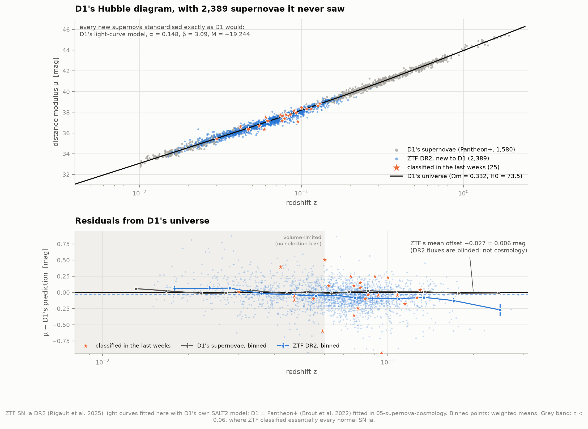
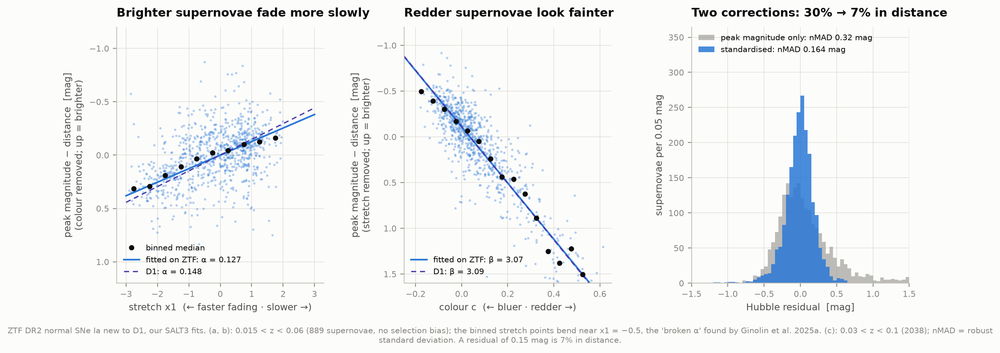
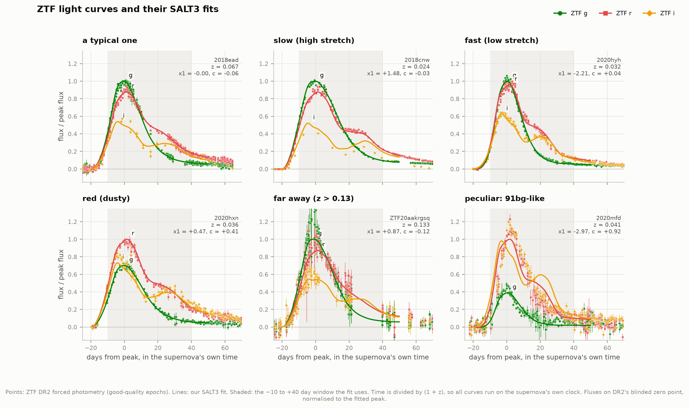
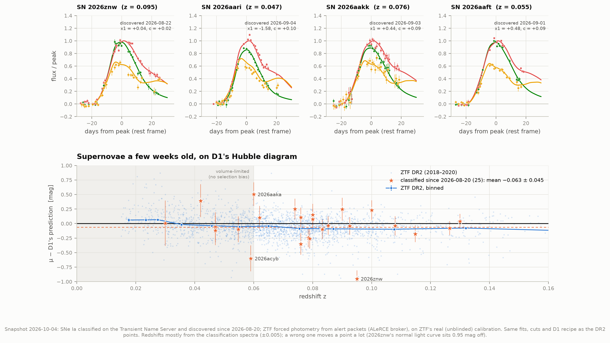

# D6 — Fresh supernovae onto D1's Hubble diagram

**D1 fitted the universe to Pantheon+, a supernova sample frozen in 2022. Do supernovae it never saw land on D1's curve?**

Yes. The Zwicky Transient Facility (ZTF) released light curves of 3,628 Type Ia supernovae from
2018–2020 (ZTF SN Ia DR2, Rigault et al. 2025). Only 4 of them are in Pantheon+. This project fits
all of them, then standardises **2,389** of them exactly as D1 would: D1's own light-curve model,
D1's stretch and colour corrections (α = 0.148, β = 3.09) and D1's absolute magnitude
(M = −19.244). They land **0.027 ± 0.006 mag** from D1's prediction, i.e. 1.2% in distance.
That is well inside the uncertainty of ZTF's deliberately blinded flux scale, so it is not a new
measurement of anything. The scatter around D1's curve is **0.151 mag** (7% in distance), the
same 0.150 the ZTF team finds. On top of that, 25 supernovae classified on the Transient Name
Server in the six weeks before 4 October 2026 land at **−0.06 ± 0.04 mag**.

Getting there meant finding a hidden convention worth **0.27 mag** (12% in distance). Fit with
the standard Python tools, every supernova first appeared 0.19 mag too faint for D1's universe.
That is exactly the kind of offset that looks like new physics and isn't.

---

## Results

### The landing test

Normal ZTF supernovae new to D1, inside D1's colour and stretch range, at 0.023 < z < 0.06:
far enough that galaxies' own motions matter little, near enough that ZTF found essentially
every one it could classify.

| Supernovae standardised… | Mean offset from D1's curve | What it means |
|---|---|---|
| **as D1 would (D1's model, α, β, M, bias corrections)** | **−0.027 ± 0.006 mag** (763 SNe) | lands on D1's curve |
| with the bare Tripp relation (no bias corrections) | −0.053 ± 0.006 mag | |
| with SALT3 and D1's numbers, conventions ignored | **+0.191 ± 0.005 mag** | the trap (below) |
| D1's own Pantheon+ supernovae, same window | +0.004 ± 0.008 mag (348 SNe) | the reference |
| supernovae classified Aug–Oct 2026 (live, all z) | −0.063 ± 0.045 mag (25 SNe) | also lands |

**Why this is not an H₀ measurement.** To absorb the −0.027 mag, D1's H₀ would have to move
from 73.5 to 74.5 km/s/Mpc. But ZTF released its fluxes on a *blinded* zero point ("near 30").
Its absolute calibration is known only to about 5% (Rigault et al. 2025), and a reprocessing with
scene-modelling photometry moves every DR2 distance by 0.09 mag (Lacroix et al. 2025). Any
offset smaller than that is calibration, not cosmology, which is why the ZTF team has not yet
fitted cosmology to DR2. What the test *can* check is the shape and the scatter: does D1's
recipe standardise new supernovae without leaving trends? It mostly does (next table).

| Leftover trend in the residuals (0.015 < z < 0.06) | D1's full recipe | Bare Tripp relation |
|---|---|---|
| with stretch x1 (mag per unit x1) | **+0.000 ± 0.006** | +0.015 ± 0.006 |
| with colour c (mag per unit c) | +0.12 ± 0.06 (2σ) | **−0.31 ± 0.06** (5σ) |
| between massive and small host galaxies (mag) | **−0.016 ± 0.015** | **−0.087 ± 0.015** (6σ) |
| with redshift (mag per unit z) | −2.7 ± 0.5 | −3.0 ± 0.5 |

D1's α leaves no stretch trend at all on fresh data. The colour and host-mass dependence that
Pantheon+ hides inside its simulation-based bias corrections is doing real work: without it, ZTF
supernovae in massive galaxies come out 0.09 mag too bright. The trend with redshift is the one
thing that does not go away (see *The open question* below).

### Standardisable, not standard

| Hubble-residual scatter, 0.03 < z < 0.1 | Ours | ZTF team (Rigault et al. 2025) |
|---|---|---|
| peak brightness only (no corrections) | nMAD 0.318 mag, std 0.445 | nMAD 0.33, std 0.46 |
| stretch + colour + host mass, fitted on ZTF (SALT3) | nMAD 0.164, std 0.198 | — |
| **D1's recipe** | **nMAD 0.151**, std 0.184 | **nMAD 0.150** |
| … host-galaxy redshifts only (SALT3) | nMAD 0.157 | — |
| … redshifts from the supernova's own spectrum (SALT3) | nMAD 0.181 | — |
| D1's Pantheon+ supernovae in the same window | nMAD 0.132, std 0.143 | — |

nMAD is a robust standard deviation (it ignores the few wild outliers). Two corrections take the
scatter from 0.32 mag (16% in distance, a factor 1.3 in brightness) to 0.15 mag (7%).
Pantheon+ is tighter still: its photometry is cross-calibrated and its selection effects are
simulated, and ZTF DR2 has neither yet.

| Standardisation fitted on ZTF (SALT3, 868 SNe, z < 0.06) | Ours | Ginolin et al. 2025a (SALT2) | D1 / Pantheon+ (SALT2) |
|---|---|---|---|
| α (stretch) | 0.127 ± 0.007 | 0.161 ± 0.010 | 0.148 ± 0.004 |
| β (colour) | **3.07 ± 0.04** | **3.05 ± 0.06** | 3.09 ± 0.04 |
| γ (host-mass step, mag) | 0.104 ± 0.014 | 0.145 ± 0.021 | absorbed in bias corrections |
| σ_int (intrinsic scatter, mag) | 0.158 | not released | ~0 + simulated scatter model |

β agrees across all three. α depends on the light-curve model: stretch is defined differently in
SALT3 and SALT2. The ZTF team also finds that "brighter-slower" is not a straight line (two
slopes either side of x1 ≈ −0.5), so a single α depends on the sample's stretch mix. Our binned
points show the same bend (figure 02). Our fit uses a global stellar-mass step; theirs prefers
local colour.

### The 0.27-magnitude trap

D1's absolute magnitude M belongs to Pantheon+'s pipeline (SNANA), which fits light curves
with a SALT2 model retrained by the Pantheon+ team. This project fits with `sncosmo`, the
standard Python package. The model's settings file (`SALT2.INFO`) contains a line
`MAG_OFFSET: 0.27`. SNANA adds it to every model magnitude and sncosmo ignores it. So for the
*same* photometry and the *same* model, SNANA reports an amplitude 0.27 mag brighter.

Refitting 40 of Pantheon+'s own Foundation light curves here, with D1's model and Pantheon+'s
stretch, colour and peak date held fixed, gives **0.262 ± 0.002 mag** (scatter 0.013). Free fits
through our full pipeline land 0.018 ± 0.009 mag further from SNANA's distances than the
documented 0.27. That is the systematic uncertainty of our emulation of D1's pipeline, about
±0.02 mag.

Using SALT3 with D1's numbers and no conversion gives the +0.19 mag offset in the first table.
For the same photometry, SALT3's peak magnitude sits 0.253 mag fainter than Pantheon+'s and its
colour 0.014 redder, which makes distances 0.21 mag too large. Both models agree on the
brightness of the average supernova to 0.008 mag, so the 0.27 is purely a convention. The fix is
to fit with D1's own model (published in the Pantheon+ data release) and subtract 0.27.

### Supernovae a few weeks old

The Transient Name Server listed 114 Type Ia supernovae discovered between 20 August and
4 October 2026 and already classified from a spectrum. 59 have public ZTF photometry. ZTF now
ships forced photometry inside its public alerts, so ALeRCE serves a flux at every epoch,
including before the explosion. The rest are either south of ZTF's sky or seen only in ZTF's
private partnership data.

Fitted exactly like DR2, 25 pass all the cuts and land at −0.063 ± 0.045 mag, with nMAD 0.21.
That is noisier than DR2 because their redshifts mostly come from the classification spectra
(±0.005), not from host galaxies. These fluxes are on ZTF's real, unblinded calibration, so
their agreement with DR2 (−0.027; difference −0.04 ± 0.05 mag) also says the DR2 blinding is
not large. One
normal-looking light curve, SN 2026znw, lands 0.95 mag off. A wrong classification redshift is
the most likely culprit, and it shows why host-galaxy redshifts matter.

Most supernovae from the last two weeks are still before or near peak, where stretch cannot be
measured yet, so they fail the cuts for now. `python fetch_live.py` on a later day takes a new
snapshot, and the diagram moves on with them.

### What else the fresh sample shows

- **Selection (Malmquist) bias, explained.** Beyond z ≈ 0.06, ZTF increasingly finds only the
  supernovae bright enough to classify. These are the bluer (mean c falls from +0.09 to −0.02)
  and slower (mean x1 rises from −0.2 to +0.5) ones, and even after standardisation they look
  0.05–0.10 mag too bright. A forward model reproduces all three trends with no tuning. It
  combines the stretch/colour mix of the volume-limited sample, the fitted scatter and ZTF's
  published selection function, P = 1/(1 + e^{4.5 (m − 18.8)}) (figure 05). It is a simulation
  built from real inputs. Pantheon+ removes this bias with simulations; DR2 does not, which is
  why the tests above stop at z = 0.06.
- **Redshift errors, measured.** Supernovae whose redshift comes from their own spectrum need an
  extra σz = 0.0037 (0.0034–0.0041), i.e. 1,100 km/s. The ZTF team quotes ~0.003. It also creates
  an Eddington bias: at z < 0.03, those supernovae sit 0.1–0.3 mag faint, because a low measured
  redshift more often belongs to a supernova that is really further away.
- **Galaxy motions: not detected.** Random peculiar velocities should blur distances as 1/z. With
  host-galaxy redshifts the scatter shows no such rise: σ_v < 230 km/s (68%), against the
  250 km/s Pantheon+ assumes. Few ZTF supernovae lie below z = 0.02, where this term would
  dominate. A plain Gaussian fit says 594 km/s, but that is 3.6% outliers masquerading as
  velocities (figure 04).
- **Peculiar Type Ia supernovae** sit off the line even after standardisation: super-Chandrasekhar
  03fg-like 0.52 mag brighter, Ia-CSM 0.87 brighter, 91bg-like 0.22 fainter with large scatter, Iax
  ±0.6 mag. 91T-like ones, which cosmology keeps, are 0.11 mag brighter (figure 06). Among the
  476 supernovae with no sub-type, 17 are more than 1 mag too faint (only 2 of them pass the
  quality cuts), probably unrecognised peculiar ones.
- **The "pocket effect".** ZTF's sensor read-out changed in November 2019, adding a
  brightness-dependent bias. Volume-limited supernovae from before and after that date differ by
  0.040 ± 0.013 mag (+0.018 vs −0.022). That is larger than, but in line with, the ~0.02 mag the
  ZTF team expects.

### The open question: the nearest supernovae are faint

Below z = 0.03 the ZTF residuals sit at +0.06 mag, against −0.02 to −0.05 at 0.03 < z < 0.06:
the −2.7 mag per unit z trend above. This is not the redshift source (it shows with host-galaxy
redshifts), not the November 2019 change (it shows before and after), not Malmquist bias
(predicted to be < 0.005 mag below z = 0.05), and not D1's model (SALT3 fits show it too). Pantheon+ shows
no such step in the same bins.

Two explanations fit:

1. **Coherent galaxy motions.** Pantheon+'s redshifts are corrected with the 2M++ velocity field
   and ours are not. A dipole fit to the residuals finds **444 ± 93 km/s towards Galactic
   (l, b) = (304° ± 10°, 13° ± 10°)**, improving χ² by 29 for 3 parameters. That is the classic
   bulk-flow direction, towards the Shapley supercluster. Carrick et al. (2015) find
   159 ± 23 km/s towards (304°, 6°) from beyond the 2M++ volume (figure 09). But the apex is
   below ZTF's horizon. Below z = 0.03 the supernovae are faint on *both* sides of the sky,
   which a flow cannot do, since its signal is largest at the lowest redshift.
2. **A brightness-dependent photometry bias.** The nearest supernovae are the brightest
   (15–16 mag). Lacroix et al. (2025) report brighter-fatter and pocket effects that distort
   ZTF's PSF fluxes by up to 7%, uncorrected in DR2. An isotropic term growing as 1/z, which is
   how such a bias would look here, improves χ² by 15 for 1 parameter.

ZTF's sky alone cannot separate them. The ZTF team's scene-modelling reprocessing should.

---

## The figures

**The test.** D1's Hubble diagram with 2,389 supernovae it never saw, standardised D1's way,
and the 25 newest in orange. Below: residuals from D1's universe, with D1's own supernovae binned
in grey for comparison. Inside the volume-limited band the two samples agree. Beyond it, ZTF's
points drift bright, which is selection.



**Standardisable, not standard.** Slow supernovae are brighter (left), and red supernovae are
dimmer (middle). Correcting both shrinks the scatter from 0.32 to 0.16 mag (right).



**What the fits look like.** Six ZTF light curves and their SALT3 fits, including the slow,
the fast, the dusty, the far, and a peculiar 91bg-like supernova that the model cannot fit.



**The newest.** Light curves a few weeks old, and where 25 of them land.



Also: `04_scatter_budget` (redshift errors and galaxy motions), `05_selection_bias` (the
Malmquist trend and its model), `06_peculiar_types`, `07_validation` (our fits against the ZTF
team's, and the 0.27 mag convention), `09_bulk_flow` (the low-redshift residuals on the sky).

**Interactive:** `figures/fresh_supernova_explorer.html` (offline, no libraries). Switch the
corrections on one at a time and watch the scatter fall, and click any supernova for its light
curve and fit.

---

## Background, in brief

**Standardisable candles.** A Type Ia supernova is a white dwarf that explodes when it reaches a
critical mass, so all of them are roughly equally bright. Roughly is not good enough: their peak
brightness varies by 30–40%. Two things predict most of that. Slower supernovae are intrinsically
brighter (Phillips 1993; stretch, x1), and redder ones are dimmed by dust or are intrinsically
redder (colour, c). The **Tripp relation** turns the peak magnitude mB into a distance modulus,
`μ = mB + α·x1 − β·c − M`.

**SALT.** To get mB, x1 and c, a spectral model of an average supernova (with a "stretch"
component and a colour law) is redshifted, dimmed by our own galaxy's dust, passed through the
telescope's filters and fitted to the photometry. SALT3 (Kenworthy et al. 2021) is the current
version; Pantheon+ used a retrained SALT2. Fits use only −10 to +40 days around peak, where the
model is well trained.

**Why "fresh".** Pantheon+ was frozen in 2022, before ZTF's sample existed. A model that
describes data it was not fitted to is the strongest test there is. Here the "model" is D1's
universe *plus* D1's standardisation recipe.

**Why not measure H₀ or dark energy here?** Brightness only gives distances once the
supernovae's absolute magnitude is calibrated. ZTF's photometric zero point is blinded and its
absolute calibration still settling, so the overall offset is not interpretable. At z < 0.06 the
Hubble diagram barely depends on dark energy anyway (Ωm = 0.3 vs 0.33 changes distances by
< 0.005 mag there). ZTF's long-term role is to anchor the low-redshift end of the next
generation of dark-energy measurements.

---

## How it works

**1. Data** (`fetch_data.py`, ~360 MB, retrieved 2026-10-04; sources, sizes and SHA-256 in
`data/manifest.json`):
- ZTF SN Ia DR2 from ztfcosmo.in2p3.fr: one 1.37 GB zip. 850 MB of it is the release's own git
  history, by accident. A zip keeps its table of contents at the end and the server honours byte
  ranges, so `remotezip.py` reads the table of contents and fetches only the 3,592 light curves
  and 6 tables: 27 HTTP requests, ~130 MB.
- Pantheon+: the distance table and covariance D1 used, the SALT2 model the Pantheon+ team trained,
  and 40 of their Foundation light curves (all from the Pantheon+ GitHub release).
- The SFD Milky Way dust maps (×0.86, Schlafly & Finkbeiner 2011, as both DR2 and Pantheon+ use),
  the SALT3 model and ZTF passbands (sncosmo's data repository).

**2. Light-curve fits** (`saltfit.py`, `lightcurves.py`). DR2 forced photometry in flux units,
dropping only the points DR2 flags as bad (bits 1, 2, 4, 8, 16). First a fit in −15..+50 days
locates the peak, then −10..+40 days with the model's own uncertainty included. Without that, the
colour is biased and its error 2.5× too small. Every supernova is fitted twice: with **SALT3** (the
spec's model; everything ZTF-internal) and with **D1's SALT2** following SNANA's conventions,
meaning ZTF's i band is dropped below z ≈ 0.13 (rest-frame 2800–7000 Å only) and 0.27 mag is
subtracted. That fit is used for the test of D1. Eight worker processes, ~10 minutes per model.

**3. Cuts** (`analysis.py`): DR2's "basic cuts" (Rigault et al. 2025, Table 1) applied to our own
fits.

| Cut | Ours | ZTF team |
|---|---|---|
| released | 3,628 | 3,628 |
| light curve + converged fit | 3,508 | — |
| good sampling (≥ 7 detected nights, 2 before and 2 after peak, 2 bands) | 2,955 | 2,960 |
| −3 ≤ x1 ≤ 3, −0.2 ≤ c ≤ 0.8, σt0 ≤ 1 d, σx1 ≤ 1, σc ≤ 0.1 | 2,791 | 2,809 |
| fit probability ≥ 10⁻⁷ | **2,531** | **2,667** |
| … normal (not peculiar), not in Pantheon+ | 2,495 | — |
| … inside D1's range (\|c\| < 0.3, \|x1\| < 3, σx1 < 1.5, D1's model) | **2,389** | — |

The two cut lists share 2,498 supernovae. The difference is the fit-probability cut, on the
best-sampled light curves (median 98 points, χ²/dof ≈ 2.6), where tiny model imperfections
show. The ZTF team's parameter errors are ~10% larger than ours, so their χ² cut bites less.

**4. D1's recipe**, read out of D1's own table. A least-squares fit rebuilds Pantheon+'s
standardised magnitudes to 0.00004 mag:
`m_b_corr = mB + 0.1475 x1 − 3.0922 c − biasCor − 0.0524`. For fresh supernovae there is no
simulation, so the bias correction is emulated by a linear fit to Pantheon+'s own values at
0.01 < z < 0.1 (630 supernovae): −0.41 c, a 0.069 mag host-mass step, and small terms in x1 and z.
The emulation's rms error is 0.034 mag per supernova. D1's universe is its calibrated best fit
(flat ΛCDM, Ωm = 0.332, H₀ = 73.53 km/s/Mpc, M = −19.244), read from D1's `results.json`.
Redshifts are moved to the CMB frame, and our conversion reproduces Pantheon+'s to 3 × 10⁻⁶.

**5. Errors** on each distance: the fit's covariance propagated through Tripp, 250 km/s of
peculiar velocity, and for spectral-feature redshifts at least σz = 0.003. Means are weighted
with an intrinsic scatter of 0.13 mag. Fits of α, β, γ follow Ginolin et al.: at a fixed σ_int,
minimise χ², then reset σ_int so χ²/dof = 1. They drop > 3.5σ outliers (11 of 879); with them, α
and β move by less than 1σ.

**6. The live snapshot** (`fetch_live.py`): one request to the Transient Name Server's public
search (no account needed for this CSV), then ALeRCE for each object's ZTF forced photometry and
alerts. A constant baseline per band, measured > 25 days before peak, is subtracted. Every
snapshot is kept under `data/live/<date>/`, and the analysis uses the newest.

---

## Honest notes

- **The photometry is not cosmology-grade yet,** and the ZTF team says so: blinded zero point,
  5% absolute calibration, PSF non-linearities up to 7% (Lacroix et al. 2025). All conclusions
  here are about *relative* behaviour: scatter, trends, the shape of the Hubble diagram over a
  narrow range. The −0.027 mag "landing" agreement is partly luck within a ±0.05–0.09 mag
  calibration uncertainty, plus ±0.02 mag for our emulation of D1's pipeline.
- **The bias-correction emulation is approximate.** Pantheon+'s bias corrections come from
  simulations of each survey, and ZTF was not one of them. The emulation transfers their
  colour and host-mass behaviour, which is mostly about how supernovae are, not how surveys
  select them, but it is a linear stand-in for a four-dimensional table.
- **Only two supernovae can be compared one-to-one.** Of the 4 in both samples, 2019np and 2019ein
  have no light curve in the DR2 files. For SN 2018aye and SN 2018fop, ZTF photometry with D1's
  recipe gives distances 0.27 and 0.10 mag shorter than Pantheon+'s, mostly through the colour
  (2018aye: c = 0.00 from ZTF's g and r, −0.11 in Pantheon+). Both are bright (15 mag), where
  ZTF's PSF photometry is least trustworthy.
- **No peculiar-velocity corrections** are applied to ZTF redshifts (Pantheon+'s are corrected).
  At 0.023 < z < 0.06 that is ≤ 0.03 mag on average. Below z = 0.03 it may be part of the open
  question above.
- **The selection model is a simulation.** Its ingredients are real (the volume-limited sample's
  stretch and colour, the fitted scatter, the published selection function), but the relation
  between SALT's mB and the observed peak magnitude is a linear fit.
- **The live redshifts are imprecise.** Most come from the classification spectrum, quoted to
  2–3 decimals; we assume ±0.005. TNS's public search filters on discovery date, so "classified
  in the last weeks" means "discovered since 20 August and classified by 4 October".
- **Public data only.** About half of the recent TNS supernovae have no public ZTF photometry. The
  ZTF Bright Transient Survey explorer has classified nothing since August 2026, so TNS replaced it.

---

## Running it

```bash
cd ..                       # repository root
source .venv/bin/activate
pip install sncosmo iminuit sfdmap2   # sncosmo builds from source on Python 3.14 (needs gcc)

cd 39-fresh-supernovae
python fetch_data.py        # ~360 MB, once
python fetch_live.py        # the newest supernovae (repeat any day for a new snapshot)
python run.py               # fits (~20 min, cached), analysis, figures, explorer
python test_physics.py      # 21 checks
```

`python run.py --figures-only` redraws the figures and explorer from `data/results.json`. Once
the data and fits are cached, everything runs without a network, verified in a network namespace
with no connectivity. Long fits checkpoint every 200 supernovae and resume after an interruption.

### Files

| File | What it does |
|---|---|
| `config.py` | Paths, sources, cuts, error model, and the published values we compare against |
| `remotezip.py` | Reads single files out of a zip on a web server by byte range |
| `fetch_data.py` | DR2 tables and light curves, Pantheon+ files and D1's model, dust maps, sncosmo data |
| `fetch_live.py` | A dated snapshot of the newest SNe Ia: TNS classifications + ALeRCE photometry |
| `lightcurves.py` | Reads DR2 and ALeRCE photometry into one flux format; coverage counting |
| `saltfit.py` | Two-pass SALT3 / SALT2-B21 fits, in parallel, cached |
| `sample.py` | The DR2 table: metadata, hosts, ZTF's own fits, dust, CMB-frame redshifts |
| `standardize.py` | D1's recipe from the Pantheon+ table; Tripp distances and errors; α, β, γ fits |
| `cosmology.py` | Flat ΛCDM distances, the heliocentric → CMB-frame conversion, velocity errors |
| `live.py` | Fits the live snapshot like the DR2 sample |
| `analysis.py` | Every number in `data/results.json` |
| `figures.py`, `plotstyle.py`, `explorer.py` | The nine figures (PNG + SVG) and the interactive page |
| `run.py`, `test_physics.py` | Run everything; self-checks |

---

## Data credits

- **ZTF SN Ia DR2:** Rigault et al. 2025, A&A 694, A1 (overview); companion papers in the same
  issue, including Ginolin et al. 2025a,b (standardisation), Amenouche et al. 2025 (selection),
  Dimitriadis et al. 2025 and Burgaz et al. 2025 (sub-types); Lacroix et al. 2025
  (arXiv:2509.04073, photometric accuracy). Data: https://ztfcosmo.in2p3.fr. ZTF is supported by
  the NSF and a collaboration of institutions; see https://www.ztf.caltech.edu.
- **Pantheon+:** Scolnic et al. 2022, ApJ 938, 113; Brout et al. 2022, ApJ 938, 110 (cosmology, SALT2
  retraining, Table 2). https://github.com/PantheonPlusSH0ES/DataRelease
- **SALT3:** Kenworthy et al. 2021, ApJ 923, 265. **sncosmo:** Barbary et al., https://sncosmo.readthedocs.io
- **Dust:** Schlegel, Finkbeiner & Davis 1998; Schlafly & Finkbeiner 2011; Fitzpatrick 1999.
- **Transient Name Server** (https://www.wis-tns.org) classifications by ZTF, ePESSTO+, SCAT, GOTO,
  ATLAS and others; **ALeRCE** broker (Förster et al. 2021) for ZTF alert photometry.
- **Bulk flow:** Carrick et al. 2015, MNRAS 450, 317. **CMB dipole:** Planck 2018 I.
- **Tripp** 1998, A&A 331, 815; **Phillips** 1993, ApJL 413, L105.

Data retrieved 2026-10-04.
