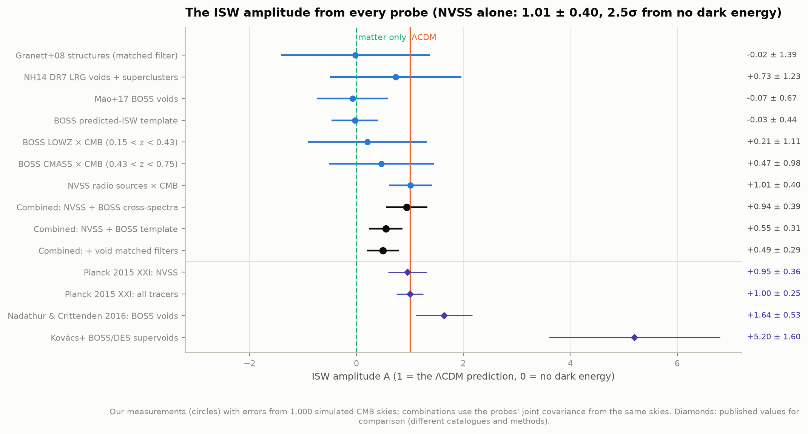
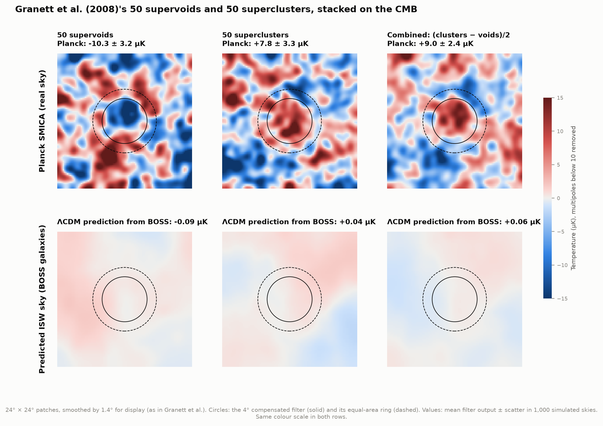
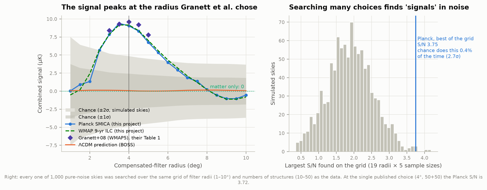
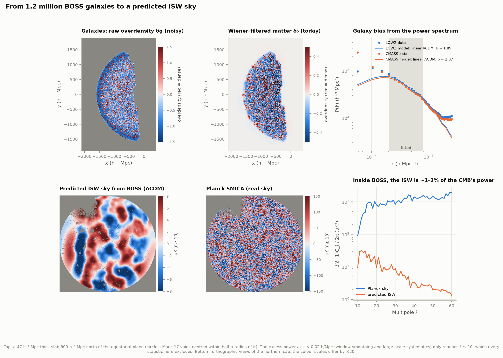
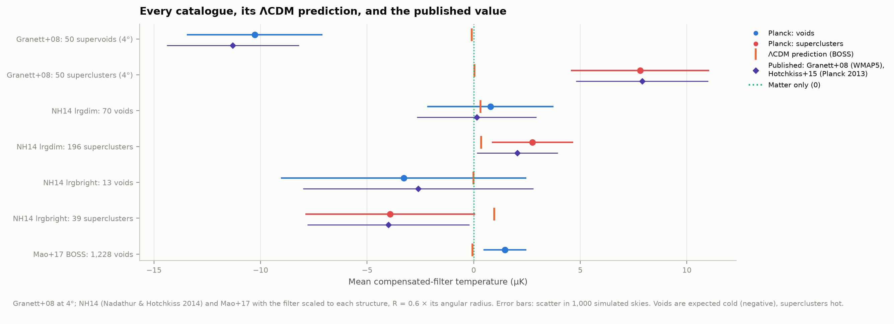
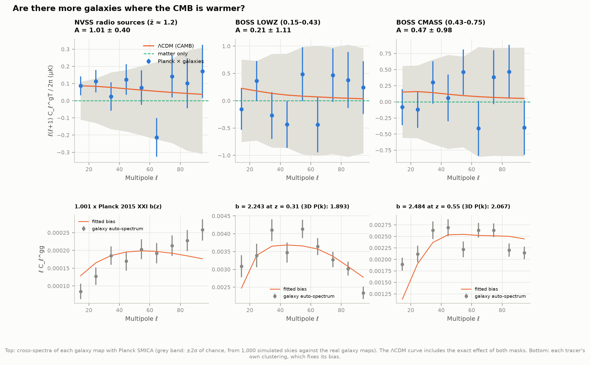
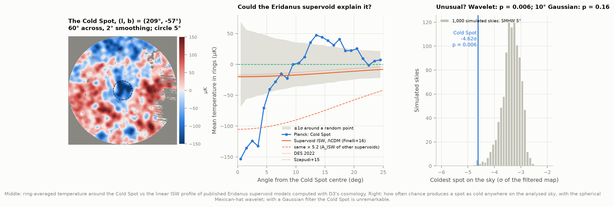
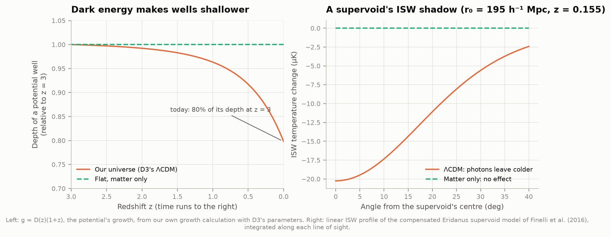

# D10 — Dark energy in the CMB: the integrated Sachs–Wolfe effect

**Can we see dark energy acting on the oldest light in the universe? A CMB photon that crosses
a supercluster falls into its gravitational well and climbs back out. If the well stays the
same depth, it leaves with exactly the energy it came in with. In a universe of matter only,
the wells keep their depth; with dark energy they grow shallower while the photon is inside, so
it leaves a little hotter (and a little colder after crossing a void). This is the integrated
Sachs–Wolfe (ISW) effect.**

**Yes, at about 2.5σ, and the most famous detection turns out not to be what it seemed.**
Write the ISW signal's strength as an amplitude A, where A = 1 is what ΛCDM (with the cosmology
project D3 measured from Planck) predicts and A = 0 is a universe without dark energy. The
cleanest probe correlates 1.37 million NVSS radio galaxies with the Planck map. It gives
**A = 1.01 ± 0.40**, exactly the ΛCDM value and 2.5σ from zero. Planck's own analysis of the same
catalogue found 0.95 ± 0.36. All three galaxy–CMB cross-correlations together give
**A = 0.94 ± 0.39 (2.4σ)**.

The famous 2008 result also replicates. Granett, Neyrinck & Szapudi's 50 supervoids and 50
superclusters give **9.0 ± 2.4 µK** on Planck (they found 9.6 ± 2.2 µK on WMAP), with the same
dependence on filter size. But three tests say it is not dark energy at work:

1. **Choosing costs.** The filter size and sample were picked after looking. Searching the same
   menu of choices in 1,000 pure-noise skies, chance matches the best result 0.4% of the time:
   **2.7σ, not 4.4σ**.
2. **ΛCDM predicts almost nothing there.** We built a 3D map of 1.2 million BOSS galaxies,
   turned it into gravitational potentials and predicted the ISW sky. Along these exact
   sightlines it gives **+0.06 µK**. The supervoids are real, but they sit in slightly overdense
   surroundings that cancel their potentials.
3. **The pattern is wrong.** Structure by structure, the temperatures do not follow the
   predicted ISW: a matched filter gives **A = 0.0 ± 1.4**. An amplified ISW effect would follow
   the prediction.

Two other void catalogues (318 SDSS DR7 structures; 1,228 BOSS voids) see nothing, as ΛCDM
predicts for structures this small. The **CMB Cold Spot** is the sky's coldest spot in a 5°
wavelet (p = 0.006, a posteriori). The Eridanus supervoid in front of it can explain about **15%**
of its central depth, and only **3%** of what makes it stand out in the wavelet.

| Measurement | Ours (Planck SMICA) | Published | ΛCDM prediction |
|---|---|---|---|
| NVSS × CMB, amplitude A | **1.01 ± 0.40** | 0.95 ± 0.36 (Planck 2015 XXI) | 1 |
| Granett+08 50 + 50 structures, 4° | **+9.0 ± 2.4 µK** (3.7σ) | 9.6 ± 2.2 µK (WMAP5) | +0.06 µK (ours, from BOSS) |
| …significance after the choice of radius and N | **2.7σ** | 4.4σ quoted | |
| Hotchkiss+15 replication (NH14 lrgdim voids / superclusters) | +0.8 ± 3.0 / +2.8 ± 1.9 µK | +0.1 ± 2.8 / +2.1 ± 1.9 µK | +0.3 / +0.4 µK |
| 1,228 BOSS voids (Mao+17), matched filter A | −0.07 ± 0.67 | 1.64 ± 0.53 (Nadathur & Crittenden 2016, other voids) | 1 |
| BOSS predicted-ISW template, A | −0.03 ± 0.44 | | 1 |
| Cold Spot, 5° wavelet | −4.62σ, p = 0.006 | the coldest wavelet spot in WMAP (Vielva+04, Cruz+05) | |
| Eridanus supervoid ISW at the centre | −20 µK (ours, D3 cosmology) | ≈ −20 µK (DES 2022) | |



---

## Results

### 1. Granett et al.'s 4-sigma signal, replicated



The 50 supervoids and 50 superclusters were found in 1.1 million photometric SDSS luminous red
galaxies at 0.4 < z < 0.75. Their web page is gone, but the Internet Archive kept the
catalogue. Stacked on Planck with the same 4° compensated filter:

| | Planck SMICA | WMAP 9-yr ILC | Granett+08 (WMAP5) | ΛCDM prediction (BOSS) |
|---|---|---|---|---|
| 50 supervoids | −10.3 ± 3.2 µK (3.2σ) | −10.2 | −11.3 ± 3.1 | −0.09 µK |
| 50 superclusters (48 clear of the mask) | +7.8 ± 3.3 µK (2.4σ) | +8.1 | +7.9 ± 3.1 | +0.04 µK |
| combined (clusters − voids)/2 | **+9.0 ± 2.4 µK (3.7σ)** | +9.2 | 9.6 ± 2.2 (4.4σ) | +0.06 µK |

None of the 1,000 simulated skies reaches +9.0 µK at these positions. The scatter of a single
4° filter on the real sky is 22.1 µK (Granett et al.: "22 µK in our filter"). Filters placed at
20,000 random positions in the survey footprint give errors within 4% of the simulations'
(3.06 vs 3.18 µK for the voids), as Granett et al. found for theirs (within 2%). The real sky
in the SDSS area carries a −0.5 µK offset, a fifth of the error. WMAP and Planck agree to
0.3 µK, so foreground residuals are not the cause. As noted under the caveats, this is the same
sky seen twice, not an independent confirmation.

### 2. The price of choosing the filter



The signal peaks at a radius of 3.5–4° and falls on both sides, just as in Granett et al.'s
Table 1 (ours/theirs at N = 50: 7.8/8.4, 9.4/9.3, 9.0/9.6, 8.3/9.2, 6.7/7.8 µK at 3, 3.5, 4,
4.5, 5°). The radius and N = 50 were chosen after looking at WMAP. Granett et al. say so
themselves and estimate the effect to be small. We measure it. Every one of 1,000 noise skies
was searched over the same grid, 19 radii (1–10°) × 5 sample sizes (10–50), and its best S/N
recorded. A typical noise sky finds S/N 1.9 somewhere; 5% find 3.0, 1% find 3.5. The data's best
cell (S/N 3.75 at 3.5°, N = 50) is beaten by 0.4% of noise skies: **2.65σ**. The single
published choice would be a 1-in-10⁴ fluke, but nobody tested only that choice.

### 3. What ΛCDM predicts along those sightlines: almost nothing



BOSS later measured spectroscopic redshifts for 1.2 million galaxies over the same sky and
redshifts. From them we predict the ISW sky (see "How it works"), with no CMB data involved,
and measure the prediction with exactly the filters used on the real map:

* **The supervoids are real.** Around Granett's void centres, the BOSS galaxy density averaged
  in 3D is 45% below the mean in the middle. Their superclusters are 70% above it.
* **But they are embedded in denser surroundings.** Out to three void radii, the mean density
  around Granett's supervoids comes back slightly *above* average (+2% at 150–220 h⁻¹ Mpc). The
  potential hill of the void is then cancelled by its surroundings. An isolated void of the
  same depth with no surroundings would imprint about −9 µK; the actual density field predicts
  **−0.09 µK** at 4°. Smaller ZOBOV voids are typically ringed by dense walls ("voids in clouds";
  Mao's voids have a +18% ridge just outside their radius) and are predicted to be colder only
  when they are big: −0.4 to −0.7 µK for voids larger than 80 h⁻¹ Mpc, +0.04 µK below 60.
* **Robust to our choices.** Smoothing 5–20 h⁻¹ Mpc, bias ±10%, no redshift-space correction, or
  no Wiener filter at all: the predicted Granett signal stays between +0.004 and +0.08 µK. An
  independent calculation (the measured mean void profile pushed through our spherical ISW
  code) gives −0.06 to +0.03 µK at 2–4°.
* **The observed temperatures do not track the prediction.** The prediction varies from
  structure to structure, enough to give an expected S/N of 0.7 for a matched filter. The fit
  gives A = −0.02 ± 1.39. If the 9 µK were an ISW signal boosted ~100 times, the matched filter
  would read ~100.

So the observed signal is 9 µK where linear ΛCDM predicts 0.06 µK. That is a 3.7σ discrepancy
before the look-elsewhere correction and 2.7σ after it, and it is not shaped like an ISW signal.
Granett, Kovács & Hawken (2015) reached the same conclusion with their own BOSS template: the
supervoids show 6.3 ± 2.6 times their template's amplitude, a template they found to
over-predict the CMB by ~2.5×.

### 4. Two more void catalogues: nothing, as predicted



Each structure's filter is scaled to its size (R = 0.6 × its angular radius, fixed in advance
from Hotchkiss et al.'s simulations, not tuned here).

| Catalogue | N used | Planck | WMAP | Published | ΛCDM (BOSS) |
|---|---|---|---|---|---|
| NH14 lrgdim voids (0.16 < z < 0.36) | 70 | +0.8 ± 3.0 µK | +0.4 | +0.14 ± 2.8 (Hotchkiss+15) | +0.32 |
| NH14 lrgdim superclusters | 192 | +2.8 ± 1.9 µK | +1.4 | +2.05 ± 1.9 | +0.36 |
| NH14 lrgbright voids (0.36 < z < 0.44) | 13 | −3.3 ± 5.8 µK | −0.9 | −2.6 ± 5.4 | −0.02 |
| NH14 lrgbright superclusters | 39 | −3.9 ± 4.0 µK | −2.2 | −4.0 ± 3.8 | +0.96 |
| Mao+17 BOSS voids | 1,121 | +1.5 ± 1.0 µK | +0.6 | — | −0.05 |

All four Hotchkiss et al. numbers are reproduced within 0.4σ (they used the 2013 Planck map). No
stack is significant. In amplitude terms: NH14 A = 0.73 ± 1.23, Mao A = −0.07 ± 0.67. ΛCDM's
expected S/N for the BOSS voids is 1.5; the measurement is 1.6σ below it and 0.1σ from zero.
Nadathur & Crittenden (2016) found A = 1.64 ± 0.53 from 2,445 BOSS voids plus 29,866
superclusters of their own catalogue, with simulation templates. That catalogue is not public in
VizieR, so this is a comparison, not a replication.

### 5. Cross-correlations: more galaxies, warmer CMB



| Tracer | Bias (from its own clustering) | A | Rotated-map error | WMAP |
|---|---|---|---|---|
| NVSS, 1,368,294 sources, f_sky 0.69 | 1.001 × Planck 2015 XXI's b(z) | **1.01 ± 0.40** | 0.38 | 0.96 |
| BOSS LOWZ, 417,924 galaxies | b = 2.24 | 0.21 ± 1.11 | 1.13 | 0.21 |
| BOSS CMASS, 826,806 galaxies | b = 2.48 | 0.47 ± 0.98 | 0.98 | 0.57 |
| BOSS predicted-ISW template | b from 3D P(k) | −0.03 ± 0.44 | (0.23, see below) | 0.00 |

The NVSS source density is 1.588 × 10⁵ sr⁻¹ (Planck: 1.584 × 10⁵). Planck's redshift
distribution and bias model fit our auto-spectrum with an amplitude of 1.001, and the
cross-spectrum fits ΛCDM with χ² = 8.3 for 8 degrees of freedom.

**The BOSS template sees nothing:** A = −0.03 ± 0.44, 2.2σ below ΛCDM. It is the same for every
systematic variant (−0.02 to −0.03), and an injected template is recovered exactly (A = 1.000).
Granett, Kovács & Hawken found 0.33 ± 0.17 with their own template, also low.

**Rotated maps can lie.** For the cross-spectra, the spread of A over the CMB rotated by
10°, 20°, … 350° in Galactic longitude matches the simulations. For the template it is half
as large. The reason is geometric: BOSS's northern cap sits around the Galactic pole, where a
rotation in longitude barely moves the sky. Within a single simulated sky, the 35 rotations
scatter by 0.27, against 0.44 between independent skies.

### 6. Putting it together

| Combination (joint covariance from the shared simulations) | A | From zero | Consistency χ² |
|---|---|---|---|
| NVSS + BOSS LOWZ + CMASS cross-spectra | **0.94 ± 0.39** | 2.4σ | 0.7 / 2 dof |
| NVSS + BOSS template | 0.55 ± 0.31 | 1.8σ | 3.5 / 1 dof |
| NVSS + template + both void matched filters | 0.49 ± 0.29 | 1.7σ | 3.9 / 3 dof |
| void matched filters only | 0.08 ± 0.61 | 0.1σ | 0.4 / 1 dof |

The combinations were not pre-registered, so all are shown. The probes are nearly independent
(correlations ≤ 0.2). NVSS and the BOSS template disagree at about 1.9σ (χ² = 3.5 for 1 degree
of freedom): most likely chance, since BOSS covers a quarter of the sky and its ISW signal is
small, though a systematic in the reconstruction cannot be excluded. The
honest summary: **the CMB is correlated with the galaxy distribution as dark energy predicts at
2.4–2.5σ**, from NVSS and the cross-spectra. The BOSS volume taken alone (template and voids)
shows no ISW signal, 2σ below ΛCDM, and no anomalous excess either. Planck 2015 XXI reached
4.0σ by adding WISE, photometric SDSS and, above all, Planck's own lensing map.

### 7. The Cold Spot and the Eridanus supervoid



| Filter | Coldest spot on the sky | Its value | Simulated skies as cold | Kurtosis p |
|---|---|---|---|---|
| wavelet R = 3° | (185°, −79°) | −4.29σ | 5.2% | 1.2% |
| wavelet R = 4° | **(208°, −57°)** | −4.45σ | 1.5% | 0.5% |
| **wavelet R = 5° (pre-registered)** | **(209°, −57°)** | **−4.62σ** | **0.6%** | 1.0% |
| wavelet R = 6° | (210°, −57°) | −4.58σ | 0.6% | 2.5% |
| wavelet R = 8° | (210°, −57°) | −3.83σ | 3.8% | 40% |
| Gaussian, 10° FWHM | (217°, −29°): elsewhere | −3.27σ (Cold Spot: −2.39σ) | 16% | 34% |

At 4–8° the Cold Spot is the coldest wavelet coefficient on the analysed sky, at the
literature position. Only 6 of 1,000 simulated skies have a colder spot anywhere at R = 5°.
But the spot was found first and the filter chosen afterwards. With a 10° Gaussian filter
the Cold Spot is not even the coldest spot, and its p-value is 16% (Zhang & Huterer's 2010
point).

Its profile: −153 µK at the centre, −123 µK on average within 5°, a warm ring of +31 to +47 µK
at 12–18°. Published models of the Eridanus supervoid (Finelli et al. 2016; DES 2022; Szapudi
et al. 2015), pushed through our own ISW code with D3's cosmology, give −17 to −20 µK at the
centre (DES: "of order −20 µK"). That is **13–16% of the central decrement** and only
**3–4% of the wavelet coefficient**: the void's shadow is ~25° wide and shallow, while the
Cold Spot is a compact hole with a warm ring. Even scaled by the A ≈ 5.2 claimed for other
supervoids, the shape does not match. The supervoid is real, but in ΛCDM it is a small part of
the story.

### Try it: the look-elsewhere playground

`figures/isw_explorer.html` (offline, 0.9 MB) puts Granett et al.'s structures on Planck's map
with a slider for the filter radius and one for the number of structures. It shows the
stacked image, the signal and its S/N, and keeps your best S/N so far. It then tells you how
often a sky with no signal at all, searched over the same choices, does as well.

### Spec notes

Everything in the atlas spec was done as written. The Granett catalogue came from the Internet
Archive, as the spec suggested. Instead of D2's main-sample galaxies (z < 0.2, below the void
catalogues), BOSS DR12 supplied the 3D galaxy field: its volume contains all the
superstructures tested here. BOSS's 2.7 GB random catalogues were not needed; we rasterised
its 2 MB footprint files instead.

---

## How it works

### The physics in one equation

A photon's temperature changes by twice the change of the gravitational potential Φ it is
moving through, summed along its path. In linear theory the density pattern only grows,
δ(x, a) = D(a) δ₀(x), so Poisson's equation gives Φ(x, a) = g(a) Φ₀(x) with g = D/a. Then

    ΔT/T (n̂) = ∫ K(χ) Φ₀(χ n̂) dχ,      K = 2 (aH/c) g (f − 1),

where f = d ln D / d ln a is the growth rate (`cosmology.py`). In a flat universe of matter only,
D grows exactly like a, f = 1 and K = 0: **no ISW signal at all**. With dark energy, growth falls
behind the expansion at z ≲ 1 (f ≈ 0.54 today), K is negative, and potentials decay: wells
(superclusters, Φ < 0) give hot spots, hills (voids, Φ > 0) cold ones. The size is tiny: a few
µK on top of the CMB's ±100 µK, which is why no single structure shows it.



### The CMB maps and the noise

* **Planck SMICA (2018)**, the mean of the two half-mission maps that project D3 downloaded, at
  HEALPix Nside 512 (6.9′ pixels), with Planck's common mask (73.4% of the sky kept). Monopole and
  dipole are fitted outside the mask and removed.
* **WMAP 9-year ILC**: a different satellite and a different foreground method, as a check of
  foreground residuals. It sees the same CMB, so it does **not** provide an independent test of
  chance.
* **The noise is the CMB itself.** Planck's instrument noise is irrelevant on degree scales; the
  primary CMB fluctuations are 20–30 µK in a single filter and cannot be reduced by better
  data, only by more structures or more sky. Every error bar comes from **1,000 simulated
  skies** with Planck's best-fit spectrum, put through exactly the same mask and code. Sky *i* is
  drawn from a fixed seed, so every analysis sees the same 1,000 skies and the correlations
  between different measurements are known.

### Pre-registration

Every choice behind a headline number (catalogues, cuts, filter sizes, multipole ranges,
statistics) is written in `config.PREREGISTRATION` and was frozen, with a SHA-256 hash and a
UTC time stamp, into `data/preregistration.json` **before** the corresponding stack of the real
map was computed: 13:21 UTC for the Granett replication (its choices are Granett et al.'s own),
13:44 UTC for everything else. The code refuses to stack the real sky for a catalogue whose
choices are not frozen, or have changed since. Up to that point the pipeline was developed and
checked on simulated skies and on the ISW sky *predicted* from galaxies, which involves no CMB
data. Scans over other choices came afterwards and are labelled exploratory. The record is only
as trustworthy as the process that wrote it (an AI agent in one session), but it is there to
inspect.

### The compensated top-hat filter

For a structure and a radius R: the mean temperature within R minus the mean in the surrounding
ring from R to √2 R, which has the same area. The ring removes fluctuations larger than the
structure, where the primary CMB has most of its power. Every filter used anywhere (17,360 of
them: each catalogue at the pre-registered size and on exploratory grids) is one row of a
sparse matrix, so stacking a sky is one matrix product (`stacking.py`).

### What ΛCDM predicts for these structures: a 3D map of 1.2 million galaxies

To know what signal to expect, we predict the ISW sky from the galaxies themselves
(`boss.py`), with no CMB involved:

1. **The survey footprint.** BOSS describes where it looked as 33,072 spherical polygons with a
   completeness weight each (mangle format). We rasterise them onto a HEALPix grid.
2. **Expected counts.** The mean density n(z) from the galaxies themselves, times the
   completeness, says how many galaxies each cell of a 3D grid (384 × 384 × 256 cells of
   15.6 h⁻¹ Mpc) should hold in a smooth universe. Weighted galaxies 1,312,748, expected
   1,312,816.
3. **Bias.** Galaxies cluster more strongly than matter. Their power spectrum against CAMB's
   linear matter spectrum for D3's cosmology (k = 0.02–0.08 h/Mpc, Kaiser redshift-space term
   included) gives **b = 1.89** for LOWZ (z_eff = 0.32) and **2.07** for CMASS (z_eff = 0.56),
   i.e. b σ₈(z) = 1.30 and 1.26, close to BOSS's published values (≈1.25–1.3).
4. **Wiener filter.** The minimum-variance estimate of the matter field given the galaxies,
   with each cell's Poisson noise set by its own expected count, solved by conjugate gradients
   with FFTs (25 iterations). It also fills unobserved sky with the field's conditional
   expectation, which fades to zero away from the survey.
5. **Potential and ISW sky.** Poisson's equation in Fourier space, then the line-of-sight
   integral above for 786,432 directions.

The machinery was checked on a Gaussian random field with CAMB's spectrum: the resulting ISW
sky matches the Limber-approximation prediction within single-realisation scatter. The ISW
sourced by the BOSS shell alone has an rms of about 14 µK in theory, almost all on the largest
scales (ℓ ≤ 5).

**Three traps on the way**, each of which would have faked structure hundreds of Mpc across:

* **Sparse early LOWZ chunks.** In BOSS's first observing chunks (2–6, ~960 deg²) the LOWZ
  sample was targeted with a faulty selection and replaced by sparser samples (LOWZE2/E3).
  There, z < 0.43 galaxies are only 48–65% as dense as elsewhere (CMASS is normal). BOSS's own
  NZ column gives these regions their own n(z); so do we, for LOWZ only. Normalising *every*
  chunk separately would instead erase real large-scale structure.
* **Cracks in the footprint.** At Nside 1024, entire HEALPix rings and columns of pixel
  centres fall *exactly* on the edges of mangle's 4,096 cells, by arithmetic coincidence.
  Rounding then makes both neighbouring polygons reject those points, leaving one-pixel cracks
  along every boundary: 2% of the area, with 2.2% of the galaxies falling into them. Nudging
  each test point by 0.02″ fixes it: the rasterised areas then equal the polygons' own
  (7,428 and 2,823 deg²) and only 0.06% of galaxies fall off the map, the true pixel-edge
  effect.
* **The potential of noise.** With ~1 galaxy per cell, a plain (smoothed) overdensity field
  gives a predicted ISW sky with 24 µK rms, dominated by ℓ = 2–5. Poisson's equation weights
  each mode by 1/k², and white shot noise, unlike real structure, does not turn over on large
  scales. The Wiener filter suppresses exactly the modes the galaxies cannot measure.

### Cross-correlations

Galaxy maps at Nside 64 (55′ pixels) from NVSS (S ≥ 2.5 mJy, Dec ≥ −40°, |b| ≥ 10°, density
normalised in 1° declination bands against NVSS's known declination stripes) and from BOSS in
two redshift slices. Multiplying by a mask mixes multipoles; in angle space the mixing is a
plain product with the mask's own correlation function. So we predict *exactly* what our
estimator measures for any theory by multiplying correlation functions and projecting back. The
same trick as D3's mask correction, run forwards, it needs no inversion and works even for
BOSS's 25% footprint. Theory spectra come from CAMB with each tracer's bias fitted to its own
auto-spectrum; NVSS uses Planck 2015 XXI's redshift distribution and bias shape.

---

## Caveats

* **The CMB is the noise, and it is the same sky for everyone.** Planck confirming Granett et
  al.'s WMAP result is a check of foregrounds and processing, not an independent detection: both
  satellites see the same primary fluctuations. Only new structures (or new sky) test chance.
* **A posteriori choices.** Granett et al. picked 4° and N = 50 after looking at WMAP; the Cold
  Spot was found by searching and its filter chosen afterwards. We quantify the first (the
  look-elsewhere test); the second has no clean correction, so the Cold Spot p-value is an
  upper bound on surprise, not a measurement of it.
* **The ΛCDM prediction is ours, not a simulation's.** It rests on linear theory, a
  scale-independent bias per sample, an isotropic Kaiser correction and a Wiener filter with a
  linear P(k). The systematic variants (smoothing 5–20 h⁻¹ Mpc, bias ±10%, no Kaiser term, no
  Wiener filter) move the predicted Granett signal by less than 0.2 µK, far below the 9 µK gap,
  but none of them includes non-linear (Rees–Sciama) effects, expected at the ≲10% level.
* **Only structures inside BOSS are predicted.** Matter outside 0.15 < z < 0.75 or outside the
  footprint is not in the template; it is uncorrelated with structures found inside, so it adds
  noise but no expected signal to the stacks. Near survey edges the Wiener filter's
  extrapolation makes predictions weaker.
* **NVSS's redshift distribution is borrowed** (Planck 2015 XXI); its bias amplitude is fitted to
  our own auto-spectrum, which pins down b × dN/dz only in combination. A different dN/dz with the
  same auto-spectrum would rescale the predicted cross-spectrum by tens of percent.
* **BOSS angular bias vs 3D bias.** The angular auto-spectra give a bias ~20% above the 3D power
  spectrum (some non-linearity, some residual large-scale systematics at ℓ < 20). The
  pre-registered rule uses the angular value; the 3D value would raise the BOSS slice amplitudes
  by ~20%.
* **Void catalogues differ.** Mao et al.'s voids are not Nadathur & Crittenden's (whose
  catalogue is not public in VizieR), so their A = 1.64 ± 0.53 is a comparison, not a
  replication. Small ZOBOV voids are often compensated "voids in clouds" with nearly no ISW
  signal; the largest voids carry it.
* **NVSS small scales.** NVSS's auto-spectrum rises above the model at ℓ > 70: large radio
  galaxies are catalogued as several components, which adds clustering on small scales. It
  barely affects the bias fit and not at all the cross-spectrum with the CMB.
* **BOSS's largest scales.** The BOSS power spectrum shows excess power at k < 0.02 h/Mpc
  (window smoothing plus residual large-scale systematics). It feeds only multipoles ℓ ≲ 10 of
  the predicted ISW sky, which no headline statistic uses.
* **Sky masks.** Two Granett superclusters and 107 Mao voids fall too close to Planck's mask at
  their filter size and are left out. The CMB within the SDSS footprint has a −0.5 µK mean
  offset in random 4° filters (0.2σ), included in no error bar but shown in the random-position
  test.

## Data and credits

| Data | Source | Size | Reference |
|---|---|---|---|
| Planck PR3 SMICA half-mission maps, masks, best-fit spectra | ESA Planck Legacy Archive (linked from project D3's cache) | 1.6 GB | Planck 2018 results IV, VI |
| WMAP 9-year ILC | NASA LAMBDA | 25 MB | Bennett et al. 2013 |
| 50 supervoids + 50 superclusters | Internet Archive copy of ifa.hawaii.edu/cosmowave/supervoids | 7 KB | Granett, Neyrinck & Szapudi 2008, ApJ 683, L99 |
| BOSS DR12 voids | CDS J/ApJ/835/161 | 0.1 MB | Mao et al. 2017, ApJ 835, 161 |
| SDSS DR7 voids and superclusters | CDS J/MNRAS/440/1248 | 0.6 MB | Nadathur & Hotchkiss 2014, MNRAS 440, 1248 |
| BOSS DR12 CMASSLOWZTOT galaxies + footprints | SDSS Science Archive Server | 304 MB | Alam et al. 2015; Reid et al. 2016 |
| NVSS catalogue | CDS VIII/65 | 74 MB | Condon et al. 1998, AJ 115, 1693 |

Compared against: Granett et al. 2008; Planck 2015 results XXI (A&A 594, A21); Nadathur &
Crittenden 2016 (ApJL 830, L19); Hotchkiss et al. 2015 (MNRAS 446, 1321); Granett, Kovács &
Hawken 2015 (MNRAS 454, 2804); Szapudi et al. 2015 (MNRAS 450, 288); Finelli et al. 2016 (MNRAS
455, 1246); Kovács et al. (DES) 2022 (MNRAS 510, 216). Cosmology: project D3's own fit to Planck
(H₀ = 66.66, Ω_m = 0.3247). Tools: healpy, CAMB 2.0.4, numpy, scipy, astropy, matplotlib.

## Reproduce

```bash
cd 40-isw-effect
../.venv/bin/python fetch_data.py     # ~0.4 GB new; Planck maps hard-linked from 09-planck-cmb
../.venv/bin/python run.py            # first run 1.5-2 h (simulations); afterwards minutes
../.venv/bin/python figures.py
../.venv/bin/python interactive.py    # figures/isw_explorer.html, works offline
../.venv/bin/python test_physics.py   # self-checks with known answers
```

Everything expensive is cached in `data/derived/` (1.5 GB, mostly the 3D galaxy grid; the 1.6 GB of Planck maps in `data/raw/planck/` are hard links to D3's files and take no extra disk); results in `data/results.json`;
the frozen analysis choices in `data/preregistration.json`.

| File | What it does |
|---|---|
| `config.py` | paths, data products, D3's cosmology, **pre-registered choices**, literature values |
| `fetch_data.py` | downloads with size checks and resume; links D3's Planck files |
| `cosmology.py` | expansion, growth, ISW kernel, spherical voids, CAMB wrappers |
| `cmb.py` | map preparation; reproducible simulated skies |
| `catalogs.py` | the three superstructure catalogues in one format |
| `stacking.py` | compensated top-hat filter bank, blinding guard, stacked images |
| `superstructures.py` | all stacks, matched filters, look-elsewhere and random-position tests |
| `boss.py` | footprint rasterising, 3D grid, bias, Wiener filter, predicted ISW sky |
| `crosscorr.py` | NVSS and BOSS maps, forward-modelled cross-spectra, template fit |
| `coldspot.py` | wavelet search, simulations, supervoid ISW profiles |
| `simpass.py` | pushes the 1,000 simulated skies through the filter bank |
| `run.py`, `figures.py`, `interactive.py`, `test_physics.py` | pipeline, figures, offline page, checks |

