# D11 — Counting galaxy clusters: how clumpy is the universe?

**Galaxy clusters are the largest objects gravity has had time to build. How many of them exist
depends on how much matter the universe holds and how clumpy it has become, and dark energy slows
that clumping. Can we count eROSITA's X-ray clusters and measure the clumpiness ourselves?**

Yes, given eROSITA's own mass calibration. We rebuilt the survey's footprint, depth and detection
efficiency from public files and published figures, predicted how many clusters each universe would
have let eROSITA find, and compared with the 5,259 it did find. With the published count rate–mass
relation free within its stated uncertainties, the counts give

> **S₈ = σ₈ (Ω_m/0.3)^0.5 = 0.885 (−0.033/+0.037)**, Ω_m = 0.282 (−0.017/+0.019), σ₈ = 0.914 ± 0.041

against the published eRASS1 result (Ghirardini et al. 2024) of S₈ = 0.86 ± 0.01, Ω_m = 0.29
(+0.01/−0.02), σ₈ = 0.88 ± 0.02. The clusters side with the cosmic microwave background: Planck
predicts S₈ = 0.832 ± 0.013, and our own CMB fit (project D3, grown to today with CAMB) predicts
0.845 ± 0.029. They do not side with the low values from galaxy shapes (DES Y6: 0.789 ± 0.012).

The clumpiness is a sensitive dial. At fixed Ω_m = 0.3, raising σ₈ from 0.76 to 0.86 (13%) raises the
predicted number of detections from 2,620 to 4,830. A universe without dark energy, grown from
the same seeds as ours, would have σ₈ = 1.03 and 3.5× as many clusters heavier than
10¹⁵ M☉ today.

What it rests on: the cluster masses. The X-ray brightness of a cluster is converted to mass with
eROSITA's weak-lensing-calibrated relation, which we cannot remeasure (the shear data are not public).
If the masses were 24% too low, as hydrostatic masses are thought to be, the same counts would give
S₈ = 0.78: the "S₈ tension" that Planck's own cluster counts once showed.

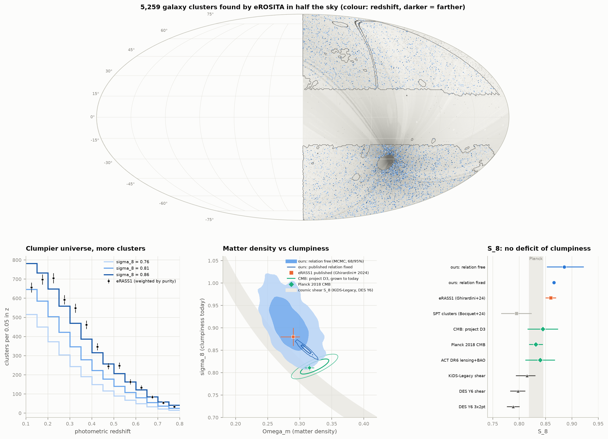

---

## Results

### 1. The sample: 5,259 clusters in the western Galactic hemisphere

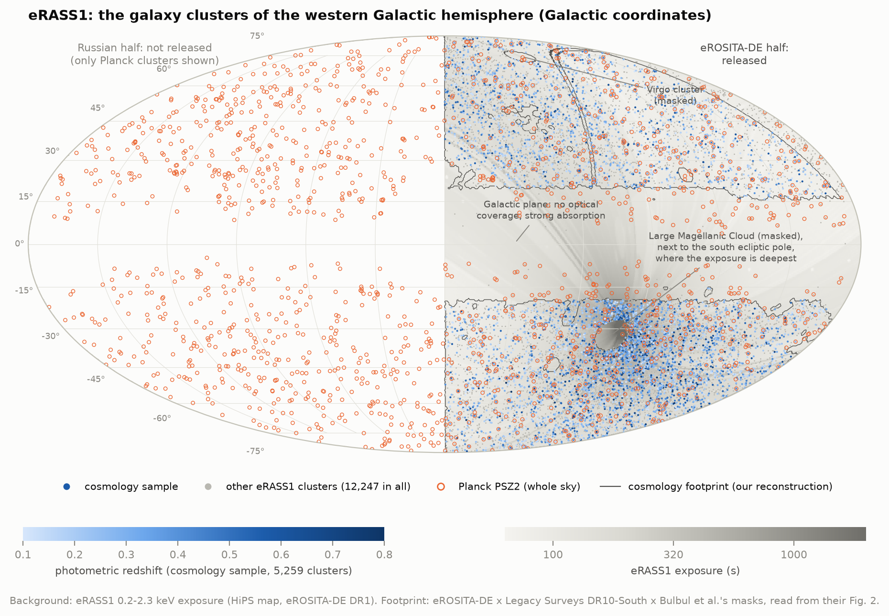

eROSITA, the X-ray telescope on the Russian–German SRG satellite, scanned the whole sky in its
first six months (eRASS1, Dec 2019 – Jun 2020). The German consortium released its half of the
sky (Galactic longitude 180°–360°): 12,247 clusters and groups of galaxies, seen as extended
glows of X-rays from gas at 10–100 million K (Bulbul et al. 2024). The **cosmology sample** keeps
the 5,259 most secure ones: X-ray extent likelihood above 6, a photometric redshift between 0.1 and
0.8 from the Legacy Surveys DR10 images, and at least three member galaxies, in a 12,791 deg²
footprint. Its median redshift is 0.29 (light travel time about 3 billion years), its median
count rate 0.33 photons per second, and it is about 95% pure: each cluster carries a
probability of being a contaminant (an active galaxy or a noise fluctuation) from the paper's
mixture model, and the sum of (1 − that probability) is 4,971 real clusters.

The sky is far from uniform. eROSITA scanned great circles through the ecliptic poles, so a typical
patch of sky got 130 s of exposure while the south ecliptic pole, next to the Large Magellanic
Cloud, got tens of kiloseconds. Clusters crowd where the survey looked longest.

### 2. Rebuilding eROSITA's eyes

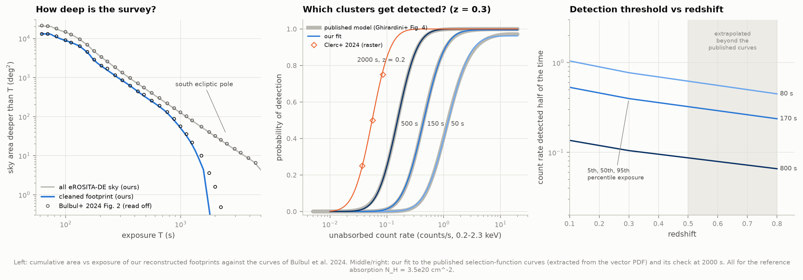

To predict how many clusters eROSITA *should* have seen we need three things that are not
published as files: the exact footprint, how deep the survey was across it, and the probability
that a cluster of a given brightness was detected. We rebuilt each and checked it:

| Ingredient | How | Check |
|---|---|---|
| Exposure across the sky | eRASS1 0.2–2.3 keV exposure map (a HiPS all-sky image, decoded to HEALPix) | reproduces the catalogue's per-cluster exposure to a median 0.5%; area above 100/200/500 s within 2–4% of Bulbul et al.'s Fig. 2 |
| Footprint | eROSITA-DE coverage × Legacy Surveys DR10 g, r, z coverage × Dec < 32.4° × the masks of Bulbul et al. **read off their Fig. 2** (LMC, SMC, Virgo, supernova remnants) | 13,114 deg² vs the published 13,116 (calibration); cosmology footprint 12,695 deg² vs the published 12,791 (independent check, −0.8%) |
| Detection probability P(detected \| count rate, redshift, exposure, absorption) | fitted to the nine curves of Ghirardini et al.'s Fig. 4, **extracted exactly from the vector PDF**, plus a long-exposure term from Clerc et al.'s 2000 s curves | reproduces the published curves to within 0.011 in probability; *predicted* Clerc et al.'s independent 200 s curves to 1–3% before using them |
| Galactic absorption | HI4PI column density; the absorbed fraction calibrated on the catalogue's own absorbed/unabsorbed count rates | a = exp(−0.056 (N_H/10²⁰)^0.80), scatter 2.6% |
| Optical depth limit | ZVLIM (deepest redshift at which the Legacy Surveys images can count member galaxies), mapped from the nearest catalogued source | every cluster lies below its own ZVLIM |
| Measurement errors | count-rate errors vs detected photons from the catalogue | σ_ln CR = 1.6/√photons |

**The decisive test:** at Ghirardini et al.'s best-fit cosmology and count rate–mass relation, our
reconstruction predicts **4,978** clusters; the purity-weighted count is **4,971**. That
0.1% agreement checks the whole chain at once: selection function, footprint, absorption, optical
depth window and mass function. The redshift distribution agrees less well (below).

Detection is mostly a photon count: across the nine published curves, half of all clusters are
found once eROSITA has collected 47–94 photons from them (more on long exposures, which also collect
more background, and fewer at high redshift, where clusters are compact). For a 150 s exposure at
z = 0.3 that is a count rate of 0.44 counts per second.

### 3. The fit

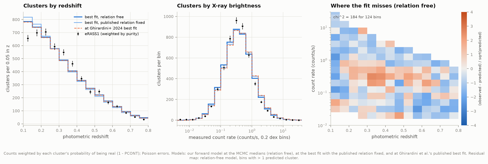

The likelihood is Poisson in 20 count-rate × 14 redshift bins. The mass function is Tinker et al.
(2008) for M500c, computed with the Eisenstein & Hu (1998) power spectrum (checked against colossus
to 0.4%); H₀ = 67.77, Ω_b = 0.049 and n_s = 0.96 are held at the centres of the paper's priors.

| Fit | Ω_m | σ₈ | S₈ |
|---|---|---|---|
| **Ours, count rate–mass relation free** (MCMC; Gaussian priors of the published widths) | 0.282 (−0.017/+0.019) | 0.914 ± 0.041 | **0.885 (−0.033/+0.037)** |
| Ours, published relation held fixed (grid) | 0.310 (−0.008/+0.007) | 0.852 (−0.010/+0.009) | 0.866 ± 0.003 |
| Ghirardini et al. 2024 (counts + lensing of ~2,500 clusters) | 0.29 (+0.01/−0.02) | 0.88 ± 0.02 | 0.86 ± 0.01 |

Holding the published relation fixed lands on the same S₈ (counts constrain this combination,
along which Ω_m and σ₈ trade off) but slides along the degeneracy to slightly higher Ω_m and lower
σ₈. Freeing the relation brings Ω_m and σ₈ back to within one error bar of the published values,
but the counts pull on the relation: A_X = 0.66 (published 0.64; +0.3 prior widths), B_X = 1.32 (published 1.38; −1.6 prior widths), F_X = −0.45 (published −0.33; −1.0 prior widths), G_X = 0.49 (published 0.29; +1.5 prior widths), σ_X = 0.89 (published 0.98; −1.9 prior widths). The scatter and the redshift evolution
move by 1.5–2 prior widths. That is tension between our reconstruction and the published relation,
and the simplifications listed under Caveats are the likely place to look.

The chain: 40 walkers × 3,000 steps, the first 1,000 discarded; acceptance 0.45, autocorrelation
times 64–96 steps, so about 830 independent samples per parameter.
That is enough for medians and 68% intervals, though short of emcee's conservative 50τ rule.

Our S₈ error is larger than the paper's. We can only use the published *marginal* uncertainty of
each relation parameter, not their joint posterior nor the shear profiles behind them; the 9%
uncertainty of the normalisation A_X dominates.

**Where the model misses.** With the relation fixed the fit is χ² = 209 for 122 well-filled bins (redshift marginal 70 for 14 bins); with it free,
χ² = 184 (redshift marginal 56, count-rate marginal 59 for 16). The clearest misses are the lowest redshift bin (z = 0.10–0.15: 656 observed,
785 predicted with the relation free) and the brightest clusters (too few observed). Below
z = 0.15 our selection model is an extrapolation of the published curves, and nearby clusters are
large on the sky, where detection pipelines split and merge sources. Dropping that bin changes S₈ by
+0.010 (robustness table).

### 4. How clumpy? Counting is exponentially sensitive

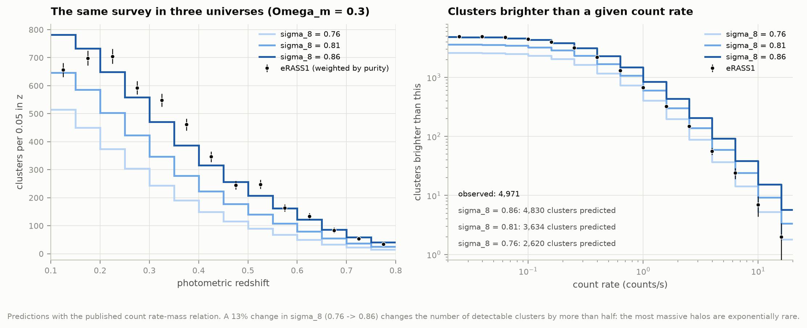

Clusters are the rare peaks of the density field. Their abundance falls off as exp(−c/σ(M)²), where
σ(M) is the typical fluctuation on the scale that encloses a cluster's mass. A small change in σ₈
therefore changes the number of massive clusters by a lot: at Ω_m = 0.3 the predicted detections
are 2,620 for σ₈ = 0.76, 3,634 for 0.81 and 4,830 for 0.86. eROSITA saw 4,971.

### 5. S₈ in context: clusters side with the CMB

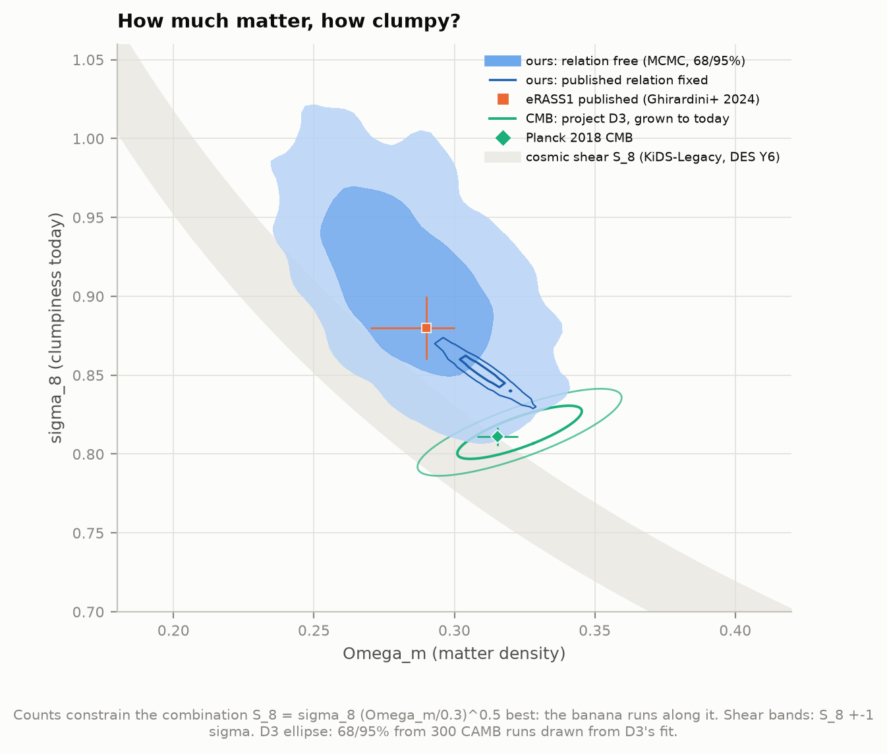

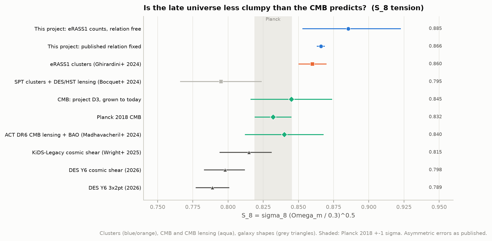

| Probe | S₈ |
|---|---|
| **eRASS1 counts, this project** | **0.885 (−0.033/+0.037)** |
| eRASS1 counts, Ghirardini et al. 2024 | 0.86 ± 0.01 |
| CMB: project D3's temperature fit, grown to today (CAMB) | 0.845 ± 0.029 (σ₈ = 0.814 ± 0.011) |
| CMB: Planck 2018 (TT,TE,EE+lowE+lensing) | 0.832 ± 0.013 |
| CMB lensing: ACT DR6 + BAO | 0.840 ± 0.028 |
| SPT clusters with DES/HST lensing masses (Bocquet et al. 2024) | 0.795 ± 0.029 |
| Cosmic shear: KiDS-Legacy (Wright et al. 2025) | 0.815 (+0.016/−0.021) |
| Cosmic shear: DES Y6 (2026) | 0.798 (+0.014/−0.015) |
| Galaxy clustering + lensing: DES Y6 3×2pt (2026) | 0.789 ± 0.012 |

The **S₈ tension** is the observation that several low-redshift probes measure a less clumpy
universe than the CMB predicts. Our cluster S₈ sits 1.4σ *above* Planck's (and
0.9σ above D3's), and well above DES Y6. eRASS1's clusters therefore offer no support for a
low-S₈ universe, as Ghirardini et al. concluded. The other cluster survey in the table, SPT, sits
1.1σ below Planck, so clusters are not unanimous either.

D3 fitted Planck's temperature spectrum with τ fixed; here τ is drawn from Planck's TT+lowE
constraint (0.0522 ± 0.0080) because temperature alone fixes only A_s e^(−2τ). Our CAMB path
reproduces Planck 2018's published σ₈ for its own best fit (0.8118 vs 0.8120).

### 6. Everything hangs on the mass scale

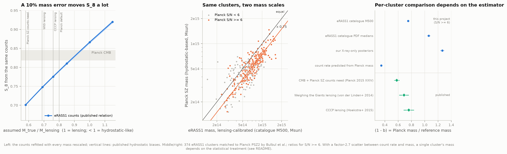

Refitting the same counts with every cluster mass rescaled shows the lever:

| Assumed M_true / M_lensing | S₈ from the counts |
|---|---|
| 0.58 | 0.701 ± 0.003 |
| 0.69 | 0.748 ± 0.002 |
| 0.76 | 0.776 ± 0.002 |
| 0.85 | 0.810 ± 0.003 |
| 1.00 (lensing, as published) | 0.866 ± 0.003 |
| 1.15 | 0.920 ± 0.003 |

A mass scale below 1 means the detected clusters are *less* massive than the lensing calibration
says. Such halos are more common, so at a given σ₈ more of them would be detected, and the fit lowers
σ₈ to match the observed number. Planck's SZ cluster counts used X-ray
masses that assume hydrostatic equilibrium (gas pressure alone holds the cluster up) and are thought
to be biased low by a factor (1 − b). Planck's analysis needed (1 − b) = 0.58 ± 0.04 to agree with
its own CMB; weak-lensing studies found 0.69 ± 0.07 (Weighing the Giants) and 0.76 ± 0.08 (CCCP).
Read with a CCCP-like hydrostatic mass scale, eRASS1 would give S₈ ≈ 0.78, as low as DES Y6.
Read with Planck's 0.58 it would give 0.70. eRASS1's lensing calibration is what puts it
next to the CMB.

**Can we measure (1 − b) for the same clusters?** Bulbul et al. matched 439 eRASS1 clusters to
Planck PSZ2 detections, 374 of them with a Planck mass. The ratio of Planck's mass to eRASS1's for
the 226 with Planck S/N ≥ 6 depends strongly on *which* eRASS1 mass is used:

| eRASS1 mass used | M_Planck / M_eRASS1 |
|---|---|
| catalogue M500 column | 0.75 ± 0.01 (226 clusters) |
| catalogue PDF medians | 1.06 ± 0.02 (226 clusters) |
| our X-ray-only posteriors | 1.26 ± 0.03 (147 clusters) |
| forward: count rate predicted from Planck mass | 0.35 ± 0.01 (147 clusters) |

Each estimator has a small spread (0.09–0.13 dex), but their medians range from 0.35 to 1.26. The
reason is the published relation's scatter. At fixed mass, count rates scatter by a factor of 2.7
(σ_X = 0.98 in ln CR), so a single cluster's count rate pins its mass only to a factor of ~2. The
estimate then depends on the prior: how common clusters of each mass are, and how the cluster was
selected. The catalogue's M500 values include a correction that maps point estimates onto the
expected mass distribution; for these massive clusters they sit ~35% above the medians of the
catalogue's own mass PDFs. Our X-ray-only posteriors ignore that Planck saw these clusters *because*
they are massive. Predicting each cluster's count rate from its Planck mass instead shows that
Planck clusters are about three times brighter in X-rays than the published median relation
predicts for their mass: the relation's low normalisation and large scatter trade off against
each other (Ghirardini et al. note the same degeneracy and a 3σ tension with eFEDS). That fits the
population, which is all the cosmology needs, but it cannot weigh individual massive clusters. The
catalogue-mass value, 0.75 ± 0.01, agrees with CCCP's lensing value. A real measurement of (1 − b)
needs hydrostatic and lensing masses of the same clusters, which is project K2.

### 7. What eROSITA can see

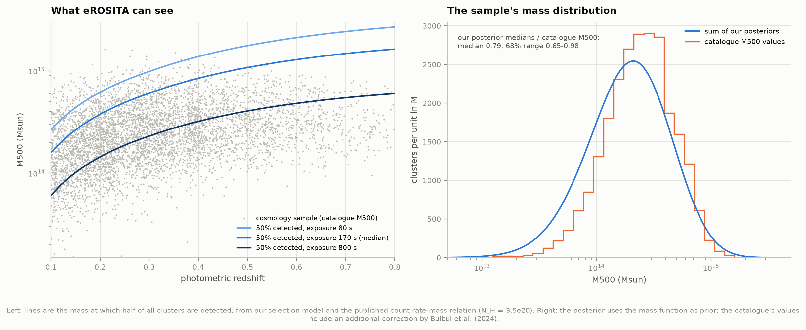

The lines mark the mass at which half of all clusters are detected, according to the published
relation: at the median exposure (170 s), 6.0×10¹⁴ M☉ at z = 0.3 and 1.6×10¹⁵ M☉ at z = 0.8.
Yet 91% of the detected clusters near z = 0.3 lie *below* that line. With a factor-2.7 scatter in
brightness at fixed mass, the X-ray-bright members of the far more numerous low-mass population
dominate the detections: Eddington bias, which the forward model handles and which makes individual
masses so prior-dependent (section 6). Read literally, the relation also says that half of all
6×10¹⁴ M☉ clusters at z = 0.3 are too faint to detect. That is a statement about the model
population. Planck's massive clusters (section 6) are brighter and more uniform than the tail of
that relation. Our posterior medians run 0.79 of the catalogue's M500 values (median),
for the reasons given in section 6.

### 8. Dark energy's brake

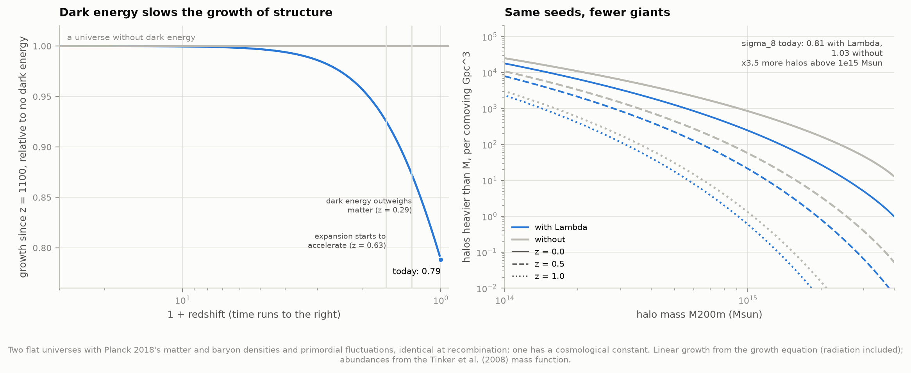

Take two flat universes with Planck 2018's matter and baryon densities and the same primordial
fluctuations, identical at recombination (z ≈ 1100), when the CMB was released. One contains a
cosmological constant, the other does not (it must then expand more slowly: h = 0.38). In the
matter-only universe, density ripples grow in proportion to the scale factor forever. With Λ, growth
slows once dark energy dominates (from z ≈ 0.3; the expansion starts to accelerate at z ≈ 0.6):

- the growth since recombination is **0.79** of the matter-only value today (0.91 at z = 0.5,
  0.96 at z = 1);
- σ₈ (in the same physical sphere, 11.9 Mpc) would be **1.03** instead of 0.812;
- there would be **3.5×** as many halos heavier than 10¹⁵ M☉ today and 1.4× as many
  above 10¹⁴ M☉.

This is the "brake" that cluster counts measure: the CMB fixes the seeds, and the clusters measure how
far they have grown. (The matter-only universe is not a viable alternative: it fails the CMB's
acoustic scale, supernovae (D1) and BAO (D5). It serves only to isolate what Λ does.)

### 9. Robustness

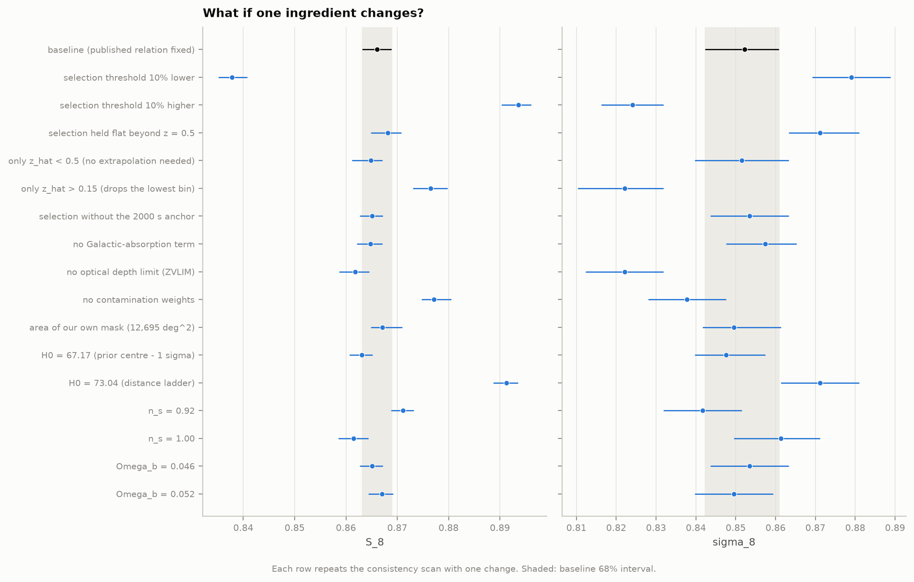

| Change (published relation fixed) | Ω_m | σ₈ | S₈ |
|---|---|---|---|
| baseline | 0.310 (−0.008/+0.007) | 0.852 (−0.010/+0.009) | 0.866 ± 0.003 |
| selection threshold 10% lower | 0.273 | 0.879 | 0.838 (−0.028) |
| selection threshold 10% higher | 0.354 | 0.824 | 0.894 (+0.028) |
| selection held flat beyond z = 0.5 | 0.298 | 0.871 | 0.868 (+0.002) |
| only z_hat < 0.5 (no extrapolation needed) | 0.308 | 0.852 | 0.865 (−0.001) |
| only z_hat > 0.15 (drops the lowest bin) | 0.342 | 0.822 | 0.877 (+0.010) |
| selection without the 2000 s anchor | 0.308 | 0.853 | 0.865 (−0.001) |
| no Galactic-absorption term | 0.305 | 0.857 | 0.865 (−0.001) |
| no optical depth limit (ZVLIM) | 0.330 | 0.822 | 0.862 (−0.004) |
| no contamination weights | 0.330 | 0.838 | 0.877 (+0.011) |
| area of our own mask (12,695 deg^2) | 0.313 | 0.850 | 0.867 (+0.001) |
| H0 = 67.17 (prior centre - 1 sigma) | 0.311 | 0.848 | 0.863 (−0.003) |
| H0 = 73.04 (distance ladder) | 0.314 | 0.871 | 0.891 (+0.025) |
| n_s = 0.92 | 0.320 | 0.842 | 0.871 (+0.005) |
| n_s = 1.00 | 0.301 | 0.861 | 0.861 (−0.005) |
| Omega_b = 0.046 | 0.308 | 0.853 | 0.865 (−0.001) |
| Omega_b = 0.052 | 0.313 | 0.850 | 0.867 (+0.001) |

The detection threshold is the most sensitive ingredient: a 10% error in the count rate needed for
detection moves S₈ by about 0.03, three times the published error bar. Our model reproduces the
published threshold curves to ~1–3% in count rate, which corresponds to ±0.005–0.01 in S₈.
Ω_b and n_s move S₈ by less than 0.01 across the paper's prior ranges, and so does H₀ within its prior
(67.77 ± 0.6). The distance-ladder H₀ = 73.04 moves S₈ by +0.025: with the relation fixed in
solar masses, a faster expansion changes volumes and the mass assigned to each count rate. In the
paper's joint fit the lensing masses would rescale with H₀ and largely compensate (they report no
effect). Ignoring contamination (counting every candidate as a cluster) raises S₈ by +0.011.

---

## How it works

1. **`fetch_data.py`** downloads and caches everything (~47 MB compressed, 77 MB kept): the three
   eRASS1 catalogues and the exposure map from the eROSITA-DE DR1 site, Legacy Surveys coverage maps and
   the HI4PI map from CDS, Planck's PSZ2 from IRSA, and three published figures from arXiv.
2. **`footprint.py`** decodes the exposure HiPS into HEALPix (the tile orientation was found by matching
   the catalogue's exposures), intersects the coverage maps, and reads Bulbul et al.'s masks off their
   figure. The figure is drawn with ~1° round markers that spill past every edge, so the read-off mask
   is eroded by the marker radius (6 px), calibrated on the published 13,116 deg².
3. **`selection.py`** extracts Ghirardini et al.'s Fig. 4 curves from the PDF's drawing commands
   (`pdftocairo -svg`) and fits P = P_max Φ(ln(photons/S₅₀)/s) at three redshift nodes, linear in
   ln(exposure), with linear interpolation in redshift (linear extrapolation outside 0.15–0.5).
4. **`cosmology.py`** computes distances, the linear growth factor, σ(M) and the Tinker et al. (2008)
   mass function in numpy (a full mass-function grid in ~20 ms); **`model.py`** turns them into
   predicted counts, with the sky-averaged selection precomputed as a kernel.
5. **`inference.py`** runs the grid scans (6 processes) and the MCMC (`emcee`, 40 walkers × 3,000 steps,
   seeded through the sampler's own RNG). **`masses.py`**, **`cmb_link.py`** (CAMB) and
   **`dark_energy.py`** do sections 6–8. **`test_physics.py`** runs 23 checks, including recovering a
   Poisson mock universe and matching colossus and CAMB.

Run `python run.py` (about 35 minutes on six cores, mostly the Markov chain), then `python test_physics.py`.
`figures/cluster_count_explorer.html` is a self-contained page: move Ω_m and σ₈ and watch the
predicted counts change against the real ones.

## What differs from the plan in the atlas

- **The selection function is not public.** The atlas spec planned to use "the published mass–observable
  relation and selection function". The relation is published (a table); the selection function is a
  Gaussian-process classifier inside the collaboration's pipeline. We rebuilt it from the curves
  published in two papers. Its accuracy is the leading systematic of this project (section 9).
- **The observable is the count rate, not the luminosity.** The cosmology analysis bins in X-ray
  count rate (photons per second, corrected for Galactic absorption), not luminosity, because the
  selection is defined in count rate and a count rate needs no cosmology to compute.
- **No footprint mask is public either.** It was read off a published figure (section 2); its area agrees
  with the published one to 0.8%.
- **Download size**: ~47 MB compressed (spec: <50 MB), 77 MB after unpacking the 50 MB primary catalogue.
- **Contamination**: the paper models AGN and noise contaminants in the likelihood (a mixture model). We
  weight each cluster by its published probability of being real instead.

## Caveats

- **Consistency, not independence.** The count rate–mass relation and its priors come from the same
  paper's joint fit of counts and lensing, so they already carry some count information. Our result
  shows that the public catalogue, our reconstruction and their mass calibration hang together; it is
  not a second, independent measurement.
- **The selection model** reproduces nine published slices of a five-dimensional function. The
  background level is not modelled (the published curves use a nominal one), and above z = 0.5 the
  model is extrapolated. Restricting the fit to z < 0.5 changes S₈ by −0.001.
- **Simplifications** relative to the paper: no correlation between richness and count-rate scatter;
  the richness cut uses the published richness–mass relation at fixed parameters; photometric-redshift
  outliers (0.13%) are ignored; H₀, Ω_b and n_s are fixed; massless neutrinos (as in the paper's baseline).
- **The mass function**: Tinker et al. (2008) tables interpolated linearly in log Δ, as in CCL (which
  the paper used); colossus interpolates in Δ, which differs by up to 3.5% at the extremes.
  Ghirardini et al. found σ₈ lower by 0.02 with other mass functions.
- **63 cosmology-sample clusters** are absent from the primary catalogue (no counterpart within 60″),
  and 14 have a count rate of exactly zero; we drop the latter (0.3%).
- **Units trap**: the optical catalogue's `NHI` column is labelled 10²¹ cm⁻² but holds 10²² cm⁻².
- **Planck comparison**: PSZ2 masses assume h = 0.7, Ω_m = 0.3; eRASS1's, the eRASS1 cosmology (~3%
  difference in mass scale).

## Data and credits

- eROSITA-DE DR1: Merloni et al. 2024 (A&A 682, A34); cluster catalogues Bulbul et al. 2024 (A&A 685, A106);
  optical follow-up Kluge et al. 2024 (A&A 688, A210); cosmology Ghirardini et al. 2024 (A&A 689, A298);
  selection function Clerc et al. 2024 (A&A 687, A238). eROSITA is the soft X-ray instrument aboard SRG, a
  joint Russian-German science mission supported by the Russian Space Agency (Roskosmos), in the interests
  of the Russian Academy of Sciences represented by its Space Research Institute (IKI), and the Deutsches
  Zentrum für Luft- und Raumfahrt (DLR). The SRG spacecraft was built by Lavochkin Association (NPOL) and
  its subcontractors and is operated by NPOL with support from the Max Planck Institute for
  Extraterrestrial Physics (MPE). The eROSITA data shown here were processed using the eSASS/NRTA software
  system developed by the German eROSITA consortium.
- DESI Legacy Surveys DR10 coverage via the CDS MocServer; HI4PI (HI4PI Collaboration 2016) via CDS hips2fits.
- Planck PSZ2: Planck Collaboration 2016, XXVII (A&A 594, A27), from IRSA.
- Comparison values: Planck 2018 VI; Madhavacheril et al. 2024 (ACT DR6); Bocquet et al. 2024 (SPT);
  Wright et al. 2025 (KiDS-Legacy); DES Collaboration 2026 (Y6 cosmic shear, arXiv:2602.10065; Y6 3×2pt,
  arXiv:2601.14559); Planck 2015 XXIV; von der Linden et al. 2014; Hoekstra et al. 2015.
- Software: numpy, scipy, astropy, healpy, matplotlib, emcee, CAMB, colossus (tests), poppler's pdftocairo.
- Retrieved 2026-10-04; `data/manifest.json` lists every file with its SHA-256.
