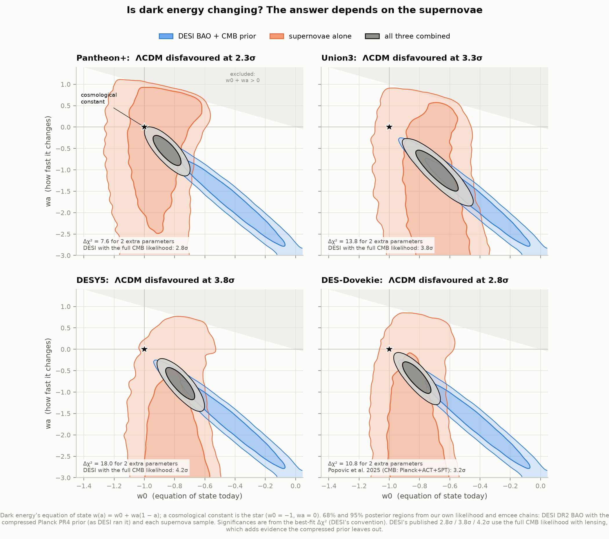
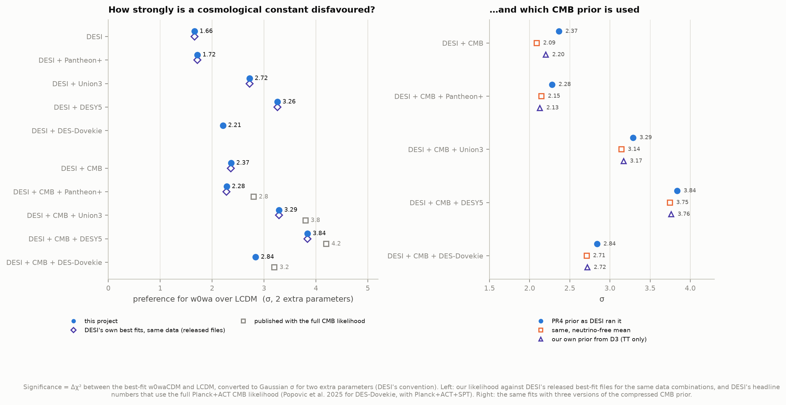
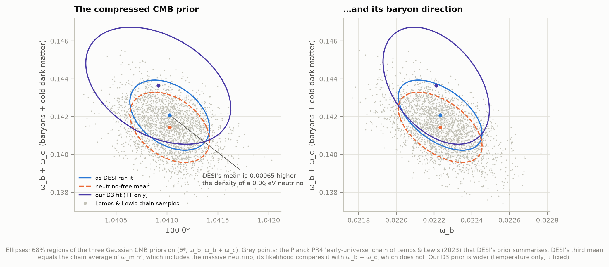
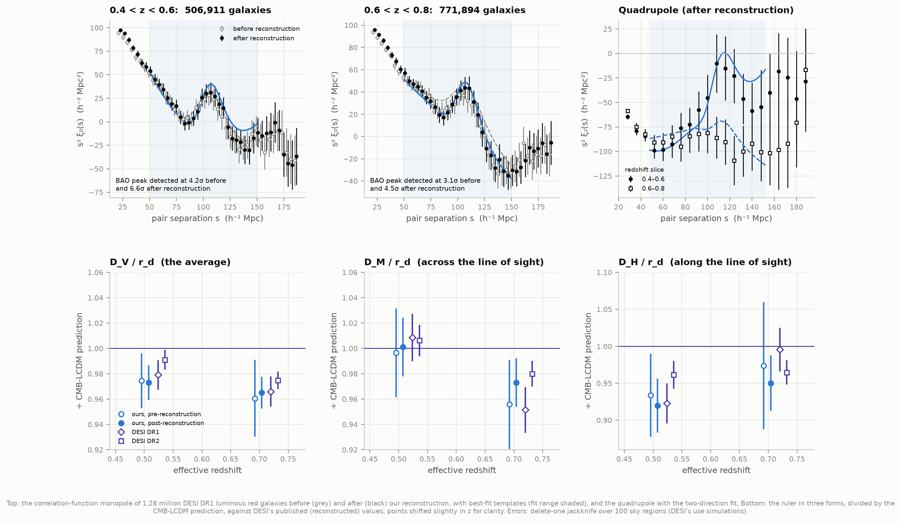
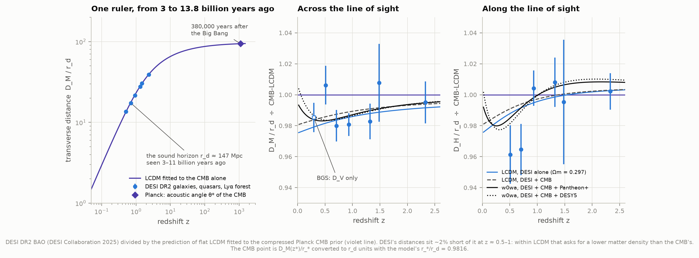
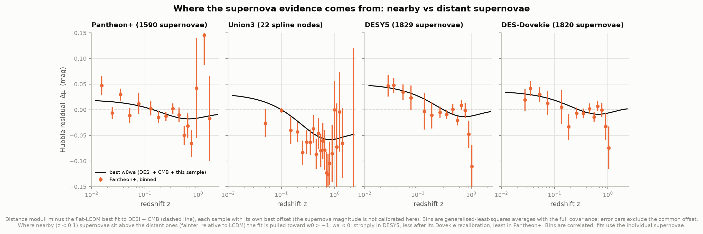
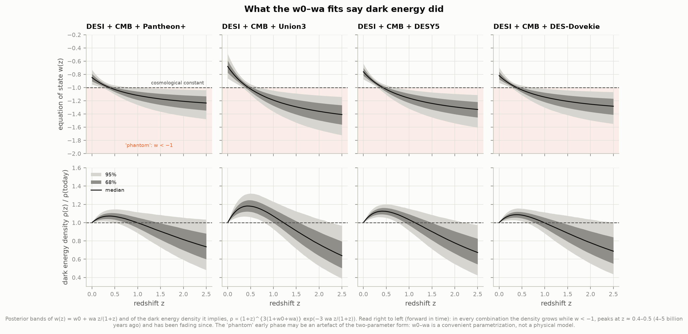

# D5 — Is dark energy changing? DESI's 2025 hint, reproduced

**In March 2025 the Dark Energy Spectroscopic Instrument (DESI) reported that dark energy may be
weakening over time. Is that what the data say, and how much does it depend on which supernovae
you trust?**

This project rebuilds DESI's analysis from public data with its own code. That includes the
expansion history of the universe (with radiation and a massive neutrino), the BAO, supernova
and CMB likelihoods, the best fits and the posteriors. Everything that can be compared with
DESI's own released results agrees with them. At DESI's 16 published best-fit points our χ²
values match theirs to 10⁻⁴ without the CMB and to 3 × 10⁻⁴ with it, once a 10⁻⁵ CAMB-version
difference is allowed for. Our significances match theirs to 0.01σ, and our posteriors match
their chains to within 0.1σ.

**The answer: the hint is real and reproducible, but how strong it is depends on the supernovae.**

- DESI's BAO plus the CMB, with no supernovae, disfavour a cosmological constant at **2.4σ**.
- Adding supernovae moves this to anywhere between **2.3σ** (Pantheon+) and **3.8σ** (DES 5-year).
- The 2025 recalibration of the DES supernovae (DES-Dovekie) brings DES back down to **2.8σ**.
- No combination reaches the conventional 5σ for a discovery. (DESI's headline 2.8σ–4.2σ use the
  full CMB likelihood with lensing, which this project does not reproduce; see the notes.)

Along the way we found a small inconsistency in DESI's minimal "compressed" CMB prior. It
compares the baryon + dark-matter density with a mean that also contains the density of the
neutrinos, and that adds about 0.3σ to the minimal-prior results. DESI's headline numbers do not
use this prior.

A stretch goal measures the BAO ruler ourselves in **1.28 million DESI DR1 galaxies**, with our
own pair-counting and reconstruction code. After reconstruction the acoustic peak is detected at
6.6σ and 4.5σ in two redshift slices. Our distances agree with DESI's published values for the
same galaxies within 1σ, with comparable error bars.



An **interactive explorer** ([figures/dark_energy_explorer.html](figures/dark_energy_explorer.html),
self-contained, works offline) lets you pick any dark energy history (w0, wa). It shows how much
better or worse than a cosmological constant each data combination finds it, and what that
universe predicts for DESI's distances and the supernovae.

---

## Results

### 1. Our likelihood is DESI's likelihood

DESI released its best fits and MCMC chains in October 2025, with χ² values for each
likelihood separately. That makes an exact test possible: put DESI's best-fit parameters into
our code and compare the χ² values number by number.

| Test | Result |
|---|---|
| χ² at DESI's 8 best fits without the CMB (BAO, Pantheon+, Union3, DESY5) | equal to **10⁻⁴** |
| χ² at DESI's 8 best fits with the compressed CMB prior | 0.004–0.044 apart. All of it is one constant 1.6 × 10⁻⁵ shift in θ* (DESI ran CAMB 1.5.4, we use 2.0.4); with that shift every value matches to **3 × 10⁻⁴** |
| Δχ² (w0waCDM vs ΛCDM) from our own fits vs DESI's released fits, 8 combinations | equal to **0.00–0.02** |
| Posterior means vs DESI's chains (Ωm, w0, wa, H0, h·r_d; 13 data sets) | within **0.08σ** (most within 0.03σ) |
| Our expansion history vs CAMB, z = 0 to 10⁶ | H(z) to 1.4 × 10⁻⁷; distances to 4 × 10⁻⁷; sound horizons to 2 × 10⁻⁶; θ* to 2 × 10⁻⁶ |

The last row matters because the CMB pins the acoustic angle θ* to 2.5 parts in 10⁴. A
cosmology code has to get it right to a few parts in a million so that its own error is
invisible.

### 2. Flat ΛCDM: DESI wants less matter than everyone else

BAO measure distances only in units of the sound horizon r_d. On their own they constrain the
matter density Ωm and the product h·r_d, not H0.

| Data | Ωm (ours) | Ωm (published) |
|---|---|---|
| DESI DR2 BAO | **0.2978 ± 0.0086** | 0.2975 ± 0.0086 (h·r_d 101.54 ± 0.73 Mpc; ours 101.52 ± 0.74) |
| CMB, compressed Planck PR4 prior | 0.3159 ± 0.0082 | 0.3169 ± 0.0065 (full Planck + ACT likelihood) |
| DESI + CMB | 0.3007 ± 0.0038 | 0.3027 ± 0.0036 (full CMB) |
| Pantheon+ | 0.332 ± 0.018 | 0.334 ± 0.018 (Brout et al. 2022) |
| Union3 | 0.358 ± 0.027 | 0.356 (+0.028/−0.026) (Rubin et al. 2023) |
| DES-SN5YR | 0.352 ± 0.017 | 0.352 ± 0.017 (DES 2024) |
| DES-Dovekie | 0.331 ± 0.015 | 0.330 ± 0.015 (Popovic et al. 2025) |
| Pantheon+ in project D1 | 0.332 ± 0.018 | (our own earlier likelihood, same data) |

In ΛCDM, DESI's Ωm is the lowest of all. How far each other probe sits from it:

| DESI vs | Δχ² when forced to share one ΛCDM | Tension |
|---|---|---|
| CMB (compressed) | 4.9 for 2 parameters | 1.7σ (1.3σ with the neutrino-free CMB prior, section 5) |
| Pantheon+ | 3.0 for 1 parameter | 1.7σ |
| DES-Dovekie | 3.6 | 1.9σ |
| Union3 | 4.6 | 2.2σ |
| DESY5 | 8.7 | **2.9σ** |

**This ordering is the whole story.** Freeing w0 and wa lets the expansion history bend so
that DESI's low-redshift distances and the other probes' higher Ωm both fit. The more a data set
disagrees with DESI within ΛCDM, the more it "prefers" evolving dark energy.

### 3. Evolving dark energy: Δχ² and significance

The preference for w0waCDM is the χ² improvement at the best fit when w0 and wa are freed
(Δχ²_MAP), turned into Gaussian σ for 2 extra parameters, as DESI does it:

| Supernovae | DESI BAO only | DESI + CMB (compressed) | DESI + CMB, published (full CMB likelihood) |
|---|---|---|---|
| none | Δχ² = 4.7, **1.7σ** (DESI: 4.7, 1.7σ) | 8.0, **2.4σ** (DESI: 8.0, 2.4σ) | 12.5, 3.1σ |
| Pantheon+ | 4.9, **1.7σ** (DESI: 4.9) | 7.6, **2.3σ** (DESI files: 7.6) | 10.7, 2.8σ |
| Union3 | 10.1, **2.7σ** (DESI: 10.1) | 13.8, **3.3σ** (DESI files: 13.8) | 17.4, 3.8σ |
| DESY5 | 13.6, **3.3σ** (DESI: 13.6) | 18.0, **3.8σ** (DESI files: 18.0) | 21.0, 4.2σ |
| DES-Dovekie | 7.2, **2.2σ** (new) | 10.8, **2.8σ** (new) | 3.2σ (Popovic et al. 2025, CMB = Planck + ACT + SPT) |

Supernovae alone give 0.3σ (Pantheon+), 1.3σ (Union3), 1.9σ (DESY5) and 1.7σ (DES-Dovekie).



### 4. The best-fit dark energy

Posterior means and 68% intervals (our emcee chains, DESI's priors):

| Data | w0 | wa | Ωm | H0 (km/s/Mpc) | DESI DR2 paper |
|---|---|---|---|---|---|
| DESI | −0.47 ± 0.28 | < −1.36 (68%) | 0.354 ± 0.032 | — | w0 = −0.48 (+0.35/−0.17), wa < −1.34 |
| DESI + Pantheon+ | −0.887 ± 0.059 | −0.17 ± 0.46 | 0.298 ± 0.019 | — | −0.888 (+0.055/−0.064), −0.17 ± 0.46 |
| DESI + Union3 | −0.70 ± 0.11 | −0.96 ± 0.57 | 0.327 ± 0.017 | — | −0.70 ± 0.11, −0.99 ± 0.57 |
| DESI + DESY5 | −0.781 ± 0.071 | −0.72 ± 0.47 | 0.319 ± 0.014 | — | −0.781 (+0.067/−0.076), −0.72 ± 0.47 |
| DESI + CMB | −0.43 ± 0.22 | −1.72 ± 0.65 | 0.353 ± 0.022 | 63.7 ± 1.9 | −0.43 ± 0.22, −1.72 ± 0.64, H0 63.7 (+1.7/−2.2) |
| DESI + CMB + Pantheon+ | −0.848 ± 0.057 | −0.55 ± 0.22 | 0.3111 ± 0.0058 | 67.50 ± 0.60 | (full CMB) −0.838 ± 0.055, −0.62 (+0.22/−0.19) |
| DESI + CMB + Union3 | −0.679 ± 0.090 | −1.03 ± 0.31 | 0.3267 ± 0.0088 | 65.97 ± 0.85 | (full CMB) −0.667 ± 0.088, −1.09 (+0.31/−0.27) |
| DESI + CMB + DESY5 | −0.760 ± 0.059 | −0.81 ± 0.24 | 0.3189 ± 0.0057 | 66.73 ± 0.57 | (full CMB) −0.752 ± 0.057, −0.86 (+0.23/−0.20) |
| DESI + CMB + DES-Dovekie | −0.816 ± 0.058 | −0.67 ± 0.24 | 0.3131 ± 0.0054 | 67.32 ± 0.54 | Popovic et al.: −0.803 ± 0.054, −0.72 ± 0.21 |

Read as a history, every combination says the same thing (figure 05). Dark energy's density
rose until about 4–5 billion years ago (z ≈ 0.4–0.5) and has been thinning since: today w is
above −1. Earlier it was below −1, "phantom" energy that grows as space expands. The CMB-only
H0 of ΛCDM (67.2) drops to 63.7 in w0waCDM with BAO alone. **Evolving dark energy makes the
Hubble tension worse, not better.** H0 rises back to 66–67.5 once supernovae are added, but never
toward the local 73.

### 5. A finding: the neutrinos in DESI's compressed CMB prior

DESI's minimal CMB information is a Gaussian on three numbers: the acoustic angle θ*, the
baryon density ω_b and the baryon-plus-dark-matter density ω_bc. It is the summary of
"early-universe" Planck PR4 chains by Lemos & Lewis (2023). We recomputed it from those chains:

| | θ* | ω_b | ω_bc |
|---|---|---|---|
| Chain average of ω_b + ω_c | 0.01041027 | 0.02223208 | **0.14143** |
| Chain average of ω_m h² (includes the 0.06 eV neutrino) | | | **0.14208** |
| DESI's likelihood (released configuration) | 0.01041027 | 0.02223208 | **0.14207901** |

DESI's third mean is the matter density *including* the massive neutrino (ω_ν = 0.00065). Its
likelihood takes only ω_b and ω_c as inputs, though, and DESI's own published χ² values confirm
that it compares the mean with ω_b + ω_c. At all eight of DESI's CMB best fits, our χ² with
ω_b + ω_c matches DESI's to 3 × 10⁻⁴. With the neutrinos included it would be off by up to
1.3 (figure 07, crosses). That leaves an offset of 0.00065, about half a standard deviation, in
the dark-matter direction.

A consistent prior (mean 0.14143) changes the minimal-CMB results:

| Data | DESI's prior | Consistent prior | Our own prior from D3 (Planck TT only) |
|---|---|---|---|
| DESI + CMB | 2.37σ | **2.09σ** | 2.20σ |
| DESI + CMB + Pantheon+ | 2.28σ | 2.15σ | 2.13σ |
| DESI + CMB + Union3 | 3.29σ | 3.14σ | 3.17σ |
| DESI + CMB + DESY5 | 3.84σ | 3.75σ | 3.76σ |
| DESI + CMB + DES-Dovekie | 2.84σ | 2.71σ | 2.72σ |
| ΛCDM tension, DESI vs CMB | 1.7σ | 1.3σ | 1.7σ |

The effect is 0.1–0.3σ. It touches only DESI's "DESI + (θ*, ω_b, ω_bc)_CMB" results, such as
its quoted 2.4σ. All of DESI's headline numbers use the full CMB likelihood, which has no such
compression. The prior built from our own D3 analysis, a fit of ΛCDM to the Planck 2018
temperature spectrum with τ fixed, is 1.7× wider. It gives nearly the same answers, a useful
sign that the conclusions do not hinge on the details of the CMB input.



### 6. Our own BAO measurement, with reconstruction

From DESI's public DR1 clustering catalogues (luminous red galaxies with their weights, plus about
13 random points per galaxy), we measured the two-point correlation function with our own pair
counter (`paircount.c`, OpenMP). We then repeated the measurement after **reconstruction**, the
technique DESI uses to sharpen the peak. Galaxies have drifted 5–10 h⁻¹ Mpc from where they
formed, pulled by the same matter they trace, and that blurs the 100 h⁻¹ Mpc ruler. Our
`reconstruction.py` estimates those displacements from the galaxy map itself (a Zel'dovich
solution on an FFT mesh, with the redshift-space term solved iteratively) and moves every galaxy
back. The typical displacement it finds is 7.4–7.8 h⁻¹ Mpc.

| Slice | Galaxies | BAO detection, before → after | D_V/r_d (ours, after) | D_M/r_d | D_H/r_d | DESI DR1 (D_V, D_M, D_H) | DESI DR2 (D_V, D_M, D_H) |
|---|---|---|---|---|---|---|---|
| 0.4 < z < 0.6 (z_eff 0.51) | 506,911 | 4.2σ → **6.6σ** | **12.44 ± 0.18** | 13.46 ± 0.31 | 20.95 ± 0.83 | 12.57 ± 0.15, 13.62 ± 0.25, 20.98 ± 0.61 | 12.72 ± 0.10, 13.59 ± 0.17, 21.86 ± 0.43 |
| 0.6 < z < 0.8 (z_eff 0.70) | 771,894 | 3.1σ → **4.5σ** | **15.86 ± 0.21** | 17.19 ± 0.34 | 19.18 ± 0.76 | 15.90 ± 0.20, 16.85 ± 0.32, 20.08 ± 0.60 | 16.05 ± 0.11, 17.35 ± 0.18, 19.46 ± 0.33 |

- **Reconstruction halves our error bars.** The uncertainty in the ruler's stretch α falls from
  0.022 to 0.013 and 0.011. With it, our errors are about the same size as DESI DR1's on the same
  galaxies.
- **Every one of our six values agrees with DESI DR1 within 1σ** (largest gap 0.9σ), and with DR2
  (more galaxies, the same redshifts) within 1.4σ. Our D_H/r_d at z = 0.51 (20.95 ± 0.83) matches DR1's 20.98.
- **The two directions** come from fitting the monopole and the quadrupole together, with
  separate stretches across (α⊥) and along (α∥) the line of sight. That is the Alcock–Paczyński
  geometry test behind DESI's D_M and D_H. D_V is derived from the same fit, as DESI does. A fit
  to the monopole alone gives a D_V 1–1.5% lower (12.27 and 15.63), because when α∥ ≠ α⊥ some of
  the quadrupole leaks into the monopole.
- **Our own BAO measurement as cosmology.** In flat ΛCDM our four distances give
  Ωm = 0.46 ± 0.10 and h·r_d = 95.7 ± 4.4 Mpc. The same fit to DESI DR1's numbers for these two
  slices gives 0.39 ± 0.08. Two redshifts alone barely constrain Ωm; DESI's 0.2975 ± 0.0086 needs
  all seven of its redshift bins.



---

## The figures worth looking at

**Is dark energy changing? (03_w0wa_by_sample, top of this page).** Each panel is one supernova
sample. DESI's BAO with the CMB (blue) allow a long diagonal band, a family of histories that
all fit. The supernovae alone (orange) pin w0 but barely constrain wa. Where the two cross
(grey) is the answer, and the cosmological constant (star) sits at a different distance from it
for each sample.

**The ruler across cosmic time (01_bao_distances).** On the left, the same sound-horizon ruler
seen at seven redshifts by DESI and at z ≈ 1090 by Planck. On the right, DESI's distances divided
by what ΛCDM fitted to the CMB predicts. The 2% deficit at z ≈ 0.5–1 is what ΛCDM can only absorb
with a lower Ωm, and what w0–wa absorbs by bending.



**Where the supernova evidence comes from (06_supernova_residuals).** Each sample's distances
minus the ΛCDM that fits DESI + CMB. DESY5's nearby supernovae (z < 0.1) sit ~0.04 mag above its
distant ones. That offset drives its 3.8σ; it is the kind of low-redshift offset Efstathiou
(2025) flagged in DES-SN5YR, and Dovekie's recalibration shrinks it. Pantheon+ shows the least of it.



**What dark energy did (05_dark_energy_history).** w(z) and the dark energy density over time for
each combination.



Also: `02_lcdm_omega_m` (section 2), `07_validation` (section 1).

---

## Background, in brief

**The sound horizon.** Before the universe was 380,000 years old it was a hot plasma in which
light and matter moved together, and sound waves crossed it at over half the speed of light.
When the plasma turned into neutral gas the waves froze. Every overdense spot left a faint shell
of extra matter 147 Mpc (480 million light-years) around it, measured today. That distance, the
sound horizon r_d, is set by physics we understand well: the densities of baryons, dark matter
and radiation.

**BAO, baryon acoustic oscillations.** Galaxies formed where matter was dense, so they have a
slight preference to be 147 Mpc apart. Measured *across* the line of sight, that separation is
an angle and gives the transverse distance D_M/r_d. Measured *along* it, it is a redshift
difference and gives D_H/r_d = c/(H r_d), the expansion rate itself. DESI measures both at seven
redshifts from 0.3 to 2.3, using nearly 15 million galaxies and quasars and the hydrogen absorption in
quasar spectra (the Lyman-α forest).

**The CMB.** The same sound waves are imprinted on the cosmic microwave background. Its acoustic
peaks fix the angle θ* = r_*/D_M(z*) to 0.025% and the matter densities that set r_d. They thus
calibrate the ruler and anchor the far end of the distance scale.

**Supernovae.** Type Ia supernovae are standard candles (project D1). They measure the *shape*
of the distance–redshift relation very precisely below z ~ 1, but not its absolute scale.

**w0 and wa.** Dark energy's pressure-to-density ratio is w. A cosmological constant has w = −1
forever, and its density never changes. The w0–wa form w(a) = w0 + wa(1 − a), where a is the
size of the universe relative to today, is the simplest way to let it evolve: w0 is today's
value and wa how fast it changed. It is a description, not a theory.

**Why combine?** Each probe alone allows a long degeneracy of (Ωm, w0, wa) histories. The three
probes' degeneracies point in different directions (figure 03), so together they close in.

---

## How it works

**1. Data** (all public; URLs, sizes, SHA-256 and retrieval times in `data/manifest.json`):
- DESI DR2 BAO: 13 distance ratios and their covariance (Cobaya's `bao_data`, the files DESI's
  own likelihood reads).
- Supernovae: Pantheon+ (1,590 at z > 0.01), Union3 (22 spline nodes of the UNITY1.5 model),
  DES-SN5YR (1,829) and DES-Dovekie (1,820), from Cobaya's `sn_data`. Our Pantheon+ files are
  byte-identical to project D1's.
- Planck PR4 early-universe chains (Lemos & Lewis 2023).
- DESI's released best fits and chains (~0.5 GB), as the answer key only.
- DESI DR1 LRG clustering catalogues and randoms (3.2 GB), for section 6.

**2. The expansion history** (`background.py`). Matter, photons, 2.03 massless neutrino species,
one 0.06 eV neutrino (the exact Fermi–Dirac integral, by Gauss–Laguerre quadrature) and w0–wa
dark energy in a flat universe. Distances are integrated in ln(1+z), batched over many universes
at once. The conventions are CAMB's: T_CMB = 2.7255 K, N_eff = 3.044, the BBN helium table DESI
used.

**3. Recombination** (`early_universe.py`). The only thing taken from CAMB is *when* the photons
let go: the drag epoch z_d and photon decoupling z*, which need atomic physics (RECFAST). Both
depend only on ω_b and ω_c, so they are tabulated on a 19 × 26 grid and interpolated to 0.001 in
z. Our own integrals then give r_d and r_* to 2 × 10⁻⁶ of CAMB's. Dark energy is negligible at
z > 600 for every model the data allow.

**4. Likelihoods** (`likelihoods.py`), matched to Cobaya's code as DESI ran it:
- BAO: Gaussian in the 13 ratios. Without the CMB, h·r_d is a free parameter, as in DESI's
  "uncalibrated" fits.
- Supernovae: Gaussian with the full covariance (DES-SN5YR: systematic covariance plus
  MUERR_FINAL² on the diagonal; Dovekie: its released inverse covariance). The distance is
  (1 + z_hel)·D_M(z_HD). The unknown magnitude offset is removed analytically, which equals
  DESI's marginalisation.
- CMB: the Gaussian on (θ*, ω_b, ω_b + ω_c), in three versions (section 5).

**5. Fits** (`fitting.py`). DESI's parameters and flat priors: Ωm ∈ [0.01, 0.99],
H0 ∈ [20, 100], ω_b ∈ [0.005, 0.1], w0 ∈ [−3, 1], wa ∈ [−3, 2], w0 + wa < 0, h·r_d ∈ [10, 1000].
Best fits use multi-start Nelder–Mead. Significance is Δχ²_MAP, converted for 2 extra
parameters. Posteriors come from emcee: 48 walkers, 6,000–30,000 steps, 30% burn-in, and
≥ 1,900 independent samples per chain. The seed is set on the sampler itself.

**6. The profile-likelihood explorer** (`explorer.py`). At each of 1,548 grid points of
(w0, wa) and each of 5 data combinations, (H0, ω_b, Ωm) are refitted. That makes a
prior-independent map of the evidence, embedded in a single HTML page with no external
libraries.

**7. Our BAO** (`bao_measurement.py`, `paircount.c`, `reconstruction.py`).
- Pair counts: fiducial Planck-2018 distances in h⁻¹ Mpc, and DD, DR, RR counts in (s, |μ|)
  bins up to 200 h⁻¹ Mpc. RR comes from random chunks about twice the data size (Keihänen
  et al. 2019). Every count and normalisation stays within one sky cap, and the caps are
  combined afterwards.
- Correlation function: Landy–Szalay monopole and quadrupole, with a delete-one jackknife over
  100 sky regions (k-means) and the Hartlap correction.
- Reconstruction: galaxies and randoms are painted on an 8 h⁻¹ Mpc mesh and smoothed with a
  15 h⁻¹ Mpc Gaussian (b = 2.0, f = 0.8). Then ∇·Ψ + (f/b)∇·[(Ψ·r̂)r̂] = −δ/b is solved by FFT,
  iterating the redshift-space term 8 times. Data and randoms are shifted by Ψ + f(Ψ·r̂)r̂
  ("RecSym"), and ξ = (DD − 2DS + SS)/RR.
- Isotropic fit: B²ξ_template(αs) + a₀ + a₁/s + a₂/s² over 50–150 h⁻¹ Mpc, with
  Σ_nl = 8 h⁻¹ Mpc damping before reconstruction and 4.5 after.
- Two-direction fit: a Kaiser template with anisotropic damping (Σ∥, Σ⊥ = 9, 4.5 before and
  6, 3 after) and the Alcock–Paczyński dilation, fitting ξ₀ and ξ₂ together on a grid of α∥ and
  α⊥. β is profiled; the amplitude and six broadband terms are solved linearly.
- Checks: a null test (unclustered points in two caps) returns ξ = 0, and an injected model is
  recovered exactly.

**8. Tests** (`test_physics.py`, 35 checks): H(z), distances, sound horizons and θ* against CAMB.
Also neutrino limits, the interpolated grid against fresh CAMB runs, both supernova likelihoods
against a literal transcription of Cobaya's formula, analytic profiling against brute-force
minimisation, the pair counter against a brute-force count, and the reconstruction solver against
analytic plane waves (the redshift-space term reduces the displacement by exactly 1/(1 + f/b)).

---

## Honest notes

**Compressed vs full CMB.** The spec asked for a compressed CMB prior, and DESI's own
compressed-prior fits are what we reproduce exactly. DESI's headline 2.8σ (Pantheon+), 3.8σ
(Union3) and 4.2σ (DESY5) use the full Planck likelihood with Planck + ACT lensing. For DESI + CMB
the full likelihood raises Δχ² from 8.0 to 12.5, 2.8 of it from lensing (DESI DR2, Table V).
Reproducing that means running the full Planck likelihoods with a Boltzmann code at every step,
outside this project's scope. The w0–wa
posteriors are nearly the same either way. Only the significances differ.

**"σ" here is a translation.** Δχ² for 2 extra parameters, converted to Gaussian odds, is
DESI's convention. It is a frequentist number. DESI's deviance information criterion, which
charges for the extra freedom, is smaller: −6.8 against Δχ² = −10.7 for DESI + CMB + Pantheon+
with the full CMB. The honest statement is "Δχ² = 7.6 for 2 extra parameters", not "a 2.3σ
discovery".

**Phantom crossing.** Every fit puts w < −1 in the past, energy that grows as space expands,
which is hard to make physically. It may be an artefact of forcing a straight line in a onto a
history the data only constrain at z ≲ 2.

**The supernova samples are not independent, and they disagree.** Pantheon+, Union3 and DES
share hundreds of nearby supernovae. Their different answers come mostly from calibration and
from how nearby samples are matched to distant ones. DES-SN5YR's low-redshift offset was
debated (Efstathiou 2025) and partly removed by the Dovekie recalibration (4.2σ → 3.2σ with the
full CMB; 3.8σ → 2.8σ with the compressed prior here). Taking the most significant sample at
face value is not justified. Neither is discarding it.

**What is ours and what is inherited.** The supernova distances and covariances (light-curve
fits, calibration, bias corrections), the BAO distance ratios (DESI's clustering analysis with
reconstruction and blinding) and the CMB compression are inherited. The cosmology code, the
likelihoods, every fit and every number in the tables are ours. So is the pair counting, the
correlation function and the BAO fit of section 6. We use CAMB only for the two recombination
redshifts, the linear power spectrum template and the tests.

**Our BAO measurement is simpler than DESI's.** Our error bars come from a jackknife over 100
sky regions, not from thousands of simulated surveys. The quadrupole is noisy, so the Kaiser
parameter β is poorly constrained; we profile over it rather than fix it. Our reconstruction uses
fixed b = 2.0 and f = 0.8 and an 8 h⁻¹ Mpc mesh, the simplest choices. χ² is 10–19 for 16–21
degrees of freedom: reasonable, if anything suggesting the jackknife errors are a little
conservative. Our results and DESI's DR1 values come from the same galaxies, so their agreement
tests the methods, not the data. DR2 adds new galaxies.

**The neutrino offset is our reading of public files.** It rests on DESI's released
configuration and χ² values, which the evidence above makes unambiguous. We have not seen DESI's
likelihood code, which is not public.

---

## Running it

```bash
cd ..                           # repository root
python3 -m venv .venv && source .venv/bin/activate
pip install numpy scipy pandas matplotlib astropy emcee camb threadpoolctl

cd 42-evolving-dark-energy
python fetch_data.py            # ~0.55 GB (add --lss for the 3.2 GB DESI DR1 catalogues)
python run.py                   # best fits, 31 posteriors, figures: ~1-1.5 h on 6 cores
python bao_measurement.py       # our own BAO + reconstruction (needs --lss data): ~1 h on 8-12 threads
python explorer.py              # profile-likelihood grid + interactive page: ~15 min
python run.py --figures-only    # redraw figures from cached results
python test_physics.py          # 35 self-checks
```

Everything is cached under `data/`. Once fetched, the project runs offline.

### Files

| File | What it does |
|---|---|
| `config.py` | Data sources, physics conventions, priors, published values for comparison |
| `fetch_data.py` | Downloads with provenance; loaders for BAO, supernovae, chains, DESI's results, LSS catalogues |
| `background.py` | Expansion history, distances, sound horizon, massive neutrinos, w0–wa |
| `early_universe.py` | CAMB recombination redshifts on a grid; r_d, r_*, θ* |
| `likelihoods.py` | BAO, supernova and compressed-CMB likelihoods; the three CMB priors |
| `fitting.py` | Data combinations, priors, best fits, emcee sampling, significance |
| `analysis.py` | Validation against DESI, all fits, posterior summaries |
| `figures.py`, `plotstyle.py` | Every figure; the shared validated palette |
| `explorer.py`, `explorer_template.html` | The interactive w0–wa explorer |
| `bao_measurement.py`, `paircount.c` | Our own BAO measurement in DESI DR1: pair counts, ξ(s), isotropic and two-direction fits |
| `reconstruction.py` | Zel'dovich reconstruction on an FFT mesh (iterative redshift-space term) |
| `run.py` | Runs everything and prints the summary |
| `test_physics.py` | Self-checks against CAMB, Cobaya's formulas and brute force |

## Data credits

- **DESI DR2**: DESI Collaboration 2025, arXiv:2503.14738 (BAO and cosmology) and
  arXiv:2503.14739 (Lyman-α). Cosmology chains: data.desi.lbl.gov/public/papers/y3/bao-cosmo-params.
- **DESI DR1**: DESI Collaboration 2025, arXiv:2503.14745 (the release); LSS catalogues: DESI
  2024 II, arXiv:2411.12020; BAO: DESI 2024 III, arXiv:2404.03000.
- **Pantheon+**: Scolnic et al. 2022; Brout et al. 2022. **Union3/UNITY1.5**: Rubin et al. 2023.
  **DES-SN5YR**: DES Collaboration 2024 (Vincenzi et al.). **DES-Dovekie**: Popovic et al. 2025
  (arXiv:2511.07517).
- **Compressed CMB**: Lemos & Lewis 2023 (arXiv:2302.12911), from Planck PR4 (Rosenberg et al.
  2022; Carron et al. 2022).
- Distributed for **Cobaya** (Torrado & Lewis 2021): github.com/CobayaSampler/bao_data and sn_data.
- **CAMB**: Lewis, Challinor & Lasenby 2000. **emcee**: Foreman-Mackey et al. 2013.
- Landy & Szalay 1993; Keihänen et al. 2019 (split randoms); Hartlap et al. 2007; Eisenstein &
  Hu 1998 (no-wiggle spectrum); Eisenstein et al. 2007, Padmanabhan et al. 2012 and Burden et al.
  2015 (reconstruction); Alcock & Paczyński 1979; Chevallier & Polarski 2001 and Linder 2003 (w0–wa);
  Efstathiou 2025, MNRAS 538, 875 ("Evolving dark energy or supernovae systematics?").

Data retrieved 2026-10-04.
