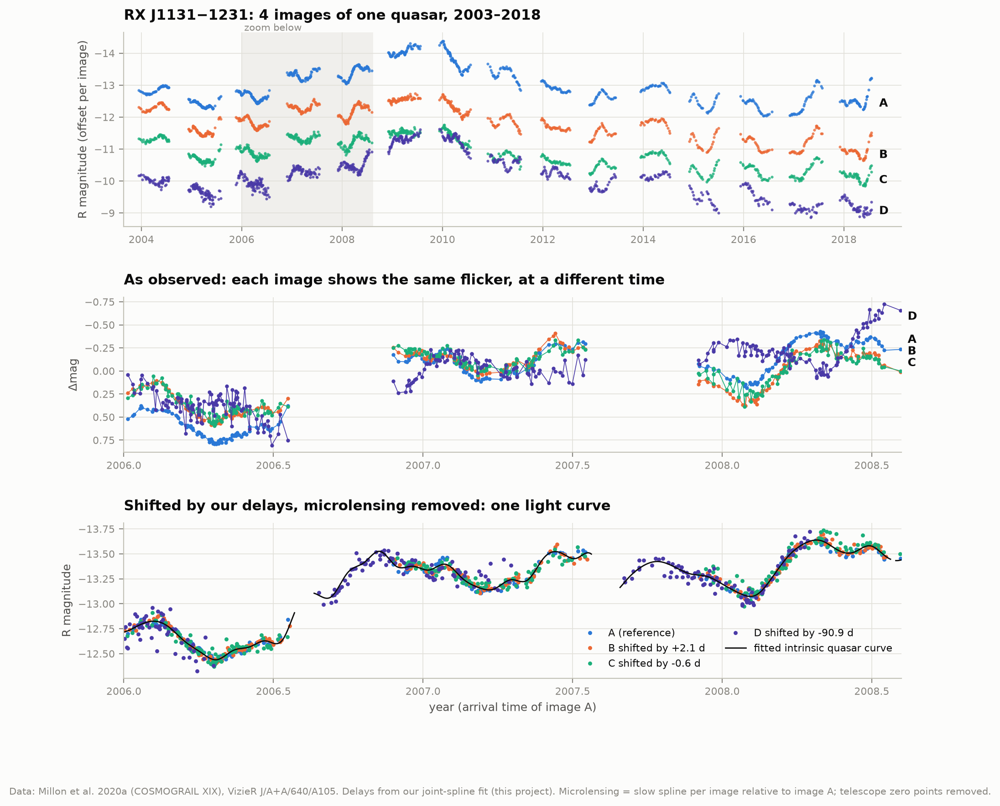
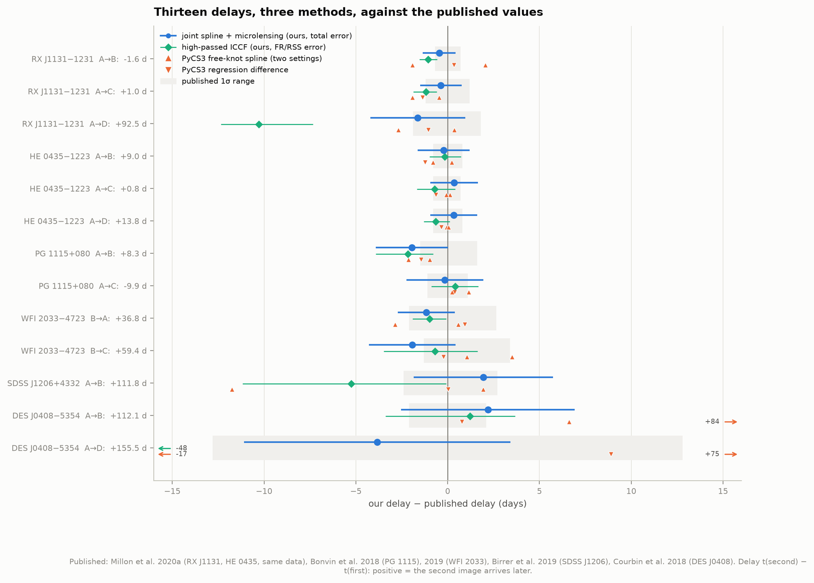
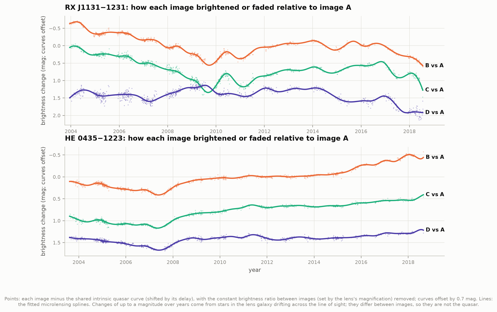
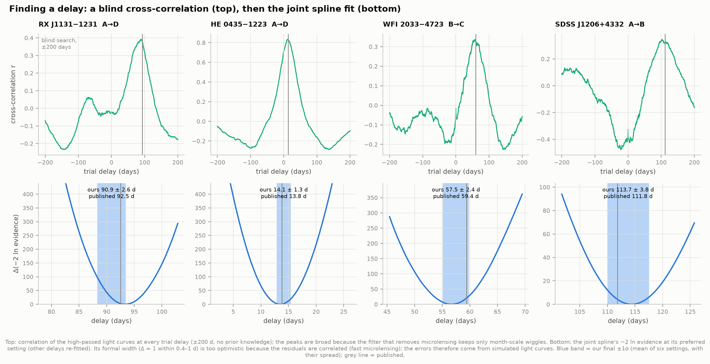
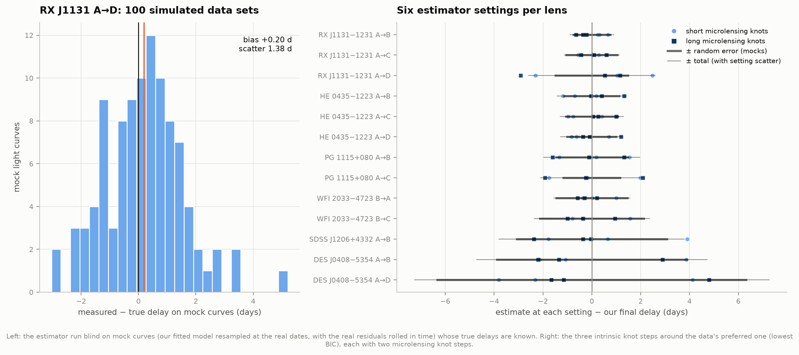
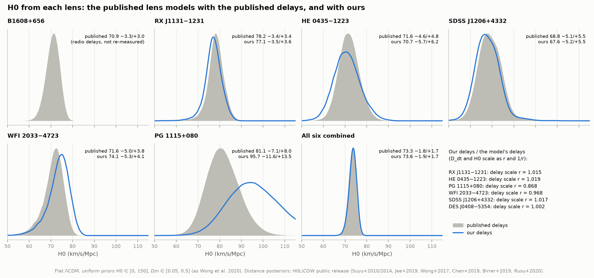
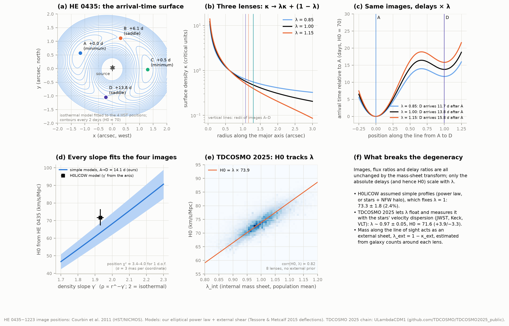
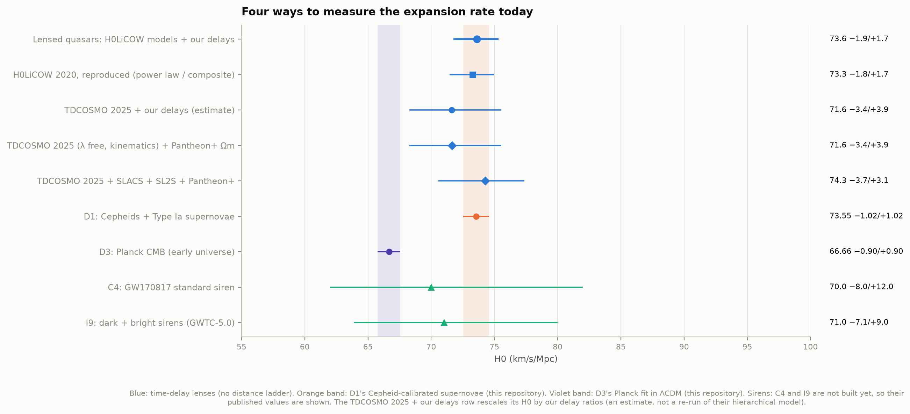
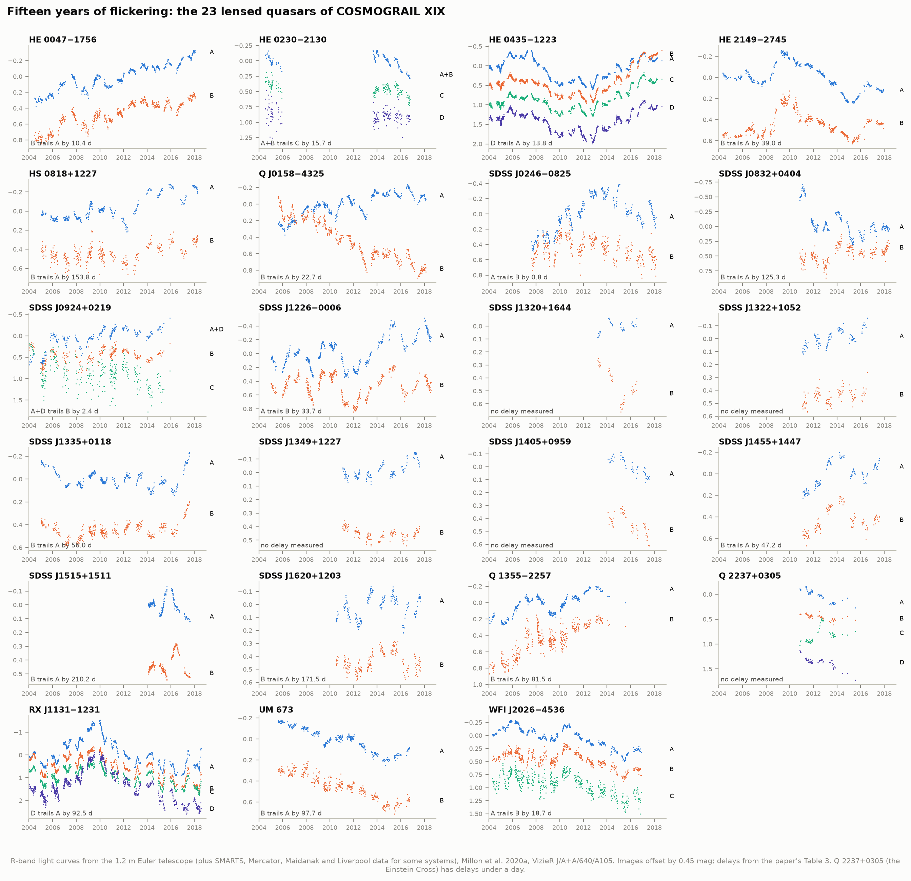

# D9 — H0 from the flicker of lensed quasars

**When a galaxy splits a distant quasar into several images, the light of each image travels a different
path and arrives at a different time. When the quasar flickers, the images flicker in turn. Can we measure
those delays ourselves from 15 years of monitoring, and turn them into the expansion rate of the universe,
H0, without any distance ladder?**

Yes, and doing it shows exactly where the difficulty lies. Our own code, run on the public COSMOGRAIL light curves, measures
13 delays in six lensed quasars; all 13 agree with the published values within 1σ. Fed into the lens models that the
H0LiCOW collaboration released, our delays give **H0 = 73.6 (−1.9/+1.7) km/s/Mpc**. H0LiCOW's own value is
73.3 (−1.8/+1.7), and we reproduce it exactly from their posteriors. But the delays turn out to be the easier half.
The four images of HE 0435−1223 can be fitted equally well by lens models that imply anything from H0 = 47 to 91.
And a whole family of mass distributions (the mass-sheet degeneracy) leaves everything we can observe unchanged
except the delays. When TDCOSMO 2025 let that degeneracy float and pinned it with the lens galaxies' stellar
motions, the answer became 71.6 (+3.9/−3.3): a 5% error set by the lens model. Our delays move it by less than 0.01%.



RX J1131−1231 seen four times (panel 1). Image D flickers about three months after A, B and C, because its light
took a longer path around the lens galaxy and climbed out of a different part of its gravity well. Shift each image
by its delay and take out the slow drift caused by stars in the lens galaxy (microlensing), and the four curves become
one: the quasar's own light curve (panel 3), with image D filling in A's seasonal gaps.

**What we found, in short:**

- **Thirteen delays, three methods.** Our main estimator fits one intrinsic quasar light curve, shifted by each
  image's delay, plus a slow microlensing curve per image. It recovers every published delay within 1σ: RX J1131
  A→D **90.9 ± 2.6 days** (Millon et al. 2020a: 92.5 +1.8/−1.9), HE 0435 A→D **14.1 ± 1.3** (13.8 ± 0.8),
  WFI 2033 B→C **57.5 ± 2.4** (59.4 +3.4/−1.3), SDSS J1206 **113.8 ± 3.8** (111.8 +2.7/−2.4), DES J0408 A→B
  **114.3 ± 4.7** (112.1 ± 2.1), and eight more. COSMOGRAIL's own tool, PyCS3, run by us on the same curves, agrees
  to 1–3 days, except where its free-knot spline lost track (one setting each for SDSS J1206 and DES J0408).
- **Cross-correlation is the wrong tool here.** The reverberation-mapping method of project I2 works for HE 0435,
  PG 1115 and WFI 2033 (within 1–2 days). But it comes out 10 days short for RX J1131's D and 5 days short for
  SDSS J1206. Removing microlensing by filtering also removes the slow intrinsic wiggles the delay lives in; the
  correlation peak becomes broad and lopsided.
- **A trap in the obvious statistic.** Minimizing χ² over the delay can reward a delay that pushes one image into
  the others' seasonal gaps, where nothing ties the curves together (RX J1131's D jumped to 101 days). Integrating
  the spline out (the Bayesian evidence) adds the missing Occam penalty and fixes it.
- **Microlensing is large.** Stars in the lens galaxies change the images' relative brightness by up to a
  magnitude over 15 years (RX J1131's image B), on top of the quasar's own flicker.
- **H0LiCOW reproduced.** From the released distance posteriors: six lenses individually within 0.1 km/s/Mpc of
  Wong et al. (2020), combined **73.29 (−1.84/+1.68)** (73.3 −1.8/+1.7).
- **With our delays: H0 = 73.6 (−1.9/+1.7).** Our delays change each lens's time-delay distance by −13% to +2%;
  only PG 1115 moves much (H0 81 → 96 ± 13). Its one-season B delay comes out 2 days shorter in every method,
  but that is only 0.8σ.
- **The lens model sets the error.** Positions alone allow H0 = 47–91 for HE 0435 as the density slope runs from
  1.7 to 2.3. TDCOSMO 2025's own posterior lies along H0 = λ × 73.9 (correlation 0.82), where λ is the mass sheet.
  Their 5% error comes from measuring λ with stellar kinematics, not from the delays.

---

## How a time delay measures H0

The light of each image left the quasar at the same moment, but arrives at a time

    t(θ) = (D_Δt / c) · τ(θ),     τ(θ) = ½ |θ − β|² − ψ(θ)

where θ is the image's position on the sky, β the quasar's true position, and ψ the lensing potential of the
foreground galaxy (Refsdal 1964). The two terms of the **Fermat potential** τ are the extra length of the bent path
and the time dilation inside the galaxy's gravity well. Images appear where τ is stationary: minima (the first to
arrive), saddle points, and maxima.

Everything about distances sits in one factor, the **time-delay distance**

    D_Δt = (1 + z_d) D_d D_s / D_ds,

a combination of the angular-diameter distances to the lens, to the quasar, and between them. Every one of those
distances is (c / H0) times a function of redshift that depends only weakly on the other cosmological parameters,
so **D_Δt ∝ 1/H0**. Measure a delay Δt, model the lens to get Δτ, and

    D_Δt = c Δt / Δτ   →   H0.

No Cepheids, no supernovae, no rungs: a single gravitational lens is a one-step distance measurement. The catch is
Δτ, which needs the lens galaxy's mass distribution. Section 5 shows why that is hard.

---

## Results

### 1. Thirteen delays, measured three ways

All delays are t(second image) − t(first image), positive when the second arrives later. "Published" is
COSMOGRAIL's own analysis of the same light curves.

| Lens | Pair | Joint spline (ours) | Published | ICCF (ours) | PyCS3 spline / regdiff (run by us) |
|---|---|---|---|---|---|
| RX J1131−1231 | A→B | −2.06 ± 0.90 | −1.6 ± 0.7 | −2.7 | +0.5, −3.5 / −1.2 |
| | A→C | +0.63 ± 1.13 | +1.0 ± 1.2 | −0.2 | +0.6, −0.9 / −0.4 |
| | **A→D** | **+90.87 ± 2.59** | **+92.5 (−1.9/+1.8)** | 82.2 | 92.9, 89.8 / 91.5 |
| HE 0435−1223 | A→B | +8.78 ± 1.42 | +9.0 ± 0.8 | 8.8 | 8.2, 9.2 / 7.8 |
| | A→C | +1.14 ± 1.30 | +0.8 (−0.8/+0.7) | 0.1 | 0.9, 0.7 / 0.2 |
| | **A→D** | **+14.13 ± 1.28** | **+13.8 ± 0.8** | 13.1 | 13.8, 13.9 / 13.5 |
| PG 1115+080 | A→B | +6.35 ± 1.96 | +8.3 (−1.5/+1.6) | 6.1 | 6.2, 7.3 / 6.9 |
| | A→C | −10.05 ± 2.09 | −9.9 ± 1.1 | −9.5 | −9.6, −8.8 / −9.5 |
| WFI 2033−4723 | B→A | +35.59 ± 1.56 | +36.8 (−2.1/+2.6)¹ | 35.8 | 37.4, 33.8 / 37.7 |
| | B→C | +57.46 ± 2.36 | +59.4 (−1.3/+3.4) | 58.7 | 62.9, 60.5 / 59.2 |
| SDSS J1206+4332 | A→B | +113.75 ± 3.79 | +111.8 (−2.4/+2.7) | 106.6 | 100.1, 113.7 / 111.8 |
| DES J0408−5354 | A→B | +114.29 ± 4.72 | +112.1 ± 2.1 | 113.3 | 118.7, (196)² / 112.9 |
| | A→D | +151.66 ± 7.26 | +155.5 ± 12.8 | (108)² | 138.8, (230)² / 164.4 |

¹ The average of the A1 and A2 delays: Euler and SMARTS cannot separate the merging pair, so A = A1 + A2 here.
² Off by more than 40 days: these estimators lose track in DES J0408's single 262-day season.
Published: Millon et al. 2020a (RX J1131, HE 0435), Bonvin et al. 2018 (PG 1115), 2019 (WFI 2033), Birrer et al.
2019 (J1206, re-analysing Eulaers et al. 2013), Courbin et al. 2018 (DES J0408).

Our delays differ from the published ones by 0.1–0.8σ (combining both errors). For RX J1131 and HE 0435 the light
curves are the very same files, so this tests the method, not the data. Most of our error bars are larger than the
published ones (by up to 2.2×), mainly because we count the full spread between estimator settings as a systematic
error: for RX J1131's D, 2.1 of its 2.6 days (added in quadrature). COSMOGRAIL combines its estimators with a
threshold rule that keeps the most precise one whenever they agree (Millon et al. 2020a). For WFI 2033 and
DES J0408's D our errors are smaller than the published ones.

The two longest delays are three and a half months (SDSS J1206, DES J0408). For DES J0408 that is close to half of
its single observing season, so few points overlap, and image D's delay is only good to ±7 days.



### 2. Microlensing: stars in the lens galaxy

Each image's light also passes through the lens galaxy's stars, and every star is a tiny lens itself.
As the stars drift across the line of sight, each image brightens and fades on its own over months to years. The
joint fit separates the two: the part every image shares (shifted by the delays) is the quasar; whatever is left is
microlensing. In RX J1131, image B faded by over a magnitude relative to A between 2004 and 2009, then partly recovered.
HE 0435's images B and C brightened by 0.7–0.9 mag relative to A between 2007 and 2018. These drifts are why a naive
"shift and compare" fails, and why every delay method has to model them (Tewes et al. 2013a).

The quasar's light also comes from an accretion disc light-days across, and microlensing magnifies parts of the
disc differently in each image. That can shift a measured delay by up to a few days in some lenses (the
"microlensing time delay", Tie & Kochanek 2018). We do not correct for it; Birrer et al. (2019) and TDCOSMO do.



### 3. How sure are the delays?

**Finding the delay (first figure below).** The blind cross-correlation over ±200 days (top) gets most
delays roughly right without being told where to look (it starts RX J1131's D 11 days short, and finds DES J0408's D
only through image B). The joint spline's evidence (bottom), searched ±20 days around that start, then pins it down. Its
formal curvature would suggest errors of 0.4–1 day, too small, because the residuals are correlated: fast
microlensing and photometric systematics.

**Errors from simulated light curves.** 3,600 mock data sets (100 per setting) with known delays, made from our fit
plus the real residuals rolled in time. The estimator is unbiased to ≤ 0.3 day for most delays (J1206: −0.7;
DES J0408's D: +1.4) with random errors of 0.6–2.5 days (6 days for DES J0408's D). The published photometric error
bars had to be inflated by factors of 1.0–7.5 to match the scatter; RX J1131's early SMARTS and Euler data were the
most underestimated.

**Errors from the estimator's settings.** The data choose the intrinsic knot step by BIC: 20 days for RX J1131 and
WFI 2033, 25 for HE 0435, 35 for SDSS J1206, 10 and 15 for the one-season PG 1115 and DES J0408. Neighbouring steps
are worse by ΔBIC = 19–440. Changing the knot step still moves some delays by more than their random error: RX J1131's
D ranges from 88.0 (25-day knots) to 93.4 days (20-day knots). That spread is part of our final error (right panel).





### 4. From delays to H0

**Reproducing H0LiCOW.** From the released posteriors, with our own code:

| Lens | z_lens / z_source | H0, published delays (ours) | Wong et al. 2020 | Delay scale r (ours / model's) | H0, our delays |
|---|---|---|---|---|---|
| B1608+656 | 0.630 / 1.394 | 70.9 (−3.3/+3.0) | 71.0 (−3.3/+2.9) | (radio delays kept) | 70.9 (−3.3/+3.0) |
| RX J1131−1231 | 0.295 / 0.654 | 78.2 (−3.4/+3.4) | 78.2 (−3.4/+3.4) | 1.015 ± 0.027 | 77.1 (−3.5/+3.6) |
| HE 0435−1223 | 0.455 / 1.693 | 71.6 (−4.6/+4.8) | 71.7 (−4.5/+4.8) | 1.019 ± 0.079 | 70.7 (−5.7/+6.2) |
| SDSS J1206+4332 | 0.745 / 1.789 | 68.8 (−5.1/+5.5) | 68.9 (−5.1/+5.4) | 1.017 ± 0.034 | 67.6 (−5.2/+5.5) |
| WFI 2033−4723 | 0.658 / 1.662 | 71.6 (−5.0/+3.8) | 71.6 (−4.9/+3.8) | 0.968 ± 0.035 | 74.1 (−5.3/+4.1) |
| PG 1115+080 | 0.311 / 1.722 | 81.1 (−7.1/+8.0) | 81.1 (−7.1/+8.0) | 0.868 ± 0.097 | 95.7 (−11.6/+13.5) |
| **All six** | | **73.29 (−1.84/+1.68)** | **73.3 (−1.8/+1.7)** | | **73.62 (−1.85/+1.69)** |

(Medians and 16th/84th percentiles, flat ΛCDM. DES J0408 has no public H0LiCOW posterior; its r = 1.002 ± 0.038
enters the TDCOSMO estimate below.)

**What our delays change.** r is how much our delays stretch each published model's time-delay distance: D_Δt
scales as r and H0 as 1/r. For most lenses our delays agree with the model's to 1.5–3% and H0 moves by 1–2.5
km/s/Mpc. PG 1115 is the exception. All our methods put its B image 1–2 days earlier than Bonvin et al. (2018) did
(their A→B 8.3 days, ours 6.4 ± 2.0), from a single season of data. That makes r = 0.87 ± 0.10 for any choice of
image pairs (0.87–0.90), and H0 rises to 96 ± 13. Combined, the six give **73.6 (−1.9/+1.7)**, 0.3 above
H0LiCOW. Without B1608 (the one lens whose delays we could not re-measure), the five optical lenses give
74.9 (−2.2/+2.0).

Our delays' fractional errors are larger than the published ones for all five lenses, so the delays' share of each
lens's distance error grows (RX J1131:
1.6% → 2.6%, HE 0435: 5.3% → 7.6%). The combined error barely changes, because the lens models and the
line-of-sight mass dominate it (Wong et al. 2020, Table 3).



### 5. The mass-sheet degeneracy: why the lens model, not the delay, dominates

**Same images, different universe.** Take any lens and transform its surface density as
κ → λκ + (1 − λ): scale the galaxy by λ and add a uniform sheet of mass. Images stay exactly where they were
(the source is moved and resized, which nobody can see), and so do the image brightness ratios and the ratios of
the delays. Only the absolute delays change, all by the factor λ. Panels (a)–(c) show this for HE 0435: the
arrival-time surface, three mass profiles with λ = 0.85, 1.00, 1.15, and the arrival time along a line from A to D.
Image D arrives 11.7, 13.8 or 15.8 days after A (at H0 = 70). Turned around, the measured 14.1 days gives H0 = 58,
68 or 78 km/s/Mpc: H0 scales with λ (Falco, Gorenstein & Shapiro 1985).

**Every slope fits the four images (panel d).** Our elliptical power law plus external shear, fitted to HE 0435's
four image positions (3 mas precision), fits equally well for any density slope from γ′ = 1.7 to 2.3
(χ² = 3.4–4.0 for one degree of freedom). With our delay, those models give **H0 = 47 → 68 (isothermal) → 91**.
The slope works like an approximate mass sheet: a shallower profile puts more mass near the images and shortens
the delays (Kochanek 2002). Kochanek et al. (2006) found exactly this for HE 0435: with H0 ≈ 72, its galaxy needs a
*rising* rotation curve, shallower than isothermal. Positions are not enough. H0LiCOW measured the slope
(γ′ = 1.93 ± 0.02) from the quasar's host galaxy, stretched into arcs across thousands of Hubble pixels. Even at that
slope our simple model gives H0 ≈ 63, against H0LiCOW's 71.7: it misses the lens's measured ellipticity (axis ratio
0.80, where position-only fits prefer 0.95 plus extra shear) and a perturbing galaxy 4.5″ away (and behind it, at
z = 0.78). A test that needs no H0 points the same way: our simple models predict that B's delay is 0.44 of D's,
while the measured ratio is 0.62 ± 0.12 from our delays (1.6σ) and 0.65 ± 0.07 from COSMOGRAIL's (3σ).

**What TDCOSMO 2025 did about it (panel e).** H0LiCOW assumed mass profiles (a power law, or stars plus a dark
halo) that do not allow a mass sheet. TDCOSMO 2025 lets an internal sheet λ_int float, and constrains it with the
stars' velocity dispersion: the sheet changes how fast stars must move, and JWST, Keck and VLT spectra measure that.
Their posterior lies along **H0 = λ_int × 73.9** (correlation 0.82). With λ_int = 0.97 ± 0.05 they find
71.6 (+3.9/−3.3), and 74.3 (+3.1/−3.7) when 15 lenses without delays help calibrate λ. Their 8 delays enter
through each lens's distance, so rescaling those by our delay ratios (weighted by each lens's distance precision in
their own inputs) changes their H0 by a factor 0.9999. The delays are no longer the limitation; the mass sheet is.



### 6. H0 in context

Time-delay lenses need no distance ladder and no physics of the early universe, so they are an
independent judge of the "Hubble tension". With the H0LiCOW lens models, our delays give 73.6 (−1.9/+1.7), right on
project D1's Cepheid-calibrated supernovae (73.55 ± 1.02) and 3.4σ above project D3's Planck fit (66.66 ± 0.90).
With TDCOSMO 2025's more conservative treatment of the mass sheet, the lenses give 71.6 (+3.9/−3.3). That is 1.4σ
from Planck and 0.5σ from D1, and decides nothing. The gravitational-wave sirens (C4's GW170817, 70 +12/−8; I9's
GWTC-5.0, 71.0 +9.0/−7.1; both published values, as those projects are not built yet) are not yet precise enough
either.



### 7. All 23 COSMOGRAIL lenses



COSMOGRAIL XIX (Millon et al. 2020a) released 15-year light curves of 23 lensed quasars. Most of them are doubles
(two images) monitored only with the 1.2 m Euler telescope; 18 yielded delays, from 0.8 days (SDSS J0246) to 210 days
(SDSS J1515). The lenses used for cosmology are the few whose delays are known to a few percent *and* whose lens
galaxies were imaged deeply enough with Hubble or adaptive optics to model.

### Interactive: find a delay yourself

`figures/delay_finder.html` (open it in any browser; it works offline). Pick a lens and an image and drag the slider:
the image's light curve slides in time over the reference image, and a mismatch curve shows where they agree best.
A button reveals our measurement and the published one. For the H0LiCOW lenses the page turns your shift into the H0
that lens would give with the published lens model.

---

## How it works

### Light curves

All curves are COSMOGRAIL R-band photometry (Eigenbrod et al. 2005), measured by simultaneous
deconvolution of all images on every frame (Magain, Courbin & Sohy 1998), so each epoch has a magnitude for every
image. Telescopes differ in zero point and in how they split the light of close images, so every image gets one free
magnitude offset per extra telescope. Where the published error bars are smaller than the scatter about a smooth
model (by factors of 1–7, mostly because of fast microlensing), they are inflated per image and telescope until the
reduced χ² is 1. They are never shrunk.

### Method 1: joint spline with microlensing (our main estimator)

`delays.py`. All images are fitted at once with

    m_i(t) = s(t − τ_i) + ℓ_i(t) + o_{i,telescope}

* s: the quasar's intrinsic light curve, a cubic B-spline with knots every 8–45 days (chosen per lens, below) and a
  weak curvature prior (a P-spline; Eilers & Marx 1996), which keeps it smooth across seasonal gaps.
* ℓ_i: microlensing of image i relative to the reference image, a stiff B-spline (knots every 100–300 days).
* τ_i: the delays.

For fixed delays this model is linear, so the best fit is one weighted least-squares solve. The banded structure of
B-splines makes it fast (a Schur complement with a banded Cholesky; ~10 ms per trial). The delays maximize the
**Bayesian evidence** p(data | τ), with the spline coefficients integrated out:

    −2 ln p = χ²_penalized(τ) + ln det(AᵀWA + P) + const.

We switched to the evidence after plain χ² gave a wrong answer: shifting an image by ~100 days pushed some of its
points into the other images' seasonal gaps, where the intrinsic spline could fit them alone, and χ² dropped for no
physical reason (RX J1131's D jumped from ~91 to 101 days for one setting). The log-determinant is the Occam factor
that charges for that extra freedom.

**Settings.** The intrinsic knot step matters, and the data choose it: for each lens we compute the BIC at its
optimum for knot steps of 10–55 days (5–25 days for the two single-season lenses) and keep the best step and its two
neighbours, each with two microlensing knot steps: six settings per lens. The final delay is the mean of the six; the
scatter between them is added to the error as a systematic (this is the analogue of COSMOGRAIL's marginalization over
estimator parameters; Millon et al. 2020a).

**Errors from simulated light curves** (as in Tewes et al. 2013a): the fitted model is re-sampled at the real dates
with known "true" delays (drawn within ±5 days of the measurement, ±8–12 for the noisier lenses), the real residuals
are added back after rolling them in time (they carry the fast microlensing and photometric noise), and the
estimator is run blind on each mock from a random starting guess. 100 mocks per setting, 3,600 in total. The spread
of (measured − true) is the random error; its mean is the bias. Both go into the total.

**Blind start.** The starting delays come from a wide cross-correlation search (±200 days), not from the published
values.

### Method 2: cross-correlation (project I2's ICCF)

`ccf.py`. The interpolated cross-correlation function and its flux-randomization / random-subset-selection errors,
copied from I2 (`33-reverberation-mapping/iccf.py`, which reproduces PyCCF to 10⁻¹⁶). Microlensing is removed first by
subtracting a stiff spline fitted to each image alone (a high-pass filter).

### Method 3: PyCS3, COSMOGRAIL's own toolbox

PyCS3 3.0.4 (Millon et al. 2020c), run by us on the same curves: its free-knot spline technique (intrinsic knot steps
25 and 35 days, microlensing 150 and 300 days; 15/25 and 40/55 for the single-season lenses, where PyCS3 needs at least three microlensing knot steps inside the season) and its regression
difference technique (Matérn kernel, scale 200 days). PyCS3 wants one curve per image, so telescope zero points were
first removed with the joint spline's offsets. We ran PyCS3 for point estimates only: its own error analysis needs
thousands of simulated curves per setting (COSMOGRAIL ran it on a cluster).

### From delays to H0

`h0.py`, `analysis_h0.py`.

**Reproducing H0LiCOW.** The H0LiCOW collaboration released the time-delay distance posteriors of its six lenses
(github.com/shsuyu/H0LiCOW-public). We rebuilt their likelihoods following their own code: kernel density estimates
(Gaussian kernel, 20 Mpc bandwidth) of binned (D_d, D_Δt) samples for RX J1131 and PG 1115, of D_Δt alone for HE 0435
and WFI 2033, scipy's KDE for SDSS J1206, and analytic skewed log-normals for B1608+656. Instead of MCMC we evaluate
the posterior on a fine (H0, Ωm) grid in flat ΛCDM with Wong et al. (2020)'s priors (H0 uniform in [0, 150], Ωm in
[0.05, 0.5]); our distances match astropy's to 10⁻⁶.

**Swapping in our delays.** We cannot redo the lens models: each took the H0LiCOW team many CPU-years of
pixel-by-pixel modelling of Hubble images. But a fixed lens model fixes every Fermat-potential difference Δτ, so
D_Δt = c Δt / Δτ scales exactly with the delays. For each lens we compute the generalized least-squares ratio r
between our delay vector and the delays the model was fitted to (with our full delay covariance), shift every D_Δt
(and D_d) sample by r, and replace the delays' share of the width (Wong et al. 2020, Table 3) by ours. B1608+656 keeps
its published radio delays (Fassnacht et al. 2002): its VLA light curves are not public in machine-readable form.

### The lens model (Section 5)

`lensmodel.py`: an elliptical power-law mass distribution (deflections from the series of Tessore & Metcalf 2015)
plus external shear, fitted to the four HST image positions of HE 0435−1223 (Courbin et al. 2011) with the lens
centre fixed at the galaxy's light centroid. Checked against analytic identities (deflection = gradient of the
potential to 10⁻¹¹; the Witt, Mao & Keeton 2000 formula for isothermal lenses; image positions unchanged by the
mass-sheet transformation): `test_physics.py`.

---

## Data and provenance

Retrieved 2026-10-04.

| Data | Source | Used for |
|---|---|---|
| R-band light curves of 23 lensed quasars, 2003–2018 | Millon et al. 2020a (COSMOGRAIL XIX), A&A 640, A105; VizieR J/A+A/640/A105 | RX J1131, HE 0435 delays; gallery |
| RX J1131 (9 seasons), HE 0435 (13 seasons) | Tewes et al. 2013b, J/A+A/556/A22; Bonvin et al. 2017, J/MNRAS/465/4914 | the data behind the H0LiCOW delays (reference) |
| PG 1115+080 | Bonvin et al. 2018, A&A 616, A183; J/A+A/616/A183 | delays |
| WFI 2033−4723 (Euler C2 and ECAM, SMARTS, MPIA 2.2 m) | Bonvin et al. 2019, A&A 629, A97; J/A+A/629/A97 | delays |
| SDSS J1206+4332 | Eulaers et al. 2013, A&A 553, A121; J/A+A/553/A121 | delays |
| DES J0408−5354 | Courbin et al. 2018, A&A 609, A71; J/A+A/609/A71 | delays |
| Time-delay distance posteriors of six lenses | Wong et al. 2020 (H0LiCOW XIII), MNRAS 498, 1420; github.com/shsuyu/H0LiCOW-public | H0 |
| Likelihood inputs and MCMC chains | TDCOSMO Collaboration 2025, arXiv:2506.03023; github.com/TDCOSMO/TDCOSMO2025_public | H0 with λ_int, comparison |
| HE 0435 image astrometry | Courbin et al. 2011, A&A 536, A53, Table 2 | the lens model |

Total download: ~190 MB (the H0LiCOW chains are most of it; the PG 1115 chain alone is 84 MB). The atlas spec
estimated < 50 MB.

---

## Caveats

- **The lens models are inherited, not ours.** Each took the H0LiCOW team years of modelling Hubble and
  adaptive-optics images. We replace only the delays, under their assumptions: power-law or stars-plus-dark-halo
  mass profiles (which fix the mass sheet), and external convergence κ_ext from galaxy counts compared with
  simulations. H0LiCOW's 2.4% precision rests on those choices, as TDCOSMO 2025's 5% shows.
- **The delay swap is an approximation.** We use the delays each model was fitted to as stand-ins for its
  Fermat-potential ratios, and replace the delays' share of the distance error using Wong et al. (2020)'s Gaussian
  error budget. An identity swap (r = 1, same errors) reproduces every published H0 to 0.03 km/s/Mpc, and the
  scale factors change by at most 0.03 with the choice of image pairs.
- **Same data, different method.** For RX J1131 and HE 0435 we use COSMOGRAIL's own final light curves, and for the
  other four the very data behind the published delays. Agreement tests the method, not the data.
- **No microlensing time delay.** Microlensing of the extended accretion disc can shift delays by up to a few
  days in some systems (Tie & Kochanek 2018); TDCOSMO models it, we do not.
- **Two lenses not re-measured.** B1608+656's delays come from VLA radio monitoring (Fassnacht et al. 2002), whose
  light curves are not public in machine-readable form. WGD 2038−4008's await Dux et al. (in preparation). Both
  enter with their published delays.
- **Weak delays.** PG 1115 has one 178-day season and DES J0408 one 262-day season. DES J0408's D delay has
  several χ² minima and is good to ±7 days only. PG 1115's shift in H0 is driven by one season.
- **TDCOSMO 2025 with our delays is an estimate.** We rescale its H0 by the precision-weighted mean of our
  distance ratios; we did not re-run its hierarchical inference (hierArc with kinematics, line-of-sight and
  anisotropy models). Our ratios are within 3% of 1 except PG 1115's, so the conclusion (a negligible change)
  is safe.
- **Flat ΛCDM** with Ωm uniform in [0.05, 0.5], as H0LiCOW. Lens H0 depends only weakly on Ωm, and TDCOSMO's
  Pantheon+ prior on Ωm moves it by ~2 km/s/Mpc (Table 6 of their paper: 73.7 alone, 71.6 with Pantheon+).
- **The simple lens models in section 5 are for illustration.** They fit point positions only, without the
  perturbing galaxy G1 or the extended arcs, and fail the delay-ratio test. They are not an H0 measurement.
- **Download.** ~190 MB, almost four times the atlas spec's estimate (< 50 MB): the distance posteriors are large
  chains (PG 1115's alone is 84 MB).
- **The interactive page's mismatch curve** uses light curves corrected with our fitted microlensing, so it is not
  fully independent of our fit. It is a teaching aid.

---

## Reproduce

```bash
cd 43-lensed-quasar-delays
../.venv/bin/python run.py              # fetch, measure (~1 h on 4 cores), infer H0, draw, summarise
../.venv/bin/python run.py --figures-only
../.venv/bin/python test_physics.py
```

Needs numpy, scipy, astropy, matplotlib, h5py and PyCS3 (`pip install pycs3`; pure Python, adds `dill` and
`multiprocess`). Every stage caches its results in `results/`, so a re-run only redoes what is missing.

| File | What it does |
|---|---|
| `fetch_data.py` | downloads light curves, H0LiCOW posteriors and TDCOSMO 2025 products into `data/` |
| `lightcurves.py` | reads every light-curve format into one structure |
| `delays.py` | the joint spline + microlensing estimator, its evidence, and the mock-curve error analysis |
| `ccf.py` | the high-passed ICCF (from I2) |
| `measure_delays.py` | stage 1: blind start, knot selection, all delay measurements (parallel, cached) |
| `h0.py` | distances, H0LiCOW likelihoods, grid posterior, delay swap |
| `analysis_h0.py` | stage 2: H0 per lens and combined, TDCOSMO 2025 chains |
| `lensmodel.py` | elliptical power law + shear, mass-sheet transformation |
| `figures.py`, `interactive.py` | figures 01–10 and `figures/delay_finder.html` |
| `test_physics.py` | checks of distances, lens identities, the solver, delay recovery and conventions |

---

## References

- Abbott B. P. et al. 2017, Nature 551, 85: a gravitational-wave standard siren measurement of the Hubble constant
- Birrer S. et al. 2019, MNRAS 484, 4726 (H0LiCOW IX): SDSS 1206+4332
- Birrer S. et al. 2020, A&A 643, A165 (TDCOSMO IV): hierarchical time-delay cosmography with the mass-sheet degeneracy free
- Bonvin V. et al. 2017, MNRAS 465, 4914 (H0LiCOW V): HE 0435−1223 delays
- Bonvin V. et al. 2018, A&A 616, A183 (COSMOGRAIL XVII): PG 1115+080 delays
- Bonvin V. et al. 2019, A&A 629, A97 (COSMOGRAIL XVIII): WFI 2033−4723 delays
- Courbin F. et al. 2011, A&A 536, A53 (COSMOGRAIL IX): HE 0435−1223, HST astrometry
- Courbin F. et al. 2018, A&A 609, A71 (COSMOGRAIL XVI): DES J0408−5354 delays
- Eigenbrod A. et al. 2005, A&A 436, 25 (COSMOGRAIL I): sampling light curves to measure time delays
- Eilers P. H. C. & Marx B. D. 1996, Statistical Science 11, 89: flexible smoothing with B-splines and penalties
- Eulaers E. et al. 2013, A&A 553, A121 (COSMOGRAIL XII): SDSS J1206+4332 and HS 2209+1914
- Falco E. E., Gorenstein M. V. & Shapiro I. I. 1985, ApJ 289, L1: the mass-sheet degeneracy
- Fassnacht C. D. et al. 2002, ApJ 581, 823: B1608+656 radio delays
- Kochanek C. S. 2002, ApJ 578, 25: what do gravitational lens time delays measure?
- Kochanek C. S. et al. 2006, ApJ 640, 47: HE 0435−1223, an early-type galaxy with a rising rotation curve
- Magain P., Courbin F. & Sohy S. 1998, ApJ 494, 472: deconvolution with correct sampling
- Millon M. et al. 2020a, A&A 640, A105 (COSMOGRAIL XIX): time delays in 18 lensed quasars from 15 years of monitoring
- Millon M. et al. 2020b, A&A 639, A101 (TDCOSMO I): systematic uncertainties in time-delay cosmography
- Millon M. et al. 2020c, JOSS 5, 2654: PyCS3
- Pelt J. et al. 1996, A&A 305, 97: light-curve dispersion and the Q0957+561 delay
- Peterson B. M. et al. 1998, PASP 110, 660; 2004, ApJ 613, 682: cross-correlation lag uncertainties
- Refsdal S. 1964, MNRAS 128, 307: the Hubble parameter from gravitational lens time delays
- Suyu S. H. et al. 2010, ApJ 711, 201; 2013, ApJ 766, 70; 2014, ApJ 788, L35: B1608+656 and RX J1131−1231
- TDCOSMO Collaboration (Birrer S. et al.) 2025, arXiv:2506.03023: TDCOSMO 2025 cosmological constraints
- Tessore N. & Metcalf R. B. 2015, A&A 580, A79: the elliptical power-law profile lens
- Tewes M., Courbin F. & Meylan G. 2013a, A&A 553, A120 (COSMOGRAIL XI): PyCS techniques
- Tewes M. et al. 2013b, A&A 556, A22 (COSMOGRAIL XIII): RX J1131−1231 delays
- Tie S. S. & Kochanek C. S. 2018, MNRAS 473, 80: microlensing time delays
- Witt H. J., Mao S. & Keeton C. R. 2000, ApJ 544, 98: time delays of isothermal lenses
- Wong K. C. et al. 2017, MNRAS 465, 4895 (H0LiCOW IV): HE 0435−1223 lens model
- Wong K. C. et al. 2020, MNRAS 498, 1420 (H0LiCOW XIII): H0 to 2.4% from six lensed quasars
- Wong K. C. et al. 2024, A&A 689, A168 (TDCOSMO XVI): WGD 2038−4008
