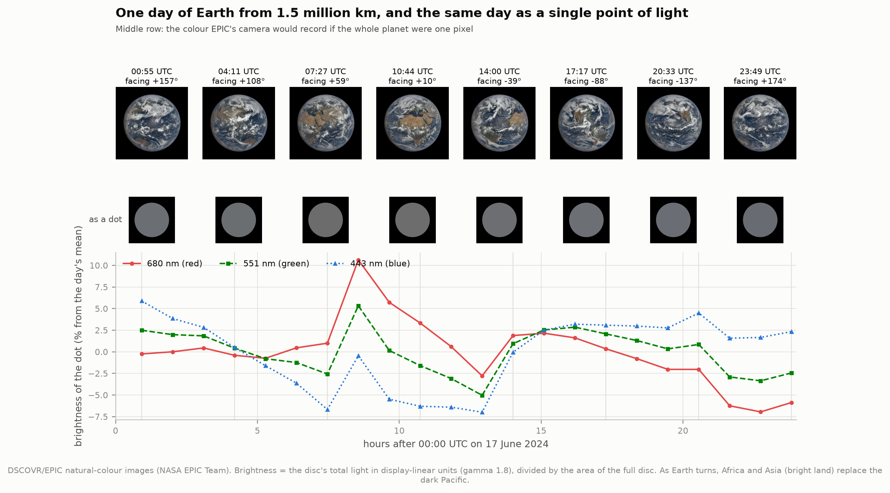
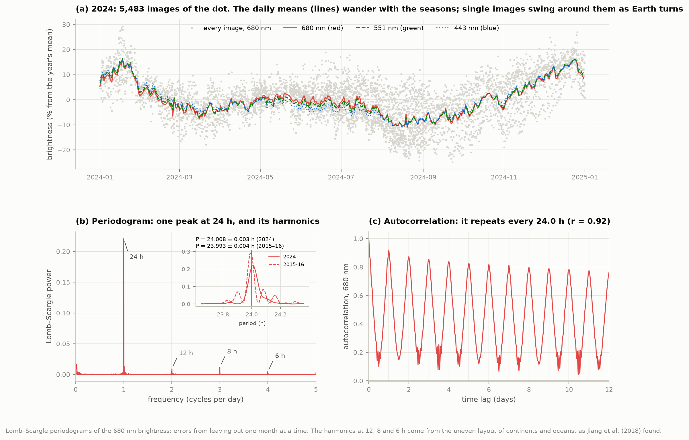
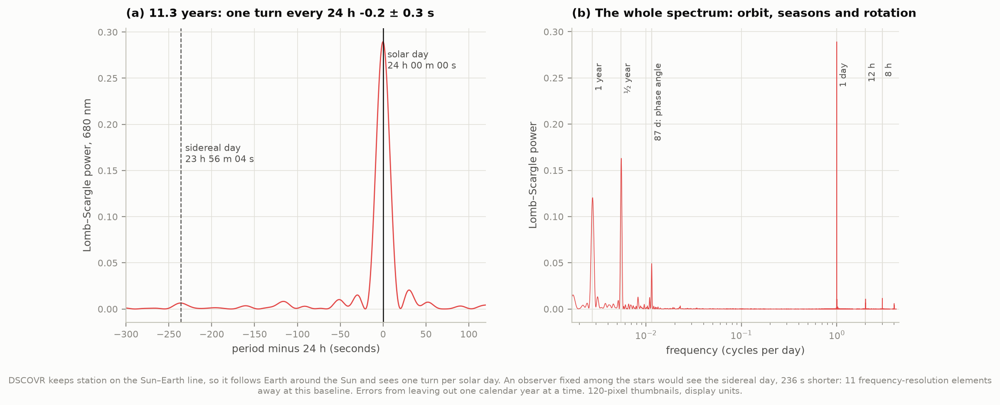
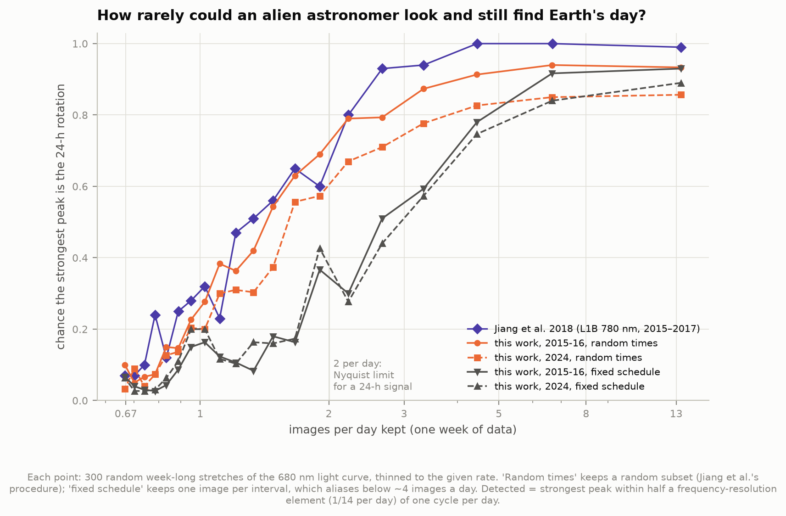
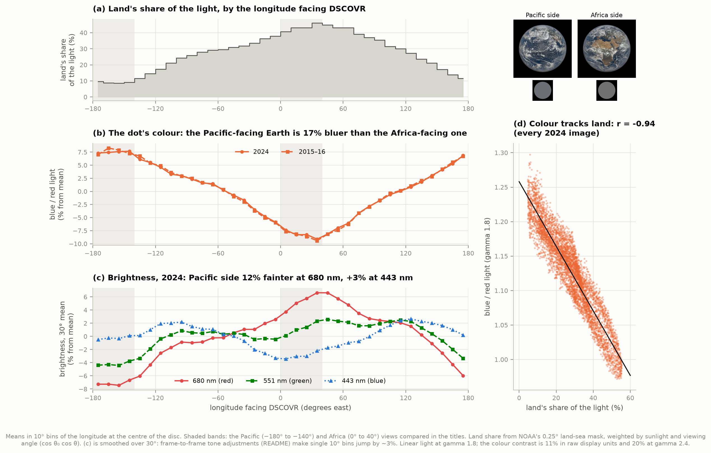
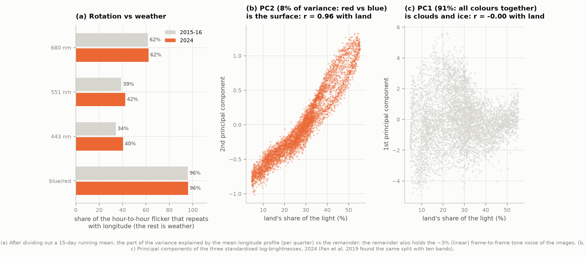
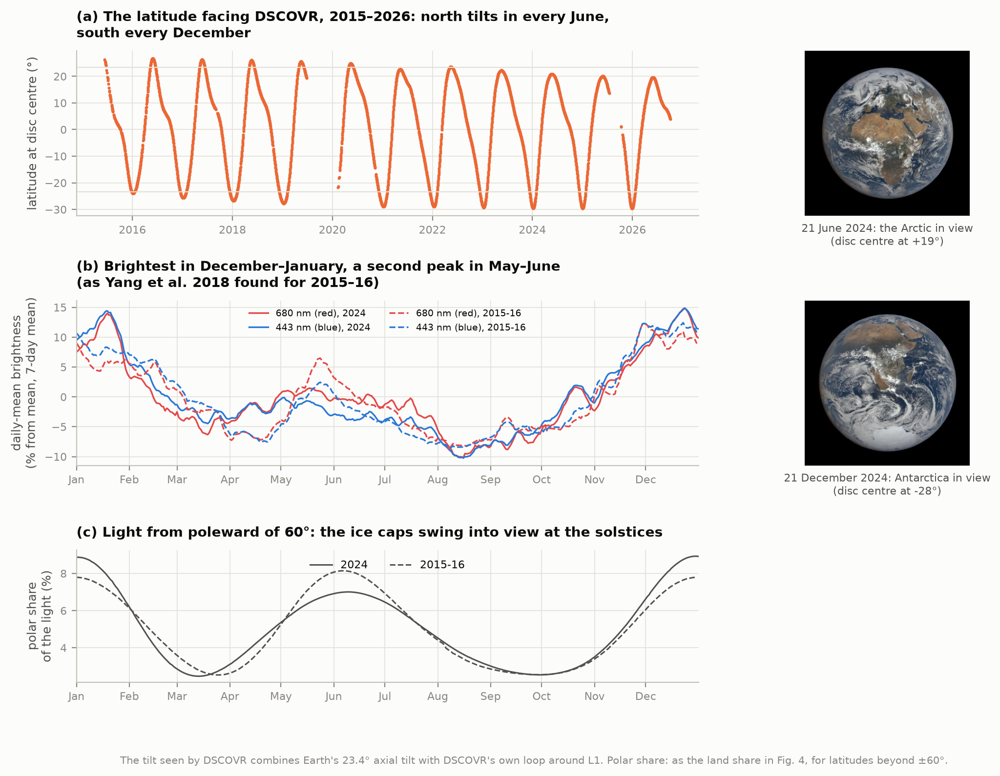
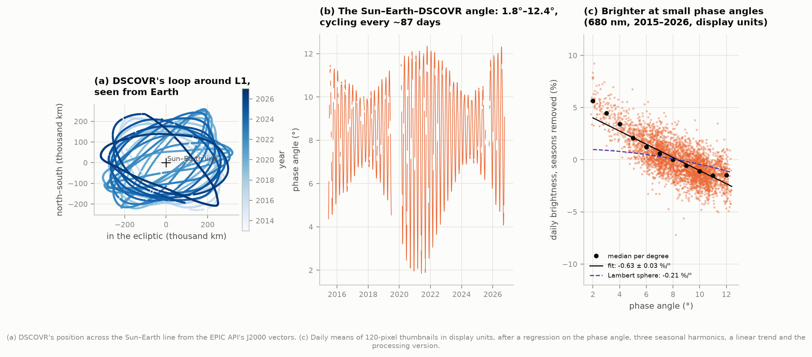
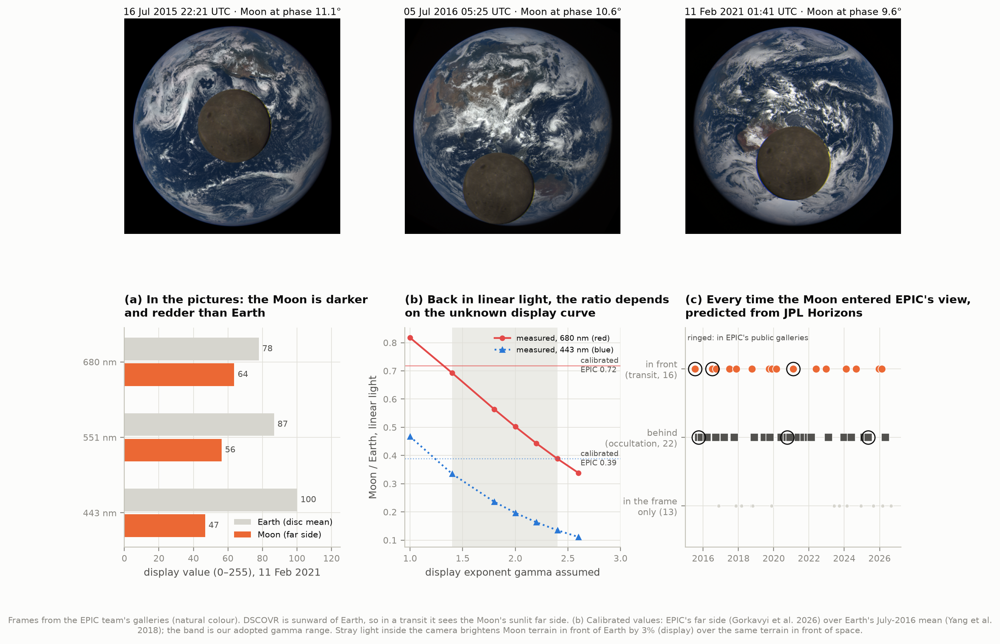

# A4 — The Earth as an exoplanet

**If Earth were a single dot of light around another star, what could we still learn about it?**

NASA's DSCOVR spacecraft hangs 1.5 million km sunward of Earth, near the Sun–Earth L1 point, and
its EPIC camera photographs the whole sunlit planet every one to two hours. Telescopes of the coming
decades will see Earth-like exoplanets only as unresolved points. So this project throws away the
picture: it turns each of **55,179 EPIC images (June 2015 – October 2026)** into one number per
colour, the brightness of "the dot", and asks what an alien astronomer could read from it.

- **The length of the day.** One year of the dot gives 23.993 ± 0.004 h (2015–16) and
  24.008 ± 0.003 h (2024). Eleven years give **24 h − 0.15 ± 0.28 s: the mean solar day**, not the
  sidereal day (236 s shorter), because DSCOVR travels around the Sun with Earth.
- **How rarely you could look.** With the light caught at random times, a week of data finds the
  day at least 90% of the time down to ~5 h between looks. With a fixed schedule, aliasing sets in
  below ~4 looks a day. Jiang et al. (2018) found the same steep fall with sparser sampling.
- **Continents in the colour.** The dot's colour (blue/red) follows the share of its light that
  comes from land with **r = −0.95**. The Pacific-facing Earth is ~17% bluer and ~12% fainter in
  red than the Africa-facing one, and slightly *brighter* in blue. Brightness alone is a poor
  continent detector, because clouds dominate it.
- **Clouds.** About 40–60% of the dot's hour-to-hour flicker is weather. Its colour is 96%
  geography. Split into principal components, 91% of the variance is "everything brighter at once"
  (clouds and ice), and the remaining 9% (red against blue) traces land with r = 0.96, as Fan et al.
  (2019) found with ten colours.
- **Seasons.** The poles tip into view in turn (the disc centre swings from 30° S to 27° N).
  The dot is brightest in December–January and faintest in August, with a second maximum in
  May–June, the pattern Yang et al. (2018) reported.
- **The angle of view.** DSCOVR sees Earth from 1.8° to 12.4° off the Sun direction, on an
  87.5-day cycle (not the ~4–15° often quoted). The dot brightens toward small angles by
  ~0.9% per degree, **4× faster than a perfectly matte sphere**. That's the backscatter glow of
  clouds and land.
- **The Moon.** From JPL Horizons we predict **16 transits and 22 occultations** between 2015 and
  2026. EPIC imaged nearly all of them into a collection that needs a NASA account. Three transits
  are public, each showing the Moon's sunlit far side, a hemisphere never seen from Earth. In the
  pictures the Moon is darker and redder than Earth.
- **And a limit.** The public images are "colour and brightness adjusted" for display, and the
  adjustment is not published. Every brightness *amplitude* here carries a factor-of-~1.5
  systematic. In the Moon's case the display images and EPIC's calibrated data disagree by a factor
  of ~2 (section 9). Periods, longitudes, colours' *ordering* and timing are unaffected.

The keeper is **`figures/earth_2024.mp4`**: every image of 2024 (5,510 frames, 3 minutes). Beside the
turning planet are the same moment as one point of light and its scrolling light curve (30 MB).
`figures/earth_one_day.gif` is a one-day preview, and `figures/moon_transit_2015.gif`, `_2016.gif`
and `_2021.gif` show the transits.



---

## 1. Earth as a dot: what is measured

An exoplanet's light is the sum over its visible face of the sunlight each patch reflects toward
us. For each EPIC image we do the same sum. We add up the light of every pixel on the disc, in each
of three colours: EPIC's 680 nm (red), 551 nm (green) and 443 nm (blue) bands, the three that make
its natural-colour pictures. We then divide by the area of the full disc predicted from DSCOVR's
distance:

    F = Σ (pixel light) / (π a b),

where a and b are Earth's projected equatorial and polar radii in pixels. F is the dot's
**apparent albedo**: how bright the planet is compared with a uniform white disc of the same size.
Dividing by the *predicted* area, not by the number of lit pixels, keeps the thin unlit crescent in
the measurement, as for a real exoplanet. The images are never rescaled: the disc grows and shrinks
with DSCOVR's distance at a constant 99,700 pixels per radian (at 1080 pixels). That's checked on
every image. 68 of the 10,387 JPEGs fail a cut: disc off-centre or the wrong size, the Moon or an
eclipse shadow in view, or a frame-level brightness jump (section 3).

**How this compares with a real exoplanet observation.** DSCOVR sees Earth almost "full",
2–12° from the direction of the Sun. A distant telescope would usually see a crescent or a half-lit
planet, and would never be this close to the star-planet line (that is where the star blinds it). In
brightness, Earth seen from 10 parsecs would be ~10⁻¹⁰ of the Sun: the challenge of the
Habitable Worlds Observatory. EPIC gives the *signal* such a mission would record, with no noise
from the star.

---

## 2. The data

| What | Where | Used |
|---|---|---|
| Image metadata: time, disc-centre latitude/longitude, positions of DSCOVR, Moon and Sun (J2000, km) | EPIC API, `epic.gsfc.nasa.gov/api/natural/date/…` | all 3,646 days, 55,179 images |
| Natural-colour images, 1080-pixel JPEG | EPIC archive | 6 Aug 2015 – 3 Aug 2016 (4,795) and all of 2024 (5,510), plus three special days (92) |
| Natural-colour thumbnails, 120 pixels | EPIC archive | all 55,179 |
| Lunar transit and occultation sets (full PNG) | EPIC team galleries | 16 Jul 2015, 5 Jul 2016, 11 Feb 2021, 2 Oct 2020 |
| DSCOVR, Moon and Sun ephemerides | JPL Horizons API (DSCOVR is body −78) | 2015–2026, 2-hour and 2-minute grids |
| Land-sea mask, 0.25° | NOAA PSL (OISST v2) | weighting the disc by surface type |
| Granule lists of EPIC L1B, L1A-lunar, L1A-misc | NASA CMR catalogue (public metadata) | which Moon events EPIC imaged |
| Format book, calibration table | NASA ASDC documents | understanding the L1B product |

`fetch_data.py` caches 2.8 GB (the 55,000 thumbnails are 0.4 GB; the JPEGs 2.1 GB) and records each
source's URL, date, size and SHA-256 in `data/manifest.json` (image sets as one entry each, with a
hash over the per-file hashes).

**A deviation from the project spec.** The spec asks for photometry from EPIC's calibrated ten-band
images (level 1B). These exist only at NASA's Atmospheric Science Data Center behind a free NASA
Earthdata Login, at ~385 MB per image. There is no public mirror, and OPeNDAP subsetting needs the
same login. We chose not to use an account. So this project measures the public natural-colour
images instead: three colours, not ten (no ozone or oxygen bands, no ultraviolet), in display
units. Section 3 is about what that costs.

Archive gaps: a safe mode from 27 June 2019 to 12 February 2020 (229 days), and 15 July – 9
October 2025 (85 days). Images exist in two processing versions, 03 (49,426) and 04 (5,753,
sporadic before mid-2025, all of them after). Matched in longitude and week, the two agree to
1.004 ± 0.004.

---

## 3. Display images are not photometry

The natural-colour pictures are made from EPIC's calibrated red, green and blue reflectances and
then "color and brightness adjusted to represent what a conventional camera would produce" (EPIC
website). The adjustment is not published. Space is masked to exactly zero, and almost nothing
clips: about 0.003% of disc pixels reach 254–255. To turn display values V back into light we model
the curve as a power law, light ∝ (V/255)^γ, and test γ six ways (`transform.py`,
Fig. 10):

| Test | γ |
|---|---|
| Partly cloudy pixels mix ocean and cloud light linearly, so their blue-vs-red locus in display units bends by an amount set by γ alone | 2.36 (blue), 2.29 (green); the implied clear-ocean colours match Rayleigh scattering |
| Clear ocean vs cloud colour, with Rayleigh physics for the ocean | 1.4–2.0 |
| The dot's day-to-day scatter vs Yang et al. (2018), who used calibrated L1B data for the same 12 days of July 2016 | 1.67 (680 nm), 1.74 (443 nm) |
| Their peak-to-peak swings | 2.4 (680 nm), > 2.6 (443 nm) |
| The darkest ocean (Rayleigh: ~0.02 at 680 nm, ~0.12 at 443 nm) against the disc mean | 1.5–1.8, 1.2–1.3 |
| The Moon in transit against EPIC's calibrated far-side reflectance | 1.1–1.2 (443 nm), < 1 (680 nm) |

The tests disagree beyond their errors, so the curve is not a single power law. It also changes
from frame to frame. Compared with the mean of its two neighbours, a frame's whole-disc brightness
jumps by 1.5% rms (display units), with tails to ±10%. When a frame jumps, its median moves with
its mean (slope 1.02) while its brightest pixels hardly move (slope 0.35): a per-frame tone curve
with a nearly fixed white point. On the day imaged every 20 minutes (21 March 2022) the jumps are
4× smaller, so the adjustment seems to follow the scene. Frames that jump more than 6% are dropped
(16 of 10,387; 108 of 55,179 thumbnails).

**What we adopt.** This project reports whole-disc brightness, and for that the direct calibration
is test 3. So we use **γ = 1.8, with 1.4–2.4 as the systematic range**, and quote raw display
units where it matters. In practice:

- **Unaffected:** periods, the solar-vs-sidereal test, which longitudes are bright or blue, the
  correlation of colour with land, the seasonal *timing*, the sampling experiment, the geometry and
  the Moon events.
- **Uncertain by a factor ~1.5:** every amplitude: how much bluer the Pacific is, the seasonal
  range, the brightening with phase angle. Each is given at γ = 1.8 and at the range's ends.
- **Not measurable here:** absolute reflectance (tied to Yang et al.'s calibrated July 2016 values),
  and the Moon-to-Earth brightness ratio (section 9).

Thumbnails average the non-linear display values over ~17 × 17 pixels. Once linearised they come
out 2–4% low, so they are used only in display units. The 1080-pixel JPEGs agree with the
full PNGs to 0.2%.

---

## 4. The length of the day



The dot's 680 nm brightness swings by about a quarter between its daily maximum and minimum, as the
bright land of Africa and Asia replaces the dark Pacific. A Lomb–Scargle periodogram of one year puts one peak at 24 h. Errors
come from leaving out one month at a time, because clouds correlate whole weeks.

| | 680 nm | 551 nm | 443 nm |
|---|---|---|---|
| Aug 2015 – Aug 2016 (4,765 images) | 23.993 ± 0.004 h | 23.986 ± 0.008 h | 24.04 ± 0.12 h |
| 2024 (5,483 images) | 24.008 ± 0.003 h | 24.029 ± 0.016 h | 24.07 ± 0.16 h |

Red finds the day best: land contrasts most at long wavelengths, while blue light is dominated by
Rayleigh scattering and clouds. The two years differ by −25 ± 14 s and +28 ± 10 s from 24 h. The
seasonal drift of the cloud and continent pattern can shift a one-year peak by that much. The
autocorrelation (Jiang et al.'s method) peaks at 23.96 h (2015–16) and 23.99 h (2024) on an
hourly grid, with r = 0.92, and repeats every day for 12 days. The weaker peaks at 12, 8 and 6 h are harmonics from the uneven layout of continents, as
Jiang et al. found.

**Solar or sidereal?** Earth turns once relative to the stars every 23 h 56 m 4 s, but DSCOVR
follows Earth around the Sun, so it should see one turn per *solar* day. Eleven years of
thumbnails (54,851 images, 4,131 days) resolve the difference by 11 frequency-resolution elements.
The answer is **24 h − 0.15 ± 0.28 s** (680 nm; errors from leaving out one calendar year at a time).
The periodogram's power at the sidereal day is 0.006, against 0.289 at the peak. An observer among
the stars would see the sidereal day instead; for an exoplanet, the two differ by the planet's
orbital frequency.



The broad periodogram (right) also shows the year, the half-year (the poles' alternating tilt into
view) and an 87.5-day peak: DSCOVR's own phase-angle cycle, which section 8 explains.

---

## 5. How rarely could we look?



A distant telescope would catch an exoplanet far less often than every 1–2 hours. Following Jiang
et al. (2018, Table 2), we take random week-long stretches of the 680 nm light curve, keep a given
number of images and ask whether the strongest periodogram peak is the 24-h rotation. "Detected"
means within half a frequency-resolution element (±1/14 per day) of one cycle per day. That's the
fair translation of their ±0.05/day window, which suits a Fourier transform whose bins fall exactly
on 1/day.

| Interval between looks | 1.8 h | 5.4 h | 9.0 h | 12.6 h | 18.0 h | 25.2 h |
|---|---|---|---|---|---|---|
| Jiang et al. 2018 (L1B 780 nm, 2015–17) | 0.99 | 1.00 | 0.93 | 0.60 | 0.51 | 0.28 |
| This work, 2015–16, random times | 0.93 | 0.91 | 0.79 | 0.69 | 0.42 | 0.23 |
| This work, 2015–16, fixed schedule | 0.93 | 0.78 | 0.51 | 0.37 | 0.08 | 0.15 |
| This work, 2024, random times | 0.86 | 0.83 | 0.71 | 0.57 | 0.30 | 0.20 |

Our curve follows theirs from ~12 h onward and sits 5–15 points lower at shorter intervals. Their
780 nm band sees more land contrast than our 680 nm channel, and a few percent of our weeks are
spoiled by the display images' frame-to-frame noise. The weeks that fail even at full cadence are
mostly December–February: from L1 the southern summer shows mostly Pacific and Southern Ocean, and
little land. Looking on a fixed schedule is worse: below about four looks a day the rotation
aliases to other frequencies, so an observer should look at irregular times.

---

## 6. Continents, oceans and clouds in the dot



**Is the Pacific-facing Earth darker and bluer than the Africa-facing one?** Yes, and the colour
says it more clearly than the brightness. The table compares the Pacific view (disc centre at
180°–140° W) with the Africa view (0°–40° E).

| Pacific / Africa | display units | γ = 1.4 | **γ = 1.8** | γ = 2.4 |
|---|---|---|---|---|
| 680 nm brightness | 0.91 | 0.89 | **0.88** | 0.87 |
| 443 nm brightness | 1.01 | 1.02 | **1.03** | 1.04 |
| blue / red colour | 1.11 | 1.15 | **1.17** | 1.20 |

(2024; 2015–16 agrees to ±0.01.) The Pacific side is darker in red because the ocean absorbs red
light while deserts reflect it. It is not darker in blue, because Rayleigh scattering over the
ocean is blue and bright. Land supplies 9% of a uniform Earth's light from the Pacific side and
43% from the Africa side. That share is computed from NOAA's land-sea mask with each patch weighted
by its Sun angle and viewing angle (cos θ₀ cos θ), as a matte surface would reflect. Across all
images, the dot's colour follows that land share with **r = −0.95** (2015–16) and **−0.94**
(2024). Its 680 nm brightness alone manages only r = +0.30 to +0.40.

**How much do clouds change the answer?** After removing the seasons (a 15-day running mean), we
ask how much of each image's departure repeats with longitude, i.e. how much the turning of the
planet explains:

| | 680 nm | 551 nm | 443 nm | blue/red |
|---|---|---|---|---|
| hour-to-hour scatter (γ = 1.8) | 6.1% | 4.6% | 4.0% | 5.5% |
| share that repeats with rotation | 62% | 39–42% | 34–40% | **96%** |

Clouds (weather) are about 40% of the red flicker and 60% of the blue. That share also includes
the images' frame-to-frame noise (~3% in linear light, section 3). The colour is almost purely
geography: clouds are white and change brightness, not colour. A principal-component analysis of
the three colours (Fan et al. 2019 did it with ten) finds the same split. PC1 (90–92% of the
variance, all colours moving together) is clouds and polar ice, uncorrelated with land
(r = 0.07 / −0.00). PC2 (8–10%, red against blue) is the surface, r = 0.96 with the land share.



---

## 7. Seasons



The latitude at the centre of the disc swings between 30° S (December) and 27° N (June). That's
Earth's 23.4° tilt plus DSCOVR's own north–south loop around L1, which has shrunk the northern
excursion from 27° in 2016 to 20° in 2026. The ice caps take turns: the light from poleward of 60°
peaks at the solstices (7–9% of a uniform Earth's light), and Antarctica's share in December
exceeds the Arctic's in June.

The dot is brightest in December–January and faintest in August in both years, with a second
maximum in May–June (+6–7% over April, August and September). That is the pattern Yang et al.
(2018) found in calibrated data for 2015–16: "a winter peak around December... a summer peak around
the beginning of June". From month to month the brightness ranges over 20% (2015–16) and 24% (2024)
at γ = 1.8, a factor-1.5 systematic as for every amplitude. The daily-mean brightness correlates
with the polar share at r = 0.64 and 0.79.

---

## 8. The angle of view: DSCOVR's loop and the backscatter glow



DSCOVR doesn't sit at L1. It loops around it on a Lissajous orbit up to ~300,000 km wide, so the
Sun–Earth–DSCOVR angle, Earth's **phase angle** as EPIC sees it, ranges from **1.8° to 12.4°**
(2015–2026). It cycles every **87.5 days**, half the ~175-day loop. The spec's "~4° to ~15°" is the
figure often quoted from the early mission. The real range is lower: below 3° only in 2020–21, and
never above 12.4°.

Over eleven years the 87.5-day cycle and the seasons drift apart, so a regression of the daily-mean
brightness on phase angle can include three seasonal harmonics, a linear trend and the processing
version, and still separate them:

| | display units | γ = 1.8 | matte (Lambert) sphere |
|---|---|---|---|
| 680 nm | −0.63 ± 0.03 %/° | −0.90 ± 0.04 %/° | −0.21 %/° |
| 443 nm | −0.53 ± 0.02 %/° | −0.71 ± 0.03 %/° | −0.21 %/° |

(Errors inflated √7× for day-to-day correlation.) Earth is ~4× more "peaked" toward the Sun
direction than a matte sphere. Water droplets in clouds scatter light straight back (the glory),
and vegetation and soils brighten when their shadows hide behind the objects that cast them (the
hotspot). Across the full 1.8–12.4° range the effect is ~10% in red, as large as the dot's
day-to-day weather swings. It also shows up as the 87.5-day peak in Fig. 8. Every light-curve
result here averages over it; a single snapshot would need the correction.

---

## 9. The Moon



**Predicting every crossing.** From JPL Horizons vectors of DSCOVR, the Moon and the Sun, we find
every time the Moon entered EPIC's 0.62° field of view between June 2015 and October 2026. That's
**16 transits** (Moon in front of Earth, its disc ~37% of Earth's diameter), **22 occultations**
(Moon behind, ~22%) and 13 near misses. Seen from DSCOVR, a transit takes ~4 hours. The
predictions match the published events to minutes: the transits of 16 July 2015, 5 July 2016 and
11 February 2021, and the occultations of 27 September 2015, 2 October 2020 and 11 May 2025.
NASA's catalogue shows that EPIC imaged nearly all the others too. Three fall in the 2019–20 safe
mode; of the other 35, 31 contain granules of a login-gated "Level 1A miscellaneous" collection
(a median of 3, up to 41). Only 4 of 40 random 4-hour windows away from Moon events contain any,
1–2 each: the collection also holds other special frames. Only the 2021 transit reached the public
natural-colour archive. Our predicted Moon position lands on the Moon in the frames to 20–35 pixels
in 2016 and 2021. The 2015 frames are rotated 30–40° from north-up (an early processing version), so
we locate the Moon in each frame directly.

**The far side in full sunlight.** DSCOVR is sunward of Earth, so in a transit it sees the side of
the Moon facing the Sun, which is the far side (at new Moon, as seen from Earth). In all three
transits the far side has the same display colour, red 63, green 56, blue 47 (out of 255), to
1–2%. Earth's disc in the same frames averages 72–83, 82–90 and 96–100. So in the pictures the
Moon is ~0.8× Earth's brightness in red and ~0.48× in blue: darker, and grey-brown against Earth's
blue.

**How bright is the Moon really, compared with Earth?** EPIC's own calibrated measurements of the
far side, in images against space (Gorkavyi et al. 2026, Fig. 7), give a disc-average reflectance
of 0.151 at 680 nm and 0.105 at 443 nm. Earth's disc average in July 2016 is 0.21 and 0.27
(Yang et al. 2018). So the Moon reflects **0.72× Earth's light in red and 0.39× in blue**. (The
spec's "Moon ~12%, Earth ~30%" are Bond albedos, the share of all sunlight reflected in all
directions. EPIC sees both bodies nearly full, where both look brighter than that.) Turned back
into light at our γ = 1.8, the pictures give only 0.49–0.63 (red) and 0.24–0.26 (blue). That's
about half the calibrated ratio, and it would need γ ≈ 1.1–1.3 to agree, outside the range every
Earth-based test allows. Stray light inside the camera does not explain it. We measured it with the
same lunar terrain in front of Earth and then in front of space (2021): Earth's glow brightens the
Moon by only 3% (display units), 5% in light. The honest conclusion: **the public display images
cannot give the Moon-to-Earth brightness ratio to better than a factor of ~2.** The calibrated
answer above comes from EPIC's level-1B data, through the two papers.

**An exomoon transit, predicted but not measured.** When the Moon crosses Earth, the combined dot
should dim by (Moon area / Earth area) × (1 − Moon/Earth reflectance). From the calibrated
reflectances, that is ~3.8% at 680 nm and ~8.4% at 443 nm. The transit is deeper in blue because
the Moon is redder than Earth, a colour signature an exomoon would share. The special transit
sequences carry frame-to-frame brightness jumps of ±10–35%, far larger than the dip, so we do not
claim to see it.

---

## Check against

| Published | Value | This work |
|---|---|---|
| Jiang et al. 2018 (AJ 156, 26): rotation by autocorrelation | 24 h | ACF peak 23.96 / 23.99 h; periodogram 23.993 ± 0.004 / 24.008 ± 0.003 h; 11 years 24 h − 0.15 ± 0.28 s |
| Jiang et al. 2018: harmonics | 12, 8 and 6 h | present (Fig. 2) |
| Jiang et al. 2018, Table 2: detection vs sampling | ≥ 0.93 to 9 h; 0.60 at 12.6 h; 0.51 at 18 h | 0.79 at 9 h; 0.69 at 12.6 h; 0.42 at 18 h (random times, 2015–16) |
| Yang et al. 2018 (Remote Sens. 10, 254): day-to-day scatter, 20–31 Jul 2016 | 8% (680 nm), 4% (443 nm) | 8.4% and 4.1% at γ = 1.8 (used to set γ) |
| Yang et al. 2018: seasonal cycle | peaks in December and early June | brightest December, second peak May–June |
| Yang et al. 2018: diurnal variation is "determined mostly by" the land/ocean fraction | strong anticorrelation with ocean fraction at long wavelengths | colour vs land share r = −0.95 |
| Fan et al. 2019 (ApJL 882, L1): PC1 clouds, PC2 surface | PC2 traces land | PC2 vs land r = 0.96 (three colours) |
| Gorkavyi et al. 2026: EPIC far-side reflectance | 0.151 (680), 0.105 (443) | not reproduced: display images give ~0.08 and ~0.06 (section 9) |
| EPIC galleries: lunar transits and occultations | 2015, 2016, 2021; 2015, 2020, 2025 | all six predicted from Horizons, plus 13 transits and 19 occultations not in the galleries |

---

## Caveats

- **Display images, not calibrated data** (section 3). Amplitudes carry a factor-~1.5 systematic
  (γ = 1.4–2.4). Frames carry ~1.5% (display) tone noise. Absolute reflectance is borrowed from
  Yang et al.
- **Three colours, not ten.** No ozone (317/325 nm), no oxygen A and B bands (688/764 nm), no
  ultraviolet or near-infrared: the bands that would tell an alien astronomer about Earth's
  atmosphere are in the login-gated data only.
- **Full phase only.** EPIC never sees a crescent Earth; real exoplanets are mostly seen at larger
  phase angles, where glint from oceans and the planet's limb matter more.
- **Land share is geometric.** It weights a land mask by cos θ₀ cos θ, i.e. a matte planet with
  equal land and ocean albedo, not a radiative-transfer model, and the mask counts Antarctica and
  Greenland as land.
- **Sub-observer longitudes** come from the API; our own from J2000 vectors differ by 0.41°
  (precession since 2000 and band timing), irrelevant at the 10° bins used.
- **The 2015 transit frames** come from an early processing version (not north-up, different
  framing). Their Moon colour still matches 2016 and 2021 to 2%.

---

## Reproduce

```bash
cd 44-earth-as-exoplanet
../.venv/bin/python fetch_data.py      # ~2.8 GB, a few hours (55,000 thumbnails at ~15/s)
../.venv/bin/python run.py             # measures every image, analyses, figures, movie (~20 min)
../.venv/bin/python run.py --offline --no-movie   # later runs: ~7 min
../.venv/bin/python test_physics.py    # 31 self-checks
```

`run.py` prints a summary and writes every number to `data/results.json`. Image photometry is
cached in `data/cache/` (per-image histograms of the 1080-pixel JPEGs, means for the thumbnails),
so later runs never re-read the images.

## Files

| File | Purpose |
|---|---|
| `config.py` | paths, sources, the ten EPIC bands and calibration factors, constants, cuts |
| `fetch_data.py` | metadata, images, galleries, land mask, documents; provenance manifest |
| `epicdata.py` | the image catalogue (one row per image) and image paths/URLs |
| `geometry.py` | phase angles, image orientation, sub-points, sidereal time, the Moon in view |
| `ephemeris.py` | JPL Horizons vectors; the transit/occultation finder |
| `photometry.py` | disc detection and per-image histograms/means, cached |
| `transform.py` | the display-to-light model, the six γ tests, Yang et al.'s numbers |
| `lightcurve.py` | the dot's brightness per image, quality cuts, frame-jump flag |
| `surface.py` | land and polar shares of the light from the NOAA mask |
| `periodicity.py` | periodograms, jackknife errors, gappy autocorrelation, the thinning experiment |
| `moon.py` | the transits: locating the Moon, its brightness, stray light, expectations |
| `analysis.py` | every number in this README |
| `figures.py`, `movie.py`, `plotstyle.py` | figures 1–10, the movie and GIFs |
| `run.py`, `test_physics.py` | run everything; self-checks |

## Credits and citations

- **DSCOVR/EPIC** imagery and metadata: NASA EPIC Team, `epic.gsfc.nasa.gov` (EPIC image use policy:
  free reuse with credit). DSCOVR is a NOAA mission; EPIC data are archived at NASA's ASDC.
- **JPL Horizons** ephemerides (Giorgini et al. 1996). **NOAA OISST v2** land-sea mask (NOAA PSL).
- Jiang, J. H., Zhai, A. J., Herman, J., et al. 2018, AJ 156, 26: *Using Deep Space Climate
  Observatory measurements to study the Earth as an exoplanet.*
- Yang, W., Marshak, A., Várnai, T., & Knyazikhin, Y. 2018, Remote Sensing 10, 254: *EPIC spectral
  observations of variability in Earth's global reflectance.*
- Fan, S., Li, C., Li, J.-Z., et al. 2019, ApJL 882, L1: *Earth as an exoplanet: a two-dimensional
  alien map.*
- Gorkavyi, N., Krotkov, N., & Marshak, A. 2026, Front. Remote Sens. 7, 1756531: *Moon observations
  from the Lagrange point L1 by the EPIC/DSCOVR spectrometer.*
- Marshak, A., Herman, J., Szabo, A., et al. 2018, BAMS 99, 1829: *Earth observations from DSCOVR
  EPIC instrument.*
