# A5 — Planets being born: ALMA's protoplanetary discs

**Young stars are wrapped in discs of gas and dust from which planets form. ALMA's sharpest images
show these discs carved into rings, gaps and spirals. Can we measure those structures ourselves,
from the released images, and ask how massive the unseen planets would have to be to carve them?**

Yes, and the published numbers come back. From the 20 discs of ALMA's DSHARP survey and HL Tau,
our own pipeline recovers the discs' tilts (all 18 that can be measured agree with the published fits within 2σ;
the nearly face-on Sz 114 defeats our fits), the positions of the rings and gaps DSHARP found by fitting ellipses
(29 of 34, typically 1.6 mas off, or 4% of ALMA's resolution), their widths (median difference 0.13 au) and
depths. Fed through the planet–disc simulations of DSHARP VII, our gap widths imply the same planets: **from about half a Neptune mass to two Jupiter masses,
10–100 au from their stars** (median ratio to DSHARP VII's masses 0.99), a region that radial velocities
and transits cannot reach and direct imaging only reaches for heavier planets. The gaps' temperatures do not
cluster at the freeze-out temperatures of CO, N₂ or CO₂, as they would if ice lines carved them.

The gas tells the same story. HD 163296's CO line, mapped pixel by pixel, rotates as a flared Keplerian disc
around a **2.06 ± 0.03 M☉** star (Teague et al. 2019, same data: 2.022), and its rotation speed dips
and recovers around **81 and 139 au**: pressure minima, where Teague et al. 2018 placed two Jupiter-mass
planets (83 and 137 au, from other data).

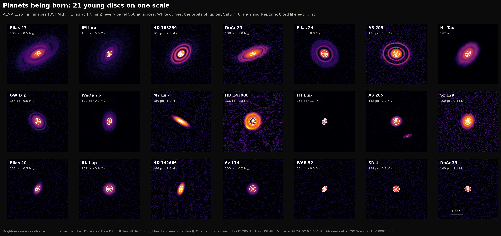

*Twenty-one planet-forming discs, all at the same physical scale (560 au across). The white curves are the
orbits of Jupiter, Saturn, Uranus and Neptune, tilted like each disc: most of these discs are several times
larger than Neptune's orbit.*

| Data | What | Size | Source |
|---|---|---|---|
| DSHARP continuum images | 20 discs at 1.25 mm, 30–70 mas resolution (4–8 au) | 0.8 GB | ALMA Large Program 2016.1.00484.L (Andrews et al. 2018) |
| DSHARP radial profiles | DSHARP II's own deprojected profiles, to check ours | 1 MB | same release (Huang et al. 2018) |
| HD 163296 CO cube | ¹²CO J=2–1, 105 channels of 0.32 km/s, 0.1″ beam | 1.7 GB | same release (Isella et al. 2018) |
| HL Tau | combined 1.0 mm image of the 2014 Long Baseline Campaign | 16 MB | ALMA 2011.0.00015.SV (ALMA Partnership 2015) |
| Gaia DR3 | parallaxes of the host stars | 10 kB | ESA Gaia archive |
| NASA Exoplanet Archive | known planets with measured masses | 1 MB | pscomppars table |
| Paper tables | DSHARP I, II, VII parsed from their LaTeX | 20 MB | arXiv |

### Some words used below

- **Protoplanetary disc**: the disc of gas (99%) and dust (1%) around a star a few million years old, left over
  from its birth. Planets form inside it.
- **Millimetre continuum**: the thermal glow of dust grains about a millimetre across, at ~10–50 K. ALMA's
  1.25 mm images trace these grains, not the gas and not small dust.
- **Interferometer image, beam**: ALMA does not take pictures. Pairs of antennas measure Fourier components of the
  sky, and an image is reconstructed from them. Its resolution element, the **beam**, is an ellipse 30–70
  milliarcseconds (mas) across for DSHARP; image pixels are in Jy per beam. Nothing finer than the beam is seen,
  and a gap narrower than the beam looks shallower than it is.
- **Inclination i, position angle PA**: a circular disc tilted by i appears as an ellipse with axis ratio
  cos i; PA is the direction of the long axis on the sky, measured from north through east. **Deprojecting**
  undoes the tilt.
- **Gaps and rings**: dark and bright annuli. DSHARP names them D or B ("dark", "bright") followed by the radius
  in au, e.g. AS 209 D61.
- **au, pc, mas**: 1 au is the Earth–Sun distance; at 140 pc (460 light years) 1 au spans 7 mas. 1 mas =
  1/3,600,000 of a degree.
- **h/r, α, Stokes number**: the disc's thickness relative to radius (~0.05–0.1); its turbulent "viscosity"
  α (unknown; 10⁻⁴–10⁻²), which smooths gaps out; and how tightly a dust grain is tied to the gas (its Stokes
  number St: small grains, St ≪ 1, follow the gas; larger ones drift towards pressure maxima and pile up in rings).

## Results

### 1. Finding each disc's tilt ourselves

Everything starts from the orientation: a wrong tilt smears rings in the averaged profile. We measure it two
ways, as DSHARP II did. For discs with clear rings, we trace each ring's crest (or each gap's trough)
along spokes about one beam apart and fit an ellipse to the points with an MCMC sampler. Gaps, rings and
their tilts all come from our own first-pass profile, never from the published list. Discs without
well-resolved rings get a two-dimensional Gaussian fitted with the beam deconvolved.

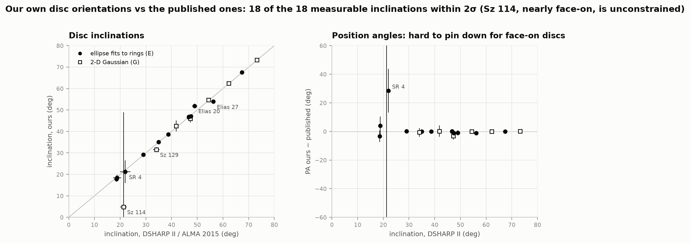

All 18 inclinations we can measure agree with the published values within 2σ: AS 209 35.05° ± 0.14 (DSHARP II
34.97 ± 0.13), HD 163296 46.65° ± 0.10 (46.7 ± 0.1), DoAr 25 67.60° (67.4), MY Lup 73.27° (73.2), HL Tau 46.85° ±
0.08 (ALMA 2015: 46.72 ± 0.05). The two furthest off, Elias 27 and Elias 20, sit at 2.0σ. Position angles agree to within about a degree
wherever the disc is tilted by more than ~25° (WaOph 6, measured with a Gaussian, is 3° off); for nearly face-on
discs the long axis is barely defined. Two lessons from getting there:

- **Spiral arms bias ring ellipses.** In Elias 27 the ring outside the D69 gap is crossed by the two spiral arms;
  its ellipse came out 6° rounder than the gap's. Like DSHARP II, we trace only the gap there, masking the arm
  crossings.
- **Rings blend along the minor axis.** HD 142666 (i = 62°) has rings 4 au apart; foreshortened by cos i they
  merge along the minor axis and the traced ellipses come out too round (57°). Our rule: a feature is traced
  only if its neighbours stay more than 0.6 beam away along the minor axis; HD 142666 then falls back to the
  Gaussian, 62.42° (DSHARP II, also Gaussian: 62.22°).

Sz 114 is the one failure: nearly face-on, small and observed with a beam stretched 2.4:1, it gives no usable
orientation from the Gaussian (5 ± 44°); DSHARP II's 21° came from tracing its faint ring pair, which our
profile only shows at 2.6–2.9σ along the beam's narrow direction.

### 2. Gaps and rings

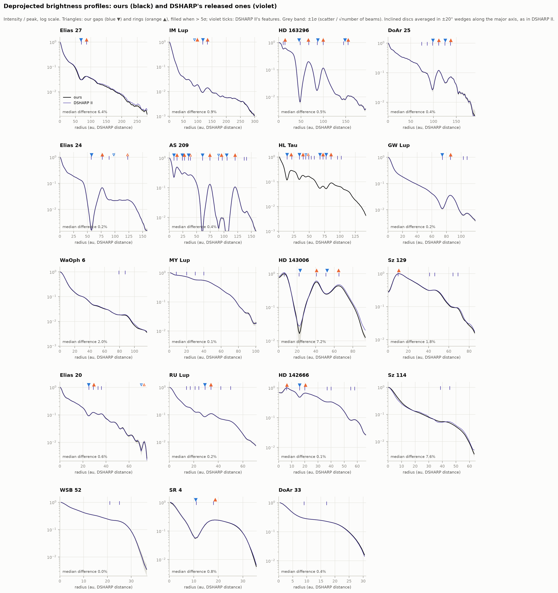

Averaged around ellipses of our fitted orientation, in 1-au bins as in DSHARP II, our profiles lie on top of
the ones DSHARP released: the median difference is below 1% for 13 of the 18 discs (0.05–0.9%), and our error
bars typically agree with theirs to within 10%. The other five (2–8%) are the discs where our orientation differs from
DSHARP II's (Sz 114, HD 143006, Elias 27, WaOph 6, Sz 129). (With DSHARP's own orientation, our AS 209 profile
matches theirs to 0.3% rms.) One release detail to watch: MY Lup's profile file uses 2-au bins, the others 1-au bins.
In each profile we look for local minima and maxima more than 3σ deep (5σ = "secure") and more than 1% of the
local brightness:

| DSHARP II feature type | recovered | median position offset |
|---|---|---|
| traced with ellipses (E) | 29 of 34 | 1.6 mas (0.04 beam) |
| extrema of their profile (R) | 17 of 33 | 4.6 mas (0.15 beam) |
| identified by eye, mostly "plateaus" (V) | 0 of 16 | — |
| HL Tau, ALMA 2015's rings | 10 of 14 | 1.0 mas (0.04 beam) |

The plateaus are not extrema, so an extremum finder cannot see them, and DSHARP II itself lists them without
uncertainties. The R features we miss are mostly 2–4% wiggles; WaOph 6's ring B88 (a 2.5% bump narrower than the
beam) and Sz 129's D41/B46 pair stay below our 3σ threshold in an azimuthal average. One feature we find that
DSHARP II does not list: a ring at 98 au in IM Lup, where DSHARP III (the spiral paper) describes the arms
merging into "radially constant structures at R ~ 98 au".

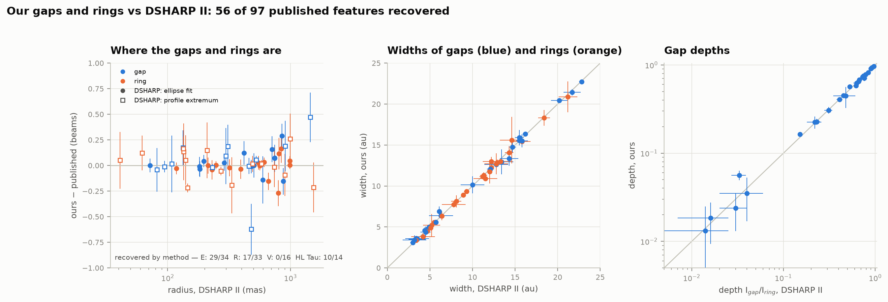

The images themselves check out too: total fluxes match DSHARP I's table to a median 0.1% and the noise to the
µJy. Two exceptions: AS 209's released image is 9% fainter than the tabulated one, with a peak 8% lower, so it
was presumably re-imaged; Elias 24's peak matches, and its 5% excess flux is faint outer emission our aperture
includes.

Widths and depths follow DSHARP II's definitions exactly (the half-way intensity between a gap and the ring
outside it marks their boundary). For 26 gaps the median width difference is 0.13 au and the depths agree to
1% (median ratio 0.994), including the special cases where a neighbouring ring never reaches the half-way level.

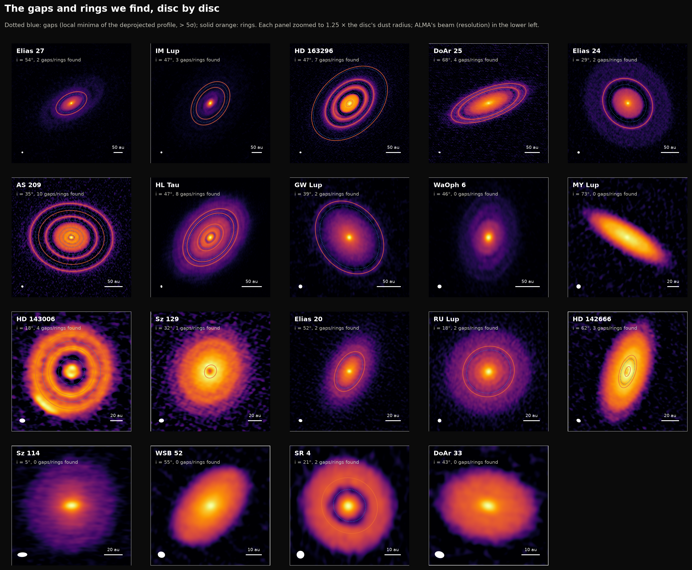

### 3. If planets carved the gaps

A planet of more than about ten Earth masses pushes gas away from its orbit faster than turbulence can refill
it, so a gap opens (in DSHARP VII's simulations, lighter planets leave nothing ALMA could see); dust grains pile
up in the pressure bump just outside. Zhang et al. (2018, DSHARP VII) ran 45
hydrodynamic simulations with dust and fitted the gap width they produce in a 1.25 mm image,
Δ = (r_out − r_in)/r_out, as Δ = A K′^B with K′ = q (h/r)^−0.18 α^−0.31 (q = planet-to-star mass ratio).
Measure Δ, estimate h/r from the star's luminosity, assume α, and q follows.

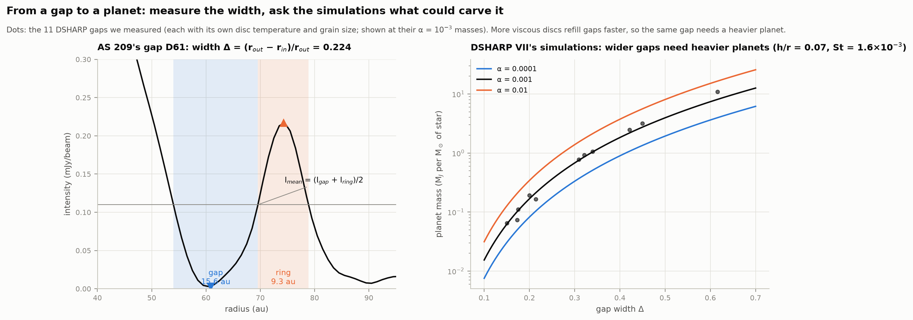

Our widths reproduce DSHARP VII's Δ to ±0.005 for 11 of their 12 gaps (the twelfth, HD 163296's 10-au gap,
is only a beam wide and below our threshold), and with their grain-size choices the masses agree:

| Gap | Δ ours (DSHARP VII) | planet mass, α = 10⁻³ (M_J) | DSHARP VII | range α = 10⁻⁴…10⁻² |
|---|---|---|---|---|
| AS 209, 9 au | 0.421 ± 0.010 (0.42) | 2.06 | 2.05 | 1.0–4.2 |
| AS 209, 99 au* | 0.309 (0.31) | 0.64 | 0.65 | 0.32–1.3 |
| Elias 24, 57 au | 0.322 (0.32) | 0.71 | 0.84† | 0.35–1.5 |
| Elias 27, 69 au | 0.175 (0.18) | 0.054 | 0.06 | 0.026–0.11 |
| GW Lup, 74 au | 0.150 (0.15) | 0.030 | 0.03 | 0.015–0.061 |
| HD 142666, 16 au | 0.200 (0.20) | 0.30 | 0.30 | 0.15–0.62 |
| HD 143006, 22 au | 0.616 (0.62) | 19.3 | 19.9 | 9.5–39 |
| HD 143006, 51 au | 0.214 (0.22) | 0.29 | 0.33 | 0.14–0.60 |
| HD 163296, 48 au | 0.340 (0.34) | 2.18 | 2.18 | 1.1–4.4 |
| HD 163296, 86 au | 0.173 (0.17) | 0.15 | 0.14 | 0.07–0.31 |
| SR 4, 11 au | 0.450 (0.45) | 2.15 | 2.16 | 1.1–4.4 |

\* DSHARP VII treats D90 and D105 as one gap, the thin ring B97 between them being material on the planet's
horseshoe orbit; we measure it the same way. † DSHARP VII's three Elias 24 masses all imply Δ = 0.334, not the
0.32 it prints; with 0.32 their own formula gives our 0.71. The Stokes numbers come from DSHARP VII's table,
which read them off simulations not published as numbers.

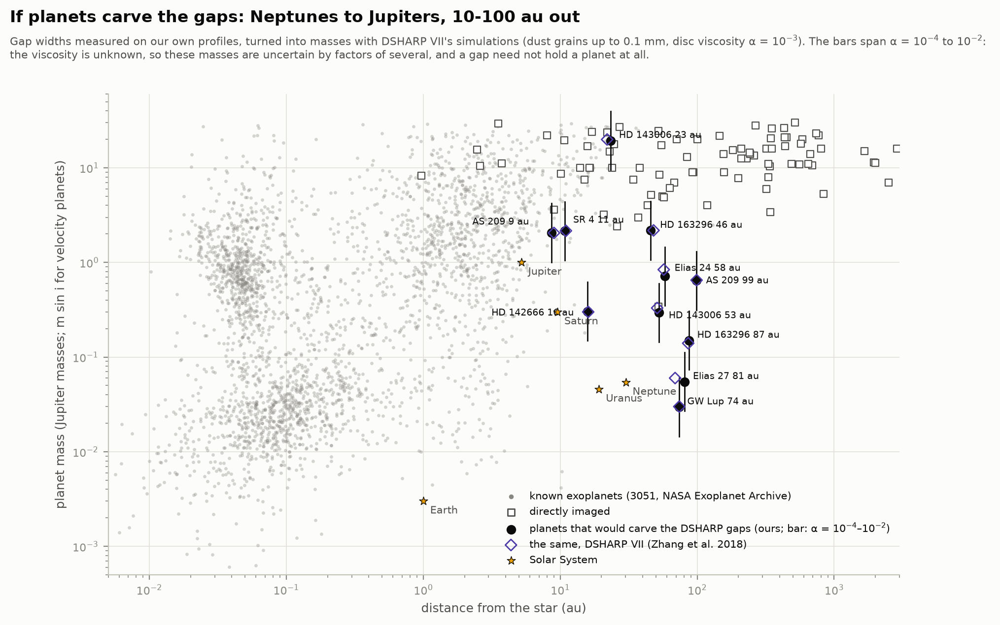

Among the ~3,000 known exoplanets with measured masses, these would sit in a sparsely populated corner: Saturn-
to Jupiter-mass planets, and some smaller, tens of au from stars only a few million years old. Radial-velocity
and transit surveys lose sensitivity beyond a few au, and direct imaging (open squares) finds mostly several-
Jupiter-mass companions. The bars show how much the unknown viscosity matters (factor ~4 over α = 10⁻⁴–10⁻²); the
grain-size assumption matters as much again. The HD 143006 22-au gap needs 10–40 Jupiter masses, more
like a brown dwarf; that disc's misaligned inner disc and bright arc suggest something unusual (Pérez et
al. 2018).

### 4. …or ice lines?

A gap is not proof of a planet. Rings and gaps could also mark where ices freeze out (CO, N₂, CO₂ snow lines),
which would put them at characteristic temperatures whatever the star.

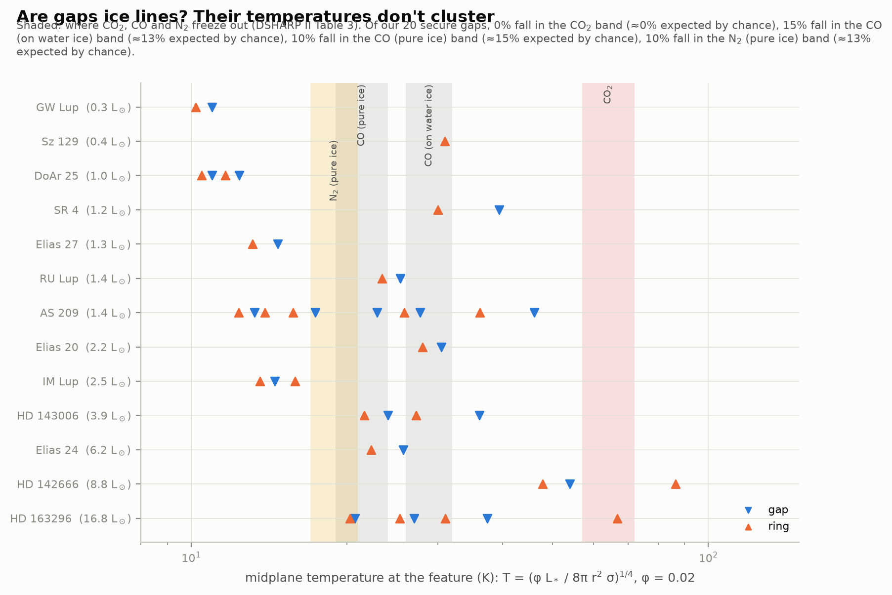

With DSHARP II's passive-disc temperatures (T = (φL★/8πr²σ)^¼, φ = 0.02, luminosities rescaled to Gaia DR3),
our 20 secure gaps span 11–54 K with no clustering: 0%, 15%, 10% and 10% fall in the CO₂, CO (water ice), CO
(pure ice) and N₂ freeze-out bands, against 0%, 13%, 15% and 13% if their temperatures were spread evenly in
log T over the same range. That agrees with DSHARP II's conclusion, though the temperatures themselves are
uncertain by tens of per cent.

### 5. HD 163296 weighed by its own disc

The CO line's Doppler shift maps the gas velocity. We find each spectrum's peak by a parabola through the
brightest channel and its neighbours (Teague & Foreman-Mackey 2018), then fit a Keplerian disc whose CO
glows from a flared surface z(r) = z₀ (r/1″)^φ − z₁ (r/1″)^ψ, one point per beam, 0.4″–3″ from the star.

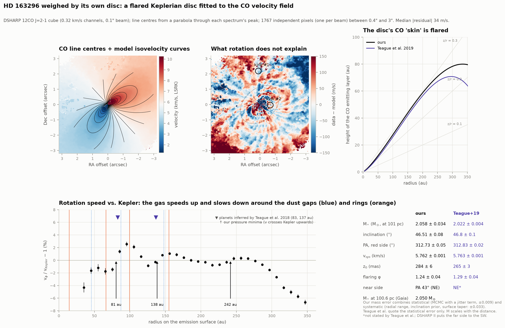

| | ours (101 pc) | Teague et al. 2019 |
|---|---|---|
| stellar mass | **2.058 ± 0.009 (stat) ± 0.033 (sys) M☉** | 2.022 ± 0.004 (stat) |
| inclination | 46.51° (prior from our continuum fit) | 46.8° (prior from continuum) |
| PA of the red-shifted side | 312.73° | 312.83° |
| systemic velocity | 5.7623 km/s | 5.763 km/s |
| emission surface z₀, φ | 284 mas, 1.24 | 265 mas, 1.29 |

At the Gaia DR3 distance (100.6 pc) the mass is 2.05 M☉; the evolutionary-track mass in DSHARP I is 2.04. The
residuals have a median of 34 m/s. The fit also decides which side of the disc faces us: the elevated surface
shifts the emission towards the far side, and only one of the four possible orientations fits (residuals 36 vs
225 m/s): the near side is to the north-east, as DSHARP II concluded from the same CO data (the inner
continuum's bright side, to the south-west, is the far side). Teague et al.'s own
parameters give a 43 m/s median residual on our map, so the map and model agree with theirs; the 2% mass
difference comes from the fitted radial range and the surface's outer taper, which is what our systematic
error spans.

**Pressure bumps.** Gas orbits slightly faster than Kepler where its pressure rises outward and slower where it
falls: v_φ² = v_K² + (r/ρ) dP/dr. Around each continuum gap, the rotation curve dips below Kepler and then rises
above it. It crosses upwards, marking a pressure minimum (a gas gap), at **81 and 139 au** (at 101 pc), where
Teague et al. (2018) inferred two Jupiter-mass planets from other data (83 and 137 au), next to the dust gaps
D86 and D145. A third crossing at 243 au is in the outer disc, where our emission-surface model starts to fail.

**The planet's wake.** Pinte et al. (2018, 2020) saw "kinks" in HD 163296's CO channel maps, where the gas
deviates from Keplerian flow near a planet. Our channel maps with the fitted model's isovelocity curves show
where to look:

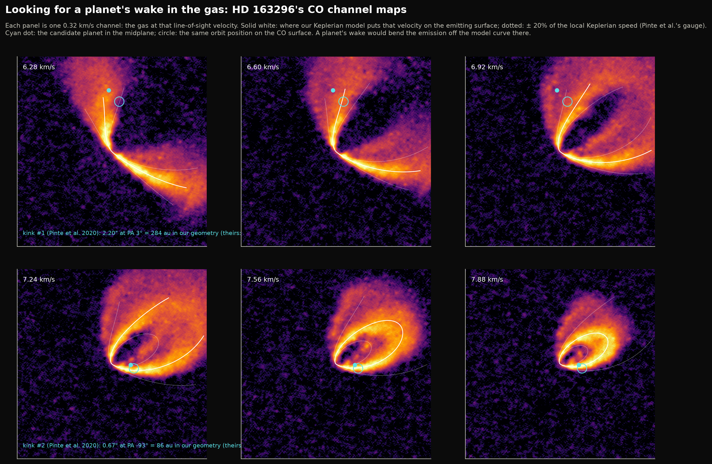

In the line-centre map, though, neither location stands out: the residuals there are +45 and +44 m/s, against
+11 ± 39 and −18 ± 76 m/s around the same orbits (0.9σ and 0.8σ). At 0.64 km/s spectral resolution, a deviation of 10–20%
of the local speed confined to one or two channels does not survive in a single line centre per pixel. Of the
nine DSHARP kinks, Pinte et al. (2020) found only kink #1 to pass all four of their tests (bright, localised,
independent of continuum subtraction, seen in three independent channels); it was first found in data with
several times finer spectral resolution (100–200 m/s; Pinte et al. 2018).

### 6. Spiral arms

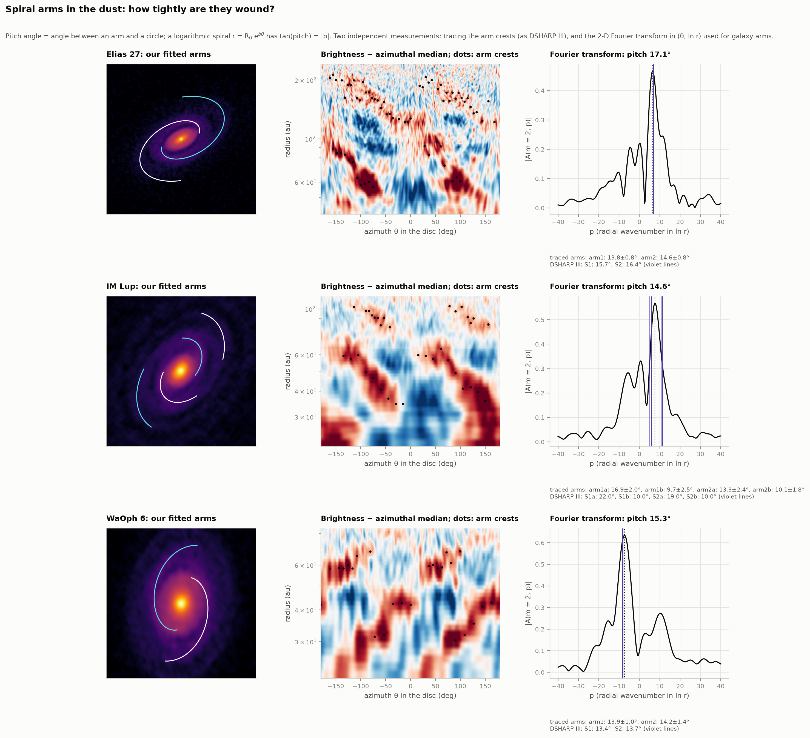

Three DSHARP discs have two-armed spirals. Tracing the arm crests as DSHARP III did, and independently with the
two-dimensional Fourier transform in (azimuth, ln r) used for galaxy arms, we find pitch angles of:

| | Fourier | traced arms | DSHARP III |
|---|---|---|---|
| Elias 27 | 17.1° | 13.8 ± 0.8°, 14.6 ± 0.8° | 15.7 ± 0.2°, 16.4 ± 0.2° |
| IM Lup inner / outer | 14.6° (both) | 16.9 ± 2.0°, 13.3 ± 2.4° / 9.7 ± 2.5°, 10.1 ± 1.8° | 22 ± 2°, 19 ± 2° / 10 ± 1°, 10 ± 1° |
| WaOph 6 | 15.3° | 13.9 ± 1.0°, 14.2 ± 1.4° | 13.4 ± 0.9°, 13.7 ± 0.9° |

WaOph 6 matches (its arms' R₀ = 21.4 and 45.6 au, b = 0.247 and 0.253, vs DSHARP III's 21.3 and 45.9 au, 0.244
and 0.238), even with our Gaussian orientation, as its rings were too faint for us to trace; IM Lup's
arms open out inside 75 au and wind tightly outside it, as DSHARP III found. Our Elias 27 arms are 1–2° tighter:
our inclination for it is 2° lower (54° vs 56°), and DSHARP III traced its outer arms on a re-imaged, tapered map
we approximate by smoothing. All three spirals trail the rotation (DSHARP III). What drives them, the discs'
own gravity or unseen companions, is open; DSHARP III discusses both.

### 7. HL Tau, re-measured

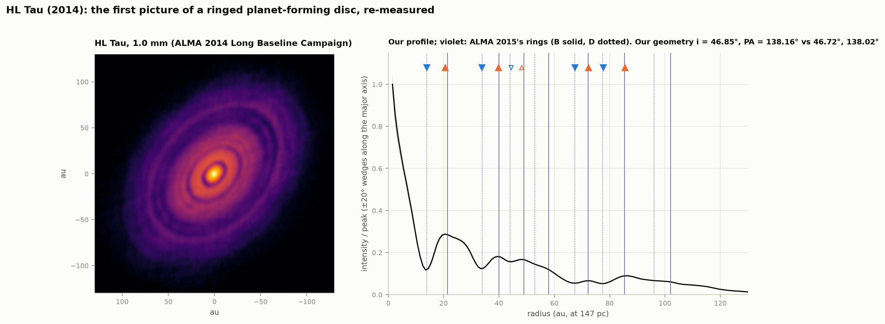

The image that started it all (ALMA's 2014 Long Baseline Campaign) gives an inclination of 46.85° ± 0.08
and PA 138.16° ± 0.11 from six of its rings (ALMA Partnership 2015: 46.72 ± 0.05, 138.02 ± 0.07). Ten of its 14
listed rings and gaps come back within 0.1–6 mas of ALMA's 2015 positions; the four we miss were estimated "directly
from the image" there, without uncertainties.

### Dust masses

For scale, the dust in these discs (optically thin estimate at 20 K, the convention of most surveys) amounts to
18–197 Earth masses, the most in Elias 24, HD 163296 and Elias 27. The inner discs are partly optically thick, so
these are lower limits, and the opacity is uncertain by a factor of several (with DSHARP's opacity the masses are 5.4×
higher). That is several times the 10–20 Earth masses of solids thought to sit in a giant planet's core, though
less than the solids locked up in many mature planetary systems (the "mass budget problem"; Manara et al. 2018).

### Interactive: unroll a disc

`figures/disc_explorer.html` (offline, no libraries): tilt and turn a disc with two sliders and watch its
rings straighten into horizontal stripes in the unrolled view, then weigh the planet in one of its gaps with
your own choice of viscosity and grain size. The page uses the same transform and planet formula as the Python
code; both were checked in a headless browser, in light and dark mode.

## How it works

| Module | What it does |
|---|---|
| `fetch_data.py` | Downloads everything (parallel byte ranges with resume: single connections to the ALMA servers stall), checks sizes, records SHA-256s in `data/manifest.json` |
| `literature.py` | Parses DSHARP I Tables 1 and 4, DSHARP II Tables 1 and 2, DSHARP VII Table 3 from the arXiv LaTeX: no hand-typed comparison numbers |
| `distances.py` | Gaia DR3 parallaxes with the Lindegren et al. (2021) zero point, errors inflated by RUWE; Elias 27 (G = 20.3, parallax 9.1 ± 0.9 mas) takes its cloud's mean distance |
| `alma_images.py` | FITS images and cubes as sky offsets, beam, noise, flux, Planck brightness temperatures |
| `geometry.py` | Disc ↔ sky coordinates in DSHARP's azimuth convention; Gaussian fit with beam deconvolution; ring tracing and MCMC ellipse fits (first-order orthogonal distances) |
| `profiles.py` | Azimuthal averages with σ/√(beams around the arc) errors, extremum finding, DSHARP II's width/depth definitions including their special cases, Monte Carlo errors with beam-correlated noise |
| `discs.py` | The per-disc pipeline (section 1–2), from the image alone |
| `planets.py` | DSHARP VII's width–mass relation, passive-disc temperatures, aspect ratios |
| `kinematics.py` | Line centres, the flared Keplerian disc and its four orientations, rotation curves |
| `spirals.py` | Polar residual maps, arm tracing, log-spiral fits and Fourier spectra |
| `analysis.py` | Runs everything and grades it against the papers → `data/results.json` |
| `figures.py`, `interactive.py` | The figures and the explorer page |
| `test_physics.py` | 22 self-checks: synthetic rings, discs, spirals and spectra with known answers, the parsed tables, DSHARP VII's table from its own inputs, our brightness temperatures against DSHARP's profile files |

## What these data cannot tell you

- **A gap is not a planet.** Ice lines, magnetically driven zonal flows, dust growth or secular instabilities
  can make rings. The planet masses are what a planet *would* need, if a planet carved the gap.
- **The masses are model-dependent by factors of several.** They scale as α^0.31 (unknown turbulence) and
  depend on the grain sizes (Stokes numbers DSHARP VII chose from their simulations, which we reuse), on h/r
  from a simple temperature model, and on 2-D simulations without dust feedback.
- **Millimetre images show millimetre grains.** Gas and small dust can be distributed differently; gaps in the
  dust need not be as deep in the gas.
- **Images are reconstructions** (as in I5): CLEAN with chosen weightings and tapers. Features narrower than the
  beam are blurred; widths are upper limits and depths lower limits for them (DSHARP II flags these).
- **Distances** enter every au: Elias 27 at its cloud's 138 pc instead of DSHARP's 116 pc makes it 19% larger in
  our gallery. Angular comparisons with DSHARP are unaffected.
- **The CO kinematics** neglect pressure support and the disc's self-gravity in the mass (a few-per-cent
  effect), and the emission surface is a parametric guess beyond ~3″.

## Reproduce

```bash
cd 45-protoplanetary-discs
python fetch_data.py          # ~2.5 GB, 20-40 min (add --skip-co for the 0.8 GB without the CO cube)
python run.py                 # all numbers, figures and the explorer; first run ~7 min, then ~2 min
python test_physics.py        # 22 checks
```

Everything is cached in `data/cache/`; `run.py --refit` recomputes from the images.

## Data and credits

This project uses ALMA data ADS/JAO.ALMA#2016.1.00484.L and ADS/JAO.ALMA#2011.0.00015.SV. ALMA is a partnership
of ESO (representing its member states), NSF (USA) and NINS (Japan), together with NRC (Canada), NSTC and ASIAA
(Taiwan), and KASI (Republic of Korea), in cooperation with the Republic of Chile. The Joint ALMA Observatory is
operated by ESO, AUI/NRAO and NAOJ. DSHARP data products: Andrews et al. 2018, ApJL 869, L41 (DSHARP I); profiles:
Huang et al. 2018, ApJL 869, L42 (DSHARP II); spirals: Huang et al. 2018, ApJL 869, L43 (DSHARP III); multiples:
Kurtovic et al. 2018, ApJL 869, L44; planets: Zhang et al. 2018, ApJL 869, L47 (DSHARP VII); HD 163296: Isella et al.
2018, ApJL 869, L49; HD 143006: Pérez et al. 2018, ApJL 869, L50. HL Tau: ALMA Partnership 2015, ApJL 808, L3. Kinematics: Teague et al. 2018, ApJL 860, L12;
Teague, Bae & Bergin 2019, Nature 574, 378; Pinte et al. 2018, ApJL 860, L13; Pinte et al. 2020, ApJL 890, L9.
Gaia DR3 (Gaia Collaboration 2023) with the zero point of Lindegren et al. 2021; HL Tau's distance: Galli et al.
2018. NASA Exoplanet Archive (doi:10.26133/NEA13), operated by Caltech under contract with NASA.
