# A6 — Watch planets orbit another star: HR 8799's four giants in motion

**Four giant planets circle the young star HR 8799. Telescopes have photographed them directly since
2008, and they are also in Hubble images from 1998. Can we fit their orbits ourselves, make the movie,
and test whether such a crowded system can be stable?**

Yes. We collected **167 measured positions from 1998 to 2025**: Hubble, Keck, Gemini, the VLT, the
Large Binocular Telescope, the VLT Interferometer and JWST, each table parsed from its paper's own
LaTeX source. We fitted all four orbits at once, fitting each instrument's calibration alongside. The
planets move along their ellipses at a pace you can watch: planet e covers a sixth of its 56-year orbit
in ten years.

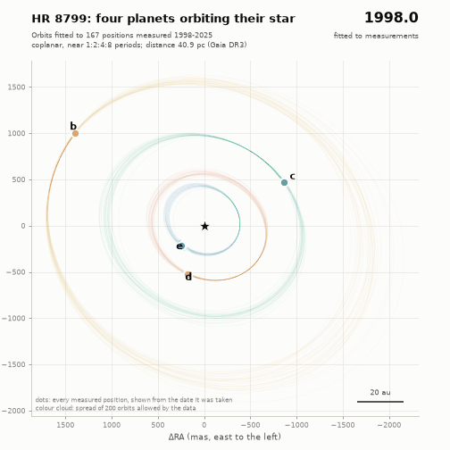

*The keeper: the four planets on the orbits fitted to all data, 1998 to 2050 (MP4:
[`figures/hr8799_orbits_1998_2050.mp4`](figures/hr8799_orbits_1998_2050.mp4)). Each black dot is a
measured position, shown from the day it was taken; after the last one (Keck, 9 October 2025) the motion
is a prediction. The coloured cloud around each planet is the spread of 200 orbits the data allow.*

**What we found:**

* **Wang et al. (2018) reproduced.** With the same data, models and priors, every orbital element agrees with
  theirs within 1.5σ, and the configurations that survive 40 Myr of N-body integration match their stable
  orbits within 0.5σ. Nested sampling adds what they could not compute, the Bayesian evidence. Coplanar
  orbits near a 1:2:4:8 period chain beat four independent orbits by ln B = 18.6 (odds of ~10⁸ : 1) on
  their data, and by 25.9 on all data.
* **The planets calibrate the telescopes.** Left free, GPI's north angle comes out 0.34° ± 0.09° off. That
  is the correction De Rosa et al. (2020) found with binary stars (+0.36°).
* **Predictions.** Orbits fitted to 2004–2016 predict 77 later positions to 14 mas, or 9 mas once GPI is
  recalibrated. Our final orbits predict 17 unpublished GRAVITY positions from 2019–2022, found inside a
  public data file, to 2.5 mas.
* **Stability.** About 1 in 1,000 configurations allowed by Wang et al.'s data survives 40 Myr, and only if
  the planets are lighter than evolutionary models say: c, d and e below 7.3 MJup each. With the models'
  masses (8.7 MJup), 1 configuration in 150,000 survives. The orbits fitted to all data survive **16 times
  more often** (1.6%; 1% even without assuming the 1:2:4:8 chain). Their survivors land on the orbits that
  the unpublished GRAVITY data favour, but they still need light planets.
* **Resonance.** In the survivors d and e are locked in a 2:1 resonance and c and d mostly are. Planet b and
  the three-body Laplace resonance are not needed, as Wang et al. found.
* **Chaos.** Moving planet b by 15 cm turns half of the 40-Myr survivors unstable; so does changing a planet's
  mass in its 16th digit. A third of the survivors last another 100 Myr.
* **The star's wobble** weighs planet e at 9.9 ± 2.0 MJup (Brandt et al. 2021: 9.6), heavier than
  stability allows. The masses remain the system's open question.
* **β Pictoris b** passed 9.8 ± 0.8 mas (0.19 au, 27 stellar radii) from its star on 2017 September 12
  (± 3 days), with its Hill sphere in front of the star from April 2017 to February 2018, as Nielsen et al.
  (2020) found.

| Check | This work | Published |
|---|---|---|
| Wang et al. 2018, Table 2: four orbit models fitted to 2004–2016 data | every element within 1.43σ; χ²ν 0.94 / 0.88 / 0.95 / 0.94 | χ²ν 1.01 / 0.88 / 0.95 / 0.94 |
| Stable for 40 Myr, near 1:2:4:8 coplanar orbits | 191 of 200,000 (955 per million) | 441 per million |
| Elements of the stable orbits | all within 0.5σ; P_b/P_c, P_c/P_d, P_d/P_e = 2.13, 2.10, 2.07 | 2.11, 2.10, 2.06 (Table 3, Sec. 4.2) |
| Mass limits from stability (99.9%) | M_cde < 7.3, M_b < 5.9 MJup | < 7.6, < 6.3 MJup |
| Resonances in the stable systems | d:e locked (≥ 90% of the time) in 90%, all above 6 MJup; Laplace c:d:e in 0.5%; b never | d:e locked above ~6 MJup; Laplace ≥ 90% in 1.2%; b never (Sec. 4.3) |
| Stable systems lasting another 100 Myr (forwards) | 64 of 191; none of the 3 above 7 MJup | none above 7 MJup lasts 100 Myr (Sec. 4.5) |
| GRAVITY 2018 position of e predicted by the stable orbits | (−351.0, +157.3) mas | (−352.6, +157.9) (Wang's, quoted by GRAVITY Collaboration 2019); measured (−357.6, +163.3) |
| GPI north-angle correction, measured by the planets | +0.34° ± 0.09° | +0.36° from binary stars (De Rosa et al. 2020) |
| Mass of e from the HGCA, Brandt's set-up | 9.7 ± 1.9 MJup | 9.6 (+1.9/−1.8) (Brandt et al. 2021) |
| β Pic b closest approach in 2017 | 2017 Sep 12 ± 2.7 d | 2017 Sep 13 ± 2.8 d (Nielsen et al. 2020) |
| β Pic b Hill sphere in front of the star | 2017 Apr 11 → 2018 Feb 13 | 2017 Apr 11 → 2018 Feb 16 (Nielsen et al. 2020) |
| β Pic b projected miss distance | 9.8 ± 0.8 mas | 9.9 (+0.9/−0.8) mas (Wang et al. 2016) |

---

## Results

### 1. Twenty-seven years of positions

A directly imaged planet is a faint dot next to a star 10,000–100,000 times brighter. A coronagraph
blocks most of the starlight and image processing removes the rest of the glare. What is left is the
planet's position relative to the star, its *astrometry*: an offset east (ΔRA) and north (ΔDec),
in milliarcseconds (mas). One mas is the size of a coin seen from 4,700 km away. At HR 8799's distance
(40.9 pc, 133 light-years, from Gaia's parallax) it is 0.041 au, about 6 million km.

| Instrument | Years | Positions | Typical error | Source |
|---|---|---|---|---|
| HST/NICMOS (archival) | 1998 Oct | 3 (b, c, d) | 23–30 mas | Soummer et al. 2011 |
| Keck/NIRC2 | 2004–2014 | 46 | 7 mas | Konopacky et al. 2016 |
| Gemini/GPI | 2013–2016 | 9 | 1–2 mas | Wang et al. 2018; recalibrated by De Rosa et al. 2020 |
| VLT/SPHERE (IRDIS + IFS) | 2014–2021 | 68 + 28 | 2 mas | Zurlo et al. 2022 |
| LBT/LUCI | 2020 | 4 | 1.5 mas | Zurlo et al. 2022 |
| VLTI/GRAVITY | 2018 Aug | 1 (e) | 0.07 mas | GRAVITY Collaboration 2019 |
| JWST/NIRCam | 2023 Nov | 4 | 3–15 mas | Balmer et al. 2025 |
| Keck/NIRC2 | 2025 Oct | 4 | 3–10 mas | Nguyen et al. 2026 |
| *JWST/NIRISS AMI (shown, not fitted)* | *2023 Aug* | *4 + candidate* | *10–33 mas* | *Nguyen et al. 2026* |

Two data sets are used throughout. **W18** is exactly what Wang et al. (2018) fitted: Keck 2004–2014 and
GPI 2013–2016, 55 positions. **ALL** is everything above, 167 positions from 1998 to 2025. Nguyen et al.'s
JWST aperture-masking positions are 10–30 times less precise; they are drawn in the figures but not
fitted. Among them is a candidate fifth planet, about 150 mas from the star, detected at 3σ (section 10).
Konopacky et al. left five of their Keck points out of their own fits (one on the edge of the
coronagraph mask, one night repeated two days later); so do we.

### 2. The orbits

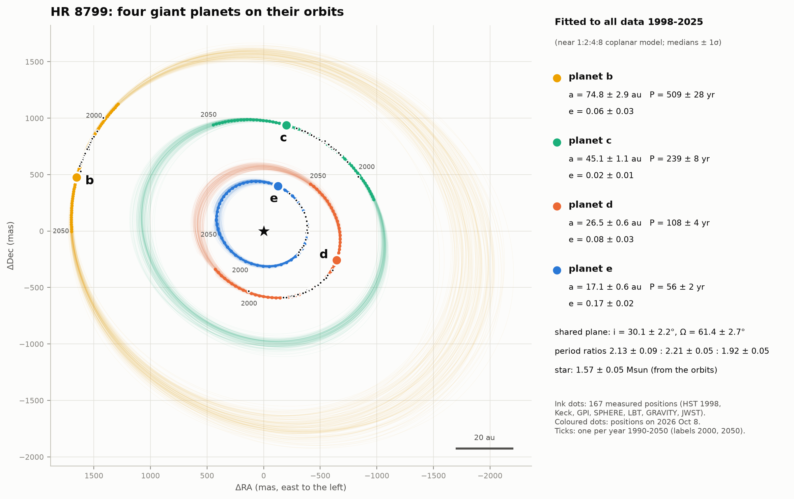

An orbit is an ellipse with the star at one focus, described by its size *a* (semi-major axis), shape
*e* (eccentricity: 0 for a circle), tilt *i* to the sky, the orientation angles Ω (where the orbit crosses
the sky plane) and ω (where along the ellipse the planet comes closest to the star), and the time of
closest approach. Kepler's third law then fixes the period from *a* and the mass inside the orbit.

The orbits fitted to all data, for the model the data prefer most (one shared plane, period ratios near
2, every e < 0.2; section 4):

| | b | c | d | e |
|---|---|---|---|---|
| a (au) | 74.8 (+3.0/−2.8) | 45.1 ± 1.1 | 26.5 ± 0.6 | 17.1 ± 0.6 |
| e | 0.06 ± 0.03 | 0.02 (+0.02/−0.01) | 0.08 ± 0.03 | 0.17 ± 0.02 |
| period (yr) | 509 (+30/−26) | 239 ± 8 | 108 ± 4 | 56 ± 2.5 |
| position on 2026 Oct 8 | 1,720 mas, PA 74.0° | 960 mas, PA 348.0° | 692 mas, PA 248.3° | 417 mas, PA 342.4° |
| uncertainty of that position | 3 mas | 2.5 mas | 2.5 mas | 5 mas |

Shared plane: inclination 30.1° (+1.8/−2.6), Ω = 61.4° ± 2.7° (or 241.4°: without radial velocities of the
planets, a mirror orbit fits equally well). Period ratios b:c 2.13 (+0.09/−0.08), c:d 2.21 ± 0.05,
d:e 1.92 ± 0.05. The planets weigh their star at **1.57 ± 0.05 M☉** (prior 1.5 ± 0.3). Position
angles (PA) are counted from north through east.

The orbits are fixed Keplerian ellipses: each planet circles the star plus the planets inside it, and
the star wobbles in response (Jacobi coordinates). The planets also pull on each other. Starting a full
N-body run from the same state in 2013 with hot-start masses, the planets drift from their ellipses by at
most 0.9 mas (d) and 2.5 mas (e) by 1998 or 2025, and less than 0.1 mas for b and c: small next to the
measurement errors, except GRAVITY's.

One number differs from the published orbits. Our d:e period ratio of 1.92 ± 0.05 sits below 2. Wang et
al.'s stable orbits (2004–2016 data) had 2.06, and whereistheplanet's posterior, which also fits
unpublished GRAVITY positions from 2019–2022, gives 2.05 ± 0.02, 2.4σ from ours. Our orbit for e
predicts those GRAVITY positions to within 1 mas (section 6): over a 16-year arc of a 56-year orbit,
different combinations of *a*, *e* and tilt trace almost the same path. Requiring stability moves it
to 1.99, close to the published values (section 7).

### 3. Reproducing Wang et al. (2018)

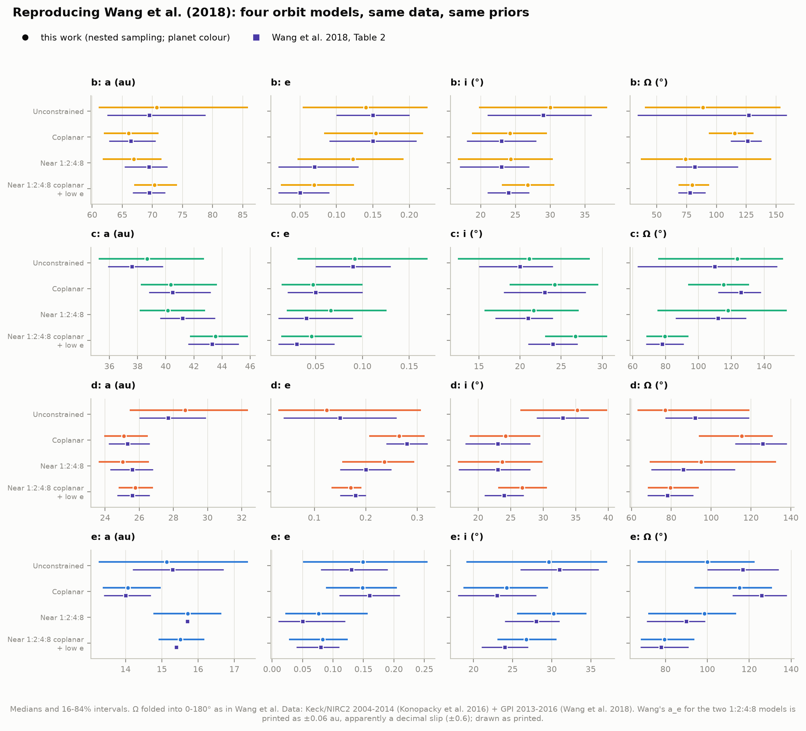

Wang et al. fitted four models to their data, each adding a physical assumption:

* **Unconstrained**: four independent orbits.
* **Coplanar**: all four in one plane.
* **Near 1:2:4:8**: each period close to twice the next one in (ratios 1.8–2.4; 1.8–2.2 for d:e).
* **Near 1:2:4:8 coplanar, low e**: both, and every eccentricity below 0.2.

With their data, their priors and nested sampling instead of their MCMC, **every orbital element of
every model agrees with their Table 2 within 1.5σ** (largest difference 1.43σ, the phase of c in the last
model). Repeat runs of two models agree to 0.07 in ln Z.

| Model | ln Z (evidence) | ln B vs Unconstrained | χ²ν ours / Wang | ΔBIC ours / Wang |
|---|---|---|---|---|
| Unconstrained | −412.44 ± 0.25 | 0 | 0.94 / 1.01 | 0 / 0 |
| Coplanar | −406.70 ± 0.23 | +5.7 | 0.88 / 0.88 | −28 / −34 |
| Near 1:2:4:8 | −401.65 ± 0.24 | +10.8 | 0.95 / 0.95 | +1 / −4 |
| Near 1:2:4:8 coplanar, low e | −393.80 ± 0.24 | **+18.6** | 0.94 / 0.94 | −22 / −29 |

Wang et al. compared the models with χ²ν and the Bayesian Information Criterion (BIC), and noted that
the proper tool, the Bayesian evidence, was "computationally difficult". Nested sampling computes it
directly. The **evidence** Z is the probability of the data under a model, averaged over everything the
model allows. A model that spreads its prior over orbits the data rule out pays for it: this is Occam's
razor in numbers. A ln Bayes factor of 18.6 means odds of about 10⁸ : 1 for coplanar, near-resonant
orbits over four independent ones, for the same quality of fit (χ²ν is 0.94 for both). Our ΔBIC values
are 5–7 smaller than Wang's because their Unconstrained draws fit slightly worse (χ²ν 1.01 against our
0.94); the BIC uncertainties are ±5–7 in both.

Their Table 2 has two apparent decimal slips: a_e of the two 1:2:4:8 models is printed as ±0.06 au
(other fits give ±0.6), and the Coplanar ΔBIC as −34 ± 0.06. Their Table 3 prints a_b as 70.8 ± 0.19 au
(±1.9 by everything else).

### 4. Is the system flat?

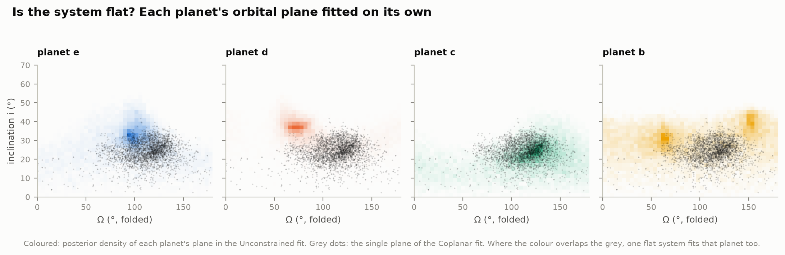

Fitted independently, each planet's plane is only loosely constrained, and d's prefers a steeper tilt
(35° against 24° for one shared plane). That once led to claims that d is misaligned (Currie et al. 2012; Esposito et al. 2013; Pueyo
et al. 2015). One shared plane fits every planet, and the evidence prefers it (ln B = +5.7). Add the
near-1:2:4:8 periods and low eccentricities, and the preference grows to +18.6 with Wang's data and
**+25.9 with all data**:

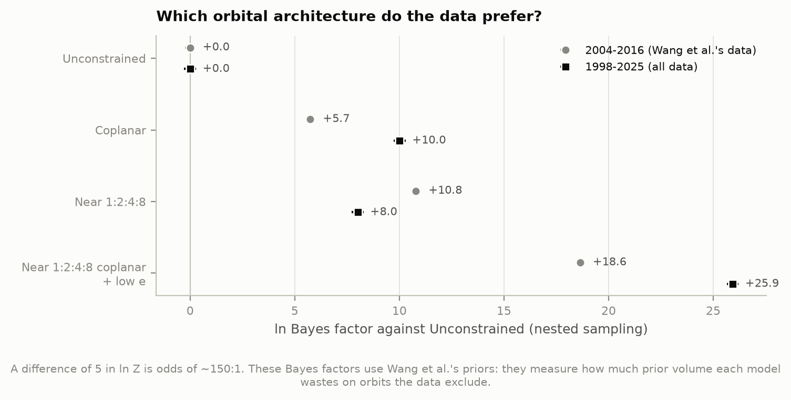

These Bayes factors assume Wang et al.'s priors (log-uniform sizes, uniform eccentricities). They measure
how much prior volume each model wastes, not physics: stability (section 7) is a separate, independent
argument for the same architecture.

With all data the fits are statistically good once each instrument's extra scatter is counted: χ²ν =
1.04 (Unconstrained) and 1.03 (near 1:2:4:8 coplanar) with the fitted jitter and calibration offsets.
Without them it is 2.8–3.0: the published errors of some instruments are too small (we add 4.0 mas in
quadrature for SPHERE/IFS, 2.7 mas for GPI, 7 mas for Keck 2025).

### 5. The planets calibrate the telescopes

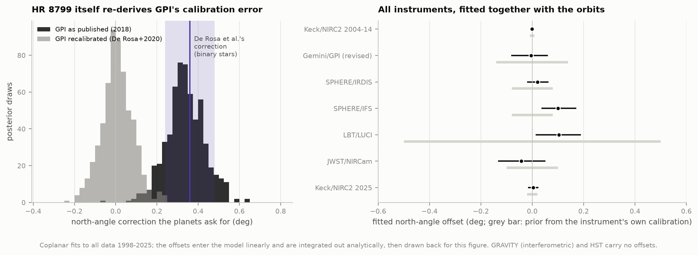

Every camera's pixels have to be tied to the sky: how many milliarcseconds per pixel (plate scale), and
which way is north. Teams calibrate this on star clusters and binary stars, typically to 0.01–0.1°. A
0.3° error in north turns into a 9 mas sideways shift at planet b's distance from the star, nine times
GPI's quoted error.

The fit gives every instrument a north rotation and a scale error, with priors from its own published
calibration. For GPI the prior is left wide (±1°), so the planets themselves measure GPI's north. They
ask for **+0.34° ± 0.09°**. De Rosa et al. (2020) found the same correction, +0.36°, from binary
stars, and revised GPI's calibration. With the revised GPI data the planets ask for
+0.01° ± 0.08°. Every other instrument's fitted offsets stay within 1.3 times its own quoted
calibration uncertainty.

### 6. Predicting the planets

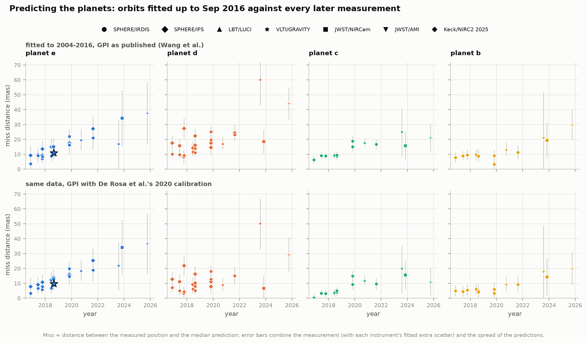

The real test of an orbit is a prediction. We fitted only the data up to September 2016, as Wang et
al. had them, and predicted all 77 later positions (SPHERE 2016–2021, LBT 2020, GRAVITY 2018, JWST
2023, Keck 2025):

| Orbits fitted to 2004–2016 | Median miss | Within 2σ | χ² (154 numbers) |
|---|---|---|---|
| Unconstrained, GPI as published | 15.2 mas | 34% | 778 |
| Near 1:2:4:8 coplanar, GPI as published | 14.3 mas | 38% | 777 |
| …only the orbits stable for 40 Myr | 12.4 mas | 39% | 823 |
| Unconstrained, GPI recalibrated | 11.3 mas | 73% | 365 |
| Near 1:2:4:8 coplanar, GPI recalibrated | **9.3 mas** | **78%** | 311 |

(2σ combines the measurement error, the instrument's fitted extra scatter and the spread of the
predictions.) GPI's 0.35° north error accounts for more than half of the misfit (χ² 777 → 311). Most of
the rest is radial: the predicted planets sit 2–10 mas too close to the star. Selecting only the orbits
that survive 40 Myr narrows the predictions (median miss 12.4 mas) but does not remove the GPI bias.
Those stable orbits predicted GRAVITY's 2018 position of e at (−351.0, +157.3) mas, 9.0 mas from the
measured (−357.6, +163.3). Wang et al.'s stable orbits predicted (−352.6, +157.9) (as quoted by GRAVITY
Collaboration 2019), 1.7 mas from ours.

**A blind test with unpublished data.** whereistheplanet (Wang et al. 2021), the public web tool that
predicts where directly imaged planets are, ships its HR 8799 orbit posterior with the data it was
fitted to. Among them are 17 VLTI/GRAVITY positions from 2019–2022 that, as far as we could find, are
unpublished: Nasedkin et al. (2024) left their GRAVITY astrometry for a later paper. We never fitted
them. Our final orbits predict them with a median miss of **2.5 mas** (maximum 4.9 mas): e 1.0, c 1.2,
d 3.0, b 4.8 mas. GRAVITY's errors are ~0.1 mas, so the misses are still larger than the measurement
noise (χ² = 107 for 34 numbers). For 2026 October 8, our positions and whereistheplanet's agree to
0.9 mas (c), 6 mas (b), 9 mas (d) and 10 mas (e).

### 7. Which configurations survive 40 million years?

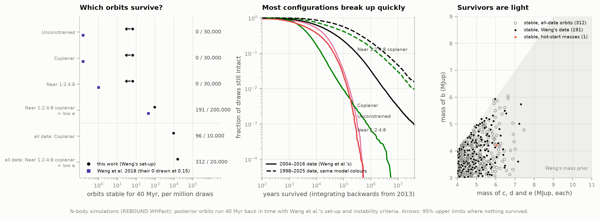

Four planets of 5–10 Jupiter masses within 70 au of each other is a crowded system. Their pulls change
each other's orbits, and most configurations end in a close encounter that flings a planet out or onto a
crossing orbit. HR 8799 is about 40 Myr old, so its present configuration must have survived that long.
That is a test the orbits must pass, whatever the fit says.

We repeated Wang et al.'s experiment: draw an orbit from the posterior and masses from a broad prior
(c, d, e equal and uniform in 4–11 MJup, b uniform from 3 MJup up to that), integrate the system 40 Myr
backwards in time with REBOUND, and call it unstable at the first close encounter (closer than the
mutual Hill radius of d and e) or ejection (beyond 500 au).

| Orbits (data, model) | Planet masses | Draws | Stable for 40 Myr | Per million | Wang et al. |
|---|---|---|---|---|---|
| Wang's data, near 1:2:4:8 coplanar, low e | uniform (Wang's prior) | 200,000 | 191 | 955 (889–1,026) | 441 |
| same orbits | hot-start models | 150,000 | 1 | 7 (3–17) | |
| Wang's data, near 1:2:4:8 | uniform | 30,000 | 0 | < 64 | 1 |
| Wang's data, coplanar | uniform | 30,000 | 0 | < 64 | 0 |
| Wang's data, unconstrained | uniform | 30,000 | 0 | < 64 | 0 |
| All data, near 1:2:4:8 coplanar, low e | uniform | 20,000 | 312 | 15,600 (14,750–16,500) | |
| All data, coplanar | uniform | 10,000 | 96 | 9,600 (8,700–10,600) | |

*Per million: 68% interval in brackets; "<": 95% upper limit.*

**Almost every configuration breaks up quickly**: for Wang et al.'s data, half within 20,000 years and
90% within 0.3 Myr. With their near-1:2:4:8 coplanar orbits and their mass prior, **191 of 200,000 draws
survive 40 Myr (955 per million)**. Wang et al. found 441 per million. The three other models produce none in
30,000 draws each (fewer than 64 per million at 95% confidence), as Wang et al. found (0, 0 and 1 per
million).

The factor of 2.2 between our rate and Wang's is significant (±7%). The stable orbits themselves agree,
so it reflects how often the posterior visits the narrow stable island, not what that island looks
like. Every element of our 191 stable systems agrees with Wang et al.'s Table 3 (their 9,792 stable
systems) within 0.5σ:

| Stable orbits | This work (191) | Wang et al. 2018 (9,792) |
|---|---|---|
| a_b, a_c, a_d, a_e (au) | 71.0, 42.9, 26.1, 16.1 (±1.5, 1.5, 0.9, 0.5) | 70.8, 43.1, 26.2, 16.2 |
| e_b, e_c, e_d, e_e | 0.024, 0.028, 0.125, 0.110 | 0.018, 0.022, 0.129, 0.118 |
| inclination, Ω (°) | 28.3 ± 2.3, 69.8 ± 5.1 | 26.8 ± 2.3, 67.9 (+5.9/−5.2) |
| P_b/P_c, P_c/P_d, P_d/P_e | 2.13 (+0.05/−0.06), 2.10 ± 0.05, 2.07 (+0.03/−0.04) | 2.11 ± 0.06, 2.10 (+0.04/−0.05), 2.06 (+0.03/−0.04) |
| \|ω_e − ω_d\| (°) | 100 (+14/−11) | 94 (+11/−9) |
| M_cde < 6 MJup / < 5 MJup | 93% / 58% | 96% / 73% |
| 99.9% upper limits, M_cde / M_b | 7.3 / 5.9 MJup | 7.6 / 6.3 MJup |

The selection also shapes the orbits: stable systems have b and c almost circular (e ≈ 0.02–0.03) and d
and e mildly eccentric (≈ 0.12), with d and e's ellipses turned ~100° apart. The stable fraction falls
steeply with mass: per million draws, 3,846 for M_cde = 4–5 MJup, 2,324 for 5–6, 389 for 6–7, 105 for
7–8 and none above 8.

**Twenty-seven years of data make the orbits friendlier.** The orbits fitted to all data (1998–2025)
survive **16 times more often: 312 of 20,000 (1.6%)**. They also take longer to break up when they do
(median 145,000 years). The survivors pick a d:e period ratio of 1.99 (1.97–2.02) out of a posterior
centred on 1.92, with a_e = 16.5 au, e_e = 0.152 and e_d = 0.091. whereistheplanet's posterior, which
includes the unpublished GRAVITY positions, has a_e = 16.4 au, e_e = 0.150 and e_d = 0.095.
Stability alone pulls our orbits to where those more precise data put them. The mass limits do not
move: c, d and e still need to be below 7.3 MJup (99.9%; the heaviest survivor has 7.5), and b below
6.1 MJup.

Even the plain coplanar fit to all data, with no period-ratio constraint at all, gives **96 survivors in
10,000 draws** (1%), against none in 30,000 for Wang's data. 93% of its posterior already lies inside
Wang et al.'s near-1:2:4:8 ranges, and its survivors land on the same orbits (a_e = 16.6 au,
e_e = 0.155, P_d/P_e = 1.99). With 27 years of data, the near-resonant architecture no longer has to
be assumed: the positions alone point to it.

**The mass problem.** Evolutionary models give the planets' masses from their brightness and age:
"hot-start" models at 42 ± 5 Myr give b 6.0 ± 0.7 and c, d, e 8.7 ± 1.0 MJup (as computed by Wang et
al.). Drawing masses from that distribution instead, **only 1 of 150,000 configurations survives**, and
it has c, d and e at 6.0 and b at 4.2 MJup, 2.7σ below the models. Wang et al. combined the two
constraints and found b 5.8 ± 0.5 and c, d, e 7.2 (+0.6/−0.7) MJup. Weighting our stable systems the
same way gives b 5.5 and c, d, e 7.2 MJup, but rests on only ~3 effective systems. The star's wobble
(section 10) prefers the heavier end. Either the planets are at the light edge of the models, or the
true orbits sit in a resonant island more stable than these Keplerian draws find.

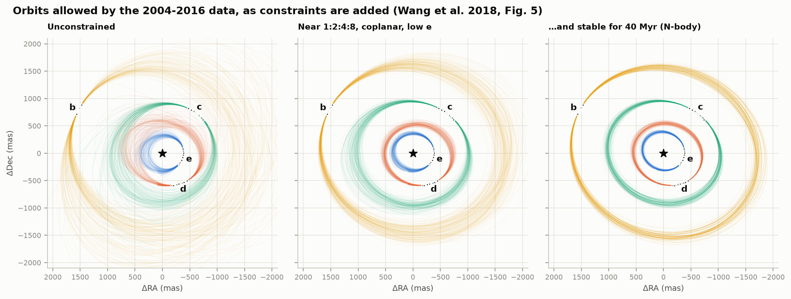

*Orbits allowed by Wang et al.'s data as constraints are added (their Fig. 5). Left: four independent
orbits. Middle: near 1:2:4:8 coplanar, low e. Right: the 191 that also survive 40 Myr.*

### 8. Locked in resonance?

Being near a 2:1 period ratio is not the same as being in resonance. In a 2:1 resonance the inner planet
laps the outer one at the same place on their ellipses every time, so their tugs add up instead of
averaging out. The test is a *resonant angle*: for the pair d:e, θ = λ_e − 2λ_d + ϖ_e, built from the
planets' mean longitudes λ (where each is along its orbit) and the direction of closest approach ϖ. The
angle *librates*, swinging back and forth around a fixed value, when the pair is locked. It
*circulates* through all 360° when it is not.

We recorded the angles of every stable system every 200 years for the full 40 Myr, as Wang et al. did:

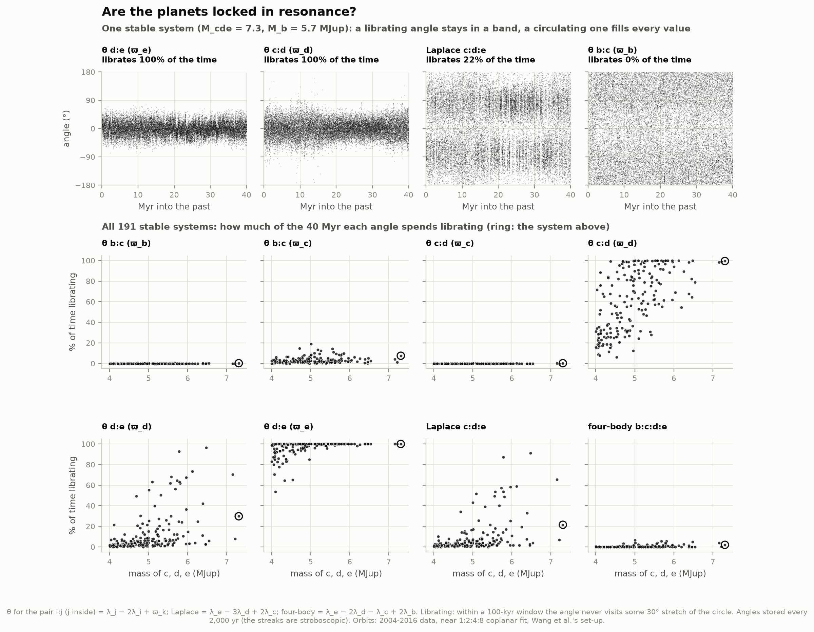

* **d and e are locked.** θ d:e (ϖ_e) librates for at least 90% of the 40 Myr in 90% of the stable
  systems, and in all 14 with c, d and e above 6 MJup. Wang et al.: "above ∼6 MJup, a large majority of
  stable orbits have θ_d:e,e librating 100% of the time".
* **c and d mostly are.** θ c:d (ϖ_d) librates more than half the time in 63% of the systems, and at
  least 90% of the time in 27%. That share is half of those above 6 MJup and all three above 7 MJup.
  Wang et al.: above ∼7 MJup it "is always librating for most stable orbits".
* **The rest are not.** The pairs' other angles mostly circulate. The three-body Laplace angle c:d:e
  librates at least 90% of the time in one system of 191 (0.5%; Wang et al.: 1.2%). Its centre jumps
  between +90° and −90°, as Wang et al. describe. No angle involving b ever librates more than 19% of
  the time, and the four-body angle never more than 7%.

So the system does not need a four-planet resonant chain to last 40 Myr. Two locked pairs (d:e, and
mostly c:d) with a distant, unlocked b are enough. That is Wang et al.'s conclusion, reached here
independently.

### 9. Chaos, and the future

A stable configuration is not clockwork. The planets' mutual tugs make the system chaotic: two copies
that start almost identically drift apart exponentially, until their positions along the orbits have
nothing in common. We measured what that means for "stable for 40 Myr".

**A rounding error as an experiment.** While replaying the stable systems we found that 31 of them had
been read back from our results file with a planet mass wrong in the last digit: a relative change of
2 × 10⁻¹⁶, the smallest step a computer's floating-point number can take (pandas' fast CSV parser; fixed, see How it
works). **15 of those 31 configurations then broke up**, between 3 and 38 Myr into the past.

**On purpose: nudged twins.** We reran every stable system with planet b moved by 10⁻¹² au (15 cm, at
70 au from the star). **99 of the 191 twins (52%) survive the 40 Myr again**; the others break up after a
median 14 Myr. Heavier systems lose more twins: 56% survive at 4–5 MJup, 49% at 5–6, 4 of 11 at 6–7,
none of 3 above 7.

So "stable for 40 Myr" describes a region of orbits, not a single configuration. Within that region, a
system's fate after ~10 Myr is as unpredictable as the weather a month ahead. What can be measured is
the fraction that survives (the statistics of sections 7 and 8), not the fate of any one system.

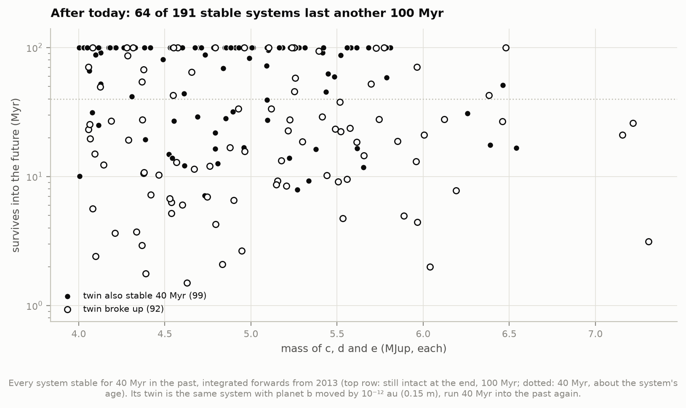

**The next 100 Myr.** Run forwards from 2013, **64 of the 191 stable systems (34%) last another
100 Myr**; half break up within 43 Myr. Survival falls with mass: 39% at 4–5 MJup, 30% at 5–6, 1 of 11
at 6–7, none of 3 above 7. Systems whose twin also survived do much better (53 of the 64 long-lived
ones). Wang et al. found the same trend over 1 Gyr: orbits stable for 1 Gyr up to 6 MJup, and none above
7 MJup lasting 100 Myr. If the planets are as heavy as evolutionary models say, the arrangement we see
today is probably not the system's final one.

### 10. Weighing the planets by the star's wobble

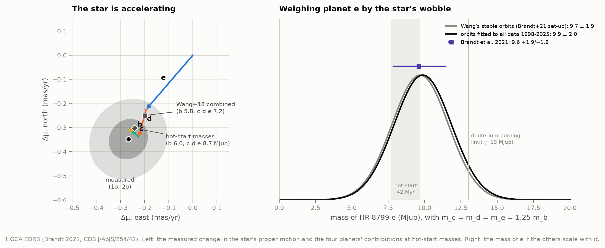

The star circles the system's centre of mass opposite its planets. HR 8799's wobble is far too small to
see in one image (tens of micro-arcseconds), but it shows up in proper motions. The **Hipparcos–Gaia
Catalog of Accelerations** (Brandt 2021) compares the star's proper motion measured by Gaia (2014–2017)
with its long-term motion between the Hipparcos (1991) and Gaia (2016) positions. The difference is
**Δμ = (−0.267, −0.348) ± (0.081, 0.084) mas/yr**, 4.7σ from zero: the star is accelerating.

Given the orbits, the predicted Δμ is linear in the planet masses. Brandt et al. (2021) assumed
c, d and e have equal masses and b 0.8 times theirs, then solved for the mass of e. On Wang et al.'s
stable orbits we reproduce their sensitivities ("Jacobian") to within a few per cent, and **m_e = 9.7 ±
1.9 MJup** (Brandt et al.: 9.6 +1.9/−1.8). On our all-data orbits: **9.9 ± 2.0 MJup** (95% below 13.2).
The hot-start masses from evolutionary models (b 6.0, c d e 8.7 MJup at 42 Myr) predict the measurement
well (χ² = 0.35 for 2 numbers). Wang et al.'s combined dynamical + luminosity masses (5.8 and 7.2)
predict a Δμ 1.4 times too small (χ² = 1.9). The two mass estimates, from stability and from the star's
wobble, pull in opposite directions.

Two papers in 2026 propose a fifth planet inside e. Lagrange et al. (arXiv:2609.20996) use Gaia,
Hipparcos, radial velocities and imaging: a 10–14 MJup companion at ~2–3 au. Nguyen et al.
(arXiv:2609.10507) report a 3σ JWST aperture-masking candidate 150 mas (~6–7 au) from the star.
The HGCA alone cannot test this. The four known planets already explain the measured acceleration, and
an inner companion's contribution could be absorbed by slightly lighter outer planets. HR 8799's Gaia
DR3 RUWE of 1.47 is higher than most comparable stars' (median 1.03) but not unusual: 23% of 826 stars of
the same brightness and colour have higher. It neither requires nor rules out an inner companion.

### 11. β Pictoris b: an orbit seen edge-on

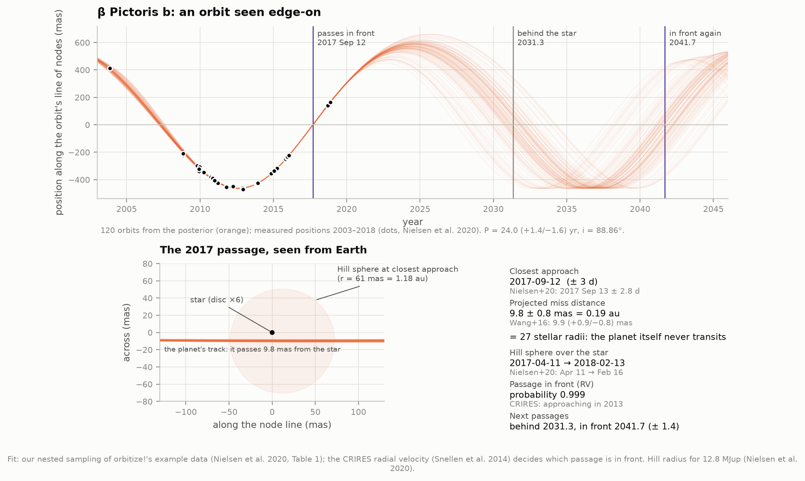

β Pic b orbits a ~25-Myr-old star 19.4 pc away, on an orbit seen almost exactly edge-on (i = 88.86 ±
0.09°). The planet swings back and forth along a line on the sky, passing in front of the star and
behind it. We fitted orbitize!'s example data (Nielsen et al. 2020: 2003–2018) with our own nested
sampler. Imaging alone cannot tell whether the 2017 passage was in front or behind (the mirror orbit).
The planet's radial velocity measured with CRIRES in 2013 (Snellen et al. 2014) can, and it puts the
passage in front with probability 0.999.

| | This work | Nielsen et al. 2020 |
|---|---|---|
| Closest approach | 2017 Sep 12 ± 2.7 d | 2017 Sep 13 ± 2.8 d |
| Projected miss distance | 9.8 ± 0.8 mas = 0.19 au = 26.6 ± 2.1 R★ | 22.7 ± 1.9 R★ (with Hipparcos and Gaia data) |
| Hill sphere in front of the star | 2017 Apr 11 → 2018 Feb 13 (± 2–4 d for a fixed planet mass) | 2017 Apr 11 → 2018 Feb 16 (± 18 d) |
| Orbit | P = 24.0 (+1.4/−1.6) yr, a = 10.1 (+0.4/−0.5) au, e = 0.11 (+0.04/−0.05) | |

The planet itself missed the star by 27 stellar radii: it does not transit. Its Hill sphere did pass in
front of the star for ten months in 2017–2018. The Hill sphere is the region where the planet's gravity
beats the star's tides, where moons or a circumplanetary ring could live. Next: behind the star in
2031.3 (+1.3/−1.5), in front again in 2041.7 (+1.4/−1.6).

### 12. Cross-checks with orbitize!

The atlas spec suggested orbitize! (Blunt et al. 2020), the community's standard code for these fits:
OFTI for short arcs, MCMC otherwise. Our main fits use our own code because of what this project needed:
all four planets at once with their mutual Jacobi geometry, instrument offsets, and Bayesian evidences.
orbitize! served as the cross-check:

* **OFTI** ("Orbits For The Impatient", Blunt et al. 2017) draws random orbits, stretches and rotates each
  one to pass through a measured point, and keeps it with a probability set by how well it fits. For b
  and c its 3,000 orbits fit well (median χ² 12.5 for 28 numbers and 27.6 for 32) and agree with our
  joint fit. **For d and e it fails**: the median χ² of its accepted orbits is 429 for 28 numbers (d) and
  235 for 22 (e). OFTI scales the acceptance by the best fit it has seen so far. With 1-mas GPI points
  that benchmark stays far below the true best fit, so poor orbits get through.
* **orbitize!'s MCMC** (parallel tempering, 5 temperatures × 100 walkers, 5,000 steps per walker) fits d
  and e well: median χ² 30.6 for 28 numbers and 19.1 for 22. For e it agrees with our fit (a = 15.6 vs
  15.1 au). For d it centres on a more eccentric orbit, e = 0.25 ± 0.07, against 0.12 in our fit and
  0.15 ± 0.11 in Wang et al.'s joint MCMC. This is the slow drift along the eccentricity ridge that
  made us sample sky positions and velocities instead of orbital elements.
* **β Pic b**: orbitize!'s MCMC settled on a near-circular 20-year orbit (a = 9.00 ± 0.11 au, e = 0.01).
  It fits worse than ours: best χ² 81.4 against 73.3, for the same 68 numbers computed with orbitize!'s
  own orbit code. It missed the eccentric 24-year solution that the 2018 points after conjunction favour
  (Nielsen et al. 2020). The orbit's tilt and node agree with ours to 0.06°.

Longer chains or more walkers would probably find the better solutions. The lesson is how hard these
short-arc posteriors are to sample, not a flaw in orbitize!.

### Interactive explorer

[`figures/hr8799_orbit_explorer.html`](figures/hr8799_orbit_explorer.html) (offline, 0.4 MB): the four
orbits on the sky with a time slider from 1990 to 2100, play controls, every measurement with its
details on hover, the uncertainty clouds, and a table of where each planet is (separation in mas and
au, position angle) on any date. Light and dark themes.

---

## How it works

1. **Astrometry from the papers' own LaTeX** (`fetch_data.py`, `astrometry.py`). Each table is parsed from
   the arXiv source of its paper, so every number traces to a publication; the parser checks the row
   counts against the papers. All positions become offsets east (ΔRA) and north (ΔDec) of the star in
   milliarcseconds, with their errors and correlations; separation/position-angle pairs are converted
   with their full covariance.

2. **The orbit model** (`kepler.py`, `models.py`). Each planet follows a Keplerian ellipse. Wang et al.'s
   four models and their priors are reproduced exactly: log-uniform semi-major axes (1–100 au), uniform
   eccentricities, isotropic orientations, Gaussian parallax and stellar mass; the 1:2:4:8 models replace
   the outer semi-major axes by period ratios. In the all-data fits the planets also pull the star:
   positions are measured from the star, which circles the barycentre of itself and the inner planets
   (Jacobi coordinates), so planet masses (uniform 1–20 MJup) enter the fit. Those fits use the Gaia DR3
   parallax (24.462 ± 0.10 mas, error widened for a G = 5.8 star) and a broad stellar-mass prior
   (1.5 ± 0.3 M☉).

3. **Sampling what the data measure** (`models.py`). The 2004–2016 data cover 2–15% of these orbits; the
   data pin down where each planet is on the sky and how fast it moves, but hardly its depth along the
   line of sight. In orbital elements the allowed orbits form a thin curved ridge, and our first sampler
   runs found different pieces of it from one run to the next. So we sample each planet's sky position
   and sky velocity on 2013 Jul 27 (plus depth and radial velocity, or one shared plane), convert to
   elements, and carry Wang's priors over exactly with the phase-space Jacobian of Delaunay variables. The
   posterior becomes a compact blob, and repeat runs agree to within 0.1 in ln Z.

4. **Instrument calibration** (`models.py`). Every instrument gets a north-angle rotation and a
   plate-scale error with a Gaussian prior from its own published calibration, plus an extra scatter
   ("jitter") added in quadrature. The offsets enter the model linearly, so they are integrated out
   analytically at every likelihood call and drawn back afterwards for the calibration figure.

5. **Nested sampling** (`fits.py`, `fastorbit.py`). [dynesty](https://dynesty.readthedocs.io) with 1,000
   live points and random-slice moves, run to Δln Z = 0.05. It returns posterior samples *and* the
   Bayesian evidence Z, which is what model comparison needs. The likelihood is compiled with numba
   (3–20 µs per call), so a fit takes 5–25 minutes on one core; the 16 fits run side by side.
   Checks (`diagnostics.py`): repeat runs of two models (ln Z within 0.07, every parameter within 0.08σ);
   a "nesting" test that no fit missed its best-fitting region (a local optimiser started from every
   model's best samples finds maxima within 2–4 in ln L of the posterior's best, 5–7 for the
   31–37-parameter all-data fits); and the posterior staying at least 7σ from the edges of the
   sampled box.

6. **N-body stability** (`stability.py`). Wang et al.'s set-up, reproduced: REBOUND's WHFast integrator
   with a fixed step of 1% of e's orbit, started on 2013 Nov 13 and run 40 Myr into the past (velocities
   reversed). A system is unstable if any two planets come within the mutual Hill radius of d and e, or a
   planet goes beyond 500 au. Masses: c, d, e equal and uniform in 4–11 MJup, b uniform from 3 MJup to
   that. Each draw pairs a random posterior orbit with random masses. The stable systems are replayed
   bit-for-bit with snapshots every 200 years for the resonant angles (`keep_unsynchronized` keeps the
   snapshots from perturbing a chaotic trajectory, and the results files are read back with exact
   round-trip float parsing; section 9 shows why both matter), again with planet b nudged by 10⁻¹² au,
   and forwards 100 Myr.

7. **Libration test** (`stability.py`). In each 100-kyr window (500 snapshots) we sort the angle's
   values around the circle; if they leave a gap wider than 30°, the angle librated in that window. The
   libration fraction is the share of the 400 windows in which it did. Wang et al. used a Fourier-based
   algorithm. The idea is the same, the details are not.

8. **The star's wobble** (`hgca.py`). The Hipparcos–Gaia accelerations are differences between proper
   motions averaged over different windows, so the reflex orbit is averaged over each mission window
   (9 epochs across each) before differencing. The prediction is linear in the planet masses.

9. **orbitize! cross-checks** (`orbitize_fits.py`). OFTI and parallel-tempered MCMC fits of single
   planets, as the atlas spec suggested, and of β Pic b.

`test_physics.py` checks the machinery on cases with known answers (8 tests): our sky positions against
orbitize!'s for random orbits; velocities as derivatives of positions; REBOUND state vectors reproducing
sky positions; the test-particle limit following Kepler; the sky-frame conventions; the inverse map from
state vectors to elements; the phase-space Jacobians (by Monte Carlo); and the compiled likelihood
against the plain numpy version.

## Data

All retrieved 6–8 October 2026; `data/manifest.json` records URLs, sizes and SHA-256 hashes.

* **Astrometry**, parsed from the arXiv sources: Konopacky et al. 2016 (AJ 152, 28; Keck/NIRC2),
  Wang et al. 2018 (AJ 156, 192; GPI), De Rosa et al. 2020 (JATIS 6, 015006; GPI recalibrated),
  Zurlo et al. 2022 (A&A 666, A133; SPHERE and LBT/LUCI), Soummer et al. 2011 (ApJ 741, 55) with the
  epoch from Lafrenière et al. 2009 (ApJ 694, L148) for HST/NICMOS 1998, GRAVITY Collaboration 2019
  (A&A 623, L11), Balmer et al. 2025 (AJ 169, 209; JWST/NIRCam) and Nguyen et al. 2026
  (arXiv:2609.10507; Keck 2025 and JWST/NIRISS AMI).
* **Gaia DR3** (Gaia Collaboration 2023) for HR 8799 and β Pic, and 826 stars of similar brightness and
  colour for the RUWE comparison, from the ESA archive (`https://gea.esac.esa.int/tap-server/tap`).
* **Hipparcos–Gaia Catalog of Accelerations**, EDR3 edition (Brandt 2021, ApJS 254, 42): the HR 8799 row
  from CDS (`J/ApJS/254/42`, via TAPVizieR).
* **β Pic b**: orbitize!'s example file (`betaPic.csv`: Nielsen et al. 2020 compilation plus the
  CRIRES radial velocity of Snellen et al. 2014).
* **whereistheplanet** (Wang et al. 2021): its current HR 8799 posterior (`post_hr8799.hdf5`, 22 kB),
  only as an outside check, never as data.
* Papers used for checks: Wang et al. 2018 (Tables 2 and 3, text), Brandt et al. 2021 (ApJL 915, L16),
  Wang et al. 2016 (AJ 152, 97), Nielsen et al. 2020 (AJ, doi:10.3847/1538-3881/ab5b92), Nasedkin et al.
  2024 (A&A 687, A298), Lagrange et al. 2026 (arXiv:2609.20996). Values are in `published.py`.

About 114 MB is transferred, mostly figure files inside the arXiv source archives. Only the LaTeX is kept
(1.3 MB). The cached fits and simulations grow to about 1.2 GB in `data/cache/`.

Please cite the papers above, Gaia, the HGCA, orbitize!, dynesty and REBOUND when reusing these
results.

## Caveats

* **Keplerian orbits.** The fits treat each orbit as a fixed ellipse. The planets' pulls on each other
  move d and e by up to 0.9 and 2.5 mas over 1998–2025 (section 2). That is below most measurement
  errors but far above GRAVITY's 0.07 mas, and part of why the unpublished GRAVITY points are missed by
  more than their errors. A full N-body orbit fit (as in Zurlo et al. 2022) is the next step.
* **The stability test is Wang et al.'s, with its assumptions**: Keplerian orbits drawn from posteriors
  fitted without dynamics, then integrated. Resonant configurations are a tiny island in that space.
  Dynamical fits that build the resonance in (Goździewski & Migaszewski 2020; Zurlo et al. 2022) find
  stable solutions at higher masses. "Survivors are light" holds for this set-up, not for every possible
  orbit.
* **Stable fractions measure the posterior's tail.** Ours is 2.2 times Wang et al.'s for the same
  set-up, while the stable orbits agree. Rates at the 0.1% level react to small differences in how a
  sampler populates the edges of the posterior. And "stable for 40 Myr" is itself fragile for these
  chaotic systems (section 9).
* **Bayes factors depend on the priors** (Wang et al.'s, used throughout). They reward models for not
  wasting prior volume, which is not the same as being physically right.
* **Instrument calibration** is one rotation and one scale per instrument. Real calibrations drift
  between epochs, which the fitted extra scatter partly absorbs. SPHERE's IRDIS and IFS observe at the
  same time and share the star's centre; we treat them as independent.
* **Hot-start masses depend on the age.** We use Wang et al.'s 42 ± 5 Myr. Recent studies argue for
  a younger system (< 30 Myr; see Lagrange et al. 2026), which would lower the model masses and ease the
  tension with stability.
* **Masses from the astrometry are weak.** Planet masses enter the fits only through the star's reflex
  motion, and their posteriors stay close to the 1–20 MJup prior (e slightly lower, 6.0 +5.8/−3.6). The
  HGCA mass assumes Brandt et al.'s fixed mass ratios.
* **Outside checks.** whereistheplanet's posterior has 20 samples. The GRAVITY 2019–2022 points come
  from its data file without documentation of their reduction. Nasedkin et al. (2024) deferred the
  GRAVITY astrometry to Chavez et al. (in prep.), and we found no publication of it.
* **β Pic b** uses relative astrometry plus one radial velocity. Nielsen et al.'s headline numbers also
  use Hipparcos and Gaia, and the Hill radius uses their mass (12.8 MJup).
* **Libration** is judged by our gap test, not Wang et al.'s Fourier-based algorithm. The 30° threshold
  and 100-kyr window are choices; the angles are stored every 200 yr as theirs were.

## Deviations from the atlas spec

* **The main fits are our own**, nested sampling of all four planets together, with orbitize! as the
  cross-check. A joint fit was needed for the Jacobi geometry, the instrument offsets and the Bayesian
  evidences. orbitize!'s OFTI, which the spec suggested for short arcs, fails on 1-mas data (d and e).
* **Download**: ~114 MB transferred (the arXiv source archives carry their figures), 1.3 MB kept, not
  <1 MB. The cached fits and simulations take ~1.2 GB.
* **Periods**: b takes ~500 years (509 ± 28 with all data) and e ~56 years, against the spec's "about
  450" and "about 45".
* **HGCA** from CDS, not the copy bundled with orbitize!, which lacks the RA–Dec correlations.
* **Added**: Bayesian evidences, the instrument calibrations, a prediction test against 77 later
  positions, a blind test with unpublished GRAVITY data, the HGCA mass, resonances, chaos and future
  stability, the stability of the all-data orbits, the interactive explorer.

## Running it

```bash
cd 46-hr8799-orbits
../.venv/bin/python run.py                   # everything from scratch (~1-2 days of CPU on 12 cores)
../.venv/bin/python run.py --stage fits      # one stage: data, fits, orbitize, stability, betapic, prediction, hgca, figures, animation
../.venv/bin/python report.py                # results.json, figures, animation and explorer from the caches
../.venv/bin/python report.py figures        # figures only
../.venv/bin/python test_physics.py          # 8 checks
```

Every expensive step is cached in `data/cache/` and resumes where it stopped: 16 nested-sampling fits
(5–25 min each on one core; `run.py` runs six side by side), orbitize! (OFTI ~1 h for b, MCMC ~2 h per
planet), and 470,000 N-body draws (~0.3 CPU-s each for Wang's orbits, 2.6 s for the all-data
orbits, ~90 s for each stable one). With warm caches `report.py` takes about 2 minutes.

## Files

| File | Purpose |
|---|---|
| `config.py` | paths, data sources, priors, model and N-body settings |
| `fetch_data.py` | downloads with a manifest |
| `astrometry.py` | parsers for each paper's table → `data/derived/astrometry.csv` |
| `kepler.py`, `fastorbit.py` | Kepler solver, sky positions, Jacobi offsets; the compiled likelihood |
| `models.py` | the four orbit models, priors, state-vector sampling, instrument offsets |
| `fits.py`, `diagnostics.py` | nested-sampling fits and their checks |
| `orbitize_fits.py` | orbitize! OFTI and MCMC cross-checks |
| `predict.py` | predicted positions and the prediction test |
| `stability.py` | REBOUND campaigns, resonant angles, twins, the future |
| `hgca.py` | the star's reflex motion against the Hipparcos–Gaia accelerations |
| `betapic.py` | β Pic b |
| `published.py` | published values we compare with |
| `analysis.py`, `report.py` | every number → `data/results.json`, summary |
| `figures.py`, `plotstyle.py`, `animate.py`, `interactive.py` | figures, the animation, the explorer |
| `run.py`, `test_physics.py` | entry point and tests |
