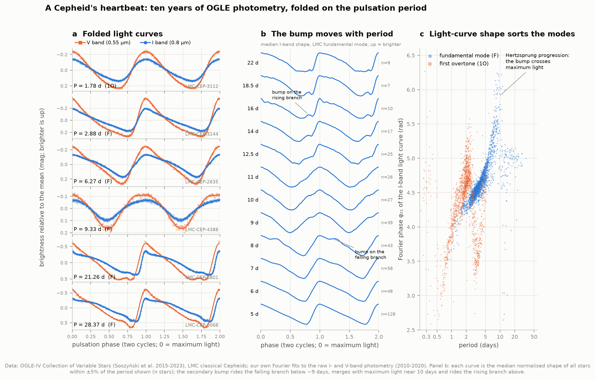
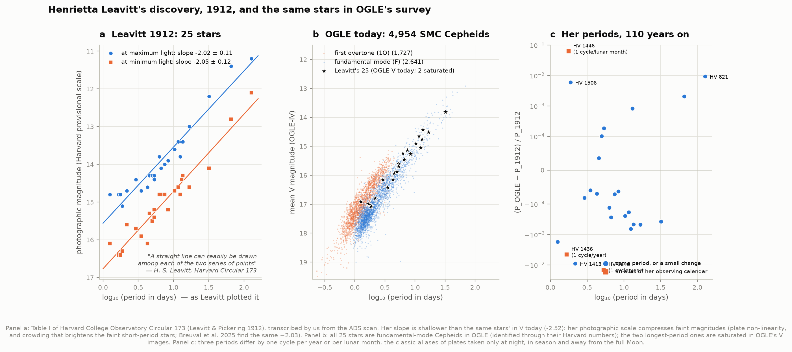
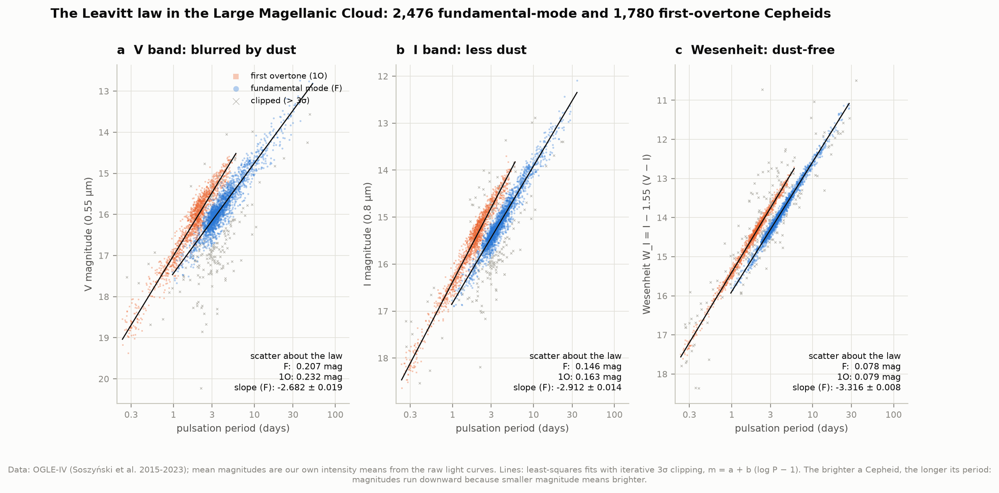
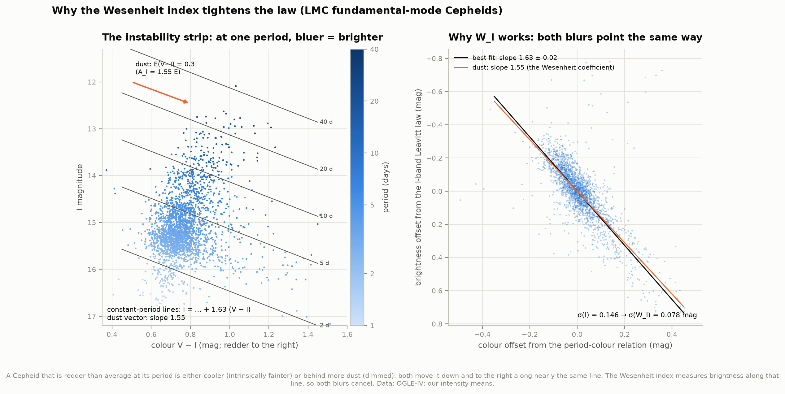
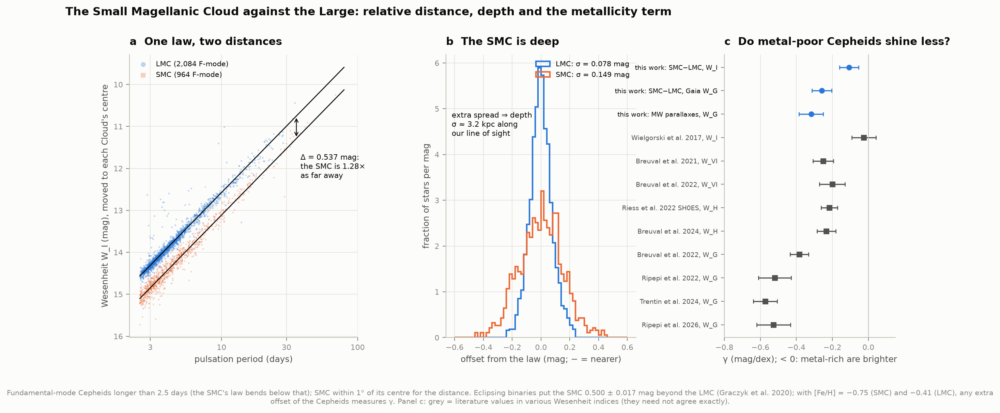
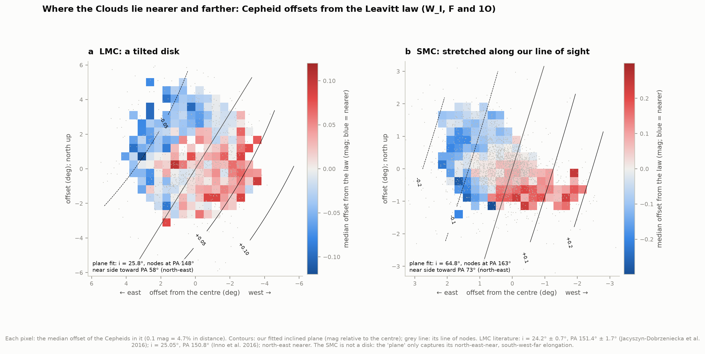
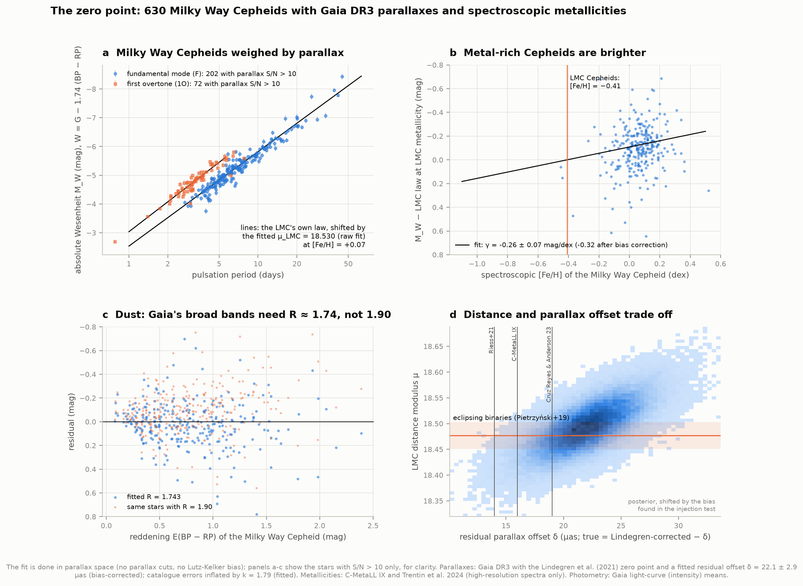
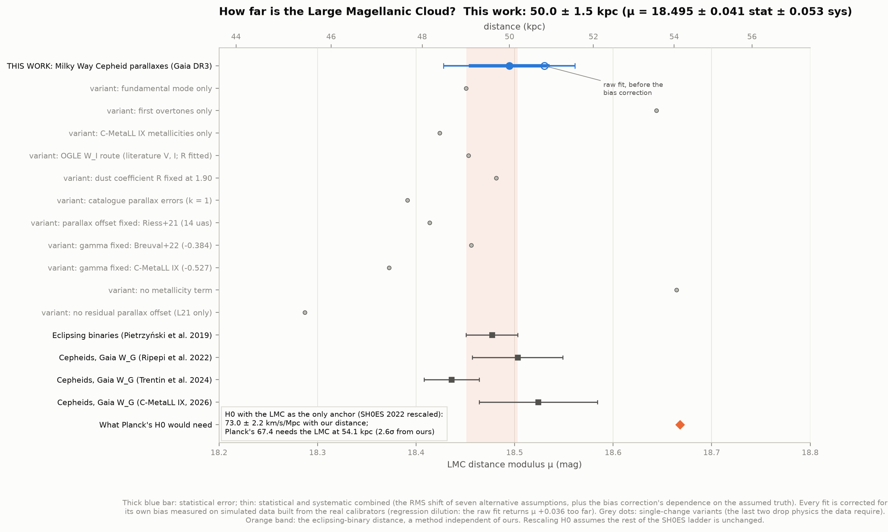
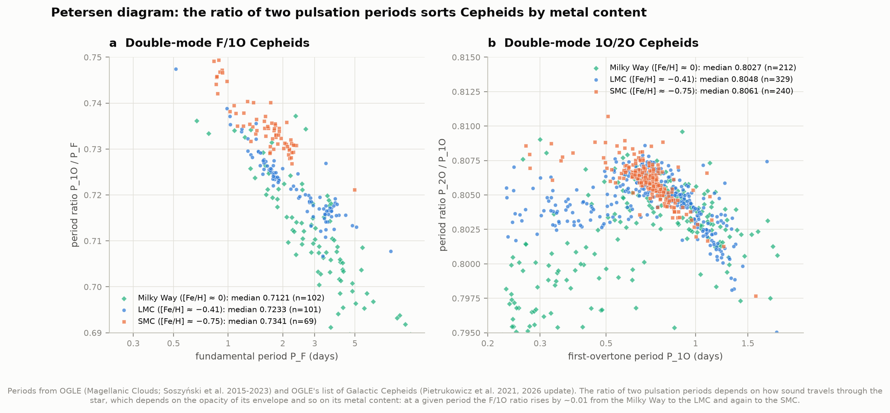

# B4 — Cepheids and the Leavitt law: the first step of the distance ladder

**Some pulsating stars reveal their true brightness through their period. Can we reproduce
Henrietta Leavitt's 1912 discovery with ~9,700 stars, and use it to measure the distance to another
galaxy?**

Yes. From OGLE's ten years of photometry of **9,667 Cepheids** in the Magellanic Clouds, we measured
every star's period and mean brightness ourselves and recovered the law Leavitt found among 25 stars:
the longer a Cepheid's period, the more luminous it is. In the reddening-free Wesenheit index the Large
Magellanic Cloud's Cepheids follow it with a scatter of only **0.078 mag** (7% in distance per star),
down from 0.21 mag in visible light. Our fits match the OGLE team's published ones on the same data to
the third decimal.

To turn the law into a ruler we calibrated it on **630 Milky Way Cepheids** whose distances Gaia
measured by parallax, using their spectroscopic metallicities, and found the Large Magellanic Cloud
(LMC) at

> **50.0 ± 1.5 kpc (about 163,000 light-years)**, distance modulus μ = 18.495 ± 0.041 (stat) ± 0.053 (sys)

against **49.59 ± 0.54 kpc** (18.477 ± 0.026) from eclipsing binaries (Pietrzyński et al. 2019), a
method independent of ours: a difference of 0.2σ. Rescaling the SH0ES ladder to our LMC distance gives
**H₀ = 73.0 ± 2.2 km/s/Mpc**; Planck's 67.4 would need the LMC at 54.1 kpc, 2.6σ beyond our result.
The first rung of the ladder cannot hide the Hubble tension.

Along the way the Cepheids map the **tilted disk of the LMC** (inclination 25.8° ± 1.0°, north-east
side nearer, as found by OGLE's own team) and the **deep Small Magellanic Cloud** (3.2 kpc deep, its
north-east 0.22 mag nearer than its south-west); they show that **metal-poor Cepheids are fainter**,
measured two independent ways; and Leavitt's own 25 stars, all identified in OGLE, reveal that three of
her periods were **aliases of her observing calendar** — off by exactly one cycle per year or per lunar
month.

| Check | This work | Published |
|---|---|---|
| LMC Wesenheit law, fundamental mode: W_I = a log P + b | −3.316 ± 0.008 log P + 15.890, σ 0.078 | −3.314 log P + 15.888, σ 0.077 (Soszyński et al. 2015, Table 2) |
| Leavitt's 25 stars, slope of (max+min)/2 | −2.033 ± 0.098 | −2.033 ± 0.098 (Breuval et al. 2025) |
| LMC inclination / line of nodes | 25.8° ± 1.0° / 148° ± 2° | 24.2° ± 0.7° / 151.4° ± 1.7° (Jacyszyn-Dobrzeniecka et al. 2016) |
| SMC − LMC distance modulus (W_I) | 0.537 ± 0.006 | 0.500 ± 0.017 (eclipsing binaries; Graczyk et al. 2020) |
| LMC distance modulus | 18.495 ± 0.067 | 18.477 ± 0.026 (Pietrzyński et al. 2019) |
| Residual Gaia parallax offset for Cepheids | 22.1 ± 2.9 µas | 14 ± 6 (Riess+21), 19 ± 3 (Cruz Reyes & Anderson 23), 16 ± 4 (C-MetaLL IX) |
| Metallicity term in Gaia's Wesenheit | −0.32 ± 0.07 mag/dex | −0.38 ± 0.05 (Breuval et al. 2022) |

---

## Results

### 1. A Cepheid's heartbeat



A classical Cepheid is a yellow supergiant of 4–20 solar masses, whose outer layers swell and
shrink in a self-sustaining rhythm: a layer of partly ionised helium traps heat when compressed and
releases it when expanded, like a valve (the "κ mechanism"). The light curve is the classic sawtooth:
a fast rise to maximum and a slow decline (panel a).

**We measured every period blind.** For each of the 9,667 OGLE light curves (median 655 I-band points,
2010–2020) a Lomb–Scargle periodogram found the strongest period between 0.2 and 250 days, which a
Fourier-series fit then refined. The blind period equals OGLE's for **99.85–99.96%** of the single-mode
stars, and our intensity-mean magnitudes (the magnitude of the average *flux*, which the Leavitt law is
built on) match OGLE's to **0.0004 mag** (median difference 0.0000). The handful of failures are sparse
light curves where the search locked onto a one-day alias, and OGLE-LMC-CEP-0227 — the famous
eclipsing-binary Cepheid whose eclipses (Pietrzyński et al. 2010) out-shout its pulsation.

**The Hertzsprung progression** (panel b): many Cepheids show a secondary bump, caused by a resonance
between the fundamental mode and the second overtone, whose periods are in a 2:1 ratio near 10 days
(Simon & Schmidt 1976). Its timing depends on period: at 6–8 days the bump rides the
falling branch, near 10 days it merges with maximum light, and above ~12 days it rides the rising branch.
The Fourier phase φ₂₁ (panel c) shows the same progression as a sharp jump near 10 days, and separates
fundamental-mode from first-overtone pulsators, whose light curves are more sinusoidal. The second
Fourier amplitude ratio R₂₁ bottoms out at **11.8 days** in our I-band fits (published LMC centre of the
progression: 10.5 ± 0.5 d, Beaulieu 1998; 11.2 ± 0.8 d, Welch et al. 1997; models 11.2 ± 0.5 d, Bono et
al. 2000).

### 2. Leavitt's 25 stars



In 1912 Henrietta Swan Leavitt published the periods of 25 variable stars in the Small Magellanic Cloud
(Harvard College Observatory Circular 173), measured on photographic plates. "Since the variables are
probably at nearly the same distance from the Earth, their periods are apparently associated with their
actual emission of light." We transcribed her Table I from the scan (checked digit by digit, and
independently confirmed by a second reading and by Shapley 1918) and refitted her law:

* slope **−2.02 ± 0.11** mag per dex at maximum light and −2.05 ± 0.12 at minimum. Her own words:
  "the logarithm of the period increases by about 0.48 for each increase of one magnitude", i.e. −2.08;
* all 25 stars are fundamental-mode Cepheids in OGLE, found through the Harvard numbers OGLE lists. The
  same 23 unsaturated stars give a steeper slope today in V, **−2.52 ± 0.11**: her photographic scale
  compressed faint magnitudes (for these stars, 0.72 photographic mag per V mag), from plate
  non-linearity and crowding that brightens the faint, short-period stars (Breuval et al. 2025, who
  reconstructed her light curves from her notebooks, find the same −2.03);
* **her periods, 110 years on** (panel c): 15 of 25 agree with OGLE's to within 5 units of her last
  quoted digit. Three are off by exactly one cycle per year (HV 1436, HV 1646) or one cycle per lunar
  month (HV 1446, 1.762 d vs 1.872 d): aliases of plates taken only at night, in season and away from
  the full Moon. (The 1966 Harvard re-analysis already had HV 1646's correct period, so it was not a real
  change.) HV 821, the longest at 127.0 days, has wandered irregularly since: 127.8 d in the 1966
  Harvard re-analysis, 127.4 d in 1990s–2000s photometry (Berdnikov & Turner 1997; ASAS), 128.1–128.2 d
  from Gaia and OGLE in the 2010s — period instability, not steady evolution.

She also wrote: "It is to be hoped, also, that the parallaxes of some variables of this type may be
measured." Section 7 does exactly that, with Gaia.

### 3. The law in the LMC: V, I and the Wesenheit



Fitted with iterative 3σ clipping (outliers are mostly blends, which look too bright):

| LMC | Fundamental mode (slope, scatter) | First overtone (slope, scatter) |
|---|---|---|
| V | −2.682 ± 0.019, **0.207 mag** | −3.223 ± 0.023, 0.232 mag |
| I | −2.912 ± 0.014, **0.146 mag** | −3.307 ± 0.016, 0.163 mag |
| W_I = I − 1.55 (V − I) | −3.316 ± 0.008, **0.078 mag** | −3.437 ± 0.008, 0.079 mag |

All twelve fits (LMC and SMC, both modes, three bands) agree with the OGLE team's on the same data
(Soszyński et al. 2015, Table 2): slopes within 0.03 except the first-overtone V and I fits (0.05–0.08,
where they include multi-mode stars and we do not), zero points within 0.026 mag, scatters within
0.009 mag. Two modes, two parallel laws: a first-overtone Cepheid pulsates ~1.4 times faster than a
fundamental-mode one of the same luminosity.

Is the law straight? An F-test for a break at 10 days finds one in I (slopes −2.96 and −2.72; p = 10⁻⁴),
weakly in V (p = 0.02) and barely in the Wesenheit (p = 0.014), the same pattern as Ngeow et al. 2009
(p = 0.003, 0.042, 0.055). In the SMC the law bends below 2.5 days (p = 5 × 10⁻¹¹), so SMC
fundamental-mode fits use longer periods, as OGLE does.

### 4. Why the Wesenheit index works



Two things blur the law: the **instability strip** has a width (at one period, a hotter Cepheid is
bluer and brighter), and **dust** dims and reddens stars by different amounts. At fixed period our
Cepheids get fainter by **1.63 ± 0.02 mag per mag of reddening** in V − I; dust makes a star fainter by
1.55 mag per mag of reddening (A_I = 1.55 E(V−I), the coefficient OGLE uses). Both blurs move a star
along nearly the same line in the colour–magnitude diagram, so the Wesenheit index, which measures
brightness along that line, cancels both: σ drops from 0.146 mag in I to 0.078 mag.

### 5. The Small Cloud against the Large



With one slope for both Clouds, the SMC's fundamental-mode Cepheids (P > 2.5 d, within 1° of its centre)
sit **0.537 ± 0.006 mag** fainter: the SMC is 1.28 times as far away. Eclipsing binaries say
0.500 ± 0.017 (Graczyk et al. 2020). The difference measures how a Cepheid's brightness depends on its
metal content: SMC Cepheids have [Fe/H] = −0.75, LMC ones −0.41, so **γ = −0.11 ± 0.05 mag/dex** in W_I.
In Gaia's Wesenheit the same test gives **γ = −0.26 ± 0.05**, agreeing with the Milky Way parallaxes in
section 7 (−0.32 ± 0.07): two independent measurements. The SMC's law is twice as wide as the LMC's
(0.149 vs 0.075 mag over the same periods): the extra spread is depth, **σ ≈ 3.2 kpc** along our line of
sight.

### 6. The shapes of the Clouds



Each Cepheid's offset from the law is a distance offset (0.1 mag = 4.7%). Mapped across the sky they
show the LMC as a **tilted disk**: fitting an inclined plane to 3,772 Cepheids gives inclination
**25.8° ± 1.0°** and line of nodes at position angle **148° ± 2°**, with the **north-east nearer**
(OGLE: 24.2° ± 0.7°, 151.4° ± 1.7°; Inno et al. 2016: 25.05°, 150.8°). Removing the tilt tightens the law
from 0.078 to 0.072 mag. The SMC is no disk: its Cepheids are spread along our line of sight, with the
north-east 0.22 mag (10%) nearer than the south-west, as found by every Cepheid study and by the
eclipsing binaries.

### 7. The zero point: Milky Way Cepheids weighed by Gaia



The Clouds give the law's *shape*; its *zero point* — how luminous a 10-day Cepheid really is — needs
stars whose distances we know independently. We used **630 Milky Way Cepheids** from OGLE's vetted list
of Galactic Cepheids with Gaia DR3 parallaxes (RUWE < 1.4, 6 < G < 19, Lindegren et al. 2021 zero point)
and high-resolution spectroscopic metallicities (C-MetaLL IX and Trentin et al. 2024). To compare like
with like, both the Milky Way and the LMC Cepheids use Gaia's own light-curve-averaged photometry, in
the Gaia Wesenheit W_G = G − R (BP − RP).

The fit is done in **parallax space**: each star's period, magnitude and metallicity predict a
parallax, which is compared with Gaia's. That keeps faint and even negative parallaxes valid, so no
parallax cut biases the sample. The model is the LMC's own law, shifted by the LMC's distance — so
**μ_LMC is a parameter of the Milky Way fit** — plus five things the data told us we need:

* **a metallicity term**, γ = −0.32 ± 0.07 mag/dex after the bias correction below: metal-rich Cepheids
  are brighter (panel b). Without it the LMC comes out at 18.66, 8% farther;
* **a residual parallax offset**: Gaia's corrected parallaxes are still **22.1 ± 2.9 µas** too large for
  these bright stars (panel d), in line with Riess et al. 2021 (14 ± 6), Cruz Reyes & Anderson 2023
  (19 ± 3) and C-MetaLL IX (16 ± 4). Without it the LMC lands at 18.29;
* **the dust coefficient**: the coefficient that cancels dust for these heavily reddened Milky Way stars
  is **R = 1.76 ± 0.03**, not the 1.90 used in the literature (panel c), plus a sightline-to-sightline
  scatter of 0.11 in it (the dust law varies across the Galaxy). With R = 1.90 the residuals of the
  reddest stars tilt bright. In the Milky Way, metal-rich Cepheids are also the most reddened (both are
  inner-Galaxy properties), so γ and R trade off: fixing R = 1.90 moves γ from −0.26 to −0.36 (both
  before the bias correction);
* **inflated parallax errors**: matching the law's intrinsic width (0.070 mag, measured in the LMC)
  requires Gaia's parallax uncertainties for these stars to be **1.79 ± 0.09 times** the catalogue
  values, comparable to the factors Maíz Apellániz et al. (2021) found for bright stars;
* first overtones and fundamental-mode stars agree (offset −0.02 ± 0.02 mag).

**A trap we found in the method.** We tested the fit on 100 simulated data sets built from the real
calibrators (their periods, metallicities, reddenings, parallax errors and zero points), with a known LMC
distance. The fit's error bars are honest (scatter 0.040 vs MCMC error 0.041), but it returns the LMC
**0.036 ± 0.004 mag too far**. The cause is *regression dilution*: in parallax space the model reads
parallax = offset + scale × 10^(−0.2 W), with the LMC's distance in the scale and the photometric
scatter in the input W. Noise in an input flattens a fitted slope, and the free offset absorbs the rest.
With the offset held fixed the bias vanishes (0.004), as it must; at a literature-like truth it is 0.047.
Every fit here — the baseline and each variant — is corrected for its own measured bias, and the bias's
dependence on the assumed truth (0.012) is in the systematic error. (Parallax-space fits are the standard
method; how much this affects published calibrations, most of which have smaller photometric scatter, we
have not tested.)

### 8. How far is the LMC?



| | μ_LMC |
|---|---|
| **This work** (bias-corrected; raw fit 18.530) | **18.495 ± 0.041 ± 0.053 = 50.0 ± 1.5 kpc** |
| Eclipsing binaries (Pietrzyński et al. 2019) | 18.477 ± 0.026 |
| Cepheids, Gaia W_G: Ripepi et al. 2022 / Trentin et al. 2024 / C-MetaLL IX (2026) | 18.503 / 18.436 / 18.524 |

The systematic error is the RMS shift of seven alternative assumptions, each bias-corrected: catalogue
parallax errors (−0.10), Riess et al.'s parallax offset (−0.08), the OGLE V/I route with literature
photometry for the Milky Way stars (−0.04), free intrinsic scatter (+0.02), R = 1.90 (−0.01), no LMC
geometry correction and no crowding cut (+0.003, +0.007); plus the bias correction's dependence on the
truth. Fixing γ at published Gaia-band values instead of fitting it gives 18.46 (γ = −0.384) and 18.37
(γ = −0.527): the metallicity term remains the largest uncertainty in the Cepheid zero point, as in
the literature. Subsamples are consistent: fundamental mode only 18.45, C-MetaLL IX metallicities only
18.42, Gaia's own DCEP class only 18.495, G > 8 only 18.47, BP − RP < 2 only 18.555; first overtones alone
(162 stars, γ poorly constrained) 18.64.

**What it means for H₀.** Every Cepheid-calibrated supernova distance scales with the LMC's: a 0.1 mag
error in this first rung moves H₀ by 4.7%. With the LMC as its only anchor, SH0ES finds 73.59 ± 1.36
(Riess et al. 2022) for μ = 18.477; with our distance, **73.0 ± 2.2**. Planck's 67.4 would need the LMC
at μ = 18.668 (54.1 kpc), 0.17 mag beyond ours, 2.6σ. Like D1, this project sides with the late-universe
value.

### 9. Double-mode Cepheids



Some Cepheids pulsate in two modes at once. Their period ratio depends on how sound travels through the
star, which depends on the opacity of its envelope and so on its metal content. The median F/1O ratio
rises from the Milky Way (**0.7121**, 102 stars) to the LMC (**0.7233**, 101) to the SMC (**0.7341**, 69):
steps of ~0.01, as Beaulieu (1998) described. A metallicity sequence read from timing alone.

### Interactive 3D map

[`figures/cepheids_3d.html`](figures/cepheids_3d.html) (offline, 5 MB): 9,365 Cepheids, each placed at
the distance its own period and Wesenheit magnitude imply with our calibration — the Milky Way's young
disk, the tilted LMC and the SMC stretched along our line of sight. Hover any star for its name, period
and distance.

---

## How it works

1. **Light curves** (`lightcurves.py`): blind Lomb–Scargle search (0.2–250 d, tenfold oversampled),
   Fourier-series refinement with the order chosen by BIC, 4σ clipping, intensity means from the fitted
   model; V light curves fitted at the I-band period. 9,667 stars in ~30 min on 6 cores, checkpointed.
2. **Leavitt laws** (`plfit.py`, `magellanic.py`): ordinary least squares with iterative 3σ clipping,
   pivot at log P = 1; our intensity means replace OGLE's where our period agrees with OGLE's.
3. **Geometry** (`geometry.py`): an inclined plane, D/D₀ = cos i / (cos i cos ρ − sin i sin ρ sin(PA − Θ)),
   fitted to the W_I residuals around the centre (80.05°, −69.30°); errors by bootstrap.
4. **Gaia calibration** (`gaia_cal.py`): the joint parallax-space likelihood described in section 7
   (μ_LMC, γ, δ, R, σ_R, k and the first-overtone offset free; intrinsic scatter fixed at the LMC's;
   predictions corrected for the lognormal mean of the law's magnitude scatter; 4σ outlier clipping;
   emcee, 40 walkers × 9,000 steps). The LMC's law in Gaia bands is fitted once in G and BP − RP, so the
   Wesenheit relation follows exactly for any R. LMC magnitudes are moved to the LMC centre with our
   plane fit, and LMC stars with blended BP/RP photometry (corrected flux excess C* > 3σ; Riello et al.
   2021) are dropped.
5. **Injection tests** (`analysis.injection_test`): 100 simulated calibrator samples for the baseline, 40
   for each variant and 40 at an alternative truth; each fit is corrected by its own mean bias.
6. **Leavitt's table** (`leavitt.py`): transcribed by hand from the ADS scan; OGLE counterparts from the
   Harvard numbers in OGLE's identification file; a test checks that her printed residuals reproduce two
   straight lines (they do, to 0.06 mag, apart from one probable sign misprint).

`test_physics.py` checks the machinery on synthetic inputs with known answers (10 tests: intensity means
against the analytic Bessel-function result, period recovery with OGLE's real time sampling, plane
recovery, the joint fit recovering an injected LMC distance, the Leavitt table's internal consistency,
the alias detector, and more).

## Data

All retrieved 6 October 2026; `data/manifest.json` records URLs, sizes and SHA-256 hashes.

* **OGLE-IV Collection of Variable Stars**, classical Cepheids in the LMC and SMC (Soszyński et al. 2015,
  AcA 65, 297; extended 2017–2023): `https://www.astrouw.edu.pl/ogle/ogle4/OCVS/{lmc,smc}/cep/` —
  catalogue files and V, I light curves (40 MB compressed).
* **OGLE list of Galactic classical Cepheids** (Pietrukowicz et al. 2021, AcA 71, 205; updated March 2026;
  3,640 stars with Gaia DR3 IDs): `https://www.astrouw.edu.pl/ogle/ogle4/OCVS/allGalCep.listID`.
* **Gaia DR3** (Gaia Collaboration 2023; Ripepi et al. 2023 for `vari_cepheid`): the full `vari_cepheid`
  table joined to `gaia_source`, and the astrometry of the Galactic list, from the ESA archive
  (`https://gea.esac.esa.int/tap-server/tap`); OGLE positions matched to Gaia DR3 with CDS xMatch.
  Parallax zero point: Lindegren et al. 2021 via the `gaiadr3-zeropoint` package.
* **Metallicities**: C-MetaLL IX (Ripepi et al. 2026, A&A 708, A216; VizieR J/A+A/708/A216) and Trentin et
  al. 2024 (A&A 681, A65; J/A+A/681/A65, high-resolution entries only).
* **Leavitt & Pickering 1912**, Harvard College Observatory Circular 173, scan from the NASA ADS
  (`https://articles.adsabs.harvard.edu/pdf/1912HarCi.173....1L`).
* Literature values used for checks are in `literature.py`, each with its table or equation.

Please cite OGLE, Gaia, C-MetaLL and the papers above when reusing these results.

## Caveats

* **The metallicity term dominates the zero point.** Our γ comes from Milky Way stars spanning
  −0.8 to +0.5 dex, mostly near solar; extrapolating to the LMC (−0.41) is what fixes μ. Published values
  in Gaia's Wesenheit range from −0.38 to −0.57, and fixing γ at those moves μ by −0.04 to −0.12.
* **The bias correction is model-dependent at the 0.01 mag level** (0.036 vs 0.047 at two truths); a
  hierarchical model with latent true distances would remove the need for it.
* **Gaia photometry of the LMC is crowded**; we drop stars with excess BP/RP flux, which moves μ by only
  0.007, but the bright (G 6–12) and faint (G 13–17) ends of Gaia's photometric calibration are assumed
  consistent.
* **The dust coefficient R** we fit is an effective value for heavily reddened Milky Way Cepheids in
  Gaia's broad bands; it is partly degenerate with γ, because metal-rich Cepheids are also the most
  reddened.
* **Leavitt's magnitudes** are on the Harvard provisional photographic scale; comparisons with modern
  V are qualitative. Her quoted decimals are not formal errors.
* **Single-star distances** in the 3D map carry the law's scatter (~3%, 1.5 kpc at the LMC); the SMC uses
  the LMC's law without a metallicity correction.

## Deviations from the atlas spec

* The OGLE collection now holds **9,667** Magellanic Cepheids (LMC 4,713, SMC 4,954), not 9,649; the
  files are on OGLE's HTTPS server (the spec's FTP path is the same tree).
* The zero point needed more than the spec's Lindegren correction: a fitted residual parallax offset, a
  metallicity term from spectroscopic [Fe/H] (the spec asks to state the assumed term; here it is
  measured), a fitted dust coefficient and inflated parallax errors — and a bias correction for the
  parallax-space method (section 7).
* Download: ~50 MB (210 MB with the light curves unpacked), inside the spec's 5–200 MB.
* The extensions (RR Lyrae, Type II Cepheids) are not done.

## Running it

```bash
cd 47-cepheids
../.venv/bin/python run.py                 # fetch (~50 MB), fit light curves (~30 min on 6 cores, once), analyse, draw
../.venv/bin/python run.py --figures-only  # redraw from the cached analysis
../.venv/bin/python test_physics.py        # 10 checks on synthetic data
```

The first full run also performs ~900 injection-test fits (~5 min); they are cached in `data/cache/`.
With warm caches `run.py` takes about 4 minutes, most of it the MCMC.

## Files

| File | Purpose |
|---|---|
| `fetch_data.py`, `literature_data.py` | downloads with a manifest |
| `ogle.py` | readers for OGLE's fixed-width files |
| `lightcurves.py` | blind periods, Fourier fits, intensity means (parallel, checkpointed) |
| `magellanic.py`, `plfit.py`, `geometry.py` | Leavitt laws, clipping fits, disk geometry |
| `gaia_cal.py` | Gaia photometry/astrometry and the joint parallax-space calibration |
| `leavitt.py` | Leavitt's 1912 Table I and its cross-identification |
| `analysis.py` | every analysis step, injection tests, summary |
| `figures.py`, `interactive.py`, `plotstyle.py` | figures and the 3D page |
| `literature.py` | published numbers we compare with |
| `run.py`, `test_physics.py` | entry point and tests |
